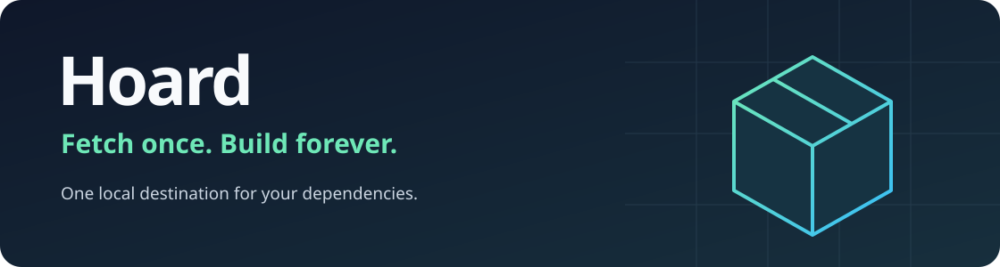

<p align="center"></p>

# Hoard

**Fetch once. Build forever.** Hoard is a lightweight, self-hosted pull-through
cache for software packages. Point your package manager at it with its normal
configuration; Hoard fetches each dependency from the upstream registry once,
verifies it, and serves it locally from then on.

<!-- release-status:start -->
## Status: early alpha

Hoard is built one specification at a time, and every merged spec ships an alpha
release. Hoard does not cache anything yet.

**Working now**

- A minimal Hoard host whose only endpoint is `GET /health`, answering `Healthy` on
  `http://127.0.0.1:8484`. Every other path returns `404`.
- Loopback only. The listener is fixed in code and no environment variable, command-line
  argument or settings file can widen it. There is no configuration yet.
- A multi-arch container image (`linux/amd64`, `linux/arm64`) and self-contained
  executables for `linux-x64`, `linux-arm64`, `osx-arm64` and `win-x64`, with a
  `SHA256SUMS` file. Before each release, every executable and both image architectures
  are smoke-tested on native runners.
- Because the host listens on loopback inside the container, the container is not yet
  reachable from the machine running it.

**Planned**

- Configuration, deployment profiles and opt-in network exposure.
- Metadata store and filesystem artifact storage.
- Registries with safe upstream access.
- The cache core: verified hits and misses, single-flight downloads and streaming.
- NuGet v3 pull-through caching, proven with real `dotnet restore` runs.
- Revalidation, negative caching, rate limits, disk quotas and eviction.
- Admin authentication, the management API, activity and telemetry.
- The web console and setup assistant.
- Other ecosystems (Go, Maven, npm, PyPI, Cargo) after the MVP.
<!-- release-status:end -->

## What it will do

The intended product. None of this ships yet; see the status above.

- **NuGet first.** The MVP is a NuGet v3 cache for public feeds such as
  nuget.org, verified with real `dotnet restore` runs. Go, Maven, npm, PyPI and
  Cargo follow.
- **One product, two profiles.** A personal install is a single container or
  executable bound to loopback, with SQLite and local disk and nothing else to
  run. A team install is the same binary exposed on the network with an
  explicit TLS posture (native HTTPS or a reverse proxy) and built-in admin
  authentication.
- **Trustworthy bytes.** Downloads are staged, checksum-verified and atomically
  committed; partial or corrupt content is never served as a hit.
- **A polished console.** A Next.js management UI, served by the Hoard process
  itself, shows hits, misses, bandwidth saved, cached packages and live activity.

Hoard is a cache, not a private package registry or publishing platform.

## Try the alpha

Releases are on the [releases page](https://github.com/Stonefly-Labs/Hoard-Cld/releases)
(prereleases named `v0.0.N-alpha`). Replace `0.0.1-alpha` below with the version you want.

**Container.** Run it with the same hardening the release smoke test uses. The host
listens on loopback inside the container, so it is checked from a helper container that
shares the container's network namespace:

```bash
docker run -d --name hoard --read-only --cap-drop ALL \
  --security-opt no-new-privileges ghcr.io/stonefly-labs/hoard:0.0.1-alpha
docker run --rm --network container:hoard curlimages/curl -s http://127.0.0.1:8484/health
docker rm -f hoard
```

**Executable.** Download your platform's executable and `SHA256SUMS` from the release,
then verify and run it:

```bash
sha256sum -c SHA256SUMS --ignore-missing      # or: shasum -a 256 -c SHA256SUMS --ignore-missing
chmod +x hoard-0.0.1-alpha-linux-x64
./hoard-0.0.1-alpha-linux-x64 &
curl http://127.0.0.1:8484/health             # Healthy
```

On macOS, also run `xattr -d com.apple.quarantine hoard-0.0.1-alpha-osx-arm64` before
starting it. On Windows, compare `Get-FileHash hoard-0.0.1-alpha-win-x64.exe` with the
matching line in `SHA256SUMS`. The checksums show that a download is intact, not who built
it.

## Build and test

Requires the .NET 10 SDK. See [Development](docs/DEVELOPMENT.md) for the smoke tests.

```bash
dotnet build Hoard.slnx
dotnet test --solution Hoard.slnx
dotnet run --project src/Hoard.Host     # http://127.0.0.1:8484/health
```

## Documentation

| Document | Contents |
| --- | --- |
| [Product vision](docs/PRODUCT_VISION.md) | Why Hoard exists and the experience it aims for |
| [Product charter](docs/PRODUCT_CHARTER.md) | Scope, MVP, non-goals, deployment profiles |
| [Product specification](docs/PRODUCT_SPEC.md) | Cache lifecycle, protocols, API, UI and security requirements |
| [Architecture](docs/ARCHITECTURE.md) | Modular monolith, provider categories, dependency rules |
| [ADR-0001](docs/adr/0001-modular-provider-architecture.md) | Composable modular monolith with vertical slices |
| [ADR-0002](docs/adr/0002-explicit-tls-posture.md) | Explicit TLS posture for network-exposed listeners |
| [Spec backlog](docs/HOARD_SPECKIT_MASTER_BACKLOG.md) | Ordered feature specifications and Spec Kit prompts |
| [Spec progress](docs/spec-progress.md) | Where each spec stands |
| [Development](docs/DEVELOPMENT.md) | Change flow and contributor tooling |
| [Releasing](docs/RELEASING.md) | Versioning, tags, the release pipeline and published artifacts |

## License

[MIT](LICENSE) © Christopher House
