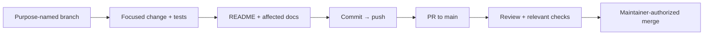

# Development workflow

No application code exists yet. Current technical intent is defined by the
[charter](PRODUCT_CHARTER.md), [vision](PRODUCT_VISION.md),
[product specification](PRODUCT_SPEC.md), [architecture](ARCHITECTURE.md),
and [modular-provider ADR](adr/0001-modular-provider-architecture.md).
Feature work proceeds through GitHub Spec Kit using the
[master backlog](HOARD_SPECKIT_MASTER_BACKLOG.md).

## Everyday change flow

Spec work uses the branch Spec Kit creates (`NNN-short-name`), one PR per
spec; the maintainer merges, and the merge commit is tagged
`v0.0.N-alpha` ([Releasing](RELEASING.md)). Other work uses `feature/`,
`bugfix/`, `chore/`, `docs/`, `refactor/`, `hotfix/`, or `test/` prefixes. Do not force-push shared history. Update the README and
affected docs on the branch before merge. Keep credentials, state, tfvars,
plans, build output, and runtime data out of Git; retain lockfiles.

## Local MCP servers

`.mcp.json` describes MCP servers useful for contributors. They are
contributor tooling, not a Hoard runtime capability.

| Server | Connection | Purpose |
| --- | --- | --- |
| [Microsoft Learn](https://learn.microsoft.com/en-us/training/support/mcp) | Remote HTTP | Official .NET, ASP.NET Core, and Microsoft documentation |
| [Context7](https://context7.com/docs/resources/all-clients) | Remote HTTP | Library-specific documentation and examples |
| [Next.js DevTools](https://github.com/vercel/next-devtools-mcp) | Local stdio via `npx` | Runtime errors, routes, and logs from a Next.js dev server |
| [shadcn](https://ui.shadcn.com/docs/mcp) | Local stdio via `npx` | Component and registry discovery for the console |
| [Playwright](https://github.com/microsoft/playwright-mcp) | Local stdio via `npx` | Browser interaction with an isolated, nonpersistent profile |
| [Azure MCP](https://learn.microsoft.com/en-us/azure/developer/azure-mcp-server/) | Local stdio via `npx` | Optional Azure resource inspection, `--read-only` |
| [Docker MCP Gateway](https://docs.docker.com/ai/mcp-catalog-and-toolkit/mcp-gateway/) | Local stdio via `docker` | Servers enabled in your local Docker MCP Toolkit |
| [NuGet MCP](https://learn.microsoft.com/en-us/nuget/concepts/nuget-mcp-server) | Local stdio via `dnx` | NuGet package discovery and vulnerability guidance |

Node-based servers need Node.js 22+; NuGet MCP needs the .NET 10 SDK (`dnx`);
Docker Gateway needs Docker Desktop with MCP Toolkit. Never add keys or
authorization headers to tracked MCP configuration, and do not send secrets
or private source code to remote documentation services.
