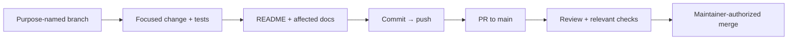

# Development workflow

Today the code is a health-only host, an empty `Hoard.Core` package, their
tests and the delivery pipeline. Technical intent is defined by the
[charter](PRODUCT_CHARTER.md), [vision](PRODUCT_VISION.md),
[product specification](PRODUCT_SPEC.md), [architecture](ARCHITECTURE.md),
and [modular-provider ADR](adr/0001-modular-provider-architecture.md).
Feature work proceeds through GitHub Spec Kit using the
[master backlog](HOARD_SPECKIT_MASTER_BACKLOG.md).

## Build, test and smoke

Prerequisites: the .NET 10 SDK (`global.json`), Docker with Buildx, bash and `lsof`.

```bash
dotnet build Hoard.slnx                 # warnings are errors
dotnet test --solution Hoard.slnx       # architecture, host and release-script tests
dotnet run --project src/Hoard.Host     # http://127.0.0.1:8484/health
```

`global.json` runs `dotnet test` on Microsoft.Testing.Platform, which takes the
solution through `--solution`. The architecture tests in `tests/Hoard.Architecture.Tests`
read `Hoard.Core`'s restore graph. They fail if Core references `Hoard.Persistence.*`,
`Hoard.Storage.*`, `Hoard.Protocols.*`, `Hoard.Identity.*`, EF Core, or any `Hoard.*`
project other than `Hoard.Abstractions`, directly or transitively.

The smoke scripts test packaged artifacts the way CI does. The binary smoke needs an
executable for your machine's RID; the image needs a Linux executable in `out/bin` for
Docker's architecture. On an Apple silicon Mac:

```bash
# Executable for this machine (osx-arm64; linux-x64 on an x64 Linux machine, ...)
dotnet publish src/Hoard.Host -c Release -r osx-arm64 --self-contained \
  -p:PublishSingleFile=true -p:DebugType=none -o out/publish-native
eng/smoke/smoke-binary.sh out/publish-native/Hoard.Host

# Linux executable for the image (linux-arm64 here; linux-x64 with --platform linux/amd64)
dotnet publish src/Hoard.Host -c Release -r linux-arm64 --self-contained \
  -p:PublishSingleFile=true -p:DebugType=none -o out/publish
mkdir -p out/bin && cp out/publish/Hoard.Host out/bin/hoard-0.0.0-local-linux-arm64
docker buildx build -f deploy/docker/Dockerfile --platform linux/arm64 \
  --build-context bin=out/bin -t hoard:local --load .
eng/smoke/smoke-container.sh hoard:local
```

Each script checks `200 Healthy` within 30 s, `404` elsewhere, and that every listener
is on loopback, both normally and when asked for wider bindings: by environment variables
and by a `--urls` command-line argument, and for the binary also by an `appsettings.json`
next to it. The container script also checks the image user is not root and that a
neighbouring container gets connection refused.

Every PR gets two checks from `ci.yml`, `build-test` and `smoke`. PRs that change the
pipeline also dry-run the release workflow ([Releasing](RELEASING.md)).

## Everyday change flow



Spec work is driven by the `drive-speckit` skill on a `feature/NNN-<slug>`
branch (`NNN` = backlog spec number), one PR per spec; progress lives in
[spec-progress.md](spec-progress.md). The maintainer merges, and the merge
commit is tagged `v0.0.N-alpha` ([Releasing](RELEASING.md)). Other work uses `feature/`,
`bugfix/`, `chore/`, `docs/`, `refactor/`, `hotfix/`, or `test/` prefixes. Do not force-push shared history. Update the README and
affected docs on the branch before merge. Keep credentials, state, tfvars,
plans, build output, and runtime data out of Git; retain lockfiles.

## Local MCP servers

`.mcp.json` describes MCP servers useful for contributors. They are
contributor tooling, not a Hoard runtime capability.

| Server | Connection | Purpose |
| --- | --- | --- |
| [Microsoft Learn](https://learn.microsoft.com/en-us/training/support/mcp) | Remote HTTP | Official .NET, ASP.NET Core, and Microsoft documentation |
| [Context7](https://context7.com/docs/resources/all-clients) | Remote HTTP | Library-specific documentation and examples |
| [Next.js DevTools](https://github.com/vercel/next-devtools-mcp) | Local stdio via `npx` | Runtime errors, routes, and logs from a Next.js dev server |
| [shadcn](https://ui.shadcn.com/docs/mcp) | Local stdio via `npx` | Component and registry discovery for the console |
| [Playwright](https://github.com/microsoft/playwright-mcp) | Local stdio via `npx` | Browser interaction with an isolated, nonpersistent profile |
| [Azure MCP](https://learn.microsoft.com/en-us/azure/developer/azure-mcp-server/) | Local stdio via `npx` | Optional Azure resource inspection, `--read-only` |
| [Docker MCP Gateway](https://docs.docker.com/ai/mcp-catalog-and-toolkit/mcp-gateway/) | Local stdio via `docker` | Servers enabled in your local Docker MCP Toolkit |
| [NuGet MCP](https://learn.microsoft.com/en-us/nuget/concepts/nuget-mcp-server) | Local stdio via `dnx` | NuGet package discovery and vulnerability guidance |

Node-based servers need Node.js 22+; NuGet MCP needs the .NET 10 SDK (`dnx`);
Docker Gateway needs Docker Desktop with MCP Toolkit. Never add keys or
authorization headers to tracked MCP configuration, and do not send secrets
or private source code to remote documentation services.
