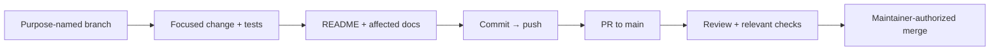

# Development workflow

Today the code is a configurable host with health endpoints, an empty `Hoard.Core`
package, their tests and the delivery pipeline. Technical intent is defined by the
[charter](PRODUCT_CHARTER.md), [vision](PRODUCT_VISION.md),
[product specification](PRODUCT_SPEC.md), [architecture](ARCHITECTURE.md),
and [modular-provider ADR](adr/0001-modular-provider-architecture.md).
Feature work proceeds through GitHub Spec Kit using the
[master backlog](HOARD_SPECKIT_MASTER_BACKLOG.md).

## Build, test and smoke

Prerequisites: the .NET 10 SDK (`global.json`), Docker with Buildx, bash and `lsof`.

```bash
dotnet build Hoard.slnx                 # warnings are errors
dotnet test --solution Hoard.slnx       # architecture, host and release-script tests
dotnet run --project src/Hoard.Host     # http://127.0.0.1:8484/health/ready; data in ./data
```

`global.json` runs `dotnet test` on Microsoft.Testing.Platform, which takes the
solution through `--solution`. The architecture tests in `tests/Hoard.Architecture.Tests`
read `Hoard.Core`'s restore graph. They fail if Core references `Hoard.Persistence.*`,
`Hoard.Storage.*`, `Hoard.Protocols.*`, `Hoard.Identity.*`, EF Core, or any `Hoard.*`
project other than `Hoard.Abstractions`, directly or transitively.

The smoke scripts test packaged artifacts the way CI does. The binary smoke needs an
executable for your machine's RID; the image needs a Linux executable in `out/bin` for
Docker's architecture. On an Apple silicon Mac:

```bash
# Executable for this machine (osx-arm64; linux-x64 on an x64 Linux machine, ...)
dotnet publish src/Hoard.Host -c Release -r osx-arm64 --self-contained \
  -p:PublishSingleFile=true -p:DebugType=none -o out/publish-native
eng/smoke/smoke-binary.sh out/publish-native/Hoard.Host

# Linux executable for the image (linux-arm64 here; linux-x64 with --platform linux/amd64)
dotnet publish src/Hoard.Host -c Release -r linux-arm64 --self-contained \
  -p:PublishSingleFile=true -p:DebugType=none -o out/publish
mkdir -p out/bin && cp out/publish/Hoard.Host out/bin/hoard-0.0.0-local-linux-arm64
docker buildx build -f deploy/docker/Dockerfile --platform linux/arm64 \
  --build-context bin=out/bin -t hoard:local --load .
eng/smoke/smoke-container.sh hoard:local
```

What each script proves:

- **`smoke-binary.sh`** runs the executable on port 8484. By default, under a hostile
  framework environment (`ASPNETCORE_URLS`, `Kestrel__Endpoints__…`) and with a hostile
  `appsettings.json` next to it, `/health/live` and `/health/ready` answer `200 Healthy`
  within 30 s, `/health` and other paths answer `404`, and the listeners are exactly
  `127.0.0.1:8484` (plus `[::1]:8484` where the machine has IPv6). A `--urls` argument and
  `--listen:address 0.0.0.0` without a TLS mode are refused with exit 2 and nothing
  listening. `--listen:address 0.0.0.0 --listen:tls:mode proxy` listens on `0.0.0.0:8484`
  only and logs the exposure warning. TLS mode `https` with an `openssl`-generated PEM pair
  serves HTTPS on loopback and no plain HTTP, and a certificate with the wrong key is
  refused.
- **`smoke-container.sh`** checks that the image user and the running process are not root.
  It then runs the image `--read-only` with all capabilities dropped. By default and under
  a hostile framework environment, Hoard is healthy, reachable from a neighbouring container
  on the bridge, logs the exposure warning and listens only on `0.0.0.0:8484`. A `--urls`
  argument is refused. `-e HOARD_LISTEN__ADDRESS=127.0.0.1` listens on loopback only and is
  refused from the bridge. A named volume at `/data` is owned by the app user, `docker stop`
  exits 0 in under 10 s, and the volume's content survives recreating the container. HTTPS
  with a mounted PEM answers on the bridge with no plain HTTP. Docker's embedded DNS
  listener (`127.0.0.11`) is the one socket the listener check ignores.

The process tests in `tests/Hoard.Host.Tests/Process` cover stop signals with `SIGTERM`
(exit 0 within 10 s). They skip it on Windows, and CI runs `dotnet test` on Linux only, so a
clean Ctrl+C stop on Windows is not tested automatically.

### Local HTTPS

```bash
openssl req -x509 -newkey rsa:2048 -nodes -keyout key.pem -out cert.pem -days 30 -subj /CN=localhost
dotnet run --project src/Hoard.Host -- --listen:tls:mode https \
  --listen:tls:certificateFile "$PWD/cert.pem" --listen:tls:keyFile "$PWD/key.pem"
curl -k https://127.0.0.1:8484/health/ready
```

## Configuration

Hoard reads its options from three sources. When an option is set in more than one, the
command line wins over the environment, which wins over the file:

1. **Command line:** `--name value` or `--name=value`. After a known option the next
   argument is always its value, even if it starts with `-`, `--` or `/`. Positional
   arguments, single-dash and `/` switches and repeated options are errors.
2. **Environment:** `HOARD_*` variables. Every other variable is ignored.
3. **File:** JSON (comments allowed, no trailing commas), from `--config <path>` or
   `HOARD_CONFIG`, otherwise `./hoard.json` if it exists. A named file must exist; an empty
   file or `{}` counts as no file. Files are limited to 1 MiB.

Names match ignoring case. Framework settings (`ASPNETCORE_*`, `DOTNET_*`, `Kestrel__*`,
`appsettings*.json`) are never read, and a framework argument such as `--urls` is an
unknown option.

| File key | Environment | Command line | Default | Values |
| --- | --- | --- | --- | --- |
| `listen.address` | `HOARD_LISTEN__ADDRESS` | `--listen:address` | `localhost` | `localhost` or an IPv4/IPv6 address written in full (`0.0.0.0`, `::`, `10.1.2.3`); no host names, brackets, scopes or IPv4-mapped forms |
| `listen.port` | `HOARD_LISTEN__PORT` | `--listen:port` | `8484` | 1–65535 (a number or a string in the file) |
| `listen.tls.mode` | `HOARD_LISTEN__TLS__MODE` | `--listen:tls:mode` | none | `https` or `proxy`; required for any non-loopback address |
| `listen.tls.certificateFile` | `HOARD_LISTEN__TLS__CERTIFICATEFILE` | `--listen:tls:certificateFile` | none | PEM (certificate and key, or certificate only with `keyFile`) or PKCS#12/PFX; `https` only |
| `listen.tls.keyFile` | `HOARD_LISTEN__TLS__KEYFILE` | `--listen:tls:keyFile` | none | PEM key for a PEM certificate |
| `listen.tls.password` | `HOARD_LISTEN__TLS__PASSWORD` | not accepted | none | PFX password or encrypted-key password |
| `data.path` | `HOARD_DATA__PATH` | `--data:path` | `./data` | a directory; created with mode 0700 on Unix if missing |
| (not a file key) | `HOARD_CONFIG` | `--config` | `./hoard.json` if present | path to the config file |

Relative paths resolve against the working directory. In the container image,
`HOARD_LISTEN__ADDRESS=0.0.0.0`, `HOARD_LISTEN__TLS__MODE=proxy` and `HOARD_DATA__PATH=/data`
are set in the environment, so only `-e HOARD_…` and command-line arguments override them; a
mounted `hoard.json` does not. The startup summary marks a value that overrides the file
with `overrides hoard.json`.

**Exposure.** A non-loopback address needs TLS mode `https` (Hoard serves HTTPS only, from a
certificate checked before start; an invalid, expired or key-less certificate stops startup,
with no fallback to HTTP) or `proxy` (plain HTTP, declaring that a TLS-terminating reverse
proxy is in front). Either mode is allowed on loopback. Non-loopback runs log a warning that
package reads are anonymous ([ADR-0002](adr/0002-explicit-tls-posture.md)).

**Secrets.** The certificate password is accepted only from `HOARD_LISTEN__TLS__PASSWORD`
or the file; `--listen:tls:password` stops startup, because command lines are visible to
other users. Keep a `hoard.json` that holds the password readable only by its owner (mode
0600). In a container, `-e` values are visible to `docker inspect`. Hoard never prints the
password or the value of an unknown option. On Windows, a PEM key is re-imported through
PKCS#12 for TLS, and after a crash that key may remain in the user's key store.

**Exit codes.** `0` after a stop signal (including one received during startup), `1` when
the listener cannot bind (port in use, address not available) or on an unexpected failure,
`2` for invalid configuration or a failed precondition (options, file, data directory,
certificate), in which case nothing was opened.

**Health.** `GET`/`HEAD /health/live` answers `200 Healthy` whenever the process serves
requests. `GET`/`HEAD /health/ready` answers `200 Healthy` after startup, while a write check
in the data directory passes (at most 2 s, concurrent probes share one check) and before
shutdown begins; otherwise `503 Unhealthy`. Bodies carry no details. On a stop signal
readiness turns unhealthy, new connections are refused and in-flight requests get up to
5 seconds.

Every PR gets two checks from `ci.yml`, `build-test` and `smoke`. PRs that change the
pipeline also dry-run the release workflow ([Releasing](RELEASING.md)).

## Everyday change flow



Spec work is driven by the `drive-speckit` skill on a `feature/NNN-<slug>`
branch (`NNN` = backlog spec number), one PR per spec; progress lives in
[spec-progress.md](spec-progress.md). The maintainer merges, and the merge
commit is tagged `v0.0.N-alpha` ([Releasing](RELEASING.md)). Other work uses `feature/`,
`bugfix/`, `chore/`, `docs/`, `refactor/`, `hotfix/`, or `test/` prefixes. Do not force-push shared history. Update the README and
affected docs on the branch before merge. Keep credentials, state, tfvars,
plans, build output, and runtime data out of Git; retain lockfiles.

## Local MCP servers

`.mcp.json` describes MCP servers useful for contributors. They are
contributor tooling, not a Hoard runtime capability.

| Server | Connection | Purpose |
| --- | --- | --- |
| [Microsoft Learn](https://learn.microsoft.com/en-us/training/support/mcp) | Remote HTTP | Official .NET, ASP.NET Core, and Microsoft documentation |
| [Context7](https://context7.com/docs/resources/all-clients) | Remote HTTP | Library-specific documentation and examples |
| [Next.js DevTools](https://github.com/vercel/next-devtools-mcp) | Local stdio via `npx` | Runtime errors, routes, and logs from a Next.js dev server |
| [shadcn](https://ui.shadcn.com/docs/mcp) | Local stdio via `npx` | Component and registry discovery for the console |
| [Playwright](https://github.com/microsoft/playwright-mcp) | Local stdio via `npx` | Browser interaction with an isolated, nonpersistent profile |
| [Azure MCP](https://learn.microsoft.com/en-us/azure/developer/azure-mcp-server/) | Local stdio via `npx` | Optional Azure resource inspection, `--read-only` |
| [Docker MCP Gateway](https://docs.docker.com/ai/mcp-catalog-and-toolkit/mcp-gateway/) | Local stdio via `docker` | Servers enabled in your local Docker MCP Toolkit |
| [NuGet MCP](https://learn.microsoft.com/en-us/nuget/concepts/nuget-mcp-server) | Local stdio via `dnx` | NuGet package discovery and vulnerability guidance |

Node-based servers need Node.js 22+; NuGet MCP needs the .NET 10 SDK (`dnx`);
Docker Gateway needs Docker Desktop with MCP Toolkit. Never add keys or
authorization headers to tracked MCP configuration, and do not send secrets
or private source code to remote documentation services.
