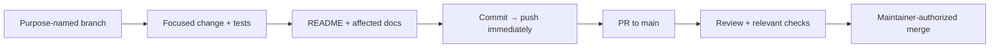
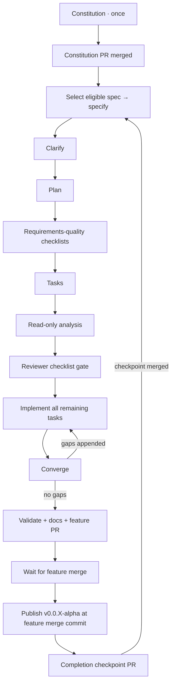

# Development workflow

## Foundation boundary

The bootstrap established contributor tools and reserved architecture boundaries.
F-01 adds four .NET library projects, immutable provider declarations, explicit
registration, and compile/package/boundary acceptance tooling. F-02 adds
opt-in fixture-tested lifecycle in Hosting. F-03 adds fixture-backed configuration,
owner-scoped local secrets and explicit synthetic conversion through that same
lifecycle. F-04 adds opt-in protected discovery slices in Application and safe
Hosting observations; F-05 adds separate BCL-only metadata operations with
independent SQLite/memory qualification fixtures. F-06 adds separate BCL-only
artifact operations with independent Local/ObjectSemantics qualification fixtures,
shared reference/read/deletion authority and bounded recovery. These remain
test-only, not production storage or F-07 certification. Core remains empty. No caching engine,
production providers, curated executable, UI, product CI/CD,
or deployment exists.
Azure identity provisioning is a
separate, explicitly authorized [operator action](../infra/bootstrap/README.md).

Current technical intent is defined by the [charter](PRODUCT_CHARTER.md),
[product specification](PRODUCT_SPEC.md), [architecture](ARCHITECTURE.md),
and [modular-provider ADR](adr/0001-modular-provider-architecture.md).

## Everyday change flow



Use `feature/`, `bugfix/`, `chore/`, `docs/`, `refactor/`, `hotfix/`, or `test/`.
Never commit directly to `main`. Inspect the worktree first, preserve user work,
and honor a branch explicitly designated for the task. Do not force-push shared
history. Push after **every** commit; failures are blockers, not successful
handoffs. Open/update the PR when work is ready; do not merge without permission.

Use the [PR template](../.github/pull_request_template.md). Update the README
and affected docs on the branch before merge; explicitly justify unaffected
documents. Describe actual checks and operational/manual steps. Keep credentials,
state, tfvars, plans, build output, and runtime data out of Git; retain lockfiles.

## Local MCP servers

The repository includes `.mcp.json` for Copilot CLI and `.vscode/mcp.json` for
VS Code Copilot. Both describe the same eight servers; keep their definitions
aligned when changing them. These settings apply to this checkout, not your
user-level MCP configuration or a hosted coding agent.

| Server | Connection | Purpose |
| --- | --- | --- |
| [Microsoft Learn](https://learn.microsoft.com/en-us/training/support/mcp) | Remote HTTP | Official .NET, ASP.NET Core, and Microsoft documentation and code samples |
| [Context7](https://context7.com/docs/resources/all-clients) | Remote HTTP | Library-specific documentation and examples |
| [Next.js DevTools](https://github.com/vercel/next-devtools-mcp) | Local stdio via `npx` | Connect to a future Next.js development server for runtime errors, routes, and logs |
| [shadcn](https://ui.shadcn.com/docs/mcp) | Local stdio via `npx` | Discover components, examples, and registry items for the planned console |
| [Playwright](https://github.com/microsoft/playwright-mcp) | Local stdio via `npx` | Browser interaction and accessibility snapshots with an isolated, nonpersistent profile |
| [Azure MCP](https://learn.microsoft.com/en-us/azure/developer/azure-mcp-server/) | Local stdio via `npx` | Optional Azure resource inspection, with `--read-only` enabled |
| [Docker MCP Gateway](https://docs.docker.com/ai/mcp-catalog-and-toolkit/mcp-gateway/) | Local stdio via `docker` | Connect to the MCP servers enabled in your local Docker MCP Toolkit |
| [NuGet MCP](https://learn.microsoft.com/en-us/nuget/concepts/nuget-mcp-server) | Local stdio via `dnx` | Official NuGet package discovery, upgrade planning, and dependency vulnerability guidance |

The HTTP servers need network access but no local Node installation. Context7
can be used without a key, subject to anonymous rate limits. If authentication
or a higher quota is needed, configure credentials privately in the client;
never add keys or authorization headers to these tracked files. Documentation
queries go to the respective remote service: do not send secrets or private
source code.

The full Node-based stdio setup needs Node.js 22+ (a supported LTS release)
and npm on `PATH`; Azure MCP 3.0.0 requires Node.js 22 or newer. The servers run
publisher packages through `npx -y`, which downloads and runs code in npm's cache
on first start. The `@latest` packages can pick up
updates later. Azure MCP is instead pinned to stable `3.0.0`: at setup time,
its npm `latest` tag pointed to a prerelease. Review and trust the publishers
before starting them. Next.js DevTools and Azure MCP telemetry are disabled in
both configurations. No package manifest, local `node_modules`, or application
scaffolding is required for this MCP setup.

Playwright uses `--isolated`, so cookies and login state are not persisted or
borrowed from your normal browser. It still needs an installed supported
browser; follow its browser-install guidance if a browser launch reports one
missing. Browser automation is not a substitute for committed end-to-end tests.

Azure resource operations require your own authenticated Azure identity, for
example through `az login`, and appropriate least-privilege RBAC. This setup
does not sign in, select a subscription, or provision resources. The read-only
flag prevents write operations; sensitive-data confirmation remains enabled.
Do not remove that restriction or perform an Azure write without separate
authorization. Azure remains optional for local Hoard development.

The Azure entry is named `azure-mcp` to avoid collisions with an existing
`azure` client plugin, which can take precedence over a same-named workspace
entry. Its read-only restriction does not constrain separately installed Azure
servers. If your client already provides Azure or another server listed here,
choose which connection to use in the client to avoid duplicate tools; this
repository does not disable or modify existing plugins.

Docker Gateway requires a running Docker engine and the `docker mcp` CLI
plugin, normally supplied by Docker Desktop with **MCP Toolkit** enabled.
Check availability with `docker mcp version`. Use Docker Desktop's MCP Toolkit
to select and configure the servers you actually need; no catalog servers are
enabled by this repository. The gateway uses your existing local selection,
so avoid enabling duplicate copies of servers already connected directly here.
Credentials belong in Docker's secret storage, not Git. No TCP gateway port,
all-server catalog flag, or relaxed security settings are configured. If Docker
Desktop is stopped, the gateway cannot connect; start it before starting this
MCP entry. This setup does not start Docker Desktop, change its catalog, or run
Hoard containers.

NuGet MCP requires the .NET 10 SDK or later, including `dnx` on `PATH`.
It downloads and runs the official `NuGet.Mcp.Server` package from nuget.org
using the publisher's recommended `--source` and `--yes` arguments. No
prerelease version is requested; an unversioned package name follows stable
updates. Review the publisher before starting the server. No project, package
reference, or tool manifest is created by this configuration. Project-specific
dependency analysis awaits the feature introducing the .NET projects, and any
package changes must remain within the explicitly requested task and normal
client permissions. If `dnx` cannot load the service index, check network and
trusted proxy access to `https://api.nuget.org/v3/index.json` before retrying;
do not disable TLS or certificate validation to make the server start.

For Copilot CLI, start a new session from this checkout, review any workspace
trust prompt, and use `/mcp` to inspect the servers. `copilot mcp list` also
shows the loaded configuration and its source, but does not prove a server
connection. For VS Code, open `.vscode/mcp.json` and use its **Start** actions;
review server trust prompts and use **MCP: List Servers** for status. Existing
client permission and trust controls still apply.

Hoard has no runnable UI yet. Next.js runtime tools require a running Next.js
16+ development server, and project-specific shadcn registry configuration
belongs to the feature that creates `apps/web`. Do not scaffold an app or run
component installation just to enable these servers. The default shadcn registry
does not require a `components.json` file for discovery.

To roll back, remove the server entries from both files and restart or stop
the affected client connections. This does not alter global settings or npm's
download cache. Product specifications and architecture diagrams are unaffected:
MCP is contributor tooling, not a Hoard runtime capability.

## Checkpointed Spec Kit flow

In a Copilot surface supporting repository skills, ask:

> Use the `hoard-speckit` skill to advance the next stage.

In CLI, `/skills` shows available skills. Name `hoard-speckit` explicitly; exact
slash-command spelling can vary by Copilot surface. The entry point is
[its SKILL.md](../.github/skills/hoard-speckit/SKILL.md).

The bootstrap did not run this flow or pre-ratify the constitution. The initial
constitution stage establishes
[version 1.0.0](../.specify/memory/constitution.md), covering product boundaries,
provider composition, shared correctness/security, evidence, accessibility,
operations, and governance. It creates no feature specification or product code.
Templates remain unchanged; the installed stage skills read the constitution
at runtime.

The constitution adoption PR must merge before a new specification begins.
After merge, the next invocation selects the first dependency-ready open
specification from the [master inventory](HOARD_SPECKIT_MASTER_BACKLOG.md)
and passes its exact prompt to the installed specify skill. The tracked
checkpoint, rather than this guide, records current stage and merge progress.

The first generated feature is
[F-01: platform package boundaries and provider contracts](../specs/001-provider-contracts/spec.md).
Its [built-in quality checklist](../specs/001-provider-contracts/checklists/requirements.md)
validates the specification, not implementation or reviewer-owned custom
checklist approval. Package contracts, custom-host compilation, and architecture
checks described there were acceptance requirements at specification time;
their current bounded implementation is described below.
Its initial [clarification review](../specs/001-provider-contracts/spec.md#clarifications)
records a no-question result with no scope changes; a later user-approved
follow-up resolves the checklist review's optional-dependency ambiguity.
Exact public signatures and
build commands were proposed in the
[implementation plan](../specs/001-provider-contracts/plan.md) and
[public contracts](../specs/001-provider-contracts/contracts/public-api.md),
then delivered by the separately authorized implementation stage. The plan
retains historical design alongside current evidence and includes research,
a declaration model,
compatibility/architecture acceptance contracts, and a
[validation quickstart](../specs/001-provider-contracts/quickstart.md).
The implementation now supplies the foundation commands in that quickstart;
they prove compilation and package boundaries, not product behavior.
Planning did not generate or approve custom reviewer-owned checklists, create
tasks, scaffold projects, or authorize implementation. The subsequent checklist
stage generated separate
[architecture](../specs/001-provider-contracts/checklists/architecture.md) and
[compatibility](../specs/001-provider-contracts/checklists/compatibility.md)
requirements-quality reviews: 20 and 18 criteria respectively.
These standard-depth checklists are for maintainers and provider-contract
reviewers before implementation authorization; they assess written requirements,
not product behavior. At the user's explicit request, a delegated review
initially found architecture 20/20 and compatibility 17/18 satisfied.
The user then approved the recommendation for
[RQ-01: incompatible present optional dependencies](../specs/001-provider-contracts/checklists/compatibility.md#rq-01-incompatible-present-optional-dependency).
The spec, declaration model, and policy now classify an enabled incompatible
optional target as an unsupported composition, without automatic disablement
or substitution; installed/registered-but-disabled optional targets are
unavailable and confer no integration/capability claim. Five new classification
examples bring the written matrix to 23 cases. The delegated re-review closes
CHK014: architecture 20/20 and compatibility 18/18, all 38 criteria satisfied
without waivers. The built-in specification checklist and driver are unchanged.
The subsequent [task-generation stage](../specs/001-provider-contracts/tasks.md)
produced 57 unchecked tasks: shared setup/declarations, four story phases, and
cross-cutting acceptance/documentation work. All 17 requirements and six
outcomes are mapped to implementation and focused proof tasks. The dependency
graph serializes the shared validation script while allowing independent
fixture/test/inspector work; architecture negatives and all 23 compatibility
classifications remain future proof obligations. No product scaffolding or
implementation occurred.

The subsequent read-only cross-artifact analysis found no actionable
duplication, ambiguity, underspecification, inconsistency, constitutional
conflict, or coverage gap. All 17 functional requirements and six buildable
outcomes have implementation/proof tasks; all 57 tasks map to requirements or
shared acceptance prerequisites. The prerequisite graph is complete and
acyclic, including serialized shared-script edits. All feature artifacts and
reviewer-owned checklist markers remained unchanged. The analysis report is
recorded in the draft feature PR, with its completion evidence in the shared
checkpoint; no remediation or implementation occurred. The next scheduled
stage was implementation through a separate `hoard-speckit` invocation, with the
existing reviewer-owned 38/38 checklist gate satisfied. Artifact analysis is
not passing product evidence or permission to skip the remaining stages.

The completed implementation stage delivers declaration-only Abstractions,
provider-free Core/Application, and metadata/type registration in Hosting.
The [provider guide](PROVIDERS.md) and
[compile-only custom-host guide](../examples/CustomHost/README.md) describe
current APIs and limits. `bash scripts/validate-foundation.sh` restores/builds
with locks, checks SDK formatting/analyzers, builds Core in isolation, packs
four local platform libraries and five independent fixtures, compiles family
consumers and both hosts, and executes architecture/compatibility/registration
acceptance. The F-01 host is never run. Current solution tests also include
in-process lifecycle regressions; the dedicated lifecycle graph/distribution/
old-binary proof still requires validate-lifecycle.sh. No listener starts.
Every subprocess has a ten-minute timeout.
A Python standard-library helper owns copying, hashes, metadata manifests, and
explicit subprocess errors; Bash owns prerequisites and private-directory cleanup.
Tests consume the prepared evidence, never recursively invoke the orchestrator,
and deliberately fail when evidence is missing.

Default runs do not rewrite lockfiles. After an intentional contract/dependency
change, `bash scripts/validate-foundation.sh --update-locks` regenerates and
replays standalone locks; review and commit them before the default locked run.
Local acceptance packages omit Git revision stamps and normalize source paths,
so fresh temporary locations and checkpoint commits do not invalidate their
content hashes. This is local proof tooling, not release/package publication.
The helper also canonicalizes unsigned local SDK archive envelopes (ZIP
metadata and OPC relationship IDs/paths) without changing nuspec/assembly/core
property bytes. Focused regressions protect reproducibility and reject signed/
external inputs; no published/external package is rewritten and locked hashes
are never bypassed. Compiler/SDK changes affecting payloads need reviewed locks.
SDK package pruning is disabled in the example so its complete explicit packed
dependency graph remains available for inspection even with ASP.NET's shared
framework. Framework ownership comes from resolved reference-pack metadata,
not trusted namespace/name prefixes.
The implemented-graph architecture review identified three proof gaps, now
corrected with focused regressions: unused framework references create real
dependency edges, prohibited BCL query/connection/transaction shapes cannot
bypass public-surface checks, and all eight named platform/provider/host scans
are mandatory. See the [review and measured evidence](../specs/001-provider-contracts/plan.md#necessary-implementation-details-and-review).
The support-claim audit is complete. The subsequent installed convergence stage
assessed all 17 functional requirements, six buildable success criteria, 15
story acceptance scenarios, nine edge cases, 12 grouped plan decisions, all 57
implementation tasks, and eight constitutional principles against current
scoped code. It found one HIGH-severity partial gap: the graph inspector rejected
the permitted `Identity -> Hosting -> Core` closure under ARCH-008, although
identity providers may use the approved Hosting API and Hosting references Core.
A temporary diagnostic invoking the current compiled graph inspector reproduced
that false rejection; the original permitted fixtures did not cover this path.
[Phase 8 / T058](../specs/001-provider-contracts/tasks.md#phase-8-convergence)
recorded the correction and regression work. That convergence invocation
appended only the new task section; its passing baseline of 81 .NET tests
and 17 tooling tests did not resolve the uncovered path.

The separately authorized T058 implementation now tracks Identity paths whose
first edge reaches Hosting separately from other paths to the same dependency.
Core is permitted through that approved Hosting composition, not directly or
through an unrelated SDK-owned helper. A package-only fixture uses the actual
Hosting registration API; isolated negatives retain both forbidden routes even
when Hosting is also referenced, with normal/reversed edge-order checks.
All four new fixture projects carry locks. No platform API, provider package,
runtime behavior, or reviewer-owned checklist changed. See the
[follow-up evidence](../specs/001-provider-contracts/plan.md#t058-implementation-follow-up-2026-10-20).
The separately authorized follow-up convergence assessment found no actionable
gaps: missing 0, partial 0, contradicts 0, unrequested 0, with zero findings at
any severity. It checked all 17 functional requirements, six buildable success
criteria, 15 story acceptance scenarios, nine edge cases, 12 grouped plan
decisions, all 58 tasks (including T058), and eight constitutional principles.
Fresh default locked acceptance passed all 86 .NET tests (42 foundation,
41 architecture, three composition), zero failed/skipped, including the
permitted Identity/Hosting path and both forbidden alternatives. All 17 Python
tooling tests passed. The assessment left the spec, plan, tasks, and all
reviewer-owned/built-in checklist bytes unchanged; no empty convergence phase
or further implementation task was added. Its report is recorded in the draft
feature PR and shared checkpoint.
The separately authorized
[finalization acceptance](../specs/001-provider-contracts/plan.md#finalization-acceptance-2026-10-20)
repeated the full locked foundation check and all 17 tooling tests, refreshed
the dependency advisory assessment with no known vulnerable packages, and
verified the acceptance traceability, documentation, and existing architecture
reviews. The reviewed implementation, locks, tasks, and checklist markers
remain unchanged. At finalization,
[PR #4](https://github.com/Stonefly-Labs/Hoard/pull/4) was ready for maintainer
review, targeting `main`; the shared checkpoint recorded `await_merge` with
that PR number and no completed feature.

PR #4 subsequently merged into `main` on 2026-10-20 at
`837fdf3edf51c3df34710184d018479683c194c2`. The separate `await_merge` stage
verified the GitHub merge state, merge ancestry in fetched `origin/main`, and
all 58 completed tasks. It created `chore/spec-progress-f-01` from that main
and records F-01 in the shared checkpoint's completed entries, retaining its
directory, PR, and merge commit. At that point the checkpoint had no active
feature and scheduled `specify`; the first dependency-ready entry was
[F-02: module registry, composition and lifecycle](HOARD_SPECKIT_MASTER_BACKLOG.md#foundation-f-02).
The progress checkpoint merged through
[PR #5](https://github.com/Stonefly-Labs/Hoard/pull/5), satisfying the gate for
the subsequent specification stage.

[F-02: module registry, composition and lifecycle](../specs/002-module-lifecycle/spec.md)
now has its own requirements at `specs/002-module-lifecycle`, on
`feature/002-module-lifecycle`. Five prioritized stories, 22 functional
requirements, and seven measurable outcomes cover explicit registered-module
selection, pre-activation dependency/compatibility checks, deterministic ordering,
disabled-route/worker/connection isolation, readiness, bounded initialization,
partial-start cleanup and shutdown, sanitized diagnostics, and restart versus
custom rebuild behavior. The existing F-01 optional-dependency policy is
preserved: absent/disabled optional targets confer no integration; enabled
incompatible targets fail composition. All explicitly enabled modules must
initialize successfully; optional dependency does not mean degraded startup.
The [built-in requirements checklist](../specs/002-module-lifecycle/checklists/requirements.md)
passes all 16 specification-quality criteria, with no unresolved clarification
markers. It is not a custom reviewer-owned approval or runtime acceptance
result. The bounded architecture review found no actionable requirement-level
findings; its operational proof obligations remain future work.

The subsequent
[clarification review](../specs/002-module-lifecycle/spec.md#clarifications)
found no critical ambiguities across all ten review categories. Zero questions
were asked or answered, and no requirements, acceptance criteria, or scope
decisions changed. The built-in specification-quality checklist was revalidated
at 16/16 to 16/16: no newly passing items, regressions, or unchecked items.
Its bytes and historical specification-stage notes remain unchanged; no custom
reviewer-owned approval is implied. Exact lifecycle APIs and state
representation, route-conflict inspection, finite budget defaults, and the stable
ordering tie-break remain planning decisions under the existing requirements.
No consequential product decision blocks planning.

The subsequent [implementation plan](../specs/002-module-lifecycle/plan.md)
defines opt-in Hosting lifecycle adapters on F-01's unchanged registration
boundary. Persistence/artifact providers retain Abstractions-only dependencies
through host-side adapters. Metadata validation precedes all construction;
enabled modules follow deterministic dependency ordering, service composition,
supervised host build, owned-route analysis, initialization and complete
readiness before traffic/worker admission. Startup/stop coordination has finite
deadlines and reports incomplete cleanup rather than pretending cancellation
forcibly stops trusted in-process code.

The [research](../specs/002-module-lifecycle/research.md),
[in-memory model](../specs/002-module-lifecycle/data-model.md),
[public API](../specs/002-module-lifecycle/contracts/public-api.md),
[lifecycle](../specs/002-module-lifecycle/contracts/lifecycle.md) and
[acceptance](../specs/002-module-lifecycle/contracts/acceptance.md) contracts
resolve planning details and map all 22 requirements, seven outcomes and
20 story scenarios to 40 fixture-only proof cases. The restricted owned-route
language rejects unsupported shapes instead of claiming to analyze arbitrary
constraints. The bounded architecture review identified a missing build
supervision boundary and two resource/worker semantics questions; the plan
corrects all three with an explicit supervised build API, retained request/
dependency resource leases and protected root disposal after drain timeout,
and whole-callback worker admission. LC-20/23/26/29 retain those proof duties.
No runtime results or repeat approval are inferred from those design corrections.

The [validation quickstart](../specs/002-module-lifecycle/quickstart.md)
distinguishes current foundation/tooling commands from a proposed lifecycle
validation script, independent packed fixtures and a separate lifecycle-only
host example. Neither that script nor new runtime APIs/projects/dependencies
are created in planning. F-01's compile-only example and all checklists remain
unchanged. The ASP.NET Core shared-framework/versioning dependency impact,
source/binary registration compatibility, deadline/admission/cleanup behavior
and actual package graph still require implementation evidence.

The subsequent checklist stage generated
[composition](../specs/002-module-lifecycle/checklists/composition.md) and
[lifecycle](../specs/002-module-lifecycle/checklists/lifecycle.md)
requirements-quality reviews: 20 criteria each, all 40 unchecked and
reviewer-owned. Standard-depth scope and audience are explicit: maintainer and
provider PR review before implementation authorization. Composition covers
registry/selection, compatibility/dependencies/capabilities, route ownership,
unchanged registration compatibility, and bundled/custom restart journeys.
Lifecycle covers disabled isolation, admission/readiness, finite coordination
budgets, partial-start and normal cleanup, pending-resource protection,
concurrency, and sanitized actionable diagnostics. The planning review's build,
resource-retention, and worker-admission corrections remain written proof
obligations; checklist generation neither evaluates them nor supplies runtime
evidence. Requirements/design artifacts and the built-in 16/16 checklist remain
unchanged; no custom criterion is approved or waived.

The subsequent [task-generation stage](../specs/002-module-lifecycle/tasks.md)
produced 72 unchecked implementation tasks across eight phases: shared setup
and safety primitives (13), US1 selection/start (14), US2 enabled/ready
functionality (18), US3 failure/stop (10), US4 safe diagnostics/state (5),
US5 distribution/restart (7), and cross-cutting acceptance (5).
All 22 functional requirements, seven outcomes and 40 LC acceptance cases
have implementation and focused proof assignments; all 20 story scenarios
retain the acceptance contract's LC mapping. Explicit acyclic prerequisites
serialize shared coordinator/lease/route/tooling edits, while 29 marked tasks
identify scoped file-disjoint parallel opportunities after their prerequisites.
The endpoint-free US1 fixture proof is the first bounded increment, not a
shippable lifecycle or complete F-02.

Tasks retain supervised synchronous build, single disposal ownership, pending
request/response/worker/build protection, finite deadlines and once-only
cleanup as implementation/regression obligations. Independent fixture packages,
package-only host variants, retained old registration binaries, explicit
framework-reference impact, initial reviewed locks and fresh default locked
replay remain required evidence. Existing F-01 fixture/example sources and
compile-only scenarios must stay intact; reviewed Hosting dependency/content
changes may require affected lock refreshes, not silent hash bypasses.
No test may skip a missing package input or accept an empty proof selection.
The task-generation stage did not perform cross-artifact analysis, implement
these obligations or evaluate the custom checklists; all 40 remained unchecked
at that stage.

The subsequent installed read-only cross-artifact analysis found no actionable
duplication, ambiguity, underspecification, inconsistency, constitutional conflict
or coverage gap. All 22 functional requirements and seven buildable outcomes
have implementation and focused proof assignments; all 72 tasks map to those
requirements or shared acceptance prerequisites. The complete prerequisite graph
is acyclic, including serialized shared-file edits; 40 LC cases, 20 story
scenarios and 12 edge cases retain their proof obligations. T002's tooling
regressions and T006's composition inputs are mapped shared prerequisites,
not orphan tasks. The analysis report is recorded in the draft feature PR,
with completion evidence in the shared checkpoint. No feature artifact or
built-in/custom checklist byte changed, and no remediation was needed.

The later explicitly requested checklist review evaluated all 40 custom
criteria at baseline `c7ccde4`: composition 19/20 and lifecycle 19/20, 38/40
satisfied without waivers. Composition CHK014 was left open for
[RQ-02: inconsistent baseline/custom artifact manifests](../specs/002-module-lifecycle/checklists/composition.md#rq-02-baseline-and-custom-artifact-package-lists-disagree).
Lifecycle CHK013 was left open for
[RQ-01: timed-out cleanup callback retention](../specs/002-module-lifecycle/checklists/lifecycle.md#rq-01-explicitly-retain-resources-for-timed-out-cleanup-callbacks).
Both were MEDIUM written-requirements/documentation findings, not demonstrated
runtime defects. The initial review changed checklist markers only, not
spec/design/tasks or the driver checkpoint.

The user subsequently approved both recommendations. The follow-up explicitly
tracks a non-completed StopAsync as pending Phase activity even after its wait
times out: owner/prerequisite/root resources remain protected, independent safe
cleanup shares the original deadline, and late completion after the bounded
result cannot rewrite outcomes, retry or trigger deferred disposal. LC-28/29
and T048/T050..T053/T055 retain the A -> B plus independent C regression duty.
The baseline manifest now consistently includes the two protocols, Metadata,
Artifact.One and optional Identity; only custom adds Artifact.Two and its host
adapter. LC-35/36, T065 and the quickstart require baseline absence and
same-binary bundled protocol switching; independent packing still covers six
fixtures. All 40 custom criteria are now satisfied without waivers after
re-evaluation; the built-in checklist remains 16/16.

Fresh installed read-only cross-artifact analysis found zero actionable
findings, with all 22 requirements/seven outcomes, 72 unchecked tasks, 40 LC
cases, 20 scenarios and 12 edge cases retaining complete proof mappings and
acyclic prerequisites. All feature bytes remained unchanged during that
analysis. The bounded follow-up architecture review also found no actionable
findings or unresolved design questions; actual runtime/package/graph proof
remains an implementation obligation. The PR records both results.
The approved follow-up is not a driver stage, independent human inspection,
runtime implementation or acceptance. The checkpoint/history is byte-for-byte
unchanged; no `begin`/`finish` or progress reset was used.

Specification, clarification, planning, checklist and task generation create no
lifecycle implementation, production executable/provider, configuration parser,
management discovery endpoint, UI, or conformance certification. F-02 can
later prove lifecycle with explicit selections and instrumented fixtures;
F-03 retains configuration sources,
option/secret handling, and operator selection UX, while F-04 retains management
discovery. Read-only analysis likewise supplies no runtime implementation or
passing product evidence. The next scheduled stage was `implement` through a
separate invocation, with the custom checklist gate now satisfied and the
approved findings resolved. This follow-up does not start implementation or
mark any of its 72 tasks complete. Do not reset the checkpoint to fabricate a
scheduled analysis rerun or infer runtime acceptance from `implement` / `ready`.
Task generation and analysis do not require custom checklist approval, but the
later implementation gate does require reviewer approval or explicit reviewer
authorization; their initial generation/analysis did not supply it. The
requested review and approved follow-up now satisfy that requirements gate,
not a feature-completion or runtime-support claim.

### Implemented F-02 lifecycle boundary

The separately authorized implementation adds metadata-only registry/selection/
version/capability validation, deterministic dependency ordering, inert opt-in
adapter association, supervised service/build/route/init phases, readiness,
worker/request admission and bounded reverse cleanup in Hosting. Abstractions,
Core and Application source stay unchanged. F-03 must feed the same validator;
F-04 still owns authorized discovery/UI, not an automatically exposed health
endpoint.

```bash
bash scripts/validate-lifecycle.sh
```

This separate ten-minute-per-subprocess orchestrator packs six independent
fixtures, verifies private-feed/hash/lock provenance, runs TestServer's seven
baseline/custom distribution journeys, retains/runs an old registration binary,
and inspects ten exact project/packed/transitive/API graphs. Source-only filters,
`--packages-only` and `--journeys-only` explicitly report partial proof.
Intentional payload changes use `--update-locks`, reviewed locks and an
independent default replay. The existing foundation command retains its eight
mandatory real scans and original compile-only fixture/example sources. It
excludes only LC-38's separate prepared lifecycle manifest test; lifecycle
acceptance supplies that mandatory proof.

Hosting now propagates the ASP.NET Core shared-framework prerequisite even to
non-web registration-only consumers. Old AddHoard/AddModule APIs remain inert
and source/binary-compatible. NuGet.Versioning is internal; TestHost is test-only
and never classified as verified shared-framework provenance. See
[measured evidence and implementation adjustments](../specs/002-module-lifecycle/plan.md#implementation-evidence).

The [provider guide](PROVIDERS.md#opt-in-lifecycle) and
[example](../examples/LifecycleHost/README.md) document actual APIs and limits.
Use normal app StartAsync, explicit StopHoardApplicationAsync(lease), and sole
external lease disposal. Module-only stop can report NotAttemptedOwnerPending;
only the final lease StopResult reports root release. Shared framework stop,
synchronous notification callbacks, cancellation/deregistration, outstanding
responses/workers and non-cooperative callbacks remain supervised. A bounded
wait is not forced termination: incomplete resources may require process exit.
Later health loss changes readiness only; stop/fault closes admission.

The subsequent installed convergence assessment checked all 22 functional
requirements, seven buildable outcomes, 20 story scenarios, 12 edge cases,
12 grouped plan decisions, all 72 implementation tasks and eight constitutional
principles against current scoped code. It found one **CRITICAL** contradiction
of bounded coordination: the worker-fault branch calls
`IHostApplicationLifetime.StopApplication()` while holding the coordinator's
state lock. Synchronous `ApplicationStopping` callbacks can therefore block
stop coordination and safe state inspection indefinitely.

An isolated public-API/TestServer diagnostic held such a callback after worker
failure: neither stop nor snapshot access completed after 1,001 ms despite a
200 ms shutdown budget. The diagnostic released and observed its pending work.
Fresh default locked lifecycle acceptance passed 126 source tests, nine boundary
proofs and seven package-only journeys; foundation passed 220 .NET tests and
tooling passed 22 tests. Those passing suites do not cover the reproduced
notification path or establish compliance for it.

[Phase 9 / T073](../specs/002-module-lifecycle/tasks.md#phase-9-convergence)
appends the required lock-free supervised notification, resource-retention and
deterministic regression/review work. The existing task prefix, spec, plan and
all built-in/custom checklist bytes remain unchanged. No application code was
modified by convergence. README and this guide record the blocker; provider/
example/quickstart contracts, product intent, diagrams, governance, IaC and
release guides are unaffected because no API, intended behavior, dependency or
operational action changed. Existing implementation evidence remains historical,
not proof of the newly uncovered path.

The separately authorized
[T073 implementation follow-up](../specs/002-module-lifecycle/plan.md#t073-implementation-follow-up)
now records the worker failure and stop latch atomically, registers global
pending Phase activity before drain scheduling, and dispatches host lifetime
resolution/notification outside the state lock. Pending notification or
cancellation protects every module and the root. The existing tracker,
cleanup planner and sole composition owner provide that retention without new
APIs, dependencies or a second shutdown path.

Barrier/virtual-time regressions prove responsive snapshots, a 200 ms original
shutdown deadline, unsafe incomplete cleanup while a notification/cancellation
is held, frozen repeated results and no deferred cleanup after release.
The cooperative counterpart proves once-only notification, module cleanup and
root disposal. The bounded implementation architecture review found no
actionable findings; its static review and runtime proof limits are recorded
in the plan. A full run exposed a test synchronization race: the independent
cleanup proof must await harmless global cancellation quiescence before
advancing its virtual drain timer. That test now does so without weakening
resource-retention assertions.

The subsequent fresh convergence assessment checked all 22 functional
requirements, seven buildable outcomes, 20 story scenarios, 12 edge cases,
12 grouped plan decisions, all 73 existing tasks and eight constitutional
principles. T073's lock-free notification, original deadline and pending-resource
protection are implemented. One **HIGH partial** diagnostics gap was found:
`StopCoreAsync` and `CancelPending` pass cancellation tasks to `Observe`
without an owner, so callback exceptions are consumed without any diagnostic.
An isolated public-API diagnostic registered a throwing worker stop-token
callback. It executed once; both module cleanups completed and final lease
release was complete, but module/final/snapshot diagnostics were all empty.
Actual resource release does not excuse omission of the cancellation failure.

[Phase 10 / T074](../specs/002-module-lifecycle/tasks.md#phase-10-convergence)
appends safe cancellation-failure reporting and focused throwing/cooperative/
late-fault regression work. Existing task bytes, spec, plan and all checklist
markers remain unchanged. Fresh `bash scripts/validate-lifecycle.sh` passed
129 source tests, nine boundary proofs and seven package-only journeys, including
retained old-binary/new-source/framework proof. Fresh
`bash scripts/validate-foundation.sh` passed 223 tests (42 foundation,
49 architecture, 132 composition), zero failed/skipped, with all original
eight scans retained. The tooling suite passed all 22 tests. Those suites
do not exercise the newly reproduced cancellation-error path.

The separately authorized
[T074 implementation follow-up](../specs/002-module-lifecycle/plan.md#t074-implementation-follow-up)
now uses one off-lock cancellation supervisor for lifetime, readiness timeout
and cleanup timeout. Callback faults generate safe additional
`CancellationFailure` diagnostics with owner, originating phase, fixed action
and lifecycle correlation before their tracked activity is released. The
primary worker/startup/timeout finding remains separate. A completed fault does
not falsely retain resources: cooperative work can still finish cleanup and
root disposal, with the cancellation error reported.

Held late-fault proof retains every module/root for lifetime cancellation under
the original shutdown deadline. After bounded stop/disposal, releasing the
callback adds one safe diagnostic to a later snapshot, not to frozen results;
no cleanup retry or deferred disposal occurs. Throwing/cooperative timeout
counterparts cover readiness and module cleanup, including known errors before
result publication and zero seeded payloads in normal results/logs. The bounded
implementation architecture review found no actionable findings; measured
red/green, packed locks and complete acceptance evidence are in the plan.

That implementation checkpoint schedules fresh `converge`. README,
provider/example guides, quickstart, lifecycle
contract/model and implementation evidence document the correction. Spec,
public API/acceptance contracts and reviewer-owned checklists are unchanged.
Product intent, baseline diagrams/ADR, governance, master backlog, F-01
sources/examples, IaC and release guidance are unaffected: existing diagnostic
and resource invariants are restored without new APIs, dependencies, provider
capabilities, permissions or operational actions.

The subsequent installed convergence assessment checked all 22 functional
requirements, seven buildable outcomes, 20 story scenarios, 12 edge cases,
12 grouped plan decisions, all 74 existing tasks and eight constitutional
principles. T074's cancellation-failure reporting is implemented. One **HIGH
partial** gap remains in eventual-fault observation:
`HoardLifecycleCoordinator.Observe` reports only when given an owner and the
shared stop task has already completed. Readiness supplies no owner; timed-out
cleanup faults before stop completes also receive no safe diagnostic.

Two isolated public-API probes reproduced those omissions without a listener
or repository source changes. A readiness callback faulted after the bounded
assessment returned not ready: later snapshots and final diagnostics retained
only Timeout/NotReady. A protocol cleanup faulted after its callback timeout
while independent metadata cleanup held the shared stop open: final diagnostics
contained only Timeout. All three cleanup callbacks ran once, the protocol's
outcome stayed TimedOut, the remaining module cleanups and root disposal
completed, and no seeded payload appeared in snapshots. The diagnostic used
real-time budgets and a 200 ms observer grace; deterministic barrier/virtual-time
regressions belong to the implementation follow-up, not this assessment.

[Phase 11 / T075](../specs/002-module-lifecycle/tasks.md#phase-11-convergence)
appends once-only owner-aware eventual-fault reporting and its focused proof.
The task also requires auditing existing supervised startup/readiness/cleanup
and framework-stop/root-disposal observers for the same timing/ownership
omission, without claiming those additional paths were dynamically reproduced.
Normal awaited failures must not become duplicate diagnostics; eventual faults
must not rewrite results, retry cleanup or trigger deferred disposal.

Fresh `bash scripts/validate-lifecycle.sh` passed 136 source tests, nine boundary
proofs and seven package-only journeys, with six independent packages and
retained old-binary/new-source/shared-framework proof. Fresh
`bash scripts/validate-foundation.sh` passed 230 tests (42 foundation,
49 architecture, 139 composition), zero failed/skipped, retaining the original
eight scans. The tooling suite passed 22 tests. Those passing baselines do not
exercise the newly reproduced omissions and do not resolve F1.

Only the new Phase 11/T075 section was appended to tasks; all previous task
bytes, spec, plan and built-in/custom checklists remain unchanged. No
implementation or checklist approval occurred. README and this guide record
the blocker; provider/example/quickstart contracts, product intent, diagrams,
governance, F-01 sources/examples, IaC and release guidance are unaffected
because no API, intended behavior, dependency or operational action changed.
The next separately authorized stage is `implement` for T075, followed by fresh
convergence. Keep PR #6 draft: finalization, merge, feature completion and
dependency availability remain separate gates.

The separately authorized
[T075 implementation follow-up](../specs/002-module-lifecycle/plan.md#t075-implementation-follow-up)
now binds fault observation to each supervised callback's owner and originating
phase. Safe normal failures or additional `LateCallbackFailure` diagnostics
are recorded inside tracked activity before release, not in a continuation
conditioned on terminal stop. Startup, readiness, cleanup, framework stop and
root disposal share the mechanism; directly awaited faults are not duplicated,
and cooperative cancellation does not become a new eventual fault. Known
errors can appear in the shared stop result; faults after bounded results
appear only in later snapshots, without outcome changes, retry or deferred
disposal. T074 cancellation supervision and the sole lease owner remain intact.

The bounded architecture review found a HIGH omitted worker-fault path during
shutdown and a MEDIUM missing deadline recheck between framework stop and root
disposal. Focused red regressions reproduced both. Workers now record safe
additional failures during drain or after bounded stop, without requesting a
second shutdown. Root disposal is explicitly NotAttemptedBudgetExhausted when
the existing deadline expires before dispatch. Review scope, the corrections'
proof, package locks and full acceptance are recorded in the plan; the review
itself ran no tests and did not re-review the corrections.

README, provider/example guides, quickstart, lifecycle contract/model and task
checkpoint document the corrected behavior. Requirements, public API/acceptance
contracts and reviewer-owned checklist bytes remain unchanged; product intent,
baseline diagrams/ADR, governance, backlog, F-01 sources/examples, IaC and release
guidance are unaffected because no public API, dependency, product capability,
permission or operational action changes. This finishes only implementation;
fresh `converge` is next, and PR #6 remains draft.

The subsequent installed convergence assessment checked all 22 functional
requirements, seven buildable outcomes, 20 story scenarios, 12 edge cases,
12 grouped plan decisions, all 75 existing tasks and eight constitutional
principles against current scoped code. T073..T075's notification, cancellation
and eventual-fault corrections are implemented. One **CRITICAL contradiction**
remains in request resource retention: the admission endpoint registers its
lease-release `OnCompleted` callback after upstream host middleware. Reverse
callback order releases that lease before the earlier middleware's response
completion work finishes.

An isolated public-API/TestServer probe held such a middleware callback.
Protocol cleanup ran once, its artifact prerequisite and independent metadata
cleanup all reported Completed, and UnsafeActivities was empty while response
completion was still pending. The root was incorrectly eligible for external
owner disposal (NotAttemptedOwnerPending); the probe did not attempt root
disposal while holding the callback. A paired callback registered inside the
handler correctly retained protocol/artifact as UnsafePendingCallback and the
root as NotAttemptedUnsafe. Both held callbacks were released and observed.
The probe used a 150 ms real-time drain budget with five-second scheduler
backstops and no listener; deterministic barrier/virtual-time regressions remain
implementation work.

[Phase 12 / T076](../specs/002-module-lifecycle/tasks.md#phase-12-convergence)
appends the completion-boundary correction, pre-/post-admission and handled-error
regressions, pending owner/prerequisite/root protection, cooperative once-only
release and no deferred cleanup requirements. Existing task bytes, spec, plan
and all built-in/custom checklists remain unchanged. The assessment produced
one contradicts/CRITICAL finding and zero missing, partial or unrequested
findings; no application code or checklist approval changed.

Fresh `bash scripts/validate-lifecycle.sh` passed 161 source tests, nine boundary
proofs and seven package-only journeys, including six independent packages and
retained old-binary/new-source/shared-framework proof. Fresh
`bash scripts/validate-foundation.sh` passed 255 tests (42 foundation,
49 architecture, 164 composition), zero failed/skipped, retaining the original
eight scans. `python3 -m unittest discover -s tests/tooling -v` passed 22 tests.
Those passing baselines do not exercise the reproduced pre-admission completion
path and do not resolve F1.

README and this guide record the blocker. Provider/example/quickstart contracts,
product intent, diagrams/ADR, governance, master backlog, F-01 sources/examples,
IaC and release guidance are unaffected: convergence changes no API, intended
behavior, dependency, permission or operational action. Implementation evidence
remains historical, not acceptance of this uncovered path. Keep PR #6 draft;
that convergence checkpoint scheduled `implement` for T076. Finalization,
merge, feature completion and dependency availability remain separate gates.

The separately authorized
[T076 implementation follow-up](../specs/002-module-lifecycle/plan.md#t076-implementation-follow-up)
installs an internal first startup filter during supervised host build. Its
middleware registers the request-completion boundary before host filters and
middleware, so reverse-order completion releases admitted leases last, not on
handler return. Admission still uses the existing coordinator/tracker and
executes through normal host middleware/access policy; there is no new public
API, dependency, admission authority or disposal owner.

Barrier/virtual-time regressions cover callbacks registered by startup filters,
host middleware and handlers, for normal and handled-error responses. Pending
completion keeps the protocol, its artifact prerequisite and root protected
after the original drain budget expires; independent metadata cleanup completes.
Releasing pending work after bounded stop/disposal neither rewrites frozen
results nor retries cleanup/disposal. Cooperative callbacks release one request
activity only after all three registration sites finish, then modules and root
clean up once. A throwing handler-completion callback still runs the earlier
host callbacks before release in TestServer; this is not transport certification.

The bounded architecture review found no confirmed violations or unresolved
design questions. Its throwing-completion proof gap is covered by the added
counterpart; full locked acceptance and reviewed payload-only lock changes are
recorded in the plan. README, provider/example guides, lifecycle contract/model,
quickstart and task evidence describe the corrected boundary. Requirements,
public API/acceptance contracts and reviewer-owned checklists remain unchanged.
Product intent, baseline diagrams/ADR, governance, backlog, F-01 sources/examples,
IaC and release guidance are unaffected: no public API, dependency, product
capability, permission or operational action changes. This completes only
implementation; fresh `converge` is next and PR #6 remains draft.

### F-02 clean convergence

The subsequent installed `speckit-converge` assessment found no actionable gaps
in the current implementation against the spec, plan and all 76 tasks,
including the resulting T073..T076 corrections. It checked 22 functional
requirements, seven buildable outcomes, all 20 story scenarios, 12 edge cases
and 40 LC cases, plus 20 buildable plan obligations and the eight constitutional
principles as applicable to this bounded feature.

The plan obligations cover additive registration compatibility, metadata-only
validation, immutable selection, deterministic dependencies, host-owned
adapters, one coordinator, supervised build, analyzable owned routes, admission,
initial/later readiness, worker supervision, absolute budgets, reverse cleanup,
pending-resource retention, sole root ownership, safe diagnostics, independent
fixtures, restart/custom journeys, source/binary/framework compatibility, and
locked acceptance with architecture review and honest documentation. Current
source and focused proof paths were inspected; checked task boxes alone were
not evidence. There were zero missing, partial, contradictory or unrequested
findings, so `tasks.md` remains byte-for-byte unchanged without an empty phase.
Spec, plan, contracts, all checklist bytes, product/test/tooling sources and
tracked locks also remain unchanged.

| Fresh command | Result |
| --- | --- |
| `bash scripts/validate-lifecycle.sh` | Passed: 169 tests, nine boundary proofs, seven package-only journeys; six independent packages, retained old binary, new-source/shared-framework proof, formatting/analyzers and unchanged locks |
| `bash scripts/validate-foundation.sh` | Passed: 263 tests (42 foundation, 49 architecture, 172 composition), zero failed/skipped; original eight graph scans, ARCH-001..008, C-01..23, isolated Core, five original fixture packages and both compile-only hosts |
| `python3 -m unittest discover -s tests/tooling -v` | Passed: 22 tests |

The earlier direct host-notification-task exception-injection limitation
remains explicitly scoped in the implementation evidence, not a newly claimed
proof. No new runtime change requires another implementation architecture
review. README and this guide record convergence; provider/example/quickstart
contracts, product intent, diagrams/ADR, governance, backlog, IaC and release
guidance are unaffected because no API, behavior, dependency, operational step
or supported capability changes. No extension hooks are registered.

At that checkpoint, `finalize` was scheduled for a separate invocation and
PR #6 remained draft. Clean convergence alone is not finalization, merge
readiness, feature completion or dependency availability.

### F-02 finalization

The separately authorized finalization verifies all 22 requirements, seven
outcomes, 20 story scenarios, 12 edge cases and 40 LC cases through the
[acceptance traceability](../specs/002-module-lifecycle/plan.md#acceptance-traceability)
and clean convergence assessment. All 76 tasks remain complete; the built-in
16/16 and reviewer-owned composition/lifecycle 20/20 each remain unchanged.
No requirement, API, implementation, test, example, lock or checklist approval
changes in finalization.

Fresh default locked lifecycle acceptance passed 169 tests, nine boundary
proofs and seven package-only journeys, with six independent fixtures and
retained-old-binary/new-source/shared-framework compatibility. Foundation
acceptance passed 263 tests (42 foundation, 49 architecture, 172 composition),
zero failed/skipped, retaining the original eight scans, ARCH-001..008,
C-01..23, isolated Core and both compile-only hosts. Both commands verify
formatting/analyzers and package provenance. Tooling passed 22 tests.
The dated dependency assessment covered seven source/test projects with no
known vulnerable direct/transitive entries or assessment errors.
Exact commands/results and documentation review are in
[finalization acceptance](../specs/002-module-lifecycle/plan.md#finalization-acceptance-2026-10-21-utc).

The implemented graph and T073..T076 ownership changes already received the
required custom architecture review. No implementation changed after reviewed
commit `1760c01`, so documentation-only finalization requires no new review.
The recorded direct host-notification-task exception-injection limitation
remains explicit; this handoff does not claim that distinct test or production
provider, native-client or transport certification.

README, specification review status, plan acceptance and this guide now
describe the handoff. Provider/example guides, quickstart/contracts/model,
research, baseline product intent/architecture/diagrams/ADR, governance,
backlog, IaC and release guidance remain accurate: finalization changes no
API, dependency, runtime behavior, support scope, permission or operational step.
No extension hooks are registered.

At finalization, [PR #6](https://github.com/Stonefly-Labs/Hoard/pull/6) targeted
`main` and was ready for maintainer review. The shared checkpoint recorded
`await_merge / ready`, with F-02 still active and no dependent feature unlocked.
Finalization itself performed no infrastructure plan/apply, deployment,
publication, tag, release, permission change or merge.

### F-02 merge completion checkpoint

PR #6 subsequently merged into `main` on 2026-10-21 (UTC) at
`b80c69fc386541be4f56f6ef2edeca40f43a0e1c`. The separate `await_merge` stage
verified GitHub's merged state, merge ancestry in fetched `origin/main`, the
shared finalization checkpoint and ratified constitution, and all 76 completed
tasks. It started `chore/spec-progress-f-02` at that merge, and the helper
independently checked merge ancestry and task completion before recording F-02
with its directory, PR and merge commit.

The completion checkpoint clears the active feature and schedules `specify`;
the next dependency-ready entry is
[F-03: provider configuration and activation validation](HOARD_SPECKIT_MASTER_BACKLOG.md#foundation-f-03).
That progress-only PR had to merge before a new specification could begin from
main. No new specification or later stage ran during that completion invocation,
and no implementation, test, lock, task or reviewer-owned checklist changed.

README, this guide and the specification's current status reflect completion;
historical finalization evidence remains unchanged. Provider/example guides,
quickstart/contracts/model/research and plan acceptance, baseline product
intent/architecture/diagrams/ADR, governance, backlog, IaC and release guidance
are unaffected because this checkpoint changes no API, package graph, command,
runtime/support behavior or operational requirement. No new architecture review,
.NET acceptance or IaC run is warranted for this progress/docs-only scope.
The stage performs no merge, publication, deployment, infrastructure action,
tag, release or permission change.

### F-03 configuration specification

The F-02 completion checkpoint merged through
[PR #7](https://github.com/Stonefly-Labs/Hoard/pull/7). The subsequent
specification stage started `feature/003-provider-configuration` from fetched
`origin/main`, verified the shared checkpoint and ratified constitution, and
pinned [F-03](../specs/003-provider-configuration/spec.md) to
`specs/003-provider-configuration` using the exact backlog prompt.

Five prioritized stories, 22 acceptance scenarios, 26 functional requirements
and eight outcomes cover command line > environment > one file > documented
defaults, canonical-key conflicts, whole-selection replacement, provider option
validation and disabled-module isolation. Configuration must consume F-02's
existing pre-construction composition gate and F-01's compatibility policy,
including incompatible enabled optional targets. Explicit validated defaults
are not fallback from an invalid override. Environment/mounted-file secret
references require no cloud service; safe diagnostics exclude values, locators
and untrusted error payloads. Configuration work has finite coordination budgets,
protects pending resources, observes late faults and cannot activate after failure.
Settings and resolved secrets remain fixed until explicit restart.

Safe configuration evolution requires a supported version, a sanitized preview,
retained original, explicit approval and a complete validated replacement.
The private replacement may preserve secret references, but reports never expose
their locators or resolved credentials. Acceptance must include a representative
and interrupted conversion; synthetic old versions cannot be advertised as
released-format support. Configuration rollback never claims to reverse
provider-owned schema/data changes.

The [built-in requirements checklist](../specs/003-provider-configuration/checklists/requirements.md)
passes all 16 specification-quality criteria, with no unresolved clarification
markers. The bounded architecture review found no actionable findings or
consequential unanswered requirement choices. Exact option-contract ownership/
compatibility, actual lifecycle integration and pending-work retention, and
migration interruption/recovery remain later proof obligations. This review
does not generate or approve custom reviewer-owned checklists.

README and this guide now link the requirements. Provider/example guides,
F-01/F-02 artifacts/checklists, product intent, baseline architecture/diagrams/
ADR, governance, master backlog, IaC and release guides are unaffected: this
stage changes no API, dependency, implemented configuration behavior, provider
support claim, permission or operational command. The specification creates no
parser, resolver, converter, executable, management endpoint, UI or new runtime
API. No extension hooks are configured. The next scheduled stage is `clarify`
through a separate invocation, not planning or implementation.

### F-03 configuration clarification

The subsequent [clarification review](../specs/003-provider-configuration/spec.md#clarifications)
found no critical ambiguities across all ten review categories. Zero questions
were asked or answered; no requirement, acceptance criterion or scope decision
changed. Source precedence and canonical conflicts, effective versus structural
validation, explicit selection through F-02's gate, disabled isolation,
secret ownership/redaction, bounded pending-work safety, fixed-state restart
and interruption-safe conversion already have observable acceptance obligations.

Exact configuration/reference syntax, canonical names, option-contract ownership
and representation, supported version mappings, safe report layout and finite
budgets remain planning decisions under the existing requirements. Management/UI,
production scale targets, real-provider data recovery and cloud integrations
remain separately scoped; synthetic conversions cannot imply released-format
compatibility. No consequential product choice blocks planning.

The built-in requirements checklist was revalidated at 16/16 before and after,
with no newly passing items, regressions or unchecked items; its bytes are
unchanged. No custom reviewer-owned approval, implementation or runtime
acceptance is implied. No extension hooks are configured.

README, this guide and the specification record the result. Provider/example
guides, F-01/F-02 artifacts/checklists, product intent, baseline architecture/
diagrams/ADR, governance, master backlog, IaC and release guides are unaffected:
no requirement, API, dependency, provider support, command, permission or
operational behavior changed. No plan, tasks, parser, resolver, converter,
executable, endpoint or UI was created. The next scheduled stage is `plan`
through a separate invocation.

### F-03 configuration planning

The subsequent installed `speckit-plan` stage pins the same feature directory
and produces the [implementation plan](../specs/003-provider-configuration/plan.md),
[research decisions](../specs/003-provider-configuration/research.md),
[data/ownership model](../specs/003-provider-configuration/data-model.md),
[operator format](../specs/003-provider-configuration/contracts/configuration-format.md),
[Hosting API contract](../specs/003-provider-configuration/contracts/hosting-api.md),
[acceptance matrix](../specs/003-provider-configuration/contracts/acceptance.md)
and [validation guide](../specs/003-provider-configuration/quickstart.md).

The design uses version 1 JSON defaults/one explicit file, `HOARD_CONFIG` JSON
environment overrides and `--hoard:<path>=<JSON>` arguments. It preserves
whole-selection replacement, keyed option merging and structural rejection of
discarded/disabled malformed inputs. Descriptive option contracts live in
Hosting, with host-owned metadata/artifact adapters and no required change to
Abstractions/provider binaries. Configuration delegates composition acceptance
to F-02 and hands only successful single-use fixed owner inputs to the existing
supervised lifecycle; it does not create another readiness or shutdown authority.

Environment/file references resolve only after public checks. Default finite
coordination is 30 seconds outer/five seconds per dispatch, with retained
in-use inputs, supervised cancellation notification and safe late observations,
not forced termination. Reports never expose values, targets or raw callback
errors. Offline preview/apply uses an explicit synthetic `fixture-v0 -> 1`
mapping, full pre-publication validation, private same-directory staging and a
fresh no-clobber destination, retaining the original. Local-platform publication
proof, truthful pending outcomes and separate provider data recovery are
mandatory; released older-format or universal power-loss support is not implied.

All 26 requirements, eight outcomes, 22 scenarios and 13 edge cases map to
36 planned proof cases. The bounded custom architecture review found no
confirmed design contradiction or consequential unresolved question. Its
material future gaps are explicitly included: unchanged option-bearing legacy
provider binary, atomic proof-consumption/disposal/input-transfer races,
safe remapping of even regex-valid unknown lifecycle identities/path elements,
and publication/cancellation/interruption evidence on each claimed platform.
The reviewer ran no tests and approved no custom checklist.

README and this guide link the design. Existing specification/built-in checklist,
F-01/F-02 artifacts and reviewer-owned markers, product/test/tooling/lock files,
provider/example guides, baseline charter/specification/architecture/diagrams/
ADR, governance, backlog, IaC and release guidance remain unchanged. They are
unaffected because planning changes no implemented API, dependency, provider
support, executable command, listener, permission or operational behavior.
Provider/example additions and actual command documentation wait for implementation.

No extension hooks are configured. No task list, custom checklist, parser,
resolver, converter, runtime change, infrastructure plan/apply, publication,
deployment or merge occurs here. The proposed `validate-configuration.sh`
does not exist yet and is not claimed as passing. The next scheduled stage
is `checklist` through a separate invocation; generation is not reviewer approval
or implementation authorization.

### F-03 configuration requirements-quality checklists

The subsequent installed `speckit-checklist` stage pins the same recorded
directory and creates separate
[configuration](../specs/003-provider-configuration/checklists/configuration.md)
and [safety](../specs/003-provider-configuration/checklists/safety.md)
requirements-quality checklists, with 20 criteria each. Both are standard-depth
PR reviews for maintainers and provider-contract reviewers before implementation
authorization. No clarification question was needed: audience, depth and scope
were explicit in the stage invocation.

Configuration criteria cover permitted sources and precedence, canonical
duplicates, whole selections versus keyed options, explicit defaults,
structural versus effective validation, disabled isolation, existing composition
ownership, descriptive option associations, compatibility and bounded inputs.
Safety criteria cover local reference grammar/ownership, safe diagnostic identity
remapping and output surfaces, finite coordination and retained pending resources,
atomic ownership handoff, fixed-state restart, bundled/custom recovery,
versioned preview/approval and original-preserving publication/interruption.
Every criterion asks about written requirement quality with traceable evidence;
none is an implementation procedure or a claim that its criterion is satisfied.

All 40 items were generated unchecked and remain reviewer-owned. Generation is
not evaluation, approval, implementation authorization, exploit review or
runtime evidence.
The specification, seven planning artifacts, built-in 16/16 checklist and all
F-01/F-02 artifacts/approvals remain byte-for-byte unchanged. No extension hooks
are configured. No task list, parser, resolver, converter, runtime API or
configuration validation command is created by this stage.

README and this guide link the new review artifacts. Provider/example guides,
baseline product charter/specification, architecture/diagrams/ADR, constitution,
backlog, test/tooling/lock files, IaC and release documentation are unaffected:
no implemented behavior, dependency, support claim, executable command,
permission or operator procedure changes. Conversion requirements are reviewed
as writing, not performed. No infrastructure plan/apply, deployment, publication
or merge occurs.

After generation, the user explicitly asked Copilot to review both checklists
and flag anything needing attention. The assisted requirements review finds
configuration 20/20 and safety 20/20 satisfied, with no unresolved writing gap,
waiver or decision requiring user attention. Both artifacts now record checked
criteria and grouped written evidence. No specification or design remediation
was needed. This is separately requested requirements evaluation, not another
scheduled driver stage, independent human inspection, implementation
authorization, exploit review or runtime acceptance.

The generation-time checkpoint evidence correctly records 40 initially
unchecked items; the subsequent assisted review is recorded in the checklists
and draft PR, without rewriting stage history. The custom requirements-review
gate is now satisfied. The next separately authorized stage is `tasks`, followed
by read-only analysis; implementation is not started by this review and still
requires the remaining scheduled gates and a separate invocation.

### F-03 configuration task generation

The subsequent installed `speckit-tasks` stage pins the recorded feature
directory and produces the
[implementation task list](../specs/003-provider-configuration/tasks.md):
69 unchecked tasks across eight phases. Setup has four tasks, shared bounded
ownership/metadata primitives have eight, the five story phases have
8/11/11/7/12 respectively, and cross-cutting acceptance has eight.

The source-resolution MVP inspects safe winners/provenance without construction
or secret reads; it cannot produce a successful activation proof. Later
increments add secret-free composition through the actual F-02 gate, local
owner-scoped secrets, restart/bundled/custom journeys and explicit synthetic
conversion. All 26 requirements, eight outcomes and 36 planned CFG proof cases
have implementation/integration and focused evidence assignments, retaining the
acceptance contract's mappings for all 22 scenarios and 13 edge cases.

Task-level prerequisites order shared parser/evaluator/proof/lifecycle and
orchestrator edits. Disjoint tests, local env/file readers and conversion
mapping/publication work have explicit parallel groups; US4/US5 can develop
after the secure secret increment, with shared runner edits serialized.
Every task names destinations and required outcomes, including finite budgets
and size limits, unknown-identity remapping, atomic proof/disposal/input-transfer
races, retained option-bearing provider/lifecycle binaries, actual package
graphs and platform-specific no-clobber/interruption proof. Test instructions
require intended red-before-green evidence and release/observation of held work.

The specification, seven design artifacts and all built-in/custom checklist
bytes remain unchanged. Task generation neither evaluates those checklists
again nor supplies runtime acceptance. The existing assisted 40/40
requirements-quality review remains satisfied. No extension hooks are configured.
No parser, resolver, converter, runtime API, package/example change, dependency,
lockfile or `validate-configuration.sh` is created by this stage.

README and this guide link the generated work and next gate. Provider/example
guides, product charter/specification, baseline architecture/diagrams/ADR,
constitution, backlog, predecessor artifacts, IaC and release documentation are
unaffected: no implemented API, graph, support claim, command, listener,
permission or operational procedure changes. Their actual configuration and
recovery additions remain implementation tasks. No infrastructure plan/apply,
deployment, publication or merge occurs.

At the task-generation checkpoint, the next separately authorized stage was
read-only `analyze`; task generation did not start implementation or authorize
remediation. Reviewed custom checklists do not bypass the analysis gate.

### F-03 configuration cross-artifact analysis

The subsequent installed `speckit-analyze` stage uses the recorded feature
directory and reviews the specification, plan, tasks and supporting contracts
without changing them. It found no actionable duplication, ambiguity,
underspecification, inconsistency, constitution conflict or coverage gap.
All 26 functional requirements and eight buildable outcomes have implementation
and focused proof assignments; all 36 planned CFG cases preserve coverage of
the 22 scenarios and 13 edge cases. All 69 tasks map to requirements or shared
acceptance prerequisites, including the shared harness/primitive proofs in
T001/T012. The complete prerequisite graph is acyclic, the 30 parallel markers
refer to independent ready groups, and shared-file edits are ordered.

The structured report is recorded in
[draft PR #8](https://github.com/Stonefly-Labs/Hoard/pull/8), with completion
evidence in the shared checkpoint. All 12 feature artifacts, the constitution
and existing 16/16 built-in plus 20/20 and 20/20 custom checklist bytes remain
unchanged. No remediation or new checklist approval occurred; no extension
hooks are configured. The existing tooling suite passes all 22 tests.

README and this guide record the analysis and next gate. Provider/example
guides, predecessor artifacts, product charter/specification, baseline
architecture/diagrams/ADR, constitution, backlog, IaC and release documentation
are unaffected: analysis changes no implemented API, graph, support claim,
command, listener, permission or operational procedure. No parser, resolver,
converter, runtime/test/tooling/dependency/lock change, infrastructure action,
deployment, publication or merge occurs.

At the analysis checkpoint, the next separately authorized invocation was
`implement`, with the existing 40/40 custom requirements-review gate satisfied.
All 69 implementation tasks were unchecked. Actual safe output, bounded ownership, retained-binary
compatibility and local-platform publication/interruption still need measured
implementation evidence and the later required architecture review; this
analysis supplies none of that runtime acceptance.

### F-03 configuration implementation

The initial T001..T020 source-resolution checkpoint is historical; subsequent
implementation adds active selection/options, local secrets, configured
lifecycle handoff, restart/distribution and explicit synthetic conversion.
The [complete evidence](../specs/003-provider-configuration/plan.md#complete-implementation)
records actual commands, review disposition and support boundaries. PR #8
remains draft; convergence/finalization/merge are separate authorizations.

The input explicitly supplies Defaults, optional file, argument enumerable and
an environment dictionary/read adapter. It does not inspect developer process
credentials, appsettings, user-secrets or UI state. Snapshotting scans at most
4,096 arguments and 4,096 environment entries, retaining only reserved Hoard
arguments and names eligible for the documented environment-reference grammar.
Defaults/overlay/reserved-argument text is bounded before copying/parsing;
secret strings are immutable references, resolved only after every active
public check passes. Hosts must supply finite in-memory inputs; trusted
enumerators/clock implementations are not a sandbox.

Each explicit document requires version 1; overlays cannot repair document
versions. Canonical keys are case-insensitive after JSON escape decoding;
module selection values are not rewritten. Every supplied occurrence is
structurally checked, including disabled/discarded options. Whole selections
replace; module option leaves and option versions merge independently; secret
reference objects replace atomically. Reports retain only safe identities and
winning source kinds, never values or private origins.

Default coordination is 30 seconds absolute and five seconds per dispatch,
capped by remaining time. Complete synchronous prefixes, async bodies and
cancellation notification are tracked; pending tasks retain inputs after
bounded disposal, with safe eventual diagnostics and frozen results. Expired
monotonic dispatch caps reject even if timeout notification arrives late.
Metric listeners run within supervised callback work, not under the state lock.

Use full fixture acceptance and retained compatibility checks:

```bash
bash scripts/validate-configuration.sh
bash scripts/validate-lifecycle.sh
bash scripts/validate-foundation.sh
python3 -m unittest discover -s tests/tooling -v
```

The configuration runner prepares real package/graph inputs for its two
`Prepared_configuration...` proof tests. Ordinary source/primitive/lifecycle
tests need no such manifest; retained foundation/lifecycle runners exclude
only those configuration-specific preparation tests, not the ordinary
regressions. No missing manifest is treated as a passing proof.

Explicit partial modes are:

```bash
bash scripts/validate-configuration.sh \
  --filter '(FullyQualifiedName~Configuration|FullyQualifiedName~ConfiguredComposition)&FullyQualifiedName!~Prepared_configuration'
bash scripts/validate-configuration.sh --baseline-only
```

An explicit `--baseline-only --update-locks` creates/replays the two new
standalone Baseline locks. `--baseline-only --retain-baseline /absolute/fresh/private/directory`
retains the verified old binaries/assets/hashes outside Git without overwriting
an existing destination. These partial switches alone do not execute configured
package journeys or establish old-binary compatibility against new configuration.
`--evidence-directory /absolute/fresh/private/directory` optionally retains
the partial runner's real TRX and status, including failed red runs. For a full
run it retains the complete owner-private workspace, actual package/graph/
binary/platform evidence, results and final status for independent review;
this can be large. Only fully verified acceptance sets `fullAcceptance: true`.
An optional full-run `--retained-baseline /absolute/private/baseline-directory`
reuses the earlier verified binaries without changing/recompiling their bytes.
The old-provider package is built reproducibly against pre-F-03 Abstractions
with normalized source paths before any optional retained-byte substitution.
Both configured hosts restore/build with the same reviewed package locks, then
receive the verified retained provider DLL in their runtime output. Each journey
records and rechecks that actual DLL hash before/after execution; original
retained bytes never determine a different package hash or bypass locked restore.
Neither option accepts an existing output directory or publishes artifacts.
Intentional dependency/payload changes use explicit `--update-locks`, reviewed
lock diffs and a separate default locked replay. Unit tooling tests use
synthetic inputs; they never recursively run these acceptance suites.

Evaluation succeeds only after the existing F-02 graph gate, enabled-only
required/type/range/allowed-value/address/version checks, every public callback,
local env/file resolution and secret-dependent callbacks. Invalid effective
input never restores a previous value. Proof consumption/disposal uses one
builder ownership gate and rejects stale/foreign/used/disposed proofs before
construction. Configured `ConfigureOptions` shares F-02's ComposingServices
phase, lease, ledger and root; it introduces no second lifecycle authority.
Inputs survive pending delivery/notification/root work, even after bounded
disposal. Legacy F-02 callers without opt-in keep their original APIs/behavior.

Conversion lives in `Hoard.Hosting.Configuration.Conversion`: preview pins
explicit original/proposal/builder/destination context without resolving
secrets; `Session.Approve()` authorizes one full-validation apply, never
activation. No environment/CLI overlays apply during conversion; an explicit
read adapter may supply local secret values during apply. Output preserves
references, not resolved credentials. Exclusive same-directory private staging,
flush/close and no-clobber publication preserve the original. Observe
`Publication.Status` after `PublicationPending`; the returned outcome/report
remain frozen. Remove only identified staging files after their originating
process/work is known to have ended. Do not promise rollback from cancellation.

Actual publication/interruption evidence covers the current macOS local
volume, not Linux, network shares, hostile same-user races or hardware power
loss. Run the same real child matrix on any newly claimed platform.
Configuration restoration never reverses provider schema/artifact changes;
coherent versions, reference targets and provider-owned backups/restore remain
separate recovery prerequisites.

See the [historical MVP evidence](../specs/003-provider-configuration/plan.md#source-resolution-mvp-implementation)
for its earlier scoped review and three corrected findings.
Source/option/diagnostic/ownership types are grouped into cohesive files rather
than one file per ancillary type; there is no new package, runtime dependency
or second lifecycle authority. README, provider guide and the active
plan/quickstart/status banners distinguish fixture support from planned product
features. F-01/F-02 artifacts and reviewer checklists, product intent,
baseline diagrams/ADR, constitution, backlog, infrastructure and release guides
are otherwise unaffected: no real provider, listener, management/API/UI,
deployment, permission or provider-data operation is introduced.

### F-03 convergence: diagnostic follow-up

The installed `speckit-converge` assessed the present scoped implementation
against all 26 FRs, eight buildable SCs, 22 story scenarios, 13 edge cases,
12 grouped plan decisions, 69 original tasks and eight constitutional principles.
Its outcome is **tasks_appended**, with two HIGH partial diagnostic-fidelity
findings and no missing, contradicting or unrequested findings:

| Finding | Current evidence | Remaining task |
| --- | --- | --- |
| F1: known secret setting lost | A public-API probe supplies a CLI reference for `modules:metadata:options:credential`; missing resolution reports `SecretUnavailable`, owner `metadata`, source `CommandLine`, but setting `unknown-setting` | T070: retain safe setting context through resolution and supervised failures |
| F2: option rule/source lost | A public validator returns the declared field/rule `label`/`paired` after a CLI override; the report has the canonical field but only `CheckFailure`, source `Defaults`, no `paired` identity and generic correction | T071: retain the validated declared rule and effective source with host-owned action text |

The probes use current compiled Hosting APIs and existing instrumented fixtures
in a session-private harness, not application changes or personal credentials.
Both failures return no activation proof. No credential disclosure, activation
bypass or new lifecycle authority was observed. These are feature diagnostic
gaps, not a claim that a passing suite proves every requirement.

Fresh exact acceptance commands passed:

| Command | Result |
| --- | --- |
| `bash scripts/validate-configuration.sh` | 168 configuration tests, six boundary proofs, nine package-only journeys, five actual Darwin child interruption barriers; CFG-01..36, formatting/analyzers and tooling passed; locks unchanged |
| `bash scripts/validate-lifecycle.sh` | 336 tests, nine boundary proofs, seven journeys, six independent packages and retained old registration binary passed |
| `bash scripts/validate-foundation.sh` | 42 unit, 54 architecture and 339 composition tests passed, zero failures/skips; retained package/Core/host/rejection proofs passed |
| `python3 -m unittest discover -s tests/tooling -v` | All 38 tests passed |

The stage appends only [Phase 9 / T070–T071](../specs/003-provider-configuration/tasks.md#phase-9-convergence).
All original task bytes/markers, spec, plan, contracts and reviewer checklists
remain unchanged; the earlier implementation-stage status in the task list
is historical, not completion of the two new tasks. No extension hooks exist.
The shared checkpoint returns to `implement / ready`, then requires a fresh
convergence assessment. PR #8 remains draft; finalization and merge are blocked
until the gaps are resolved. No feature completion or dependency unlock occurs.

README and this guide update only current foundation/stage status. Provider/
example/quickstart guidance, baseline product/architecture diagrams/ADR,
governance/backlog, predecessor artifacts, infrastructure and release guides
are otherwise unaffected: no API, dependency, grammar, command, runtime behavior,
platform support, permission or operational procedure changed. Diagnostic
guidance/evidence changes belong to the implementation follow-up. Existing
architecture-review evidence remains historical; this append-only task/docs
checkpoint changes no provider boundary or shared lifecycle invariant.

### F-03 diagnostic implementation follow-up

The separately authorized `speckit-implement` follow-up corrects T070/T071
without changing the original 69 tasks or reviewer-owned checklist approvals.
Secret env/file dispatch now captures the known canonical field alongside
owner/phase/winning source. Failure, timeout, caller cancellation, cancellation
notification failure and eventual check faults keep that context; pending
inputs remain retained and returned reports/outcomes stay frozen.

Public and secret-dependent rule rejection retains `CheckFailure` and a
separate nullable `OptionRule`, validated against the owner's finite declared
rule metadata. The effective violated field supplies its winning source.
Malformed/unknown callback results still fail InvalidCheckResult without
reflecting their identities; correction text is host-owned. Unsupported active
option versions report their canonical version setting and actual source.
No values, locators, raw exceptions or new metric dimensions are added.
F-02 remains the only activation/lifecycle owner; no dependency is added.

Executable red/green evidence and complete acceptance/review disposition are
recorded in the [follow-up plan evidence](../specs/003-provider-configuration/plan.md#diagnostic-implementation-follow-up).
The next scheduled stage is fresh `converge`, not finalize. PR #8 remains
draft; no feature completion, dependency unlock or merge occurs here.
README, provider/example diagnostic guidance, model/contracts and quickstart
are updated. Product intent, baseline architecture/diagrams/ADR, governance,
backlog, predecessor artifacts, IaC and release guides are unaffected because
no provider support, grammar, listener, API endpoint, dependency direction,
platform guarantee, deployment, permission or provider-data operation changes.
The only additive public member is the safe diagnostic `OptionRule`.

### F-03 clean convergence

The subsequent installed `speckit-converge` assesses the present scoped code
against the spec, plan and every task, not checkbox completion or a branch diff.
Its outcome is **converged**, with zero missing, partial, contradicting or
unrequested findings and zero findings at any severity. It checks all 26 FRs,
eight buildable SCs, 22 story scenarios, 13 edge cases, 12 grouped plan
decisions, all 71 tasks including T070/T071, and eight constitutional principles.
No empty convergence phase is appended. All feature artifacts, task bytes,
built-in/custom checklists and constitution remain byte-for-byte unchanged.

The assessment traces source structure/precedence/bounds, actual F-02 composition
and disabled isolation, active option contracts/checks, local owner-only secrets,
finite supervision and retained inputs, single-use proof transfer, configured
delivery, restart/distribution, synthetic conversion and private publication
to their implementation and focused proofs. The twelve plan groups cover
Hosting/dependency compatibility; strict source parsing; merge/fixed provenance;
the existing composition gate; public option checks; local secret ownership;
finite supervision; proof/transfer ownership; sole F-02 delivery/lifecycle;
restart/distribution; synthetic preview/approval; and no-clobber publication.
Documentation and support claims are checked against the actual APIs, example
journeys and measured limits, not inferred from a passing test count.

T070's env/file failures now retain the exact known field, owner and source
through timeout, caller cancellation, notification failure and late faults.
T071's public/secret-dependent rejection retains only the validated declared
OptionRule, effective field/source and host-owned action; explicit active
option-version errors retain their own setting/source. Malformed/unknown
callback identities remain sanitized InvalidCheckResult failures. No activation
bypass, new dependency/lifecycle owner or normal-output payload was observed.

| Validation entry point | Fresh result |
| --- | --- |
| `bash scripts/validate-configuration.sh` with a fresh private `--evidence-directory` | Passed full locked acceptance: 201 configuration tests, six boundary proofs, nine package-only journeys, five actual Darwin interruption barriers, CFG-01..36, formatting/analyzers and 38 tooling tests; no lock mutation |

The optional evidence-directory flag only retains the complete owner-private
workspace; it is not a partial selector. Actual TRX records show 201/201 and
6/6 passed with zero failed, skipped or unexecuted tests. The closed result is
passed/fullAcceptance; the manifest has all 36 cases, 13 actual graph scans,
nine exact journeys, six independent packages and both retained pre-F-03
binaries with verified runtime-provider provenance. Evidence paths are local
artifacts, not committed binaries or a prerequisite for another checkout:
the documented default command prepares equivalent fresh proof inputs.

Publication remains measured Darwin on local device `16777232`, not a verified
filesystem-family, Linux, network-share or power-loss guarantee. The prior
implementation's lifecycle/foundation runs and architecture review remain
historical evidence; this convergence does not claim to rerun them or constitute
an exploit-focused security review. No runtime source, test, dependency or
operational behavior changes in this stage.

Only README, this guide and the driver checkpoint change. Provider/example/
quickstart guidance, product charter/specification, baseline architecture/
diagrams/ADR, backlog/governance, predecessor artifacts, infrastructure and
release guides are unaffected: their APIs, support boundaries, procedures and
intent remain accurate. Existing architecture-review evidence is sufficient
for this documentation/progress-only handoff; finalization retains its own
acceptance/documentation/review gate.

The checkpoint schedules **`finalize / ready`**. PR #8 remains draft; no further
implementation pass is needed for the assessed scope. This invocation does not
finalize, request a merge, complete F-03, unlock dependencies, deploy, apply
infrastructure or publish packages/releases.

### F-03 finalization

The separately authorized finalization verifies the clean convergence result
against all 26 requirements, eight outcomes, 22 story scenarios, 13 edge cases,
36 CFG cases, 12 grouped plan decisions and all 71 completed tasks. The built-in
16/16 and reviewer-owned configuration/safety 20/20 each remain unchanged.
Requirements review is not independent implementation or provider certification.

Fresh full locked configuration acceptance passed 201 tests, six boundary
proofs, nine package-only journeys and five actual Darwin interruption barriers,
with all 13 graph scans, six independent packages, retained pre-F-03 binaries
and verified runtime-provider provenance. The optional private evidence-directory
flag retained the complete workspace and actual 201/201 and 6/6 TRX results,
not a partial selection. Lifecycle acceptance passed 369 tests, nine boundary
proofs and seven journeys; foundation passed 42 unit, 54 architecture and
372 composition tests, zero failed/skipped. Formatting/analyzers and all
38 tooling tests passed; no lock changed. The dated dependency advisory check
covered seven solution projects with no known vulnerable entries or errors.
Commands, acceptance traceability and limitations are recorded in the
[finalization evidence](../specs/003-provider-configuration/plan.md#finalization-acceptance-2026-10-21).

The implemented graph/ownership corrections and T070/T071 already received
the required custom architecture reviews. No implementation changed after
reviewed commit `66fef6b`; this documentation/progress-only finalization does
not require a new review or claim an independent runtime/exploit audit.
Publication remains measured Darwin/local-device behavior, not Linux,
network-filesystem or hardware power-loss certification. Bounded waiting
cannot terminate trusted code, and configuration rollback cannot reverse
provider-owned data changes.

README, specification review status, plan evidence, this guide and the provider
guide's stale future-tense gate description are updated. Provider API/operational
guidance, examples, quickstart/model/contracts/research, baseline product intent,
architecture/diagrams/ADR, governance/backlog, predecessor artifacts, IaC and
release guidance otherwise remain accurate: finalization changes no API,
dependency, runtime, grammar, support scope, permission or operational procedure.
Task bodies/markers and reviewer-owned checklist bytes are preserved.

At finalization, [PR #8](https://github.com/Stonefly-Labs/Hoard/pull/8) targeted
`main` and was ready for maintainer review. The shared checkpoint recorded
`await_merge / ready`, with F-03 still active and dependent work locked.
Finalization itself performed no merge, infrastructure plan/apply, deployment,
package/release publication, tag or permission change.

### F-03 merge completion checkpoint

PR #8 subsequently merged into `main` on 2026-10-21 (UTC) at
`7fd73267a5154583363c94e9e85b9bac7d4a16b3`. The separate `await_merge` stage
verified GitHub's merged state, merge ancestry in fetched `origin/main`, the
shared finalization checkpoint and ratified constitution, and all 71 completed
tasks. It started `chore/spec-progress-f-03` at that merge, and the helper
independently checked merge ancestry and task completion before recording F-03
with its directory, PR and merge commit.

The completion checkpoint clears the active feature and schedules `specify`;
the next dependency-ready entry is
[F-04: module capabilities and management discovery API](HOARD_SPECKIT_MASTER_BACKLOG.md#foundation-f-04).
The progress-only checkpoint subsequently merged through
[PR #9](https://github.com/Stonefly-Labs/Hoard/pull/9), satisfying the next-spec
merge gate.
No new specification or later stage ran during this completion invocation,
and no implementation, test, lock, task or reviewer-owned checklist changed.

README, this guide and the specification's current status reflect completion;
historical finalization evidence remains unchanged. Provider/example guides,
quickstart/contracts/model/research and plan acceptance, baseline product
intent/architecture/diagrams/ADR, governance, backlog, predecessor artifacts,
IaC and release guidance are unaffected because this checkpoint changes no API,
package graph, command, runtime/support behavior or operational requirement.
No new architecture review, .NET acceptance or IaC run is warranted for this
progress/docs-only scope. The stage performs no merge, publication, deployment,
infrastructure action, tag, release or permission change.

### F-04 module discovery specification

The separately authorized `specify` stage starts
`feature/004-module-discovery` from fetched `origin/main` after verifying
the merged F-03 completion checkpoint, ratified constitution and shared
predecessor work. The helper pins
[F-04](HOARD_SPECKIT_MASTER_BACKLOG.md#foundation-f-04) and
`specs/004-module-discovery`; the installed `speckit-specify` receives the exact
backlog prompt with only its command prefix removed.

The [specification](../specs/004-module-discovery/spec.md) contains five
independently testable journeys, 22 acceptance scenarios, 13 edge cases,
22 functional requirements and eight measurable outcomes. It separates known
package inclusion, registration, enablement, distribution support and observed
readiness. Unknown inclusion or support evidence cannot be promoted into an
installed/usable production feature. Capability availability is operation- and
dependency-scoped and must match actual composed fixture routes/services and
published lifecycle observations, never extra probes or a second activation
authority. Failed startup does not become a successful diagnostic service.

Management-read access protects inventory, capability/option details and API
descriptions. Explicit local loopback policy is distinct from secured network
exposure; reference identities exercise enforcement without implementing
production login or token issuance. Sanitized descriptive option metadata
contains no configured values or secret locators. Discovery is read-only and
does not confer execution permission.

The presentation contract requires distinct loading, empty, denied, failed,
unknown, stale, disabled, unsupported and temporarily not-ready states, safe
textual guidance and no unsupported/unavailable action invocation. A reference
consumer must prove these decisions; the rendered Next.js console remains
SPEC-11 and later UI work. Versioned, coherent observations identify their
distribution/lifecycle and freshness; representative local acceptance targets
95% of 100 reads within two seconds for 100 modules with 10 capabilities each
and 10 concurrent readers, without provider I/O or resource growth.
These are future proof obligations, not measurements from specification.

The [built-in quality checklist](../specs/004-module-discovery/checklists/requirements.md)
passes 16/16 specification-quality criteria with no unresolved clarification
markers. It is not reviewer-owned custom checklist approval, implementation
authorization or passing runtime evidence. Exact contracts, public signatures,
limits, route shapes and observation mechanics remain planning decisions.
The bounded `hoard-architecture-review` found no actionable requirements-level
architecture findings or unresolved design questions; route/service truth,
coherent observations, access/redaction and reference-consumer behavior still
require future implementation evidence.
This invocation generates no plan, tasks, custom checklists, endpoint, product
console, provider, package/dependency change or infrastructure. At the
specification checkpoint, the next stage was `clarify` through a separate
invocation.

README and this guide reflect the specification. Provider/example guides,
predecessor artifacts, baseline charter/product specification/architecture/
diagrams/ADR, constitution, master backlog, IaC and release guidance are
unaffected because this stage changes no current API, dependency graph,
validation command, runtime/support behavior or operational procedure. Their
planned discovery/static-console boundaries remain in force.

### F-04 module discovery clarification

The separately authorized `clarify` stage resumes the recorded
`feature/004-module-discovery` branch and `specs/004-module-discovery`, preserving
the completed specification in draft
[PR #10](https://github.com/Stonefly-Labs/Hoard/pull/10).
Before beginning, the branch incorporates merged workflow/release-policy
[PR #11](https://github.com/Stonefly-Labs/Hoard/pull/11) from fetched
`origin/main`, retaining its active feature checkpoint and pushing the merge.
The specification generator is not rerun and no second feature is created.

The installed `speckit-clarify` uses explicitly pinned feature context. The
[dated clarification review](../specs/004-module-discovery/spec.md#clarifications)
finds no critical ambiguities: zero questions, no changed requirements,
acceptance criteria or scope decisions. All ten review categories are clear:
functional scope/behavior, domain/data, interaction/UX, applicable quality
attributes, integration/dependencies, edge cases/failure handling,
constraints/tradeoffs, terminology/consistency, completion signals and
miscellaneous/placeholders.

The review preserves operation-scoped support and availability, the existing
configuration/lifecycle authorities, management-read versus execution permission,
sanitized metadata, coherent bounded observations and unknown/stale consumer
rules. Exact contract shapes, endpoints, limits, finite budgets, safe reason
vocabulary and observation mechanics remain planning decisions. Reference
consumer evidence stays in F-04; rendered screens and production identity
providers stay in their separately scoped workstreams.

Revalidation of the
[built-in specification-quality checklist](../specs/004-module-discovery/checklists/requirements.md)
remains **16/16 to 16/16**: zero newly passing items, regressions or unchecked
items, with every marker and all other checklist bytes unchanged. This is not
custom reviewer approval or runtime evidence. No extension hooks are configured.
At the clarification checkpoint, the next separately authorized stage was
`plan`; that invocation created no design artifacts, tasks, custom checklist,
endpoint, console or provider.

README, this guide and the spec's clarification section are updated with the
checkpoint. Provider/example guides, predecessor artifacts, baseline
charter/product specification/architecture/diagrams/ADR, constitution, backlog,
IaC and release guidance are unaffected: clarification changes no requirement,
public API, dependency graph, current command, runtime/support behavior or
operational procedure. The existing specification-stage architecture review
remains relevant; no new provider contract, composition or shared invariant
change warrants another architecture review. Product/.NET, frontend and IaC
acceptance are not rerun for this documentation/checkpoint-only stage.

### F-04 module discovery planning

The separately authorized `plan` stage runs the installed `speckit-plan`
with `specs/004-module-discovery` explicitly pinned on its recorded branch.
Its [implementation plan](../specs/004-module-discovery/plan.md),
[research](../specs/004-module-discovery/research.md),
[in-process model](../specs/004-module-discovery/data-model.md) and
[validation quickstart](../specs/004-module-discovery/quickstart.md) are design
artifacts, not new runtime behavior. The generated contracts define
[Hosting/Application integration](../specs/004-module-discovery/contracts/hosting-api.md),
[HTTP behavior](../specs/004-module-discovery/contracts/discovery-api.md),
[OpenAPI shapes](../specs/004-module-discovery/contracts/openapi.json),
[consumer presentation](../specs/004-module-discovery/contracts/presentation.md)
and [40 paired acceptance cases](../specs/004-module-discovery/contracts/acceptance.md).
All 22 requirements, eight outcomes, 22 scenarios and 13 edge cases are mapped.

The design keeps F-01/F-02/F-03 interfaces and the sole lifecycle authority.
An immutable host catalog separates known inclusion, tested support and
sanitized public metadata; actual route/service-owner evidence and a single
published lifecycle revision determine operation availability without request
probes, secret reads or construction. Application gains its already approved
Hosting/ASP.NET Core dependencies only during implementation. Core stays
provider-free; metadata/artifact packages remain Abstractions-only.

Two literal protected GET routes cover discovery and its fixed OpenAPI
description; neither bypasses the existing route validator. Explicit local
loopback/no-proxy and authenticated secured-network/TLS/trusted-proxy modes
share management-read enforcement. Defaults authorize no exposure until an
explicit posture/policy is supplied. Bounded private JSON encoding, cooperative
cancellation, closed safe diagnostics and no-store prevent success-shaped
fallbacks or accidental disclosure.

The bounded architecture review identified a missing failure-context schema
field set and an unspecified cross-assembly ownership check. The design now
requires safe phase/approved affected identities in Problem and a Hosting-owned
BindHoardDiscovery guard for the exact app/lease/root/source. It also requires
future private ephemeral loopback Kestrel adapter evidence rather than relying
solely on TestServer for actual binding/raw-peer capture. No external proxy,
production certificate/auth, rendered accessibility or runtime approval is
claimed. All observation/concurrency/package/binary proofs remain future gates.

The JSON-only reference consumer defines textual state distinctions, denied/
failed/stale handling and non-invocable unsupported/unknown/unavailable actions;
the rendered static Next.js console remains later work. The proposed
`bash scripts/validate-discovery.sh` does not exist yet. Existing validation
commands remain unchanged; planning never reports future cases as passed.

README and this guide are updated; spec requirements and all built-in checklist
bytes remain unchanged. Provider/example guides, predecessor artifacts, baseline
charter/product specification/architecture/diagrams/ADR, constitution, backlog,
IaC and release guidance are unaffected: no current API, package graph, command,
runtime/support claim or operational procedure changed. Their established
boundaries already permit this proposed design. No extension hooks, tasks,
custom checklists, source/project/lock changes, frontend, provider, listener,
infrastructure action or release are introduced. The next separately authorized
stage is `checklist`; generation will not approve reviewer-owned criteria.

### F-04 module discovery requirements-quality checklists

The separately authorized `checklist` stage runs the installed
`speckit-checklist` with `specs/004-module-discovery` explicitly pinned.
It creates two new reviewer-owned requirements-quality checklists:
[discovery](../specs/004-module-discovery/checklists/discovery.md) and
[management](../specs/004-module-discovery/checklists/management.md), with
20 criteria each. Both use standard depth for maintainers and PR reviewers
before implementation authorization; provider/composition reviewers own the
first domain and management-API/consumer reviewers the second.

Discovery covers explicit inclusion versus registration and selection,
distribution-qualified operation support, actual composition evidence,
inherited authorities, disabled isolation, coherent lifecycle observations,
failure/restart semantics, finite limits and measurable bounded acceptance.
Management covers equal protection of reads and API descriptions, explicit
local/network exposure assumptions, read versus execution permission,
allowlisted metadata, safe bounded diagnostics, versioned contract consistency
and consumer state/freshness/action rules. Semantic accessibility and fixture
policy/transport evidence are explicitly distinct from rendered WCAG,
production identity or external-proxy certification.

All **40 criteria are generated unchecked**. They ask whether written
requirements are complete, clear, consistent, covered and measurable; they are
not runtime test procedures or a finding that the requirements are satisfied.
Every item references the specification and supporting design sections.
No reviewer evaluation, waiver, remediation or custom checklist approval occurs.
The built-in 16/16 specification-quality checklist and all specification/design
bytes remain unchanged. No extension hooks are configured.

README and this guide link the generated reviews and preserve current versus
planned behavior. Provider/example guides, predecessor artifacts, baseline
charter/product specification/architecture/diagrams/ADR, constitution, backlog,
IaC and release guidance are unaffected: checklist generation changes no
requirement, public API, dependency, current command, runtime/support behavior
or operational procedure. No additional architecture review is needed for
this requirements-review-artifact/documentation/checkpoint-only stage.
Product/.NET, UI and IaC acceptance are not rerun; the proposed discovery
acceptance command still does not exist and is not reported as passing.

The next separately authorized stage is `tasks`, not implementation.
Task generation and subsequent read-only analysis do not approve these custom
checklists. Implementation remains gated on reviewer-owned satisfaction or
explicit reviewer authorization; the draft feature PR remains incomplete.
No task list, endpoint, console, provider, project/lock change, listener,
infrastructure action, tag, release or merge is introduced.

After generation, the user explicitly requested an assisted evaluation of both
checklists. The review assesses all 40 criteria against the unchanged
specification and nine design artifacts at `b5a1880`: **discovery 20/20 and
management 20/20 satisfied**, without unresolved requirements-quality findings,
waivers or decisions needing maintainer attention. Each checklist records
grouped criterion-level evidence and the distinction from independent human
inspection or implementation proof. Only review markers and evidence change;
no requirement or design is remediated.

This separately requested review is not a scheduled driver stage. The
checkpoint stays **`tasks / ready`**; the next invocation still performs task
generation, then separately invoked read-only analysis before implementation.
The custom requirements-quality gate is now satisfied, but actual composition,
publication/cancellation races, redaction/access integration, consumer behavior,
package/binary compatibility and bounded performance remain future proof
obligations. No runtime acceptance, rendered accessibility, production support
or permission to skip later stages follows from the checked markers.

README and this guide reflect the review; the specification, nine design
artifacts, built-in checklist and flow checkpoint are byte-for-byte unchanged.
Provider/example guides, predecessor artifacts, product/architecture/ADR/
diagrams, constitution, backlog, IaC and release guidance remain unaffected
because the assisted review changes no requirements, contract, runtime,
dependency or operational procedure. No additional architecture review or
product/.NET/UI/IaC acceptance is warranted for marker/evidence-only changes.

### F-04 module discovery task generation

The separately authorized `tasks` stage runs the installed `speckit-tasks`
with `SPECIFY_FEATURE_DIRECTORY=specs/004-module-discovery` on the recorded
feature branch. Its [implementation task list](../specs/004-module-discovery/tasks.md)
contains **78 unchecked tasks across eight phases**: four setup tasks,
eight frozen-metadata/publication prerequisites, five story phases of
8/11/16/9/10 tasks, and 12 cross-cutting tasks. Twenty-eight tasks identify
file-disjoint parallel opportunities after explicit prerequisites; the complete
task graph serializes shared coordinator/composition/source/encoding/helper
and lockfile edits.

All 22 requirements, eight outcomes and D01..D40 have implementation and focused
proof assignments. The unchanged acceptance contract supplies the complete
22-scenario/13-edge mapping. Tasks quote model invariants and preserve numeric
schema/collection/text/UTF-8 bounds. Tests precede changed behavior, with actual
negative runtime evidence required beyond initial missing-API compile failures.
The inventory MVP is in-process; it does not expose an unsecured route while
waiting for the management story. Both fixed HTTP slices are introduced together
with explicit read policy/posture, exact app/lease/source ownership, safe
bounded encoding and protected API description.

Actual route/effective owner-service evidence, sole-authority coherent
publication, disabled zero-side-effect inspection, loopback Kestrel/raw-peer/TLS
adapters, separate execution permission, safe full-surface diagnostics, JSON-only
consumer decisions, publication/cancellation races and the specified local
100-read workload remain future proof obligations. Pre-F-04 binaries must be
compiled and retained before platform changes; package-only bundled/custom
journeys, non-web framework propagation and all existing foundation/lifecycle/
configuration proofs remain mandatory. An incomplete proof inventory fails,
never skips into acceptance. Semantic consumer output is not rendered WCAG
evidence, and fixture/adapter evidence is not production qualification.

The built-in checklist and both assisted reviewer-owned 20/20 approvals remain
byte-for-byte unchanged, as do the specification and all nine design artifacts.
No extension hooks are configured. This stage creates no product/test source,
project/lock change, runner, listener, console, provider, infrastructure,
publication or merge. `bash scripts/validate-discovery.sh` is still proposed
and is not run or reported as passing.

README and this guide link the task list and next gate. Provider/example guides,
predecessor artifacts, baseline product/architecture/diagrams/ADR, constitution,
backlog, IaC and release guidance are unaffected because task generation changes
no requirement, design contract, current API, dependency graph, command,
runtime/support behavior or operational procedure. Implementation tasks require
their affected guides to be updated when new APIs actually exist. No additional
architecture review or product/.NET/UI/IaC acceptance is warranted for this
task-artifact/documentation/checkpoint-only change.

At task generation, the next separately authorized stage was read-only
`analyze`. The satisfied
custom requirements-quality gate does not bypass it or authorize implementation,
convergence, finalization or feature completion. Draft
[PR #10](https://github.com/Stonefly-Labs/Hoard/pull/10) remains incomplete.

### F-04 module discovery cross-artifact analysis

The subsequent installed `speckit-analyze` runs read-only with
`SPECIFY_FEATURE_DIRECTORY=specs/004-module-discovery` on the recorded branch.
It assesses the specification, plan, tasks and supporting model/contracts
against constitution v1.0.0. No actionable duplication, ambiguity,
underspecification, inconsistency, coverage gap or constitutional conflict is
identified; no remediation is required.

All 22 functional requirements and eight buildable outcomes have implementation
and focused proof assignments. All 78 unchecked tasks map to requirements or
shared acceptance prerequisites; the complete prerequisite graph is acyclic,
every task reaches final closure, and shared-file edit chains are ordered.
The 40 paired cases, 22 story scenarios and 13 edge cases retain their proof
obligations, including actual route/service correspondence, lifecycle publication
races, protected descriptions, real private loopback adapters, JSON-only consumer
decisions, bounded performance and package/retained-binary compatibility.
Traceability is not proof that any of those future cases pass.

The structured report and coverage table are recorded in draft
[PR #10](https://github.com/Stonefly-Labs/Hoard/pull/10), with stage evidence in
the shared checkpoint. All 14 feature files, including the specification, nine
design artifacts, task bodies/checkboxes and three checklists, remain unchanged.
The built-in 16/16 and existing assisted reviewer-owned 40/40 approvals are
preserved, not reapproved by analysis. No extension hooks are configured.
The repository tooling suite passes all 44 tests.

README and this guide record the analysis and next gate. Provider/example
guides, predecessor artifacts, baseline product/architecture/diagrams/ADR,
constitution, backlog, IaC and release guidance are unaffected: analysis changes
no requirement, design, implemented API, package graph, command, runtime/support
claim or operational procedure. No additional architecture review or product/
.NET/UI/IaC acceptance is warranted for this read-only analysis and documentation/
checkpoint-only change. The proposed discovery runner still does not exist
and is not run or reported as passing.

The checkpoint schedules **`implement / ready`** through a separate invocation,
with the existing custom requirements-quality gate satisfied. That invocation
must complete every remaining task and its checks unless genuinely blocked.
Analysis starts no implementation, listener, console, provider, infrastructure
operation, release or merge, and does not bypass convergence/finalization or
mark F-04 complete.

### F-04 implemented discovery and acceptance

The implementation invocation delivers Hosting's immutable public catalog,
safe source and sole-lifecycle publication plus Application's two protected
GET-only discovery slices. It completes the full task scope, not a single
phase. The [quickstart](../specs/004-module-discovery/quickstart.md#public-integration)
documents exact opt-in/mapping order, direct-local/no-proxy versus authenticated
TLS/trusted-proxy posture and the supported explicit Kestrel URL topology.
The [provider guide](PROVIDERS.md#safe-discovery-metadata-and-observations)
explains approved metadata, exact fixture support/actual binding evidence and
why read permission never authorizes execution.

```bash
bash scripts/validate-discovery.sh
```

The default command passed all 122 actual/declared tests, D01..D40, nine
package journeys, seven distinct wire observations, 18 real graph scans and
12 private-copy runtime mutations. It verifies all required suite classes and
fully qualified theory rows, never merely method names/counts. Missing or stale
proof, nonlocal/hash-drifted packages, skipped rows, retained binary/dependency/
assets drift and lock mutation fail closed. Default workspace cleanup is
owner-private and exact; use a fresh absolute `--evidence-directory` outside
the repository to retain local proof. `--update-locks` is intentional only;
review resulting locks, then independently replay the default.

Final default configuration, lifecycle and foundation checks also passed,
preserving all prior scan inventories, architecture/compatibility classifications
and retained binaries. Tooling passed 61 tests. Local macOS 26.5.0/.NET SDK
10.0.203 measurement recorded 100 complete reads of 100 x 10 contributions at
concurrency 10, zero extra provider activity/resources and p95 0.0354103s in the
retained run (0.066s in the subsequent exact default run).
The [implementation report](../specs/004-module-discovery/plan.md#implementation-evidence)
records exact commands/results, original hashes, earlier failed attempts,
provenance correction, both architecture reviews and red/green evidence.

The BCL-only stdin consumer proves semantic presentation/refresh behavior,
not a rendered console. Protected reads are snapshots of actual publication/
assessment times, not health refreshes or permission grants. Production auth,
external proxy isolation, request-log redaction, native providers/conformance
and rendered accessibility remain unqualified. Only dedicated adapter tests
open finite private ephemeral loopback listeners; no product/public service
or deployment exists.

README/guides/examples and active implementation artifacts are updated.
Product charter/specification/architecture/ADR/diagrams, constitution/backlog,
predecessor artifacts, IaC and release documents are unaffected because their
product scope, approved boundaries, governance and operational release/cloud
procedures did not change. No infrastructure, release, publication or merge
ran. Draft [PR #10](https://github.com/Stonefly-Labs/Hoard/pull/10) remains draft;
the next separately authorized stage is `converge`, not merge or a new feature.

### F-04 convergence: reference-consumer follow-up

The installed `speckit-converge` resumes the interrupted `converge / running`
checkpoint on the recorded branch and explicitly pinned feature directory.
It preserves the already appended
[Phase 9 / T079-T080](../specs/004-module-discovery/tasks.md#phase-9-convergence),
without rerunning `begin`, duplicating tasks or changing any existing task.
The assessment covers 22 functional requirements, eight buildable outcomes,
22 story scenarios, 13 edges, all 80 current tasks, ten grouped plan decisions
and eight constitutional principles. It identifies two **partial** consumer
gaps; there are no additional missing, contradicting or unrequested findings.

| Task | Severity | Current evidence and required correction |
| --- | --- | --- |
| T079 | HIGH | The public JSON reader understands `unknown` and terminal module phases, but action eligibility checks only understood/registered/enabled/ready owners and dependencies. With current host admission, usable capability and independent execution permission retained, all ten tested `unknown`, `stopping`, `draining`, `cleaning-up` and `stopped` owner/dependency cases remain enabled. Future phases correctly reject, and the genuine ready control correctly permits the last-entered `assessing-readiness` phase. Add paired wire regressions and fail closed at the existing interpretation/eligibility boundary. |
| T080 | MEDIUM | Fixture evidence replaces the support semantic line, giving supported, unsupported and unverified contributions identical support text. Unsupported/unverified actions correctly remain hidden and reasons remain available; preserve the explicit support state and fixture qualification separately, with focused wire/reading-order assertions. |

A private session-only reproduction uses actual authorized endpoint bytes and
the compiled JSON reader/projector, not Hosting objects as consumer input.
It confirms both findings without modifying product/test sources or introducing
a product listener. The existing two consumer classes pass all 19 tests,
demonstrating the missing regression coverage rather than disproving the gaps.
Fresh locked discovery acceptance with a private `--evidence-directory` passes
122 declared/executed tests, D01..D40, nine package journeys, 18 real graph scans,
12 runtime mutation checks, original-binary and JSON-consumer proof, with no
lock mutation. The specified 100-read local fixture workload records p95
0.031 seconds and zero additional provider activity/resource deltas.
`python3 -m unittest discover -s tests/tooling -v` passes all 61 tests.
Prior configuration/lifecycle/foundation results remain implementation evidence;
this assessment does not claim to rerun those suites or qualify production
providers, identity, proxy isolation, native clients or rendered accessibility.

Only README, this guide, the append-only task additions and the flow checkpoint
are shared by this stage. The specification, plan, contracts and reviewer-owned
checklists remain unchanged. Provider/example/quickstart guides retain the same
intended APIs and operational procedures; their known consumer proof limits are
recorded here rather than rewriting historical implementation evidence.
Product charter/specification/architecture/ADR/diagrams, governance/backlog,
predecessor artifacts, IaC and release guidance are unaffected because no
requirement, dependency boundary, API, runtime, permission, restart/rollback,
infrastructure or release behavior changes. No new architecture review is
required for this assessment-only checkpoint.

The outcome is **`tasks_appended`**, recovered from the interrupted stage:
78 original tasks remain checked and T079-T080 remain unchecked. The helper
schedules **`implement / ready`** for a separate invocation, then fresh
convergence. Draft [PR #10](https://github.com/Stonefly-Labs/Hoard/pull/10)
must remain draft; finalization and merge are blocked by these two gaps.
No implementation, merge, release, publication or infrastructure operation ran.

### F-04 convergence follow-up implementation

The next `implement` invocation completes T079-T080 without changing the
specification, contracts or reviewer-owned approvals. Reference-consumer
eligibility now requires every owner/dependency to be ready in
`assessing-readiness` or `running`, in addition to existing currentness,
support, availability, admission and independent permission checks. Unknown,
future and terminal phases cannot revive an action merely by retaining
`ready`/`usable` fields. The actual last-entered `assessing-readiness` control
remains eligible. Capability support has its own contextual semantic line,
followed by evidence scope and availability; fixture qualification no longer
replaces supported/unsupported/unverified text or safe corrective reasons.

Fifteen added wire scenarios establish the gaps before correction: 13 intended
runtime assertion failures, with future-phase rejection and genuine ready
controls already passing. All 36 focused consumer/presentation/refresh tests
then pass. Fresh `bash scripts/validate-discovery.sh --evidence-directory
<fresh-private-directory>` passes 137 declared/executed tests with no skips,
D01..D40, ten suites, nine package journeys, seven wire observations, 18 graph
scans, 12 existing runtime mutations and retained-binary/JSON-consumer checks.
No lock changed. The 100-read local fixture workload records p95 0.029193s
and zero extra provider activity/resources. Focused SDK formatting and all
61 tooling tests pass; full SDK formatting/analyzers also pass in acceptance.
Private TRX/log/manifest references and requirement mappings are in the
[follow-up evidence](../specs/004-module-discovery/plan.md#convergence-follow-up-implementation).
Prior configuration/lifecycle/foundation results remain historical; this
consumer-only change does not rerun or expand their qualification.

README, this guide, the example's semantic reading order/guide and the active
plan/tasks/quickstart are updated. Provider/custom-host guides, product
charter/specification/architecture/ADR/diagrams, governance/backlog,
predecessor artifacts, IaC and release guidance are unaffected: provider APIs,
dependencies, composition, transport, operations, restart/rollback and product
scope do not change. No new architecture review is required for this isolated
reference-consumer/evidence correction; the prior reviews remain in the plan.
All 80 tasks are checked, but draft
[PR #10](https://github.com/Stonefly-Labs/Hoard/pull/10) remains draft and F-04
remains incomplete. Next is separately invoked fresh **`converge`**. No merge,
tag, release, package publication, deployment or infrastructure operation ran.

### F-04 clean convergence

The separately invoked installed `speckit-converge` assesses the current scoped
implementation after T079-T080, not a branch diff or task completion claims.
It finds **zero actionable findings** across 22 functional requirements, eight
buildable outcomes, 22 story scenarios, 13 edge cases, all 80 tasks, ten grouped
plan decisions and eight constitutional principles. Missing, partial,
contradicting and unrequested counts are all zero; no severity has a finding.
The specification, plan, tasks, contracts and reviewer-owned checklists remain
byte-for-byte unchanged. No empty convergence phase or new task is added.

The consumer rejects unknown/future and stopping/draining/cleaning-up/stopped
owner or dependency phases despite conflicting ready/usable fields, while the
genuine last-entered `assessing-readiness` control stays eligible subject to
independent execution permission. Explicit support state precedes separate
fixture evidence scope and availability, with safe corrective reasons and
contextual reading order. These close the two prior gaps without weakening
freshness, admission, support, binding or authorization boundaries.

Fresh `bash scripts/validate-discovery.sh --evidence-directory
<fresh-private-directory>` passes **137 declared/executed tests**, zero skips,
D01..D40, ten suites, nine package journeys, seven wire observations, 18 real
graph scans, 12 private-copy runtime mutations, retained binaries, JSON-only
consumer and SDK formatting/analyzers. Default locked mode changes no lock.
The command also passes all 61 tooling tests. Its private evidence run ID is
`a15d7e55-e599-470a-a26e-ba28dc32da90`; logs, TRX, manifests and payloads stay
outside Git. On macOS 26.5.0/.NET SDK 10.0.203, all 100 complete authorized
reads of 100 modules x 10 contributions at concurrency 10 produce
615,887..615,889-byte bodies, p95 **0.0265445 seconds** and zero constructor,
probe, secret-read, service-call, connection or active-resource deltas.
This is local fixture evidence, not a production SLA.

Prior configuration/lifecycle/foundation runs and architecture reviews remain
the implementation evidence recorded in the
[plan](../specs/004-module-discovery/plan.md#implementation-evidence); they are
not new rerun or review claims. This assessment changes no application, test,
tooling, dependency or lifecycle behavior, so no new architecture review is
warranted. Production identity, external proxy isolation, framework request-log
redaction, native protocols/provider conformance and rendered accessibility
remain unqualified.

README and this guide record the clean result; the draft PR carries the full
assessment and the shared flow checkpoint records its evidence. Provider and
example guides, quickstart/contracts/research/model, charter/product
specification/architecture/ADR/diagrams, governance/backlog, predecessor
artifacts, IaC and release guidance are unaffected because APIs, support scope,
dependency boundaries, commands, transport, restart/rollback and operational
procedures are unchanged.

The checkpoint schedules **`finalize / ready`** for a separate invocation.
[PR #10](https://github.com/Stonefly-Labs/Hoard/pull/10) remains draft; clean
convergence does not finalize or complete F-04, request a merge, unlock
dependencies, publish a source release/package, deploy or apply infrastructure.

### F-04 finalization

Finalization verifies the clean convergence result, all 80 checked tasks,
the unchanged 16/16 requirements checklist and the existing reviewer-owned
20/20 discovery and 20/20 management approvals. No requirement, contract,
task body, approval, product/test/tooling source, dependency or lock changes.
The previous production/evidence architecture reviews remain applicable:
Hosting/Application composition and shared lifecycle ownership are unchanged;
the subsequent consumer correction is isolated to reference presentation
and its proof. No new architecture review is warranted for finalization docs.

Fresh locked discovery acceptance passes 137 exact declared/executed tests,
zero skips, D01..D40, ten suites, nine package journeys, seven wire observations,
18 actual graph scans, 11 local feed packages, 12 intended runtime-red mutations
with passing counterparts, JSON consumer and full SDK formatting/analyzers.
All 61 tooling tests pass within acceptance. A second fresh run uses
`--retained-baseline` to import and replay the originally frozen pre-F-04
lifecycle/configuration/options DLLs, with their original hashes, baseline
dependency/assets provenance and no consumer recompilation. This is distinct
from the first run's freshly built immutable merged-baseline consumers.
Commands, run IDs, manifest digests and original binary hashes are in the
[finalization evidence](../specs/004-module-discovery/plan.md#finalization-acceptance).

The exact-original-binary run records 100 complete authorized reads of
100 modules x 10 contributions at concurrency 10, p95 **0.034034 seconds**,
615,888..615,889-byte bodies and zero constructor, probe, secret-read,
service-call, connection or active-resource deltas on macOS 26.5.0/.NET SDK
10.0.203. This is local fixture evidence, not a production SLA.
`dotnet list Hoard.slnx package --vulnerable --include-transitive --format json`
reports no known vulnerable direct/transitive entries or assessment errors
across seven solution projects; it is not an exploit audit or future guarantee.
Previous foundation/lifecycle/configuration full-run results remain historical,
not new finalization rerun claims.

README, this guide and the active spec/plan/tasks/quickstart now record accepted
scope and the merge handoff. Provider and example guides, normative contracts,
research/model, charter/product specification/architecture/ADR/diagrams,
constitution/backlog, predecessor artifacts, IaC and release guidance are
unaffected: public APIs, support limits, commands, dependency boundaries,
transport, permissions, restart/rollback and operational procedures do not change.
Production identity, external proxies, framework request-log redaction,
native protocols/provider conformance and rendered accessibility remain unqualified.

Finalization makes [PR #10](https://github.com/Stonefly-Labs/Hoard/pull/10)
ready for maintainer review/merge and schedules **`await_merge / ready`**.
F-04 is not yet complete and dependencies remain locked. A separate invocation
after the maintainer merges verifies the exact merge commit and publishes the
authorized `v0.0.4-alpha` source prerelease before recording completion.
This invocation does not merge, tag, release, publish packages, deploy or run
OpenTofu plan/apply.

### F-04 merge completion and alpha source release

[PR #10](https://github.com/Stonefly-Labs/Hoard/pull/10) merged on 2026-10-21 at
`287c7b65a068b50e672d92f2d535ef79c910ac0b`. The separately invoked
`await_merge` stage verifies that exact commit in fetched `origin/main`, the
unchanged ratified constitution/finalization checkpoint, all 80 completed tasks
and existing 16/16 requirements, 20/20 discovery and 20/20 management approvals.
Historical product acceptance and architecture reviews remain unchanged;
this documentation/progress-only stage does not rerun product acceptance or
require a new architecture review.

Under the bounded Spec Kit standing authorization, `hoard-release` publishes
the annotated `v0.0.4-alpha` tag at that exact feature merge commit, not the
progress branch tip. `python3 -m unittest discover -s tests/tooling -v` passes
all 61 tests; `python3 scripts/release.py v0.0.4-alpha` and
`python3 scripts/release.py v0.0.4-alpha --check-main` pass. The
[Source release run](https://github.com/Stonefly-Labs/Hoard/actions/runs/39678124349)
succeeds and the [published source prerelease](https://github.com/Stonefly-Labs/Hoard/releases/tag/v0.0.4-alpha)
is non-draft and prerelease-classified, with generated notes. Both automatic
ZIP and TAR.GZ archives are downloaded and verified: identical file inventories,
selected source/checkpoint files matching the merge commit, and exact merge SHA
in the ZIP metadata. The annotated remote tag independently peels to that SHA.
Downloaded verification archives are removed; no release artifact enters Git.

Only after publication verification does the helper independently check the
remote annotated tag and GitHub prerelease and record F-04 complete with
`release_tag` and `release_url`. The running checkpoint was first pushed in
draft [PR #12](https://github.com/Stonefly-Labs/Hoard/pull/12), preserving a
clean-worktree release and durable recovery point. PR #12 merged that running
checkpoint before the completion changes were committed, so it did not record
F-04 complete on `main`. The completion changes are preserved on
`chore/spec-progress-f-04-complete` for a follow-up progress-only PR. The next
scheduled stage is `specify / ready`, but a new specification remains gated on
that follow-up completion checkpoint merging. The existing source release is
unchanged; no tag or release is recreated.

README and this guide record the verified merge/release handoff. Feature
artifacts preserve historical finalization evidence; provider/example guides,
normative contracts, research/model, charter/product specification/architecture/
ADR/diagrams, constitution/backlog, predecessor artifacts, IaC and release
procedures are unaffected: no API, support scope, dependency, command,
permission, transport or restart/rollback change occurs. No older completion
is backfilled with release metadata. This stage starts no new specification,
implements no feature, merges no PR, publishes no binary/package/image and
performs no infrastructure, deployment, governance change or OpenTofu plan/apply.

### F-05 metadata persistence specification

The F-04 completion checkpoint merged through
[PR #13](https://github.com/Stonefly-Labs/Hoard/pull/13). The separately invoked
`specify` stage fetches `origin/main`, verifies the merged checkpoint and ratified
constitution, and starts `feature/005-metadata-persistence` from current main.
The driver pins the exact master F-05 prompt and independent directory
`specs/005-metadata-persistence`; the installed `speckit-specify` uses that explicit
directory and the resolved specification template. No extension hook is
registered, and only one specification is created.

The [specification](../specs/005-metadata-persistence/spec.md) defines five
independently testable journeys: retained identity-isolated state, atomic and
concurrent changes, artifact-reference/lease ownership, controlled durable
upgrades and recovery, and alternative-provider qualification. It includes
23 acceptance scenarios, 14 edge cases, 24 functional requirements, ten logical
entity descriptions and eight measurable outcomes. Story independent tests
cover every requirement. The built-in
[requirements checklist](../specs/005-metadata-persistence/checklists/requirements.md)
passes all 16 specification-quality criteria, with no unresolved clarification
markers. This is generation-time quality review, not the scheduled clarification
stage or reviewer-owned custom checklist approval.

The specification preserves registry/request/authorization identity partitions,
all-or-nothing metadata visibility, consistent grouped reads, conditional
revisions, reconcilable uncertain commits, finite work and safe errors. Artifact
commit evidence comes from shared publication coordination; metadata cannot
establish cross-store atomicity or authorize physical deletion by itself.
Leases reject expired owners without claiming distributed coordination.
Schema compatibility, controlled upgrades, single-upgrader admission, interrupted
recovery and verified backup restoration remain explicit proof obligations.
Provider-private schemas/migrations/frameworks must not leak into consumers.

The master F-05 SQLite acceptance focus is retained as a bounded, real durable
qualification adapter during later implementation, distinct from production
SQLite delivery in original SPEC-03. An independent alternative fixture proves
logical interchangeability, not durable production support for another engine.
Generic certification remains F-07; production PostgreSQL, arbitrary NoSQL,
cross-engine transfer, HA, artifact storage and shared cache algorithms are not
implemented or promised here. Exact signatures, value limits, finite budgets,
schema paths and proof mechanics remain constrained planning decisions.

Only the specification, built-in quality checklist, README, this guide and
shared driver checkpoint change; the ignored local feature pointer is restored.
Provider/example guides, predecessor artifacts, charter/product specification,
architecture/ADR/diagrams, constitution/backlog, package/version policy, runtime
and test source, IaC and release procedures are unaffected because this stage
changes no existing API, dependency, command, operational procedure or supported
capability. No new architecture review is required for this requirements-only
change; substantial contract implementation/design still needs the normal gate.
Existing tooling checks validate the driver; product acceptance and OpenTofu
checks are not rerun for this documentation/checkpoint-only stage.

The checkpoint schedules **`clarify / ready`** for a separate invocation. The
feature PR remains draft. No plan, tasks, custom review, implementation,
qualification, schema upgrade, release, merge, infrastructure or deployment is
performed by this stage.

### F-05 metadata persistence clarification

The separately invoked `clarify` stage uses the recorded
`feature/005-metadata-persistence` branch and explicitly pinned
`specs/005-metadata-persistence`, retaining draft
[PR #14](https://github.com/Stonefly-Labs/Hoard/pull/14).
Fetched main contains no new commits requiring branch reconciliation. The
installed `speckit-clarify` resolves the existing specification without
rerunning its generator or creating another feature. No extension hooks are
configured.

The [dated review](../specs/005-metadata-persistence/spec.md#clarifications)
finds all ten ambiguity/coverage categories clear: zero questions and no
requirement, acceptance or scope changes. Identity isolation, atomic groups,
consistent reads, revision conflicts, reconcilable uncertain commits,
artifact-evidence authority, reference/lease safety and controlled schema
recovery remain explicit. SQLite durable qualification and alternative-fixture
semantics remain distinct from production support and generic certification.
Exact signatures, value/page limits, timestamp precision, finite budgets,
reconciliation lifetime, schema paths and proof mechanics are constrained
planning decisions, not unresolved product decisions.

Built-in specification-quality revalidation remains **16/16 to 16/16**:
zero newly passing items, regressions or unchecked items. All checklist bytes
remain unchanged; no reviewer-owned custom approval or runtime evidence is
claimed. Only the spec's clarification section, README, this guide and shared
checkpoint change. Provider/example guides, predecessor artifacts, baseline
charter/product specification/architecture/ADR/diagrams, constitution/backlog,
compatibility policy and release/IaC guidance are unaffected: no existing API,
dependency, supported behavior, command or operational procedure changes.
No new architecture-agent review is required for this documentation-only stage;
product/.NET and OpenTofu acceptance are not rerun.

The checkpoint schedules **`plan / ready`** through a separate invocation.
PR #14 remains draft. No design artifacts, tasks, custom review, persistence
implementation, schema upgrade, qualification, release, merge, infrastructure
or deployment are produced by this clarification stage.

### F-05 metadata persistence planning

The separately invoked installed `speckit-plan` uses the same recorded branch
and explicit `SPECIFY_FEATURE_DIRECTORY=specs/005-metadata-persistence`.
The driver begins `plan / running` before setup. No generator or prior stage
is repeated, and no extension hooks are configured. Existing specification
and built-in checklist bytes remain unchanged.

The [plan](../specs/005-metadata-persistence/plan.md),
[research](../specs/005-metadata-persistence/research.md),
[logical model](../specs/005-metadata-persistence/data-model.md),
[API contract](../specs/005-metadata-persistence/contracts/metadata-api.md),
[recovery contract](../specs/005-metadata-persistence/contracts/recovery.md),
[acceptance matrix](../specs/005-metadata-persistence/contracts/acceptance.md)
and [validation quickstart](../specs/005-metadata-persistence/quickstart.md)
resolve the constrained planning details. BCL-only operational interfaces are
opt-in additions alongside the unchanged metadata marker, not new members on
existing providers. Typed atomic groups, snapshot reads, binary canonical keys,
conditional revisions, 24-hour persisted operation tickets and atomic receipts
prevent partial state and blind replay after reconciliation expiry.

Artifact publication requires a host-injected shared authority guard retained
until transaction settlement; metadata neither verifies bytes nor authorizes
physical deletion. Reference generations and lease tombstones protect stale
decisions, while the persisted time floor and final guarded decision define
expiry. Work/result/queue/receipt bounds and finite monotonic deadlines include
explicit uncertainty and retained ownership for non-preemptible native calls.

The proposed file-backed SQLite qualification adapter uses private
`Microsoft.Data.Sqlite`, parameterized SQL and checked WAL/FULL/foreign-key
settings. The private driver version/locks will be selected and assessed during
implementation; no dependency is added now. A separately implemented immutable
memory fixture proves only logical semantics. Host-side adapters reuse F-02
admission/cleanup and F-03 owner options without provider-to-Hosting references,
new Core behavior or a second lifecycle authority.

The 48 acceptance cases trace all 24 FRs, eight SCs, 23 story scenarios and
14 edge cases. They cover unchanged package-only consumer/old-marker binaries,
real child-process termination, one explicit v1-to-v2 upgrade, read-only
incompatible-schema inspection, single-upgrader/store exclusion and verified
quiescent backup/restore. The future metadata command is clearly labelled
unimplemented; SQLite process-crash evidence cannot establish power-loss
certification, production provider support, another engine, HA or generic F-07
qualification. Existing validation commands are regression obligations at
implementation, not product evidence from planning.

The required bounded `hoard-architecture-review` found no confirmed design
violations or unresolved implementation-blocking questions. It identifies
future binary, ownership/interleaving, crash/recovery and exact environment/
dependency evidence gaps; it ran no commands. Constitution checks pass before
research and after design without exceptions.

README and this guide reflect design status. Provider/example guides, existing
feature artifacts, baseline charter/product specification/architecture/ADR/
diagrams, constitution/backlog, compatibility policy, runtime/test/tooling
source, dependency manifests/locks, IaC and release procedures are unaffected:
this stage changes no existing API, command, package graph, supported behavior
or operational procedure. Their implementation updates remain later work.
Only existing repository-tool checks and design/link/scope checks are relevant
now; .NET product acceptance and mock OpenTofu checks are not rerun.

The checkpoint schedules **`checklist / ready`**, retaining draft
[PR #14](https://github.com/Stonefly-Labs/Hoard/pull/14). No custom checklist
approval, tasks, implementation, schema operation, qualification, source release,
merge, infrastructure or deployment occurs in planning.

### F-05 metadata persistence requirements-quality checklists

The separately invoked installed `speckit-checklist` uses the recorded branch
and explicit `SPECIFY_FEATURE_DIRECTORY=specs/005-metadata-persistence`, after
the driver begins `checklist / running`. No extension hooks are configured.
It creates two standard-depth requirements-quality checklists for maintainer
and provider reviewers before implementation authorization:
[metadata contract](../specs/005-metadata-persistence/checklists/metadata.md)
and [recovery](../specs/005-metadata-persistence/checklists/recovery.md),
20 criteria each. They evaluate the written requirements, not delivered behavior.

Metadata scope covers canonical identity and authorization partitions, common
values, final-graph relationships, atomic groups/reads, concurrent revisions,
publication authority, reference generations, leases, pages, secret handling
and compatibility/qualification boundaries. Recovery scope covers operation
tickets and uncertain outcomes, finite budgets and retained work ownership,
schema admission, controlled upgrades, real crash boundaries, coherent backups,
restoration and attributable durability limits.

The user explicitly requests Copilot's assisted review and identification of
anything needing maintainer judgment. The assessment compares all 40 criteria
with the specification and seven design artifacts: each has written coverage,
with no unresolved requirements-quality finding, waiver or product decision
needing maintainer attention. Evidence is recorded in draft
[PR #14](https://github.com/Stonefly-Labs/Hoard/pull/14). This is not independent
human inspection, formal checklist approval or passing implementation evidence.
All generated custom markers remain unchecked as required by the checklist
stage; the built-in 16/16 checklist and all existing design artifacts are
unchanged. Later implementation still requires reviewer approval or explicit
reviewer authorization; tasks and analysis may proceed without that approval.

Late native-call/guard ownership, reference/lease/ticket interleavings,
unchanged-consumer/old-binary compatibility and real SQLite crash/upgrade/restore
proof remain explicit implementation obligations, not unresolved design choices
or current support claims. README and this guide link the new artifacts and
record the assisted-review result. Provider/example guides, baseline product/
architecture/ADR/diagrams, constitution/backlog, compatibility/release policy,
existing feature artifacts, runtime/test/tooling sources, dependencies/locks
and IaC are unaffected: no API, behavior, package graph, command or operational
procedure changes. No new architecture review is required for checklist and
status-documentation additions; the planning review remains historical evidence.

The checkpoint schedules **`tasks / ready`**, retaining draft PR #14.
No task generation, analysis, implementation, formal custom checklist approval,
schema operation, qualification, release, merge, infrastructure or deployment
occurs in this invocation.

### F-05 metadata persistence task generation

The separately invoked installed `speckit-tasks` uses the recorded
`feature/005-metadata-persistence` branch and explicit
`SPECIFY_FEATURE_DIRECTORY=specs/005-metadata-persistence`, after the driver
begins `tasks / running`. Its setup resolves the absolute feature directory
and canonical task template. No before/after task extension hooks are configured.

The [task list](../specs/005-metadata-persistence/tasks.md) contains 83 unchecked
tasks: six setup, 11 foundational, 11 US1 retention/isolation, 13 US2 atomicity/
reconciliation, 11 US3 publication/reference/lease, 15 US4 upgrade/recovery,
ten US5 independent qualification, and six cross-cutting acceptance tasks.
All 24 FRs, eight SCs, 23 story scenarios, 14 edge cases and 48 MP cases have
implementation/focused-proof mappings. Direct prerequisites form an explicit
acyclic graph, including serialized evidence-helper/shared-file edits and
pre-change retained-binary provenance. File-disjoint test and independent
SQLite/memory lanes are identified; story dependencies are not disguised as
parallel work.

US1 is the suggested bounded record/identity/page MVP, not full qualification
or a runnable cache. Full F-05 implementation requires every story. Tests must
record intended red before accepted behavior, then attributable green;
concurrency and late ownership use controlled barriers, while durable cases
require actual parent-terminated children, confirmed exit and reopened state.
All 39 logical cases run against each independent fixture; SQLite additionally
requires nine durable cases. Memory reports those nine as explicitly
non-durable NotApplicable, never passing or waiving a logical obligation.

The existing specification, seven planning artifacts and built-in/custom
checklist bytes are unchanged. All 40 custom review markers remain unchecked;
the earlier assisted assessment is not formal approval. Task generation does
not evaluate/approve those checklists, perform cross-artifact analysis or
execute implementation/qualification. Read-only **`analyze`** is the next
separately authorized stage; implementation additionally waits for reviewer
approval or explicit reviewer authorization.

README and this guide link the task artifact and next gate. Provider/example/
quickstart guides, product/architecture/ADR/diagrams, compatibility/release
policy, constitution/backlog, prior features, runtime/test/tooling sources,
dependencies/locks and IaC are unaffected: this stage changes only planned work,
status documentation and checkpoint, not APIs, package edges, operational
behavior or supported capabilities. Implementation tasks explicitly update
their affected surfaces and require a fresh architecture review; the historical
planning review is not implementation acceptance. Draft
[PR #14](https://github.com/Stonefly-Labs/Hoard/pull/14) remains incomplete.
No schema operation, product scaffolding, release, package publication, merge,
infrastructure plan/apply or deployment occurs in task generation.

### F-05 metadata persistence cross-artifact analysis

The separately invoked installed `speckit-analyze` uses explicit
`SPECIFY_FEATURE_DIRECTORY=specs/005-metadata-persistence` after the driver
begins `analyze / running`. Its prerequisite check resolves the recorded
directory, specification, plan, tasks and supporting design documents.
No before/after analysis extension hooks are configured.

Read-only review of the specification, plan, tasks, logical model and three
contracts against constitution v1.0.0 finds no actionable duplication,
ambiguity, underspecification, inconsistency, constitutional conflict or
coverage gap. All 24 FRs and eight buildable SCs have implementation/focused
proof tasks (32/32, 100%); all 23 story scenarios, 14 edge cases and 48 MP cases
retain mappings. Every task has a requirement/story or shared acceptance/
workflow purpose. The 83-node graph has 107 direct edges, no unknown or missing
prerequisites and no cycles; retained-binary preparation precedes platform
changes and shared orchestrator edits remain serialized.

The [structured report](https://github.com/Stonefly-Labs/Hoard/pull/14#issuecomment-6329405510)
records zero findings and no proposed remediation. All 83 tasks, existing
design/specification artifacts and checklist bytes remain unchanged. The
built-in checklist stays 16/16; the two reviewer-owned custom checklists retain
all 40 unchecked markers. Neither the earlier assisted assessment nor analysis
supplies formal approval. The checkpoint schedules **`implement / ready`**,
but that separate invocation still requires reviewer approval or explicit
reviewer authorization before execution.

All 39 logical cases for both independent fixtures, nine additional SQLite
durable cases, real crash/upgrade/restore, late-work ownership, unchanged
consumer/retained-binary and package-boundary proof remain implementation
obligations. No future metadata command runs or gains a passing claim here.
README and this guide record the analysis result and remaining gate. Provider/
example/quickstart guides, baseline charter/product specification/architecture/
ADR/diagrams, prior features, constitution/backlog, compatibility/release policy,
runtime/test/tooling sources, dependencies/locks and IaC are unaffected:
analysis changes no requirement, design, API, package edge, command, operational
procedure or supported behavior. Historical planning architecture review
remains historical; implementation requires the fresh review in its tasks.
Existing repository-tool and artifact-integrity checks apply; .NET product
acceptance and mock OpenTofu checks are not rerun for status/checkpoint-only
changes. Draft [PR #14](https://github.com/Stonefly-Labs/Hoard/pull/14) stays
incomplete; no implementation, checklist approval, schema operation,
qualification, source release, merge, infrastructure or deployment occurs.

### F-05 assisted checklist review

The user reiterates that Copilot should run the existing checklists and
highlight only decisions needing maintainer attention. This separately
requested review follows the earlier features' assisted-review pattern; it
does not regenerate checklists, self-approve them during implementation or
advance a scheduled driver stage.

Copilot evaluates all 40 criteria against the specification and seven planning
artifacts at `72f1078`. The
[metadata checklist](../specs/005-metadata-persistence/checklists/metadata.md)
and [recovery checklist](../specs/005-metadata-persistence/checklists/recovery.md)
now record **20/20 and 20/20 satisfied**, with grouped criterion-level evidence.
There is no unresolved requirements-quality finding, waiver or decision needing
maintainer attention. Markers record the requested reviewer assessment, not
independent human inspection, implementation completion or durability evidence.
The custom requirements-quality review gate is satisfied.

The checkpoint remains **`implement / ready`**, all 83 tasks remain unchecked
and the specification, seven planning artifacts and built-in checklist remain
unchanged. No driver stage is begun or finished. Actual transaction/reference/
lease interleavings, finite late-work ownership, independent package/old-binary
compatibility and SQLite crash/upgrade/backup recovery remain mandatory proof
obligations for the next separately authorized implementation invocation.

README and this guide reflect the review. Provider/example/quickstart guides,
baseline charter/product specification/architecture/ADR/diagrams, prior features,
constitution/backlog, compatibility/release policy, runtime/test/tooling sources,
dependencies/locks and IaC guidance are unaffected: review markers/evidence
change no requirement, design, API, dependency boundary, command, operation or
capability. No additional architecture review or product/.NET/IaC acceptance is
warranted for this documentation-only change. Draft
[PR #14](https://github.com/Stonefly-Labs/Hoard/pull/14) remains incomplete;
no implementation, schema operation, qualification, publication, merge,
infrastructure action or deployment occurs.

### F-05 implementation setup

The separately invoked `speckit-implement` runs on the recorded feature branch
with `SPECIFY_FEATURE_DIRECTORY=specs/005-metadata-persistence`. The existing
review gate passes: metadata 20/20, recovery 20/20, built-in requirements 16/16.
There are no pre/post implementation extension hooks.

T001..T006 establish a deterministic clock/owned barrier harness, twelve
fail-closed evidence-tool tests, isolated locked build/package preparation and
the retained marker/registration binary from merged pre-F-05 main
`10ce78851b97b02bd83a8ef7da7ffdc2381d6519`. Private evidence freezes binary,
recipe, dependency, lock, source and package hashes before public API changes.
The SQLite scaffold privately pins Microsoft.Data.Sqlite 10.0.13; exact
native/transitive packages and license/advisory review are in the
[research](../specs/005-metadata-persistence/research.md).

The [metadata quickstart](../specs/005-metadata-persistence/quickstart.md)
documents preparation-only selectors. They explicitly report
`qualification: false`; default full mode fails while runtime case evidence
is missing. Initial missing-runner red and a runtime mutation that accepts
failed cases are both observed; the unmodified verifier passes all twelve
tooling cases. No operational provider, schema, L/D qualification, cache,
release or deployment follows from compiling/packing scaffolds.

The driver remains **`implement / running`**. Continue through all remaining
tasks in this invocation unless genuinely blocked; do not call `finish` or
start convergence from setup. Requirements/checklist bytes remain unchanged.
Provider/example guides, architectural/product diagrams, release/IaC guides
and previous feature artifacts are unaffected by setup because there is no
new operational API, host behavior or supported capability.

### F-05 operational metadata implementation

The full implementation continues beyond setup through all functional and
acceptance obligations in the 83-task feature.
`Hoard.Abstractions.Metadata` now supplies opt-in store/schema/publication
contracts without changing `IMetadataProvider`. Independently packed SQLite and
copy-on-write memory fixtures preserve exact caller identities, atomic groups/
receipts, bounded snapshot reads/keyset pages, references, fenced leases and
explicit admission. HostAdapters uses existing configured F-02/F-03 composition:
one selected authority, inert registration, no routes or disabled I/O, failure
blocks readiness, no fallback or second lifecycle.

```bash
# Full fixture qualification, immutable locks, retained owner-private evidence.
bash scripts/validate-metadata.sh
# Focused proof; rebuild/verify prerequisites, explicitly not full qualification.
bash scripts/validate-metadata.sh --phase logical
bash scripts/validate-metadata.sh --phase recovery
bash scripts/validate-metadata.sh --phase packages
```

Use `--update-locks` only for intentional source/package/dependency changes, then
review locks and replay the default command independently. `--evidence` accepts
a fresh destination outside Git with an existing parent; the runner prints the
retained location. Proofs and synthetic databases/captures/binaries stay private.
Each subprocess is bounded to ten minutes, with stricter operation/admin
budgets. Only the exact owned temporary workspace and known children are cleaned
up. Never remove a live database/WAL/owner file as recovery.

The full manifest accounts for all 96 provider/case entries: 39 logical cases
per implementation, nine additional SQLite durable cases and explicit
`NotApplicable: non-durable fixture` for memory. It records actual local OS/
runtime/filesystem/driver/native versions, effective WAL/FULL/foreign-key/busy
settings, proof hashes/durations, all eight real signal-terminated crash
boundaries, isolated verified-v1 restore, unchanged consumer/common binaries,
frozen marker binary compatibility and permitted/forbidden actual package scans.
Runtime mutations must cause the intended assertion failure, not compilation
failure, before the same repaired test passes.

The [quickstart](../specs/005-metadata-persistence/quickstart.md),
[provider guide](PROVIDERS.md#opt-in-metadata-operations-and-fixture-qualification)
and [recovery guide](../specs/005-metadata-persistence/contracts/recovery.md)
document exact interfaces, ticket reconciliation/expiry, explicit upgrades,
compatible backup readers, artifact reconciliation and cleanup ownership.
File permissions and OS ownership apply only to private local fixture data.
Native timeout cannot preempt I/O: late work retains its connection/lock/guards;
30-second incomplete cleanup remains explicit and may require process termination.
No physical-deletion permission or distributed safety follows from metadata.

The product charter/specification, baseline architecture/ADR and product
diagrams remain unchanged: their production topology and centralized cache
responsibilities are not delivered by test fixtures. Release/IaC/cloud/UI guides,
prior feature artifacts and the compile-only host source remain unaffected:
no deployment, secret permissions, protocol/UI operation, new listener,
production provider or published package is added.

Complete update-lock and independent default locked qualification pass:
59 common tests per provider, 87 applicable case passes and nine explicit
memory durability exclusions. All eight M/U crash boundaries, R0/R1 restore
installation interruptions, native cleanup ownership, unchanged consumer/common
binaries, frozen marker compatibility and seven real package graphs pass.
The final locked foundation/lifecycle/configuration/discovery commands and
76 repository tooling tests pass; every tracked lock hash is unchanged.

The [plan](../specs/005-metadata-persistence/plan.md#implementation-evidence)
records exact commands/results, the measured macOS/APFS configuration, all three
architecture findings and their verified corrections, and the final requirement
audit. No implementation extension hooks are configured. The durable driver
handoff schedules the separately invoked `converge` stage. Draft
[PR #14](https://github.com/Stonefly-Labs/Hoard/pull/14) remains incomplete until
convergence and finalization; feature merge, source release and dependency
completion remain later gates. This invocation runs none of them.

### F-05 convergence

The installed convergence stage assessed all 24 functional requirements, eight
outcomes, 23 story acceptance scenarios, 14 edge cases, 83 existing tasks, eight
numbered integration decisions and eight constitution principles against the
current implementation. It found one HIGH partial gap, F1, under FR-010/FR-015
and T026/T036 (MP-08): a query/epoch-matching continuation with null SQLite
`LastKey` or memory `After` reaches a null dereference, producing
`InternalFailure/OperatorRecovery` instead of `InvalidInput/CorrectInput`.

An SDK-interactive probe against the freshly packaged, unchanged providers
reproduces that outcome in both implementations; an ordinary valid query
continues to succeed afterward. No application or test source was edited.
The stage appended only
[Phase 9 / T084](../specs/005-metadata-persistence/tasks.md#phase-9-convergence),
requiring bounded decoded-field validation and paired malformed/valid cursor
regressions. The original task bytes and all 83 completions remain intact;
specification, plan, constitution and reviewer-owned checklists are unchanged.
There are no convergence extension hooks.

| Convergence check | Result |
| --- | --- |
| `python3 -m unittest discover -s tests/tooling -v` | Passed 76 tests |
| `bash scripts/validate-metadata.sh` | Passed existing full locked qualification and formatting/analyzers: 59 common tests per provider, 87 applicable entries and nine explicit memory durability exclusions; locks unchanged |
| `dotnet fsi --quiet --readline-` with the fresh fixture assemblies and query/epoch-matching null-key continuations | Reproduced F1 in both providers; subsequent valid queries passed |
| SHA-256 append-only artifact checks | Specification/plan unchanged; original tasks byte-identical, exactly one new unchecked T084 |

Fresh qualification retains source commit
`7dcf5090f426ed8088e1b6ba5ec15d11c6e963d8` and source/lock fingerprint
`2594b90d9871c0a0555e2e5c590ea77dab461c543dbe50ededa5dda552922f5a`.
It verifies the existing eight M/U crash boundaries, R0/R1 restore interruptions,
native cleanup ownership, seven package graphs, unchanged consumers/marker
binary and both runtime mutation pairs. This passing existing suite does not
waive F1 or establish clean convergence.

The outcome is `tasks_appended`; the next separately invoked stage is
**`implement`**, not `finalize`. Draft
[PR #14](https://github.com/Stonefly-Labs/Hoard/pull/14) remains incomplete until
T084, fresh convergence and finalization pass. The driver updates only this
handoff documentation and its checkpoint outside the append-only assessment.
Provider/example/API/recovery guides and product/architecture diagrams remain
unaffected: no API, supported behavior, operational procedure, dependency or
production capability changed. No merge, tag, release, infrastructure operation
or deployment ran.

### F-05 T084 implementation correction

The returned implementation stage completes T084 only. SQLite `LastKey` and
memory `After` now use null-safe bounded checks before hex decoding, preserving
the existing complete-query/schema/epoch/size binding and finite decode limits.
Six common theory variants mutate every decoded field (null, omitted,
wrong-type, empty, odd-length and invalid hex); each rejection must return
`InvalidInput/CorrectInput/Page`, allow the original cursor to resume, and
preserve remaining/full dataset traversal.

Both independently packaged providers reproduce the null/omitted
`InternalFailure` assertion before repair. The corrected focused logical gate
passes 65 tests per provider. The full independent locked metadata gate passes
formatting/analyzers, 65 common tests per provider, all 87 applicable entries,
nine explicit memory D exclusions, and existing crash/restore/native-ownership,
package/old-binary/unchanged-consumer/runtime-mutation proofs. Repository tooling
passes 76 tests. Four downstream locks change only local fixture package
content hashes; no dependency identity/version or platform/third-party hash
changes, and default replay preserves the reviewed locks.

[Exact commands and attribution](../specs/005-metadata-persistence/plan.md#t084-malformed-continuation-correction)
include both red runs and the tested working-source fingerprint. README,
plan/tasks, quickstart and acceptance evidence are updated. Provider/API/model/
recovery/example guidance and product/architecture diagrams are unaffected:
they already require malformed-cursor refusal, and no public API, operational
procedure, dependency or shared boundary changes. The earlier architecture
review remains applicable; no new substantial provider-boundary change occurs.
The specification, constitution and reviewer-owned checklists are unchanged;
no implementation hooks exist.

All 84 tasks are complete. The next separately authorized stage is fresh
**`converge`**, not finalize or merge; draft
[PR #14](https://github.com/Stonefly-Labs/Hoard/pull/14) remains incomplete until
convergence and finalization. No merge, tag, release, package publication,
infrastructure operation or deployment ran.

### F-05 fresh convergence: stored-page corruption classification

The separately invoked installed `speckit-converge` assesses the current
implementation after T084 against all 24 functional requirements, eight
outcomes, 23 story acceptance scenarios, 14 edge cases, 84 existing tasks,
eight numbered integration decisions and eight constitution principles.
The malformed-continuation correction passes its common regressions in both
independently packaged providers. One HIGH partial gap remains under
FR-010/FR-013, SC-007 and T024/T026/T036 (MP-21/22).

SQLite page reads deserialize and validate persisted payloads directly.
A syntactically valid registry payload with `Label: null` reaches the generic
caller-input exception mapping and returns `InvalidInput/CorrectInput/Page`.
The identical stored record in a grouped read correctly returns
`CorruptState/OperatorRecovery/Read`. Consumers therefore receive incorrect
caller-correction guidance for damaged stored data. The existing
corruption-aware decoder is the appropriate shared mechanism; globally
reclassifying input failures would break valid malformed-query rejection.

An SDK-interactive probe against the freshly packed, unchanged SQLite fixture
reproduces both results. Malformed JSON is a positive classification control:
both read paths report `CorruptState/OperatorRecovery`. Restoring the original
synthetic payload after each probe makes the same valid grouped read and page
succeed; fixture cleanup also completes. No application or test source is
edited. Private synthetic data, captured output and binaries stay outside Git.

The assessment appends only
[Phase 10 / T085](../specs/005-metadata-persistence/tasks.md#phase-10-convergence),
requiring corruption-aware page decoding and paired structural/value/JSON
corruption, valid-page and caller-input regressions. A SHA-256 prefix comparison
confirms every original task byte and all 84 completions are unchanged.
Specification, plan, constitution and reviewer-owned checklists also remain
unchanged. No pre/post convergence hooks exist.

`$PRIVATE_EVIDENCE` below represents this invocation's owner-private parent
outside Git; personal paths and raw evidence are not committed.

| Convergence check | Result |
| --- | --- |
| `bash scripts/validate-metadata.sh --evidence "$PRIVATE_EVIDENCE/metadata-convergence"` | Passed full locked qualification and formatting/analyzers: 65 common tests per provider, 87 applicable entries and nine explicit memory durability exclusions; locks unchanged |
| `python3 -m unittest discover -s tests/tooling -v` | Passed 76 tests |
| `DYLD_LIBRARY_PATH="$PWD/runtimes/osx-arm64/native" dotnet fsi --quiet --readline-` from the fresh package consumer output, with the bounded synthetic corruption probe on standard input | Reproduced F1; malformed-JSON classification, restored valid reads/pages and cleanup controls passed |
| SHA-256 artifact and source/lock comparison | Original tasks prefix, specification, plan and checklists unchanged; exactly one new unchecked T085; tested source/lock fingerprint unchanged |
| `git diff --check` | Passed |

The full manifest attributes execution to source commit
`50a16a3f54b7a1a75d82ca8905f36742e27c0165` and source/lock fingerprint
`41ef899b40bd4017c3be0973de1bb66e93a81ca7dae3b9ed2cf064f1072b6c1a`.
Its measured configuration remains macOS 26.5.0/APFS, .NET 10.0.7,
Microsoft.Data.Sqlite assembly 10.0.13.0 and native SQLite 3.53.3, with checked
WAL/FULL/foreign-key/busy-timeout-zero settings. Existing eight M/U crash
boundaries, R0/R1 restore interruptions, native cleanup ownership, seven actual
package graphs, unchanged consumer/common binaries, frozen marker compatibility
and both runtime mutation pairs pass. Existing-case success does not resolve
F1 or establish clean convergence. Earlier platform-wide regression results
remain historical; they are not claimed to have been repeated in this stage.

The outcome is **`tasks_appended`** and the next separately invoked stage is
**`implement`** for T085, not finalize or merge. Draft
[PR #14](https://github.com/Stonefly-Labs/Hoard/pull/14) remains incomplete until
the correction, fresh convergence and finalization pass. The driver updates
only README, this guide and its checkpoint outside the append-only assessment.
Provider/API/model/recovery/acceptance/quickstart/example guides and product/
architecture diagrams are unaffected: convergence changes no intended API,
operational procedure, dependency or supported production capability. No new
substantial boundary change requires another architecture review in this stage.
No merge, tag, release, package publication, infrastructure operation or
deployment ran.

### F-05 T085 stored-page corruption correction

The returned implementation stage completes T085. SQLite pages now reuse the
existing bounded corruption-aware record decoder used by exact/grouped reads.
The decoder checks canonical stored-key equality in both paths. Only persisted
JSON/record validation becomes `CorruptState/OperatorRecovery`; caller query/
continuation validation and final result-size failures retain
`InvalidInput/CorrectInput`. No global exception translation changes.

The new packaged MP-21 regression reproduces the null-label failure before
repair: expected `CorruptState`, actual `InvalidInput` (65 pass, one fails).
Five SQLite-specific shapes cover null label/revision, oversized label,
malformed JSON and mismatched identity after a valid first row. Both page and
group reads fail completely with safe phase/retry results, preserve the damaged
payload and recover the exact original encoded page after synthetic restoration.
Both fixture selections also pass the common page-corruption assertion.
The existing malformed-cursor theory and tightened oversized-result controls
preserve caller-correction guidance and valid traversal.

Focused locked replay and full locked qualification pass 66 tests per provider;
the full run passes formatting/analyzers, 87 applicable entries and nine explicit
memory D exclusions, actual crash/restore/native ownership, seven package graphs,
unchanged consumers/common binary, frozen marker and runtime mutation pairs.
Repository tooling passes 76 tests; `git diff --check` passes. Four downstream
locks change only local SQLite/HostAdapters content hashes, without identity,
version, memory/Abstractions or third-party changes. Default replay preserves all
88 reviewed locks. [Exact commands and attribution](../specs/005-metadata-persistence/plan.md#t085-stored-page-corruption-correction)
also record the intermediate lock-refresh/test-comparison correction.

README, plan/tasks, quickstart and acceptance evidence are updated. Provider/API/
model/recovery/example guides and product/architecture/ADR diagrams are
unaffected: existing corruption requirements, public APIs, operational procedures,
package boundaries and production support claims are unchanged. Earlier platform
regression results remain historical, not rerun for this fixture-private change.
The previous architecture review remains applicable without a new substantial
boundary change. Constitution, specification and reviewer-owned checklists are
unchanged; no pre/post implementation hooks exist. Backlog/governance, prior
features, release/cloud/UI/IaC guidance are unaffected; no new permissions,
schema-repair procedure or deployment behavior is introduced.

All 85 tasks are complete. The next separately authorized stage is fresh
**`converge`**, not finalize or merge. Draft
[PR #14](https://github.com/Stonefly-Labs/Hoard/pull/14) remains incomplete until
convergence and finalization. No merge, tag/release, package publication,
infrastructure operation or deployment ran.

### F-05 fresh convergence after T085

The installed append-only assessment checks all 24 functional requirements,
eight buildable outcomes, 23 story scenarios, 14 edge cases, 12 grouped plan
decisions, all 85 existing tasks and eight constitutional principles against
current scoped code. T084/T085's malformed-continuation and returned-page record
decoding corrections are implemented. Two **HIGH partial** gaps remain:

| Finding | Current evidence | Required follow-up |
| --- | --- | --- |
| F1: filtered pages hide corrupt query dimensions | `SqlitePages.cs` filters authorization partitions using `json_extract` before decoding candidate records. A stored entry with null `Identity.AuthorizationPartition` produces `CorruptState/OperatorRecovery/Read` on exact read, but a successful empty page for its original partition. | T086: corruption-aware bounded page selection, with regression coverage and an audit of the analogous aggregate/lease predicates; preserve legitimate foreign-scope absence and query isolation. |
| F2: committed receipt retrieval lacks validation | `SqliteOperations.cs` deserializes stored receipts without the full receipt validation used during schema integrity checks. A persisted receipt with null `Revisions[0].Target` returns successful `MetadataResolution.Committed`. | T087: bounded persisted receipt/state validation and ticket binding before replay/reconciliation, with safe corruption outcomes and focused regressions. |

One bounded diagnostic executes against the fresh package consumer's binaries,
using only a private synthetic database seeded by the existing crash runner.
Both findings are runtime observations, not deductions from checked tasks.
The diagnostic verifies the damaged entry remains unchanged, restores both
synthetic payloads, recovers the original valid page and commit receipt, and
passes final schema integrity. No listener or repository application-code
change is involved. F1's aggregate/lease audit and F2's other malformed/oversized/
ticket-binding cases are implementation obligations, not additional reproduced
paths. There are zero missing, contradicts or unrequested findings and no
requirement waiver.

`$PRIVATE_EVIDENCE` represents the owner-private session evidence parent outside
Git. The F# diagnostic is retained there, not added to the repository.

| Exact command / check | Result |
| --- | --- |
| `bash scripts/validate-metadata.sh --evidence "$PRIVATE_EVIDENCE/metadata-convergence"` | Passed full locked qualification and formatting/analyzers: 66 common tests per provider, 87 applicable passes and nine explicit memory D exclusions |
| `python3 -m unittest discover -s tests/tooling -v` | Passed 76 tests |
| `DYLD_LIBRARY_PATH="$PWD/runtimes/osx-arm64/native" dotnet fsi --quiet --exec "$PRIVATE_EVIDENCE/metadata-corruption-probe.fsx"` from the fresh package consumer output | Reproduced F1/F2; valid-page/original-receipt restoration and final integrity controls passed |
| Artifact/source/lock integrity comparison | Original task prefix, specification, plan and all checklist bytes unchanged; exactly two new unchecked tasks, T086/T087; qualified source fingerprint and all 88 locks unchanged |
| `git diff --check` | Passed |

The full manifest identifies source commit
`bbdf328ca14d8971e123c5da704a1b3fd3c90d69` and source/lock fingerprint
`68215c83a4b41ed5b8f3c10976aa7519e71fc8d82cbd1e657a30cec30e3a513d`.
Configuration remains macOS 26.5.0/APFS, .NET 10.0.7, driver 10.0.13.0 and
native SQLite 3.53.3, with checked WAL/FULL/foreign-keys/busy-timeout-zero.
All existing eight M/U process-stop boundaries, R0/R1 restore interruptions,
native cleanup ownership, seven package graphs, unchanged consumer/common
binaries, frozen marker and both assertion-level runtime mutation pairs pass.
Passing existing cases does not resolve F1/F2. Earlier platform-wide regression
results remain historical and were not repeated for this append-only assessment.

The outcome is **`tasks_appended`** under
[Phase 11](../specs/005-metadata-persistence/tasks.md#phase-11-convergence).
The next separately invoked stage is **`implement`** for both T086 and T087,
then fresh convergence; keep
[PR #14](https://github.com/Stonefly-Labs/Hoard/pull/14) draft.
No pre/post convergence hooks exist. Outside the assessment, the driver updates
only README, this guide and its checkpoint. Provider/API/model/recovery/
acceptance/quickstart/example guides and product/architecture/ADR diagrams are
unaffected: no intended API, operational procedure, dependency boundary or
production capability changes. Their contracts still apply; the new tasks
record implementation gaps, not weaker guarantees. The existing architecture
review remains historical and no new substantial boundary change occurs here.
Governance/backlog, prior features, release/cloud/UI/IaC guidance and permissions
are unaffected. No implementation, merge, tag/release, package publication,
infrastructure operation or deployment ran.

### F-05 T086/T087 filtered-page and receipt corrections

The separately invoked implementation completes both Phase 11 tasks and all
87 feature tasks. SQLite now decodes bounded ordered candidates before applying
payload-based authorization/aggregate/lease filters. Every scanned candidate
consumes the original deadline; only page-sized results and matching lookahead
are retained. Five package-only theory variants prove complete corruption
failure, unchanged damaged payloads, exact restored pages and one-row traversal
that excludes interleaved foreign scopes while preserving healthy empty scopes.

Persisted operation decoding is shared by runtime replay/reconciliation and
schema integrity: native types, ticket bounds, closed state, fingerprint shape,
bounded receipt bytes, public receipt validation and ticket equality are checked
before returning success. Fourteen malformed, oversized, wrong-ticket or
invalid-state/fingerprint forms return sanitized operator-recovery failures with
the original ticket and originating phase. Damaged state and committed aggregate
contributions remain unchanged; synthetic restoration returns the original
receipt without duplicate effects. The memory implementation is unchanged.

`$PRIVATE_EVIDENCE` represents this invocation's owner-private evidence parent
outside Git; raw synthetic databases, binaries and canary captures are not tracked.

| Exact command / check | Result |
| --- | --- |
| `bash scripts/validate-metadata.sh --phase logical --evidence "$PRIVATE_EVIDENCE/red"` | Intended runtime red: six new SQLite failures and 66 passes against unchanged packages |
| `bash scripts/validate-metadata.sh --phase logical --update-locks --evidence "$PRIVATE_EVIDENCE/logical"` | Passed 72 tests per provider and unchanged consumers; not full qualification |
| `bash scripts/validate-metadata.sh --evidence "$PRIVATE_EVIDENCE/qualified"` | Passed complete locked qualification and formatting/analyzers: 72 tests per provider, 87 applicable entries and nine memory D exclusions |
| `python3 -m unittest discover -s tests/tooling -v` | Passed 76 tests |
| Source/lock/proof comparison | Current source and retained proof hashes verified; four locks change only local SQLite/HostAdapters hashes; all 88 locks preserved by locked replay |
| `git diff --check` | Passed |

The [plan](../specs/005-metadata-persistence/plan.md#t086t087-filtered-page-and-receipt-corruption-corrections)
records exact source/environment attribution, the six passing pre-repair memory
controls and the unchanged architectural/regression scope. Existing actual
crash/restore/native ownership, seven package graphs, unchanged consumer/common
binaries, frozen marker and runtime mutation proof pass again. Earlier separate
platform regression commands remain historical, not newly claimed execution.

README, tasks, plan, quickstart and acceptance evidence are current.
Provider/API/model/recovery/example guides and baseline product/architecture/ADR
diagrams are unaffected because the existing contracts, operations, package
boundaries and production support scope do not change. The prior architecture
review remains applicable; no new substantial dependency, lifecycle, authority,
reference or lease boundary is introduced. Governance/backlog, earlier features,
release/cloud/UI/IaC guidance and permissions are unaffected. Specification,
constitution and reviewer-owned checklists remain unchanged; no implementation
hooks exist. Fresh **`converge`** is the next separate stage, then finalization.
[PR #14](https://github.com/Stonefly-Labs/Hoard/pull/14) remains draft. No merge,
tag/release, package publication, infrastructure plan/apply or deployment ran.

### F-05 clean convergence

The subsequent installed `speckit-converge` assessment finds no actionable
missing, partial, contradictory or unrequested work. It checks all 24 functional
requirements, eight buildable success criteria, 23 story acceptance scenarios,
14 edge cases and all 87 existing tasks, including the resulting T084..T087
behavior. Twelve grouped plan decisions and all eight constitution principles
are assessed against the current implementation and fresh attributable proof.
No new task or empty convergence phase is appended; `tasks.md` is byte-for-byte
unchanged. No implementation, requirement, design or checklist approval changes.

The assessment covers additive BCL-only contracts and canonical encoding;
independent SQL/native and immutable-root state machines; atomic
revision/ticket/receipt, snapshot/page, authority/reference/lease behavior;
bounded admission and late ownership; configured F-02/F-03 adapters; schema,
crash and backup/restore recovery; package/binary boundaries; and fail-closed
qualification/documentation. Existing out-of-scope production, F-07,
multi-node, power/device-loss and other-engine/filesystem claims remain excluded.

`$PRIVATE_EVIDENCE` denotes the existing owner-private evidence parent outside
Git. The full run independently verifies all 96 provider/case entries:
87 applicable passes and nine explicit memory durability exclusions, with no
applicable failure or skip. Source/lock fingerprint
`29971e15fbeebde654bad140c1801f840c50018f4b507deaf50243fd5818cb24`
matches the current source; every proof/package hash and all 88 locks are
independently checked. Measured scope remains macOS 26.5.0/APFS, .NET 10.0.7,
driver 10.0.13.0 and native SQLite 3.53.3 with checked WAL/FULL/foreign keys/
busy-timeout-zero.

| Exact command / check | Result |
| --- | --- |
| `bash scripts/validate-metadata.sh --evidence "$PRIVATE_EVIDENCE/metadata-converge"` | Passed complete locked qualification and formatting/analyzers; 72 common tests per provider, all 87 applicable entries and nine memory D exclusions |
| `python3 -m unittest discover -s tests/tooling -v` | Passed 76 tests |
| Independent manifest/source/lock verification | Passed current fingerprint, all proof/package hashes and unchanged 88-lock inventory |
| Additional freshly packaged SQLite corruption probe | Six wrong-type/unknown option discriminators correctly return `CorruptState/OperatorRecovery` for grouped reads, pages, replay and reconciliation; damaged rows stay unchanged and restored original records/receipts and final integrity pass |
| `git diff --check` | Passed |

Full qualification repeats all eight M/U process stops, R0/R1 interrupted
restore installations, native-stall ownership, backup/compatible restore,
seven actual package graphs, unchanged consumer/common binaries, frozen
pre-F-05 marker compatibility and both runtime assertion-failure/green pairs.
Earlier separate foundation/lifecycle/configuration/discovery commands remain
historical, not newly claimed executions. The installed stage has no pre/post
extension hooks.

README and this guide record the clean result and next gate. Spec, plan,
contracts, tasks, constitution, all checklist bytes, product/test/tooling sources
and locks remain unchanged. Provider/example/compatibility/recovery guides and
baseline product/architecture/ADR diagrams are unaffected: this assessment
changes no API, behavior, dependency, operational procedure or support scope.
The existing architecture review remains applicable; no new substantial
boundary change requires another review. Earlier feature artifacts, governance/
backlog and release/cloud/UI/IaC guidance and permissions are unaffected.

The next separately invoked stage is **`finalize`**.
[PR #14](https://github.com/Stonefly-Labs/Hoard/pull/14) stays draft; clean
convergence is not finalization, feature completion or a merge request.
No merge, tag/release, package publication, infrastructure plan/apply, cloud
mutation or deployment ran.

### F-05 finalization

The separately invoked finalization stage uses the recorded
`feature/005-metadata-persistence` branch and explicit
`SPECIFY_FEATURE_DIRECTORY=specs/005-metadata-persistence`, after the driver
records `finalize / running`. All 87 implementation tasks are complete, fresh
convergence is clean, and the built-in 16/16 and reviewer-owned 40/40 checklist
assessments remain unchanged. All 24 requirements, eight outcomes, 23 story
scenarios and 14 edge cases retain their implementation/proof mappings.

The [implementation architecture reviews](../specs/005-metadata-persistence/plan.md#implementation-evidence)
remain applicable. Their restore-installation, lifecycle-stop and original-ticket
reconciliation findings were corrected and re-reviewed, with runtime proof.
T084..T087 subsequently change fixture-private validation, not public signatures,
dependency direction, lifecycle, publication authority or reference/lease
algorithms. Finalization changes no implementation boundary, so it does not
require another architecture review.

`$PRIVATE_EVIDENCE` below represents this invocation's existing owner-private
evidence parent outside Git; raw databases, binaries and synthetic captures are
not committed.

| Exact command / check | Result |
| --- | --- |
| `bash scripts/validate-metadata.sh --evidence "$PRIVATE_EVIDENCE/f05-finalize-evidence"` | Passed complete locked qualification and formatting/analyzers: 72 common tests per provider, 87 applicable entries and nine explicit memory durability exclusions |
| `python3 -m unittest discover -s tests/tooling -v` | Passed 76 tests |
| Independent manifest/source/lock verification | Passed every proof/package hash, current source fingerprint, eight confirmed crash exits, seven package graphs and all 88 unchanged locks |
| `git diff --check` | Passed |

The final manifest attributes source commit
`9bb288b2234341695599a1c2536d8e88209486de` and fingerprint
`29971e15fbeebde654bad140c1801f840c50018f4b507deaf50243fd5818cb24`.
Measured scope remains macOS 26.5.0/APFS, .NET 10.0.7,
Microsoft.Data.Sqlite assembly 10.0.13.0 and native SQLite 3.53.3, with checked
WAL/FULL/foreign-keys/busy-timeout-zero settings. Full acceptance repeats M0..M2,
U0..U4, R0/R1 restore interruptions, native ownership, compatible backup/restore,
unchanged consumer/common binaries, the frozen marker binary and both runtime
red/green pairs. Separate foundation/lifecycle/configuration/discovery results
remain historical; finalization does not claim new executions of those commands.

README, this guide and feature plan/task/quickstart status now record the merge
handoff. Provider, API/model/recovery/acceptance and CustomHost guidance already
describe the implemented fixture interfaces, commands, reconciliation, recovery
and limits; no additional change is needed because finalization changes none of
those behaviors. Baseline charter/product specification/architecture/ADR diagrams,
earlier features, governance/backlog, release/cloud/UI/IaC guides and permissions
are unaffected: no production provider, endpoint, runtime, deployment or new
operational procedure is delivered. Specification, constitution, checklists,
product/test/tooling sources and locks remain unchanged.

[PR #14](https://github.com/Stonefly-Labs/Hoard/pull/14) is ready for maintainer
review and merge using the repository template. `finish --pr 14` records
**`await_merge / ready`**, not feature completion or dependency eligibility.
After the maintainer merges, a separate invocation must verify that merge and
publish `v0.0.5-alpha` at its exact merge commit before recording completion.
No merge, tag/release, package publication, infrastructure plan/apply, cloud
mutation or deployment runs in finalization.

### F-05 merge completion and alpha source release

[PR #14](https://github.com/Stonefly-Labs/Hoard/pull/14) merged into `main` at
`81e2e8d41e08aafc9e89f388dab78e7509227dd5`. The separately invoked
`await_merge` stage verifies that exact commit in fetched `origin/main`, all
87 completed tasks, and the merged finalization, checklist and architecture
evidence above. This progress/docs-only stage changes no product code or
dependency; full metadata and earlier platform acceptance remain historical
evidence, not new executions.

The stage starts `chore/spec-progress-f-05` from fetched main before `begin`.
Its running checkpoint is committed/pushed as `eefbd1d` in draft
[PR #15](https://github.com/Stonefly-Labs/Hoard/pull/15), preserving a clean
worktree and durable recovery point before tagging. Under the bounded standing
authorization, the installed `hoard-release` skill publishes
[`v0.0.5-alpha`](https://github.com/Stonefly-Labs/Hoard/releases/tag/v0.0.5-alpha)
at the exact feature merge, not the progress branch tip.

| Exact command / check | Result |
| --- | --- |
| `python3 scripts/release.py v0.0.5-alpha` | Passed; valid prerelease |
| `python3 -m unittest discover -s tests/tooling -v` | Passed all 76 tests |
| `git merge-base --is-ancestor 81e2e8d41e08aafc9e89f388dab78e7509227dd5 origin/main` | Passed |
| `python3 scripts/release.py v0.0.5-alpha --check-main` | Passed; exact merge commit |
| `gh run watch 39730092661 --exit-status --interval 3` | Passed; [Source release run](https://github.com/Stonefly-Labs/Hoard/actions/runs/39730092661) succeeded at the exact merge |
| Release/tag/archive verification | Passed non-draft prerelease, generated PR-linked notes and changelog, annotated remote tag, ZIP commit comment and four exact-merge file comparisons in each automatic archive |
| `git diff --check` | Passed |

The annotated tag object is `f890f2d1f6938751a6e6f64b9815235829cd399c`;
its remote peeled commit is the feature merge above. Both GitHub archive roots
identify that tag object; the ZIP comment identifies the full merge commit.
README, checkpoint, task list and public metadata values match the exact
merge's bytes in both archives. Verification holds downloaded archives only
in memory; no archives, databases, build outputs or credentials enter Git.

Only after publication verification does `finish` independently verify the
remote annotated tag and GitHub prerelease and record F-05 complete with its
`release_tag` and `release_url`. The completion checkpoint and documentation
are shared through PR #15, which must merge before a later invocation can
start the next **`specify`** stage. This invocation starts no new specification
and does not merge that PR.

README and feature plan/task/quickstart status now record the verified handoff.
Provider/API/model/recovery/acceptance and CustomHost guides, baseline product
intent/architecture/ADR diagrams, constitution/backlog, predecessor artifacts,
release/cloud/UI/IaC guidance and permissions are unaffected: no implementation,
signature, package edge, operational procedure or support scope changes.
No new architecture review is needed for this progress/docs-only scope.
Specification and reviewer-owned checklists remain unchanged. This source
release publishes no runtime binaries, packages or containers and performs no
deployment, infrastructure plan/apply, cloud mutation or governance change.

### F-06 artifact storage specification

The F-05 completion checkpoint merged through
[PR #15](https://github.com/Stonefly-Labs/Hoard/pull/15). The separately invoked
`specify` stage fetches `origin/main`, verifies the shared checkpoint and ratified
constitution already merged, and starts `feature/006-artifact-storage` from that
main. The driver pins the exact master F-06 prompt and independent directory
`specs/006-artifact-storage`. The installed `speckit-specify` uses the explicitly
pinned directory and core specification template resolved through the preset
stack. No pre/post extension hooks are configured; only one spec is created.

The [specification](../specs/006-artifact-storage/spec.md) defines five
independently testable journeys: verified publication, bounded large transfers,
interrupted-work recovery, safe deletion, and alternative-store qualification.
It includes 23 acceptance scenarios, 15 edge cases, 25 functional requirements,
nine logical entities and eight measurable outcomes. Story independent tests
map all requirements to observable proof obligations. Its built-in
[requirements checklist](../specs/006-artifact-storage/checklists/requirements.md)
passes all 16 quality criteria with no unresolved clarification markers. This
generation-time review is not the scheduled clarification stage, custom
reviewer-owned checklist approval or product acceptance.

The agreement requires private staging, complete-content verification,
immutable digest identity, conditional publication, reconcilable uncertain
mutations and direct committed-read visibility. Bounded non-seekable streaming,
explicit resource ownership and classified safe failures remain mandatory.
The future qualification must write and read 256 MiB and 4 GiB artifacts within
64 MiB incremental transfer memory per single-transfer run; this is not a
production size default or total host memory ceiling.

Shared coordination owns integrity/publication policy, metadata sequencing
and reader/reference/deletion authority; no provider establishes cross-store
atomicity or independently treats an unreferenced observation as deletion
permission. Recovery must fence expired owners, preserve acknowledged content
and distinguish incomplete staging from committed-but-unreferenced artifacts.
Filesystem and object-store capabilities must preserve the same safety
outcomes without requiring atomic rename or trusting incomplete listings.

The master F-06 filesystem focus remains real durable qualification during
later implementation, distinct from production filesystem delivery in original
SPEC-04. An independent no-rename object-store-semantics fixture proves logical
portability, not qualification of a real remote service or delivery of SPEC-27.
Generic certification remains F-07. Exact signatures, finite operational
budgets, reconciliation lifetimes and stored-content verification schedules
remain planning decisions under these requirements.

Only the spec, built-in checklist, README, this guide and shared flow checkpoint
change; the ignored local feature pointer is restored. Existing provider/example
guides, predecessor artifacts, product charter/specification, architecture/ADR
and diagrams, constitution/backlog, compatibility policy, product/tooling source,
IaC and release guidance are unaffected: this stage changes no existing API,
package edge, operational procedure or supported capability. No new architecture
review is required for this requirements-only change; substantial later contract
design/implementation retains its normal review gate. Repository tooling checks
cover the checkpoint, not artifact-store behavior; product and OpenTofu checks
are not rerun for this documentation/checkpoint-only stage.

| Exact command / check | Result |
| --- | --- |
| `python3 -m unittest discover -s tests/tooling -v` | Passed all 76 tests |
| `SPECIFY_FEATURE_DIRECTORY=specs/006-artifact-storage .specify/scripts/bash/check-prerequisites.sh --json --paths-only` | Passed; resolves the pinned feature/spec |
| Direct artifact assertions | Passed exact master prompt, feature pointers, completed template and counts above; no pre/post hooks configured |
| `git diff --check` | Passed |

The checkpoint schedules **`clarify / ready`** for a separate invocation; the
feature PR remains draft. No plan, tasks, custom review approval, implementation,
qualification execution, merge, tag/release, infrastructure or deployment occurs.

### F-06 artifact storage clarification

The separately invoked `clarify` stage uses the installed `speckit-clarify`
with `SPECIFY_FEATURE_DIRECTORY=specs/006-artifact-storage`, retaining the
recorded feature branch and directory. The preceding specification checkpoint
is already pushed; [PR #16](https://github.com/Stonefly-Labs/Hoard/pull/16)
remains draft. No pre/post extension hooks are configured.

The [dated clarification review](../specs/006-artifact-storage/spec.md#clarifications)
finds no critical ambiguities worth formal clarification. Zero questions were
asked or answered, and no functional requirements, acceptance scenarios,
outcomes, entities or scope decisions change.

| Ambiguity category | Status |
| --- | --- |
| Functional scope and behavior | Clear |
| Domain and data model | Clear |
| Interaction and UX flow | Clear |
| Non-functional quality attributes | Clear |
| Integration and external dependencies | Clear |
| Edge cases and failure handling | Clear |
| Constraints and tradeoffs | Clear |
| Terminology and consistency | Clear |
| Completion signals | Clear |
| Miscellaneous / placeholders | Clear |

Publication verification and direct-read visibility, uncertain acknowledgment
and recovery, ownership fencing, reader/reference-safe deletion and truthful
provider capabilities already have observable outcomes. Exact signatures,
finite budgets, reconciliation lifetimes, stored-content verification schedules,
capability representation and proof mechanics remain planning decisions, not
unanswered product questions. The 4 GiB/64 MiB target remains a future
qualification obligation, not measured evidence or a production default.

The built-in [quality checklist](../specs/006-artifact-storage/checklists/requirements.md)
is revalidated at **16/16 -> 16/16**, with no newly passing items, regressions
or unchecked items; the entire checklist remains unchanged. No reviewer-owned
custom checklist is generated or approved. Only the specification's
Clarifications section, README, this guide and shared checkpoint change.
Provider/example guides, predecessor artifacts, charter/product specification,
architecture/ADR/diagrams, constitution/backlog, compatibility policy and
release/IaC guidance are unaffected because requirements, public APIs,
dependency edges, operational procedures and supported capabilities do not
change. No new architecture review or product/OpenTofu run is warranted for
this documentation/checkpoint-only stage.

| Exact command / check | Result |
| --- | --- |
| `python3 -m unittest discover -s tests/tooling -v` | Passed all 76 tests |
| `SPECIFY_FEATURE_DIRECTORY=specs/006-artifact-storage .specify/scripts/bash/check-prerequisites.sh --json --paths-only` | Passed; resolves the pinned feature/spec |
| Direct clarification assertions | Passed dated no-question review, unchanged requirements/checklist, ten clear categories, new local links and absence of hooks/later-stage artifacts |
| `git diff --check` | Passed |

The checkpoint schedules **`plan / ready`** for a separate invocation, with no
clarification blocker. Planning, custom checklist review, task generation,
implementation, qualification execution, merge, publication, infrastructure
and deployment are not performed by this stage.

### F-06 artifact storage planning

The separately invoked `plan` stage retains `feature/006-artifact-storage` and
explicitly pins `SPECIFY_FEATURE_DIRECTORY=specs/006-artifact-storage`.
The installed `speckit-plan` initializes its resolved template once; no
pre/post extension hooks are configured. It creates the
[plan](../specs/006-artifact-storage/plan.md),
[research decisions](../specs/006-artifact-storage/research.md),
[operation model](../specs/006-artifact-storage/data-model.md),
[API contract](../specs/006-artifact-storage/contracts/artifact-api.md),
[recovery protocol](../specs/006-artifact-storage/contracts/recovery.md),
[acceptance matrix](../specs/006-artifact-storage/contracts/acceptance.md)
and [future validation quickstart](../specs/006-artifact-storage/quickstart.md).
These artifacts are design obligations, not implemented public APIs or
executed artifact-store acceptance.

The additive BCL contract preserves `IArtifactProvider`, the existing
`Metadata.ArtifactDigest` and all lifecycle/configuration/metadata APIs.
Stores expose private verified staging, conditional immutable publication,
protected full-copy reads, ticket reconciliation and bounded maintenance.
Full read completion verifies digest/length; an open is not a media scrub,
and a failed copy cannot authorize reuse of partial destination output.
Complete verification is mandatory even for newly submitted duplicate content.

One host-injected shared authority coordinates store publication, readers,
F-05 metadata admission and exclusive deletion. Its metadata bridge validates
exact current commit evidence and holds protection through actual transaction
settlement. A zero-reference observation is not deletion permission.
Store/digest/incarnation and operation receipts fence stale deletion/recreation,
while late uncertain I/O retains exclusion rather than pretending rollback.
The guard-recognition API is provider-neutral; no concrete authority or
provider-private metadata schema leaks into consumers.

All 25 FRs, eight outcomes, 23 scenarios and 15 edge cases are traced to
48 planned cases: 40 common logical cases, four local durability cases and
four package/report cases. Full qualification requires exactly 96 provider/case
entries, 92 applicable passes and four explicit simulated-provider durability
exclusions. Each implementation must actually write/read 256 MiB and 4 GiB
with paced non-seekable streams and at most 64 MiB incremental peak process RSS.
Data generation and OS measurements cannot be replaced by sparse file size,
managed allocation counts, a smaller payload or a skipped test.

The local qualification adapter owns a private same-filesystem root, immutable
payloads and checked decision/receipt records. Actual child-process kills at
B0..B3/D0..D1 prove only the reported process-crash configuration; no portable
BCL flush is advertised as power-loss or directory durability certification.
The independently implemented disk-backed object-semantics fixture uses
multipart/conditional pointers and delayed direct visibility/listing without
rename; it supplies no durable remote-service claim.

Finite budgets now include transfer/control/cleanup/maintenance deadlines,
inactivity, byte/buffer/concurrency/staging limits, owner renewal and 24-hour
receipt retention. Cooperative streams have finite resource-release proof;
non-cooperative negative cases must retain bounded ownership, report incomplete
cleanup and block readiness. Closing a borrowed stream or disposing a live guard
is not an acceptable timeout shortcut.

The required bounded `hoard-architecture-review` identified one P2 omission:
the store lacked a public way to recognize protection acquired by the metadata
bridge. The design correction adds authority-owned `RetainAsync`, atomically
recognizing opaque live identity and pinning the same-operation protection
without another admission acquisition. AS-35 includes foreign/copied/disposed
guard negatives and held-after-expiry settlement. The reviewer otherwise found
no confirmed dependency/API compatibility violation or additional product-policy
question. The correction is recorded in the plan; no second agent review or
runtime proof is claimed. Both pre-research and post-design constitutional
assessments pass without an exception or ADR change.

README and this guide link the new artifacts and accurately schedule
`checklist / ready`. Existing specification and built-in checklist remain
byte-for-byte unchanged, with no custom approval or tasks generated. Provider/
example/compatibility guides, predecessor artifacts, charter/product spec,
baseline architecture/ADR/diagrams, constitution/backlog, product/tooling source,
locks, release and IaC guides remain unaffected: this stage adds proposed
contracts/fixture proof, not existing APIs, dependencies, runnable commands,
supported capabilities or operational procedures. The planned
`bash scripts/validate-artifacts.sh` must not be presented as runnable until
implementation. Existing .NET/OpenTofu acceptance is not rerun for design-only
changes; the tooling checks below do not establish storage behavior.

| Exact command / check | Result |
| --- | --- |
| `python3 -m unittest discover -s tests/tooling -v` | Passed all 76 tests |
| `SPECIFY_FEATURE_DIRECTORY=specs/006-artifact-storage .specify/scripts/bash/setup-plan.sh --json` | Passed once; copied resolved plan template into the pinned directory |
| `SPECIFY_FEATURE_DIRECTORY=specs/006-artifact-storage .specify/scripts/bash/check-prerequisites.sh --json --paths-only` | Passed; resolves the pinned feature/spec/plan |
| Direct planning assertions | Passed seven artifacts, 48 cases/25 FRs/eight SCs, six crash barriers, 31 local links/anchors, unchanged spec/16-item checklist and planning-only scope |
| `git diff --check` | Passed |

The feature PR remains draft and the next separate invocation runs `checklist`.
Reviewer approval, tasks/analysis, implementation, qualification, convergence
and finalization remain outstanding. No source release, package publication,
infrastructure plan/apply, settings/permissions change, deployment or merge occurs.

### F-06 artifact storage checklists and assisted review

This subsection records the original checklist checkpoint. The
[approved RQ-01 follow-up](#f-06-approved-rq-01-clarification-and-re-review)
below records the current 40/40 review status.

The separately invoked `checklist` stage retains the recorded branch and pins
`SPECIFY_FEATURE_DIRECTORY=specs/006-artifact-storage`. After the driver begins
`checklist / running`, the installed `speckit-checklist` resolves its template
and produces two new standard-depth requirements-quality checklists for
maintainer/provider-contract PR review:
[storage](../specs/006-artifact-storage/checklists/storage.md) and
[recovery](../specs/006-artifact-storage/checklists/recovery.md), 20 criteria each.
Generation leaves all 40 markers unchecked; no extension hooks are configured.

Storage covers content identity, complete verification, immutable publication,
read completion, borrowed streams, finite resource limits, private namespaces,
safe diagnostics and honest provider-neutral qualification. Recovery covers
ticket reconciliation, expiry/fencing, bounded maintenance, metadata authority,
protected readers, deletion/recreation, process-crash evidence and incomplete
cleanup. Every question evaluates written requirements and carries specification
traceability; none is an implementation procedure or passing runtime claim.

The maintainer explicitly reiterates: "you review the checklists, then highlight
what needs my attention". After generation completes, the separately authorized
assisted review evaluates all 40 items against the existing specification and
seven planning artifacts. Per-item evidence records **storage 20/20** and
**recovery 19/20**, with recovery CHK012 left unchecked. This is requirements
review, not self-approval during implementation or an unqualified approval of
the entire feature.

**Initial finding: high-priority
[RQ-01](../specs/006-artifact-storage/checklists/recovery.md#rq-01-finite-release-versus-non-cooperative-work).**
FR-009, SC-006 and US2 scenario 3 initially required finite owned-resource
release without an explicit cooperation condition. The API/plan/research and
required AS-39
negative instead permit non-cooperative stream/native work to retain ownership,
stop admission and block readiness until settlement. Bounded retained counts
are not finite release time. The recommendation is to explicitly distinguish
finite caller-return/cleanup-attempt budgets from resource release, guarantee
finite release for cooperative I/O, and require fenced late work, bounded
retained ownership and truthful incomplete cleanup/not-ready otherwise.
No disposal under live work, forced closure of borrowed streams or fabricated
rollback is acceptable. A different safely preemptible execution model would
require reconsidering the design.

At this checklist checkpoint, the maintainer had not approved that clarification
or a waiver. Requirements,
plan, research, model, API/recovery/acceptance contracts, quickstart and historical
built-in 16/16 checklist remain byte-for-byte unchanged. The custom review
did not silently edit them to satisfy its own criterion. RQ-01 needed resolution
and CHK012 re-review before implementation approval. The subsequent
[approved follow-up](#f-06-approved-rq-01-clarification-and-re-review)
records that resolution separately. Checklist generation was
complete, so the driver may schedule `tasks / ready`; neither task generation
nor later analysis bypasses this outstanding requirements gate.

README and this guide link the generated reviews, counts and exact decision
needed. Provider/example/compatibility guides, predecessor artifacts, charter/
product specification, baseline architecture/ADR/diagrams, constitution/backlog,
source/tests/tooling, locks, release and IaC guidance remain unaffected: the
change adds reviewer questions/evidence and checkpoint status, not APIs,
dependency edges, supported capabilities, operational procedures or architecture.
No additional architecture-agent review is needed for this checklist/docs-only
change. Product/.NET/OpenTofu checks are not rerun; the proposed artifact command
remains unimplemented and no storage qualification result is claimed.

| Exact command / check | Result |
| --- | --- |
| `SPECIFY_FEATURE_DIRECTORY=specs/006-artifact-storage .specify/scripts/bash/check-prerequisites.sh --json --template checklist-template` | Passed; resolves recorded directory, planning documents and canonical checklist template |
| `python3 -m unittest discover -s tests/tooling -v` | Passed all 76 tests |
| Direct generation/review assertions | Passed 40 initially unchecked sequential questions, 100% specification traceability, 40 evidence rows, final 39 satisfied/one unresolved marker, unchanged nine original artifacts and no later-stage scaffolding |
| Local Markdown link/anchor checks | Passed for both new checklists and added README/development links |
| `git diff --check` | Passed |

The feature stays draft in [PR #16](https://github.com/Stonefly-Labs/Hoard/pull/16).
Only the checklist stage and the expressly requested assisted review run here;
no tasks, cross-artifact analysis, requirements remediation, implementation,
qualification, convergence, finalization, release, infrastructure plan/apply,
settings/permissions change, deployment or merge occurs.

### F-06 artifact storage task generation

This subsection records task generation before the separately approved
[RQ-01 correction](#f-06-approved-rq-01-clarification-and-re-review).

The separately invoked `tasks` stage retains `feature/006-artifact-storage`
and explicitly pins `SPECIFY_FEATURE_DIRECTORY=specs/006-artifact-storage`.
After the driver begins `tasks / running`, the installed `speckit-tasks`
resolves its canonical template and all eight specification/design inputs.
No pre/post extension hooks are configured. The generated
[tasks](../specs/006-artifact-storage/tasks.md) contain **86 unchecked tasks**:
six setup, 13 foundational, 11 US1, 11 US2, 15 US3, 12 US4, 12 US5 and six
cross-cutting tasks. All task lines have sequential IDs, exact destination
paths and story labels only in their respective story phases.

The plan's five journeys become independently testable increments in actual
dependency order: verified publication/read, bounded real large transfers,
exact receipt/recovery/ownership, shared-authority deletion, then unchanged
consumer/package/qualification proof. US1 is the smallest useful MVP, not
complete qualification or a runnable cache. The task prerequisite table is
complete and acyclic, with separate provider lanes and file-disjoint test work.
Shared orchestrator edits are serialized, and the old binary is frozen before
public API changes. Parallel markers describe scheduling opportunities, not
permission to launch a workflow engine.

Traceability assigns all 25 FRs, eight SCs, 23 story scenarios, 15 edge cases
and AS-01..48 to implementation and focused proof. Tests require intended
runtime red-before-green evidence rather than treating a missing type as proof
of failure safety. Each independent store must actually write/read both 256 MiB
and 4 GiB through paced non-seekable streams, with <=64 MiB incremental OS
peak RSS. Local B0..B3/D0..D1 require actual parent-signaled exit, fresh reopen,
exact receipt and full acknowledged control/new-content readback. Complete
qualification needs exactly 96 provider/case entries, 92 applicable passes and
four explicit simulated-provider durability exclusions, including every
required subproof on the current source/locks. Focused modes cannot qualify.

The tasks preserve the additive BCL-only boundary, historical digest and marker,
private independent local/object mechanisms, existing lifecycle/configuration
authority and unchanged metadata fixtures/APIs. One controlled host authority
coordinates publication, readers, metadata settlement and exclusive deletion;
zero-reference observation is never deletion permission. No cache engine,
production provider, endpoint, UI, cloud account, vendor SDK or generalized
F-07 certification is introduced by task generation.

**At task generation, RQ-01 remained unresolved and high priority.** The tasks
explicitly retained the conflict between FR-009/SC-006/US2.3 finite release and
design/AS-39 retained non-cooperative ownership. They did not choose the recommended clarification,
amend requirements, mark recovery CHK012 satisfied or grant a waiver.
Implementation had to wait for an approved resolution, aligned artifacts and
re-review (or explicit reviewer authorization), without silently interpreting
contradictory acceptance as satisfied. Read-only analysis may assess the
conflict; critical/high findings require separately authorized remediation and
fresh analysis before progress. Successful task generation itself is not blocked
by unchecked custom review markers and does not bypass their implementation gate.
The [later approved follow-up](#f-06-approved-rq-01-clarification-and-re-review)
updates the current task/review status without changing task markers or the
scheduled stage.

README and this guide link the task list and distinguish planned proof from
current behavior. Specification, seven planning artifacts and all three
checklists remain byte-for-byte unchanged, including built-in 16/16, storage
20/20 and recovery 19/20. Provider/example guides, existing compatibility
policy, predecessor artifacts, charter/product specification, architecture/ADR/diagrams,
constitution/backlog, source/tests/tooling, locks, release and IaC guides are
unaffected: only task/documentation/checkpoint artifacts change, not an API,
dependency edge, supported capability, architecture or operational procedure.
No additional architecture-agent review is needed for this task/docs-only
stage; implementation tasks retain that required pre-handoff review.

| Exact command / check | Result |
| --- | --- |
| `SPECIFY_FEATURE_DIRECTORY=specs/006-artifact-storage .specify/scripts/bash/setup-tasks.sh --json` | Passed once; resolved the pinned directory, canonical task template and four available design-document entries |
| `SPECIFY_FEATURE_DIRECTORY=specs/006-artifact-storage .specify/scripts/bash/check-prerequisites.sh --json --require-tasks --include-tasks` | Passed; resolved the same feature with tasks included |
| `python3 -m unittest discover -s tests/tooling -v` | Passed all 76 tests |
| Direct task-structure/traceability/integrity assertions | Passed 86 unchecked sequential tasks, 36 parallel markers, all 86 prerequisite rows acyclic, 25 FR/eight SC/48 case/23 scenario/15 edge mappings, 11 unchanged original artifacts and intact review gate |
| Local Markdown link/anchor assertions | Passed all 14 links/anchors in the new task list and added README/development text |
| `git diff --check` | Passed |

The next separately authorized stage is read-only **`analyze`**. The feature
stays draft in [PR #16](https://github.com/Stonefly-Labs/Hoard/pull/16).
No cross-artifact analysis stage, requirements remediation, implementation,
qualification, convergence, finalization, source release, infrastructure
plan/apply, settings/permissions change, deployment or merge occurs here.
Existing product/.NET/OpenTofu checks and the still-unimplemented
`validate-artifacts.sh` are not run for documentation-only task generation;
artifact-structure/link/integrity checks are not runtime storage evidence.

### F-06 approved RQ-01 clarification and re-review

The maintainer explicitly approves the recommended RQ-01 clarification:
"yeah, let's do what you're suggesting". This is a separately authorized
requirements correction and assisted re-review, not another `hoard-speckit`
invocation or implicit implementation approval.

The [specification follow-up](../specs/006-artifact-storage/spec.md#approved-follow-up-2026-10-22-rq-01-resource-ownership)
aligns exactly US2 scenario 3, FR-009 and SC-006 with the existing
[finite-work/ownership design](../specs/006-artifact-storage/contracts/artifact-api.md#finite-work-and-ownership):
caller return and cleanup attempts obey finite budgets; the qualified
cooperative I/O profile also guarantees actual owned-resource release within
the cleanup bound. Non-cooperative stream/native work retains only bounded
owned resources, fences late mutation, reports incomplete cleanup and blocks
admission/readiness until settlement or owner-controlled process termination.
Live handles/buffers/slots/guards cannot be released to fake cleanup, borrowed
streams cannot be forcibly disposed, and uncertainty cannot become false
rollback or successful cleanup.

The separate [recovery CHK012 re-review](../specs/006-artifact-storage/checklists/recovery.md#approved-resolution-and-re-review-2026-10-22)
compares these three updated specification passages with the unchanged API,
research D6, protected-reader/settlement ownership and required AS-39.
They now specify the same safe cooperative-release/non-cooperative-retention
outcomes. CHK012 is satisfied without a waiver: recovery becomes 20/20 and the
combined custom review **40/40**. All other custom markers and the built-in
16/16 requirements checklist remain unchanged. Storage's evidence notes
reference the resolution; none of its markers is re-generated or toggled.
No further maintainer decision remains from this review; actual release,
memory, crash and coordination proof are still future implementation obligations.

The [task list](../specs/006-artifact-storage/tasks.md) updates its current
status, RQ-01 references and focused ownership test instructions to the approved
requirements. Its 86 task IDs/markers, five-story counts, 36 parallel markers
and complete dependency graph are unchanged. No generator, `begin` or `finish`
is rerun. The tracked flow checkpoint stays byte-for-byte unchanged at
**`analyze / ready`**; read-only analysis must run through its installed skill
on a separate invocation before implementation.

README, this guide and draft [PR #16](https://github.com/Stonefly-Labs/Hoard/pull/16)
record approval, the resolved finding and current review status while retaining
the original finding/history. The seven planning artifacts, required AS-39 and
all 48 acceptance cases remain unchanged because they already describe this
cooperation distinction. Provider/example/compatibility policy, predecessor
artifacts, charter/product specification, baseline architecture/ADR/diagrams,
constitution/backlog, source/tests/tooling, locks, release and IaC guidance are
unaffected: the correction aligns written promises with existing design, not
public signatures, dependencies, resource limits, architecture or runtime
behavior. No architecture-agent review is needed for this requirements/docs-only
correction; implementation still requires its planned architecture review.

| Exact command / check | Result |
| --- | --- |
| `SPECIFY_FEATURE_DIRECTORY=specs/006-artifact-storage .specify/scripts/bash/check-prerequisites.sh --json --require-tasks --include-tasks` | Passed; resolves the recorded feature and unchanged task inventory |
| `python3 -m unittest discover -s tests/tooling -v` | Passed all 76 tests |
| Focused clarification/re-review assertions | Passed only US2.3/FR-009/SC-006 plus the approval log changed in the spec, only recovery CHK012 toggled, 40/40 custom criteria satisfied and all 86 unchecked tasks/36 parallel markers/dependencies preserved |
| Artifact/checkpoint integrity assertions | Passed nine unchanged planning/built-in/checkpoint artifacts, required AS-39 unchanged, no source/test/tooling/lock changes and driver still `analyze / ready` |
| Local Markdown link/anchor assertions | Passed all 17 added local links/anchors |
| `git diff --check` | Passed |

No analysis stage, implementation, qualification, convergence/finalization,
release/tag/package publication, infrastructure plan/apply, settings/permissions
change, deployment or merge occurs. Product/.NET/OpenTofu acceptance and the
unimplemented artifact runner are not run for this documentation-only change.

### F-06 artifact storage read-only analysis

The separately invoked `analyze` stage retains the recorded
`feature/006-artifact-storage` branch and explicitly pins
`SPECIFY_FEATURE_DIRECTORY=specs/006-artifact-storage`. The driver begins
`analyze / running` before the installed `speckit-analyze` initializes the
existing specification, plan and tasks. No generator or earlier stage is
repeated, and no before/after analysis hooks are configured.

The read-only assessment finds no actionable duplication, ambiguity,
underspecification, constitutional conflict, coverage gap or inconsistency.
All **25 functional requirements and eight buildable outcomes** have
implementation/proof tasks: **100% coverage**, with zero actionable findings
and no remediation required. All **86 tasks** map to requirements, stories or
shared acceptance prerequisites; no task is unmapped. The 23 scenarios,
15 edge cases and all 48 acceptance cases retain focused proof assignments.
The 86-row prerequisite graph is complete and acyclic. Shared runner edits
are serialized, provider lanes remain independent and baseline capture
precedes public contract changes. The 36 parallel markers are scheduling
metadata, not authorization for agents or a workflow engine.

The approved RQ-01 clarification agrees across US2.3, FR-009, SC-006,
the API ownership contract, recovery design and T032/T037/T040/AS-39:
finite caller return and cleanup attempts, finite cooperative resource release,
bounded retained non-cooperative ownership, fenced late mutation and blocked
admission/readiness. No live-resource release or fabricated cleanup/rollback
is permitted. The additive BCL boundary, unchanged marker/digest/metadata APIs,
one shared authority and exact local-versus-simulated qualification limits
remain consistent with the constitution. UI, native protocol clients and
production-provider acceptance remain outside this bounded feature.

All **12 feature artifacts remain byte-for-byte unchanged**, including the
86 unchecked implementation tasks, built-in 16/16 checklist and existing
40/40 custom-review markers. Analysis does not re-approve checklists, implement
contracts, qualify storage or establish runtime proof. Actual four size/provider
measurements, six process-crash barriers, authority races, independent packages
and the 96-entry qualification inventory remain future obligations.

The full structured analysis report and per-requirement coverage table are
recorded in draft [PR #16](https://github.com/Stonefly-Labs/Hoard/pull/16).
Only after the read-only skill completes does the driver finish analysis and
update README, this guide and the shared checkpoint. Provider/example guides,
compatibility policy, predecessor artifacts, charter/product specification,
architecture/ADR/diagrams, constitution/backlog, product/test/tooling sources,
locks, release and IaC guidance are unaffected: no requirement, public API,
dependency, support claim, command, permission or operational procedure changes.
No new architecture review is warranted for this report/docs/checkpoint-only
stage; the implementation's planned review remains mandatory.

| Exact command / check | Result |
| --- | --- |
| `SPECIFY_FEATURE_DIRECTORY=specs/006-artifact-storage .specify/scripts/bash/check-prerequisites.sh --json --require-spec --require-tasks --include-tasks` | Passed once; resolves the recorded feature and all required analysis artifacts |
| `python3 -m unittest discover -s tests/tooling -v` | Passed all 76 tests |
| Direct inventory, traceability, prerequisite and integrity assertions | Passed 33 requirement/outcome mappings, 86 unique sequential unchecked tasks, complete acyclic prerequisites, serialized runner edits, pre-API baseline ordering, 48 case IDs, 36 parallel markers and byte-identical feature artifacts |
| `git diff --check` | Passed |

The checkpoint schedules **`implement / ready`** for a separate invocation,
with the existing reviewer-owned 40/40 custom gate satisfied and no analysis
blocker. PR #16 remains draft. Product/.NET/OpenTofu acceptance and the
unimplemented artifact command are not run for this analysis/docs-only stage.
No implementation, qualification, convergence/finalization, feature completion,
merge, release/tag/package publication, infrastructure plan/apply, governance
change or deployment occurs.



Each box representing a scheduled stage is **one invocation**, not a command
to run the entire backlog. Clarification is before planning; checklist generation
can use the plan, tasks precede analysis, and analysis precedes implementation.
Convergence is the installed post-implementation gap check. The implementation
invocation covers every remaining task, including tests and documentation:
successful tasks, batches, stories, phases, validation checkpoints, and
commit/push boundaries do not require another approval or invocation. Continue
until all tasks and checks pass, including when resuming or implementing
convergence-added tasks. Genuine blockers, unresolved questions, required
approvals, or user interruption can stop it with the stage still running.
Reviewer-owned checklist approval is not implicit. Completion still stops before
the separately invoked `converge` stage.

`await_merge` includes the post-merge source release, not a second scheduled
stage. The maintainer's standing authorization allows `hoard-speckit` to invoke
`hoard-release` and push the exact `v0.0.X-alpha` tag without another prompt.
X is the pinned feature directory's positive decimal prefix, not its backlog
ID: `specs/001-...` maps to `v0.0.1-alpha`, `002` to `v0.0.2-alpha`, and `010`
to `v0.0.10-alpha`. The tag must be annotated and target the recorded feature
PR's exact merge commit in `origin/main`, even if main has advanced.
Publication must be verified before recording completion or selecting the next
spec. Merges still require explicit authorization; this does not authorize
other release versions, package publication, infrastructure, or deployment.

### Checkpoint contract

- `.specify/hoard-flow.json` is **tracked shared progress**: stage, ready/running
  status, branch, active backlog ID/directory/PR, merged completions, and history.
  `status` also derives `release_tag` for the active directory without network
  calls or checkpoint writes. New completions include the verified
  `release_tag` and `release_url`.
- `.specify/feature.json` is an **ignored local pointer** used by Spec Kit.
  Restore it from the active shared checkpoint when resuming in another checkout.
- The master backlog owns prompts/dependencies; the checkpoint's `completed`
  entries own delivery status. A checked implementation task is not a merged
  feature. Eligibility uses completed dependencies, not phase labels alone.
- The first open eligible row wins. For example, F-08 is skipped until its
  dependency `18` is complete; the driver can then select original spec `01`.
  IDs stay stable and independent from Spec Kit sequential directory numbers.
- Start state is persisted **before** the skill runs; completion is persisted
  only after artifacts and quality gates pass. Commit/push the checkpoint with
  the stage's artifacts. Do not run two driver invocations concurrently.
- Constitution and completion checkpoints must be merged before a new feature
  starts from main. There is intentionally a progress-only PR after each feature
  merge and verified alpha release: it avoids declaring a feature complete in
  its own still-unmerged PR. Previously recorded completions without releases
  remain valid historical records; this policy does not backfill releases.

Inspect without modifying anything:

```bash
python3 scripts/speckit_flow.py status
```

The skill normally manages these commands; they are also available for recovery:

```bash
# On a proper work branch; do not run just to inspect progress.
python3 scripts/speckit_flow.py begin
# Only the specify stage needs the pinned new directory:
# python3 scripts/speckit_flow.py begin --feature-directory specs/001-provider-contracts

# Execute the scheduled installed skill and verify the actual stage gate first.
python3 scripts/speckit_flow.py finish --evidence "Stage result and review/check references"
# At finalize only: add --pr NUMBER.
# At await_merge: first verify the derived source prerelease was published.
```

**Interrupted stage:** `running` means inspect and resume the same artifacts.
Never reset JSON to `ready`, rerun specify into another directory, or invent
successful evidence. A failed stage stays running. A successful stage that
failed to push must be pushed before continuing. Restore corrupted checkpoints
from reviewed Git history and reconcile artifacts; do not silently default.
Already-open feature branches must incorporate merged workflow/tooling updates
from main to use the new release gate; preserve their feature checkpoints and
shared history when reconciling, rather than resetting them to main's state.

**Post-merge release recovery:** start `chore/spec-progress-<id>` from fetched
main before `begin`; commit/push that running checkpoint and open/update its
draft PR before invoking the release skill, so tagging uses a clean worktree.
Verify the `Source release` run, generated notes, source archives, exact tag
commit, and published prerelease. A successful tag push alone is not completion.
The helper's `finish` independently requires an annotated remote tag at the
feature merge commit and a non-draft GitHub prerelease with the expected tag and
URL. Missing publication, collisions, wrong commits, drafts, non-prereleases,
or failed checks leave `await_merge` running.
On retry, reuse only the correct existing tag/release after verification; watch
or rerun the specific failed workflow run when appropriate, never retag,
overwrite, or silently edit a release. Once verified, finish and commit/push
the release-bearing completion checkpoint, then make its PR ready. The next
spec still waits for that checkpoint PR to merge. See [release governance](RELEASING.md).

**Human gates:** requirements-quality custom checklists are reviewer-owned.
Generating them does not approve them. Analysis is read-only; remediation must
be separately authorized. Block on unresolved significant findings, unanswered
scope decisions, or missing acceptance evidence. The helper validates state and
some artifacts; the agent/reviewer must assess semantic correctness.

### Installed skills and agent responsibilities

| Entry point | When to use it |
| --- | --- |
| `hoard-speckit` | Advance/resume one backlog stage and checkpoint it |
| `speckit-constitution` | Governance creation/amendment; no product implementation |
| `speckit-specify`, `speckit-clarify` | Outcome-focused spec and ambiguity resolution |
| `speckit-plan`, `speckit-checklist`, `speckit-tasks` | Design, requirements-quality reviews, executable task breakdown |
| `speckit-analyze` | Read-only cross-artifact consistency gate after tasks |
| `speckit-implement`, `speckit-converge` | Build tasks, then append genuine remaining gaps |
| `speckit-taskstoissues` | Only when explicitly asked to publish tasks as GitHub issues |
| `hoard-architecture-review` agent | Substantial project-reference/provider-contract/composition/shared-invariant changes before PR handoff |
| `hoard-release` | Explicit release request or authorized Spec Kit post-merge alpha release; never deploy |

The architecture agent is read-only and returns concrete `path:line` findings,
not implementation or a blanket approval. Select it in Copilot's agent selector
or delegate a narrowly bounded architecture review when supported. It is not
required for simple doc or repository-tool changes.

## Current checks and future product checks

F-06 implementation passes full **test-fixture** qualification. Its entry point,
`bash scripts/validate-artifacts.sh --evidence <fresh-private-destination>`,
requires an existing owner-private parent outside Git. It prepares the retained
pre-F06 baseline and independent packages with tracked locks, then executes
the complete 96-entry matrix (92 passes/four Object durability exclusions). Set
`HOARD_ARTIFACT_RETAINED_BASELINE` to the original private baseline capture;
the marker binary is hash-verified and reused without rebuilding. The BCL
contracts and independent storage mechanisms also have focused package checks;
use `--phase logical` for nonqualifying common checks,
including real metadata transactions and non-cooperative containment children.
Both fixtures declare the baseline and become ready after successful explicit
admission; missing guarantees/version/authority reject before root I/O.
Failure captures are retained with
`qualification: false`; neither compilation nor the verifier's synthetic tests
qualifies storage. See the [final implementation evidence](../specs/006-artifact-storage/plan.md#final-fixture-qualification-and-handoff-2026-10-22).
The initial `NU1403` failure came from rebuilt Abstractions bytes under local
acceptance version `0.1.0` meeting the old package-content hash. The maintainer
approved reviewed local-package hash refreshes on 2026-10-22. Only 142
`Hoard.*` hashes in 38 of 97 tracked lockfiles change; package versions,
dependency graphs, external-package hashes and frozen baseline locks/binaries
remain unchanged. All five existing regression commands pass separate default
locked replays at that earlier checkpoint. Focused artifact runs still report
`qualification: false`; only complete locked full mode qualifies. The artifact runner permits that local hash-only
metadata lock delta while still rejecting source, dependency/version, external
hash and malformed-hash changes. This does not disable package integrity checks
or authorize rewriting published packages. See
[exact results and audit](../specs/006-artifact-storage/plan.md#approved-lock-refresh-and-locked-replay-2026-10-22).
Provider authoring guidance identifies the additive, fixture-qualified contracts. Custom-host
examples, architecture diagrams, compatibility policy, IaC and release guides
are otherwise unaffected: old APIs/markers and production behavior are unchanged,
and no production storage, deployment or release is delivered.

The resumed mechanisms are recorded in the
[implementation evidence](../specs/006-artifact-storage/plan.md#resumed-storage-mechanisms-and-recovery-2026-10-22).
`--phase logical` runs common package checks and the unchanged round-trip
consumer without durable-crash or external-measurement proof tests.
`--phase recovery` runs ticket/owner checks
and six directly owned SIGKILL/fresh-process reopen journeys. `--phase transfers`
performs real 256 MiB/4 GiB write/read and OS peak-RSS measurements on both
fixtures and four actual-input runtime proof tests. Each rebuilds/hash-verifies prerequisites in a fresh private
workspace; none qualifies storage. `--phase packages` now checks actual resolved
graphs/public signatures, provider/Hosting leak negatives, baseline public member
accessibility and the unchanged old marker binary with current assemblies, plus
both consumer selections. Full mode requires every obligation, input binding
and exact per-AS runtime witness; missing evidence still fails closed.
The unchanged consumer now executes 16 store/evidence/maintenance/read/authority
operations on both choices, rather than only a round trip. It verifies exact
pending/committed/removed receipts, renewal, abandonment, bounded observation,
safe stale cleanup/recreation, unsupported ranges, borrowed stream survival and
independent retained protection. Report validation rejects roundtrip-only or
incomplete/duplicate/foreign operation inventories. Actual compiled consumer
bodies are checked separately from the host composition entry point; a hidden
provider-constructor control rejects. The same resolved negative graph also
rejects an impermissible Core/provider edge, and compiled object code has no
rename calls with the Local mechanism as its positive rename control.
Foundation and lifecycle selectors exclude only artifact graph tests that need
artifact-specific preparation, as they already do for other feature-owned graph
tests. Artifact package mode executes those tests with its real graphs; generic
architecture rejection/permitted and in-memory compatibility checks still run
in the existing foundation/lifecycle suites.
In-process metadata fixtures, not fabricated reference counts,
now test committed orphans, failed publication, live-reference exclusion and
guard retention through lost metadata acknowledgments on SQLite and memory.
Configured artifact fixture selection now uses the existing F-02/F-03 lifecycle:
registration/composition and disabled options perform no storage I/O, while
startup refuses incomplete capabilities. Successful controls prove exactly one
selected ready instance, stop and explicit restart: Local reopens its exact
known identity; Object uses a fresh root/epoch and rejects old tickets.
Lost deletion acknowledgments retain pending
physical status until exact-incarnation cleanup actually finishes; reconciliation
then advances only reclamation status, preserving the logical receipt.
Pre-decision commit cancellation fences the exact settled owner/generation,
including cancellation before the worker starts. Fencing happens after worker
unwind; live I/O is never cleaned underneath it. Independent-thread follow-up
reads guard against rejection paths stranding a provider state lock.
Cancellation settlement recognizes the complete current staged handle, not
just copied owner IDs; stale/forged handles and a newer external renewal cannot
destructively fence valid staging. Progress renewal owned by the cancelled
invocation still receives terminal fencing.
Equivalent-writer proof now holds both admitted publications before releasing
the decision; cleanup proof holds an old generation while replacement staging
is created. Additional checks cover conflicting staged lengths, producer/sink
inactivity and stale versus fresh recovery-page traversal. Package controls
compile actual third-party SDK, raw filesystem and service-locator leaks beside
permitted operation/stream/stamp counterparts.
Ordinary artifact commands own a fresh process session. Timeout or interruption
settles only its observed exact PIDs before returning; process observations share
the original cleanup deadline. A real descendant-timeout test confirms the owned
descendant stops while an unrelated child remains alive. Incomplete settlement
is an explicit failure, not permission to delete the retained evidence.
Architecture review corrected close admission/release ownership, terminal
noncommit cleanup, deadline bookkeeping behind blocked state I/O and ticket
validation/expiry classification. Final architecture review additionally found
successful-result handoff and unclaimed-reclamation defects; exact regression
reds and the corrections are recorded in the final evidence below.
Ticket-expiry admission now has separate finite retained-index budgets and
bounded compaction of expired fully reclaimed history. Physically active or
unresolved ticket work keeps its dependent records. Paired regressions cover
capacity restoration, blocked native/delete/reconciliation ownership and
finalized receipts across delete/recreate; a 105-cycle small-budget Local
journey reopens successfully after UTC rollback. Separate locked logical,
all-six-crash-barrier and package replays bind the current correction; see
[exact evidence and bounded reviews](../specs/006-artifact-storage/plan.md#bounded-ticket-and-reclaimed-history-2026-10-22).
Those earlier partial checks did not enable readiness or complete the stage.
The qualification value record now enforces the exact failure-model exclusions:
none for Local process-crash durability, exactly AS-41..44 for simulation.
Owned-child negatives additionally exercise non-cooperative source, destination
and synchronous native work on both fixtures. The parent validates two
PID/run/provider/scenario-bound observations around an explicit inspection
handshake, then terminates only that child and observes its exit before root
cleanup. Each observation checks retained physical work, borrowed streams,
exclusive root ownership, applicable read/delete protection and incomplete
shutdown with blocked admission. These six cases are containment negatives,
not cooperative release, durable crash recovery or qualification.
Retained-history admission now bounds candidates examined, not just records
removed: at most 100 tickets and 100 candidates per retained-history index,
with at most 100 history retirements per call. Rotating candidate cursors
resume across calls, including after a candidate fault. Incremental
exact-incarnation dependency memberships avoid rebuilding a protected-ticket
set from every ticket; Local rebuilds these indexes from validated bounded
records on reopen. Unexpired, unresolved and physically active dependencies
remain protected. The partial gate still does not establish full qualification.
Public qualification records now require a bounded explicit environment,
baseline capabilities and all 48 immutable per-case statuses, durations and
proof hashes. The old flat constructor explicitly rejects unattached case names
and aggregate hashes. The verifier reads each hashed case payload, checks its
provider/run/source/lock/configuration/capability/environment/package context,
and resolves both runtime subproofs to actual passed TRX tests and measured
durations. Case JSON is limited to 1 MiB and each TRX witness to 16 MiB.
The exact per-AS registry now requires all provider/parameter variants, not
generic passing method names. Full mode binds every case to actual input files,
materializes both public qualification records, and executes runtime/verifier
mutations plus altered-full-manifest rejection checks.

### F-06 final fixture qualification and handoff

The final locked full run and all four separate focused modes bind source
`aa5afb01c594acb418f48db975c408ea3c0350e6ef33cef93ba27fd322739e24`.
The full run ID is `f57fd648-f0fe-4eef-b72d-554b4e691a44`, retained privately at
`../hoard-artifact-evidence/final-qualified-handoff-locked-20261022`.
It contains 92 applicable passes/four explicit Object AS-41..44 exclusions,
229 logical/crash checks, four actual-transfer proof tests, three architecture
checks/eight graph scans, both unchanged consumer selections and the original
marker binary (`5b745ae0860722852921cab4e6b210fa20facb59e53aa6f1f8a157060aba939d`).
All six Python-owned SIGKILL/fresh-process barriers, three executed mutation
pairs and 29 altered-full-manifest rejection checks passed.

Qualification is limited to macOS 26.5 arm64, .NET 10.0.7 and APFS. Local uses
payload/decision `Flush(true)` without directory fsync; Object is process-local
simulation. Incremental OS peak RSS for Local 256 MiB/4 GiB was
2,129,920/17,793,024 bytes and Object 1,916,928/18,595,840 bytes, each below
67,108,864. Transfers run individually with one slot, 256 KiB copy buffers and
a 2 MiB provider buffer limit. No production cache/provider, remote service,
power-loss/network-filesystem/HA support or F-07 certification is inferred.

The final `hoard-architecture-review` found a P1 successful-result handoff race.
Four controlled runtime reds reproduced lost tickets/read sessions. Success
delivery is now serialized against cancellation; abandoned results stay owned
until their provider-private reclamation finishes. A bounded follow-up found
two P2 issues: expired staging reclamation and forgotten cleanup failures.
Six additional actual assertion reds preceded exact-generation cleanup without
new-work expiry requirements, retained failed-cleanup bookkeeping, blocked
admission/readiness/root release and bounded shutdown retries without duplicate
live cleanup. All corrected logical regressions and the final full run passed.

Exact final commands/results are in the
[plan evidence table](../specs/006-artifact-storage/plan.md#final-fixture-qualification-and-handoff-2026-10-22).
All five predecessor scripts passed separate default locked runs; tooling
passed 105 tests and `git diff --check` passed. The final delta is 15 local
`Hoard.*` content hashes in six locks only; dependency graphs/versions, external
hashes and frozen baseline locks/binaries are unchanged.
Full mode refuses `--update-locks`; refresh intentionally, review the delta,
then replay locked acceptance separately. The original pre-F06 capture remains
mandatory. The four focused modes always report `qualification: false`.
README, provider/test guides and the quickstart describe the delivered fixture
scope. Existing examples, product diagrams, compatibility/release policy and
IaC are unaffected: no prior API is removed, no product host/provider is added,
and no infrastructure, merge or release is performed.
The implementation checkpoint does not start convergence or finalize the PR;
the next separately authorized stage is **`converge`**.

### F-06 convergence findings

The separately invoked installed `speckit-converge` assessed the current
implementation in pinned `specs/006-artifact-storage`: 25 FRs, eight buildable
SCs, 23 story scenarios, 15 edge cases, eight Phase 1 design decisions with
their technical constraints, all 86 original tasks and eight constitutional
principles. The 48-case matrix, actual provider/authority paths, compiled
consumer, transfer/crash children and evidence verifier support the assessment;
checked task markers and a passing suite are not proof of uncovered behavior.

**Outcome: `tasks_appended`.** Two HIGH partial gaps remain; zero missing,
contradictory or unrequested findings and zero other severity findings.
The installed skill appended only
[Phase 9 / T087-T088](../specs/006-artifact-storage/tasks.md#phase-9-convergence).
Every preceding byte of tasks.md is preserved. Specification, plan, all other
feature artifacts and every built-in/custom checklist marker are unchanged.
No application, test, tooling or lockfile was modified. No extension hooks exist.

| Finding | Source | Current-code evidence and reproduced result |
| --- | --- | --- |
| F1 / T087: failed staging cleanup ownership | FR-009/012/015, US2/AC3-4, US3/AC4, SC-006; T032/037/043/048/049 | Local's staging failure path marks `notcommitted` before unlink; Object fences the upload before removing multipart files. If unlink fails, each supervisor returns `AccessDenied` with cleanup `Released` and readiness true. Restore access and expire ownership: observation exposes one abandoned stage, but cleanup returns zero completed/one conflict because it rejects Local `notcommitted` or Object `Fenced` state. One payload and its reservation remain; a new full-cap reservation returns `Capacity`. |
| F2 / T088: recovery cursor exhaustion | FR-015, US3/AC4, SC-008; bounded resumable recovery and T043/048/049/055 | Both maintenance implementations retain each consumed continuation and allocate another, with a 32-handle quota. A stable 35-identity inventory, page size one and one sequential caller returns only 32 observations before `Capacity`, without inventory mutation or concurrent scans. |

F1 requires bounded retained/retryable exact-generation reclamation and truthful
cleanup/readiness until settlement, including repeated failure, safe stop/local
reopen and capacity restoration. F2 requires a bounded cursor lifecycle that
permits complete sequential scans beyond 32 pages while retaining expiry,
query/store binding, changed-inventory rejection and listing-safety semantics.
Neither correction is implemented in this convergence stage.

Fresh evidence uses the same source fingerprint
`aa5afb01c594acb418f48db975c408ea3c0350e6ef33cef93ba27fd322739e24`.
Run `d74a80fa-1aa2-42a8-8217-2cf9370c661e` is retained privately at
`../hoard-artifact-evidence/converge-f06-locked-20261022`.
It passes the existing full 96-entry inventory: 92 applicable passes/four Object
durability exclusions, all four actual transfers, six actual crash barriers,
package/architecture/compatibility and fail-closed evidence checks. These
existing cases omit the two newly reproduced paths; their passing status does
not close T087/T088 or establish clean convergence.

| Command / check | Result |
| --- | --- |
| `HOARD_ARTIFACT_RETAINED_BASELINE=../hoard-artifact-evidence/pre-f06-20261022 bash scripts/validate-artifacts.sh --evidence /Users/christopherhouse/projects/hoard-artifact-evidence/converge-f06-locked-20261022` | Passed existing locked full qualification, 92 passes/four exclusions; not a clean-convergence result |
| Owner-private .NET probe referencing this fresh run's compiled Abstractions/Local/Object/HostAdapters assemblies, not rewritten provider code | Reproduced both findings on both providers: stable paging 32/35 then `Capacity`; restored staging access still yields 0 completed/1 conflict, 1 residual file, `Released`, ready true and blocked reservation |
| `python3 -m unittest discover -s tests/tooling -v` | All 105 passed |
| Append-only, feature/checklist integrity, current-source manifest verification, README/development link and `git diff --check` checks | Passed |

The probes and detailed raw proof remain outside Git. README and this guide
now distinguish existing passing qualification from known convergence gaps.
Provider/test guides, examples, quickstart, contracts/model/research, compatibility
policy, charter/product spec, architecture/ADR/diagrams, governance/backlog,
IaC and release guides are unaffected: this stage changes no API, mechanism,
dependency, command, operational configuration or supported environment; the
normative requirements already require both corrections. Those documents may
need implementation evidence updates when the fixes actually exist.
The driver schedules **`implement / ready`**, followed by fresh convergence.
[PR #16](https://github.com/Stonefly-Labs/Hoard/pull/16) remains draft. No feature
completion, dependency unlock, finalization, merge, tag, publication, infrastructure
action or deployment occurred.

### F-06 convergence follow-up implementation

The separately invoked installed `speckit-implement` completes both
[Phase 9 tasks](../specs/006-artifact-storage/tasks.md#phase-9-convergence).
All 88 tasks are checked; existing reviewer-owned checklist markers are
unchanged. This invocation does not run convergence or finalization.

Failed prefix reclamation now retains exact staging ownership/reservations,
reports retained cleanup and blocks readiness/new admission. Bounded maintenance
can retry after access returns without ticket expiry or reopening a finalized
noncommit. Repeated shutdown failure keeps root ownership; one owned retry task
prevents duplicate live cleanup, and Local stop/reopen restores safe capacity.
Borrowed streams remain intact. Stale owners cannot reclaim new staging.

Recovery continuation successors retire their consumed handles; terminal pages
release them. All 32 independent single-row scans traverse 35 stable identities,
then free quota for another set of scans. Query/page-size/store/revision/expiry,
explicit consistency and no-deletion-authority protections remain intact.

Required architecture review `f06-recovery-followup-review` found one MEDIUM
introduced receipt-recovery issue. Two additional runtime reds preceded its
correction: exact settled receipts remain reconcilable during pending staging
cleanup, and bounded maintenance reclaims only residual staging without touching
committed bytes or reopening tickets. The reviewer ran no tests or post-fix
re-review; paired regressions/full acceptance provide correction evidence.

Six original and two review-correction runtime reds are retained privately.
Fresh source
`42cb2a4eaa77daf772b4197c1b6b189155516a9029aa08f00fdecfa995f1a90c`
qualifies in locked full run `a3c382f7-31a8-45a8-bda1-3037d44f9119`.
It passes 237 common/crash tests, four actual-transfer proof tests, three
architecture checks/eight graphs, six actual SIGKILL/fresh-reopen journeys,
the original frozen binary and both unchanged consumers. The 96-entry matrix
contains 92 passes/four Object durability exclusions; three mutation pairs and
29 altered manifests pass their rejection controls. Exact commands, red paths,
environment/limits and review details are in the
[follow-up evidence](../specs/006-artifact-storage/plan.md#convergence-follow-up-implementation-2026-10-22).
The logical update run passed 231 tests; its qualification remains false.
`python3 -m unittest discover -s tests/tooling -v` passed all 105 tests.
Build analyzers/format verification, hash-only lock audit and
`git diff --check` passed. Only 15 local package hashes in six locks change;
graphs/versions, external hashes and historical baselines remain unchanged.

README, provider/test guides, quickstart and recovery contract are updated.
Other contracts/model/research, examples, baseline product/architecture/diagrams/
ADR/governance/backlog, compatibility, IaC and release guides are unaffected:
no API, dependency boundary, production support, configuration or deployment/
release behavior changes. Predecessor full checks remain historical, not freshly
rerun; the complete affected artifact gate and tooling suite run here.
[PR #16](https://github.com/Stonefly-Labs/Hoard/pull/16) stays draft. Next:
**`converge / ready`**, separately invoked; no clean-convergence, merge,
feature completion, release, infrastructure or dependency-unlock claim.

### F-06 fresh convergence: unpublished object cleanup

The separately invoked installed `speckit-converge` assesses present scoped
code against all 25 FRs, eight buildable SCs, 23 story acceptance scenarios,
15 edge cases, eight grouped Phase 1 plan decisions, all 88 existing tasks and
eight constitutional principles. T087's failed-staging ownership/receipt
correction and T088's consumed-continuation lifecycle remain covered.
Outcome: **`tasks_appended`**, one **HIGH partial** finding; zero missing,
contradicting or unrequested findings. No critical, medium or low finding.

| ID | Source | Current evidence | Required correction |
| --- | --- | --- | --- |
| F1 | FR-008/009/012/015, US2.2..4, SC-006; bounded private payload/recovery plan; T024/T032/T036/T037/T049/T050/T065 | `ObjectPublication.cs` creates a new assembled object per commit attempt, but failed deletion in its unselected-object `finally` has no retained cleanup index. Three 1 KiB retries leave three untracked payloads while returning `AccessDenied`, cleanup `Released` and readiness true. Abandonment frees the multipart reservation; recovery lists nothing and stop reports release with all three payloads remaining. | Track exact unpublished assembly ownership/capacity before fallible work, fence admission/readiness/retries on incomplete cleanup and provide finite repeatable recovery/shutdown without deleting selected or newer objects. |

The isolated package-only probe uses unchanged assemblies from the fresh
qualification workspace. It injects an actual exception at `pointer.compare`
after assembly and removes write permission from the owned `objects` directory.
Access is restored after each attempt. The otherwise identical writable
control leaves zero objects across all three retries; the failure variant
retains 1,024, 2,048 and 3,072 bytes. After `AbandonAsync`, both variants report
zero `ObserveAsync(All)` rows and admit another full-cap reservation; only the
failure variant still has payloads after successful `StopAsync`. No root or
artifact implementation is edited by the probe, and no external store is used.

The append-only stage adds just
[Phase 10 / T089](../specs/006-artifact-storage/tasks.md#phase-10-convergence).
All previous task text/markers, spec, plan, contracts and reviewer-owned
checklists remain unchanged. The existing task-status header is historical
implementation evidence, not a claim that newly appended T089 is complete.
Implementation must retain focused runtime red/green proof, cover partial and
complete assembly/cancellation/unlink retry/selected-object protection, wire
required runtime witnesses and rerun affected default locked acceptance.
Convergence does not implement the correction.

| Exact command / check | Result |
| --- | --- |
| `HOARD_ARTIFACT_RETAINED_BASELINE=../hoard-artifact-evidence/pre-f06-20261022 bash scripts/validate-artifacts.sh --evidence ../hoard-artifact-evidence/converge-followup-20261023` | Passed existing full locked qualification: 237 common/crash tests, four measured-transfer proof tests, package/architecture/retained-binary/consumer checks, four actual 256 MiB/4 GiB measurements and six actual SIGKILL/reopen barriers; 96 entries, 92 passes/four explicit Object durability exclusions |
| `python3 -m unittest discover -s tests/tooling -v` | All 105 passed |
| `dotnet run --project "$SESSION_FILES/convergence-probe/Probe.csproj" -c Release` | Reproduced F1 using current package assemblies: writable control zero residuals; denied-unlink variant three residual 1 KiB objects, false released cleanup/readiness and successful released shutdown; diagnostic probe, not a passing regression or qualification |
| `artifact_evidence.verify_manifest(manifest, work, artifact_evidence.source_hash(root))` | Passed independent retained full-manifest revalidation against unchanged current source |

`SESSION_FILES` denotes this invocation's private session `files/` directory;
the probe source, exact command output and owned roots are outside Git.
Retained `convergence-probe/result.log` SHA-256:
`99f3aec66a8691d239d8d6ab915e9ff2900c724ba2497eecccb6ba7b86b49ab3`.
Fresh full run `faea99c3-fc0b-44bb-a402-24e223a0158f` binds source
`42cb2a4eaa77daf772b4197c1b6b189155516a9029aa08f00fdecfa995f1a90c`.
These passing existing checks do not cover or waive F1 and do not establish
clean convergence. Full acceptance independently verifies formatting/analyzers.
No dependencies, lockfiles, application/test/tooling sources, historical
baseline inputs or capability claims change.

README and this workflow guide record the current gap and next stage.
Provider/test guides, quickstart, existing examples, product charter/spec/
architecture/diagrams/ADR, governance/backlog, compatibility, IaC and release
guides are unaffected: no API, runtime mechanism, intended contract, supported
environment or operational command is changed by this append-only assessment;
implementation must update affected evidence when T089 is actually fixed.
There are no pre/post convergence hooks. The driver schedules
**`implement / ready`** for T089, followed by a separate fresh convergence.
[PR #16](https://github.com/Stonefly-Labs/Hoard/pull/16) remains draft.
Finalization is blocked; no merge, feature completion, dependency unlock,
release, package publication, infrastructure action or deployment is authorized
or performed.

### F-06 unpublished-object cleanup implementation

The separately invoked installed `speckit-implement` completes T089 and all
89 tasks. Before any fallible file creation, ObjectSemantics registers each
assembly to its exact upload and reserves its verified length. Its independent
scratch pool is bounded by the staging byte limit and transfer slots, alongside
the existing multipart reservation; the two private pools total at most twice
the staging byte limit, excluding selected/retired content. Selection atomically
transfers the exact object out of scratch accounting. No rename or shared
Local algorithm, public API, dependency or capability change is introduced.

Failed unlink retains partial/complete assemblies and original reservations,
blocks readiness/new admission and prevents commit retries from allocating
more payloads. Exact abandoned-generation maintenance reclaims only that
operation's unselected assembly and multipart pieces, reports actual bytes and
restores capacity only after settlement. Bounded nonduplicating shutdown retry
retains ownership on repeated failure. Selected/current/new content and exact
settled reuse receipts survive cleanup; borrowed sources stay open.

Five actual runtime reds precede the fix. Required bounded architecture review
`f06-t089-architecture` finds no confirmed defect, but identifies a missing
direct equivalent-reuse/unselected-unlink witness. The sixth regression closes
that evidence gap in the final full run; the reviewer ran no commands/tests.
See the [exact commands, audit and limits](../specs/006-artifact-storage/plan.md#unpublished-object-cleanup-implementation-2026-10-22).

| Exact command / check | Result |
| --- | --- |
| `HOARD_ARTIFACT_RETAINED_BASELINE=../hoard-artifact-evidence/pre-f06-20261022 bash scripts/validate-artifacts.sh --filter 'FullyQualifiedName~Unselected_object_cleanup\|FullyQualifiedName~Stop_retains_unselected_object\|FullyQualifiedName~Committed_receipts_remain_reconcilable' --update-locks --evidence ../hoard-artifact-evidence/t089-focused-green-update-20261023` | Seven checks and both unchanged consumers passed; intentional local-payload hash refresh, nonqualifying |
| `HOARD_ARTIFACT_RETAINED_BASELINE=../hoard-artifact-evidence/pre-f06-20261022 bash scripts/validate-artifacts.sh --evidence ../hoard-artifact-evidence/t089-full-locked-20261023` | Separate default locked full qualification passed: 243 common/crash tests, four actual-transfer proof tests, three architecture checks/eight graphs, both unchanged consumers/original marker and six SIGKILL/reopen barriers; 96 entries, 92 passes/four Object durability exclusions |
| `python3 -m unittest discover -s tests/tooling -v` | All 105 passed |
| `artifact_evidence.verify_manifest(manifest, work, artifact_evidence.source_hash(root))` | Independent final-source/lock manifest revalidation passed |
| Hash-only lock audit against `5134e09` | Nine local package content hashes in five locks; dependency graphs/versions, external hashes and frozen baseline unchanged |
| `git diff --check` | Passed |

Full run `a5c38d76-6d43-4cc9-94a6-0ec01f220cfb` binds source
`b4a89fcc5fdf5334a4ab03c493ba62704580643ca486e970ced3e65f9d1da1db`.
The exact catalog requires the new Object AS-15/17/21/27/40 witnesses. Actual
256 MiB/4 GiB write/read measurements meet the 64 MiB incremental RSS limit;
materialized qualification records, three mutation pairs and all 29 altered
manifest controls pass. Full acceptance includes whitespace/build analyzers.
No simulation or stale capture is substituted for durable proof.

README, provider/test guides, quickstart, recovery contract, plan and task status
are synchronized. Spec/API/model/research, existing examples, baseline charter/
product architecture/diagrams/ADR/governance/backlog, compatibility, IaC and
release guides are unaffected: no public signature, dependency boundary,
supported environment or operational command changes. Original task bodies
and reviewer-owned checklist markers stay unchanged. No extension hooks exist.
The five predecessor full gates remain historical; fixture/catalog-only changes
receive complete affected artifact qualification and tooling regressions.

The checkpoint schedules **`converge / ready`** for a separate invocation.
[PR #16](https://github.com/Stonefly-Labs/Hoard/pull/16) remains draft.
No clean-convergence, finalization, feature completion, dependency unlock,
merge, release, package publication, infrastructure action or deployment.

```bash
python3 -m unittest discover -s tests/tooling -v
bash scripts/validate-foundation.sh
bash scripts/validate-lifecycle.sh
bash scripts/validate-configuration.sh
bash scripts/validate-discovery.sh
dotnet restore Hoard.slnx --locked-mode
dotnet build Hoard.slnx --configuration Release --no-restore
dotnet format Hoard.slnx --verify-no-changes --no-restore
tofu -chdir=infra/bootstrap fmt -check
tofu -chdir=infra/bootstrap init -backend=false
tofu -chdir=infra/bootstrap validate
tofu -chdir=infra/bootstrap test
```

The OpenTofu tests mock Azure/GitHub; they do not provision anything. The .NET
commands build libraries only; no runnable application or product CI exists.
`dotnet test` requires the temporary `HOARD_FOUNDATION_EVIDENCE` manifest prepared
by the full script; a solution build/test alone is not package independence proof.
Partial script selectors `--phase declarations`, `--phase packages`,
`--phase architecture`, and `--phase hosts` cover their named bounded checkpoints,
never full acceptance. Later features
must introduce and document focused backend/UI format/type/unit checks,
architecture tests, provider contract suites, and real-client protocol tests.

### F-06 fresh convergence: corruption quarantine

The installed `speckit-converge` assessed the present scoped implementation
against 25 functional requirements, eight buildable success criteria, 23 story
acceptance scenarios, 15 edge cases, eight grouped plan decisions, all 89
existing tasks and eight constitutional principles. T087/T088/T089's resulting
cleanup/cursor behavior is present, but the outcome is **`tasks_appended`**:
one HIGH partial finding, no missing/contradicting/unrequested findings.

| ID | Source | Current evidence | Remaining work |
| --- | --- | --- | --- |
| F1 | FR-005/010/012, US1/AC5, SC-001/003; T021/T022/T025..T028 | `LocalEvidence.cs:35..36` and `ObjectReadSession.cs:213..215` detect a direct-length mismatch but never mark the selected incarnation corrupt | Quarantine each exact detected-corrupt incarnation across validation/open/publication/reconciliation detection paths, with paired regressions and Local reopen proof |

A private console probe references the actual independently prepared current
assemblies and calls only public artifact/authority contracts. For **each**
provider, an intact published receipt first validates successfully; truncating
its payload makes `ValidateAsync` return `CorruptContent`. Without performing a
full copy (whose existing path does record corruption), `OpenReadAsync` still
returns a successful session. Externally restoring the original bytes then
makes that same evidence validate and a new duplicate commit return
`AlreadyPresentVerified`. No explicit recovery or new incarnation intervenes.
The normative verification policy requires detected corruption to mark that
incarnation unusable; external byte restoration is not authorized automatic
repair. This is missing quarantine, not a demand for continuous media scrubbing.

The skill appends only [Phase 11 / T090](../specs/006-artifact-storage/tasks.md#phase-11-convergence).
All previous task bytes/checkboxes, spec, plan and reviewer-owned checklists
remain unchanged. Application/test/tooling sources and lockfiles are untouched;
the probe and raw qualification captures remain outside Git. No pre/post
convergence hooks are configured. No implementation or checklist self-approval
occurs in this stage.

| Exact command / check | Result |
| --- | --- |
| `SPECIFY_FEATURE_DIRECTORY=specs/006-artifact-storage .specify/scripts/bash/check-prerequisites.sh --json --require-spec --require-tasks --include-tasks` | Passed; exact pinned directory and required artifacts |
| `HOARD_ARTIFACT_RETAINED_BASELINE=../hoard-artifact-evidence/pre-f06-20261022 bash scripts/validate-artifacts.sh --evidence ../hoard-artifact-evidence/converge-f06-20261023-2021` | Fresh default locked qualification passed: 243 common/crash tests, four actual-transfer proof tests, three architecture checks/eight graphs, original binary and both unchanged consumers; exact 96 entries, 92 passes/four Object AS-41..44 exclusions |
| `dotnet run --project "$SESSION_FILES/corruption-probe/Probe.csproj" -c Release -v quiet` | Reproduced F1 on both providers: initial `Success`, truncation `CorruptContent`, subsequent open `Success`, restored-byte validation `Success`, duplicate reuse `Success (AlreadyPresentVerified)` |
| `python3 -m unittest discover -s tests/tooling -q` | All 105 passed |
| `artifact_evidence.verify_manifest(manifest, work, artifact_evidence.source_hash(root))` | Independent fresh current-source/lock manifest revalidation passed |

`SESSION_FILES` denotes this invocation's private session `files/` directory.
Fresh full run `d43680be-3121-4fbe-a18c-6cea1c01f081` binds source
`b4a89fcc5fdf5334a4ab03c493ba62704580643ca486e970ced3e65f9d1da1db`.
Existing full qualification includes all four real 256 MiB/4 GiB write/read
measurements and six owned SIGKILL/fresh-reopen barriers, with zero failed or
skipped tests. It omits the demonstrated validation-first quarantine sequence
and therefore cannot establish clean convergence. The five predecessor gates
remain historical, not freshly rerun for this append-only assessment.

The driver records this result separately from the skill's append-only write.
README and this guide describe the blocker; provider/test guides, quickstart,
recovery/API/model/research, examples, baseline charter/product architecture/
diagrams/ADR/governance/backlog, compatibility policy, IaC and release guides
are unaffected because no API, intended behavior, dependency, runtime mechanism,
supported environment or operational command is changed. The original evidence
and task-status passages remain chronological implementation history.

Next stage: **`implement`** T090, then separately invoked fresh convergence.
[PR #16](https://github.com/Stonefly-Labs/Hoard/pull/16) stays draft.
Finalization, feature completion and dependency unlock remain blocked; no
merge, tag, release, package publication, infrastructure action or deployment.

### F-06 corruption quarantine implementation

The separately invoked installed `speckit-implement` completes T090; all 90
tasks are checked and reviewer-owned checklist bytes remain unchanged.
Each independent provider quarantines the exact committed incarnation whenever
validation, open, reuse, full-copy, publication or unresolved reconciliation
detects corruption. External byte restoration does not revive evidence/opens/
reuse. Local quarantine survives compatible reopen; Object retention remains
process-local. Permission and unavailable-directory failures stay distinct.
Finalized receipts remain historical decisions; authorized delete/recreate
produces a new incarnation without poisoning it.

Delayed opens recheck quarantine before handing off a session. Required review
`f06-t090-architecture` found two P2 defects, both reproduced and corrected:
Local unresolved reconciliation now rechecks quarantine after verification,
and failed quarantine persistence retains its in-memory fence, not-ready/
admission block and root ownership. Restore access and retry bounded `StopAsync`
until pending quarantine is durable; failure/timeout never reports root release.
One owned recovery task retries at most 100 pending decisions per call.

| Exact command / check | Result |
| --- | --- |
| `HOARD_ARTIFACT_RETAINED_BASELINE=../hoard-artifact-evidence/pre-f06-20261022 bash scripts/validate-artifacts.sh --update-locks --filter 'FullyQualifiedName~ArtifactEvidenceTests\|FullyQualifiedName~ArtifactReadVerificationTests\|FullyQualifiedName~ArtifactPublicationRaceTests' --evidence ../hoard-artifact-evidence/t090-final-update-20261023` | All 32 focused checks and both consumers passed; final-source local hash refresh, nonqualifying |
| `HOARD_ARTIFACT_RETAINED_BASELINE=../hoard-artifact-evidence/pre-f06-20261022 bash scripts/validate-artifacts.sh --evidence ../hoard-artifact-evidence/t090-full-locked-20261023` | Separate default locked full qualification passed: 261 common/crash tests, four actual-transfer proof tests, three architecture checks/eight graphs, both unchanged consumers/original marker, four actual size/provider measurements and six owned SIGKILL/reopen barriers; exact 96 entries, 92 passes/four Object durability exclusions |
| `python3 -m unittest discover -s tests/tooling -v` | All 105 passed |
| `artifact_evidence.verify_manifest(manifest, work, artifact_evidence.source_hash(root))` | Independent final-source/lock full-manifest revalidation passed |
| Hash-only lock audit against `73a1fc4` | Only 15 local package hashes in six locks; versions/graphs, external hashes and frozen historical inputs unchanged |
| Task/checklist integrity, local documentation links and `git diff --check` | Passed |

Run `555737ba-995c-4501-b205-b2352da0da9a` binds source
`27fada08e37c9fe21949ce5579151e01a1cdafd676b18ae3415fa3950bfd37a4`.
Fourteen intended runtime reds precede their corresponding corrections, with
intact/access/outage/full-copy controls retained. Exact commands, reviewer
findings/corrections, bounded recovery and environment limits are in the
[T090 evidence](../specs/006-artifact-storage/plan.md#corruption-quarantine-implementation-2026-10-22).
The full verifier requires new per-AS witnesses and passes its three executed
mutation pairs/29 altered-manifest controls, formatting and build analyzers.
Actual generated 256 MiB/4 GiB write/read transfers on each fixture meet the
64 MiB incremental OS peak-RSS ceiling; no stale or simulated durability proof
is substituted.

README, provider/test guides, quickstart, recovery contract, plan and task status
are synchronized. Spec/API/model/research, examples, charter/product architecture/
diagrams/ADR/governance/backlog, compatibility, IaC and release guides are
unaffected because no public signature, dependency boundary, supported environment
or operational command changes. No hooks exist. Predecessor full gates remain
historical, not rerun for fixture/catalog-only changes. Qualification remains
test-only macOS/.NET/APFS Local process-crash evidence plus process-local Object
simulation, not production/F-07 or power-loss/remote-service/HA certification.

That implementation checkpoint scheduled separately invoked **`converge / ready`**.
[PR #16](https://github.com/Stonefly-Labs/Hoard/pull/16) remains draft.
No clean-convergence, finalization, feature completion, merge, release, package
publication, infrastructure action, deployment or dependency unlock is claimed.

### F-06 clean convergence

The subsequent installed `speckit-converge` assesses the present implementation
in the pinned `specs/006-artifact-storage` directory, not a branch diff.
Outcome: **converged**, with zero missing, partial, contradicting or unrequested
findings and zero findings at any severity. The assessment covers all 25 FRs,
eight buildable SCs, 23 story acceptance scenarios, 15 edge cases, eight Phase 1
plan decisions, all 90 existing tasks and eight constitutional principles.
Corrective chains are assessed by their resulting behavior, including
T087/T088 failed-prefix ownership and cursor retirement, T089 bounded
unselected-object cleanup and T090 exact-incarnation corruption quarantine.

No convergence phase or task is appended. Spec, plan, tasks, contracts,
checklists, product/test/tooling sources and lockfiles remain byte-for-byte
unchanged. No custom checklist approval or implementation occurs, and no
extension hooks exist.

| Exact command / check | Result |
| --- | --- |
| `SPECIFY_FEATURE_DIRECTORY=specs/006-artifact-storage .specify/scripts/bash/check-prerequisites.sh --json --require-spec --require-tasks --include-tasks` | Passed; exact pinned feature and all required artifacts |
| `HOARD_ARTIFACT_RETAINED_BASELINE=../hoard-artifact-evidence/pre-f06-20261022 bash scripts/validate-artifacts.sh --evidence ../hoard-artifact-evidence/converge-t090-20261022` | Fresh default locked full qualification passed: 261 logical/crash checks, four measured-transfer proof checks, three architecture checks/eight actual graphs, original frozen marker, both unchanged 16-operation consumers, four actual size/provider measurements and all six owned SIGKILL/fresh-process barriers; exact 96 entries, 92 passes/four Object AS-41..44 exclusions |
| `python3 -m unittest discover -s tests/tooling -v` | All 105 passed |
| `artifact_evidence.verify_manifest(manifest, work, artifact_evidence.source_hash(root))` | Independent current-source full-manifest revalidation passed |
| Artifact/task/checklist integrity and `git diff --check` | Passed; all 90 tasks remain checked, no feature artifact or source/lock change |

Run `83c78659-2dc0-4564-93da-f74bdd2fc263` binds unchanged source
`27fada08e37c9fe21949ce5579151e01a1cdafd676b18ae3415fa3950bfd37a4`.
Each measured child writes and reads actual paced non-seekable 256 MiB/4 GiB
payloads. Incremental OS peak RSS is Local 2,244,608/17,924,096 bytes and Object
2,129,920/18,661,376 bytes, all below 67,108,864 bytes.
The exact B0/B1/B2/B3/D0/D1 kill/reopen proofs, three executed mutation pairs,
29 altered-manifest rejections, formatting and build analyzers pass.
Qualification remains limited to macOS 26.5 arm64, .NET 10.0.7/APFS,
Local `Flush(true)` without directory fsync and process-local Object simulation.
It is not production/F-07, remote-service, power-loss, Windows or HA certification.

README and this guide record the assessment and next stage. Provider/test
guides, examples, quickstart, feature design/evidence artifacts, baseline
charter/product specification/architecture/diagrams/ADR, governance/backlog,
compatibility, IaC and release guides are unaffected because no requirement,
API, mechanism, dependency, command, supported environment or recovery/rollback
procedure changes. Predecessor acceptance remains historical rather than
newly rerun; only the full affected artifact suite and tooling regressions run
for this assessment.

Next separately invoked stage: **`finalize`**. Draft
[PR #16](https://github.com/Stonefly-Labs/Hoard/pull/16) carries this assessment.
Clean convergence alone does not finalize the feature, authorize merge,
unlock dependencies, publish a tag/release/package or deploy infrastructure.

### F-06 finalization

The separately invoked finalization stage resumes the recorded
`feature/006-artifact-storage` branch and explicitly pinned
`specs/006-artifact-storage` directory. All 90 tasks are complete and convergence
is clean. The built-in 16/16 and reviewer-owned storage/recovery 40/40 approvals
remain unchanged, without waivers. All 25 requirements, eight outcomes, 23 story
scenarios, 15 edge cases and the exact 48-case matrix retain their proof mappings.

The [implementation architecture reviews](../specs/006-artifact-storage/plan.md#final-fixture-qualification-and-handoff-2026-10-22)
and [T087/T088](../specs/006-artifact-storage/plan.md#convergence-follow-up-implementation-2026-10-22),
[T089](../specs/006-artifact-storage/plan.md#unpublished-object-cleanup-implementation-2026-10-22)
and [T090 corrections](../specs/006-artifact-storage/plan.md#corruption-quarantine-implementation-2026-10-22)
remain applicable. Reported findings were reproduced as runtime assertion reds
and corrected; focused regressions and fresh full acceptance verify the fixes.
The T090 reviewer was not rerun after correction. Finalization changes no
implementation, contract or dependency boundary and does not add another review
or imply blanket independent approval.

| Exact command / check | Result |
| --- | --- |
| `SPECIFY_FEATURE_DIRECTORY=specs/006-artifact-storage .specify/scripts/bash/check-prerequisites.sh --json --require-spec --require-tasks --include-tasks` | Passed; exact pinned feature and required artifacts |
| `HOARD_ARTIFACT_RETAINED_BASELINE=../hoard-artifact-evidence/pre-f06-20261022 bash scripts/validate-artifacts.sh --evidence ../hoard-artifact-evidence/finalize-f06-20261022` | Fresh default locked full qualification passed: 261 logical/crash checks, four measured-transfer proof checks, three architecture checks/eight actual graphs, original frozen marker, both unchanged 16-operation consumers, four actual transfers and six owned SIGKILL/fresh-reopen barriers; exact 96 entries, 92 passes/four Object AS-41..44 exclusions |
| `python3 -m unittest discover -s tests/tooling -v` | All 105 passed |
| `artifact_evidence.verify_manifest(manifest, work, artifact_evidence.source_hash(root))` | Independent current-source full-manifest revalidation passed |
| Task/checklist/source/lock integrity, affected local documentation links and `git diff --check` | Passed; all task bodies/markers, reviewer approvals, normative contracts, product/test/tooling sources and locks preserved |

Run `49189bab-9010-4ec6-a825-2b4d2f2de31b` binds source
`27fada08e37c9fe21949ce5579151e01a1cdafd676b18ae3415fa3950bfd37a4`.
The actual paced non-seekable 256 MiB/4 GiB write/read incremental OS peak RSS
is Local 9,863,168/17,842,176 bytes and Object 2,195,456/18,366,464 bytes,
all below 67,108,864 bytes. B0/B1/B2/B3/D0/D1 owned-child crash/reopen proof,
three executed mutation pairs, 29 altered-manifest negatives, formatting and
build analyzers pass. The environment remains macOS 26.5 arm64, .NET 10.0.7/APFS,
Local `Flush(true)` without directory fsync and process-local Object simulation.
No production/F-07, remote-service, power-loss/OS/device-failure, Windows/
network-filesystem or HA qualification follows. Raw evidence remains outside Git.
The five predecessor full gates remain historical, not newly rerun here.

README, this guide and feature plan/task/quickstart status record the merge
handoff. Provider/test guides, API/model/recovery/acceptance contracts, research
and examples already describe the implemented interfaces, commands, limits and
recovery procedures; no behavior changes require further edits. The normative
specification, constitution and reviewer checklists remain unchanged. Baseline
charter/product specification/architecture/diagrams/ADR, earlier features,
governance/backlog, compatibility, release/cloud/UI/IaC guidance and permissions
are unaffected: no new runtime, capability, dependency or operational procedure
is introduced.

[PR #16](https://github.com/Stonefly-Labs/Hoard/pull/16) is ready for maintainer
review and merge using the repository template. `finish --pr 16` records
**`await_merge / ready`**, not completion or dependency eligibility. After the
maintainer merges, a separate invocation must verify the merge and publish
`v0.0.6-alpha` at its exact merge commit before recording completion. No merge,
tag/release, package publication, infrastructure plan/apply, repository-setting
change, cloud mutation or deployment runs in finalization.

### F-06 merge completion and alpha source release

[PR #16](https://github.com/Stonefly-Labs/Hoard/pull/16) merged into `main` at
`9389016c0285c79f6f515f59805a5a41c69b0767`. The separately invoked
`await_merge` stage verifies that exact commit in fetched `origin/main`, all
90 completed tasks, unchanged 16/16 built-in and 40/40 reviewer-owned checklist
approvals, and the finalization/convergence/architecture evidence above.
The retained full manifest independently revalidates against unchanged source
`27fada08e37c9fe21949ce5579151e01a1cdafd676b18ae3415fa3950bfd37a4`,
run `49189bab-9010-4ec6-a825-2b4d2f2de31b`, with all 96 attributed entries.
This is verification of retained acceptance, not a new full product execution
or architecture review; the qualification limits above still apply.

The stage starts `chore/spec-progress-f-06` from fetched main before `begin`.
Its running checkpoint is committed/pushed as `f46b561` in draft
[PR #17](https://github.com/Stonefly-Labs/Hoard/pull/17), preserving a clean
worktree and durable recovery point before tagging. Under the bounded standing
authorization, the installed `hoard-release` skill publishes
[`v0.0.6-alpha`](https://github.com/Stonefly-Labs/Hoard/releases/tag/v0.0.6-alpha)
at the exact feature merge, not the progress branch tip.

| Exact command / check | Result |
| --- | --- |
| `python3 scripts/release.py v0.0.6-alpha` | Passed; valid prerelease |
| `python3 -m unittest discover -s tests/tooling -v` | Passed all 105 tests |
| `git merge-base --is-ancestor 9389016c0285c79f6f515f59805a5a41c69b0767 origin/main` | Passed |
| `artifact_evidence.verify_manifest(manifest, work, artifact_evidence.source_hash(root))` | Passed independent retained full-manifest revalidation against unchanged source |
| `python3 scripts/release.py v0.0.6-alpha --check-main` | Passed; exact merge commit |
| `gh run watch 39887599522 --exit-status --interval 3` | Passed; [Source release run](https://github.com/Stonefly-Labs/Hoard/actions/runs/39887599522) succeeded at the exact merge |
| Release/tag/archive verification | Passed non-draft prerelease, generated PR-linked notes/changelog, annotated remote tag, ZIP full-commit comment and four exact-merge file comparisons in each automatic archive |
| `git diff --check` | Passed |

The annotated tag object is `a2b7124ab826c04b43f3dcfc809e1d891f2271bd`;
its remote peeled commit is the feature merge above. README, checkpoint, task
list and `src/Hoard.Abstractions/Storage/IArtifactStore.cs` match the exact
merge's bytes in both source archives. Verification holds downloaded archives
only in memory; no archives, raw qualification evidence, runtime data, build
output or credentials enter Git.

Only after publication verification does `finish` independently verify the
annotated remote tag and published GitHub prerelease and record F-06 complete
with `release_tag` and `release_url`. PR #17 shares the completion checkpoint
and documentation and must merge before a later invocation starts F-07
**`specify`**. This invocation starts no new specification and merges no PR.

README and feature plan/task/quickstart status now record the verified handoff.
Provider/API/model/recovery/acceptance and CustomHost guides, examples, baseline
product intent/architecture/ADR diagrams, constitution/backlog, predecessor
artifacts, release/cloud/UI/IaC guidance and permissions are unaffected: no
implementation, signature, package edge, operational procedure or support scope
changes. No new architecture review is needed for this progress/docs-only scope.
The normative specification and reviewer-owned checklists remain unchanged.
The source release publishes no runtime binaries, packages or containers and
performs no deployment, infrastructure plan/apply, cloud mutation or governance
change.

### F-07 provider conformance specification

The F-06 completion checkpoint merged through
[PR #17](https://github.com/Stonefly-Labs/Hoard/pull/17) at
`e75415fee07a5003c4cb40d869826c19fe0a2f36`. The next invocation fetched
`origin/main`, verified the merged checkpoint and ratified constitution,
and began F-07 on `feature/007-provider-conformance` from that main commit.
The driver pinned the exact dependency-ready master prompt and
`specs/007-provider-conformance` before invoking installed `speckit-specify`.
The resolved core specification template was used; no extension hooks exist.

The [specification](../specs/007-provider-conformance/spec.md) defines five
prioritized journeys, 23 acceptance scenarios, 14 edge cases, 24 functional
requirements and eight measurable outcomes. Scope includes shared category
checks, startup/readiness/disabled-module failures, declared and actual
source/binary compatibility, forbidden/permitted dependency proof, contributor
templates, bounded isolated resources, and attributable fail-closed local/CI
reporting. The [built-in checklist](../specs/007-provider-conformance/checklists/requirements.md)
satisfies 16/16 specification-quality criteria, not custom reviewer approval.

The future baseline must exercise both independent F-05 metadata options and
both independent F-06 artifact options with unchanged common assertions and
consumers. Required logical guarantees cannot become optional exclusions.
Actual local database/filesystem crash evidence, process-local simulations
and future remote-service qualification remain distinct. Marker-only protocol
and identity checks cannot certify operational behavior; F-08 retains identity
contracts, production providers retain their backlog scopes, and native-client
acceptance remains SPEC-09. Existing contracts and finite retained-ownership
semantics are not redefined. CI checks are a future bounded F-07 deliverable,
not a workflow added or executed by specification generation.

Only README, this guide, the checkpoint and the new specification/checklist
change. Provider/API/compatibility/recovery and example guides, existing feature
artifacts, product charter/specification, architecture/ADR/diagrams, governance/
backlog, release/cloud/UI/IaC guidance and runtime/test/tooling sources are
unaffected: this stage changes no API, dependency edge, executable behavior,
support status or operational procedure. No new architecture review or product
acceptance execution is warranted for this requirements-only change.

That specification checkpoint scheduled **`clarify`** in a separate invocation. The feature remains
incomplete and its PR remains draft; no implementation, qualification,
production support, merge, release, package publication, infrastructure action
or deployment is claimed.

### F-07 provider conformance clarification

The installed `speckit-clarify` reviewed the pinned
[specification](../specs/007-provider-conformance/spec.md#clarifications) against
all ten ambiguity categories and the constitution. No critical ambiguity
required a question: zero asked or answered, with no requirement, acceptance
criterion or scope change. Functional scope, domain/data, interaction flow,
applicable quality attributes, integrations, failure handling, constraints,
terminology, completion signals and placeholders are clear for this feature.

Mandatory logical checks, actual durable-local evidence, simulated behavior and
future service qualification remain distinct. Composition, disabled optional
targets, retained binary consumers and permitted dependency counterparts retain
their existing policies. Observation deadlines do not authorize unsafe resource
release; reports must preserve input attribution and reject incomplete evidence.
Exact interfaces, report formats, finite budgets, job structure and the bounded
composition/version matrix remain constrained planning decisions, not unresolved
product choices.

The built-in specification checklist was revalidated unchanged at **16/16 ->
16/16**, with no newly passing items, regressions or unchecked items. No custom
reviewer checklist is approved. No extension hooks are configured; no plan,
tasks, implementation, CI workflow or qualification run is produced here.
The next stage is **`plan / ready`** through a separate invocation; draft
[PR #18](https://github.com/Stonefly-Labs/Hoard/pull/18) remains incomplete.

Only the clarification record, README, this guide and shared checkpoint change.
Provider/API/compatibility/recovery and example guides, predecessor artifacts,
product charter/specification, architecture/ADR/diagrams, governance/backlog,
release/cloud/UI/IaC guidance and runtime/test/tooling sources are unaffected:
no requirement, API, dependency edge, executable behavior, support scope or
operational procedure changes. No architecture-agent review, product acceptance,
infrastructure action, publication or merge is warranted or performed.

### F-07 provider conformance planning

The installed `speckit-plan` used pinned `specs/007-provider-conformance` and
generated the [plan](../specs/007-provider-conformance/plan.md),
[research](../specs/007-provider-conformance/research.md),
[data model](../specs/007-provider-conformance/data-model.md),
[validation quickstart](../specs/007-provider-conformance/quickstart.md) and
four contracts: [shared harness](../specs/007-provider-conformance/contracts/harness.md),
[evidence/CI](../specs/007-provider-conformance/contracts/evidence.md),
[finite matrix](../specs/007-provider-conformance/contracts/matrix.md) and
[acceptance](../specs/007-provider-conformance/contracts/acceptance.md).
No extension hooks are configured.

The design extracts common assertions into a separately packable test-only
SDK, with explicit provider-specific setup/fault bindings outside it. The SDK
does not reference concrete providers or enter production package graphs.
Existing independent mechanisms and platform contracts remain unchanged.
Both metadata and both artifact bindings retain their 192 inherited case
entries (179 applicable passes/13 exclusions required in a successful future
run), including actual SQLite/Local process-crash and 4 GiB/RSS obligations.
The plan adds 20 composition rows with explicit subvariants, existing policy
plus three-axis version boundary expansion, unchanged-source/retained-binary
consumption, isolated architecture negatives and permitted counterparts,
contributor good/faulty examples and 48 F-07 acceptance obligations.

Five mandatory local/CI profiles share one frozen inventory/evaluator.
Every case is bound to actual parameterized runtime witnesses and exact source,
locks, package bytes, configuration, capabilities and environment. Missing,
stale, duplicate, altered, skipped-mandatory, interrupted or retried-away
failures cannot qualify. Finite watchdogs preserve live ownership rather than
claiming settlement. All retained diagnostics, including private evidence,
are sanitized before persistence; raw output is transient and byte-bounded,
never spooled as logs/TRX. Synthetic stores are separate owned resources, not
report artifacts.
The workflow is planned only, with read-only permissions, no credentials,
verified action SHA pins and explicit runner-capacity admission at implementation.

All 24 FRs, eight SCs, 23 scenarios and 14 edge cases have design/proof mappings.
Constitution gates pass before and after design without exceptions. The bounded
architecture review identified retained-diagnostics sanitation and output-capture
bounds that are now corrected in the contracts and QC-34/QC-48 proof obligations.
Planned commands remain clearly marked unavailable. No product code,
new package manifest, workflow, custom checklist, tasks or runtime qualification
is created by this stage. Next is separately invoked **`checklist`**; custom
requirements reviews remain reviewer-owned and draft PR #18 remains incomplete.

README and this guide are updated. Provider/API/compatibility/recovery and
example guides, predecessor artifacts, baseline charter/product specification,
architecture/ADR/diagrams, constitution/backlog and release/cloud/UI/IaC guides
are unaffected: planning changes no implemented contract, dependency edge,
activation behavior, supported provider or operational procedure. The new
future contributor guide is specified, not presented as an existing example.
No merge, release/tag, publishing, infrastructure plan/apply, repository-setting
change, cloud action or deployment is authorized or performed.

### F-07 provider conformance checklists and assisted assessment

The installed `speckit-checklist` used pinned `specs/007-provider-conformance`
after `begin` recorded `checklist / running`. No before/after extension hooks
are configured. Standard-depth scope is requirements quality for maintainers
and provider-contract/evidence reviewers at draft PR review, before
implementation authorization. The two new reviewer-owned files are
[conformance](../specs/007-provider-conformance/checklists/conformance.md) and
[evidence](../specs/007-provider-conformance/checklists/evidence.md), with
20 criteria each. Every criterion cites written requirements; the checklists
assess completeness, clarity, consistency, measurable acceptance, scenarios,
edge cases, bounds, dependencies and scope, not delivered runtime behavior.

At the maintainer's request, an assisted assessment maps all 40 criteria to
written evidence and finds no unresolved requirements-quality blocker or
product decision needing maintainer resolution. All 40 markers remain
unchecked: generation and advisory assessment do not constitute reviewer
approval or authorization to implement. The built-in 16/16 checklist, spec,
plan, contracts and other design artifacts remain unchanged.

The important implementation risks are already explicit requirements:
preserve all 192 inherited category entries and parameterized subproofs during
extraction; freeze old binaries before candidate execution; perform actual
256 MiB/4 GiB and SQLite/Local crash proofs; measure at least 24 GiB private
scratch and sufficient runner capacity without reducing mandatory coverage;
sanitize private diagnostics before persistence as well as public output, and
bound transient capture without raw spooling or truncation into a pass.
Finite observation still preserves live ownership until actual settlement.
These require future evidence, not new product decisions at this checkpoint.

Next is separately invoked **`tasks`**. Task generation and later read-only
analysis do not require custom approval, but implementation remains gated on
reviewer approval or explicit reviewer authorization. Draft PR #18 stays draft.
No task list, implementation, workflow, runtime qualification, merge, release,
publishing, infrastructure plan/apply or deployment is performed here.

README and this guide link the new artifacts and distinguish assessment from
approval. Provider/API/compatibility/recovery and example guides, predecessor
artifacts, charter/product specification, architecture/ADR/diagrams,
constitution/backlog and release/cloud/UI/IaC guides are unaffected: this stage
changes no contract, product dependency, supported behavior or operational
procedure. No architecture change requires a new architecture-agent review.

### F-07 provider conformance task generation

The installed `speckit-tasks` uses the pinned
`SPECIFY_FEATURE_DIRECTORY=specs/007-provider-conformance` and canonical task
template to generate [86 unchecked tasks](../specs/007-provider-conformance/tasks.md).
Setup has six tasks and shared foundations twelve; the five story phases contain
20, 11, 12, six and 13 tasks, followed by six cross-cutting completion tasks.
There are 18 explicitly marked different-file parallel opportunities, subject
to the exact prerequisite graph and immutable-input acceptance isolation.

Every functional requirement, all eight outcomes and QC-01..48 have focused
implementation/proof assignments. The task list preserves all 192 inherited
category entries, every CP/version/architecture subvariant, real durable-local
recovery and actual 256 MiB/4 GiB/RSS proof. It requires safe owned execution,
sanitation before private/public diagnostic persistence, sealed old binaries
before candidate builds, a package-only contributor red/green journey and
all five actual CI profiles. Insufficient runner capacity, incomplete ownership
or missing CI evidence blocks acceptance; no reduced-coverage fallback is allowed.

US1 is the suggested MVP: unchanged common category consumers on all four
independent implementations, exact applicability and deliberate faulty-adapter
proof. It is category-scoped evidence, not complete F-07 qualification.
Each later story has its own independent diagnosis criteria; cross-story
prerequisites honestly identify shared packaged consumer, host and evaluator
integration. Shared-file edits are explicitly serialized and acceptance cannot
overlap edits to fingerprinted inputs.

Existing specification, plan, research, model, contracts, quickstart and all
checklists remain unchanged. All 40 reviewer-owned custom markers remain
unchecked; advisory assessment and task generation do not approve them.
No extension hooks are configured. Next is separately invoked read-only
**`analyze`**; implementation still requires reviewer approval or explicit
authorization and cannot bypass analysis.

README and this guide link the tasks and record the next gate. Provider,
compatibility, custom-host and other example guides, predecessor artifacts,
charter/product specification/architecture/ADR/diagrams, constitution/backlog,
IaC/release/UI guidance are unaffected: task generation changes no requirement,
design, implemented API, package graph, runtime/support claim or operational
procedure. The task list assigns their actual implementation-time updates.
No product project, harness, workflow, listener, qualification, package
publication, release, infrastructure operation or merge occurs in this stage.
Draft [PR #18](https://github.com/Stonefly-Labs/Hoard/pull/18) remains incomplete.

### F-07 provider conformance analysis

The installed `speckit-analyze` runs read-only with explicitly pinned
`SPECIFY_FEATURE_DIRECTORY=specs/007-provider-conformance`, after the driver
records `analyze / running`. Its prerequisite check resolves the recorded
directory and complete design/task inventory; no extension hooks are configured.

The review finds no actionable duplication, ambiguity, underspecification,
inconsistency, coverage gap or constitutional conflict across the specification,
plan, tasks and supporting contracts/model. All 24 functional requirements and
eight buildable outcomes have implementation and focused proof assignments:
32/32 covered, with zero unmapped tasks. Supporting mappings retain QC-01..48,
23 acceptance scenarios, 14 edge cases, all 192 inherited category entries and
every finite composition/version/architecture subvariant. This is an assessment
of planned coverage, not proof that any runtime obligation has passed.

All 86 tasks remain unchecked, with 18 marked parallel opportunities and story
counts 20/11/12/6/13. All 86 exact prerequisite rows are complete, execution-ordered
and acyclic; every task reaches T086 closure. Shared-file edits are serialized.
Old baselines are sealed before candidate builds. Immutable-input acceptance,
real transfer/recovery proof, sanitation before private diagnostic persistence,
bounded live ownership and actual five-profile CI remain future obligations.
Insufficient runner capacity or missing evidence remains a blocker.

All 13 feature artifacts, including task bodies and built-in/custom checklist
markers, remain byte-for-byte unchanged. The structured analysis report is
published in draft [PR #18](https://github.com/Stonefly-Labs/Hoard/pull/18).
No remediation is needed. The next separately authorized stage is **`implement`**,
but execution remains blocked on reviewer approval or explicit reviewer
authorization for all 40 unchecked custom checklist items. Existing advisory
assessment is not approval, and this analysis does not change that gate.

README and this guide record the analysis and next gate. Provider/compatibility,
custom-host and other example guides, predecessor artifacts, charter/product
specification, baseline architecture/ADR/diagrams, constitution/backlog and
IaC/release/UI guidance are unaffected: analysis changes no requirement, design,
API, dependency graph, runtime/support claim or operational procedure.
No product, .NET/native-client or IaC acceptance is implied by this documentation
checkpoint; no implementation, workflow, qualification, release/tag, publishing,
infrastructure operation, repository-setting change, deployment or merge occurs.

### F-07 partial implementation checkpoint

**Whole-harness wiring:** the producer, 21-case derivation, native held-owner
evaluation, finite renderer, public dispatcher and separately receipted reader
are connected. Derivations identify exact observed tooling methods, original
contributor packets and the actual metadata/artifact mutation methods. The ten
catalog executions remain explicitly identified anchors; no tooling observation
is invented as a C# execution or assigned a child run's identity. Qualification
requires the original evaluation reference, original parent command bytes and
all five actual released child owners; serialized/copy state cannot replace it.
The affected Linux evidence/SDK/CLI/coordinator selection passes 461 tests.
The preserved `f4628e2` attempt completes all 21 harness cases and 892 tooling
tests in 1672.192 seconds, with all six owners Released. Public completion then
rejects absent presentation files. At `a7fc113`, the corrected public producer
qualifies all 21 cases and completes 893 tooling tests in 1602.496 seconds.
Separately pinned public `--verify` passes in a fresh readonly process, checking
1,965 declared proofs and all four finite presentations without changes.
The session observer failed after public success by counting a modeled tooling
call; its six extra parent-authority controls were not reached. They are not
claimed passed. Common-source baseline and qualifying hosted acceptance remain
unfinished.

At clean `cf9f62a`, the preceding combined component run finishes in 1538.128
seconds: both category qualifications, all 56 actual mutation controls, the
catalog/contributor journey and 887 tooling tests pass under one parent.
All six owners release. Separately pinned readonly replay verifies 1,940
component proofs (149,809,194 bytes), plus the original tooling observation.
That original parent remains nonqualifying; adding the full-harness producer
does not retrospectively promote it. The exact source IDs selected for the new
control derivations are present in those original observations.

**Sequential local baseline:** on a clean supported Linux checkout,
`bash scripts/validate-conformance.sh --evidence <fresh-private-path>` now
executes metadata, artifacts, composition, compatibility and harness in order.
It predeclares one group/source/catalog/SDK context and bounds child deadlines
by the unchanged eight-hour baseline budget, reserving termination/cleanup.
Original native completions supply receipts; no report-only inference or
automatic retry is used. All child and parent owners must release before public
aggregation using `proofs/baseline-coordinator.json` and `proofs/profiles/`.
At clean `e4365e1`, the original local sequence/public aggregate succeeds for
all 418 cases (405 passed/13 declared exclusions). A separate readonly public
aggregate replays the external original receipts, all 4,635 declared proofs and
20 finite presentations unchanged. All eleven original owners are Released;
all six parent-harness authority controls reject their intended mutations.
This local route rejects hosted
execution: CI must report genuine separate job/upload/download outcomes.
The affected Linux selection passes 501 tests; modeled scheduling checks are
not themselves qualification evidence. Qualifying hosted acceptance remains
open. The existing hosted composition diagnostic at run `41218438268` fails
in inherited `LifecycleOwnershipTests` with `WitnessMissing`/`UnknownDiagnostic`
before tooling; its fallback `OutputLimitExceeded` means the tooling file is
absent, not that a tooling size limit was exceeded. This failure is preserved
and must not be bypassed.
Its safe test value `102` is a source line, not a byte count: it identifies the
cooperative response-completion test's cleanup wait. Failed inherited scopes
now report admitted nonpassing test identities/statuses and the completion
diagnostic alongside the existing safe events; private exception text remains
excluded and the original rejection is unchanged.

Hosted qualification is now wired in `conformance.yml` and its isolated
`conformance-profile.yml` reusable job, but actual hosted acceptance remains
pending. A pre-producer assignment pins the common source/group/catalog/SDK;
original job-output receipts pin the exact bounded proof bundle independently
of downloaded reports. The always-on aggregate rejects any failed/missing
job, producer, upload or download and replays all original receipts at their
unchanged root paths. Both producer and aggregate install the pinned SDK;
actual Ubuntu24 image/filesystem/free scratch is measured and >=24 GiB remains
mandatory. The local default route still rejects hosted invocation rather than
fabricating transport success. See the feature quickstart for reproduction and
the plan for retained readonly transport evidence and open final gates.

Packaged composition fixtures no longer delete scratch during their own
disposal: an enclosed incomplete lifecycle lease can still own live callbacks.
Their containing original native controller removes its owned stores only
after confirmed child exit/settlement; caller-supplied roots remain caller-owned.
This does not change any platform/provider lifecycle contract or authorize
deleting an incompletely settled root.

**Metadata evidence correction and category controls:** moving origin output
before assertions also flushed argument evidence too early. Origins now emit
in `finally`, preserving failed-test origins and all 16 required argument
observations without changing common assertions. Contributor replay checks
the same frozen parameter assignments as the built-in category reader,
including custom binding IDs. Earlier 11-argument packets remain preserved
and now reject. Fresh readonly good/faulty/corrected replay has all 76 rows,
86 origins and 16 arguments per run, with only the three intended faulty
assertions. The Linux affected selection passes 343 tests; 413 SDK/evidence
regressions also pass.

The harness can invoke the existing actual live/released/retained category
control factories using caller-held child owners, a shared invocation group
and parent-bounded deadlines. The earlier dirty-source attempt passed metadata
runtime ingestion, then seven released qualification controls correctly rejected
dirty source. The clean component run above resolves that admission blocker,
without rewriting any failed packet. Clean-source admission now fails before
allocating category children. Fresh whole-harness qualification and
five-profile acceptance stay unfinished; no test or
qualification requirement is relaxed. Exact attempts and retained roots are in
the [correction record](../specs/007-provider-conformance/plan.md#t073-metadata-argument-correction-and-native-category-integration).

**Harness-owned contributor integration:** the catalog and good/faulty/corrected
adapter journey now execute under one actual harness owner and invocation
group, with child deadlines bounded by the parent. The harness retains the
three actual child owners and their original proofs outside transient stores.
All four roots actually release, and a fresh readonly process replays 843
original proofs after parent cleanup. Each contributor run has 76 rows/86
origins; only the faulty adapter has the three expected named failures.
Fourteen altered-frame controls reject on an isolated copy, with successful
restored replay after each; original evidence is not changed. The affected
Linux selection passes 341 tests without skips. This remains an internal,
nonqualifying component; full harness, baseline and hosted five-profile
acceptance are still open. See the
[retained run and exact validation](../specs/007-provider-conformance/plan.md#t073-harness-owned-contributor-integration).

**Contributor original replay:** the internal metadata contributor reader now
reconstructs the retained binding descriptor, exact discovery/execution
manifests, selected SDK runner, native command parents, immutable runtime
images, original packets, actual component origins and completion inputs.
Its explicit stale-replay control requires exactly the three named failed
assertions and all 86 actual session origins across 76 rows. Ordinary positive
replay still requires every row to pass; unknown failures cannot substitute
for the intended assertions.

The common consumer emits its already-captured session origin in `finally`
after invoking the unchanged assertions, so a failed assertion does not hide its actual
factory/components. The safe logger correlates xUnit's mirrored `Output:`
lines only with the actual result's fully validated output packets. Unknown
provider/adapter output, foreign packets and unrelated diagnostics still
reject; raw text is not retained. The copied good/faulty/corrected CLI journey
and fresh readonly replay pass, with identical provider/SDK/common-source
bytes and actual release. All 340 affected Linux tests and 181 managed logger
tests pass without skips. Eight original-packet mutations reject and restored
bytes replay successfully. Public contributor commands remain exit2/
`qualification:false`; this does not complete the harness or five-profile
baseline. Exact roots, failures and validation commands are in the
[implementation record](../specs/007-provider-conformance/plan.md#t073-contributor-seam-original-goodfaultycorrected-replay).

**Harness catalog component:** the original QC-01 transport now reuses the
existing locked builder, native command receipts and HoardSafe discovery/
execution protocol. Ten actual C# witnesses pass; fresh readonly replay after
actual release passes, and ten altered-packet controls reject on an isolated
copy. The 16-file owned-command ceiling is unchanged. The affected SDK/CI/CLI
selection passes 210 Linux tests, zero skips. This internal component is not a
public harness command or a complete profile; twenty other harness cases,
original profile authority and genuine all-five acceptance remain unfinished.

**Trusted verification:** public `--verify` now consumes separately trusted
schema-2 input/report assignments and original-owner receipts for metadata,
artifacts, composition and compatibility. Actual readonly packets from all four
native qualifications pass through the CLI; four missing/altered authority,
resource or execution-status controls per profile reject. This is replay of the
original finite scope, not fresh execution or a common-source baseline.
Schema-1 diagnostics remain nonqualifying. Local upload/download observations
are explicitly `not-required`; clean-ci assignments still require successful
job/upload/download. The six affected Linux modules pass 492 tests, zero skips;
the final coordinator/CLI selection passes 42 tests after added policy and
missing-harness regressions.
The [schema and trust boundary](../specs/007-provider-conformance/contracts/evidence.md#trusted-original-receipt-verification)
distinguish common policy from exact profile fingerprints. T073 remains open
until the harness reader/producer allows a genuine all-five aggregate.

**Current report checkpoint:** T071 strict evaluation and T072 finite
presentation implementation are verified. Category, composition and
compatibility qualification share JSON/JUnit/Markdown/CI rendering; original
released authority reconstructs each qualified candidate before rendering, and
public completion compares exact readonly outputs. Support is limited to
observed case/matrix IDs, package versions/hashes and environment/configuration/
capability hashes, never an untested cross-product. Failed/Incomplete diagnostics
remain nonqualifying, including a JUnit qualification error.
`PYTHONDONTWRITEBYTECODE=1 PYTHONPATH=scripts:tests/tooling python3 -B -m unittest test_conformance_evidence test_conformance_composition test_conformance_sdk_checks test_conformance_cli test_conformance_sanitation -q`
passes 472 tests on Linux with zero skips. Readonly actual composition and
compatibility diagnostic replay also passes; it does not exercise fresh native
qualified publication. T073..T086, final common-source acceptance and reviewer
checklist approval remain open. See the [current evidence and lifecycle
audit](../specs/007-provider-conformance/plan.md#t071-evaluator-and-t072-finite-report-implementation-verified);
older checkpoints below retain their original scope.

Complete package-component replay now passes all 155 discovered composition/
version identities with exact result-set equality and unchanged consumer bytes.
Source-mode checks pass 148 rows. This verifies the existing declaration/
mapping probes, optional-target cases and explicit version fixtures, closing
T042/T043/T053 without changing the runtime validator or widening ranges.
Ownership/controller, inherited-profile and remaining structured transport work
remain unfinished. The stage remains `implement / running`, 46/86 checked.

The two packaged CP-01/02 rows now emit bounded owner-linked snapshots rather
than unstructured text when explicitly requested by the safe controller. Fresh
seventeen-package execution independently admits both actual schema4 proofs and
six observed before-initialization/ready/stopped snapshots. Missing stages,
changed images/context, false ready/cleanup counters and cross-attempt snapshot
replay reject. A scoped review found that an earlier decoder lost genuine
partial-failure proofs; reproduced zero/one/two-stage controls now retain the
original failed witness, safe diagnostic and available observations. Full tooling
passes 486 tests with nineteen explicit native skips; all 86 runtime logger cases
and focused formatting pass. This remains a macOS diagnostic component, with
filesystem/native SQLite explicitly unobserved, not Linux containment, full T046
integration or qualifying profile evidence. No additional task is checked.
Exact earlier native run40407642140 at `d604993` also passes all five existing
diagnostic jobs; it does not verify this later snapshot increment.

T044 continuation moves the shared cooperative/noncooperative callbacks into
the packaged Host's `OwnershipFixtures.cs`, preserving existing cancellation,
underlying-task and frozen incomplete-stop assertions. Exact packaged discovery
exposes a separate catalog gap: CP-16 lacks both Boolean parameters and CP-17
omits the late-fault shutdown variant. Two tests-first subcases reproduce the
omissions; regenerated SDK data now requires all seven actual CP-15/16/17
identities. All seven source and packaged rows pass, with exact catalog/
discovery/result equality and the packaged callback-owner assertion. Fresh
seventeen-archive and locked replay pass, as do the two safe baseline/replacement
rows again. Full tooling passes 487 tests with nineteen native skips. Native
exact-child containment, safe conversion of ownership output and remaining
T044 obligations are still open; 46/86 remains unchanged.
Native run40415198673 at exact `22ddff9` now succeeds in all five existing
diagnostic jobs after retrying only failed lock preparation on unchanged source.
Attempt1's `CleanupIncomplete` remains recorded; no root cause or cleanup fix
is inferred from attempt2's successful fresh locked replay. These jobs are not
full qualifying profiles or native execution of the seven composition rows.

The next T044 increment adds safe observation transport for all seven ownership
rows. It reuses the bounded composition envelope with a closed stage-specific
counter shape, not arbitrary event text. Actual callback work completion/faults
remain distinct from callback barriers and the frozen stop/root result.
Independent policy requires exact cancellation/retained/settled/stopped sequences
for every parameter and never reclassifies retained roots as released. Fresh
seventeen-package execution admits nine passing schema4 proofs and nineteen
snapshots, including both baseline rows, through the strict logger and independent
RunInputs/image/owner/stage decoder. All 90 logger cases, seven source ownership
rows and 490 tooling tests pass (nineteen native skips). Scoped architecture
review reports no confirmed defect; it is not T081 or native validation. Earlier
claims that ownership output is unstructured describe the preceding checkpoint.
Native exact-child containment, CP-14/18 integration and full qualifying profiles
remain unfinished; no task/checklist status is advanced.

The dedicated native component entry is
`python3 scripts/conformance_composition_checks.py --evidence /private/parent/run`.
Its existing parent must be user-owned and mode 0700, outside the repository.
Unsupported hosts reject before allocation. The diagnostic builds seventeen
archives, prepares only a private consumer lock, locked-replays that consumer
with a fresh cache, and binds the exact nine identities and safe context to an
owned child command. Its immutable command record covers the input/owner/test
manifests, settings, configuration, consumer, packaged Host, SDK, logger and
runtime configuration; manifests additionally bind the remaining images,
archives and locks. Independent ingestion checks actual snapshots before input
recomputation and real process-resource release. Retained module roots remain
incomplete even when process resources release. The added Linux workflow job
has not yet executed; 493 local tooling tests pass with nineteen native skips.
This is not a qualifying profile, final T044 closure or portable proof retention.

The initializer-failure row now uses the same packaged controlled callback and
safe owner transport. It records faulted work and the rollback stop already
performed by `StartAsync`, while distinguishing the absent public stop result
from later complete root disposal. One independent-policy and one logger-stage
test first fail. Actual package execution then exposes an incorrect pre-disposal
stop-count assumption; the exact policy now requires the observed rollback
stop and rejects its omission. Eight focused source rows, 91 logger cases,
494 tooling tests (nineteen native skips), fresh seventeen-package locked replay
and independent ingestion of ten proofs/twenty-one snapshots pass.

The original native diagnostic at `168828c`, run40423940683, fails `InputChanged`
before launching the test child: its command closure contains ordinary writable
build/configuration files, but owned execution requires mode 0400. The entry now
seals all declared runtime images and bound command files before capture, and
emits bounded closed phase labels. Native validation of this repair is pending;
the failed attempt is not reclassified. Superseded run40421829046 was cancelled,
not observed green. CP-14 schema branches, CP-18, complete containment/profile
integration and T044 remain open.

The paired schema-denial/recovery increment binds each actual composition owner
separately instead of attributing both roots to an unused aggregate fixture.
Frozen owner indices require denial/stopped evidence from owner zero and
repair/stopped evidence from distinct owner one, in global stage order. Safe
failed attempts retain their original ordered owner/snapshot prefixes without
claiming repair. Controls reject swapped/reused/missing owners, early repair,
erased failures, optimistic cleanup and unauthorized/missing worker entry.
Actual repair snapshots await both real protocol/identity worker entries;
an initial component attempt exposes the missing wait rather than treating an
asynchronous one-worker snapshot as success. Fresh seventeen-package construction
and fresh-cache locked replay then independently admit all thirteen proofs and
thirty-three snapshots. All 95 logger cases and 496 tooling tests pass with
nineteen native skips; catalog/inventory/format checks pass.

The sealed native successor at `97a24f1`, run40425468998, reaches `runtime-command`
but fails `UnknownDiagnostic`: it routed VSTest output through the closed build
projector. The corrected entry uses the existing closed `tests` projector,
without relaxing diagnostics. Native replay is pending; both failed native jobs
remain failures. Complete containment/controller acceptance and T044 remain open.

Exact `e9a158979d1d3e2028d6aefd3286aa48668da9f7` subsequently passes the native
composition job in run40426812284: all thirteen proofs/thirty-three snapshots,
fresh-cache locked replay, immutable command/input validation, completion input
recomputation and actual process-resource release. Module/root qualification and
profile completion remain false. The private command parent digest is
`d59f6ccc3a7bfbf99e6860d10d96c1f045d30438d3f9cdd5f6e4587784e2d64a`.
Both earlier failed jobs remain recorded; this is not a full workflow/profile
result. Bounded architecture review finds no confirmed defect and does not
replace final T081 review or independently establish native acceptance.

The short job now lives in `conformance-composition.yml`, with independent
concurrency from the longer foundations workflow; no older diagnostic need be
cancelled merely to admit a new composition probe. A small follow-up separates
the platform probe from the component environment, explicitly marking SQLite
version/provenance `unobserved` and binding both environment files to the owned
command. The summary exposes this admitted environment. Native validation of
that metadata/workflow follow-up is pending; no full qualification is implied.

The independent composition workflow now passes at exact
`f6e9db42f227686c865c924ba5b00cfe5bd4e3b5`, run40427660565/job121937366800.
Its thirteen real proofs/thirty-three snapshots pass input/environment binding,
native child execution, independent admission and actual process-resource
release. The summary explicitly records SQLite `unobserved`, Linux x86_64,
SDK10.0.403/runtime10.0.14 and the actual hosted runner/filesystem; it does not
pretend the setup action's requested SDK10.0.203 is the selected SDK under
`global.json` roll-forward. T044 is now checked, 47/86; implementation continues
to T045. This closes bounded CP-14..18 probes, not full profile qualification,
portable evidence retention or final architecture review.

T045 now moves actual Local-store authority/guarantee admission and active-request
callbacks into `OwnershipFixtures` in the packaged Host. Three assembly-owner
assertions first fail against consumer-local delegates; the unchanged selection/
restart control passes. Fresh seventeen-package construction and fresh-cache
locked replay then pass all four CP-19/20 cases. Both source-mode CP-20 cases and
the thirteen-proof/thirty-three-snapshot safe regression pass. All 496 tooling
tests pass with nineteen explicit native skips; catalog/inventory and focused
format checks pass. T045 is checked, 48/86. These ordinary package assertions
do not establish new safe CP-19/20 transport, native evidence or qualification;
T046 continues the complete composition/inherited-profile integration.

The first T046 transport increment extends the closed SDK/logger shapes and
independent source policies to CP-19 store denial/repair and CP-20 selection/
configuration/request drain. Each repair/restart has its distinct actual Host
registry owner; terminal stages retain real store readiness, worker entry,
request/task settlement and root outcomes. Four logger store-stage and nine
restart-stage tests first fail; both independent positive controls first reject
missing policy. Fresh seventeen-package construction/fresh-cache locked replay
then independently admits seventeen proofs/fifty-one snapshots. Source CP-20
passes both cases, the logger passes 108 cases, and tooling passes 498 tests with
nineteen native skips. All focused format/catalog/inventory checks pass.
The first source compile incorrectly referenced an inaccessible lifecycle
composition member; the observation now reads the public enabled-module
snapshot and compiles/passes. T046 remains unchecked, 48/86. Expanded Linux
replay is pending; inherited inventories, all CP transport and full qualification
remain unfinished.

All CP-01..20 rows now emit safe matrix observations for preconstruction
rejection, repair readiness/stop, disabled effects, optional edges/capabilities,
multiplicity and mapping publication. Four logger matrix controls and eleven
independent declaration controls first fail. The first all-CP attempt discovers
that selecting the declaration theory includes four endpoint-declaration
parameters missing from its manifest. These now belong explicitly to CP-11's
catalog witnesses; the method-level selector is not relaxed. Actual execution
also rejects an incorrect mapping policy: rollback has already stopped all
three modules before the rejected snapshot, while their unmaterialized fixture
services receive zero disposal callbacks. Independent challenges reject erased
rollback and invented disposal. Fresh seventeen-package construction/fresh-cache
locked replay then admits thirty-six exact identities/110 snapshots.
All 34 source matrix cases, 112 logger cases and 500 tooling tests pass
(nineteen native skips); focused formatting/catalog/inventory checks pass.
Exact `cb8d6eb`, run40430393637/job121946361759, separately passes the prior
seventeen-row/fifty-one-snapshot native scope with actual process release.
Its success does not qualify the later thirty-six-row scope. T046 remains
unchecked, 48/86, pending complete inherited lifecycle/configuration/discovery
integration and profile evaluation.

Exact `59d9eff5c6c8ddc4ea2a95e5662154c846dab52b` subsequently passes the complete
CP diagnostic scope in run40431979915/job121951597034: 36 proofs/110 snapshots,
native containment and actual process-resource release. It remains explicitly
non-qualifying, with native SQLite provenance unobserved.

The next T046 transport increment discovers an inherited identity collision:
xUnit truncates twenty configuration-structure theory displays into twelve
distinct strings. Hashing only display text therefore fails exact inventory
admission. Opaque identities now use `testCaseSha256`, the lowercase SHA-256 of
strict UTF-8 `adapter-case-id-in-D-format + "\n" + actual-display`. The actual
adapter ID and private display are consumed only in memory. An independently
discovered exact manifest and real execution admit all twenty cases without
persisting private arguments; source bytes match the frozen F-06 assertion file
and platform runtime bytes match actual candidate archives. Changed displays,
changed IDs, copied opaque labels and literal/opaque aliases fail closed.
All 124 logger cases pass, and the same fresh seventeen-package/fresh-cache
component still admits all 36 CP proofs/110 snapshots. This bounded source-mode
experiment is not a complete inherited inventory/controller or native profile
receipt. T046 remains unchecked, 48/86; production APIs, architecture diagrams,
governance, infrastructure and release behavior are unaffected.

The safe discovery experiment is now a committed, locked test-only executable at
`tests/fixtures/conformance/Discovery/`, using typed VSTest discovery events.
It writes only opaque case projections to a create-exclusive bounded output and
prints closed control events. Unknown warnings/messages fail closed. An actual
run exposes an incorrect extension-directory argument; passing the exact staged
xUnit adapter DLL fixes the warning rather than allowing it. Nested adapter
banners use the existing logger classifier.

`python3 tests/fixtures/conformance/baselines/freeze_composition_inventory.py --check`
reconstructs the new immutable catalog from F-06 Git objects without modifying
the existing metadata/artifact inventory. It covers 203 methods/525 parameters,
including the lifecycle/configuration/discovery boundary suites, every CFG/D
method assignment and all forty LC/controller obligations. Actual assertion and
helper source files remain byte-identical to F-06. Independent admission pins
the full canonical catalog digest; a fully resealed changed parameter count first
passes incorrectly, then fails after the pin is enforced. Missing/duplicate/
foreign/raw/extra-key discoveries and changed sources also reject.

Actual committed-client discovery admits all 509 composition parameters
(172 lifecycle, 201 configuration, 136 discovery). This is not execution;
the six architecture methods/16 parameters and prepared controller journeys
remain required. The native composition diagnostic now attempts this discovery
as an additional owned child with sealed runtime/source/method inputs and exact
output-byte hashes. At that checkpoint, native replay remained pending. T046 remains
unchecked; the public qualifying composition profile remains unfinished.
The first expanded native attempt (`1c47134`, run40435425402) rejects
`OwnershipInvalid` before inherited child launch because the full image closure
exceeds the recorder's sixteen direct-file bound. The repair preserves that
bound: a sealed request pins the full closure, verified in the child before/after
discovery and independently recomputed by the parent. Local actual discovery
verifies all 178 images and admits the same 509 identities; all 137 logger/
discovery cases pass. The original native failure remains recorded.

Exact `6178a775281ed8a17742d82524b12de340b9762d` subsequently passes
[run40435964976](https://github.com/Stonefly-Labs/Hoard/actions/runs/40435964976),
job121964573833: 36 CP proofs/110 snapshots, all 509 inherited discovery
identities, verified closure and actual process-resource release. This is
discovery, not inherited runtime or profile qualification.

Scoped `conformance_inherited.controller_transport` now adapts borrowed
controller commands without changing their standalone entry points. Unknown
commands reject before launch. Evidence variables are explicitly forwarded only
to owned files, hashed before/after each command and restored with the original
entry points/environment on exit. A real missing-variable boundary failure
motivates this explicit handoff. Configuration publication uses unreaped owned
leaders, finite exact barrier reads and complete group settlement; no raw spool
or unbounded `communicate` is retained. Discovery bodies must use the fixed
synthetic wire vocabulary and agree with their observation, lifecycle and exact
byte count; a boolean/integer JSON alias first passes incorrectly, then rejects
with canonical typed comparison.

The dirty-local source snapshot
`4f99a9b2c58ba9cf4caef1516f825c3c6f7098e92d8c4781aeaf30fd3d7e887e`
prepares all four evidence families and independently admits all 509 composition
and 16 boundary parameters, with 695 bound controller read inputs. The first
whole-assembly attempts remain failed: one has an incorrect staged normative
contract location, and the corrected layout still reaches the two-minute child
timeout. Reproducing the frozen tests' repository-relative layout and executing
58 exact class scopes preserves that timeout and the complete parameter union.
The later typed-body repair admits all seven retained actual bodies; all 514
tooling tests pass, nineteen native skips. No frozen assertion changed. Native
inherited execution, complete controller/mutation/freshness acceptance, public
profile integration and T046 remain unfinished; task count stays 48/86.

`conformance_evidence.inspect_inherited_runtime_attempts` now owns independent
whole-inventory inspection. It derives exact class scopes from both frozen
discovery inventories, supplies its own complete expected parameter sets, and
re-admits every scope's raw manifest, owner, witnesses, completion and proofs.
The union must include every composition and boundary scope exactly once.
Scope inputs share source/package/environment/run identity and owner bytes;
runtime/configuration inputs must also agree within each assembly. Changed
case assignments, partial theories, omitted boundaries, replayed attempts or
executions and resealed cross-scope inputs reject. Valid failed transport
remains inspectable but never becomes a complete passing execution. Results
stay immutable, nonqualifying and separate from historical controller, native
containment and public-profile acceptance. This internal inspector is not a
new public CLI or evidence of those still-open gates.

The inspector re-admits all 525 retained actual parameters across 58 scopes at
the earlier `4f99a9b` source, after checking the recorded controller inputs,
runtime/package bytes and snapshot with its explicitly bound prepared consumer
lock. Receipt SHA-256:
`4e154892a495985df4277f1d4eac543c72c95d4b8e780dda6142882c59f63a86`.
This is historical transport inspection, not fresh execution or retained
parent-clock corroboration; its bounds come from the retained witnesses.

At dirty-local source
`824ab5a64b4a610f996a9d4ec3669306adb4e762fca039766008452103c8e9ee`,
fresh seventeen-package construction/locked replay and foundation preparation
pass. Both whole-CP and class-CP attempts reach the unchanged two-minute timeout
(29/36 and 30/36 passed); all 36 parameters/110 snapshots then pass in fourteen
complete method scopes. No theory is split. Fresh lifecycle preparation fails
in the host journeys on three attempts, including a controlled-environment run.
Related same-binary probes observe cancellation at the unchanged twenty-second
fixture deadline. One controlled probe passes both hosts, but fresh preparation
still fails, so neither the cause nor an environment repair is established.
The later controller phases and fresh inherited execution have not run. Earlier
failures remain failures; neither timeouts nor assertions were weakened.
`python3 -m unittest discover -s tests/tooling -v` passes 516 tests with nineteen
native skips. T046 and the implementation stage remain incomplete.

Subsequent isolated timing instrumentation identifies framework configuration
watching: `WebApplication.CreateBuilder` alone can consume nineteen seconds,
with further disposal delays. The conformance child environment now explicitly
sets `DOTNET_HOSTBUILDER__RELOADCONFIGONCHANGE=false` through one shared fixture
environment map, in both legacy transport and native owned execution. The
unchanged baseline/custom binaries pass in roughly 150 ms with their original
deadline and assertions; both environment regression controls first fail, then
pass. These synthetic hosts have no framework appsettings reload scenario.
Hoard's explicit configuration evaluation, publication, immutable active
selection and fresh restart paths remain enabled and required. This is a
test-harness environment setting, not a product host behavior change or a
waiver of fresh controller/native/profile acceptance.

Fresh clean-commit `5359f57` validation then passes seventeen-package construction,
fresh-cache locked replay, all 36 CP proofs/110 snapshots without partitioning,
all four real controller preparations, and all 525 inherited parameters in 58
class scopes. The independent scope admission digest is
`d1233b0a4d0e4dafba44bb5dd23dd3c094d688779499fb661c0448b0c1fe7ba8`;
695 private controller inputs remain unchanged. An earlier attempt correctly
rejects an assets-file change because driver restore/build followed input
freezing. Completing preparation before freezing fixes the ordering, not the
input check. Linux run40447989258 passes at exact `5359f57`, still with the older
36-CP/509-discovery-only native scope.

The committed diagnostic executor now promotes the complete execution path:
build both inherited assemblies and the discovery driver, prepare all four
borrowed controller families, stage the normative contract at the frozen
repository-relative location, and discover both exact staged assemblies.
Each of the 58 complete class scopes uses a fresh logger manifest and native
owned command receipt with independently checked argv/cwd/input agreement.
A sealed private fixture-input descriptor keeps the direct-file bound at
thirteen; private inputs and runtime images are rehashed around each child.
The existing whole-inventory inspector independently admits the final union.
Native replay of this extension is pending. Borrowed preparation retains
`controllerNativeContainment=false` and `fullControllerAcceptance=false`;
its input descriptor is not a native I/O trace. Historical sealing before
candidate builds, complete controller/mutation obligations, public composition
profile integration and T046 remain unfinished. No budget or frozen assertion
changes, and no new qualification claim follows.

The first extended native replay, run40449473314 at `d6b2aeb`, passes package
construction, whole CP execution/admission and inherited source builds, then
fails during borrowed preparation with `EvidenceIncomplete`. It is not a
525-parameter native success. Closed controller/operation/error-code progress
now identifies preparation failures without persisting raw diagnostics;
that subsequent diagnostic replay is pending.

Run40449999083 at `6c2ddca` localizes the same failure to foundation preparation,
outside its command transport. A focused reproduction identifies a native-only
input difference: the owned source snapshot is mode 0400, and legacy source
copying preserves that mode before the second CustomHost recipe edits its
derived project/program. That write fails on an ordinary runner. The scoped
controller adapter now makes only bounded, symlink-free owned working copies
writable; original snapshot bytes/modes remain sealed. The regression first
fails, then passes, and an outside sentinel/symlink challenge rejects before
copying. Native confirmation of this repair is pending. Failure output also
retains only allowlisted repository script names/line numbers, not raw exception
messages, paths or child diagnostics.

Run40451074081 at `85b8917` confirms foundation preparation now passes, then
fails the lifecycle boundary transport at its parent-directory SDK-feed lookup.
The native feed is `feed/candidate`, not the private helper's former `feed`
layout. Borrowed boundary invocations now receive explicit owned SDK-archive
and prepared logger paths, checked before/after execution. This also prevents
the logger helper from building an implicit checkout-local copy. Existing
standalone callers retain their original lookup when no override is supplied.
Native replay of this binding repair is pending; earlier failures remain failed.

Exact Linux run40451900182 at `f319b77` now passes all four preparation families,
36 CP proofs/110 snapshots and all 525 inherited parameters in 58 actual owned
class scopes. Each scope has a native command-parent receipt; all 696 private
fixture inputs remain unchanged and actual process resources release. Source:
`a56adf5f1ccd482639deb73ee825172659db21dbcb71b15a712f8f406d569471`;
CP input:
`ec0fb1cecac743e1491dd2063a80ec4f5393728c721adae3a7a47b6388f03c3e`;
complete inherited scope admission:
`40984cc223e9e7387aa741329284b614c77d4a753a1a6024cb55d03434f8b562`.
Native containment describes those runtime children, not borrowed controller
commands. `controllerNativeContainment`, `fullControllerAcceptance`,
`profileComplete` and `qualification` remain false.

The public entry now routes an unchanged complete composition catalog selection
to that same native executor:
`bash scripts/validate-conformance.sh --profile composition --evidence /fresh/private/path`.
Like the metadata/artifact routes, successful observations still end with
`Incomplete`/`EvidenceIncomplete`, exit 2, until independent full acceptance is
delivered. Omitted/duplicate keys, focused/custom/mixed selections cannot launch
a substituted batch; known native failures keep their codes and borrowed runtime
exceptions produce a safe incomplete result. The composition diagnostic workflow
now exercises this public entry and requires its expected nonqualifying exit,
completed native summary, exact CI source/input agreement and released resources.
An early incomplete failure cannot pass just by returning 2. Public-entry Linux
replay subsequently passes at `5d2e959` in run40453911841/job122022680973:
CP36/110, inherited525/58, all 696 unchanged private inputs and released
processes, with expected incomplete exit 2. Source
`c8bedc8e0824d47b282afe64d16500183e018c27b7f1678c3022ec3c3d0d06e3`;
CP input `0046b7bc06d865c41791c1b7f2b2eff5d048a3ee31e5d0409339b0d4d09d3a68`;
inherited scope admission
`843700209e04f1db13fbc300d2f200a67cc1f1d83cb9eb70af9982d1ada81c7c`.
Historical pre-candidate sealing, full controller/mutation
acceptance, portable independent evaluation and T046 remain unfinished.

The historical-ordering continuation exports the exact F-06 recipes before
creating the candidate feed or executing candidate commands. Registration is
prepared once against F-01; configuration retains its two F-02 binaries and
discovery its three F-03 binaries. A private run/root-bound descriptor seals
recipe/source bytes, projects, build outputs, assets and local archives.
Package caches are not represented as immutable historical project trees.
All sealed inputs are rehashed before/after borrowing and around runtime
children. Candidate compatibility recipes copy complete prebuilt project trees
into separate writable replays; they do not restore/build the historical
projects again or replace sealed originals with candidate dependencies.
Registration's original standalone behavior remains available without a
prepared input. The first focused regressions reject the missing preparation
API; subsequent checks cover late preparation, foreign seals, changed ownership,
changed binaries and dependency replacement confined to a replay. Native
confirmation of the reordered public route is pending. Borrowed preparation
still does not have native owning-command receipts; full controller acceptance,
profile evaluation and qualification remain incomplete. T046 is unchecked.
These are tooling changes; product contracts, examples, diagrams, infrastructure
and release behavior are unaffected.

The workflow's retained-seal check must run after actual store release. A
focused replay first reproduces `InputChanged` when that check tries to rehash
already-deleted historical project files. Runtime still verifies all live
historical bytes before cleanup; afterward CI checks the retained descriptor's
exact digest, run/root identity, baseline and nonqualifying mode instead of
requiring deleted stores to exist. Changed bytes, resealed foreign ownership
and false qualification reject. Native confirmation remains pending.

Run40455417840 at `b10def8` confirms the historical ordering at runtime:
CP36/110, inherited525/58, all 2,011 bound private inputs, unchanged sealed
historical binaries and actual process release. Its workflow still fails at
the post-release rehash described above; it is not a successful CI receipt.
Historical seal:
`1cacc48475daded10bdb3703281bbb4faea284156885dd74bdfd9ce933afc358`;
inherited scope admission:
`02b398e7dac50857ebe185b5611715b3dec24cc561067c6107c3641c01355592`.
The separately pushed `f602db4` workflow repair passes
run40455993703/job122030077361: the same CP36/110, inherited525/58, 2,011
unchanged inputs and released resources, plus successful retained-seal CI
checks after expected incomplete exit 2. Source
`e121bffd8100e8697ca8081aff8aa0e1be84a8e08d8860794c19f781108c7a21`;
input `181606131048af27205ee3fa87d7ce73ec5e463d4ded075577ec7636ea4ce1d2`;
seal `631487499f5d50dc15c8930abedd533d0bb23ff6678814005470c631e675026a`;
scope `4a938c6af12ea17f9bed55e81fb1b48ab34534dea4cef0ce9ec4cf6615fc59dd`.

The next continuation wraps historical preparation and four-family controller
preparation in two bounded native child scopes. Each has a sealed request,
source-script binding, native argv/cwd/input/output receipt, exact closed phase
progress and actual namespace/group exit before its result can be consumed.
Controller preparation uses a separately staged immutable logger so a solution
rebuild cannot overwrite a native-bound logger input. Legacy subprocesses
remain inside those scopes; this is batch containment, not a native receipt
for every inner command or complete controller obligations. Raw progress,
unknown failures, changed outputs, omitted phases and optimistic retained-group
claims reject in focused checks. The first parent regression also catches a
wrong receipt property name before native handoff. Native replay is pending;
`controllerNativeContainment`, `fullControllerAcceptance`, `profileComplete`
and `qualification` remain false. No frozen case, assertion or timeout changes.

Run40457447997 at `f6372fe` fails before candidate construction with
`UnknownDiagnostic`: isolated Python omits the script directory, so the new
child cannot import its sibling modules. An actual `-I -S` entry regression
first exits 1 with an import failure, then safely returns its expected
`EvidenceSchemaInvalid` event/exit 2 for a malformed request after admitting
only the sealed script directory explicitly. No private input or traceback is
emitted. The nineteen inherited and five composition/workflow checks pass;
native replay of this bootstrap repair is pending.

Run40457814600 at `b86f79d` passes isolated import bootstrap but fails during
native historical preparation; it is not a successful receipt. The native
guard prohibits `setsid`, while the legacy transports normally request a new
session. Preparation now borrows only its admitted leader's existing group:
Linux leader identity and the ownership ledger's PID/start witness must agree.
Direct children are bounded and reaped without killing their shared group.
Descendant settlement remains the outer native owner's responsibility; a
retained descendant still fails that parent's actual group-exit check. The
standalone legacy transports retain their separate-session ownership behavior.
A Linux-only regression installs the actual guard, first requires rejection
of a legacy nested-session launch, then executes the same child in the admitted
group. Local conformance tooling passes 427 tests with twenty Linux-only skips;
the actual guarded regression and complete native replay remain pending.
No controller/profile qualification, task marker, catalog or budget changes.

Run40458672367 at `c11415b` gets through the historical native wrapper and
CP runtime ingestion, then fails the controller-preparation wrapper with
`OutputLimitExceeded`. It is still a failed receipt. The parent now re-admits
and exposes only its already-closed progress events on failure, so controller
phase/error localization needs no raw child log or private exception text.

The next controller increment reuses the original standalone BCL-only discovery
consumer with an actual serialized response, not an in-process deserialization
substitute. The complete finite presentation is independently compared before
only module IDs are retained: missing/extra fields or lines, private text,
foreign modules, Boolean/integer aliases and optimistic execution authority
reject. The prepared manifest binds consumer source, image, assets, runtime
sidecars and response bytes into the existing frozen private input closure.
The original discovery entry point uses the same extracted execution helper.
A direct local six-module run of the real unchanged consumer passes strict
presentation admission, with image
`bd676fb670f72156a7c0beca9dd79db6b2d3195abc09e246f07b396aaf1a54e0`.
An earlier isolated fresh-home local restore safely rejects unknown diagnostics;
that attempt is not counted as transport success. Full tooling passes 538 tests
with twenty native skips. Native reference execution, the controller wrapper's
output-limit cause, full controller/mutation acceptance and qualification
remain unverified. T046 stays unchecked and implementation stays running.

Run40459781590 at `79b6757` localizes `OutputLimitExceeded` to lifecycle
preparation (after foundation), before the new reference consumer can execute.
Its failed receipt remains failed. The next diagnostic preserves conformance
error codes through borrowed command projection and emits only numeric
allowlisted script/line witnesses after child authorization; no exception
message, source line, arbitrary filename or private path is emitted.

The original discovery mutation workspace's selective F-04 copy omits current
test SDK/fixture/contract inputs. A focused reproduction fails on the missing
Host project. Setup now copies the complete source/tests/specs/examples trees,
excluding build/package outputs through the existing copy helper, plus the
solution marker and root build inputs. Actual fresh compilation then exposes
missing directly consumed Abstractions and NuGet.Versioning references in the
source-mode composition test project. Both are now explicit; locked source
restore records Versioning as direct at the same 7.9.0 version/content hash.
Package-mode references/lock remain unchanged. Actual fresh source
restore/build, all seven positive static-association guard cases and
`dotnet format <copied-composition-project> --verify-no-changes --no-restore -v quiet`
pass. These are setup/positive checks, not mutation detections: no negative
mutation or complete controller is claimed. Full tooling passes 541 tests
with twenty native skips. Native lifecycle diagnosis/repair and the remaining
full-controller obligations continue; no catalog, assertion or budget changes.

Run40461182891 at `bf7c2fc` identifies `conformance_sources.py:57`, a bounded
legacy evidence read, in lifecycle command 77. A local real architecture
boundary invocation passes through discovery, the safe logger and independent
completion/proof validation. It does not reproduce the Linux failure.
Legacy validation now projects bounded stdout first and preserves a closed
zero-observation logger failure before attempting to read absent completion.
Unknown text still rejects, and successful or expected-negative execution
still requires the complete original evidence. The masking regression fails
before the repair; 432 conformance tooling tests pass with twenty native skips
after it. Linux replay and the underlying lifecycle repair remain pending.

Whole-inventory inspection now derives all 36 CFG and forty D case rows from
the independently pinned method assignments and the re-admitted opaque runtime
witnesses, retaining every theory parameter. A case passes only when every
contributing parameter passes and its scope has no diagnostic failure. Red
controls catch both absent case coverage and optimistic cases from incomplete
scopes; all three focused inherited inspector tests pass. Case coverage joins
the retained scope-admission proof, not a full-controller/qualification claim.

Run40462305943 at `b1b985e` exposes the nested legacy logger's
`EvidenceIncomplete` with zero observations. Its receipt remains failed.
Lifecycle graph preparation is now a separate helper: the inherited preparer
retains actual graphs, not an optimistic boundary count, while mandatory
native runtime execution still independently requires the complete sixteen
unchanged architecture parameters (including all nine lifecycle parameters).
The standalone lifecycle entry point reuses graph preparation and still runs
and validates its original boundary command. Both separation/preservation
controls fail before implementation and pass afterward.
`python3 -m unittest discover -s tests/tooling -v`: passed, 545 tests with twenty
native skips. Linux replay and complete controller acceptance remain pending;
no assertions, catalog entries, guard policies or budgets are relaxed.

The completed ownership job122053946415 in run40463591758 executes 433 Linux
tests with zero failures/errors/skips, including the actual group-guard
regressions, but correctly fails `UnknownDiagnostic`: the historical-baseline
unit test leaks three expected progress records. A safe-result reproduction
observes 295 diagnostic bytes before the repair and zero afterward, with all
twenty inherited tests passing. The test now privately captures and asserts
the exact three events, rather than weakening the safe runner or discarding
unknown output. The three inherited inspector checks also confirm opaque
coverage remains accepted by both original CFG and D case verifiers.
Fresh Linux wrapper confirmation remains pending.

The enlarged inherited input closure now passes at exact `8f46a2c` in
[run40465825066](https://github.com/Stonefly-Labs/Hoard/actions/runs/40465825066):
CP36/110, inherited525/58, 2,124 unchanged bound inputs and actual release.
The next prepared-project formatting increment binds generated NuGet imports,
assets and archive caches and requires an individually re-admitted native
command receipt for every selected project. Local receipt/input-drift controls
pass; native confirmation is pending. This does not establish whole-solution
native formatting, full controller/tooling/mutation acceptance or qualification.
Rehashing uses the existing bounded descriptor-relative input reader; a
same-byte symlink substitution fails without admitting an unbound target.

The safe-unit wrapper at `8f46a2c` is independently green in run40465825259,
job122064084083: 433 tests, zero failures/errors/skips and code `None`.
The same checkpoint's locked-replay, metadata and artifact diagnostic jobs pass;
the separate SDK diagnostic is not inferred to have passed.
`python3 scripts/conformance_unit_checks.py --all-tooling` now selects the
documented complete `test_*.py` tooling scope while retaining the same strict
output projection and rejection of skips/unexpected stdout. CI uses this mode.
It reports the selected scope and unexpected diagnostic byte count without
retaining raw framework output. Locally it observes 548 tests, no failures/errors,
zero unexpected diagnostic bytes and twenty explicit native skips, returning 2.
This is not a full-controller tooling proof; fresh Linux full-scope execution
and attributable integration into controller acceptance remain pending.

Prepared-project formatting now passes natively at exact `78a8486`,
run40467841673/job122069149790: forty individually admitted commands
(foundation7/lifecycle9/configuration12/discovery12), CP36/110,
inherited525/58, 2,281 unchanged bound inputs and actual release. The complete
tooling scope also passes independently at exact `7ff5499`,
run40468960470/job122073676284: 548 tests, zero failures/errors/skips or
unexpected diagnostic bytes. Neither receipt claims full-controller acceptance.
The next whole-solution formatting increment restores missing assets in locked
mode, including `Build=false` projects, adds the needed private contributor
package and freezes every tracked source input. Native confirmation now passes
at exact `cfb20eca20f41d0a85b1f7c0adb76baf89ef20d8`,
run40471161893/job122080437087: 41 individually admitted formatter commands
(7/9/12/12 prepared plus one whole solution), CP36/110, inherited525/58,
all 3,181 unchanged inputs and actual release. `solutionFormatting=true`;
full-controller acceptance and qualification remain false.
CP input `b96fce78a07444eb9854eaa1695b0515288ed2be9a75dd3d0d3e28418cf93323`;
scope admission `f38a3a5b9be1ae2f73ad25f638818dd76313f54e9b52c6f2600a17f987b29fbc`;
historical seal `af6d8b561b9b8ef9b5ea35b4cd116fa872bd6fce5b40d837a2264f376372a1fc`.
Controller-bound tooling/mutation obligations remain pending.

The safe logger and Python transport admission now permit a composition-wrapper
assertion symbol only when it exactly equals the selected fully qualified
method. Existing shared SDK assertions remain supported. An actual bounded
xUnit assertion prefix and exact stack frame are still required; an unknown
failure remains unknown, and an assertion failure never becomes passing evidence.
Five focused logger controls first expose the missing wrapper admission, then
pass with all 129 logger cases; all 550 tooling tests pass with twenty explicit
native skips. The original mutation red/repair executions remain unimplemented.
Provider contracts, public examples and architecture diagrams are unaffected:
this increment changes private evidence classification, not provider behavior.

Actual local, non-native discovery mutation execution exposes an opaque failure
headline mismatch: the adapter renders the private original display while the
manifest contains only its actual GUID/display hash. The safe logger now
correlates a `[FAIL]` headline only to an admitted actual failed result, using
the existing bounded transient hash sets in either event order. Raw displays
remain absent from evidence; foreign headlines, passing results and unknown
exceptions cannot become assertion evidence. Both event-order controls first
fail, then all 135 logger cases and focused formatting pass. All 29 legacy
tooling controls pass with one explicit native skip.
The original `catalog-bound` mutation produces all seven actual assertion
failures with complete safe transport. The original `source-identity` and
`path-protection` wrappers instead dereference missing failure/header state
before asserting. Their unchanged recipes now have finite typed `Guard` scopes,
requiring the exact method, matrix, binding, null-reference prefix and stack
frame. These witnesses remain failed with `EvidenceIncomplete`, never assertion,
passing or complete evidence; unknown adapter messages still reject first.
All twelve actual local negatives and twelve repairs execute through
`run_discovery_mutations`, covering 29 parameters each. Each scope independently
admits actual opaque discovery, logger transport and projection. Retained
original source maps, sealed mutant bytes and staged runtime/driver inputs are
revalidated after all repairs, separately from historical mutable read maps.
The native worker now binds this phase to composition inputs and requires all
24 progress ordinals. Workflow challenges first expose missing mutation/repair
and false-qualification checks, then pass after strict completeness admission.
The 145 logger cases and local real executions pass; Linux integration is
pending. Full-controller tooling/provenance obligations and T046 remain open.
Provider contracts, public examples and architecture diagrams are unaffected:
this increment changes private evidence execution, not provider behavior.

Opaque discovery records now carry the actual VSTest case GUID in addition to
their existing opaque identity and selected method. A GUID alone never proves a
scenario: the inherited inspector recomputes the identity's existing hash using
each original mandatory adapter display and requires exactly one matching
actual case. No raw display is retained, no unsalted private-display digest is
introduced, and no literal label is invented from an opaque hash. A real local
driver run corroborates all four adapter parameters. Complete discovery joins
137 parameters, all ten original suites/classes and D01..D40 to their admitted
runtime witnesses; failed scopes cannot produce passed suites. The original
case/suite verifiers still run for successful coverage. Missing/substituted
GUIDs, duplicate parameters, and omitted adapter/suite summaries reject in
focused red/green controls. This is diagnostic provenance, not native or
full-controller qualification; Linux confirmation remains pending.

Native `750e4d9`, run40480747075/job122110128501, reaches mutation admission but
fails `InputChanged` at the original-source comparison before any negative.
Reusing the prepared build tree as an original snapshot is invalid: that tree
also admits explicit package-acceptance lock derivations. Mutation execution
now receives a separately created immutable snapshot from the same verified
repository manifest, with only the actual compiled discovery driver staged
under its excluded build output. Descriptor-relative creation, no-follow reads,
original byte hashes and pre/post repository agreement are unchanged. A new
control first exposes the missing independent snapshot, then verifies that
prepared changes neither enter the new snapshot nor become accepted originals.
The failed native receipt remains failed; repaired native execution is pending.

Complete tooling runs in the trusted owning supervisor, where its native
executor regressions can allocate their own independently owned groups. It
never runs inside a provider child or gains an exception to the provider's
session/group escape ban. The shared safe runner records the complete declared
and actually started test inventories, bounded diagnostic counts and per-test
safe failure locations; cooperative scheduling stops after the current bounded
test at its deadline. Source bytes are compared before/after, tracked test-module
coverage is exact, and missing/duplicate tests, skips, expected failures,
unexpected successes or output cannot pass. A retained input/run/root-bound
proof is independently re-admitted by the workflow after store release.
Its explicit `trusted-tooling-supervisor` role and `nativeContainment=false`
prevent it from being mistaken for native provider execution. This does not
advance full-controller/profile qualification or T046. Public provider
contracts, examples, diagrams, governance and infrastructure are unaffected.
Actual local supervisor replay observes all 557 declared/started tests, zero
failures/errors/unexpected diagnostic bytes and twenty native skips; the
result is correctly `EvidenceIncomplete`, not passing tooling acceptance.

Exact `1606a448c920c956efb144637b34a89626dd7717` now passes Linux
[run40484685752](https://github.com/Stonefly-Labs/Hoard/actions/runs/40484685752),
job122123411570. It admits CP36/110, inherited525/58, all twelve discovery
negatives and repairs with 29 parameters each, all 137 discovery parameters,
four adapter scenarios/ten suites, 41 formatter commands and all 3,181
unchanged bound inputs. Controller-bound tooling admits all 557 declared and
started tests with no skips or unexpected diagnostics; its private proof is
independently re-admitted after actual store/process release. The repaired
independent mutation snapshot is therefore natively confirmed. Scope admission
is `6d591b8bea07eba994c7abe4d3d30e19ce5c4be875bfc65fbbd8b78d207df98b`,
mutation result
`ae98b8e4c026481f73bbb82038f6d9b86c5c1b4c040d24e701186ff8c79ba24b`
and tooling proof
`ce0d5d6797ab0e0af8c1781c9453621cc1ed148d3fe4a0c81fcdc1ce0e4a23f1`.
The original failed receipts remain failed, and the explicit full-controller/
profile/qualification flags remain false. New material and cross-scope
membership gates at `a42d083` await their separate native replay.

Discovery material admission shares the existing original verifier rather
than replacing it with preparation counts: it requires the exact eleven-file
feed and actual SHA-512 bytes, all three retained binary/provenance records,
eighteen graph records, nine package journeys and matching current-run
performance. The owning supervisor reads the fixed controller manifest once
and checks its preparation hash before admitting these materials. Malformed
or changed materials become closed failures. CI rejects omitted materials,
foreign manifest binding and qualification overclaims after store release.
No new full-controller or native-containment claim is introduced.

The supervisor also independently re-admits all twelve actual negative and
repair projections and compares each complete parameter set with its selected
method in the admitted positive discovery inventory. It verifies actual
failure names, typed assertion/finite-Guard classification, repair success and
integer counters; path substitutions, missing repairs, foreign parameters,
changed bytes and malformed rows reject. Actual retained local execution
passes this gate for all twelve pairs/29 parameters against the actual repair
scope identities. A separate actual positive-assembly discovery also
corroborates all 28 unique selected identities against those retained pairs.
Neither local check stands in for the full native positive inventory.
Complete local tooling now observes 560 tests, no failures,
errors or unexpected diagnostic bytes, and twenty explicit native skips.
Native admission of these new gates is pending; T046 remains unchecked.
Public provider contracts, examples, diagrams, governance and infrastructure
are unaffected.

Exact `a42d0834343291fbe9d6ede57c04f5c8212e3c56` now passes
[run40487687455](https://github.com/Stonefly-Labs/Hoard/actions/runs/40487687455),
job122134815231: all eleven feed packages/three retained binaries/eighteen
graphs/nine journeys, current-run performance and actual positive-to-negative/
repair parameter equality are admitted. It also admits CP36/110,
inherited525/58, all twelve negatives/repairs at 29 parameters each, all 560
controller-bound tooling tests, 41 formatter commands, 3,186 unchanged bound
inputs and actual release. Scope:
`091dcd01db7d3a86a6061b4ab0e47a007e03f4d6eccf29ce23ba96607095e65a`;
material manifest:
`fb592a359c4963f034625606c6729c8cefe40dd90a36d2d2812ce9aa904bf99d`;
tooling:
`926e36caeb02e4f0afb863770c2c80b6d91a1701b7833bdbc6dad10ff1b2d1fa`.
T046 remains open: the native batch boundary is not independently observed
native invocation/input evidence for every inner controller command.

The partial T051 binary controls link the existing
`compatibility/BinaryMemberRemoval` consumer and Old/New contract sources into
four nonpackable test projects with distinct project/package identities.
Contract assembly names/versions deliberately match; compiler-emitted fixture
metadata makes the observed bytes distinct. The single unchanged compiled
consumer throws an actual `MissingMethodException` against the broken candidate
and succeeds against the compatible candidate. Explicit collectible fixture
contexts resolve only the selected contract for that identity, and existing
SDK capture corroborates actual loaded bytes/MVID rather than old DLLs or
matching version labels. Atomic replacement of an already loaded baseline
with actual candidate bytes is rejected as `InputChanged`.

These are trusted compiled test fixtures, not provider/plugin discovery.
Their project references are private/nonreferencing test build dependencies,
and each fixture pins its own locked restore path. Actual package-mode replay
first exposes inherited root-lock propagation (`NU1004`); fixture-local lock
ownership fixes it without relaxing locked restore. Architecture review then
finds hard-coded default output paths: a clean redirected replay first fails
`MSB3030`. Copying MSBuild's evaluated `GetTargetPath` outputs fixes the replay
and prevents stale default-output fixture selection. All three controls pass
in the actual isolated package-mode build with
`BaseOutputPath=bin/package-diagnostic/` and an independently reverified
prepared root lock. Combined source-mode compatibility/binding controls pass
23 tests; focused formatting passes. Historical source-consumer recipes,
sealed predecessor replay and source-break execution remain unfinished.
Product/provider contracts, examples,
diagrams, governance and infrastructure are unaffected.

T051 additionally verifies actual portable PDB document hashes against the
three unchanged fixture sources frozen from the exact F-06 commit. Each PDB's
content ID/stamp must match its actual PE's CodeView record before source
attribution. Tooling independently recomputes the frozen JSON from Git blobs,
not the current working source or candidate labels. All seven source/binary
controls pass in source mode and actual isolated redirected package mode.
A private actual build with only a trailing comment added to the retained
consumer still preserves binary behavior but fails exactly its source
attribution row; six other controls pass. This completes T051's test controls,
not historical source/retained compatibility acceptance or T056. Full local
tooling observes 561 tests, no failures/errors/unexpected diagnostic bytes,
and twenty native skips; expected incomplete exit 2.

The exact `022f5f8` native
[run40490532226](https://github.com/Stonefly-Labs/Hoard/actions/runs/40490532226)
fails controller preparation at command44; it is not acceptance. An actual
fresh source snapshot exposes a related whole-solution build failure:
`MSB3030`, missing compatibility fixture outputs. Direct project builds and
cached solution builds had hidden that the four fixture projects were absent
from the solution's build graph. They are now explicit default-build projects.
A second fresh snapshot restores with locked mode, builds the full solution
and passes all seven compatibility controls without rebuilding the test
project. Focused whole-solution formatting and `git diff --check` pass. Native
confirmation of the repaired graph is pending. No package/provider/API
dependency, fixture source, lock, assertion, example or diagram changes.

T054's internal `conformance_baselines.execute_source_recipes` now compiles
the closed `baselines/source-consumers.json` catalog: twenty unchanged F-06
API consumers, retained marker sources, lifecycle/configuration providers
and operational metadata/artifact providers/consumers, plus all four current
SDK bindings. The latter explicitly have no historical SDK release. Source
copies, original locks, candidate feeds and sealed predecessor sources/
binaries are checked before/after. Actual assets must reference the observed
candidate archive SHA-512 values, not just matching version labels.

Actual replay first finds the older projects' explicit versions incompatible
with the later central-version context (`NU1004`/`NU1008`), then the three
recipes whose original locks live in `Baseline/`. The repair preserves their
unchanged source/project/lock bytes: explicit-version projects disable central
versions only for their build; the shared preparer supports a closed Baseline
lock context and writes alternate hashes only under `obj`. Ordinary and
package-acceptance lock behavior is unchanged.

A fresh isolated local replay builds all eighteen candidate packages from the
current source snapshot, then passes all 24 recipes/48 locked restore/build
commands (102 commands including package builds). Its genuine six-entry
predecessor seal is independently checked before/after, including actual
retained binaries; none is rebuilt during source replay. Twelve baseline
tooling controls pass, including source/feed mutation and archive/asset
substitution rejections. Full local tooling: 565 tests, zero failures/errors/
unexpected diagnostic bytes, twenty native skips, expected incomplete exit 2.
This is non-qualifying local source compatibility, not T055 retained runtime
execution, T056 compiler-break controls or a delivered compatibility CLI.
Examples/diagrams and public provider APIs remain unaffected.

Exact `1f94d191d1268c5a45aaa54a70474e529e7aea5b` now passes the clean-solution
graph's native
[run40493145991](https://github.com/Stonefly-Labs/Hoard/actions/runs/40493145991)/
job122151817568: CP36/110, inherited525/58, all twelve negatives/repairs at
29 parameters each, discovery137/4/10, material11/3/18/9, all 561 tooling tests,
41 formatter commands, 3,208 unchanged bound inputs and actual release.
Scope: `7626f987228559bfd2e2414bf2f44566a04e51e073b01503b4ad32ad932a3d25`;
tooling: `48e47152f93c8acd012f0c344f9e5b4afb7724af612c03564fd68d042570acd8`.
Earlier `022f5f8`/`ed04d63` failures are not relabeled; T046 and all full-profile
and qualification claims remain open.

T055's new observer is a fixed BCL-only, nonpackable test project. The harness
supplies it explicitly as a CLR startup hook to unchanged retained executable
bytes; no consumer/provider DLL or dependency/runtime JSON is rewritten.
Private runtime copies replace only four platform DLLs from exact candidate
archives. The observer temporarily captures bounded console text, validates
the original exact safe output and records actual loaded paths, SHA-256 and
loaded-versus-PE MVID. Only finite events and safe hash/MVID proof rows persist.
It is not a provider discovery/loading mechanism or production dependency.

An actual local replay passes all nine predecessor/F-06 scenarios with forty
loaded assembly observations, preserving the original six-entry seal and
every retained consumer/provider/dependency byte. Memory/SQLite and local/
object-semantics execute the frozen operational consumers' journeys, not
the full current common suites; old metadata/artifact markers remain
marker-only. Actual wrong-hash and old-location challenges reject
`InputChanged`/`ProofMismatch` despite application exit zero.

Native execution now binds request/staging manifests, observer and retained
entry DLL inputs plus exact observation bytes to each owning command record.
Independent admission rejects edited observations, missing/duplicate/foreign
loaded identities, candidate hash or MVID-shape changes, false qualification
and optimistic success. It is wired to all-SDK diagnostics only; selected
category qualification is unchanged. Scoped architecture review found writable
observer inputs and the missing candidate Application archive. Sealing the
observer before native capture and explicitly packing Application before
all-SDK replay resolve those findings. The actual input-reader regression first
rejects the writable observer, then passes after sealing. This is not T081's
final review. Fifteen baseline controls and focused observer formatting pass.
Full local tooling: 568 tests, zero failures/errors/
unexpected diagnostic bytes, twenty native skips, expected incomplete exit 2.
Native confirmation is pending, so T055 stays unchecked. README/plan updated;
public provider contracts, examples, diagrams and infrastructure are unchanged.

The next T056 increment reuses the original RequiredMember and BinaryMemberRemoval
fixtures. Actual local source replay performs eight restore/build commands:
unchanged implementer success, exact `CS0535` for
`RequiredContract.IProvider.Required()`, then success after restoring only the
compatible contract. Consumer source and deterministic output bytes are unchanged;
all historical originals/seals remain intact. A dedicated native build projector
admits that precise consumed member, never another `CS0535` member or raw paths.
Result admission rejects unrelated compiler errors, exit-zero and missing symbol
witnesses. The three existing actual binary exception/compatible/substitution
controls join the full SDK's exact runtime inventory; actual VSTest discovery
corroborates all three display identities.

`python3 scripts/conformance_sdk_checks.py --root "$PWD" --evidence
"$PRIVATE_EVIDENCE/run" --compatibility-only` is a bounded non-qualifying
diagnostic, not the public compatibility profile. It shares the full SDK's
preparation and replay path, then verifies unchanged repository/candidate/historical
inputs and releases all owned processes, caches and stores. Its separate Linux
job does not remove any full SDK/category obligation. T055/T056 remain unchecked
pending native evidence. The actual private source-break probe passes; exact
symbol projection and sixteen baseline controls pass. Full safe tooling observes
570 tests, zero failures/errors/unexpected diagnostic bytes and twenty native
skips, expected incomplete exit 2. A first run exposed two smoke-test positional
assumptions; preserving the original leading scenario order repairs that integration.
Provider contracts, examples, architecture diagrams, infrastructure and governance
are unaffected.

Native confirmation at exact `87e9399515ecdbc7faddc8b95154b346d0450894`,
[run40501112699](https://github.com/Stonefly-Labs/Hoard/actions/runs/40501112699),
now closes T055/T056's implementation/control scopes, 52/86. All six jobs pass.
The bounded compatibility job122179087309 confirms all 24 source recipes/nine
retained scenarios/forty loaded assemblies, the exact source compiler break and
repair, unchanged original inputs and actual owned process/cache/store release.
Its source/retained/break proof hashes are respectively
`fe40c2cae55bb1c82d84b8128fa22e3a259e7ecd5731a4dce702e7a744260d4f`,
`831db8eb8752efc0017c45e2a46f80f490453483127a4c0a70750ce1abc7ff94`,
`a6cd9644165c5e9c9620df183c4306c16cc3ecdf3bbf4bdeb1f5dd28c584cc79`.
The separate full SDK job122179087412 executes the exact three binary
exception/compatible/substitution controls; discovery/completion hashes are
`dc741ec6f4c202b2cc40912485eef579093216ad81fa2bec4c170ccd056d29e5` and
`fab74acf8a9fd0ca703db2eaa6a1c207d4f6f5222aec62b9c0a1533f2eec7bb9`.
These controls assert actual exception type and unchanged loaded consumer/
candidate identity, not merely totals. Full profiles, T046 and independent
qualification remain unfinished. Cancelled superseded run40499315656 is not
counted as acceptance.

The next T046 continuation gives the existing standalone BCL discovery consumer
its own native reference phase after complete solution preparation. It executes
the original compiled consumer and serialized response without recompilation.
The supervisor freezes the manifest, source/project/import/asset/sidecar/response
closure, then checks the identical map before and after the invocation. The
child admits the exact original presentation through the existing safe transport;
the parent independently checks its module and actual argv/cwd digests against
the original manifest, owning native command and exact output packet.
The workflow separately re-admits that original input/output/parent linkage.
Changed or omitted source/runtime inputs, foreign paths, direct package
dependencies, unknown descriptor fields and output substitution reject.
`python3 scripts/conformance_unit_checks.py --all-tooling`: 571 tests, zero
failures/errors/unexpected diagnostic bytes, twenty native macOS skips, expected
incomplete exit 2. `git diff --check`: passed. Linux confirmation of this new
phase remains pending; every other inner-command receipt is still required.
T046 remains unchecked, 52/86, implement/running; full-controller/profile/
qualification flags remain false. Provider contracts, examples, diagrams,
infrastructure and governance are unaffected by this test-only continuation.

The follow-up reference receipt comes from the actual bounded launcher rather
than reconstructing command facts alone. While the native preparation group is
borrowed, capture observes the actual child PID/kernel-start identity and group,
freezes launch argv/cwd and stdin digest, and attaches the reaped exit status.
The reference projection preserves only this closed safe packet. The parent
and independent workflow match the observed group PID/start to the original
native execution record, in addition to the complete unchanged input/output
binding. The child is exited; the group is explicitly still `Borrowed` until
the native parent proves its settlement. No escaping/nested session is created.
An unreaped fast-exiting child can retain its kernel identity without being
classified as live: ordinary liveness/cleanup identity probes keep their
existing zombie exclusion. Modeled missing/foreign/live/stdin-substituted
receipts reject; the actual guarded Linux transport test also checks a
fast-exiting native command. `python3 scripts/conformance_unit_checks.py
--all-tooling`: 571 tests, zero failures/errors/unexpected diagnostic bytes,
twenty native macOS skips, expected incomplete exit 2. Linux confirmation is
pending; T046 remains unchecked, 52/86, implement/running. Provider contracts,
examples, diagrams, infrastructure and governance are unaffected.

Exact `8bdce752366307f89509dad1a4e9168771c1753a` now passes
[run40579834470](https://github.com/Stonefly-Labs/Hoard/actions/runs/40579834470),
job122456613486. The original unchanged BCL replay admits six modules/eighteen
inputs; input map `849a2c264eafe68260ffa68ec10e0e6982628d8ab7b2da4f522a7bfc8c880f0c`,
native parent `b96a5a6024dc580937eda85af5f1f42eed33222a9fc44d712ab27923dc754dca`.
CP36/110, inherited525/58, all twelve original negatives/repairs (29 parameters
each), discovery137/four adapters/ten suites, all 571 tooling tests, 41
formatters, 3,216 unchanged inputs and actual release also pass. All six
foundations jobs pass in run40579834545. This confirms the earlier reference
phase, not the later actual-child receipt or journal extension.

The next extension retains a bounded closed launch journal for historical,
controller, reference and mutation native phases. Both finite capture and
interactive `OwnedChild` settlement append actual process/group identities,
argv/cwd, supplied stdin digest and reaped status. The original configuration
controller still checks staging before its kill; no timing/assertion is
replaced. Internal success packets use schema version 2 and include that
journal. Parent admission rejects missing, duplicate, foreign-group and
unsettled observations. CI independently re-opens each original packet/native
parent and checks exact output/hash/owner linkage; reference must match its
single original child observation. Summary receipts explicitly retain
`inputClosureComplete=false`: this is launch observation, not every command's
complete read set. Full safe tooling remains 571 tests with zero failures/
errors/unexpected diagnostic bytes, twenty native macOS skips and expected
incomplete exit 2. Native journal confirmation remains pending; T046 remains
unchecked, 52/86, implement/running. Provider contracts, examples, diagrams,
infrastructure and governance are unaffected.

Exact `42115be5cccb5ac757ed01a5ebd14f3932815974` now confirms the actual
reference-child/group receipt in
[run40581441462](https://github.com/Stonefly-Labs/Hoard/actions/runs/40581441462),
job122470521931. All six foundations jobs in run40581441420 also pass.
Exact `c72ba970e7bb1292bffe425554c4e2899c4b9fb4` subsequently confirms
the four original launch journals in
[run40584775906](https://github.com/Stonefly-Labs/Hoard/actions/runs/40584775906),
job122483743130: historical45/controllers230/reference1/mutations73. Independent
CI re-admits their original output/native-parent bindings after stores release.
CP36/110, inherited525/58, all twelve original negative/repair pairs, discovery
137/four adapters/ten suites, 571 tooling tests, 41 formatters, 3,216 unchanged
inputs and actual process/cache/store release pass. These are schema-v2 launch
receipts, not confirmation of the subsequent selected-input extension.

Internal success transport v3 adds one selected-declared-input snapshot per
actual launch. The trusted selector captures owned project/source/ancestor
configuration, available assets, runtime images/sidecars, explicit file arguments,
local feed archives and supplied evidence manifests. Relative file arguments use
the actual working directory; omitted environments use the actual inherited
environment. Mutable restore outputs are not treated as immutable inputs.
The launcher independently rehashes the selected map before starting the child
and after actual settlement, rejecting changed inputs. Both original parent
admission and independent CI require aligned snapshot counts, valid relative
paths/content hashes, exact map/array digests and original native output linkage.
Unknown schemas, changed snapshot digests, escaped paths and optimistic closure
claims reject. The Linux transport control preserves original staging-before-kill
ordering and checks actual post-launch mutation and pre-launch rejection.

Snapshots retain `inputClosureComplete=false` and
`scope=selected-declared-inputs`: this is not a complete transitive/imported
compiler or runtime read set. `python3 scripts/conformance_unit_checks.py
--all-tooling`: 572 tests, zero failures/errors/unexpected diagnostic bytes,
twenty explicit native macOS skips, expected incomplete exit 2. Focused inherited/
composition/legacy regressions: 66 tests, zero failures, one Linux-only skip.
Native v3 confirmation remains pending; T046 stays unchecked, 52/86,
implement/running, all full-controller/profile/qualification flags false.
Provider contracts, examples, diagrams, infrastructure and governance are
unaffected by this test-transport continuation.

The first v3 native attempt, exact `c7dcb739c991b305a25842bbf95f538945a97d62`,
[run40590586172](https://github.com/Stonefly-Labs/Hoard/actions/runs/40590586172),
job122493477463, fails historical preparation with `EvidenceSchemaInvalid`.
Original finite control400211 and a focused red regression identify the generic
proof-manifest helper's nonempty-list requirement: some actual commands have no
selected declared file arguments. The repair preserves an explicitly empty
partial map and its canonical digest while retaining every nonempty pre/post
hash check, aligned launch count, native ownership check and false closure flag.
The actual guarded Linux test now also covers an empty-map native launch.
Focused regressions: 67 tests, zero failures, one Linux-only skip.
`python3 scripts/conformance_unit_checks.py --all-tooling`: 573 tests, zero
failures/errors/unexpected diagnostic bytes, twenty native macOS skips, expected
incomplete exit 2. Native repair confirmation remains pending; the failed attempt
is retained as failure. T046 stays unchecked, 52/86, implement/running.
Provider contracts, examples, diagrams, infrastructure and governance remain
unaffected.

Exact `b5d6319d9b018ba017b3c3933573204d59fe6ed9` reaches the mutation
phase in
[run40591427509](https://github.com/Stonefly-Labs/Hoard/actions/runs/40591427509),
job122496379218, then fails `OwnershipInvalid` at original
`conformance_inherited.py:1095`. The original discovery launcher supplies the
installed SDK's VSTest DLL as a data argument to the owned discovery driver.
A focused red control reproduces the selector wrongly treating every DLL
argument as the executable. Actual dotnet/VSTest executable and foreign project
targets still reject; supplementary SDK arguments remain environmental inputs,
not private owned files or evidence of complete SDK-byte closure.
Superseded `ec66f5e` composition run40592633301, containing the same reproduced
selector defect, is explicitly cancelled and never counted as acceptance.
All six `c72ba97` foundations jobs now pass in run40584775863.

The selected-file collector also follows literal Compile/ProjectReference/Import/
HintPath declarations, bounded cyclic project traversal and recursively admitted
Hoard cache files. Linked-source/import/project and nested-package omissions
first fail focused controls, then pass; foreign links reject. It deliberately
does not interpret dynamic MSBuild expressions or imported/glob evaluation.
`PYTHONPATH=tests/tooling python3 -m unittest test_conformance_inherited
test_conformance_composition test_conformance_legacy -q`: passed, 68 tests with
one Linux skip. `python3 scripts/conformance_unit_checks.py --all-tooling`:
574 tests, zero failures/errors/unexpected diagnostic bytes, twenty native macOS
skips, expected incomplete exit 2. Native replay remains pending, both original
failed attempts remain failures, and T046 stays unchecked at 52/86,
implement/running. Provider contracts, examples, diagrams, infrastructure and
governance remain unaffected.

The next T046 selected-input increment reads the actual `HoardSafe` logger
configuration from the original runsettings. It follows the existing owned
Root/AttemptId/ManifestSha256/OwnerSha256 descriptors rather than reconstructing
a replacement authority. The matching original runtime manifest, owner,
run-input document, declared images and SDK archives join the same per-launch
pre/post map; expected content hashes must agree before the child starts.
Duplicate/conflicting descriptors, changed manifest/owner/input/image/archive,
foreign or escaping roots, escaped relative image paths and unknown logger
configuration fields reject. Full runtime schema/result semantics remain with
the existing logger and transport admission, not a second result evaluator.

The new focused control first exposes one omitted descriptor and eight missing
rejections; its repaired ten-subcase control passes. Linked regressions: 68 tests,
zero failures, one Linux-only skip. `python3 scripts/conformance_unit_checks.py
--all-tooling`: 574 tests, zero failures/errors/unexpected diagnostic bytes,
twenty native macOS skips, expected incomplete exit 2. Native confirmation of
this extension remains pending. It is still selected-declared-input capture,
not complete compiler/import/runtime I/O closure; T046 remains unchecked,
52/86, implement/running, all full-controller/profile/qualification flags false.
Provider contracts, examples, diagrams, infrastructure and governance remain
unaffected.

Exact `cf6a9a6f2bb34e70cf2a78d00db1e020660b2cee` confirms the repaired v3
transport in
[run40594189002](https://github.com/Stonefly-Labs/Hoard/actions/runs/40594189002),
job122505782182. The original 45 historical, 230 controller, one reference and
73 mutation launches each retain selected-input snapshots, independently admitted
against their original parent/output records after actual release. CP36/110,
inherited525/58, all twelve original negative/repair pairs with 29 parameters
per side, discovery137/four adapters/ten suites, all 574 tooling tests,
41 formatters and 3,272 unchanged controller inputs pass on Linux.
The original BCL reference replay retains six modules/eighteen inputs.
`inputClosureComplete`, `controllerNativeContainment`, `fullControllerAcceptance`,
`profileComplete` and `qualification` remain false as emitted; native component
acceptance does not establish complete dynamic MSBuild/SDK/runtime input closure
or final profile evaluation. T046 remains unchecked, 52/86, implement/running.
Provider contracts, examples, diagrams, infrastructure and governance are
unaffected by this evidence-only checkpoint.

The composition report-schema boundary now derives case/matrix keys and CP
parameter identities from the independent catalog. Six red controls expose
acceptance of omitted/duplicate/foreign parameters, unknown cases/matrices and
excluded mandatory composition coverage. The repair rejects each while
preserving a failed parameter prefix and an empty interrupted attempt.
These synthetic schema controls do not establish runtime origin, re-evaluate
proof bytes or complete T048/T071. Existing runtime ingestion still independently
rejects false readiness and optimistic retained-owner cleanup.
`PYTHONPATH=tests/tooling python3 -m unittest test_conformance_evidence -q`:
passed, 171 tests. `python3 scripts/conformance_unit_checks.py --all-tooling`:
576 tests, zero failures/errors/unexpected diagnostic bytes, twenty native macOS
skips, expected incomplete exit 2. SDK catalog and diff checks pass.
No task or qualification flag changes; product/provider contracts, examples,
diagrams, infrastructure and governance remain unaffected.

Composition's original runtime assignment uses physical `.observe` rows:
one real parameter can assert both rejection and its repair. Final logical
matrix rows must not rewrite that execution's original matrix or invent a new
execution ID. A shared physical assignment catalog and explicit input-bound
case-derivation packet now support this relationship. Report admission checks
the canonical case, exact parameters, original physical assignments, input/run
identity, snapshot-policy digest, time bounds and registered derivation digest.
Missing/altered derivations and changed original matrix/case reject.
The controls remain synthetic schema/derivation controls, not runtime-good
controls or independent replay of original proof bytes. The diagnostic runner's
physical assignments remain unchanged.
`PYTHONPATH=tests/tooling python3 -m unittest test_conformance_evidence
test_conformance_composition -q`: passed, 181 tests.
`python3 scripts/conformance_unit_checks.py --all-tooling`: 577 tests,
zero failures/errors/unexpected diagnostic bytes, twenty native macOS skips,
expected incomplete exit 2. No task/qualification flags change; 52/86,
implement/running. Provider contracts, examples, diagrams, infrastructure and
governance remain unaffected.

T046 is now checked after criterion-level reconciliation with the specification,
not by changing a runtime qualification flag. Its required integration is
verified at exact native `cf6a9a6`: all 525 inherited parameters/58 fresh scopes,
complete frozen source-owned inventories, exact manifests/witnesses, source/
package/runtime agreement, independent original parent/output admission and
actual release. `inspect_inherited_runtime_attempts` rejects omitted scopes,
parameters, reused attempts/executions and mixed source, owner or image inputs;
the original discovery/controller negatives and repairs also execute.
Earlier continuation notes treated universal compiler/SDK/runtime read-I/O
closure as an extra T046 gate. T046/FR-018 do not require syscall tracing.
The approved specification remains the acceptance boundary; no new tracing
requirement or relaxation of attribution, completeness or sanitation is added.
Selected per-command snapshots remain partial, and all full-controller/profile/
qualification flags remain false. T047 and final independent proof evaluation
remain open. Current progress: 53/86, implement/running.

The composition component now writes `proofs/composition-runtime-report.json`
after original runtime admission and fresh completion measurements. Every
canonical CP case references unchanged original witnesses plus its explicit
derivation packet. All nine quality obligations remain `Incomplete`; report
state is `Incomplete`, qualification is false and resources describe the point
of capture, not final cleanup. Source identity, packages, locks, runtime images,
configuration and an actual completion environment probe are recomputed;
only the existing free-space measurement exception applies. Original proof bytes,
derived packets and the immutable completion document are hash-registered.
This is diagnostic publication, not final independent proof/origin evaluation.
A modeled full-catalog control confirms complete logical rows and rejects changed
original proof bytes; it is not counted as runtime evidence.
`PYTHONPATH=tests/tooling python3 -m unittest test_conformance_evidence
test_conformance_composition -q`: passed, 182 tests.
`python3 scripts/conformance_unit_checks.py --all-tooling`: 578 tests,
zero failures/errors/unexpected diagnostic bytes, twenty native macOS skips,
expected incomplete exit 2. Linux confirmation remains pending; T047 stays
unchecked, current progress 53/86. Product/provider contracts, examples, diagrams,
infrastructure and governance are unaffected.

The publication path is now verified at exact
`456f818651c97479076304614f93f63b70307dd5`,
[run40601395925](https://github.com/Stonefly-Labs/Hoard/actions/runs/40601395925),
job122533378626. The actual report has 41 passed logical CP rows and nine
incomplete quality rows; SHA-256
`34374d341b53f5db8f116b6139bf4119c771d6548cc367f0a401b416ba18c5fd`.
CP36/110, inherited525/58, all original negative/repair pairs, 578 tooling
tests, 41 formatting commands, unchanged 3,272 controller inputs and actual
process release also pass. This does not establish final qualification.

The follow-on independent diagnostic reader replays the original manifest,
owner, settings, logger proofs/completion and native parent receipt. It rebuilds
the exact logical result/proof set instead of trusting reported pass counts,
and verifies measured completion inputs. Selected original runtime images,
package archives, locks and command inputs are captured as immutable
hash-addressed evidence before cleanup; their original relative names/hashes
remain linked to the native input map. Stores, feed and cache are still removed.
The copies prove those selected bytes, not universal SDK/compiler read tracing.
Original protocol/parent records and all derivation packets are registered.
The Linux workflow replays after release and applies fourteen mutations to the
actual generated report, rejecting optimistic state/qualification, omitted
results/witnesses/transport/snapshot, changed derivations/matrices/proofs and
extra proof registrations without rewriting original runtime evidence.

`PYTHONPATH=tests/tooling python3 -m unittest test_conformance_evidence
test_conformance_composition -q`: passed, 184 tests.
`python3 scripts/conformance_unit_checks.py --all-tooling`: 580 tests,
zero failures/errors/unexpected diagnostic bytes, twenty native macOS skips,
expected incomplete exit 2. Catalog and diff checks pass. Linux replay
confirmation remains pending; no full-profile/qualification flag changes and
T047/T071 remain open. Provider contracts, examples, diagrams, infrastructure
and governance remain unaffected.

Exact `08fec30` run40604553886/job122540687673 fails with `ProofMismatch`
after completion measurement, before the inherited continuation; it is retained
as failed evidence. A full modeled report-link replay reproduces the defect:
raw persisted JSON lists were compared with already-admitted immutable tuples.
Both sides now pass through strict `RunInputs` admission before comparison;
original bytes still have to match the native command/proof hashes. The model
also executes all fourteen rejecting mutations after deleting stores/feed.
Only transport ingestion is mocked: this is link-level regression coverage,
not actual native-origin acceptance.

The selected-input snapshot uses `configurationPolicy=synthetic-nuget-v1`.
It verifies original configuration bytes before cleanup but does not retain
their absolute scratch path. Replay reconstructs the exact generated local/
public NuGet configuration in memory and checks its original digest.
Matching hashes for an unsupported configuration still reject.
Two focused replay/retention controls pass. Full safe tooling observes 581
tests, zero failures/errors/unexpected diagnostic bytes, twenty native macOS
skips and expected incomplete exit 2; catalog/diff checks pass. Fresh Linux
confirmation remains pending, T047/T071 remain open, 53/86 implement/running.

Exact `4e29abe` run40606038841/job122545642668 also fails `ProofMismatch`
after completion measurement and before inherited execution. The normalization
repair passes its modeled link control but does not prove native replay.
The next native attempt retains all rejecting checks and adds closed failure
codes plus allowlisted Python source filenames/line numbers only; no raw
provider/compiler output or private paths are exposed.

The existing `--compatibility-only` diagnostic now allocates the explicit
compatibility profile and asks the original native worker to prepare its full
architecture corpus. The unchanged foundation factories build/restore the 22
paired fixture graphs, all eight required platform/provider/host scan graphs
and original cycle inputs. Both declared inventories must match exactly;
private graph manifests remain in stores and are removed by actual cleanup.
A relative-path/hash input map remains as diagnostic evidence.
Shared native controller transport preserves the original composition phases
and additionally admits this explicit architecture phase. Foreign profiles,
omitted/duplicate scans, missing paired inputs, changed source, parent/output
substitution and incorrect selected-input snapshots reject. Before cleanup the
SDK diagnostic recomputes every selected file; after cleanup CI independently
admits the original parent/output/journal/snapshots and released owner.

This is original input construction, not completed ARCH semantic runtime
inspection or a complete compatibility/version profile. T057/T059/T071 remain
open. Thirteen focused composition controls pass; full safe tooling observes
584 tests, zero failures/errors/unexpected diagnostic bytes, twenty native
macOS skips, expected incomplete exit 2. Catalog and diff checks pass.
Linux confirmation remains pending; product/provider contracts and their
guides/examples/diagrams, infrastructure and governance are unaffected.

Exact `861a28a` run40608278877/job122553169898 fails `ProofMismatch`
at retained-input admission (`conformance_composition_checks.py:624`), before
re-ingestion. The compound guard is split into individually located, unchanged
rejecting conditions; this is diagnostic localization, not a repair or pass.

The compatibility-only path now wires 88 exact architecture parameters through
the existing safe logger discovery/execution/native-parent transport: 22
original ARCH witnesses, 19 original Identity/inspection witnesses and 47
test-SDK boundary/actual declared-and-compiled graph/Identity-order controls.
It supplies the original foundation manifest only to this explicit scope,
binds all selected original graph inputs and runtime images into the native
command, rejects context substitution or changed bytes, and recomputes full
profile inputs before release. Missing parameters and foreign case/binding
assignments reject. The inventory and transport-context tests are modeled,
not native-origin proof. Full version/compatibility/report qualification and
T057/T059/T071 remain open pending genuine Linux results.

`PYTHONPATH=tests/tooling python3 -m unittest test_conformance_composition -q`:
passed, 15 tests. `python3 scripts/conformance_unit_checks.py --all-tooling`:
586 tests, zero failures/errors/unexpected diagnostic bytes, twenty native
macOS skips, expected incomplete exit 2. Catalog and diff checks pass.
The older exact `456f818` foundations run40601395871 independently passes
lock replay, both category extraction jobs, native ownership and retained
compatibility replay; its SDK/logger job fails. It is not an all-green run.

Exact `058fcfb` run40609512858/job122557327114 further localizes replay
failure to the retained-proof registration guard (`:621`). Actual source
snapshots live under `snapshot/`, not removable `stores/`; their selected
original/prepared lock files survived cleanup but were absent from the report's
proof registry. Adding a surviving snapshot lock to the modeled report-link
replay reproduces this exact failure. Retention now returns every surviving
selected input and every retained copy for registration, and the caller no
longer separately registers a duplicate subset of command inputs. Raw hashes,
permissions, namespace/configuration policy and all transport checks remain.
The model passes after store/feed deletion and all fourteen report mutations
still reject. Sixteen focused tests pass; full safe tooling observes 586 tests,
zero failures/errors/unexpected bytes, twenty native macOS skips, expected
incomplete exit 2. Catalog/diff checks pass; genuine repaired Linux replay
remains pending. T047/T057/T071 and qualification remain incomplete.

Exact `40a3d8c` run40610563622/job122560810060 advances to the unchanged
retained-input permission guard (`:623`), not registration. The full modeled
release-aware replay reproduces it with a writable surviving snapshot lock.
Retention rehashes inputs, rejects symlinks/hard-linked aliases and seals
surviving selected files to `0400`; it never chmods an unselected alias.
Generated-report-only challenges now contain 28 rejecting mutations, including
all six scalar input digests, source/lock/runtime maps, same-version package
bytes, environment SDK, unknown fields, duplicates and negative durations.
They still do not establish native transport origin or complete T068.

The exact `058fcfb` compatibility job122557787912 fails architecture preparation
at command64, the original TransitiveIdentityCore locked restore. An isolated
local .NET experiment reproduces `NU1004` when a parent restore propagates its
alternate lock into a referenced project; independently restoring the child and
using `--no-dependencies` on the parent succeeds. This diagnostic is not native
acceptance. Preparation now validates all original 34 project files and their
eighteen project references as a closed graph. Only this finite copied project
set gets independent locked restores, and every member must actually restore
before the unchanged architecture factory output is admitted. Ordinary restores,
original source/locks, recipes, assertions and runtime inventories are unchanged.
Foreign references and a missing restored member have reproducing negative
models. Focused composition/inherited modules pass 44 tests. Latest full safe
tooling before this restore change passes 586 tests with twenty native macOS
skips, zero failures/errors/unexpected bytes and expected incomplete exit2.
Fresh `python3 scripts/conformance_unit_checks.py --all-tooling`: 587 tests,
zero failures/errors/unexpected bytes, twenty native macOS skips and expected
incomplete exit2. `python3 scripts/conformance_evidence.py --check-sdk` and
`git diff --check`: passed. The independent local restore also builds and
executes the changed package graph successfully; the recursive failure's
errored assets are not reused for this positive branch. Linux replay remains
required; no task is newly closed.
Product/provider guidance, examples, architecture diagrams, governance,
infrastructure and release behavior are unaffected by these harness-only fixes.

Exact `44fd370` run40612965869/job122569229533 passes original architecture
preparation, descriptor admission and native invocation verification. It next
fails `PrerequisiteMissing` along SDK4168/3894/726/635: execution invokes
`build_inspection_runtime` a second time and its immutable image writer rejects
already installed files. The initial SDK preparation already built this runtime.
Execution now reuses and independently verifies its three exact package images;
it never overwrites an existing image or makes the exclusive writer permissive.
The new regression first fails at the duplicate build and passes after repair,
including unchanged bytes/`0400` permissions and changed-package rejection.
Focused composition controls pass seventeen tests. The exact88 architecture
parameters still need native execution; no compatibility task is newly closed.

A separate bounded local diagnostic compiles the unchanged original artifact
wrappers and current shared SDK, uses 84 verified unchanged fixture source files
with their existing local runtime images/native SQLite dependency, and selects
the catalog's exact183 original parameters. All183 pass, zero failed/skipped.
The sixteen integration wrappers and all four direct lost-ack authority pairs
also pass locally. Earlier setup failures from a noncanonical temporary path
and missing native-library probe path were diagnostic prerequisites, not
conformance failures. This is macOS/local diagnosis, not native-origin evidence
or a fix for the exact058 local/SQLite and older456 local/memory Linux failures.
No deadline, assertion, provider implementation or frozen inventory is relaxed.

Fresh `python3 scripts/conformance_unit_checks.py --all-tooling`:588 tests,
zero failures/errors/unexpected bytes, twenty explicit native macOS skips and
expected incomplete exit2. `python3 scripts/conformance_evidence.py --check-sdk`
and `git diff --check`: passed. All183 original artifact cases also pass locally
with their actual original-observation context enabled; this remains a local
diagnostic, not native acceptance.

The two complete native category jobs at exact feature head44fd370 now both
succeed: run40612965869 metadata122569229740/artifacts122569229921. Independent
bounded summary projection checks the qualification-mode catalog and partitions,
not observed count proxies: metadata93 passes/nine exclusions,10 scopes/141
parameters; artifacts99 passes/four exclusions,9 scopes/263 parameters. Native
source parent counts are10/9, with1/2 additional quality-source proofs. The final
CLI step independently verifies exact result keys, proof hashes, recomputed
completion inputs and all resources released after cleanup. All required
recovery/transfers/common-consumer/mutation sources remain admitted, and full
tooling covers frozen-wrapper parity plus missing/renamed parameter rejection.
This closes T037/T038 and updates provider guidance/plan;55/86 tasks are done.
The192 inherited entries still contain179 applicable passes and thirteen
authorized exclusions; extra catalog quality rows do not replace them.
Report state remains `Incomplete`, qualification false and CLI exit2 because
independent full-profile evaluation/aggregation is unfinished. The separate
SDK diagnostic remains running, the architecture image repair still needs
Linux confirmation, and no all-green workflow or certification is claimed.
Examples/diagrams/product behavior and governance are unaffected by this
category scope documentation and harness-only repair.

The exact `44fd370` composition run40612965874/job122568697750 subsequently
passes the public composition command (expected exit2), independent post-release
replay and all 28 generated-report controls. All 36 physical CP parameters,
110 snapshots and 41 logical CP subvariants verify, alongside inherited525/58,
3,272 controller inputs, 41 formatter commands and actual process release.
T047's execution is complete, progress56/86; nine quality-source rows and
full-controller/profile qualification remain incomplete. The actual tests reuse
`ConformanceMatrixTests.cs` and packaged `OwnershipFixtures.cs`, not duplicate
files named in the original task draft. The same head's SDK job122569229836 also
passes 113 scopes/1,578 parameters including intended negatives, not a blanket
passing-case or qualification claim.

The version-output protocol now retains bounded numeric observations from only
the exact original method/parameter forms. Independent catalog policy checks
114 parameters, ordered rejected-row repairs, platform flags and policy-only
classifications. Missing/foreign/duplicate/mixed observations and old-schema
omissions reject; arbitrary diagnostics still fail safely. All 157 actual
logger cases and a private actual 114-parameter/170-observation protocol replay
pass. The latter uses synthetic admission and is not native package evidence.
Its initial incomplete attempts omitted the existing fixture-host reload-watcher
setting; reusing the normal execution environment fixes the private diagnostic
without changing assertions or budgets.

Native `4822d3` architecture execution advances past image verification but
violates the unchanged sixteen-file command-input ceiling before discovery.
The bounded repair captures its already verified sealed graph map and runtime
manifest, not thousands of separate input arguments; graph bytes still rehash
before/after execution and changed post-child input rejects. A larger-graph
model fails first, then all seventeen composition models and both new version
policy/schema controls pass. Actual 88-parameter native confirmation and public
compatibility dispatch remain open. Provider behavior, source assertions,
examples, diagrams, governance and infrastructure are unaffected.

The T048 continuation extends the actual generated-report checks to 29 rejecting
mutations, explicitly including duplicate runtime witnesses. It also reads the
already verified original runtime proofs, admits each unmodified snapshot set
and challenges premature readiness/completed stop while ownership is retained.
These two controls invoke independent counter policy in memory, so digest
mismatch or changed host exit/status labels are not their rejection reason;
the original proof files remain unchanged. Missing target stages, optimistic
semantics, or missing workflow control receipts fail explicitly. Focused model
and workflow tests pass. Native 29-plus-two confirmation is pending; T048,
qualification and the remaining task gates are not declared complete.
Full safe tooling subsequently observes 591 tests, zero failures/errors/
unexpected diagnostic bytes, twenty explicit native macOS skips and expected
incomplete exit2. Catalog and diff checks pass. No C# source changes.

The public `bash scripts/validate-conformance.sh --profile compatibility
--evidence <fresh-private-path>` entry point now wires the existing bounded
source/retained-binary/graph replay and a new package-only version scope.
It independently packs the fixture host, rebinds the frozen consumer lock to
that exact local package closure, and uses the existing runtime discovery,
native command parent and schema5 admission for all 114 physical parameters.
All rejected-row repairs, platform flags and policy-only classifications remain
separate observations; no assertions, timeouts or executor limits change.
Input/package/lock/source bytes reverify after execution; graph inputs reverify
again before release. CI requires matching retained receipts for 88 architecture
parameters and 114 version parameters/170 observations, then actual resource
release. Borrowed-controller errors remain safe explicit incomplete results.
This wiring is not native execution evidence: the new package-only version
scope and public invocation still need Linux confirmation. The command retains
expected incomplete exit2; T057/T059 and qualification remain open. No product
contracts, provider behavior, examples, diagrams, infrastructure or governance
change.

Exact `bbe70e6cf13e869a34e771c976ba49e8fd95dedc` subsequently fails architecture
launch in run40618776034/job122588964516 with safe `InputChanged`, inside
`OwnedRun.command`, rather than the earlier sixteen-input cap. The two
compatibility scopes omitted runtime-output sealing: freshly compiled assemblies
remain writable, while the actual executor requires0400. A regression invokes
that real input-capture guard, reproduces rejection before sealing and verifies
unchanged bytes admitted after sealing. Both scopes now seal before capture.
The new version scope also uses distinct immutable environment receipts, avoiding
an exclusive-create collision with architecture admission/completion probes.
Closed failure projection includes execution/controller source roles, never
raw paths or exception text. Native confirmation remains pending. The queued
0310b2b composition run40619582068 was automatically cancelled before receiving
a job; it supplies no T048 evidence and was not manually cancelled.

The next actual composition execution at exact
`0e49db127ee1a38b49dd157adc7eba1a02a99b11`,
[run40620701197](https://github.com/Stonefly-Labs/Hoard/actions/runs/40620701197)
job122595970901, succeeds through independent post-release replay and the
mandatory29-report/two-semantic control receipt. All36 CP parameters/110
snapshots,41 logical subvariants and inherited525/58 verify with3,273 bound
controller inputs,41 formatting commands, mutation pairs/reference consumer
and actual process release. T048 is now complete. T049's provider/CustomHost
guidance states the finite package baseline/replacement, explicit enablement/
restart/no fallback, lifecycle-only protocol/identity and retained ownership
limits without making the example operational. Progress is58/86, still
implement/running: nine quality-source rows and full-controller/profile
qualification remain incomplete. The separate c9a5990 native compatibility
gate is still pending. This checkpoint changes documentation/task status only;
the last local frozen595-test result remains recorded above.

The separate gate subsequently succeeds at exact
`c9a5990462be78df7220469b88342b662ac19edc`,
[run40621394269](https://github.com/Stonefly-Labs/Hoard/actions/runs/40621394269)
job122600307923: public compatibility execution admits88 architecture
parameters from22 fixture graphs/eight real scans and114 version parameters/
170 observations, then releases all actual process resources. The same run
confirms24 source recipes, nine retained scenarios/forty loaded assemblies
and the intended source compiler-break control. T057 is complete; neither
the failed earlier launches nor the policy-only classifications become runtime
or qualification claims.

T058 now challenges unchanged version strings with altered archive/NuGet/
runtime/SDK/source/lock bytes, self-consistent substituted baseline hashes or
revision, and missing baselines. Imported success packets still reject a
candidate-rebuilt consumer, old platform image, foreign scenario or omitted
consumer. Existing exact-axis and schema5 controls remain mandatory. Focused
compatibility/CLI/workflow tests pass; progress is60/86.
T059 additionally wires all seven existing source-PE/PDB and isolated retained
binary-break/repair/substitution parameters. Version/binary scopes reuse the
same native discovery/admission/recomputation helper, with separate immutable
probe receipts. Selected PDBs join the sealed runtime manifest so source-symbol
provenance cannot float outside the input hash. CI requires its matching
seven-parameter receipt as well as88/114/170. These supplemental native controls
remain pending; T059 and full-profile qualification stay open.

The exact `3ca391a` supplemental attempt (run40624928955/job122608489234)
subsequently failed `EvidenceSchemaInvalid` at runtime identity admission.
Observation recovered after the transient API/DNS failure; it is no longer an
unknown job outcome. The repaired Python/logger grammar admits only the four
exact frozen public source-provenance identities, never arbitrary paths.
All174 selected actual logger/original compatibility component cases and58
focused Python cases pass locally; these are not fresh Linux acceptance.
The seven-case native gate and T059 remain open.

Partial T064 now validates explicit contributor sidecar registration and
fingerprints bounded declared sources at public invocation admission.
See [the registration limits](PROVIDERS.md#contributor-registration-admission-not-execution).
Source/import/lock closure, owned build/pack, a compiled typed factory bridge,
complete independent suite selection and actual contributor execution remain
unimplemented. The dispatch guard still returns `EvidenceIncomplete`; neither
T064 nor the separately packaged good/red/corrected journey is complete.
This checkpoint's frozen `python3 scripts/conformance_unit_checks.py --all-tooling`
observes602 tests with zero failures/errors/unexpected diagnostic bytes, twenty
explicit native macOS skips and expected incomplete exit2. Catalog/SDK/diff
checks and focused C# formatting pass; native/profile acceptance stays open.

The next partial T064 increment adds owned declared-source staging with
fingerprint checks before/after copying, read-only exact inventory, copy-race
rejection and author/output root separation. Existing Git snapshot callers
retain their original inventory behavior. All26 focused contributor/input
cases pass. This does not yet validate complete MSBuild closure, build/pack
the adapter or execute a typed factory; the public custom route remains closed.
Its frozen full tooling checkpoint observes605 tests with zero failures/errors/
unexpected diagnostic bytes, twenty explicit native macOS skips and expected
incomplete exit2; catalog/SDK/diff checks pass. Native compatibility
run40627874774/job122619085176 at exact74c0587 is now in progress, not confirmed.
The next T064 feed-helper increment generates/verifies exact additional local
package-ID mappings without a `Hoard.*` namespace restriction or new wildcard.
The original default policy remains unchanged; unselected/widened mappings,
duplicate case-folded IDs and oversized output reject. All61 focused
input/contributor/composition/CLI cases pass. This does not yet run a custom
restore, owned build or contributor suite.

Exact `74c05878eb6884eabe9438bd2b8fc0824d098dec`,
[run40627874774](https://github.com/Stonefly-Labs/Hoard/actions/runs/40627874774)
job122619085176 now confirms the actual public compatibility route and release:
88 architecture parameters/22 graphs/eight scans,114 version parameters/
170 observations, all seven binary controls,24 source recipes and nine genuine
retained scenarios/forty loaded assemblies. Independent comparison confirms
the three original compatibility/version/architecture assertion sources are
byte-identical to the preceding accepted native checkpoint. The
[plan records immutable receipts and red/green classifications](../specs/007-provider-conformance/plan.md#native-compatibility-confirmation-t059t061).
T059..T061 are complete; progress is63/86, implement/running. Policy-only rows,
finite support and expected diagnostic exit2 remain explicit; full qualification
and contributor execution are not delivered.

The adjacent exact-ID feed-helper checkpoint observes606 frozen tooling tests,
zero failures/errors/unexpected diagnostic bytes, twenty explicit native macOS
skips and expected incomplete exit2. All61 focused cases and catalog/SDK/diff
checks pass. No C# assertions, executor limits, budgets or provider behavior
change in that helper increment.
The next partial T064 helper emits a direct typed factory after checking exact
local adapter/provider package identity and adapter image. The declared type
accepts the actual provider archive hash as a public constructor argument.
All28 focused contributor/input cases pass. A separate bounded managed
metadata-only Acme component compiles/invokes the generated factory, matches
the actual loaded image to its archive, and observes intended `CS0029`/`CS1503`
rejections for wrong category/constructor types. Its managed child exits and
temporary owner release are observed. The native macOS execution prerequisite
still rejects: this component is not Linux containment, full source closure,
public contributor build/dispatch or a complete common-suite journey.
Frozen full safe tooling observes607 tests with zero failures/errors/unexpected
diagnostic bytes, twenty explicit native macOS skips and expected incomplete
exit2. The28 focused cases and catalog/SDK/diff checks pass; malformed non-local
package policy fails the existing strict entity schema without remapping.
The following partial T064 increment validates actual generated-factory
declarations, with exact capability/fault sets independent of order. Four
managed negative components reject foreign binding ID, wrong hash, omitted
capability and extra fault with the intended `BindingInvalid`; compile-time
category/constructor rejection and positive archive/image matching still pass.
The artifact typed-factory increment adds Create(ArtifactAssertionOptions options)
through a fixed public hash/options constructor, without a new SDK interface or
reflection. It forwards the exact options object, rejects null before provider
construction and shares declaration admission with default Create(). Default
hash-only construction and metadata source generation are preserved. An actual
managed artifact component compiles/invokes both overloads, matches its loaded
adapter image to the captured archive, and rejects each of four wrong declarations
through both overloads. Missing/wrong options constructors and wrong category
reject at CS1729/CS1503. The original managed metadata factory replay also passes.
This is not artifact common-consumer/applicability integration, native containment
or qualification; public dispatch and T064 remain open.
The next artifact component enables exact-package/generated-factory build inputs
for thirteen independently expanded portable rows. It calls unchanged SDK
publication/read/reconciliation/deletion/budget/reference assertions, uses the
registered ID and settles actual sessions without built-in aliases/exclusions.
An actual owned Acme adapter build/SDK-pack at2.4.0-preview.1 passes all thirteen
rows and origins, all eight independently selected role-image matches, exact
discovery and fresh-cache locked consumer replay. Five incomplete/unsupported
property controls and a mismatched supported category reject. The first actual
external pack exposed a Hoard-only envelope canonicalizer assumption; the build
now supplies the exact admitted package ID. Default legacy policy still rejects
non-Hoard inputs, and explicit mismatches/signed archives reject unchanged.
This component is not complete artifact catalog/applicability coverage, compiler/
native provenance or public dispatch. T064 stays unchecked.
The subsequent portable expansion passes 44 rows/origins, including publication
barriers, recovery/expiry, cancellation, references, concurrent release and all
ten fault controls. It reuses existing boundary, controlled-clock and run-ID
helpers with unchanged bodies; only test-fixture visibility changes. Exact
discovery, eight-role archive/image matching, fresh-cache locked replay and all
six property/category controls still pass. All 71 selected built-in Local/Object
boundary/budget/recovery/control/concurrent-release regressions also pass.
Durability/enumeration applicability, complete catalog coverage and native
producer/toolchain closure remain unfinished; this is managed component evidence.
The artifact profile increment requires one durability marker and one
enumeration-snapshot/enumeration-incomplete marker in existing contributor
declaration capabilities. Missing/unknown/ambiguous claims reject before staging;
generated enum constants are compared to an actual capability snapshot before
and after every row. Actual durable/snapshot and simulated/incomplete adapters
each pass 44 rows, exact discovery, eight-role image attribution, fresh-cache
locked replay and the 71 selected built-in regressions. Independently packed
false-durability, false-enumeration and changed-during-work variants reject at the
named profile assertion; raw exception/stack text is not emitted. The typed
factory/declaration/compiler controls also pass with these profile constants.
A bounded interim architecture review found an outdated positive fixture, now
corrected; it is not final T081 approval. No registration field/SDK interface,
default fixture declaration or conditional case omission is introduced.
The subsequent enumeration component independently expands a closed frozen
profile into 45 snapshot or 46 incomplete-enumeration rows. Sequential recovery
uses the admitted expectation; direct-availability is included only for
Incomplete, with no built-in aliases/exclusion map. Both actual SDK-packed
profiles match exact discovery, eight-role origins and fresh-cache locked replay;
all 71 selected built-in rows still pass. False snapshot claims and profile
changes during work continue to fail at the named assertion, not silently select
a shorter successful run. This remains partial component applicability, not full
catalog/native acceptance.
The subsequent logical reopen row reuses the original shared consumer body and
adds only a test-fixture profile callback on original/reopened/final sessions.
Original publication, parent lineage, fresh instance, retention/reset, stale
control, stale-disposal and settlement assertions are preserved. Actual snapshot/
incomplete profiles pass 46/47 rows and 47/48 origins, exact discovery, eight-role
attribution and fresh-cache locked replay; all 73 selected built-in rows pass.
A separately SDK-packed adapter changes only its reported profile on reopen:
the same named profile assertion rejects after the preceding 46 valid rows.
The bounded interim reopen architecture review found no blocker; final T081 and
real process-crash/native qualification remain open.
The next nine contributor admission rows reuse the original complete-profile/
missing-guarantee consumer with before/after profile checks. Every original
unsupported/foreign-authority no-I/O, initialization, stop, origin and ownership
assertion remains. Actual snapshot/incomplete adapters pass 55/56 rows with 56/57
origins, exact discovery, eight-role attribution and fresh-cache locked replay;
all 91 selected built-in regressions pass. Independently packed false profiles
fail on the first admission row; changed-during-commit and changed-on-reopen
variants fail at the named profile assertion after nine and 55 preceding rows.
Frozen full safe tooling remains653 observed, zero failures/errors/unexpected
diagnostic bytes, twenty explicit native skips and expected incomplete exit2.
The51 contributor cases, catalog/SDK checks, focused two-file whitespace and
diff checks pass. T064/public dispatch and native qualification remain open.
The next 21 rows share original damaged-read/payload/progress, handoff, candidate
bound/resume and clock-rollback consumers and unchanged cancelled-descriptor SDK
assertions. Snapshot/incomplete actual runs pass 76/77 rows with 79/78 origins,
exact discovery, eight-role attribution, fresh-cache locked replay and all 134
selected built-in regressions. Durable damaged reads require two parent-linked
origins; no durability is borrowed by simulation. A separately packaged durable
profile-on-reopen mutation fails during the damaged read after19 preceding rows;
the incomplete mutation fails at logical reopen after76. Changed-during-commit
still rejects after nine. Full safe tooling remains653 observed, zero failures/
errors/unexpected diagnostic bytes, twenty native skips and expected incomplete
exit2; the51 contributor cases, catalog/SDK, whitespace and diff checks pass.
These are component/logical journeys, not process-crash/native qualification.
The next12 rows share committed-detection/validation-first quarantine and
receipt/callback/admitted-delete/queue/shutdown ownership consumers. Actual
snapshot/incomplete profiles pass88/89 rows with95/90 origins, exact discovery,
eight-role attribution, fresh-cache locked replay, all158 selected built-in
regressions and all six input/category controls. Independent inventory requires
durable quarantine's additional reopen origins without borrowing them for
simulation. The51 contributor cases, catalog/SDK, whitespace and diff checks
pass; frozen safe tooling remains653 observed, zero failures/errors/unexpected
diagnostic bytes, twenty native skips and expected incomplete exit2. T064 and
native/compiler/public dispatch closure remain unfinished.
Eight further ordinary cleanup/callback/candidate/acknowledgment error controls
reuse original consumers, retaining exact exception identity, faulted settlement
and no released-ownership assertions. Disposal assertions execute after cleanup
without masking an earlier profile failure. Actual snapshot/incomplete adapters
pass96/97 rows with103/98 origins, exact discovery, eight-role attribution,
fresh-cache locked replay, all174 selected built-in regressions and all six input/
category controls. Profile-on-reopen mutations fail at the named assertion after
27 preceding durable rows or96 simulated rows. The51 contributor cases,
catalog/SDK, whitespace and diff checks pass; frozen full safe tooling remains653
observed, zero failures/errors/unexpected diagnostic bytes, twenty native skips
and expected incomplete exit2. T064 and native/common/public closure stay open.
Seven additional cleanup/access rows share original prefix-stop, committed-
residual, access-scope and validation-access consumers. Preserve explicit Unix
permission rejection, actual-incarnation protection, conflicting-control
rejection, restoration and settlement; frozen durability selects prefix-stop
logical reopen and the additional origin. Actual snapshot/incomplete adapters
pass103/104 rows with111/105 origins, exact discovery, eight-role attribution,
fresh-cache locked replay, all188 selected built-in regressions and all six input/
category controls. The51 contributor cases, catalog/SDK, whitespace and diff
checks pass. Frozen full safe tooling remains653 observed, zero failures/errors/
unexpected diagnostic bytes, twenty native skips and expected incomplete exit2.
Complete common/native/compiler closure and public dispatch remain unfinished.
The next three generation-ownership rows share original settled-replacement,
admitted reconciliation-history and late-cleanup assertions. An interim
reconciliation-seam-review established that both bindings already expose the
equivalent unresolved-operation boundary through BeforeReconciliation; the
Object direct-verification hook has no intervening admission/state mutation.
Use that existing point for both, not provider-name or capability inference.
Cleanup still uses CleanupCandidate. No SDK enum/binding rebuild is needed.
Actual snapshot/incomplete adapters pass106/107 rows with114/108 origins, exact
discovery, eight-role attribution, fresh-cache locked replay, all194 selected
built-in regressions and all six input/category controls. The51 contributor cases,
catalog/SDK, whitespace and diff checks pass. Frozen safe tooling remains653
observed, zero failures/errors/unexpected diagnostic bytes, twenty native skips
and expected incomplete exit2. This interim review is not final T081 acceptance.
The next three rows share access-application shutdown and admitted-open
quarantine consumers. Both read implementations already expose ReadOpened after
the read guard and stream are held, before final incarnation/quarantine recheck
and handoff. Remove that original provider-name branch too; no new SDK seam is
needed. Actual snapshot/incomplete profiles pass109/110 rows with117/111 origins,
exact discovery, eight-role attribution, fresh-cache locked replay, all201
selected built-in regressions and all six input/category controls. The51
contributor cases, catalog/SDK, whitespace and diff checks pass. Frozen safe
tooling remains653 observed, zero failures/errors/unexpected diagnostic bytes,
twenty native skips and expected incomplete exit2. T064/public closure stay open.
Captured component selection additionally checks distinct adapter/provider/
helper owners against exact local archive members and captured runtime bytes,
without assuming assembly name equals package ID. Thirty focused cases pass,
covering both category role layouts, altered images, missing/wrong owners and
ambiguous identical runtime assets. This remains partial input/component
evidence, not source/import/lock closure or public/full-suite acceptance.
Frozen `python3 scripts/conformance_unit_checks.py --all-tooling` observes609
tests, zero failures/errors/unexpected diagnostic bytes, twenty explicit native
macOS skips and expected incomplete exit2. Catalog, SDK and diff checks pass.
The next partial T064 lock increment admits an explicit captured-package policy
for additional IDs/versions, checking actual archive SHA-256/SHA-512 before
changing only selected content hashes. Requested/resolved versions, dependency
edges, unselected nodes and source locks remain unchanged. Actual SDK-packed
`Acme.Adapter` `1.2.3-preview.1` and `Acme.Provider` `4.2.1` restore/build a
package-only consumer from a second fresh locked cache; invocation and both
archive/image matches succeed. This fixed trusted managed component is not
native containment, arbitrary supplied-project closure/build or contributor
common-suite acceptance. Existing default lock behavior is unchanged.
`PYTHONPATH=tests/tooling python3 -m unittest test_conformance_contributors test_conformance_sdk_checks -q`:
160 passed. After additional duplicate-node/missing-hash/version challenges,
`PYTHONPATH=tests/tooling python3 -m unittest test_conformance_contributors test_conformance_evidence.ConformanceBaselineTests -q`:
27 passed.
Frozen full safe tooling observes610 tests with zero failures/errors/unexpected
diagnostic bytes, twenty explicit native macOS skips and expected incomplete
exit2. Catalog, SDK and diff checks pass.
The next partial T064 input reader admits bounded known MSBuild item metadata,
rechecks all declared source bytes and captures relative source/toolchain hashes
without retaining derived private vendor paths. A private fixed trusted .NET10
MSBuild task observes actual conditional/expanded imports and project references,
captures seven declared source/110 toolchain hashes, rejects an omitted ambient
source and outside-root import, and leaves the fixture author bytes unchanged.
The inline task-factory attempt genuinely failed SDK reference compatibility;
the successful component instead compiles a proper net10.0 build-only task
against the already installed SDK, with no new package dependency.
This is not a permanent public task, complete dynamic/generated/restored build
input closure, native containment or supplied-project build/pack acceptance.
The32 focused contributor/input cases pass. Frozen full safe tooling observes611
tests, zero failures/errors/unexpected diagnostic bytes, twenty explicit native
macOS skips and expected incomplete exit2; catalog/SDK/diff checks pass. The
complete scope also covers the new unqueried-declaration mutation.
The promoted `Hoard.Fixtures.Conformance.BuildInputs.ReadBindingInputs` task now
lives in the repository-owned non-packable BuildInputs tool, referencing only
the selected SDK's MSBuild libraries for task hosting, not product modules or
new NuGet dependencies. It evaluates Release/net10.0 through MSBuild's API and
follows declared project references. A closed hash-bound request names the owned
source root, complete source hashes, actual host toolchain and create-new output.
The receipt contains only relative identities/kinds/SHA-256 hashes; current
source/toolchain files are bounded and rechecked, including empty inputs.
Malformed project errors and unknown failures produce fixed safe rejecting
events, not raw messages or private paths. Derived MSBuild item metadata is not
persisted.
`capture_binding_evaluation_inputs` uses a read-only generated driver and request,
the explicit SDK MSBuild image and exact runtime with roll-forward disabled,
then admits the claimed hashes and exact count event. It rechecks source modes/
bytes, request/driver/tool/host inputs after either success or failure.
Three actual managed task controls and three modeled-command orchestration
controls pass; all63 focused contributor cases pass. Frozen full safe tooling
observes665 tests, zero failures/errors/unexpected diagnostic bytes, twenty
explicit native macOS skips and expected non-qualifying exit2. The actual component
selects installed runtime10.0.7 explicitly; no native guard is relaxed.
This is evaluation-only tooling, not complete generated/compiler/package
closure, a project sandbox or public contributor qualification. T064 stays open.

The subsequent compiler-source reader checks bounded per-project receipts,
requires successful declared projects including the selected binding project,
matches frozen author hashes and independently rechecks a disjoint generated
root. All frozen author inputs are rechecked; duplicate/foreign/failed rows,
unknown fields/namespaces, unsafe paths/links and changed/conflicting bytes reject.
A private actual MSBuild logger requests Csc task inputs. Quiet event delivery
initially yielded no source rows and correctly failed the probe; diagnostic
delivery with `-noconsolelogger` observes two genuine compiler tasks and nine
source hashes without retaining raw diagnostics. A target-generated source
absent from evaluation is admitted, then an actual generated-file mutation
rejects. This is managed source-observation evidence only, not complete compiler
closure, portable-PDB/loaded-image correspondence, native containment or public
contributor build/pack/full-suite acceptance. T064 stays open.
`PYTHONPATH=tests/tooling python3 -m unittest test_conformance_contributors -q`:
16 passed. Frozen `python3 scripts/conformance_unit_checks.py --all-tooling`:
616 observed, zero failures/errors/unexpected diagnostic bytes, twenty explicit
native macOS skips and expected incomplete exit2. Catalog, SDK and diff checks
pass.

The promoted BuildInputs CompilerInputsLogger now owns this bounded typed
capture. Actual two-project controls independently admit source/file/parameter
receipts, including target-generated source, resources and additional files.
Changed requests, missing typed-event prerequisites, reused outputs and a
post-compile generated-file mutation reject without successful receipts.
The initial diagnostic CLI transport exposed an extra SDK startup line; no raw
line was retained or accepted. Fixed diagnostic observer verbosity, minimal CLI
verbosity and `-noconsolelogger`/`-nologo` retain typed command events without that
text. Explicit managed-component `MSBUILDLOGTASKINPUTS=1` and
`MSBUILDLOGIMPORTS=1` enable the remaining typed events; missing flags reject
with PrerequisiteMissing rather than silently produce partial receipts.
Native environment admission/guards are unchanged; owned build integration and
source-generator/tool-dependency closure remain unfinished. T064 stays open.
The focused contributor suite passes66 tests. Frozen full safe tooling observes668
tests, zero failures/errors/unexpected diagnostic bytes, twenty explicit native
macOS skips and expected non-qualifying exit2.

Owned compile orchestration now selects the exact SDK/runtime, fixed typed-event
mode and read-only hash-bound request, then independently admits source/file/
parameter receipts. It requires the complete declared project set, equal Csc
source maps and one exact count event. Frozen source/control/tool/host inputs
are rechecked after success or failure. The contributor builder passes immutable
prepared workspace/control hashes into the trusted compile action; the shared
builder runs it between locked restore and pack, never a fallback compile.
Failure prevents pack. This is repository-owned Python orchestration, not a
provider callback or arbitrary project-loading extension.
Native environment admission now permits only the complete fixed
`MSBUILDLOGTASKINPUTS=1`/`MSBUILDLOGIMPORTS=1` pair, rejecting partial pairs,
other values and other MSBuild variables. No inherited variables, native guard,
runtime roll-forward, ownership or capacity checks are relaxed.
A fresh private managed component executes all six real projected commands:
evaluation, restore, restore-graph capture, observed compilation, pack and PDB
capture. It admits four evaluated source inputs, one restore graph, one compiler
row and three document hashes, and independently matches the packaged DLL hash
to the actual compiled output. The forwarding command adapter does not prove
native containment/settlement. Full compiler/generator/tool-dependency closure,
complete common applicability, public dispatch and T064 remain unfinished.
Focused execution/contributor checks pass132 tests with nineteen native skips.
Frozen full safe tooling observes675 tests, zero failures/errors/unexpected
diagnostic bytes, twenty explicit native macOS skips and expected incomplete exit2.

The next T064 increment captures actual Roslyn-generated sources separately from
Csc input Sources. Per-project emission uses isolated directories; the typed Csc
output-path event must name a fresh owned directory disjoint from other projects.
Bounded source-only trees are frozen at compiler completion and compared again
before receipts publish. Actual GeneratedRegex output hashes match the built
portable-PDB documents; missing provenance, altered bytes, reused/foreign paths
and post-compile additions reject. These managed checks do not establish native
containment, complete generator/tool dependency closure or public qualification.

The tool-support increment additionally binds actual loaded MSBuild module
MVIDs/bytes and distinct runtime/host/compiler/analyzer support manifests.
Compiler runtime/resources come from the selected csc dependency manifest, not
unrelated VB/compiler-server files. Analyzer support trees are frozen in full.
Owned capture forces built-in compiler selection; non-default typed tool
parameters reject. Setting a DLL as a custom executable correctly failed
MSB3883 during development: the actual SDK uses a csc apphost, so the final path
preserves built-in resolution instead of guessing its invocation.
Each capture/revalidation pass has its own 256 MiB aggregate cap, retaining the
per-file/file-count/deadline limits. Independent admission retains the unchanged
unique proof-byte limit and source/package policy. Actual module/support and
six-command managed owned-build controls pass. This does not claim arbitrary
external generator I/O tracking, native containment or public acceptance.

The internal captured-build bridge now runs evaluation, locked restore,
archive-content capture, observed Csc build, portable-PDB inspection and pack as
one joined pipeline. Csc output DLL/PDB hashes are captured at task completion,
rechecked before publication and matched against the actual packed adapter.
The observed image name may differ from the package ID. Consumed package
members are derived from the typed compiler/import/tool/support receipts and
checked against exact graph-admitted archives, including build-only packages.
Post-pack revalidation covers sources, compiler files/parameters, DLL/PDBs,
documents, assets, locks and restored archives. Actual six-command managed
tests cover a build-only props/additional-file dependency and a post-pack image
substitution; post-Csc image changes also reject. These controls explicitly use
the installed managed runtime and do not claim native containment or open
public contributor dispatch. T064 remains unchecked.

Actual multi-project bridge controls also join referenced-project restore
graphs, compiler DLL/PDBs and document receipts, rejecting a dependency image
changed after pack. The internal consumer-lock composer adds an explicitly
selected adapter's archive dependency closure to a frozen package-only consumer
lock. NuGet's own framework/range/content-hash APIs select compatible dependency
groups and check the already frozen versions; no resolver or package source is
invoked. Preserve all original consumer entries except the explicitly selected
adapter's direct/exact declaration, and omit unrelated build-only archives.
Missing/conflicting archives, cycles, changed hashes and malformed policies
reject. Owned capture hashes the complete co-located tool support tree, rechecks
requests/source locks/archives/support/receipts and creates a read-only derived
lock. Independent admission rejects modified original rows, missing or extra
closure rows and optimistic/unknown fields. The positive managed control uses
the derived lock for an actual locked NuGet restore. These are private
preparation/component helpers, not the public contributor runner or native
acceptance. Separate real-owned-executor controls remain Linux-only.
The first Linux replay executes all697 tooling tests without skips but fails
joined builds at content-hash capture; consumer-lock capture is not among the
failed controls. Capture now preserves a single closed producer diagnostic
instead of masking it as CommandFailed, without relaxing input revalidation.
The Linux cause and complete native acceptance remain unresolved.
Run40787411716 at6e7b651 confirms EvidenceSchemaInvalid from the content-hash
producer, with698 tests, two failures, three errors and no skips or unexpected
diagnostic bytes. A separate managed red control proves restore/pack could
select an ambient SDK outside the frozen source, unlike measured evaluation/
compilation. The captured path now executes Restore and Pack through that same
explicit MSBuild DLL and exact runtime, not the SDK-selecting CLI. The control
passes even with an enclosing unavailable SDK request. This closes the measured
toolchain gap without accepting a different assets schema or weakening runtime
selection; it is not yet proof that the Linux content-hash failure is resolved.
Run40789296142 at eff2e3b still fails that boundary (699 tests, two failures,
four errors). Safe request/graph assertions in run40790413172 at08a31ad isolate
the failure to the v3-only assets version check, without retaining its raw data.
NuGet's documented v4 format is used from SDK10.0.300 onward; its library layout
is unchanged, while framework sections use aliases. The private content producer
now reads versions3/4 only. Independent v4 graph admission additionally requires
exact single-net10.0 maps with matching framework/targetAlias in both project
and restore metadata. Unknown versions and missing/extra/foreign mappings
reject; archive/hash/edge/ownership checks are unchanged. Dedicated v4 controls
first failed, then pass locally.
The temporary schema-diagnosis assertions are removed after isolating the gate.
The ownership/evidence job in run40791780057 at50a6672 now passes all701 tests
without failures, errors, skips or unexpected diagnostic bytes. The real owned
executor joined build, multi-project graphs and intended post-pack image
rejections all complete. This verifies the v4 repair at that source revision;
All six jobs in that exact workflow have now completed successfully. The public contributor
runner, complete applicability and qualification are still unfinished.

The next partial T064 package-only consumer bridge joins frozen lock capture and
typed factory generation to a measured-MSBuild build in its own output roots.
Only explicitly selected archives enter its owned read-only feed; the private
consumer configuration has no remote package source. Actual restored cache
archives, SDK/Abstractions images and registered component bytes must match.
Frozen sources, generated controls, input archives and tool support are
revalidated even on failure. Modeled controls reject substituted SDK/cache bytes,
nine late input/support changes and failed builds without fallback.

The actual managed integration initially fails `ProofMismatch`: the original
`SQLitePCLRaw.core` lock row omits a dependency already provided/pruned by the
target framework. Composition now preserves the original graph without repairing
missing baseline rows; new packages still require complete exact nuspec closure.
A lower-bounded System.Memory fixture passes real locked restore without lock
changes, and an original edge to a missing baseline row rejects even with its
archive supplied. Those restores use separate private caches, avoiding same-ID/
version byte reuse between fixtures. The subsequent actual build findsCS0579:
redirecting intermediate roots exposes the previously built baseline's original
generated files. Consumer default items now explicitly exclude its original
`obj`/`bin` trees. The persistent managed build regression passes50 commands with
123 runtime files and six registered component roles; its native counterpart
remains an explicit local skip. No logger/runtime dispatch or public qualification
is delivered by this preparation bridge.

The following internal runtime increment uses the production contributor
manifest/transport path rather than a session-only settings patch. It stages the
exact logger archive/image, writes declaration properties/arrays in SDK snapshot
order, captures diagnostic RunInputs with exact frozen-feed policy, and binds an
immutable control-map hash into invocation inputs. The feed admits no remote,
ambient, mapped, credential-bearing or extra archive source. Its serialized
policy contains filenames/hashes rather than the private absolute feed path;
capture rechecks policy after package admission.

The managed regression passes all76 independently catalogued common metadata
rows and86 exact session origins through real discovery/execution. Negative
controls cover incomplete/duplicate/foreign identities, wrong binding/category/
mode, incompatible builtin scope, changed control/runtime/cache bytes and late
cache mutation after actual discovery. Source/runtime/build/cache inputs are
rechecked even after failed commands. Native commands use existing command
proofs and unchanged bounded pinning; the separately gated native test is not a
local native pass. `python3 -m unittest discover -s tests/tooling -p
test_conformance_contributors.py -v` passes108 tests with four native macOS skips;
the23 ConformanceInputTests pass. Frozen `python3
scripts/conformance_unit_checks.py --all-tooling` observes713 tests, zero failures/
errors/expected failures/unexpected successes/unexpected diagnostic bytes,
24 explicit native skips and expected incomplete exit2. Catalog/SDK and diff
checks pass. This remains diagnostic-only: public dispatch, complete artifact
applicability, good/red/corrected guide execution and T064..T086 remain open.

The next T064 increment adds production owned prerequisite/captured-project/
Consumer preparation and wires only explicit complete metadata binding dispatch.
The existing prerequisite inventory is reused; platform identities cannot be
replaced by the adapter. The supplied same-ID/version example is built before
baseline Consumer lock preparation. An explicitly identified bounded archive
universe joins baseline lock archives, supplied restore packages and packed
source projects, normalizing cache filenames without guessing package identity.
Final Consumer restore has only its frozen local feed.

Evaluation now records every project's exact package ID, normalized version and
packability. Packable reference identities must match the captured NuGet graph,
and their archives' images must match actual Csc outputs. A real shared fixture
uses package Acme.Shared.Package3.1.0 with assembly Acme.Shared.Emitted; explicit
nonpackable references still retain their graph/compiler/document proof.
Substituted reference images and unrelated feed changes reject. The captured
verifier can be reused before/after runtime, and the complete producer support
tree is checked across evaluation, restore/compile and pack boundaries.
Runtime controls also freeze build/evaluation receipts, consumed cache members
and original archive bytes, without recursively hashing volatile socket-bearing
scratch trees. The managed production path passes76 rows with86 exact origins.
Public metadata observation remains diagnostic and exits incomplete; custom
artifact dispatch, complete artifact applicability and the clean guide remain
unfinished. Its full native entrypoint regression awaits current-source CI.
Native55c94dc job123215871067 passes712 controls without skips/errors/failures or
unexpected diagnostic bytes; all six foundations jobs in run40802490588 now
pass, including SDK diagnostics. Frozen `python3
scripts/conformance_unit_checks.py --all-tooling` at the new metadata-dispatch
source observes717 tests, zero failures/errors/expected failures/unexpected
successes/unexpected diagnostic bytes,23 native macOS skips and expected
incomplete exit2. BuildInputs Program.cs/ReadBindingInputs.cs formatting,
catalog/SDK consistency and diff checks pass. This is not current-source native
acceptance or qualification.
The b49fa51 MP19 failure remains retained, with no established underlying cause.
The separate b49fa51 composition workflow fails before a usable summary can be
admitted; its reader reports OutputLimitExceeded, which can also mean a missing
file. Do not infer an oversized summary or raise a limit from that code alone.

The composition workflow now handles an unreadable final summary by projecting
only validated supervisor code, finite counts and elapsed time from the retained
tooling packet. The packet must match the run/root and captured source manifest,
and CI source/profile identity must match before this projection is printed.
Missing, foreign or unsafe tooling instead emits a closed rejecting code; raw
test names, locations, exception text and private paths are not copied. This is
failure observation only: the existing600-second full-tooling admission ceiling,
summary byte limit and non-qualifying exit remain unchanged. Deadline-exhausted
tooling can be observed but cannot pass verification. The28 inherited and21
composition tooling tests pass, including missing-summary, incomplete-tooling,
foreign-root/source and unsafe-code controls; catalog/SDK and diff checks pass.
Exact earlier55c94dc composition run40802490632/job123219196444 has now failed
after33 minutes with EvidenceIncomplete and no usable summary. It still supplies
no admitted tooling packet in public logs, so its underlying cause is unproven.

The next production artifact component regression creates a separately packaged
Acme adapter and frozen source lock, then uses the same captured build, frozen
Consumer and common discovery/execution/origin transport as metadata. Its first
actual replay exposes a component/full-binding case-ID mismatch; the manifest
now uses contributor-artifact-component. Five durable logical rows reuse the
unchanged decision/receipt reopen, quarantine persistence, record callback and
reconciliation assertions. The actual durable snapshot path passes114 rows with
125 origins and all eight image roles; source/control/cache/feed changes still
reject. The independently expanded durable incomplete-enumeration inventory is
115/126, while simulation inventories remain109/110 rows and110/111 origins.
These cross-inventory counts do not claim new runtime support or native recovery.
Native092925c job123229258610 observes717 tests with one error, no failures or
skips, and no unexpected diagnostics: the full public metadata controller returns
success, but its test passes str to the strictly bytes-only load_json reader.
Encoding the captured stdout fixes that test boundary, not a provider or native
admission rule. The failed run is retained; new-source native acceptance remains
pending. Frozen `python3 scripts/conformance_unit_checks.py --all-tooling`
observes718 tests with zero failures/errors/expected failures/unexpected
successes/unexpected diagnostic bytes,23 native macOS skips and expected
incomplete exit2. Two-file C# whitespace formatting, catalog/SDK and diff checks
pass. Full artifact applicability/dispatch and T064..T086 remain open.

An additive test-only IArtifactRecoveryConformanceBinding facet now reopens an
exact persisted identity without a live predecessor session. Local retains the
owned directory and stored identity, creates a fresh authority, and uses
ReopenCompatible. Foreign providers reject before allocation; failed recovery
initialization rejects after actual shutdown is joined. The packaged artifact
regression separately executes a Local setup check through the existing safe
discovery/logger transport, preserving both settlements and the original
physical directory owner. It checks receipt/content continuity, cancelled
admission and incompatible epochs. This same-process fresh-factory setup is not
native crash proof and is not included in contributor component origin counts.
The independent Local diagnostic inventory includes the new setup row; its
original live-session parent/factory admission remains unchanged.
Frozen `python3 scripts/conformance_unit_checks.py --all-tooling` observes718
tests with zero failures/errors/expected failures/unexpected successes/unexpected
diagnostic bytes,23 native macOS skips and expected incomplete exit2. The focused
production artifact regression, five-file whitespace formatting, catalog/SDK and
diff checks pass. T064 and all later tasks remain open.

The tooling supervisor now retains the existing closed runtime mismatch
projection instead of replacing it with an ordinary assertion string. Validate
its exact fields, finite counts/exit, closed code and at most four sorted unique
identity hashes before retaining or rendering it. The controller adds only a
tooling-test hash, a total count and at most four such observations; foreign
tests/sources, unsafe fields/codes and malformed projections reject. Raw
provider messages, test identities, payloads and private paths remain excluded.
The composition shell now observes failure before enforcing exit2: its previous
early status check bypassed observation on the actual assertion exit1 at2ec1de1.
The job still fails for unexpected exits even if the observer succeeds.
The combined bounded-runtime/inherited/composition controls pass51 tests.
Frozen `python3 scripts/conformance_unit_checks.py --all-tooling` observes719
tests, zero failures/errors/expected failures/unexpected successes/unexpected
diagnostic bytes,23 native macOS skips and expected incomplete exit2.
Catalog/SDK and diff checks pass; no native failure is reclassified as success.

Exacta610c01 native ownership job123253829360 observes719 tests with one error,
zero failures/skips/unexpected diagnostics. Its new projection identifies106
failed/8 passed artifact component rows, not a single new durable assertion.
The integration fixture omitted the private Linux application-data bootstrap
already used by SDK/public metadata execution and rooted its owned run beneath
ambient temporary ancestors. Local rejects writable/link ancestors; these checks
must remain unchanged. The artifact fixture now uses a unique private sibling
scratch parent outside the repository and creates its private cache/.local/share
before runtime. The focused artifact test, catalog/SDK and diff checks pass.
The earlier failed evidence stays failed.
Exactfbac058 foundations run40817572159 now passes all six jobs, including719
native tooling tests with zero failures/errors/skips/expected failures/
unexpected successes/unexpected diagnostic bytes. Composition run40817572151
also passes its non-qualifying diagnostic checks. The scratch prerequisite
repair is therefore confirmed at that source without changing the600-second
supervisor bound. Earlier failed/cancelled runs stay retained.

The next recovery setup uses the actual SDK allocator rather than a test-only
directory-returning stub. Call OpenRecovery on the original owning allocator,
not with an arbitrary path or claimed completed task. It requires its own
registered work to have settled, verifies the original/recovery native inode
pins, locks recovery exclusively and allocates the same exact resource once.
The original allocator refuses teardown while any issued recovery owner is
live; new actual settlement retains original controller pins. Observe recovery
history and dispose it after settlement before the original owner deletes state.
The bounded architecture review finds two issues, both repaired: directly bind
the allocation descriptor to the locked pin, and block parent cleanup until
issued recovery owners safely close. Six OwnedResourceTests and the packaged
artifact/recovery regression pass. Frozen full tooling observes719 tests, zero
failures/errors/expected failures/unexpected successes/unexpected diagnostic
bytes,23 native macOS skips and expected incomplete exit2. Four-file whitespace
formatting, catalog/SDK and diff checks pass. Native verification of this later
lease code and actual cross-process contributor recovery remain open.

The observed recovery wrapper now captures a distinct `artifact-recovery`
payload: `recover`, source-session ID and recovery-input SHA-256, without
parentSessionId. It reuses component observation internally but cannot write
that internal create-shaped root through the ordinary origin channel. Live
reopen returns an unobserved session. The packaged setup checks persisted state
after both recovery and live reopen, validates safe payload fields and rejects
invalid source/hash, cancellation and foreign identity before allocation.
The existing ordinary-origin mutation control also rejects recovery payloads;
its same-factory create/reopen rules are unchanged. Cross-process controller/
input/termination admission still must be implemented before native qualification.

The separate recovery leaf reader now validates the exact bounded declaration,
its package/capability hashes, durable marker, source create observation and
eight independent role images. It rejects borrowed source/input/context,
reused source component IDs, contradictory aliases and live-lineage/unsafe
fields. Its payload is not admitted as an ordinary origin or execution proof.
All110 runtime-ingestion tests pass, including the new recovery controls.

The six original crash assertions are extracted into SDK
Artifacts/ArtifactCrashAssertions.cs with typed boundary callbacks and
cancellation propagation. The original Local runner links that one
BCL/Abstractions-only source without a new package edge; its Local factory,
event formatting, owned four-minute pause and stop remain outside the helpers.
Artifact preparation copies the exact linked source, covered by its existing
preparation regression. SDK build reports zero warnings/errors and whitespace/
catalog/diff checks pass. Two fresh current-package focused replays each pass
all six real parent-SIGKILL/fresh-process tests, the latter after the callback
was made a closed enum. These use artifact.prepare_packages/focused_tests,
not full/baseline qualification. The documented validator attempt without an
original HOARD_ARTIFACT_RETAINED_BASELINE rejects during preparation; its
failure receipt remains retained. The documented original baseline directory
is unavailable here and must not be reconstructed/relabelled as original.
Generic supplied-factory native execution, process-bound recovery admission,
transfer/retention/full applicability and T064..T086 remain open.

The next controller seam retains actual directory descriptors across children,
passes only explicitly issued leases to recovery-scope recorded commands and
adds a safe `directoryLease` seal to the original held execution receipt.
Original reference/owner, inode/path, UID/mode and exclusive ownership are checked;
the inherited directory counts as one of the unchanged16 combined pins. The
SDK's separate OpenControllerLease duplicates centrally with close-on-exec,
verifies exact private identity and allocates one resource, leaving the original
controller descriptor and same-process OpenRecovery rules unchanged.

Incremental architecture review found a cleanup-retry lifecycle defect: closing
pins before a failed Released publication made retry impossible. Cleanup
completion is now tracked separately; a retry checks actual absence without
reopening deleted resources or closing pins twice. Partial cleanup retains pins
and admits only missing paths whose original inode is actually unlinked. Linux
native link counts provide this witness; the macOS filesystem keeps a nonzero
count after rmdir, so that partial-retry case stays explicitly native-only and
macOS fails closed rather than treating a moved pin as deleted.

`dotnet test tests/contracts/Hoard.Conformance.Tests/Hoard.Conformance.Tests.csproj
--no-restore --filter FullyQualifiedName~OwnedResourceTests -v quiet
-p:UseSharedCompilation=false -nodeReuse:false` passes8 tests without skips.
The Python controls cover foreign/forged references, pin limits, exclusive
locking, failed-admission retention, inode/link/permission changes, retained
cleanup history and failed final-publication retry. A native-only case joins an
actual killed source and distinct recovery through the inherited descriptor and
exact command seals. Local macOS skips that actual Linux execution; it cannot
establish native qualification. Public artifact dispatch, full contributor
native execution and T064..T086 remain unfinished.

Exact36cf301 foundations run40822378629 passes all six jobs. Its ownership
job123277543427 observes719 native tooling tests without failures/errors/skips
or unexpected diagnostics. Composition run40822378727/job123277543288 fails
with WitnessMissing/OutputLimitExceeded and tooling EvidenceIncomplete after
601353.578469ms:193/719 tests observed, no observed failures/errors/skips or
unexpected diagnostics. This is an over-budget incomplete supervision receipt,
not an assertion failure or success; the600-second bound and failed receipt are
preserved. Neither this older success nor later queued workflows accepts the
current descriptor lease source.

Exact44c2180 composition run40823865275/job123287595151 is a different failure:
all719 tooling tests are observed in513682.25567700004ms with one error,
zero failures/skips/unexpected diagnostics and code AssertionFailed. The
enclosing projection is WitnessMissing/OutputLimitExceeded; no actual failing
test/cause is exposed or assumed. Its failure receipt remains retained.

The new SDK ownership tests also reject an attempted atomic fcntl duplication
on Darwin arm64. Final duplication uses dup and the no-argument FIOCLEX ioctl
for close-on-exec rather than incorrectly declaring the native variadic third
argument as a fixed P/Invoke argument. Corrected ownership tests pass8/8; both
new facts enter the exact native SDK diagnostic inventory. The attached local
full-tooling replay interrupted for that known SDK defect is not acceptance;
no GitHub workflow was cancelled.

Final corrected frozen `python3 scripts/conformance_unit_checks.py --all-tooling`
observes726 tests with zero failures/errors/expected failures/unexpected
successes/unexpected diagnostic bytes,25 explicit native macOS skips and expected
incomplete exit2. Actual packaged artifact and metadata regressions pass.
Three-file SDK ownership whitespace, catalog/SDK and diff checks pass.
Linux descriptor handoff/partial cleanup and current-source native verification
remain pending; no task/checklist/flow markers advance.

The next partial T064 producer compiles `ArtifactContributorProcess` only in
the explicitly artifact-selected Consumer, preserving ordinary VSTest execution
and metadata builds. It uses the generated typed supplied factory, actual
profile checks and unchanged shared crash assertions. Private continuation
bytes live under stores outside the provider resource, never under proof output.
Safe source-origin/hash-index and separate recovery-origin/readback outputs are
created once, flushed and sealed0400. Recovery uses the inherited original
descriptor, request/state hashes and supplied recovery interface; session
disposal must finish before the process can exit successfully.

Control files use pinned native directories and centralized descriptor-relative
I/O. Darwin `/dev/fd` directory traversal and native vararg creation were tried
and rejected by actual tests. Final creation is Linux-only rather than a weaker
path-based fallback; the entrypoint emits explicit PrerequisiteMissing elsewhere.
The incremental architecture review found a read-allocation race from sampling
Length twice. Final reads validate one captured length and reject trailing bytes.
A controlled growing-stream test fails without that correction. SDK ownership
now observes ten tests: nine pass locally and one Linux-only writer test skips.
Both new facts enter the exact native SDK diagnostic inventory.

The actual separately packaged Acme adapter forwards recovery through its
typed Local binding. Its existing full component replay still passes114 rows/
125 origins and checks the actual executable's closed unsupported-platform
result. On supported Linux that same fixture also runs all six source SIGKILL/
fresh-recovery cases, checks original input/output/lease seals and source-state
hash correspondence, and independently admits the recovery leaf. The local
macOS run does not execute or qualify those Linux cases.

One managed preparation replay emits UnknownDiagnostic with no exposed cause;
an unchanged-source classified replay subsequently passes without projecting
unknown raw text or weakening admission. That passing replay does not diagnose
or erase the earlier failure. Review ran no tests and is not final T081.
At this producer-only checkpoint, public artifact dispatch, production native
orchestration/strict complete crash admission and T064..T086 remain open.

The subsequent internal controller in `scripts/conformance_contributor_crashes.py`
now executes all six supplied-factory source/recovery pairs and independently
admits original native receipts, exact requests/inputs/outputs, the original
held directory lease, source index/state, source/recovery origins and strict
shared readback expectations. Requests move from proofs into private control
stores because they contain an absolute repository root. Mutation controls
reject altered request formatting, state/index/origin/image bytes, borrowed
native receipts, failed exits, changed lease identity and live children.
Closed producer errors remain explicit; failure never starts recovery or retries.
Complete artifact applicability and public dispatch remain unfinished.

Real Linux validation uses the local Unix-socket OrbStack Docker daemon and
`mcr.microsoft.com/dotnet/sdk@sha256:8a90a473da5205a16979de99d2fc20975e922c68304f5c79d564e666dc3982fc`,
not an external Docker endpoint. Only an exact edcbec7 Git bundle, the two
changed source files and a bounded test script are mounted read-only. No host
home, credentials, Docker socket or ignored worktree files enter the container.
Python is installed after the image explicitly lacks it; the unprivileged
UID 10001 executes on Linux/arm64, Python 3.12.3, SDK 10.0.203. The isolated
clone remains honestly dirty-local for the overlaid implementation. No
current-source clean CI or full artifact filesystem/capacity claim is inferred.

`dotnet test tests/contracts/Hoard.Conformance.Tests/Hoard.Conformance.Tests.csproj
--filter FullyQualifiedName~OwnedResourceTests -v minimal
-p:RestoreLockedMode=true -p:UseSharedCompilation=false -nodeReuse:false` passes
all ten tests without skips. The four portable crash admission controls and
actual packaged artifact runtime test pass together in 71.736 seconds, including
all six actual SIGKILL/fresh recovery pairs. Initial root-container replays
have five failed permission-fault cases; an unchanged unprivileged replay passes
the component rows and exposes an actual new controller InputChanged defect.
Runtime preparation adds the logger, so the original consumer image map must
be a byte-identical subset, not equal the final frozen runtime map. Correcting
that join makes the actual native pairs pass; a portable check now exercises
the real prepared join too. Failed observations remain retained, not erased
or counted as native success. The earlier unexplained managed UnknownDiagnostic
and unrelated CI failures are not diagnosed by this environment correction.
The final frozen `python3 scripts/conformance_unit_checks.py --all-tooling`
observes 730 tests, zero failures/errors/expected failures/unexpected successes,
25 explicit native macOS skips and zero unexpected diagnostic bytes. Expected
exit 2 remains diagnostic EvidenceIncomplete, not qualification.

### Supplied-factory measured-transfer component

The original transfer runner and package-only Contributor Consumer now use
the same SDK-owned `ArtifactTransferAssertions`, generated source and hashing
sink. TransferRunner links the three source files explicitly without adding
a package/production graph edge. Actual 8 MiB warmup, generated non-seekable
pacing, stage/commit/read and exact byte/hash assertions are shared. The
supplied-factory process has a closed hash-bound private request, checks its
actual frozen profile and disposes its session before final control.

`scripts/conformance_contributor_transfers.py` performs actual filesystem and
24 GiB capacity admission, then owns both native transfer commands and their
idle/transfer/settle handshakes. Its independent reader joins original native
argv/input/output receipts, exact requests, proc-status RSS measurement,
producer readback and independently admitted ordinary session origins. Shared
artifact context rechecks the full frozen build/source/runtime map; crash
durability and original directory leases remain separate recovery-only rules.
The combined 16-pin and 64 MiB RSS-delta limits are unchanged.

The bounded local Unix-socket Docker replay mounts only an exact 2cc409f Git
bundle, thirteen explicitly selected dirty source files and the session script
read-only. An anonymous btrfs volume holds the private clone and scratch;
UID 10001, Linux/arm64, Python 3.12.3 and SDK 10.0.203 execute under four
CPUs/6 GiB/512 PIDs. Initial free scratch is 55,690,960,896 bytes; actual
transfer admission independently passes the 24 GiB floor. No host home,
credentials, ignored worktree content or Docker socket is mounted.

The isolated replay passes eleven SDK ownership/stream facts without skips
and seven Python tests in 117.426 seconds, including the 114-row/125-origin
actual packaged component, six actual SIGKILL/fresh recovery pairs and both
256 MiB/4 GiB transfers. Exact hashes match; proc-status baseline/peak pairs
are 59,965,440/65,634,304 bytes with 12 samples and 59,797,504/84,197,376 bytes
with 303 samples. An initial archive includes macOS AppleDouble metadata and
fails C# compilation; it is retained as nonaccepting. Recreating the same
explicit source archive without metadata fixes transport, not product code.
The task container/anonymous volume are removed on exit; the cached shared
SDK image is not deleted.

Four portable transfer controls now cover original native receipt/input/output
mutations, relabelled/insufficient environment, unsupported/foreign ownership
and failed-child short-circuiting. The two additional receipt/failure tests
were added after native execution and pass in the final eight-test combined
crash/transfer selection. Native transfer producer/controller bytes are unchanged.
The focused shared-stream fact, exact C# formatting, legacy TransferRunner
build, catalog/SDK and diff checks pass. Bounded architecture review finds no
actionable findings; it runs no tests and is not final T081 acceptance.
The actual 4 GiB work is explicit native validation, not automatic work added
to every 600-second tooling replay. Native retention/noncooperation, complete
applicability/public dispatch and T064..T086 remain open.
Final frozen `python3 scripts/conformance_unit_checks.py --all-tooling`:
734 tests, zero failures/errors/expected failures/unexpected successes/unexpected
diagnostic bytes, 25 explicit native macOS skips and expected diagnostic
EvidenceIncomplete exit2.

### Supplied-factory retained-child component

The original source/destination/native noncooperative child assertions now live
in SDK-owned `ArtifactNonCooperationAssertions`, linked with their primitive
control/observation declarations by the legacy CrashRunner. The wrapper retains
its concrete construction, safe/raw event schema and actual parent-only kill.
Actual provider-neutral SDK controls expose the genuine worker task, existing
synchronous hold and a competing-root initialization probe. The latter returns
actual admission/shutdown results and always stops its new lifetime; bindings
do not decide expected Unavailable or claim a pass. Existing observation/hold
type full names remain unchanged when moved into the linked source file.

The generated supplied factory uses those same assertions and setup seams.
Both inspection phases require actual pending workers, borrowed streams intact,
blocked new admission/shutdown, retained protection/root and unavailable competing
initialization. Native control is a real synchronous fixture hold, not a stalled
filesystem syscall. The child deliberately retains rather than releases/disposes
live work; only the owning parent sends inspect then SIGKILL. This is containment,
never durable crash proof. The internal independent reader reconstructs exact
native requests/argv/input/output receipts, both inspection packets and ordinary
origin, preserving16 combined pins and15 seconds. Failure cannot start another
scenario, erase diagnostics or substitute another owner.

Fresh local Unix-socket Docker validation uses exact7a69fd5 plus19 explicit
source overlays, the same pinned SDK image/unprivileged UID10001 and anonymous
btrfs private scratch.31 SDK facts pass without skips;13 Python tests pass in
109.248 seconds, including114 rows/125 origins, six actual crash/recovery pairs,
both actual transfers and all three contained/inspected/killed supplied children.
Transfer deltas are6,438,912 bytes with12 samples and24,674,304 bytes with230
samples. Separate current artifact package preparation and
`dotnet vstest <private-current>/tests/contracts/Hoard.Artifacts.Tests/bin/Release/net10.0/Hoard.Artifacts.Tests.dll --TestCaseFilter:FullyQualifiedName~ArtifactNonCooperativeChildTests`
pass all six original Local/Object children and retain six safe proof packets.
The exact task container and observed anonymous-volume ID are absent afterward.

The preparation regression exposes a coupled bug: only the old crash assertion
was copied, omitting the previous increment's three source-linked transfer files
and the new retained-child sources. Preparation now copies all six exact files
before either runner build; its focused rejecting/accepting regression passes.
A direct host CrashRunner no-restore build separately reports missing assets;
actual private current-source preparation restores/builds successfully, rather
than treating missing host output as a source defect or using a stale binary.

The184-test focused Python selection, SDK build and20 binding-contract facts pass.
The initial enhanced ownership assertion fails to compile before the two new
setup observations exist, then builds after their implementation. Bounded
architecture review finds no actionable findings/unresolved questions; it runs
no tests, has no independently established diff/receipts and is not final T081.
Final frozen `python3 scripts/conformance_unit_checks.py --all-tooling` observes
737 tests, zero failures/errors/expected failures/unexpected successes/unexpected
diagnostic bytes,25 explicit native macOS skips and expected non-qualifying
EvidenceIncomplete exit2. Exact13-file C# whitespace verification,
`python3 scripts/conformance_evidence.py --check-catalog --check-sdk` and
`git diff --check` pass.
Complete contributor applicability/public dispatch, guide journey, qualifying
profiles and T064..T086 remain open.

### Additional contributor history and access restoration

The original access-release error/cancellation assertions now have a typed
consumer helper also used by the generated supplied factory. Existing Local/
Object wrappers retain their names, parameter inventories and expected body.
Four common denied/unavailable/error/cancellation rows require actual restored
payload bytes, the original exception in faulted settlement and no Released
observation. Five additional durable rows cover original reclaimed-incarnation
capacity, reclamation candidate bounds, record-permission application joined
with shutdown and both record-permission release variants with restored mode.
Selection uses the frozen durability marker and actual profile checks, never
the contributor name. No SDK/product contract or production edge changes.

The independent inventory regression first fails110 versus114, then passes
all four immutable profile expansions: durable Snapshot123 rows/134 origins,
durable Incomplete124/135, simulated Snapshot113/114 and simulated Incomplete
114/115. `PYTHONPATH=scripts:tests/tooling python3 -m unittest
test_conformance_contributors.ContributorAdmissionTests
test_conformance_contributors.NuGetContentToolTests.test_managed_artifact_contributor_runtime_executes_component_rows_with_actual_package_origins -v`
passes69 tests in115.205s on macOS, including the actual123-row/134-origin
packaged component.

Fresh UID10001 Linux/arm64 observation uses exacte50c924 plus four explicit
source overlays, the same pinned local Unix-socket Docker SDK image,
Python3.12.3/SDK10.0.203 and an anonymous btrfs scratch volume initially admitting
53,601,800,192 free bytes. Overlay SHA-256:
`139e727e39e9beab35f5ad5750f2ca07cef235e013e7020dd77d27c083b395d0`.
The inventory fact and actual packaged component pass in86.108s, including its
six actual source/fresh-recovery pairs and three retained children. No new
transfer code changes or additional real4GiB execution are claimed. The exact
task container is absent after exit. Other new profile inventories remain
expansion checks, not new runtime support. Two-file C# whitespace verification,
catalog/SDK consistency and diff checks pass.
Final frozen `python3 scripts/conformance_unit_checks.py --all-tooling`:
737 tests, zero failures/errors/expected failures/unexpected successes/unexpected
diagnostic bytes,25 explicit native macOS skips and expected non-qualifying
EvidenceIncomplete exit2. T064..T086 remain open.

### Contract-neutral applicability and public artifact dispatch

The subsequent applicability decision keeps private mechanism checks mandatory
for the original built-in fixtures, while contributors run every
implementation-neutral common assertion selected by frozen durability and
enumeration. These markers do not imply Unix directory modes, a third physical
record write, invalid filesystem inventory shapes or object residual mechanics.
Five previously selected durable mechanism rows are removed only from the
contributor scope; no original built-in assertion, provider-name branch, new
registration trait or provider-selected omission is introduced.
The independent scopes are durable Snapshot118 rows/128 origins, durable
Incomplete119/129, simulated Snapshot113/114 and simulated Incomplete114/115.

Public explicit artifact `--binding-project` dispatch now executes actual
supplied-project admission/build/pack/common runtime, applicable crash/recovery,
all three retained children and both measured transfers, followed by independent
post-input recomputation and actual resource release. The existing artifact
10800-second profile policy is reused; no budget or16-pin bound is raised.
Discovery and execution invoke the selected SDK's `vstest.console.dll` through
`dotnet exec --fx-version` with the frozen runtime, matching the existing
explicit MSBuild strategy. This avoids ambient SDK CLI initialization; it does
not whitelist or suppress an SDK workload-integrity warning.

The initial native CLI attempts fail closed at discovery on the exact97-byte
SDK `WorkloadIntegrityCheckError` notice, SHA-256
`9c2411c22976123ed949c8be3829ed2e4f8707d99bee71c594df653f2be1bb0b`.
The fixed canonical SDK resource text matches exactly. An advertising-download
environment experiment does not fix that warning and is removed; no production
environment override or relaxed output admission is added.
The subsequent isolated native public CLI run passes84 tests in123.849 seconds,
including the actual118-row/128-origin separately packaged artifact adapter,
six killed-source/fresh-recovery pairs, source/destination/native retention and
real268435456/4294967296-byte transfers with exact expected hashes. Completion
input recomputation, stored summary equality, Released resource state and absent
stores/cache/feed all pass. This remains diagnostic `EvidenceIncomplete` exit2,
with `qualification:false` and `profileComplete:false`, not final evaluation or
CI qualification. The other profile scopes are inventory checks, not a newly
executed runtime cross-product.

The bounded architecture review finds two P2 issues: SDK-version-only runner
selection does not freeze its bytes, and per-role image pins reject valid
separately assembled components. Both are corrected and closed by the same
read-only reviewer. The runner's bounded dependency/extension/resource manifest
is sealed into the input-bound build controls and rehashed/re-enumerated around
commands. Fixed driver/map pins bind the full component closure without
layout-dependent descriptor growth; complete images remain independently
rehashed and matched to genuine origins. Crash admission uses14 combined pins
even with eight distinct role images, under the unchanged16 limit. The new
eight-image case is structural/model coverage, not a runtime cross-product.
Same-version dependency/resource/extension changes, added extensions, mutated
controls, altered runner manifests and changed adapter DLLs reject.

Final sealed-source native replay uses overlay SHA-256
`906888760a4abbefb7f1916c0c9644429ac841efb02f6abc232f0c686e817508`
and passes86 tests in162.759 seconds, preserving all common/native/post-input/
settlement obligations above. Its common native parent is
`99e3b0c2ade96ace708465c72728b1e06d57e8a42f4bcc67c93b576010e66a13`.
Actual packaged macOS runtime and tampering checks pass in137.116 seconds.
Final frozen `python3 scripts/conformance_unit_checks.py --all-tooling`:
740 tests, zero failures/errors/expected failures/unexpected successes/unexpected
diagnostic bytes,25 explicit native macOS skips and expected non-qualifying
EvidenceIncomplete exit2. Affected C# whitespace verification and
`git diff --check` pass. T064 is complete; T065..T086 and implement/running remain.

The [separately packaged contributor guide](../examples/ProviderConformance/README.md)
now reproduces actual public good/faulty/corrected commands, original-owner
recovery controls, overlapping contributors and unavailable-service rejection.
All five Bash blocks execute verbatim in a fresh isolated clone at
`e5556e53f1479d55666f3ad68220dcfa848c914c` with only the guide overlaid.
Guide hash:
`a506a876893d1a5f067d7aef3e8461c8bb0c1b7e7236db8f6bb9ac7adbef9240`.
Good/corrected and both actual concurrent runs each pass76 parameters/86 origins;
faulty passes73 and fails exactly `publication-replay`, `receipts`, `time-ticket`.
Only the external adapter constructor changes; common consumer/assertion sources,
SDK/provider/Memory-binding images and provider archive hashes are identical
across good/red/corrected. Per-run adapter-specific compiled drivers/PDB/packages
are separately attributed, not claimed byte-identical.

All five ownership ledgers reach Released with absent stores/cache/feed.
Duplicate active-root reuse rejects OwnershipInvalid and the outside sentinel
is unchanged. An unavailable `service-backed` profile explicitly rejects
UnsupportedProfile without allocating a root or substituting Memory; this does
not test a real external service. Four guide recovery/writer/sentinel controls
pass in0.062 seconds; seven additional read-only-source Linux foreign-identity/
ledger/missing-facility/post-spawn controls pass in0.191 seconds.
The complete guide container exits0 after330.272 seconds. Bounded packets are
retained before exact task container/volume removal, with independent anonymous
volume absence verification. Bash/Python snippet syntax, guide links and diff
checks pass. Detailed run identities/hashes are in the F-07 plan.
T065..T067 are complete; T068..T086 and implement/running remain. The commands
still end diagnostic EvidenceIncomplete exit2, never full qualification.
There is no arbitrary persisted-root adoption or `--recover` CLI.

The next partial T068/T071 increment extracts category report structural
inspection from the native producer into `inspect_category_report`.
An independently supplied admitted input packet must exactly match admission
inputs (including their original free-space measurement); separately retained
completion measurements still permit actual free-space variation. Exact frozen
case keys/exclusions and every passed binding-local parameter set are checked,
along with non-reused execution IDs across attempts, actual bounded proof-file
hashes and the read-only completion packet. Unknown/duplicate fields, changed
files/links and optimistic Complete/qualification claims reject. Returned scope
is explicitly `category-report-structure-diagnostic`, qualification false and
EvidenceIncomplete; this does not attest native origin or complete evaluation.

Three new producer-generated model controls first fail before implementation,
then pass with the existing publication control. These are models, not genuine
runtime-origin controls. All299 affected admission/runtime-ingestion/SDK tests
pass in93.297 seconds. Frozen safe tooling observes743 tests, zero failures/
errors/expected failures/unexpected successes/unexpected diagnostic bytes,
25 explicit native macOS skips and expected non-qualifying exit2. Catalog/SDK
and diff checks pass. T068..T086 remain unchecked; genuine generated-native
mutation controls and final strict evaluation are still required.

The new partial T070 `test_conformance_sanitation.py` uses distinct synthetic
secret/payload/connection/exception/private-path canaries. It inspects all owned
file contents and filenames, not just diagnostics or uploaded text. Actual
native unknown-output and flood attempts reject with UnknownDiagnostic and
OutputLimitExceeded, observe exited groups, retain no raw log/TRX, and reach
Released without leaking canaries before or after cleanup. Public CLI OSError/
ValueError/RuntimeError projections return safe incomplete JSON with empty
stderr and no allocated root. Three actual Linux controls pass in0.146 seconds;
macOS passes the public control and explicitly skips the two native controls.
Public JSON/JUnit/Markdown reports and CI summaries remain unimplemented and
uncovered by these new controls; T070 remains unchecked.

The attempted genuine generated-native metadata report at exact117b0b2 fails
closed before producing a category report. The initial isolated bundle lacks
the actual origin/main ref and rejects InputChanged; the corrected fresh bundle
includes genuine main `e75415fee07a5003c4cb40d869826c19fe0a2f36`, then rejects
UnknownDiagnostic at its first historical restore. A separate bounded owned
SDK probe delegates to the unchanged projector and records only97 bytes and
SHA-256 `9c2411c22976123ed949c8be3829ed2e4f8707d99bee71c594df653f2be1bb0b`.
This matches the already verified SDK WorkloadIntegrityCheckError resource.
No notice whitelist, warning suppression, profile pass or SDK repair is claimed.
The probe genuinely releases; failed category ledgers remain failed/Settling,
not relabeled Released. Safe packets are retained before exact stopped
container/volume removal and independent volume absence checks. The default
historical restore/build path in that attempt predates the shared selected-SDK
correction below; contributor-specific MSBuild/VSTest success alone does not
establish successful default report generation.

Default category execution now captures an owned build-environment observation
before baseline preparation. It selects the measured SDK's `MSBuild.dll` and
measured runtime explicitly, without fallback to another installed SDK. Shared
command construction preserves locked restore, private caches/feeds, disabled
compiler servers, release build and no-build packing. Historical preparation,
candidate/nested builds and copied compatibility controls receive that prefix.
Owned inspection workers read the retained measured build environment rather
than invoke the ambient SDK frontend; subsequent runtime admission rejects a
changed SDK/runtime. Explicit lock-update preparation retains its separate
force-evaluation behavior; it never replaces failed locked replay.

Three focused controls first fail before implementation. The final SDK suite
passes155 tests in27.151 seconds, the joined SDK/legacy/contributor/composition
regressions pass333 tests in335.377 seconds with four explicit skips, and all17
baseline source/lock/retained-binary controls pass in0.321 seconds. This is a
tooling backend correction, not an SDK workload repair, successful native
category report, runtime-origin attestation or qualification. Fresh isolated
native generation, final evaluation and T068..T086 remain outstanding.

The fresh exact2a8ed8e Linux observation passes all historical/candidate builds,
locked replay, inspection preparation, SQLite admission and initial native
recovery/noncooperation/ownership/package-consumer controls, then rejects
UnknownDiagnostic at its first shared-consumer VSTest invocation. No category
report is produced. Its ledger remains Settling with no live children/groups;
this is not successful release. A separate bounded owned `dotnet vstest --help`
probe executes no provider and reproduces the exact97-byte SDK notice hash
`9c2411c22976123ed949c8be3829ed2e4f8707d99bee71c594df653f2be1bb0b`,
delegating to the unchanged projector before rethrowing. It genuinely releases.

Default metadata/artifact category VSTest now uses the selected SDK's
`vstest.console.dll` through explicit measured runtime selection. The existing
contributor runner-closure inventory supplies a read-only hash-only SDK packet,
captured before runtime input admission and pinned in those inputs and every
category command. Both launcher and independent native source reconstruction
verify that original packet/current SDK closure and identical arguments;
the launcher rechecks even when its child fails. Missing, changed or unfrozen
pins reject, never fall back to ambient `dotnet vstest`. Existing standalone
compatibility/diagnostic frontends are unchanged; this correction alone does
not complete those profiles or T074.

The new runner control first fails before implementation. Final affected
SDK/admission/runtime-ingestion regressions pass304 tests in94.551 seconds.
At the preceding exact2a8ed8e source, frozen safe tooling passes750 tests with
zero failures/errors/expected failures/unexpected successes/unexpected diagnostic
bytes and27 explicit macOS native skips, returning expected incomplete exit2.
That replay predates the new runner test. No native report success or
qualification is inferred; a fresh corrected-source observation remains required.
Safe packets precede removal of only the stopped task containers/volumes,
with both exact volumes independently verified absent.

Fresh exact1f69eaf Linux generation now completes the metadata category
diagnostic:102 cases/141 witnesses,93 Passed, nine frozen NotApplicable,
zero Failed/Incomplete. Run7c294e84-eece-4ed8-bd00-12e41409a35a genuinely
reaches Released, with stores/cache/feed absent. Report SHA-256:
`dd0f95c139812ecdb5a4871a9b37a453ea97080d1bf35229b69f3969a36b3032`.
Actual admission/completion packets and470 referenced proofs independently
pass structural inspection both in the original namespace and from retained
bytes. This414.945-second observation is generated-native diagnostic evidence,
not independent runtime-origin evaluation or qualification.

The same exact source's frozen tooling observes751 tests with zero failures/
errors/expected failures/unexpected successes/unexpected diagnostic bytes,
27 explicit native macOS skips and expected incomplete exit2. After that
frozen replay completes, a focused regression catches SDK-sidecar insertion
preceding the mandatory compiled-runtime guard. The sidecar now appends only
after actual runtime and lock inventories are nonempty; it cannot substitute
for compiled outputs or reach profile admission alone. All156 final SDK
controls pass in27.122 seconds, with catalog/SDK and diff checks passing.
The native positive control is still identified as1f69eaf, not relabeled as
this later guard correction. Generated-native mutation controls and T068..T086
remain unfinished.

Retained-native structural mutation controls now use the actual unchanged
1f69eaf metadata report, not a generated model substitute. Six test families
exercise90 rejecting mutations: all23 missing/changed input classes; exact
case/parameter inventories; runtime provenance/outcomes; exclusions/retries/
optimistic flags; nested schema, Unicode, duration and path/size bounds; and
actual changed/missing/symlinked proof bytes, writable completion and a sparse
oversized proof. Every family first inspects the unchanged control. Each copied
proof tree also passes before mutation; the original report/input/proof hashes
are checked unchanged afterward. Outside sentinels remain untouched.

Supply one retained metadata **or** artifact category packet root explicitly:

```bash
HOARD_CONFORMANCE_NATIVE_CATEGORY_ROOT="$RETAINED_CATEGORY_ROOT" \
PYTHONPATH=scripts:tests/tooling python3 -m unittest \
  test_conformance_evidence.retained_native_category_structure_tests -v
```

These are structural diagnostics, not final runtime-origin qualification.
Absent fixture configuration explicitly skips the selected tests with
`PrerequisiteMissing`; configured missing/ambiguous/incomplete packets fail
rather than substitute modeled data. The ordinary unittest skip exit is not
qualification; the safe full-tooling runner continues treating skips as
incomplete. No native generation is recursively launched by test discovery.
The original automatic-discovery implementation with the actual metadata fixture
passes195 tests in73.749 seconds. Its exact389e6ce frozen full-tooling replay
passes757 observations with zero failures/errors/expected failures/unexpected
successes/unexpected diagnostic bytes,27 explicit native macOS skips and expected
incomplete exit2.

The external-packet suite is subsequently separated into the explicit callable
selector above: ordinary foundational discovery must not acquire an external
artifact prerequisite. This does not accept skips, filter discovered tests or
increase CI budgets. Full-profile native mutation obligations still require
explicit replay against their freshly generated packets; foundational success
does not satisfy them. The combined evidence suite and explicit metadata replay
pass195 tests in75.284 seconds, while the explicit selector without a fixture
reports six prerequisite skips. Catalog/SDK consistency and diff checks pass.
Both category fixtures have now been replayed; final T068/T071 evaluation
remains outstanding.

After another independent retained-byte inspection, the stopped successful
metadata container and its exact anonymous volume are removed. A separate
successful Docker volume listing verifies that exact volume absent; no shared
image or unrelated namespace is removed.

The first artifact attempt at exact389e6ce remains an explicit failed observation.
Run81017a5c-9129-44dd-b6f6-be4901614e0f completes native preparation, both
shared-consumer commands and Local256 MiB, then rejects UnknownDiagnostic at
Local4 GiB after30.463 seconds. No category report exists. Its actual owner
remains Settling, without children/groups;56 bounded proof files are retained.
Two separate fresh owned probes of the unchanged4-GiB producer then pass and
genuinely release, including a one-CPU diagnostic. Neither reproduces/explains
the original text rejection or changes the original owner's state. No text is
whitelisted, no raw exception is retained and no deadline/RSS bound is relaxed.

A distinct fresh exact6305356 artifact invocation, without concurrent host
tooling, completes the full native diagnostic. Run
c93ca9c0-0b27-4a5a-b508-7cc1ea21a517 produces103 cases/263 witnesses:
99 Passed, four frozen NotApplicable, zero Failed/Incomplete. Admission
free scratch is50,769,182,720 bytes; namespace duration326.593 seconds.
The original owner genuinely reaches Released and disposable stores/cache/feed
are absent. Report SHA-256:
`c12c489a7975454204251526527a996c566fbb55c0538a68b6d8638fed7c6b67`.
Input SHA-256:
`dbb271d0e91fa46e676a8e09e009bb28efe957b5cd59388144118595a98d1ca6`.
All622 referenced proof bytes pass independent retained structural inspection.
Local and ObjectSemantics each actually write/read256 MiB and4 GiB, with
matching expected/source/sink hashes, paced non-seekable streams and peak
RSS growth below64 MiB. The same six-family explicit native selector then
passes all90 mutation challenges against this unchanged artifact packet
in7.303 seconds. Both actual category controls remain incomplete diagnostics,
not independent retained-origin qualification.

All four stopped artifact/probe namespaces are removed after evidence retention.
The original failed volume is separately removed only after confirming no
container references; all four exact scratch volumes are independently verified
absent. The failed owner is not relabeled Released.
After the native attempt finishes, exact6305356 default frozen tooling passes
751 observations with zero failures/errors/expected failures/unexpected
successes/unexpected diagnostic bytes,27 native macOS skips and expected
incomplete exit2. The external fixture prerequisite does not enter ordinary
discovery.

The retained-category API now requires `expected_report_sha256`, supplied
independently by a trusted coordinator rather than read from the untrusted
artifact. It rejects missing/malformed/mismatched anchors before reading proofs,
then performs the existing exact ledger, proof-byte and completion-input
inspection. Its result remains a structural diagnostic even with a valid pin.
The explicit native suite adds a seventh digest/scope-boundary test; the six
existing mutation families retain all90 challenges.

The native producer also replays the complete category history before cleanup,
while the original `OwnedRun` and its held execution records remain available.
It expands the expected partitions afresh, preserves the actual captured parent
window and scope identities, independently re-ingests the immutable transports,
and compares exact results, witnesses, proof registries and derived quality
packet bytes. It does not launch a second provider execution, reconstruct a dead
owner or broaden original ownership reads. A closed readonly replay packet is
linked into the retained history/report. That packet is diagnostic, not portable
origin authority on its own.

Fresh exact893bcd9 Linux artifact execution confirms this replay: run
fa010640-364f-4731-9d29-9d09d9723938 produces103 cases/263 witnesses,
99 Passed/four authorized exclusions and no Failed/Incomplete. All623 proofs
and the exact input/plan/results/witness/proof-registry replay hashes are
independently checked after retention. The original owner genuinely releases;
cleanup is202.510 ms and its disposable stores/cache/feed are absent. Namespace
duration is313.490 seconds; admission free scratch is48,090,071,040 bytes.
Report SHA-256:
`a320ec8f3084c4fbd5e5eae759cbf6214c965e6db024966b92e973fe5fa54690`.
Input SHA-256:
`b3f167aa32b9e0ab0e68d83c2f3c8eb16b73154d69fc801b75aa89f7ef30b730`.
Replay packet SHA-256:
`69904d54375a0e1e13157b68f9a8199b03a4ea1713da9f08c1d071531f16014f`.
The trusted driver digest is supplied separately during host verification;
reading a digest from an untrusted artifact would not provide that anchor.
All seven retained-control tests pass in7.637 seconds against this fresh packet.
The exact stopped container and anonymous volume are removed and their absence
is independently checked. This remains incomplete diagnostic execution, exit2.

The explicit in-executor factory
`test_conformance_evidence.live_native_category_replay_tests` requires the
actual original history/source/Active owner; it cannot reconstruct one from an
external packet. Four test families first replay the unchanged positive control,
then challenge exact partitions/scope identities, original transports, altered
ledger/window/retry history, and a replaced command receipt with a correspondingly
rehashed parent. Physical proof bytes are checked before/after each family and
intentional mutations are restored without changing held command authority.
The first0317814 artifact control fails one test because its test harness uses
the command-record hash field at the wrong level. Its original owner stays
Settling and no report is produced; observations are retained. The corrected
three-link mutation directly requires original held-record rejection and full
replay rejection, restores all originals and verifies the held reader again.

At exact99bc8e1 both native categories pass all four live families without
failure/error/skip and reject reuse after genuine release. Artifact run
5a43a120-ab7a-44ed-8c2c-35ab1890dca2 has103 cases/263 witnesses and623 verified
proofs; metadata run2554287d-8d4a-4639-95a9-fcb9ef930ce7 has102/141 and471
proofs. Each retains all earlier expected pass/exclusion counts, with zero
Failed/Incomplete. Report SHA-256 values are respectively
`d204c23c2a7f824921d4008acba13fa9e52bdee5ec37c20e150c45f086c958be`
and `e948552f58887f48afd8e9198f26634fa7bed37b09e6020479ebb44982a42b94`.
The same seven retained-control tests then pass in12.009/6.514 seconds.
Both namespaces and exact volumes are removed after retention and absence checks;
the failed earlier owner is not relabeled.

The producer next retains an immutable in-memory native origin snapshot before
completion-input recapture and cleanup. It binds the original source/owner,
admitted inputs, live-replayed ledger and exact readonly history bytes. Final
publication requires that same held snapshot identity and owner, matching
results/witness/proof hashes, and independently queried actual released resources.
A file, copied snapshot or modeled owner cannot replace it; no inactive
execution-record reads are enabled. Five explicit post-release tests challenge
snapshot copies, ledger/history substitution, cached resources and foreign inputs.
Modeled admission/report rejection and both complete evidence/SDK suites pass.
Exact3f34aca metadata run04be5029-dede-4be8-9295-65951ca15f98 confirms original
capture, genuine release and all four live/five post-release binding tests,
without failures/errors/skips. It retains102 cases/141 witnesses/471 proofs,
93 Passed/nine exclusions, zero Failed/Incomplete, and cleanup229.880 ms.
Report SHA-256:
`29e25b7dd68738bcfcd932c30811060d21d327539c900ebef7443262d7595a70`.

A distinct four-CPU artifact run at that source fails before origin capture:
ObjectSemantics4-GiB command221 rejects UnknownDiagnostic after72.586 seconds
with exit-9/Exited. Its original owner stays Settling with no children/groups;
the failure is retained, unexplained and never relabeled. A separately labeled
one-CPU diagnostic, with the same source, real transfer coverage and unchanged
budgets, then confirms the complete artifact snapshot path and all nine binding
families. Rund1f50147-51e3-41bd-b3d1-dc616ba10e86 retains103 cases/263 witnesses/
623 proofs,99 Passed/four exclusions, zero Failed/Incomplete, and genuinely
releases with561.821-ms cleanup. Report SHA-256:
`aad278d45ed14d91d08fba64598eefa2bef3c54bfcaa45140d7706e9421b8e7e`.
This contrast does not diagnose the earlier rejection, repair the four-CPU
observation or establish CI/capacity qualification. Both successful packets pass
independent host proof/replay checks and all seven retained controls in5.018/
8.226 seconds, using separately retained trusted driver digests. All three exact
stopped containers/volumes are removed after retention and absence checks.
Full qualification,
report sanitation and standalone CLI/aggregate delivery remain unfinished.

Built-in metadata/artifact publication additionally renders four fixed diagnostic
surfaces inside the existing owned `diagnostics/` directory:
`category-<profile>-diagnostic.json`, `category-<profile>-diagnostic.junit.xml`,
`category-<profile>-diagnostic.md` and `category-<profile>-ci-summary.md`.
The renderer first calls the independently pinned retained verifier and strict
report admission; unknown fields reject rather than disappear into a success.
Its public projection contains only closed catalog slots/exclusions, actual
counts, run/group identifiers and hashes. Package names, environment text,
source/proof filenames, raw errors and private paths are not copied.
JSON remains Incomplete/qualification:false/NotQualified. JUnit preserves
case failures and frozen exclusions and always adds an EvidenceIncomplete
qualification error, even when every actual runtime case passes. Markdown
and CI text explicitly state that diagnostics are not qualification.

The reusable API is `conformance_evidence.render_category_diagnostics(root,
report_data, expected_inputs=predeclared_inputs,
expected_report_sha256=trusted_digest)`. Supply the digest separately from a
trusted coordinator, not solely from the artifact being checked. The returned
immutable filename-to-bytes map does not write files itself and is not a
standalone verification report. The native producer uses the existing create-new
writer after original-origin and settlement checks. Custom contributor execution
has its separate diagnostics; this increment does not wire these four surfaces
into `--binding-project`, public verify/aggregate or the final CI workflow.

Presentation canaries cover secrets, payloads, connections, exceptions and
private paths in filenames and contents across all four new surfaces. They
isolate presentation with an explicitly mocked verifier, not modeled origin
authority. An eighth explicit retained-native control instead uses real pinned
verification, rehashes actual proofs and recomputes exact rendered counts.
All eight pass against the unchanged snapshot-producing metadata and separately
labeled one-CPU artifact reports in7.040/9.515 seconds. Both complete evidence/
SDK suites plus sanitation pass352 tests in107.615 seconds, with two explicit
native Linux sanitation skips on macOS. This does not establish sanitation of
every retained private proof/configuration file, especially encoded path values;
T068..T086 and implement/running remain unchanged.
Frozen `python3 scripts/conformance_unit_checks.py --all-tooling` also observes
755 tests, zero failures/errors/expected failures/unexpected successes/unexpected
diagnostic bytes,27 explicit native macOS skips and expected incomplete exit2.
Separately, both original snapshot reports render successfully using literal
trusted original coordinator report/input digests, not artifact-derived anchors;
their four readonly summaries retain the93/9 and99/4 pass/exclusion counts
and remain NotQualified. The fixed SDK catalog and diff checks pass.

Selected metadata/artifact runtime settings now live at
`stores/settings-<attempt>.runsettings`, including their discovery and custom
contributor launches. They are executable configuration resources, not safe
retained diagnostics: private absolute paths and encoded runtime context can
be necessary during execution. Original live source readers still compare
their exact readonly bytes, reconstructed settings, command arguments and
held command input hashes before replay/capture. Shared, hook and failed-mutation
proof collectors no longer copy these configuration bytes into retained proofs.
The existing command wrapper retains their exact SHA-256; it is not redacted
or rehashed into replacement authority. Genuine owned settlement removes the
original stores directory before final report publication.

This migration is deliberately limited to selected category/contributor execution.
Legacy and composition command replay keep their existing settings/proof contract;
removing those files without an appropriate original-origin handoff would weaken
post-cleanup verification. Their sanitation and the complete all-profile gate
remain unfinished. Updated source controls reject both raw and base64-encoded
private roots in returned packets while retaining negative checks for altered
settings and held commands. The all-output canary scanner now also decodes
base64 candidates in contents/filenames. A separate native-only configuration
test binds a private synthetic settings file to a real held command and requires
actual settlement to remove it before inspecting every retained owned file.
It is a resource-lifecycle control, not a VSTest/category origin proof.

The initial source controls fail because executable settings are retained as
proof bytes. A first broad path migration exposes composition's post-cleanup
dependency and stale test expectations; the implementation is scoped rather
than relaxing its verifier. After one remaining legacy test expectation is
corrected, `PYTHONPATH=scripts:tests/tooling python3 -m unittest
test_conformance_evidence test_conformance_sdk_checks test_conformance_sanitation -q`
passes353 tests in106.285 seconds, with three explicit Linux-only skips on macOS.
The fixed SDK catalog and diff checks pass. Fresh native category generation
and the new native settlement control remain pending; T070/T071 do not advance.

Exact3d2a38d metadata subsequently confirms this path in a fresh four-CPU,
6-GiB, unprivileged Linux namespace: runa143512c-3ba3-4572-b495-68eeb7253510
has102 cases/141 witnesses/468 verified proofs,93 Passed/nine exclusions,
zero Failed/Incomplete, and genuine Released cleanup277.890 ms. All six
sanitation tests execute without skips, including actual configuration cleanup;
all four live and five released-origin families pass. Every retained filename/
file is scanned for the original private root in plain or base64 form; it is
absent, as are executable runsettings. Four actual producer-written public
surfaces exactly reproduce on the host using separately retained trusted driver
report/input digests. Report SHA-256:
`218439920b2b72a6ddd86c34bab5fabfd7bb31e2a2299f89113bccfb38d80388`.
All eight retained controls pass in5.543 seconds. Namespace463.217 seconds;
admission free scratch47,003,258,880 bytes. The exact stopped container and
anonymous volume are removed after retention and absence checks. This is
metadata-only diagnostic sanitation/origin evidence, not all-profile or CI
qualification; the distinct four-CPU artifact observation is still pending.

The distinct exact3d2a38d four-CPU/6-GiB artifact observation subsequently also
passes: run91c859d5-6fc8-483c-a0d2-5ebe516540db has103 cases/263 witnesses/
620 proof files,99 Passed/four exclusions, zero Failed/Incomplete, and genuine
Released cleanup2,071.064 ms. All six sanitation, four live-origin and five
released-origin controls pass without skips. All eight retained controls pass
in10.264 seconds; host rendering with original trusted pins exactly reproduces
all four producer-written surfaces. Report SHA-256:
`a5288395e75ca454e3ea7294465cde438f7c2b22ef2656825ffc3ba46a792913`.
Namespace477.828 seconds; admission free scratch50,273,640,448 bytes.
Actual cgroup peak/max memory is6,442,450,944 bytes, with22,701 max-boundary
events and zero oom/oom_kill/oom_group_kill. These are measurements of this
invocation only: no cause is inferred for earlier failed runs, and no CI/capacity
qualification is claimed. All retained filenames/files exclude the original
private root in plain/base64 values, and no executable settings remain.
The exact stopped container and volume are removed after retention and absence checks.

The next template increment removes private path values from retained composition
settings themselves, rather than rewriting retained provenance. Logger Root is
relative to the actual assembly-parent working directory; adapter discovery moves
to the explicit VSTest `--TestAdapterPath` argument. The installed SDK's help
confirms that option. Native command records already bind the exact argv/cwd
hashes; all live readers still reconstruct the original arguments/settings and
the managed logger still checks the original root/owner/input hashes. Composition
can retain and verify its original settings after cleanup without storing those
private paths. Category executable environments remain transient because their
other context values can still be private. No dead-owner read or provenance
redaction is introduced.

A two-depth private-path canary test first fails against the old template, then
passes with root-relative settings and explicit adapter arguments.
`PYTHONPATH=scripts:tests/tooling python3 -m unittest test_conformance_sanitation
test_conformance_evidence test_conformance_sdk_checks test_conformance_composition -q`
passes377 tests in134.106 seconds, with three explicit Linux-only skips.
The subsequent frozen full tooling run executes758 tests with zero failures,
one `OwnershipInvalid` error in inherited controller input binding and28 native
macOS skips; exit1 is not accepted. That reader required an absolute logger root.
It now resolves relative roots against the actual command cwd, preserving
symlink/foreign-root and original-input checks. Its regression adds a foreign-cwd
rejection; `PYTHONPATH=scripts:tests/tooling python3 -m unittest
test_conformance_inherited test_conformance_sanitation -q` passes35 tests
in0.845 seconds with three explicit Linux-only skips.
The corrected `python3 scripts/conformance_unit_checks.py --all-tooling`
executes758 tests with zero failures/errors/expected failures/unexpected successes
or diagnostic bytes and28 explicit native macOS skips. Its exit2 remains
non-qualifying. The SDK catalog consistency check and `git diff --check` pass.
Native verification of this subsequent template change remains pending; prior
exact3d2a38d observations are not relabeled as testing these new source bytes.

Fresh exactc23251a metadata subsequently confirms the new template through actual
VSTest: run9c7dc0a9-3445-4ffa-a816-639d1f3b88dd,102 cases/141 witnesses/
468 verified proof files,93 Passed/nine frozen exclusions and no Failed/Incomplete.
All seven sanitation, four live-origin and five released-origin families pass
without failures/errors/skips; genuine Released cleanup is271.842 ms.
Namespace466.825 seconds, admission scratch45,669,031,936 bytes and actual
cgroup peak1,966,931,968 bytes at the unchanged6,442,450,944-byte limit, with
zero max/oom/oom_kill/oom_group_kill events. No cause for prior failures is inferred.
The host verifies the retained packet with separately retained original driver
report/input pins, reproduces all four actual public outputs and passes all
eight retained controls in5.403 seconds. All filenames/files exclude the original
private root in plain/base64 values; no executable settings remain.
Report SHA-256:
`3b8242a11d9ebb440f96cd289cea1912f1fd1fdcfde8c673c2c1c924df8d01a2`.
Input SHA-256:
`50305e133705c4ae86f93edf2ee154e1a24dec75c0e34082f0a0e031d47a47fc`.
The exact stopped namespace and volume are removed after retention and independent
absence checks. This confirms finite native metadata behavior, not full
composition/all-output/all-profile/CI qualification.

The first T069 transport controls are now present in
`tests/tooling/test_conformance_ci.py`, with an internal pure inspector in
`scripts/conformance_ci.py`. It requires exactly five reports, separately
supplied per-profile inputs/report pins and all three successful job/upload/
download outcomes. Missing/foreign slots, changed inputs/pins, focused or
preparation modes, dirty sources, reused run IDs and mixed invocation/source/
catalog/SDK context reject. Legitimate predeclared provider/environment hashes
can differ. Local and CI inventory counts come from the same independent catalog.
Output is a closed immutable diagnostic with `qualification: false` and
`EvidenceIncomplete`, never a full report evaluator, origin attestation or
successful aggregate.

Seven new modeled tests first fail because the inspector does not exist.
The first implementation run exposes an invalid empty proof-map fixture; it is
corrected rather than relaxing schema admission. All seven then pass.
`PYTHONPATH=scripts:tests/tooling python3 -m unittest test_conformance_ci
test_conformance_evidence.ConformanceAdmissionTests test_conformance_cli -q`
passes58 tests in1.683 seconds without skips. These fixture pins test consistency,
not external runtime authority. No actual five-profile CI, upload/download or
final verify/aggregate execution is claimed; T069 and later tasks remain open.

Fresh exact5e6a8b8 composition stops during historical preparation, before CP
runtime: the closed parent reports `UnknownDiagnostic` from its third command.
A distinct instrumented diagnosis retains only closed codes/lengths/hashes,
not raw child text. It observes successful `dotnet restore` with one97-byte SDK
workload advisory, SHA-256
`9c2411c22976123ed949c8be3829ed2e4f8707d99bee71c594df653f2be1bb0b`.
That exactly matches the fixed SDK message about verifying workloads. The
build projector now admits only that exact literal; appended/replaced/private
text still rejects, coded compiler failures remain failures and a nonzero
restore exit still fails. No workload is installed/updated, no dependency
or lock is changed and no workload support is claimed.
The first failure and the distinct instrumented diagnosis remain failures,
not frozen successful production-wrapper observations. Both actually Released
with zero children/groups; safe failure/ownership packets and immutable drivers
are retained, and only the exact stopped namespaces/volumes are removed.

The same trace identifies executable controller requests containing private
owner/repository paths in `proofs`. They now live as original readonly declared
inputs in owned `stores`; the child requires that namespace. Hash-only command
receipts and existing result-verifier requirements are unchanged. A new
red/green test verifies placement and live input binding. Other legacy result/
baseline path projections remain an explicit unfinished all-output obligation.
After correcting three modeled fixtures to include the real owned `stores`
directory/namespace, `PYTHONPATH=scripts:tests/tooling python3 -m unittest
test_conformance_execution test_conformance_legacy test_conformance_inherited
test_conformance_sanitation test_conformance_ci test_conformance_composition -q`
executes162 tests in6.175 seconds with zero failures/errors and25 native skips.
Frozen `python3 scripts/conformance_unit_checks.py --all-tooling` executes767
tests with zero failures/errors/expected failures/unexpected successes/unexpected
diagnostic bytes,28 explicit native macOS skips and expected non-qualifying
exit2. SDK catalog consistency and diff checks pass. Fresh native composition
remains pending.

The next controller-output change publishes historical seals as version2:
closed registration/configuration/discovery entry shapes, exact known identities
and typed hash metadata, with root-relative assembly/assets paths before initial
publication. The live reader rejects old absolute-path version1, unknown fields,
escape paths and invalid metadata, verifies the original file hashes and only
then returns a private hydrated legacy-call view. Original retained bytes and
the seal remain unchanged. Candidate controller results now also publish
root-relative manifest descriptors; only their live environment/read-input
consumers hydrate them. Inherited settings containing those private environment
values move to owned `stores` with the existing live settings/input checks and
hash-only command receipts; pure CP settings keep strict retained-byte replay.
The red baseline case detects the original private-root leak. The corrected
six-module command above executes163 tests in6.026 seconds, zero failures/errors
and25 native macOS skips; `PYTHONPATH=scripts:tests/tooling python3 -m unittest
test_conformance_sdk_checks -q` executes157 tests in28.968 seconds with zero
failures/errors/skips. Full tooling and a new native composition observation
for this subsequent source change remain pending.

Fresh exact6cceb83 native composition now completes genuine historical
preparation:45 borrowed invocations,1314 sealed files and original successful
parent output hashes agree with the retained version2 seal/result. The first
pure CP runtime command then stops at `UnknownDiagnostic` before managed test
evidence. The namespace exits after100.629 seconds; actual Released cleanup
takes115.625 ms with zero children/groups. A distinct modified-observer
diagnosis identifies the same97-byte SDK advisory/hash recorded above, now
through `project_test_line`; it does not establish original-wrapper success.
The test projector now shares only that exact literal with the build projector,
while altered/private/multiline variants remain rejected.

The original failed owned tree has1563 files. Plain/one-level-base64 inspection
finds180 private-root-bearing files, all in its non-transient build `snapshot`;
none are in `proofs`, `diagnostics` or other namespaces. This is an actual
failed sanitation observation, not a clean tree or successful composition
report. The original failed tree remains private diagnostic evidence, not an
upload candidate. Composition and mutation snapshots now explicitly opt into
owned `stores` through the original descriptor, preserving source and command
hash checks before real cleanup. Other snapshot callers are unchanged.
The separate diagnosis also actually Released with zero children/groups.
Both exact stopped namespaces/volumes are removed and absence is verified.
The exact seven-module command extending the six-module command above with
`test_conformance_sdk_checks` executes321 tests in42.807 seconds, zero failures/
errors and26 native macOS skips. The new native-only canary exercises generated
snapshot metadata, actual input binding and real release; its Linux execution,
and fresh full composition remain pending. Corrected frozen
`python3 scripts/conformance_unit_checks.py --all-tooling` executes769 tests,
zero failures/errors/expected failures/unexpected successes/unexpected diagnostic
bytes,29 explicit native macOS skips and expected non-qualifying exit2.
SDK catalog and diff checks pass.

Before launching the next native attempt, inspection finds two more private
path fields in discovery mutation results: projection and input descriptors.
Both are now root-relative before first publication; only live reads hydrate
them. Membership verification requires the exact expected relative projection
descriptor and rejects absolute, escaping and foreign paths. The original
projection bytes/hashes, parameter membership and negative/repair assertions
are unchanged. The valid-relative regression first fails the former reader.
`PYTHONPATH=scripts:tests/tooling python3 -m unittest
test_conformance_inherited test_conformance_composition
test_conformance_sanitation -q` executes60 tests in1.319 seconds with zero
failures/errors and four native macOS skips. The allocated a6ff8ff namespace
never starts and its empty volume is removed; it is not a native execution
observation. Fresh native validation of these subsequent bytes remains pending.

The shared SDK snapshot wrapper now opts into owned `stores/snapshot` for its
metadata, artifact and compatibility workspaces. The metadata inventory
producer/verifier moves its exact source, argv, cwd and retained script
descriptors together; original source hashes, red/repair bytes and native
execution receipts remain mandatory. Snapshot ancestry/symlink regression now
also verifies the exact transient role and actual removal on release.
The snapshot placement and inventory authority tests both first fail against
their former paths. Their combined focused run passes two tests in0.827 seconds;
catalog/SDK and diff checks pass. These subsequent bytes are not part of the
already frozen06c3a16 composition attempt. Full shared-SDK/native validation and
the contributor/preparation workspace audit remain pending.

Contributor source/evaluation/build/configuration/consumer workspaces now use
owned stores as well. Exact ownership, declared source/build/cache/pack/runtime
checks move together; original author files and tracked locks are unchanged.
Original readonly runtime images are copied to hash-named
`proofs/contributor-runtime-inputs` before runtime so good and intended-faulty
guide runs can still inspect their bytes after actual release. Changed/foreign
inputs or images containing the private root in plain/one-level-base64 reject
before their first retained copy; no image bytes or old receipts are rewritten.
The first real managed attempts correctly reject private PE symbol paths.
Compilation now maps the generated namespace to `/_generated`; the PDB producer
requires the explicit `/_generated/` marker to resolve those documents under
the original disjoint generated root. Original image/PDB identity, checksum,
every document hash, compiler-source correspondence and path/link guards remain.
The fixed Consumer maps its own private owner prefix without altering source.

The contributor snapshot regression first fails its former retained placement.
The combined71 admission cases plus actual managed metadata/artifact consumers
pass73 tests in230.049 seconds. The explicit mapped source/generated PDB case
then passes in9.754 seconds, covering omitted/malformed/foreign markers and
outside source/generated links with unchanged sentinels. Managed producer
format verification, catalog/SDK and diff checks pass. The guide now reads the
original hash-named copies rather than deleted workspaces. The frozen full
`python3 scripts/conformance_unit_checks.py --all-tooling` run observes770 tests,
zero failures/errors/expected failures/unexpected successes/diagnostic bytes
and29 macOS native skips. Exit2/EvidenceIncomplete correctly remains
nonqualifying. Native all-output replay of these new bytes remains pending.

Separately, frozen06c3a16 native run
`ae0dd227-bed6-489d-b52b-6f57b786100c` passes all eight sanitation controls without
skips or unexpected output, completes pure CP ingestion and reaches inherited
runtime. It fails an actual
`LifecycleDeadlineTests.Timeout_cancellation_reports_additional_fault_before_cleanup_publication`
parameter (nine of ten class rows pass), command160 exit1/None/Exited. It is
not retried into success or called composition qualification. The namespace
lasts541.138 seconds; cgroup peak is1,344,643,072 bytes with zero OOM events.
Actual Released cleanup takes593.596 ms with zero children/groups. All1226
remaining owned files/names are private-root absent in plain/one-level base64;
stores/feed/cache/snapshot are absent. The complete original failed tree,
console and ownership bytes are retained. The exact stopped namespace and
volume are removed after that verification. Final report, post-release CP
report replay and29/2 controls remain unverified; the lifecycle failure needs
separate diagnosis.

A distinct unmodified-source native console observer at14244ed reproduces the
lifecycle failure on its third class execution after two passing executions.
Only bounded output hashes/counts and fixed test source lines141/172 are
retained, not raw assertion text or stacks. Line141 checks cancellation's
module owner. Readiness timeout schedules cancellation through an intermediate
source on a worker; startup shutdown can win cancellation of the linked probe,
attributing the provider callback failure to global composition instead.
Cancellation initiation now marks the original linked probe synchronously via
`CancelAsync`, before shutdown can compete; its asynchronous callback task
remains supervised by the original owner/phase activity. No callback is invoked
synchronously, wait budget extended, assertion changed or failure erased.
The redundant intermediate timeout source is removed. The existing deadline,
shutdown and readiness selection passes21 tests with zero skips, and focused
Hosting format verification passes. The original failed proof remains failed;
fresh native repeated-observer and original composition transport checks remain
required. Public lifecycle contracts, module graph and architecture are unchanged.

The unchanged distinct native lifecycle observer against frozen5e35310 then
observes40 successive class executions with exit0 and no failure source frames.
This is bounded regression diagnosis, not replacement of the original failed
proof or original-observer full composition acceptance. Its exact stopped
namespace/volume are removed after the completion marker is retained.

The same frozen source's actual public metadata contributor passes76 parameters/
86 origins, actual Released settlement, zero unexpected output and whole-owned
tree plain/one-level-base64 private-root inspection. The complete319 original
retained files include124 hash-named original runtime images and are preserved
with their original manifests/ledgers. The subsequent public artifact unit
observes one CLI packet instead of its expected summary plus incomplete packet
and fails; the native guide does not execute. That attempt's default fixture
cleanup did not preserve the failed artifact tree. A distinct diagnostic must
retain the original closed error/tree before cleanup; no success or cause is
inferred from the managed consumers.

The distinct artifact observer, with its own original root, then completes118
parameters/128 origins, all B0/B1/B2/B3/D0/D1 crash/recovery pairs, source/
destination/native retention and measured268435456/4294967296-byte transfers.
Its455 original retained files contain125 original runtime-image hashes and
pass whole-tree plain/one-level-base64 private-root inspection. Actual Released
cleanup is197.612 ms, zero children/groups. This new diagnostic does not explain
or erase the earlier failed attempt and is not qualification; the guide and
original-observer full composition are still pending.

Lock preparation's candidate and fresh locked replay now both snapshot into
owned stores. The replay's original owner/closed diagnostic root is kept under
`locked-replay`, outside the parent's disposable stores, rather than deleting
its final ledger. Both original owners must actually release before lock
publication or success output. Failure to release a replay keeps the parent
Retained too; graph failures still settle the owned work without publishing
locks or a success-shaped proof. The final nonqualifying proof records actual
resource projections. The focused modeled graph/original-owner release and
sanitation selection, including parent and replay cleanup failures, passes13
tests in0.743 seconds with four native macOS skips. The frozen full safe tooling
run observes771 tests, zero failures/errors/expected failures/unexpected
successes/diagnostic bytes, and29 native macOS skips; exit2/EvidenceIncomplete
remains nonqualifying. Native locked
graph execution and complete native preparation all-output inspection remain
required.

The subsequent unchanged original composition observer at frozen5e35310
completes run `6fc01828-d2c3-4c9c-a170-b8a72807edda`: eight native sanitation
controls, CP36/110, all525 inherited parameters/58 scopes and770 native tooling
checks pass without failures/errors/skips/unexpected output. Actual tooling
takes493640.773 ms, below the unchanged600-second ceiling. Original-settings
post-release replay and29 report/two semantic mutations pass. The report hash is
`5df03ebae44a8f865abd3c90e784a4bb062b9f93df5d9b0e8f13afff57e272d8`;
41 Passed/9 Incomplete and qualification false remain deliberate. Full controller
acceptance/containment, module ownership and profile completion remain false.
Actual release takes462.490 ms with zero children/groups. All1503 original
retained files pass plain/one-level-base64 private-root inspection; the complete
copy also contains the separate console. No earlier failed attempt is erased.

At frozenc7dc15b, all five Bash blocks in
`examples/ProviderConformance/README.md` pass verbatim, including the four recovery
controls and overlapping-root/duplicate/service rejections. Good/faulty/corrected
runs preserve identical common source/image/provider-archive digests; only the
three declared faulty consumers fail. All five original released roots retain
124 original images each and pass whole-tree plain/one-level-base64 private-root
inspection. The good/faulty/corrected file counts are319/315/319; both overlapping
roots contain319 files.

The separate fresh native `--update-locks` preparation at that same frozen source
passes the historical/candidate graph and fresh-cache locked replay:13 locks/
18 packages, ten changed declared locks in its isolated clone,249 retained files.
Both original ownership ledgers are Released with zero children/groups before
publication; their cleanup takes94.180/56.425 ms. Whole-root plain/one-level-base64
private-root inspection passes. This is preparation, never qualification.
Complete original evidence is copied before removing only the three inspected
stopped diagnostic namespaces and their exact volumes.

Modeled five-profile transport inspection now also requires a common complete
`sourceManifestSha256`, preventing different evaluator/source bytes under the
same revision/catalog/SDK pins even when each external assignment matches.
Per-profile configuration/package/environment hashes may differ. The foreign
evaluator regression fails before the fix; `python3 -m unittest discover -s
tests/tooling -p test_conformance_ci.py -v` passes all eight tests afterward.
This remains nonqualifying inspection: common configuration-policy attestation,
runtime-origin/settlement evaluation and actual five-profile CI remain open.

Resource schema admission additionally requires zero PID and zero start hash
together; Released permits no live child or cleanup error. Report resources
cannot duplicate a root/PID, mix a no-child sentinel with live children, or mix
state/cleanup duration/code snapshots for one root. A claimed qualification
cannot omit its entire ownership inventory. Initial/partial diagnostics may
still have no observations, and coherent retained/live snapshots remain valid.
The two focused regressions reproduce ten accepting mutations before the fix.
`PYTHONPATH=scripts:tests/tooling python3 -m unittest -q
test_conformance_evidence test_conformance_execution test_conformance_ci` passes267
tests in86.771 seconds with21 explicit native-only skips. The existing modeled
completion-input test now supplies a coherent ownership shape; it still rejects
retained diagnostic verification and establishes no actual runtime settlement.
These guards preserve actual release/recovery behavior and do not replace the
unfinished independent evaluator.

Offline `--verify` and `--aggregate` now take an explicit separate
`--coordinator <trusted-manifest>` and perform actual bounded retained-file
inspection. The [quickstart](../specs/007-provider-conformance/quickstart.md#offline-correspondence-inspection)
documents commands/layout, and the [evidence contract](../specs/007-provider-conformance/contracts/evidence.md#delivered-offline-correspondence-inspection)
defines exact fields/trust. Coordinator assignments and report hashes cannot be
inferred from the same artifact or stored inside an inspected root. Aggregate
requires exact five-profile context and successful job/upload/download
observations; verification accepts selected profiles. Both re-expand catalog
keys/applicability/parameters, rehash actual proofs and verify the original
readonly completion-input packet. Their summary is always nonqualifying:
valid diagnostics exit2, while retained failed attempts exit1 even after retry.
Neither cached qualification nor optimistic job status establishes runtime
origin or actual resource settlement.

The shared configuration preimage preserves existing fingerprint bytes. Its
common fresh-store/locked-restore/HoardSafe/no-console policy is checked
independently, while synthetic/frozen sources and opaque inspection assignments
may differ per profile. No actual CI attestation is inferred from trusted
assignment correspondence. Full baseline coordinator generation, native
qualification evaluation and five-profile CI remain unfinished.

Claimed-complete report schema admission now requires the named actual completion
packet hash in the proof registry instead of equality with the admission-input
hash. Free space can legitimately change during execution. Completion verification
still reads the original readonly packet, checks its actual hash and rejects all
immutable input changes; neither measurement is rewritten. Five focused
schema/packet cases cover the valid measured difference and missing/changed
links, changed inputs and changed physical bytes. All36 admission regressions
pass in1.141 seconds; catalog/diff checks pass. These are schema controls only:
the modeled claim still rejects retained diagnostic verification and establishes
no runtime origin or qualification. Public CLI/aggregate behavior is unchanged.

Native ownership/evidence job123205181349 in run40799886702 atb49fa51 passes713
tests without failures/errors/skips/expected failures/unexpected successes/
unexpected diagnostic bytes, including actual contributor runtime and settlement.
It nearly consumes its15-minute budget. The next joined regression replaces the
ordinary adapter build with captured evaluation/restore/Csc/PDB/pack, then runs
the same complete metadata runtime. Redundant package-only preparations are
consolidated into these stronger managed/native cases: all prior package,
generated-source isolation, cache/control, manifest and late-change checks remain.
No budget or coverage is reduced.

That joined case first fails OwnershipInvalid at actual PDB capture:
Directory.Build.props maps repository sources to `/_/`. The private PDB request
now explicitly permits only this source-document prefix. Its relative suffix
must resolve inside the owned source root, with the original no-link/path checks;
PE/PDB identity, checksums and independent document-to-captured-Csc hashes still
apply. Unknown/malformed prefixes and mapped links reject without touching an
outside sentinel. The managed source-to-runtime join passes76 rows/86 origins.
Frozen `python3 scripts/conformance_unit_checks.py --all-tooling` now observes712
tests, zero failures/errors/expected failures/unexpected successes/unexpected
diagnostic bytes,23 native macOS skips and expected incomplete exit2. The count
reflects consolidated redundant full-build cases, not omitted assertions.
BuildInputs Program.cs formatting, catalog/SDK and diff checks pass.

The same b49fa51 foundations workflow is not wholly green: metadata extraction
fails original-memory MP19 queue-capacity/deadline coverage (62 passed, one
failed, UnknownDiagnostic). Its retained test digest resolves against the frozen
inventory; the failure is not erased, retried into success or assumed caused by
the separate PDB change. Other job successes do not replace this failed evidence.
Public dispatch, complete applicability and qualification remain unfinished.

The next compiled-document reader admits only closed bounded receipts matching
the selected successful compiler project, expected DLL/PDB paths, observed
compiler source hashes and independently rehashed current outputs. Unsafe
paths/links, unknown fields, foreign/mismatched sources/projects and changed
outputs reject. It does not itself parse PE/PDB bytes or prove producer origin.
The earlier private BCL inspector matches the built image's CodeView identity and
specified portable-PDB checksum, then matches five document hashes to actual
author/generated compiler sources. The initial raw-file checksum attempt failed;
the corrected check uses the specified20-byte zeroed ID at the actual metadata
header offset. Appended symbol bytes reject at checksum verification; a foreign
valid PDB rejects at identity matching. Both also reject current-output admission.
The BCL probe uses explicit `LatestPatch` runtime resolution; no native guard,
SDK pin or product dependency changes. Full compiler/package closure, native
provenance and the public build/common-suite pipeline remain open; T064 stays
unchecked.

The promoted repository-owned BuildInputs producer now accepts
`pdb-documents <owned-root> <request-relative> <sha256>`. Its closed request binds
disjoint source/generated roots, the selected project, exact DLL/PDB hashes and
a create-new receipt path. It verifies actual CodeView GUID/stamp/age and the
specified portable-PDB checksum, and rehashes every physical source document
without dropping generated documents. Finite image/document/aggregate/time
budgets and fixed safe events preserve the diagnostic boundary.
Managed producer tests emit compiler-generated files into the disjoint generated
root and clear the test build's path mapping; they do not relax native execution.
Owned-run capture uses explicit `dotnet exec --fx-version` with
`DOTNET_ROLL_FORWARD=Disable`, a read-only hash-bound request, the selected
per-project build output and exact document-count events. It independently
admits the receipt against compiler sources and rechecks source/generated,
image, request and tool inputs, including after child failure. Three actual
producer controls and three modeled orchestration controls pass; the full
focused contributor suite passes57 tests. Frozen full safe tooling observes659
tests with zero failures/errors/unexpected diagnostic bytes, twenty explicit
native macOS skips and expected non-qualifying exit2. Complete compiler/generator closure,
public contributor dispatch and T064 remain unfinished.
`PYTHONPATH=tests/tooling python3 -m unittest test_conformance_contributors -q`:
20 passed. Frozen `python3 scripts/conformance_unit_checks.py --all-tooling`:
620 observed, zero failures/errors/unexpected diagnostic bytes, twenty explicit
native macOS skips and expected incomplete exit2; catalog, SDK and diff checks
pass.
The next build-file reader checks observed imports/known physical Csc parameters
under disjoint author/generated/toolchain/package roots, rehashing all frozen
author and selected files with one aggregate count/byte/deadline budget. Package
files must match a supplied frozen file policy. Unknown fields/parameters/
namespaces, failed or duplicate/foreign projects, observer errors despite build
success, undeclared/conflicting/changed inputs, links and overlapping roots reject.
A private actual build admits116 imported files and305 distinct file hashes,
335 reference and16 analyzer observations, additional data and embedded resources.
Actual additional-file/generated-reference mutations reject.
Private import delivery requires explicit `MSBUILDLOGIMPORTS=1`; normal diagnostic
delivery alone observed no imports. Null imported-file values for false
conditions/no-match globs are explicitly non-imports. The initial mishandling
was detected by structured observer errors even with build success; corrected
serialized callbacks report no observer/diagnostic errors. No raw/binary logs
are retained and the public executor environment is unchanged.
This is not complete compiler-option/item-metadata/source-generator closure,
archive/member/cache attribution, native containment or public build/common-suite
acceptance. The component uses SDK/project references only; package-file policy
admission is modeled and must not be presented as archive ownership. T064 stays
unchecked.
`PYTHONPATH=tests/tooling python3 -m unittest test_conformance_contributors -q`:
24 passed. Frozen `python3 scripts/conformance_unit_checks.py --all-tooling`:
624 observed, zero failures/errors/unexpected diagnostic bytes, twenty explicit
native macOS skips and expected incomplete exit2; catalog, SDK and diff checks
pass.
The next registered-package file-policy helper revalidates frozen actual archive
identity/SHA-256/SHA-512 and hashes exact selected runtime/reference/analyzer/
build/content members without extraction. Unknown owners/versions, duplicate/
ambiguous cache prefixes, unsafe/missing members, changed bytes/hashes, selected
non-DLL CRC errors and aggregate read limits reject. Cache prefixes come from an
independently checked asset graph; the helper does not resolve that graph.
A private actual SDK-packed `Acme.Dependency` `2.4.0-preview.1` supplies runtime
image, imported props and additional data to a fresh NuGet cache. Actual assets
provide prefix/SHA-512 correspondence; actual Csc/import observations select all
three consumed members. Archive/cache hashes match and changing the cache
reference rejects. The component now observes117 imports/308 distinct inputs/
336 references;16 analyzers/nine source observations/five PDB document hashes
and prior mutation controls remain unchanged. No raw diagnostics are retained.
Current PackageIdentity still requires a runtime image; non-runtime packages,
full evaluated package/lock admission, native provenance and the public owned
build/common-suite pipeline remain open. T064 stays unchecked.
`PYTHONPATH=tests/tooling python3 -m unittest test_conformance_contributors -q`:
28 passed. Frozen `python3 scripts/conformance_unit_checks.py --all-tooling`:
628 observed, zero failures/errors/unexpected diagnostic bytes, twenty explicit
native macOS skips and expected incomplete exit2; catalog, SDK and diff checks
pass.
The next separate archive identity reuses existing bounded archive/metadata
capture but permits build-only inputs without runtime images. Runtime package
identity remains strict and still returns EvidenceIncomplete for such an
archive. Selected-member policy accepts either closed identity and rechecks the
matching actual archive; no runtime schema or provider fallback changes.
A private actual SDK-packed `Acme.BuildInputs` `3.2.1` supplies imported props/
additional data without a runtime image. Actual assets provide prefix/SHA-512
and actual import/Csc observations select its consumed members. All five selected
members from both archives match their fresh cache. Runtime package admission
independently rejects the build-only archive. The complete finite component
observes118 imports/310 distinct files;336 references/16 analyzers/nine source
observations/five PDB hashes and all prior mutation controls remain unchanged.
Full evaluated asset/lock admission, compiler options/item metadata/source
generators, native origin and the public build/common-suite pipeline remain
unfinished; T064 stays unchecked.
`PYTHONPATH=tests/tooling python3 -m unittest test_conformance_contributors test_conformance_evidence.ConformanceInputTests -q`:
50 passed. Frozen `python3 scripts/conformance_unit_checks.py --all-tooling`:
629 observed, zero failures/errors/unexpected diagnostic bytes, twenty explicit
native macOS skips and expected incomplete exit2; catalog, SDK and diff checks
pass.
The next compiler-parameter reader requires one command hash and exact metadata
parameter/file keys per successful observed compiler project and binds the
admitted file-row digest. Missing/duplicate/foreign rows or keys, malformed
hashes, unknown fields and oversized receipts reject; only hashes are retained.
A private actual logger records two Csc command hashes and369 bounded custom
item-metadata hashes. Rebuilding identical frozen source/resource bytes with
only a different resource logical-name global property changes the actual
command/resource-metadata hashes and DLL bytes. Both exact file/parameter
inventories admit and prior archive/cache/source/PDB mutation controls still pass.
This is not complete compiler-argument interpretation, source-generator closure,
native origin or public build/common-suite acceptance. T064 stays unchecked.
`PYTHONPATH=tests/tooling python3 -m unittest test_conformance_contributors -q`:
32 passed. Frozen `python3 scripts/conformance_unit_checks.py --all-tooling`:
632 observed, zero failures/errors/unexpected diagnostic bytes, twenty explicit
native macOS skips and expected incomplete exit2; catalog, SDK and diff checks
pass.

The next partial T064 change connects an explicit metadata-contributor build mode
to the actual package-only Consumer. A generated typed factory and exact adapter
version are compiled directly; missing/category-inconsistent properties fail.
Shared test data expands with the actual registered binding ID and every common
variant, without a Memory alias, provider-selected omission or borrowed built-in
exclusion. Shared assertion bodies remain unchanged. The independent common
metadata inventory can expand that registered ID.

A finite managed component restores actual retained SDK-packed archives into a
fresh cache, builds Consumer and passes all77 common/hook rows. Exact xUnit
discovery equals all77 independently expected identities. Direct invocation of
the same compiled bodies verifies87 session-origin packets, their exact per-row
counts and six registered role-image hashes against independent archive members.
Without contributor properties, all154 default Memory/SQLite rows pass. Frozen
source bytes and inventory remain unchanged after both builds/runs.
The private executable's initial CS8892 was resolved by disabling only its
Test SDK-generated entry point. Its initial absent-lock stringification created
an unexpected None file and failed snapshot verification; omitting that absent
override resolves the mismatch. Neither failed observation counted as acceptance.
The private driver is not the native public executor.

`PYTHONPATH=tests/tooling python3 -m unittest test_conformance_contributors test_conformance_sdk_checks -q`:
183 passed. Focused Consumer whitespace verification passes.
Frozen `python3 scripts/conformance_unit_checks.py --all-tooling` observes633
tests, zero failures/errors/unexpected diagnostic bytes, twenty explicit native
macOS skips and expected incomplete exit2; catalog, SDK and diff checks pass.
This does not
complete artifact-contributor support, the full applicable profile, owned
supplied-project build/pack, complete compiler/asset/native provenance or the
three independently packaged contributor journeys. Public dispatch remains
closed, qualification/profileComplete remain false and T064 remains unchecked.

The next partial T064 build helper selects an explicitly registered archive
version instead of assuming0.1.0, validating identity/version before commands.
Existing fixture defaults are preserved. A further managed component actually
builds/SDK-packs the declared read-only staged forwarding adapter at
2.4.0-preview.1 with separate intermediate/output roots. Original producer-lock
local hashes first fail NU1403; explicit non-qualifying local-hash preparation
fixes that without changing the source lock. The fresh package feeds deliberate
consumer-lock preparation and a second fresh-cache locked replay.
All77 common/hook rows pass, exact discovery matches and87 session origins match
registered archive-role hashes. Author, staged and frozen common source bytes
remain unchanged. Five actual missing/category-inconsistent Consumer builds
reject with BindingInvalid.
The private managed command adapter exercises the existing helper's actual
restore/build/pack recipe, not native OwnedRun.command. Full input/native
provenance, artifact support, public dispatch and the three independently packaged
good/red/corrected journeys remain open; T064 remains unchecked.
`PYTHONPATH=tests/tooling python3 -m unittest test_conformance_sdk_checks test_conformance_contributors -q`:
184 passed.
Frozen `python3 scripts/conformance_unit_checks.py --all-tooling`:634 observed,
zero failures/errors/unexpected diagnostic bytes, twenty explicit native macOS
skips and expected incomplete exit2; catalog, SDK and diff checks pass.

The next partial T064 change adds an internal isolated supplied-project builder.
It requires the owned read-only binding snapshot and its exact full inventory,
prepares each declared project's lock outside source, and generates distinct
intermediate/output/extension paths keyed by relative project path. Generated
controls use descriptor-anchored exclusive writes. Configuration, generated
controls and complete staged source bytes/inventory/read-only modes are rechecked
even after a failed command; undeclared files also reject.

Actual managed probes build/pack the2.4.0-preview.1 adapter both alone and with a
declared ProjectReference, preserving author/staged input inventories and using
one/two isolated project workspaces respectively. The single-project archive
again passes77 actual common/hook rows, exact discovery,87 session origins and
five invalid-property controls. An owned path containing spaces/apostrophes also
builds. CustomBeforeMicrosoftCommonProps proved too late (MSB3540); the recipe
uses CustomAfterDirectoryBuildProps before extension paths are established.
Semicolon configuration/feed paths reject before commands after actual MSBuild/
NuGet failures demonstrated that unsupported path case.

This helper is internal and does not resolve author hook conflicts or complete
evaluated graph/compiler/generator/native provenance. Public dispatch remains
closed and T064 unchecked. The actual probe uses the private managed command
adapter, not native OwnedRun.command; executor guards/environment are unchanged.
`PYTHONPATH=tests/tooling python3 -m unittest test_conformance_contributors test_conformance_sdk_checks -q`:
187 passed, including failure-time source/mode/configuration/control tampering.
Frozen `python3 scripts/conformance_unit_checks.py --all-tooling`:637 observed,
zero failures/errors/unexpected diagnostic bytes, twenty explicit native macOS
skips and expected incomplete exit2. Catalog, SDK and diff checks pass.

The next partial T064 admission aligns actual net10.0 assets with the immutable
prepared lock: exact node/dependency-endpoint sets, resolved versions, content
hashes, one expected cache and declared ProjectReference paths. Cached archives
are independently rehashed, package metadata checked and source inputs rechecked
under finite read limits. Closed content-hash receipts require exactly one row
per package, matching its raw archive SHA-256 and NuGet logical content SHA-512.
Missing/foreign/duplicate rows, altered owners/versions/hashes/edges, stale locks,
changed cache/source bytes, unknown fields and oversized inputs reject.

An actual probe initially rejects signed xUnit archives because their logical
NuGet content hashes differ from raw archive SHA-512. The correction uses the
bundled NuGet.Packaging PackageArchiveReader.GetContentHash API in a private
bounded producer, not cache sidecars, raw-hash substitution or a hand-written
signing algorithm. Actual single/two-project probes admit eleven package nodes
and one declared project node; seven logical hashes differ from raw hashes.
The single-project archive again passes77 actual common/hook rows, exact
discovery,87 session origins and five invalid-property controls.

This is finite cross-artifact admission, not signature trust or native producer
origin. The producer remains private; dependency-range semantics, RID/multi-target
graphs, evaluated compiler/generator closure and public dispatch remain open.
Existing runtime/archive identity schemas and executor guards are unchanged.
T064 remains unchecked.
`PYTHONPATH=tests/tooling python3 -m unittest test_conformance_contributors -q`:
42 passed. Frozen `python3 scripts/conformance_unit_checks.py --all-tooling`:
643 observed, zero failures/errors/unexpected diagnostic bytes, twenty explicit
native macOS skips and expected incomplete exit2; catalog, SDK and diff checks pass.

The next partial T064 change promotes the content producer into the repository's
non-packable tests/fixtures/conformance/BuildInputs project, excluded from default
solution builds like the other conformance tools. It references the pinned SDK's
NuGet assemblies directly and has an empty replayed package lock, not new product
or NuGet package dependencies. The implemented internal protocol is:
`dotnet <BuildInputs.dll> content-hashes <owned-root> <request-relative> <sha256>`.
Its closed request contains schemaVersion1, qualificationfalse, hash-bound
relative assets, cachePath and outputPath. Reads are bounded/owned/link-checked;
input changes, duplicate fields, foreign metadata and existing outputs reject.
Outputs are create-new closed receipts and finite native-event-compatible
control messages, never raw exception/provider diagnostics.

Actual frozen single/two-project probes now compile this repository source with
isolated outputs and a locked restore. They admit eleven package nodes/one
project node and all seven distinct signed-package content hashes; the
single-project archive again passes77 shared rows, exact discovery,87 session
origins and five invalid-property controls. An earlier concurrent solution edit
correctly triggered InputChanged and was discarded before frozen replay.
Managed component tests use normal runtime patch selection; the native executor's
guards/environment are unchanged. The tool does not itself establish native
producer/SDK binary closure, signature trust, complete compiler inputs or public
dispatch. T064 stays unchecked.
`PYTHONPATH=tests/tooling python3 -m unittest test_conformance_contributors -q`:
47 passed, including five actual managed producer controls.
Focused BuildInputs `dotnet format whitespace --verify-no-changes --no-restore`
passes. Frozen `python3 scripts/conformance_unit_checks.py --all-tooling`:
648 observed, zero failures/errors/unexpected diagnostic bytes, twenty explicit
native macOS skips and expected incomplete exit2; catalog, SDK and diff checks pass.

The next partial T064 change connects supplied build workspaces to an internal
owned graph-capture flow. It checks declared project/workspace ownership, creates
read-only requests through a shared descriptor-anchored writer, and invokes the
repository tool through OwnedRun.command(kind=events) with explicit
dotnet exec --fx-version and unchanged DOTNET_ROLL_FORWARD=Disable. Require one
exact successful package-count event; independently admit all graph receipts.
Recheck request/assets/lock/tool/source bytes, full source inventory and source
modes even after command failure. Tests reject omitted events and failure-time
input/mode tampering.

Actual frozen single/two-project probes use this real recipe through an explicit
private managed command adapter. Exact runtime selection works with the strict
environment; eleven package nodes/one project node and seven distinct logical
content hashes admit. The fresh single-project archive retains77 shared rows,
exact discovery,87 session origins and five invalid-property controls.
No native guard or environment allowlist changes. This does not yet bind complete
tool dependency/toolchain/compiler closure or establish native producer origin;
public dispatch stays closed and T064 unchecked.
`PYTHONPATH=tests/tooling python3 -m unittest test_conformance_contributors -q`:
49 passed. Frozen `python3 scripts/conformance_unit_checks.py --all-tooling`:
650 observed, zero failures/errors/unexpected diagnostic bytes, twenty explicit
native macOS skips and expected incomplete exit2; catalog, SDK and diff checks pass.

Fresh checkpoint checks: `python3 scripts/conformance_unit_checks.py --all-tooling`
observes 590 tests with zero failures/errors/unexpected diagnostic bytes and
twenty explicit native macOS skips (expected incomplete exit2).
`python3 scripts/conformance_evidence.py --check-sdk`, `git diff --check` and
focused C# `dotnet format --verify-no-changes --no-restore` pass.
The actual current logger suite and local version protocol again pass157/114
tests respectively, with170 independently admitted version observations.

Native run40463591718 at exact `cd9102977d47ecc486332cf44044bcea6c98d20d`,
job122053635177, passes historical/four-family batch preparation, actual BCL
consumer presentation admission, CP36/110, inherited525/58, all 2,022 unchanged
bound inputs, process release and retained historical-seal verification.
Configuration retains nine journeys/thirteen graphs/five publication barriers;
discovery retains nine journeys/seven observations/eighteen graphs and the
real reference consumer; lifecycle retains seven journeys/ten graphs.
The expected public exit remains 2, not qualification or full-controller
acceptance. Formatting/tooling, mutation and remaining provenance obligations
remain open. The next input-closure regression exposes omitted owned ancestor
MSBuild props/targets, central package/SDK files and per-project locks. Binding
those files makes changes observable; symlinked context rejects without touching
an outside sentinel. All twenty inherited and seven parent tests pass.

T041 now consumes the separately packed `Hoard.Fixtures.Conformance.Host`
instead of compile-linking Host source in package mode. Both existing CP-01/02
rows first fail the added assembly-owner assertion, then pass with the same
consumer image after the package-reference repair. A fresh seventeen-archive
build and independent fresh-cache default locked restore/build pass. The
intentional package lock expansion adds Host, SDK and four binding dependencies,
removing none and changing no resolved version. Bounded architecture review
finds no confirmed issue; this is not the final T081 review.
Source-mode composition/version regressions pass all 148 selected tests after
restoring a missing test dependency. The complete native diagnostic run40405035306
at `ef82218` now passes all five existing jobs, including full SDK diagnostics;
these remain component jobs, not qualifying five-profile CI.
That preceding component run does not qualify a composition profile: the strict safe
logger rejects the existing unstructured observation output as
`UnknownDiagnostic`, leaving safe transport for T046. That preceding T041
checkpoint recorded 43/86 tasks checked.

At exact `ef82218`, run40405035306's isolated metadata/artifact jobs both pass
through the public CLI, including complete original/native source admission,
all real recovery/transfer controls, package-only common consumers and actual
store/feed/cache cleanup. Metadata observes 93 Passed/9 NotApplicable over 102
rows; artifacts observes 99 Passed/4 NotApplicable over 103. Together these are
179 inherited applicable passes, thirteen authorized exclusions and thirteen
category quality passes. Reports remain `Incomplete`, qualification false;
full independent acceptance/portable retention/evaluation remains unfinished.
T026/T032/T035/T036 record execution/wiring/consumer completion, not certification.

T052 adds actual declared/compiled SDK paths for all nine production owners and
permitted test owners, complete/omitted/duplicate/foreign/uninspectable scan
controls, plus actual direct/helper Identity-to-Core routes alongside the allowed
Hosting route in both traversal orders. Four malformed entries first fail with
the wrong exception; the scanner now rejects non-object entries through its
existing `InspectionException`. Standalone graph checks pass 43 cases, then
`bash scripts/validate-foundation.sh --phase architecture` passes with prepared
inputs, including the four new actual Identity paths and unchanged ARCH-001..008.
An initial direct inherited-test invocation lacked `HOARD_FOUNDATION_EVIDENCE`;
it is a setup failure, not a rule regression or qualifying pass. Full tooling
still passes 481 tests with nineteen explicit native skips; scoped formatting,
frozen inventories/catalogs and whitespace checks pass. The stage remains
`implement / running`, now 42/86 tasks checked.

Public metadata/artifact commands now dispatch their existing complete native
category batches rather than reject before execution. Exact full catalog keys
are rechecked; focused/custom-binding, other-profile and offline modes still
reject without allocating or substituting a built-in agreement. Native failures
retain their safe code. A completed batch remains non-qualifying and returns
exit 2 (`EvidenceIncomplete`) until independent evaluation is implemented.
The native backend currently requires Linux x86_64/aarch64; unsupported hosts
reject before allocating. Existing isolated Linux diagnostic jobs now use the
public shell entry and require a complete all-applicable-pass report, original
proof bytes, actual completion inputs and released resources after that expected
exit. A missing report or unrelated incomplete failure cannot make the job pass.
These are component diagnostics, not the future five-profile qualification CI.

Three routing regressions first expose nine intended failures, then all nine CLI
tests pass. Full tooling runs 481 tests successfully with nineteen explicit
native skips; frozen inventory, SDK catalog, shell syntax and whitespace checks
pass. Current-source native CLI execution is pending. No additional task/checklist
or stage marker is completed by routing tests or historical receipts.

T062/T063 now supply a separately packed Memory-forwarding contributor adapter
and package-only good/faulty/corrected controls. Two actual safe-logger witnesses
pass from an isolated source/feed/cache. The faulty state triggers the intended
shared assertion; good/corrected states use the same compiled consumer and six
unchanged platform/provider/adapter/assertion images. All fifteen consumer runtime
package images match their actual local archives. Fresh-cache default locked
restore/build also passes, and its generated consumer lock is retained in Git.
Focused C# whitespace formatting passes; tooling remains 478 passes with
nineteen explicit native skips. Native SDK diagnostics now explicitly select both
contributor controls and pack the contributor before its consumer. Native
admission is pending; the isolated component check does not complete T064..T067
or the public CLI/guide journey. The stage remains `implement / running` with
37/86 tasks checked.

Linux run40395540197 exposed an input-set mismatch: Python's inventory producer
included `conformance_legacy.py`, but the independent C# decoder retained its old
required source list. Focused regressions reproduce rejection of a complete graph
and acceptance of a fully resealed graph omitting that helper. The decoder and
its model fixture now independently require it. Command
`dotnet test tests/contracts/Hoard.Conformance.Tests/Hoard.Conformance.Tests.csproj --no-restore --filter FullyQualifiedName~MetadataInventorySourceTests --verbosity quiet -p:UseSharedCompilation=false -nodeReuse:false`
changes from two intended failures/one pass to three passes. Focused whitespace
formatting, frozen inventory/catalog checks and `git diff --check` pass.
This repairs the demonstrated inventory-controller defect, not the separate
earlier Object native-I/O deadline failure or complete profile qualification.

Run40928378773 atcc1c374 later rejects both current-input metadata inventory
runtime identities. Their closed diagnostic hashes resolve to the independent
inventory-controller partition. The Python producer already emits owned
`stores/snapshot` descriptors, but the managed decoder/model still require
`snapshot`. The decoder and fixture now require the current owned namespace
for the script and every exact command input. Fully resealed legacy, foreign
and escaping namespaces reject without output. The current-namespace positive
and legacy-namespace rejection first fail against the old decoder.
`dotnet test tests/contracts/Hoard.Conformance.Tests/Hoard.Conformance.Tests.csproj --no-restore -c Release -p:UseSharedCompilation=false -nodeReuse:false --filter 'FullyQualifiedName~MetadataInventorySourceTests|FullyQualifiedName~MetadataRecoverySourceTests' --logger 'console;verbosity=minimal'`
passes11 tests with zero skips. Focused `dotnet format --verify-no-changes`
and the two Python original-inventory/scope checks pass. Fresh native execution
remains required; this does not repair or explain the separate composition
runtime failure, advance T068--T086 or establish qualification.

The public CLI now preserves the existing bounded native failure diagnostics
instead of discarding them at dispatch. Admitted failures expose up to four
static allowlisted script/line locations; runtime observation errors additionally
expose independently validated code/exit/counts and at most four hashed test
identities. Unknown fields or unsafe diagnostic values reject as
`UnknownDiagnostic` without reflecting the values. Composition now carries its
actual runtime observation into this same closed exception rather than
collapsing every nonzero/diagnostic outcome to `ProofMismatch`. No assertion,
origin, settlement or qualification check is bypassed. The CLI/composition/
sanitation and two existing SDK diagnostic regressions pass51 tests with four
explicit native-only skips. A new source-bound native observation is pending.

At1f7db23, native SDK diagnostics reach qualification report publication, then
fail at create-new diagnostic output: diagnostic and qualification-mode reports
use the same four presentation filenames. A two-mode publication regression
reproduces `FileExistsError`. Qualification-mode presentation now uses
`category-<profile>-qualification-*`; ordinary diagnostic filenames remain
unchanged. Both modes retain separate readonly JSON/JUnit/Markdown/CI summary
outputs, still explicitly nonqualifying. The corrected CLI/CI/sanitation and
original complete-catalog/proof-replay selection passes44 tests with four native
macOS skips; original byte/hash and exclusive-create semantics are unchanged.

Capacity subsequently recovers externally to126 GiB; no unrelated user data is
removed. The original frozen `python3 scripts/conformance_unit_checks.py
--all-tooling` at1f7db23 completes784 tests, zero failures/errors/expected failures/
unexpected successes/diagnostic bytes,29 explicit native-only macOS skips and
expected incomplete exit2. The earlier disk-full/empty-result failure remains
a distinct failed observation. Latest native composition instead stops in its
unchanged600-second tooling supervisor:227/784 tests in637954.396 ms, zero
failures/errors/skips, incomplete rather than qualification. Native foundations
is cancelled; preparation, compatibility and artifacts pass. Metadata fails
earlier at original SDK runner proof capture, not the repaired inventory reader;
its cause remains unproven. No final regression or feature gate closes.

Proof inventory rejection now preserves the original closed `ProofMismatch`
guard's traceback for the existing static-source projection. It no longer
collapses every such rejection to the outer normalization line. Other evidence
errors and filesystem exceptions still normalize to `ProofMismatch`, without
raw text. The five-second/256 MiB/file/depth/entry limits, descriptor and
no-symlink guards are unchanged. The focused input/CLI/sanitation/SDK runner
selection passes53 tests with four native-only skips. This enables precise
future SDK capture diagnosis, not a claimed explanation or successful retry.

At49804ee, both isolated metadata and artifacts CI reach SDK runner capture
and reject at the proof inventory's combined read-byte/deadline guard,
not the earlier metadata namespace verifier. The SDK job separately fails
before its first declared phase: a failed environment probe emits presentation
JSON into a build-output parser, obscuring its originating closed error as
`UnknownDiagnostic`. A new regression reproduces that protocol mismatch.
Environment probes now emit strict control events on failure, and the parent
preserves the admitted code rather than interpreting it as compiler output.
Prerequisite, deadline and schema controls retain their original exit status;
no failed probe reads or publishes a successful environment receipt.
`PYTHONPATH=scripts:tests/tooling python3 -m unittest -q
test_conformance_sdk_checks test_conformance_cli test_conformance_sanitation`
passes186 tests with four explicit native-only skips. The underlying SDK
startup failure, runner-capture rejection and native tooling budget still
require native investigation; no limits, assertions or qualification gates
are relaxed.

SDK runner capture previously traverses every SDK tool subtree even though
those files are outside its declared input selection. It now prunes beneath
unselected first-level directories, retaining every top-level SDK file, all
`Extensions/` descendants and the same immediate localized TestPlatform/vstest
resources. The selected closure, five-second/256 MiB/file/depth/entry limits,
descriptor checks and no-link checks on selected paths remain unchanged.
A new regression first rejects a valid runner solely because an unrelated
tool has a40-level subtree; after the fix it captures exactly the selected
files and still rejects selected-byte/file overflows and extension symlinks.
The installed SDK's original and pruned inventories match all367 file hashes;
one local diagnostic measures364.947 ms versus101.991 ms, not a CI benchmark
or qualification result. Byte-limit and deadline rejection now occupy distinct
closed source locations so a future read-loop failure is not ambiguous.

Inspection-resolution children use that same closed failure protocol. Their
command, input-mutation and deadline errors no longer become unknown compiler
output or a generic parent error; a failed child cannot admit a result.
The existing receipt, owned-output, source-recheck and timeout requirements
remain intact. Both internal child modes share one result check, while public
failures retain the existing safe presentation. The SDK/CLI/sanitation selection
passes188 tests with four explicit native-only skips.

Ordinary exact-SDK historical/candidate project builds now use one
`-restore -target:Build` or `-restore -target:Pack` process, rather than separate
restore/build/pack processes. `-restore` performs fresh build evaluation after
restoring imported props; a `Restore,Build` target list is not equivalent.
Because `-restoreProperty` replaces build globals, the helper transfers the
entire original restore property set, including prepared-lock paths, caller
properties and the original restore configuration. Locked restore, private
caches/feeds, archive canonicalization and disabled compiler/node reuse remain.
Captured compiler callbacks and lock-preparation commands retain their separate
proof boundaries; the unselected-backend fallback is unchanged.

A cold private build-only package requires its newly restored import; the
separate and combined recipes emit identical DLL, PDB and canonical archive
bytes. A readonly invalid lock rejects before compilation/packing, without
rewriting that lock. Both complete managed contributor runtime/origin/mutation
controls pass, with24 metadata and25 artifact preparation commands instead of
56 and59. `PYTHONPATH=scripts:tests/tooling python3 -m unittest -q
test_conformance_sdk_checks test_conformance_contributors
test_conformance_evidence.ConformanceInputTests test_conformance_legacy
test_conformance_inherited` passes372 tests in534.231 seconds with four explicit
native-only skips. This is not a native performance/qualification result.

At `b227e45`, five CI diagnostics pass (SDK, metadata, artifacts, preparation
and compatibility), while native ownership/evidence is cancelled. Composition
observes664/788 tooling tests in601817.908 ms, zero failures/errors/skips/
diagnostic bytes, and remains incomplete against the unchanged600-second
ceiling. The source-pinned combined-build native replay remains required.

The immutable local Linux/aarch64 replay at `0e6af49` now completes its
diagnostic:228 observations in622541.328 ms, zero failures/errors/skips/
diagnostic bytes, and `EvidenceIncomplete` against the unchanged600-second
boundary. Its initial free scratch is200545800192 bytes; disk capacity is not
the current blocker. The original unsuccessful packets remain unchanged.

Metadata/artifact category CI now invokes the explicit test-only
`--native-category-controls` mode documented in the
[quickstart](../specs/007-provider-conformance/quickstart.md#native-generated-report-controls).
It runs the existing mutation factories against the original live executor,
then its actual released evaluation token, then the retained generated report.
Ordinary foundational discovery does not acquire an external-packet dependency.
Skipped, incomplete, failed, unexpectedly successful, noisy or flooded controls
reject; private exceptions are not reflected. Missing callbacks cannot masquerade
as success, and a failed underlying CLI remains failed. Successful controls
return0 from the test-only runner; the underlying category must still return2
and leave its report explicitly nonqualifying. CI requires the runner's0, so a
missing/skipped control cannot pass by returning the category's expected2.

`PYTHONPATH=scripts:tests/tooling python3 -m unittest -q
test_conformance_evidence test_conformance_ci test_conformance_cli
test_conformance_sanitation` passes240 tests in101.217 seconds with four explicit
native-only skips. Catalog/SDK and diff checks pass. These host regressions
verify orchestration and rejection, not genuine Linux mutation execution;
that execution and the remaining T068/T077 obligations are still required.

Two additional regressions first reproduce stale qualification-mode report
filenames in retained controls and the ambiguous control/category exit status.
The controls now use the actual qualification-mode presentation names and the
distinct successful test-runner exit above. The same selection passes242 tests
in107.512 seconds with four explicit native-only skips; catalog/SDK and diff
checks pass. The original immutable `ae0a7fe` Linux attempt remains active and
unchanged, not silently upgraded to these repaired control bytes.

The original native evaluation now additionally compares the entire canonical
history record with its held history hash. Previously its record checker binds
results/witnesses/proofs but permits changed or extra summary fields when those
projections remain unchanged. A new correspondence regression reproduces both
cases before the fix, while explicitly proving a modeled token cannot authorize
an owner. The genuine released-origin factory also challenges changed scope,
test, source-parent and quality-source counts and an extra optimistic field.
`PYTHONPATH=scripts:tests/tooling python3 -m unittest -q
test_conformance_evidence test_conformance_ci test_conformance_cli
test_conformance_sanitation
test_conformance_sdk_checks.SdkDiagnosticTests.test_selected_category_extraction_recomputes_inputs_and_releases_before_reporting`
passes244 tests in92.099 seconds with four explicit native-only skips.
Catalog/SDK and diff checks pass. This strengthens the original in-memory
authority; it does not mint offline origin or complete generic qualification.

At immutable `bddb2a8`, native Linux/aarch64 executes all nine
`ConformanceSanitationTests` through the bounded `_run_native_control_suite`
helper:239.883 ms, code `None`, no skipped/missing/noisy controls. This includes
real owned child unknown-output/flood failures, input-bound private settings and
build snapshots through actual release, recursive private filename/content and
encoded-canary scans, public JSON/JUnit/Markdown/CI projections, and explicit
unknown-field/error rejection. The original safe result packet SHA-256 is
`65b46e62e86af8f5e3d15825c4f442e9a4062cea6d4f8d026b5089f54cddedea`.
T070's finite challenge-test task is complete; T077's integrated acceptance
and generic/five-profile output guarantees remain open. No broader secret-
absence certification is inferred. The same source's serial genuine metadata/
artifact category controls are still running from their separate immutable
clone; this native test result does not qualify those pending executions.

T069's modeled transport/parity challenge-test task is also complete.
`PYTHONPATH=scripts:tests/tooling python3 -m unittest -q test_conformance_ci`
passes16 tests in0.781 seconds. The added control changes every report and its
independently supplied expected assignment consistently to focused,
preparation or dirty mode; rejection must be `EvidenceIncomplete`, not merely
an input mismatch or inconsistent cross-profile context.
The suite also checks all-five inventories and external report pins, unique
assignments, local/CI expansion parity, foreign source/invocation/evaluator
manifests, required job/upload/download failures/cancellations/missing statuses,
configuration-policy preimages, full modeled CLI aggregation and preserved
failed retries. These are finite modeled transport tests, not actual CI
attestation, successful generic qualification or T078 execution.

T068's generated-good mutation-test task now also verifies on immutable
`bddb2a8`: metadata completes in423654.078 ms and artifacts in313455.500 ms.
Each executes four original-live-owner, six original-released-token and eight
retained actual-report controls, with test-runner exit0 and no skipped/noisy
controls. Positive report checks require all catalogued cases Passed or
NotApplicable, actual Released resources, exact input/proof bytes and original
file snapshots unchanged by the mutations. Production reports remain
`Incomplete`, `qualification: false`, exit2.
The metadata/artifact closed packet SHA-256 values are respectively
`122cc339014425fe3cb355b0c4b42d6459ff744d407bf20fbca408199a95c481` and
`71fe5a62a30154a86345dcf13905ef45796ba00ba293715704d0f405e1711073`.
This advances implementation to70/86 tasks without completing T071 or T077.
The earlier `ae0a7fe` stale-filename failure remains a separate failed attempt.

The completed `0e6af49` composition CI instead remains incomplete:244/790
tooling observations in600175.675 ms, zero failures/errors/skips/diagnostic
bytes, against600 seconds. Its missing final summary does not turn a deadline
failure into acceptance. That independent scheduling issue remains unresolved.

T071 now has an independent category-report boundary in
`conformance_evidence.inspect_native_category_report`. Native publication uses
it after actual release, in addition to the original source-record check.
It requires the original owner/evaluation types, rereads readonly history
against the held history pin, verifies original token identity and current
resource projection, and binds exact report results/witnesses/proofs to that
capture. The only additional proof is the separately verified completion-input
packet; an otherwise valid unobserved proof cannot be appended.
The same catalog/schema/parameter/proof/completion inspector still runs.
Readonly history and completion reads share the existing descriptor-bound,
bounded reader. The result explicitly verifies native category origin while
remaining diagnostic and nonqualifying; offline correspondence does not gain
authority from that result or any cached boolean.

`PYTHONPATH=scripts:tests/tooling python3 -m unittest -q
test_conformance_evidence test_conformance_ci test_conformance_cli
test_conformance_sanitation
test_conformance_sdk_checks.SdkDiagnosticTests.test_selected_category_extraction_recomputes_inputs_and_releases_before_reporting`
passes246 tests in84.248 seconds with four explicit native-only skips.
Catalog/SDK and diff checks pass. Two expanded genuine released-origin controls
challenge copied authority, substituted resources and extra unobserved proofs;
their native execution remains required. T071 remains open because generic
qualification and the remaining profile authorities/reports are unfinished.

The shared profile inspector already derives `AssertionFailed` from any failed
attempt, including one followed by a passing retry. Category inspection and its
public diagnostic JSON previously overwrite that code with `EvidenceIncomplete`.
Both now preserve the independently derived code without promoting
qualification. A new retained-report mutation deliberately marks dependent
quality projections Incomplete before adding a modeled failed/passing retry,
so it cannot borrow the original single-attempt quality receipts. The generated
metadata/artifact regression reproduces the downgrade before the fix.
The same246-test selection passes in83.216 seconds with four explicit native
skips; catalog/SDK and diff checks pass. Expanded native execution remains
required, now including this ninth retained-report control.

The expanded suites now genuinely pass in a fresh immutable `887aaba`
Linux/aarch64 checkout, SDK10.0.203/runtime10.0.7 on btrfs, starting with
212064096256 free scratch bytes and no extra SDK prewarming. All nine sanitation
controls pass in197.218 ms. Metadata passes4 live,8 released and9 retained
controls in421940.048 ms; artifacts passes the same counts in312851.054 ms.
Both test-only commands return0, while their actual category reports remain
Incomplete/nonqualifying with production exit2. The independent boundary,
copied-token/resource/extra-proof challenges and modeled failed-retry
classification now have actual native execution.
Original closed packet SHA-256 values are
`faee96e3b89543ac4ca0d7996927309bdeb26962176bd8644b808662adde413f`
(sanitation),
`b1c930cbc7710652575919503a935d9474e1277a02800a5f42a96d5f6b9c7457`
(metadata) and
`ce0105b5eea501f1e0e8efac2cb020ed8848858f22af1258cba826531070a5ed`
(artifacts). Prior failed/incomplete packets remain unchanged. This is finite
category-origin verification, not all-profile qualification or completion of
T071/T077.

Composition's original native command/report now has a separate held evaluation.
Capture requires the actual Active `OwnedRun`, its descriptor-checked execution
record, the exact original report and independent transport replay. After actual
release, `inspect_native_composition_report` checks that same token/owner identity,
unchanged inputs/results/witnesses/proofs and the current Released projection,
then independently replays the retained composition transport. The original
`composition-runtime-report.json` remains unchanged; a new readonly
`composition-runtime-released-report.json` contains the settled projection.
The diagnostic summary retains `caseReport` for the original finite transport
controls and adds `releasedCaseReport` for the new independent observation.
Neither is qualifying or an offline authority.

The explicit test-only [composition-origin command](../specs/007-provider-conformance/quickstart.md#native-composition-origin-controls)
stops deliberately after the actual composition runtime, releases in the real
owner's cleanup path, and runs live/released authority controls. It does not run
inherited acceptance or tooling, so it cannot replace the full composition job.
Ordinary discovery does not require external evidence. The focused report/
composition selection passes271 tests in80.320 seconds with four explicit
native-only skips; catalog/SDK and diff checks pass.

The immutable `023aff8b83e4bdb3e1c760e37049f2dbf1f09cf8` native Linux/aarch64
execution now passes all3 live and7 released-origin controls, test-only exit0,
in99095.700287 ms. Initial free scratch is213162979328 bytes and extra SDK
prewarming is false. The task-owned local tooling image
`sha256:323a097f0870a3b880ea1e4313930ef0af2359905fcac0b29f7c14c59a45fe98`
preserves Python/git installation over the existing pinned .NET image; source
and all run caches/outputs remain fresh/private. Actual finally-path release
and independent original-runtime replay succeed, while profileComplete and
inheritedRuntimeExecuted remain false. Original closed packet SHA-256:
`4af88c8689da40f5ed84ad9481b50f2b7ec1b84af7c4fbaaaa2a869746715643`.
This finite result does not cover inherited/tooling execution or complete T071,
which remains unchecked at70/86.

Composition reports now also derive QC-13..21 from independently enumerated CP
bases rather than placeholder Incomplete rows. Each derivation binds every
required logical variant, exact original CP attempt/proof/witness material,
fixed QC controls and one execution window. Missing cancellation variants,
failed prefixes, missing witnesses or retiming cannot borrow successful source
rows. QC-21 includes CP-18's real corrupt-manifest/sanitized-error repair, not
only authority/restart observations.
Report schema and independent retained replay both recompute those derivations;
quality proofs cannot invent observations or shrink catalog applicability.
All finite rows may therefore pass while the overall diagnostic remains
Incomplete/nonqualifying: full inherited/tooling execution and generic profile
qualification are still separate obligations. Native composition controls now
include a changed-QC-proof rejection, three live/eight released tests.
Their fresh immutable `904384b50015a489d3a2800e095d0a83083cb8ad`
Linux/aarch64 execution passes all11 controls, test-only exit0 in117841.250533 ms.
Initial free scratch is212224888832 bytes with no extra SDK prewarming.
All50 finite CP/QC rows replay successfully with zero incomplete rows, but
the overall report remains Incomplete/nonqualifying and inherited/tooling
execution remains outside this run. Original closed packet SHA-256:
`a96c37d013ef8c2f194327315cc99864f936d40788f23b9196130bc1eef0461e`.
Neither this packet nor the earlier023aff8 packet is relabeled as full-profile
acceptance; T071 remains open.

Composition and compatibility now use the same frozen exact SDK/runtime runner
as category commands. `proofs/sdk-vstest-inputs.json` is read-only, included in
RunInputs and original command inputs, and checked before/after execution.
Independent composition replay reconstructs that exact runner prefix rather
than accepting default `dotnet vstest` resolution. A changed compatibility
runner after execution rejects with InputChanged; the released composition
factory also challenges changed SDK-closure bytes (now three live/nine released
controls). Host validation passes273 tests with four native-only skips in79.519
seconds; catalog/SDK and diff checks pass. Fresh immutable
`d35824cf3d39312b68f29faeed7233326cceb0d8` Linux/aarch64 execution passes all12
composition controls, test-only exit0 in130014.212075 ms, starting with211429793792
free scratch bytes and no extra SDK prewarming. The unchanged original packet
SHA-256 is `ffcff1a65946f17d239d8769629b7ad953989ab6b457cf29bac269e3c871cbc0`.
Inherited/tooling/full-profile acceptance is still excluded.

Compatibility additionally prepares version runtime/locks before architecture
preparation and any scoped execution. All three scopes share one
`proofs/compatibility-runtime-inputs.json`, invocation group, selected SDK closure,
complete runtime/lock/package/baseline set and architecture-input fingerprint.
Every scope checks the entire set before and after executing, not a fresh
scope-specific declaration; actual completion inputs are retained separately.
CI rejects split input hashes and rehashed changed completion inputs.
Host validation passes432 tests with four native-only skips in112.398 seconds;
catalog/SDK and diff checks pass. Fresh native compatibility execution remains
separate: immutable `6c2ee884ead12fef0834debc1f7866e11963dc55`
Linux/aarch64 execution passes88 architecture,114 version and7 binary parameters,
including170 version observations, diagnostic exit0 in356891.265625 ms.
Initial free scratch212137140224 bytes, no extra SDK prewarming.
All scopes bind common input SHA-256
`917e5346fe440e488417c78f16a501bdd2f8c392d64b339dc98887e21ea5230f`
and actual completion recomputes successfully. Original closed packet SHA-256:
`cb3187932dc34cf27d5cb5d8f26dfde6761bb31dd0d9f493527583e0f6c4343e`.
It does not retain an original live-to-released token or qualify a profile.

The next increment adds that original compatibility runtime boundary.
`NativeCompatibilitySources` independently replays each original discovery/
execution transport and binds all six records to executor-held bytes while
Active. One captured evaluation retains original scope summaries, shared inputs
and original active summary. Released inspection requires the same token/owner,
actual Released resources, unchanged captured material and independently replayed
readonly transports/completion inputs. The original active summary is preserved
beside the released summary; cached verification flags supply no authority.
Host validation passes434 tests, four native-only skips, in113.699 seconds;
catalog/SDK and diff checks pass. Three live/nine released genuine controls are
connected but their new native execution remains pending. They do not cover
complete compatibility catalog/QC derivation, baseline attestation or qualification.
The first immutable `b32f8a7` native attempt fails before origin-control execution,
ProofMismatch in364622.542850 ms: replay expects legacy `stores/candidate` rather
than the actual owned `stores/snapshot`. Its original failed packet SHA-256 is
`c2dc30d8e778be3a71f217e74291eb08ac8727e3eeccc9e6e1415ea94fba88ea`.
The repaired namespace regression now admits the actual snapshot and rejects
the legacy alias. The live resealed-record challenge also expects the real
executor's OwnershipInvalid rejection. All29 composition/compatibility host
tests pass in1.237 seconds; fresh native origin controls remain required.
The separate immutable `b5b68c2` run reaches all three runtime summaries,
actual release, independent replay and retained released summary, then exits1
at presentation. Its failed original packet SHA-256 is
`c1b75f3c761f31bfdf9c78bfaa6bb1a1139e0eea92b2006784aac3f46522f1bd`;
elapsed349482.042638 ms, initial free scratch207362428928 bytes, no extra SDK
prewarming. No released control-suite pass is inferred. A focused regression
reproduces TypeError when standard JSON printing encounters actual
`ResourceOwnership` mapping proxies. The release transaction now uses the
existing canonical encoder without changing resource evidence or the original
active summary.

Compatibility report admission also independently reconstructs logical VERSION,
VERSION-INDEPENDENT, classification, architecture, identity-path and
inspection-failure cases from exact fixed physical runtime witnesses, controls
and observation-policy digests. Missing/duplicate/foreign/failed/retimed witnesses
and substituted derivations reject. This is report admission, not native
attestation or a complete compatibility producer; baseline-only and QC cases
remain unfinished.

`PYTHONPATH=scripts:tests/tooling python3 -m unittest -q
test_conformance_composition test_conformance_evidence test_conformance_ci
test_conformance_cli test_conformance_sanitation test_conformance_sdk_checks`
passes437 tests, four native-only skips, in107.230 seconds.
`python3 scripts/conformance_evidence.py --check-catalog --check-sdk` and
`git diff --check` pass. Separately, the immutable `b32f8a7` macOS
`python3 scripts/conformance_unit_checks.py --all-tooling` finishes804 tests with
zero failures/errors and29 native-only skips, nonqualifying exit2. That command
has no600-second acceptance deadline and does not cover subsequent repairs.
Fresh immutable `61da227` Linux/aarch64 execution now passes all3 live/nine
released origin controls, test-only exit0 in322117.071000 ms; initial free
scratch207389683712 bytes, no extra SDK prewarming. All209 runtime parameters
and170 version observations bind shared input SHA-256
`5f8c4523342f57e555a249a5c71ceba99afdead41a71a205b7ee409862a831c4`.
The original root fingerprint remains unchanged after controls. Original packet
SHA-256: `5edbdfa7efc699caf3ccad162471ea3ac0f3cae6b72591f67df82ec10de48d9f`.
An earlier wrapper launch did not check out the bundled branch and failed at
import, before runtime execution; the corrected diagnostic driver explicitly
selects the branch and checks the exact clean source before imports.

The following increment projects independently replayed architecture/version/
binary transports into the common QualificationReport schema. Exact runtime-backed
logical cases pass only by reconstructed derivations; baseline-only and QC rows
retain explicit EvidenceIncomplete attempts. The original active case report is
preserved beside a released copy whose only change is the actual resource
projection. Capture pins the original report through the immutable summary;
released inspection independently replays all scopes, report/proof bytes and
actual completion measurements, then checks the exact released copy. Diagnostic
state cannot become qualification. The genuine factory adds a tenth released
control for missing/optimistic/changed case reports and derivation bytes.

`PYTHONPATH=scripts:tests/tooling python3 -m unittest -q
test_conformance_composition test_conformance_evidence test_conformance_ci
test_conformance_cli test_conformance_sanitation test_conformance_sdk_checks`
passes438 tests, four native-only skips, in110.298 seconds.
Catalog/SDK and diff checks pass. Fresh native case-report controls remain
required; the earlier61da227 packet cannot cover this increment.
Immutable `fa3d70d` Linux/aarch64 execution now passes all3 live/ten released
controls, test-only exit0 in623377.064450 ms. Initial free scratch207354695680
bytes; no extra SDK prewarming. All209 runtime parameters and170 version
observations share inputs through release. Original packet SHA-256:
`b5bedeedb0c7f60ef80fc9c108bc1fd92809f2e1e5432c8db245d4ce42c2d663`.
Both common reports contain142 cases (130 Passed/12 Incomplete) and155 witnesses,
remain nonqualifying, and differ only by actual resources. Active report SHA-256
`f2d9e51ece51d42d551bd6ad84709e565e6df3fe8debe9ed89a43778d7b81839`;
released report SHA-256
`9c1cf948d59fd79f7df08d87c13e22a1d56e2d8914636abd1c5640a4ee90d8bf`.

The next increment independently derives QC-22..24 from the complete114-row
version scope and every corresponding logical basis. QC-27/28 require the
complete88-row architecture scope, including direct/helper Identity-to-Core
paths in both traversal orders, and every corresponding logical basis.
Failed/missing/retimed bases and missing/failed physical controls reject.
QC proofs bind complete canonical bases and original witness hashes without
exceeding the unchanged128-witness/proof bounds. Baseline-only cases and
QC-25/26 remain explicitly Incomplete.

Pure reconstruction now reuses one admitted immutable input/catalog frame within
an evaluation rather than repeatedly admitting it per basis row. Canonical proof
bytes and all source/group/window checks are unchanged; actual scope/proof/SDK
reads still replay fresh. No cross-evaluation hash cache, prewarming or bound
increase is introduced. The focused pair passes in1.772 seconds; the full
438-test host selection passes in106.936 seconds, four native-only skips.
Catalog/SDK and diff checks pass. The genuine factory extends its existing
tenth report-control test to QC hashes/bytes; fresh native execution is required.

Immutable `df47818ce80e0a9ecae42d7ac4b42cb8bb6c692d` now passes all3 live/ten
released controls, exit0 in377600.666429 ms, with208143249408 initial free
scratch bytes and no extra SDK prewarming. Both reports contain142 cases,
135 Passed/seven Incomplete and202 witnesses; only resources differ.
Original packet SHA-256:
`1aa2b721475caac8c30b4ac5e4caf4788730a2cb2da41307235cd3005c596cf3`.
This remains a runtime diagnostic, not full compatibility qualification.

The next historical-binary increment builds the exact F-06
`BinaryMemberRemoval/Old/BinaryContract.csproj`, then its original
`Consumer/BinaryConsumer.csproj` with that original ContractAssembly, before
candidate compilation. Preparation schema3 includes PDBs and requires both
original DLL/PDB pairs and recipes; schema1/2 verification keeps its earlier
inventory semantics. Exact sealed originals atomically replace fresh wrapper
bytes in both default and package-consumer runtimes before input capture.
The consumer filename is staged as RetainedConsumer; assembly/PDB bytes are
unchanged. Staging never recompiles it and rejects changed originals, foreign
roots and symlinks. This does not yet attest baseline-case/native-build authority
or QC-25/26. Focused host checks pass; fresh native validation remains required.

The first immutable `1db3816` native execution exits1 after all209 parameters,
with five binary assertions failing. The original packet SHA-256 is
`690afc906c26ff7ec45aceeb9562d09c978235834a167ca7306675cf737f97c7`.
A bounded in-memory, read-only diagnostic projects only static source line34,
not exception text. The actual historical nested compatibility build policy
sets Version1.0.0 and omits the root PathMap. Thus the original source-document
names differ from mapped wrappers, and the original identity differs from0.1.0
wrappers. All assertions remain unchanged: the four wrappers now preserve the
original fixture Version1.0.0, while historical builds receive an explicit
virtual PathMap as an invocation property. Original sources/recipes are untouched.

The next increment also records the actual old-contract/consumer build parents,
binding readonly source-frame/project/source/lock/build-policy/configuration
inputs and the consumer's original contract PE/PDB references. Independent replay
checks exact arguments, input bytes, ordered child identities/exits/times and
sealed original images. Actual Active-owner capture occurs before the candidate
snapshot; copied/resealed build records cannot replace executor-held bytes.
Capture is single-use, cannot occur late, and the same original preparation
survives common-input execution and actual release. The native factory adds
two pre-candidate, one late-capture and one released preparation controls,
expecting6 live/11 released controls. No model mints native authority.

The six-module host command passes444 tests with four native-only skips in
110.151 seconds. The documented direct
`dotnet test tests/contracts/Hoard.Conformance.Tests/Hoard.Conformance.Tests.csproj
--no-restore -c Release -p:UseSharedCompilation=false -nodeReuse:false
--filter 'FullyQualifiedName~CompatibilityBaselineTests'
--logger 'console;verbosity=minimal'`
passes all seven tests with zero skips. Catalog/SDK and diff checks pass.
Fresh immutable native verification is required; baseline-only case authority
and QC-25/26 remain incomplete.

The immutable `1ba70f9` run reaches actual release, then exits1 with InputChanged:
the new preparation inspector still calls physical baseline verification after
cleanup has correctly removed `stores`, `feed` and `cache`. Its original packet
SHA-256 is `3923f05ffe29db030e4798216dfb533319b703194329f8574d99a2c0aca3980b`;
elapsed361513.447843 ms, initial free scratch205323829248 bytes, no extra SDK
prewarming. This is a replay lifecycle bug, not insufficient disk capacity.
Preparation now writes the same readonly receipt into
`proofs/historical-binary-preparation.json` before candidate creation.
Live capture still checks the complete physical seal, original images/config,
actual input hashes and executor-held receipts. Released replay verifies the
original captured seal digest, retained source frame/receipt and exact native
command hashes/arguments/input maps without rereading deliberately deleted
trees. Only the original Released owner/token supplies native authority.
The regression reproduces rejection after removing transient stores, verifies
retained correspondence and rejects changed receipt bytes.

The binary-break logical row now requires all seven physical witnesses, one
exact F-06 baseline, its complete binary-map digest, and all four original/staged
PE/PDB correspondences. Missing/duplicate/foreign baselines, missing PDBs,
runtime substitutions and rehashed changed derivations reject.
`PYTHONPATH=scripts:tests/tooling python3 -m unittest -q
test_conformance_composition test_conformance_evidence test_conformance_ci
test_conformance_cli test_conformance_sanitation test_conformance_sdk_checks`
passes445 tests, four native-only skips, in111.326 seconds.
The focused baseline class passes23 tests in0.596 seconds; catalog/SDK and
diff checks pass. An earlier package-qualified two-module invocation lacked the
documented tooling import path and failed nine imports; the corrected command
above passes. Fresh immutable6/11 native controls remain required; expected
diagnostic counts are142 cases,136 Passed/six Incomplete and209 witnesses.
No deadline, cold-input condition, assertion or qualification gate changes.

Immutable `c8d8e30a9e84e9f587de3d22ace117a28e6181be` now passes all6 live/
11 released original-origin controls, exit0 in467178.538511 ms, initial free
scratch205250375680 bytes and no extra SDK prewarming.
Both reports have142 cases,136 Passed/six Incomplete and209 witnesses; only
actual resources differ. Original packet SHA-256:
`d1d753fcd2ea69cc5c4fe60554bb918149222e4e10eb58d85ba2db0cf14314c8`.
Active/released report SHA-256:
`d07dba5568c8fe0c35d99267cc7962bc5b05ec2b2fc2fa15623a45a636507fb4` /
`ac915585d17b7ddf164dfbe7571519bf2e8310df9a50e3187729ead39742875e`.
All209 parameters/170 version observations share input SHA-256
`ad89f456ab9163c58fea2b21880edcf19089fe1a8483c45313066de633dd92ae`.
The original failed1ba attempt remains distinct.

The next source-break increment records the actual Old/New contract and unchanged
consumer build parents, including native output hashes for each DLL/PDB pair.
Split dotnet restore/build captures outputs only after the final build; selected
MSBuild remains one parent. Compiler output uses dedicated proof slots, then
atomically moves into transient stores; original and repaired consumers remain
readonly and compare identically. The existing proof-only output boundary is
unchanged, and cleanup retains no raw compiler DLL/PDB outputs under proofs.
The source-specific parent also binds the canonical closed diagnostic stream,
including the intended CS0535/member guard; no raw compiler text is retained.
Independent inspection checks exact source/configuration/input/output maps,
arguments, ordered child identities/exits/times, failed compilation and repaired
DLL/PDB bytes. Actual Active-owner capture must match held records at the final
repair command, precede runtime scopes and occur once. Original frozen data and
all command hashes replay again before evaluation and after actual release;
retained replay does not access deleted stores. Metadata models cannot mint it.

The new native protocol unit first fails on the missing diagnostic hash, then
two actual Linux executor tests pass in0.133 seconds. This overlay unit run
uses synthetic compiler-format output, not a real compiler/certification.
The new independent correspondence model rejects resealed wrong compiler codes,
repair arguments, missing outputs/commands, reordered commands and foreign
owners, and verifies metadata replay after transient-store deletion.
`PYTHONPATH=scripts:tests/tooling python3 -m unittest -q
test_conformance_composition test_conformance_evidence test_conformance_ci
test_conformance_cli test_conformance_sanitation test_conformance_sdk_checks
test_conformance_execution` passes514 tests,26 native-only skips, in119.291
seconds. Fresh immutable8 live/12 released native controls remain required.
Focused baseline/output-staging checks pass25 tests in1.088 seconds after fixing
a test-only missing namespace in the first514-test invocation. Output-slot
controls reject overwrites and source/destination symlinks before touching targets.
The final descriptor-relative staging rerun passes those25 tests in0.835 seconds;
it reuses the bounded no-follow input-parent helper and verifies the moved inode.
The six remaining baseline/QC logical rows are not promoted by this increment.
Current `c8d8e30` foundations CI passes compatibility, preparation and artifacts;
the workflow still fails. Its SDK error is ProofMismatch at the five-second
proof-reader guard (`conformance_sources.py:959`,
`conformance_evidence.py:1710 -> :1674 -> :1693`), not the earlier environment
probe. Metadata instead reaches frozen-binary control and rejects InputChanged
at `conformance_sources.py:1803`: schema3 adds original PDBs to staged/sealed
dependencies, while category runtime capture omitted those same PDBs.
The repair captures PDB hashes only for that already-selected frozen metadata
runtime. It preserves the exact image-set and readonly-byte assertions; other
unselected debug symbols remain outside the scope. Focused runtime-capture/
frozen-image regressions pass two tests in1.269 seconds, including changed PDB
rejection. This does not resolve or change the separate SDK reader deadline.
Fresh metadata CI verification remains required; cancelled native regressions
and prior attempts never count as qualification.
The original `e82daf7`8/12 attempt also fails before source compiler launch:
InputChanged at execution's output-parent preflight, because the new proof
output directory is absent. Its original packet is preserved; producer slot
creation and a fresh genuine run are still required. No8/12 pass is claimed.
The producer now explicitly prepares each compiler proof-slot parent before its
recorded build/repair, using the existing descriptor-relative no-follow helper.
Execution keeps rejecting existing outputs and symlinked parents. All25 baseline
regressions pass in0.704 seconds; a fresh immutable native run remains required.
That fresh `3c95c07` attempt now passes all8 live/12 released controls, exit0,
422759.847826ms, with202334208000 initially free scratch bytes and no extra SDK
prewarming. All209 runtime parameters and170 observations share input SHA256
`0d4b1a5840f3b228dde06092a20032712fbd145353e0c00081e3a078ad3c026e`.
Original packet SHA256 is
`06058495306199e57b14a60e8a3bd94d2437a1b713d3ff9144c80112ccdad1b3`.
Independent readonly inspection finds142 cases,136 Passed/six Incomplete and209
witnesses in both original/released reports; only resources differ.
Actual source compiler output/diagnostic/repair authority survives cleanup.
This does not promote the remaining logical rows or qualify a profile.
The completed `e82daf7` foundations unit job separately executes818 tests with
zero skips/failures and one managed-artifact contributor error: ProofMismatch at
the unchanged five-second SDK proof-reader guard. It is not a passing job.
The next increment maps source-control PDB documents to `/_/`, then stages all
eight original/repaired DLL/PDB images plus five exact control/source/input/
negative-receipt/diagnostic frames into both transient test runtimes before
common input capture. Only those named sidecar frames join runtime selection.
Copying is bounded, readonly, descriptor-relative and no-follow/no-overwrite;
source substitutions reject before publication. Raw images still disappear with
actual transient-store cleanup. Host514 checks pass with26 native-only skips in
113.596 seconds; an initial test-only fixture attribute error was corrected.
Fresh immutable native verification is required. This is input groundwork,
not an additional passing logical source case or qualification.

At `3c95c07` foundations41011436828, native ownership/evidence and preparation
jobs pass. SDK, metadata and artifacts all reject at the initial selected-runner
proof-read deadline: SDK4825 -> sources959 -> evidence1710/1693, ProofMismatch.
Thus this metadata attempt does not reach or verify the PDB integration repair.
These original failures remain separate from successful local compiler controls.
Proof-reader rejections now retain original numeric progress only:
`proofRead.filesHashed`, `bytesRead`, `entriesSeen`, `elapsedMs`. SDK and public
category CLI failure projection share the same typed observation; no file/root
name, payload, retry, extra SDK read or prewarming is added. Code/status, original
guard traceback, five-second/256-MiB/file/depth limits and failure exit remain
unchanged. This is diagnostic instrumentation, not a deadline repair or pass.
The first regression rejects the missing progress field. The broader host
selection passes515 tests with26 native-only skips in114.076 seconds; final
CLI/proof-input selection passes43 tests in3.962 seconds after correcting a
test-only admission fixture. Catalog/SDK and diff checks pass. Fresh CI numbers
remain required to distinguish actual byte throughput from traversal/scheduling.
The original `3589481` native attempt passes8 live/12 released controls, but
independent readonly inspection finds only13/26 staged source files selected:
default runtime13, package runtime0. The controls do not yet test that new scope
obligation. This remains an implementation gap, not complete staging acceptance.
Reports still contain142 cases/136 Passed/six Incomplete/209 witnesses and differ
only in resources. Completion differs only by actual freeBytes measurement and
its derived environmentSha256, not source/runtime bytes.
Common capture now explicitly freezes the already-built package-consumer tree
alongside the three prior runtime trees; the three execution scopes are unchanged.
The existing common-freeze regression first reproduces missing package assembly/
control/PDB hashes, then rejects their later mutation while excluding unselected
JSON. A new released native control requires both exact13-file source scopes in
original common inputs, so its expected native control count is now8 live/13
released. Composition/baseline host selection passes56 tests in2.525 seconds;
catalog/SDK and diff checks pass.
Immutable `a53fd49` now passes all8 live/13 released controls in424853.976 ms,
exit0. Independent readonly inspection verifies both13-file inventories frozen
with their original hashes; active/released reports differ only in resources
and retain142 cases/136 Passed/six Incomplete/209 witnesses.

The next source-break logical linkage uses a real package-only runtime assertion:
original compiler/control/input/negative/diagnostic frames, actual CS0535, original
and repaired DLL/PDB hashes, canonical PE/PDB source documents, loaded old/new
interface shapes and unchanged compatible consumer execution. The combined binary
scope selects the already-frozen package consumer and adds this eighth physical
test without adding a fourth execution scope. Independent derivation requires
matching exact13-file source scopes and both original historical image copies;
original live capture additionally binds the staged control to its held compiler
receipt. Fresh native package compilation/execution is required; no modeled
case or updated expected count establishes acceptance. Provider/product APIs,
examples, diagrams and deployment remain unaffected by this test-only increment.

The original immutable `62175f4` attempt compiles the new assertion but fails
before binary discovery transport creation: the package runtime has139 manifest
images, beyond the existing128-image managed logger bound. The original logger
emits EvidenceSchemaInvalid; an unchecked missing directory then masks it as
PrerequisiteMissing. This is not a capacity issue. The source assertion now lives
beside the existing shared binary tests, and execution/inspection select their
complete default runtime instead. Both13-file source scopes and historical image
copies stay frozen/bound; no cap is raised and no selected inventory is pruned.
A failing regression reproduces the masked rejection for discovery/execution;
missing transport now preserves a known closed logger error, rejects unknown
codes safely and otherwise remains EvidenceIncomplete.

Before that repair, `python3 -m unittest discover -s tests/tooling -q` passes820
tests in471.025 seconds with30 explicit native-only skips; this is not the native
full-tooling acceptance. Original `a53fd49` CI now passes preparation/native/artifact
jobs but fails SDK/metadata/compatibility at the unchanged five-second read guard.
Original bounded progress is respectively245/335/317 files,63516037/67850318/
67554958 bytes,979/1104/1082 entries,5002.563/5003.303/5000.088ms.
Reader optimization and full qualification remain unresolved.
The reader additionally records original process CPU milliseconds with two
process-clock calls and no extra I/O, caching, prewarming or wall-budget changes.
The existing two-byte deadline regression first reproduces the missing CPU field,
then verifies125ms CPU against5000ms wall time and the same original failure/
static guard through SDK/public CLI. The focused reader/CLI/input selection
passes43 tests in4.013 seconds. Fresh CI CPU observations remain required before
attributing elapsed delay to hashing, reads or scheduling; this is instrumentation,
not the reader optimization or profile acceptance.
QC-26 additionally reconstructs both source-break and binary-break logical bases
and their complete eight-witness scope, original input/group/window, controls and
proof links. Missing, failed, retried or retimed bases reject rather than borrowing
passing physical observations. Existing released native controls now also mutate
source-break/QC-26 derivations and their actual retained proof bytes. The affected
composition/admission/CI selection passes88 tests in6.113 seconds after the first
regression reproduces the unimplemented QC row. Fresh native execution remains
required;138 Passed/four Incomplete is an expected criterion, not an observation.

The separate immutable `9f10d1a` source-case attempt
`17148304ec1d4e18bf50cbc2e6f34cbb` passes all8 live/13 released controls in
458991.389447001ms, exit0, with199714336768 initial free scratch bytes and no
extra SDK prewarming. The actual shared C# source-break assertion passes:
142 cases/137 Passed/five Incomplete/210 witnesses. Separate readonly inspection
confirms both13-file source scopes frozen, staged control bound to its original
compiler receipt, and resources-only active/released differences. This does not
verify the later QC-26 increment. The separate immutable `bba48b8` attempt
`74faca16ebf04dea804f0e878e22aaee` subsequently passes all8 live/13 released
controls, exit0, in463841.06184600026ms, initial scratch199487303680 bytes.
Readonly independent report reconstruction verifies QC-26 Passed,142 cases/
138 Passed/four Incomplete/210 witnesses, both13-file source scopes, the original
control binding, Released resources and resources-only report differences.

Original `bba48b8` CI SDK job123940941945 fails at the unchanged five-second
reader guard after233 files/58371594 bytes/939 entries,5004.47748900001ms wall
but only111.4042669999975ms process CPU. Hashing CPU is therefore not the elapsed
bottleneck; filesystem wait versus scheduling still needs attribution. Original
metadata job123940942165 passes4 live/8 released/9 retained controls, finally
exercising the frozen metadata PDB repair. Compatibility job123940942178 also
passes. These diagnostic successes are not full profile qualification.
The reader now also measures wall time inside its existing read calls as
`readElapsedMs`, including a throwing read. It reuses the post-read clock for the
unchanged deadline guard, adds no I/O/prewarming, and keeps all file/byte/entry/depth
bounds. This distinguishes read-call delay from traversal/other elapsed time;
descheduling inside a read remains included. The existing two-byte regression first
fails for the absent measurement, then verifies5000ms read/wall and125ms CPU,
original failure and safe SDK/public CLI projection. The focused SDK/CLI/input
selection passes205 tests in34.021 seconds; actual new CI attribution is pending.
This is diagnostic instrumentation, not a reader optimization or acceptance.

Original6b44f97 CI subsequently attributes approximately98-99% of rejected
SDK/metadata/artifact reads to time inside the original sequential read calls.
The reader now admits at most four concurrent files, reserves their selected
file/byte totals before submission, and verifies all selected bytes and original
file/directory identities before returning. Directory descriptors remain owned
through their workers; rejection stops pending reads, joins all workers and closes
even a descriptor whose submission fails. The original five-second budget includes
worker cleanup; all other existing bounds, no-follow checks and inventory remain
unchanged. `readElapsedMs` is now cumulative across parallel calls and can exceed
elapsed wall time. It is not disk service time and adds no I/O/prewarming.
The overlap regression first fails on the serial implementation, then checks all
eight real hashes, peak four readers, mid-read mutation rejection and completed
workers. A second regression checks descriptor cleanup on submission failure.
`PYTHONPATH=scripts:tests/tooling python3 -m unittest -q
test_conformance_sdk_checks test_conformance_cli
test_conformance_evidence.ConformanceInputTests
test_conformance_evidence.ConformanceBaselineTests` passes234 tests in36.278 seconds.
Fresh original CI with the unchanged complete closure is still required; modeled
overlap does not establish native budget acceptance. The separate currentcc9f36d
metadata job123953694593 fails its initial SDK probe deadline before proof reads;
the parallel-reader repair does not claim to resolve that distinct failure.

Source-recipe builds now freeze a complete source/package input frame, configuration,
project and selected lock, record original compiler parents and exact DLL/PDB output
hashes, and atomically stage images into transient stores using the same no-follow,
no-overwrite helper as source-break controls. Prepared locks and source/feed checks
are preserved. The new producer regression first reproduces missing native output
declarations; `python3 -m unittest
tests.tooling.test_conformance_evidence.ConformanceBaselineTests -q` passes26 tests.
Independent source-recipe inspection, live ownership, runtime assertions and native
acceptance are still required; no logical source/predecessor/QC-25 case is promoted.
The immutable `babad47` producer attempt
`5bbd9252c8e94ffc9865a6e81333b003` now passes all8 live/13 released controls,
exit0, in456378.2896740013ms, initial scratch199619416064 bytes, without
extra SDK prewarming. A separate readonly inspector reconstructs all24 original
compiler commands, their selected locks, declared inputs and DLL/PDB outputs
after cleanup, and confirms the current source map matches common RunInputs.
This correspondence inspection alone supplies no native authority.

The new source-recipe inspector independently requires the exact24-recipe policy,
source/package/configuration frame, selected original/prepared locks, properties,
ordered original compiler inputs/outputs, exit/group/time/owner correspondence
and active physical source/assets/images. Retained replay uses the same fixed
frames after transient cleanup. Original live capture additionally requires the
actual executor-held records before any retained execution; evaluation preserves
those original bytes through actual release and checks the common source hash.
Eleven resealed mutation families reject in the existing baseline tests, and the
dependent selection passes237 tests in34.565 seconds. New original native10/13
controls are still required. Four logical baseline/QC rows remain incomplete.
The first immutable `6b44f97` attempt exits1 at final Active source replay after
341360.3080200009ms. It reaches all three runtime scopes, but version preparation
has added `Hoard.Fixtures.Conformance.Host.0.1.0.nupkg` after the original source
feed frame was frozen. Readonly comparison confirms shared archive hashes unchanged;
Application is outside the runtime's selected package set. Version preparation now
runs before source compilation. Exact whole-feed checks remain strict; an added
archive still rejects. This is not a successful10/13 observation.

The next physical source fixture stage now copies exact original compiler records,
input/control frames and24 DLL/PDB pairs into a bounded metadata-only ZIP under
transient runtimes. Entries are stored, fixed-name/timestamp and hash-checked,
limited to128 entries/16MiB; no existing selected runtime inventory or bound changes.
The images will be inspected as PE/PDB streams, not loaded as runtime dependencies.
Host staging/strict-feed/dependent checks pass237 tests in33.149 seconds.
Runtime assertions, common capture and logical source-case promotion remain pending.

Immutable `cc9f36d` original attempt
`d26622eb0cb746659f71397bd9ec9b3a` subsequently passes all10 live/13 released
controls, exit0,471526.4642120019ms, initial scratch197135413248 bytes and no
extra SDK prewarming. A separate readonly container reconstructs all24 original
compiler records, current-source equality,142 cases/138 Passed/four Incomplete/
210 witnesses, QC-26 Passed, both13-file source scopes and resources-only report
differences. Original packet SHA256:
`165949df98a5b3c5d330bdce57ccd7b11ed25c5ecef17f5238a0fb94e60fe976`.
Active/released report SHA256:
`da214d5e5a1bbb72f6ecb0f652234f6ccb6688740609ce4279ac767bcf901307` /
`a0093344a5cb15b4d68aef195e7bcdb00446fa2bbdd03915fd7985b2c502cfa6`.
Readonly correspondence supplies no new native authority.
At reader checkpoint `9697ba5`,
`python3 -m unittest discover -s tests/tooling -q` passes825 tests in428.906
seconds with30 explicit native-only skips. This does not satisfy native tooling
or the full-profile600-second wrapper.

The next source-case increment now stages the bounded bundle into both existing
consumer runtimes before common capture. Only its fixed root ZIP name is selected;
the complete original runtime inventory and128-image limit remain unchanged.
Before the first original scope, native capture verifies exact stored entries,
metadata, actual image/compiler/frame hashes and historical/current source-map
correspondence against its original held recipe observation. Rehashed changed
images still reject. A shared C# PE/PDB helper preserves the existing source-break
assertion and verifies all24 source recipe outputs as streams, including assembly
identity, CodeView/PDB identity, canonical authored source hashes, generated
document boundaries and original compiler inputs/output/exit/order/owner fields.
The logical source row binds this actual physical witness and both frozen bundles;
released controls additionally check those bindings and source derivation bytes.
The missing-admission, missing-runtime-capture and missing-source-witness
regressions each fail first. The focused admission/baseline/composition/SDK/CI
selection passes279 tests in36.702 seconds. Managed `dotnet build` with
`--no-restore --no-dependencies` and targeted `dotnet format whitespace
--no-restore --verify-no-changes` pass; SDK catalog and diff checks pass.
Fresh11 live/13 released native controls are required before claiming the new
source case: expected142 cases/139 Passed/three Incomplete/211 witnesses.

Original `c25be95` attempt80ee0f8abbaf413693d52113cbda2742 instead exits1 after
354572.6716079989ms, initial scratch196281024512 bytes. The new source fact fails
at its generated-document boundary, not a proof limit. A separate readonly
replay projects only the original source locations; exact original PDB inspection
shows `AppendTargetFrameworkToOutputPath=false` also selects `obj/Release/`,
plus the fixed ASP.NET PublicTopLevelProgram generated document in executable
consumer roles. The assertion now requires that exact layout and restricts that
exact additional generator path to those fixed roles. Its actual original ZIP
then passes all24 recipes in one managed test after reproducing the failure first;
this is metadata correspondence, not new original native authority.
Original packet/ZIP SHA256:
`a4c44ae39c47694d8d0ab064ccb6a330a1949afa69218ff8e41191497d8cd8c1` /
`b9e4fe49e6b8f553e8fd2e668e3e1f56fe44774ad188c84b8f7cb4a3ca18f14d`.
The original host suite runs826 tests in442.126 seconds with one failure and30
native skips: a directly dependent binary-manifest gate still expects eight
witnesses. It now requires nine; all116 runtime-ingestion tests pass in71.174
seconds. Fresh full tooling/source execution remains required.
Actualc25be95 CI metadata123962991518 and artifact123962991505 both pass
4 live/8 released/9 retained controls, exercising the repaired parallel reader
with complete inventories and unchanged bounds. Native123962991325 runs826 tests,
zero skips, one failure and one error: the same stale count, and output-flood
sanitation rejecting OwnershipInvalid at the original process identity check.
That ownership failure remains unresolved; SDK123962991499 is still running.
No full CI/source/profile acceptance is inferred.

Fresh immutable `d1b814c` attempt70c424309ef84617ac211e250f24345c passes all11
live/13 released controls, exit0,499926.36765600037ms, initial scratch193804124160
bytes, without extra SDK prewarming. A separate readonly container reconstructs
all24 original compiler frames and candidate-source equality, both bundle inputs,
the actual source case Passed and142 cases/139 Passed/three Incomplete/211
witnesses. Active/released reports differ only in actual Released resources.
Packet/source-frame/fixture SHA256:
`b370ed4698df21078f53a635a3a09e1003b2d6569b9bb80ccb65f81804e248ec` /
`c91b4b52556c8bb76d3e7c1c91741761f9c489f758c514a50f3bcf3372a24775` /
`55afd91cef60ab101595ab3aa7c555d2642e7f580fc0c9d99f88d4592e3add3c`.
The original full host `python3 -m unittest discover -s tests/tooling -q`
passes826 tests in442.364 seconds with30 explicit native-only skips.

The subsequent ownership repair eliminates the pre-bootstrap identity sampling
boundary: the original pidfd group handle and provisional ledger are retained
before waiting for the child's guarded acknowledgement; actual UID/PID/start
identity is captured and persisted while target exec is still held. Missing
identity now rejects just like foreign identity, before target release. No UID,
start-time, group, cleanup or deadline guard is weakened. A new actual-Linux
ordering regression fails first at the old pre-acknowledgement read; the expanded
missing-identity regression first proves the old target could execute without
that identity. Both pass after repair, including original containment and flood
controls. All93 ownership/sanitation/CI tests pass in9991.920255997684ms on actual
Linux/btrfs, zero skips or unexpected diagnostics; host93 pass with27 native
skips. The first broad diagnostic used tmpfs and correctly rejects three
artifact/baseline prerequisite cases; it is not acceptance. Separately,16 original
flood samples pass without reproducing the CI UID error, so its transient kernel
cause remains unproved. Fresh source CI and full-profile acceptance remain required.

The next retained-consumer increment freezes a separate original observer source
frame and declares the frame, configuration, project and lock as actual compiler
inputs. Original DLL/PDB outputs use the existing bounded proof-only compiler
slots, then move atomically into `stores/retained-compatibility-observer` before
any old consumer runs. Schema2 retained preparation records exact compiler
sequence/hashes, source-frame hash and staged image hashes; consumers still bind
the actual observer bytes. The existing observer admission regression first fails
for absent compiler inputs, then verifies all four readonly inputs, both outputs
and source/configuration/seal correspondence before first consumer admission.
`PYTHONPATH=scripts:tests/tooling python3 -m unittest -q test_conformance_evidence.ConformanceBaselineTests test_conformance_composition test_conformance_sdk_checks test_conformance_ci`
passes237 tests in33.144 seconds. Original retained observation inspection,
executor-held authority and physical assertions remain unfinished; fresh native
replay is required and binary/predecessor/QC-25 stay Incomplete.

Immutable `4249723` attempt5f9dda3518064181a149a55ebcc816a3 passes all11 live/
13 released controls, exit0,502270.05426500546ms, initial scratch193654013952
bytes, no extra SDK prewarming. A separate readonly container uses the subsequent
strict retained inspector against those unchanged original bytes: ten actual
observer-compiler/consumer records, nine scenarios and40 loaded-image
observations reconstruct, with exact source/source-frame/summary correspondence.
Packet/retained-packet/observer-frame SHA256:
`3cceb39b2e9b9060ec7fa3facd11f460d257f1199d0ffa01086f2c55a4e6df81` /
`889683fe8c71709c323f852eea6c2bf3514db7d793c0ab9c2760f4c863db35bc` /
`24439e65efa87bd373eebee1cdc18ff018340d321b1fa6b183492ce6ef574239`.
This correspondence is not new native authority.

The subsequent inspector independently reconstructs exact observer compiler
commands/inputs/outputs, nine fixed old runtime inventories, four candidate package
images, original request/staging/observation bytes, loaded identities and original
consumer command owners/groups/timing. Active inspection checks actual stores;
released inspection needs no deleted stores/feed. Original capture requires the
same Active owner and every executor-held compiler/consumer record, freezes the
result before source-break execution and preserves it through released-token
inspection. Resealed source/image/parent/failure/owner/time and omitted/reordered
scenarios reject. A modeled fixture first fails for the absent inspector, then
passes active/released and deleted-store replay; explicit native factories
challenge the original live capture and released token.414 baseline/admission/
ingestion/composition/SDK/CI/CLI tests pass in138.724 seconds. New13 live/14 released
controls remain unverified; physical retained assertions and all three remaining
logical cases still require completion.

Original CI SDK123962991499 now succeeds, with closed result None; metadata and
artifact jobs also succeeded with unchanged closure/bounds. Overallc25 CI still
fails its preserved source/ownership outcomes. A directly dependent CI gate also
retained the stale eight-witness count; it now derives all three scope counts
from the independent catalog. Its existing embedded-workflow regression now
requires the ninth witness and rejects a missing binary parameter. The old
workflow fails two cases; the repaired embedded workflow test passes. No full
five-profile or600-second tooling acceptance is inferred.

Exact-source408a2d3 full host tooling passes828 tests in453.127 seconds with31
explicit native-only skips. Its original native attempt3e55e1b814504a7da950dc63b9b085e4
instead exits1 after382144.88997100125ms, initial scratch192914419712 bytes.
Original readonly inspection confirms actual Released ownership, deleted stores
and both active/released reports; this is not successful native13/14 acceptance.
The released verifier reuses `retained` for active-summary bytes, then indexes it
as the retained-observation dictionary. A focused modeled transport regression
reproduces the exact TypeError at that lookup. Keeping active-summary bytes in
`active_raw` preserves both original comparisons and retained command replay.
All239 baseline/composition/SDK/CI tests pass in32.252 seconds; fresh native
acceptance remains required. Original packet SHA256:
`1cd3e5032663fccf906efff896851bf7e94c61ee59bdb394698d92f5ca96e5ef`.

Original0fd5115 CI preserves further failures: artifact123974955629 hits the
unchanged proof deadline after355 files/72051695 bytes/1127 entries,
5061.224584000001ms wall/205.2821189999996ms CPU/7937.166356997003ms summed reads.
Native123974955522 is cancelled at the15-minute foundational job budget, without
a final test result; metadata succeeds and SDK remains running. Compatibility
123974955524 rejects EvidenceIncomplete at its embedded gate. Catalog-sized scope
counts are already repaired in408a2d3, but fresh CI acceptance is not established.
These failures do not imply a local capacity blocker; no bound or inventory is
relaxed and no failed/cancelled outcome is erased.

Proof admission now consumes any completed future, in stable admission order
among completed futures, before refilling one of its four bounded slots. The
old FIFO drain could wait on the first slow read while three completed readers
sat idle. A deterministic actual-file regression holds the first read until
the fifth file is read: old FIFO rejects ProofMismatch; completion-driven
refill succeeds with all eight exact hashes and at most four concurrent reads.
`PYTHONPATH=scripts:tests/tooling python3 -m unittest -q test_conformance_evidence.ConformanceInputTests test_conformance_sdk_checks test_conformance_cli test_conformance_ci`
passes224 tests in33.840 seconds; `git diff --check` passes. All existing mutation,
descriptor cleanup, byte/count/depth/entry/selection guards and the five-second/
256MiB bounds remain. This is not yet a fresh CI deadline acceptance claim.

Immutable3062a9f original attempt67b0f4a04f084538985daf121602fc50 now passes all13
live/14 released controls, exit0,505160.07475899823ms, initial scratch193619550208
bytes and no extra SDK prewarming. Actual scope counts remain88/114/9 with170
version observations; original runtime origin verifies and profileComplete stays
false. Packet SHA256:
`a07f2a200396e48bb09fd34df2aa095f3857e7dd77c5163391eb782830d0ae20`.
The original408a2d3 failure is preserved, not reclassified.

The next physical retained witness consumes `retained-compatibility-fixture.zip`
from both common runtime roots. The original Active capture verifies every byte
against its held retained observation before the first scope. The deterministic
metadata-only bundle retains the exact baseline seal, observer/source frames,
compiler/nine consumer records, all request/staging/observation frames, deduplicated
loaded/candidate PE images and observer/old-consumer portable PDBs. It shares the
source fixture's no-follow, exclusive readonly staging, exact ZIP-entry/hash,
128-entry and16MiB guards. These images are never assembly-loaded by the witness.
The physical fact checks actual PE assembly names/MVIDs against every loaded
observation, PE/PDB identity pairs, original old consumer hashes, four candidate
package overlays, frame hashes and common original parent/owner/time/input/output
bindings. Both binary/predecessor derivations bind the frozen ZIP and the tenth
physical binary witness; QC-25 remains incomplete pending remaining acceptance
and baseline provenance review.

The modeled bundle regression first fails for the absent producer, then passes
both identical runtime scopes and rejects omitted/resealed images. All416 focused
baseline/admission/ingestion/composition/SDK/CI/CLI tests pass in112.991 seconds.
The managed project builds with zero warnings/errors; catalog/diff checks pass.
New14 live/15 released controls, expected88/114/10 physical parameters and142
cases/141 Passed/one Incomplete/212 witnesses require fresh actual native
acceptance. No modeled fixture, build or expected count establishes that result.

Immutable67be8bf original attempt0e934fab7eab45cea71ff156f3615e15 now passes all14
live/15 released controls, exit0,564410.5652530051ms, initial scratch193141510144
bytes and no extra SDK prewarming. All88/114/10 physical parameters pass, with
170 version observations;142 cases/141 Passed/one Incomplete/212 witnesses,
runtimeOriginVerified true/profileComplete false. Packet SHA256:
`4ec2b9801f6876e770fe6c3824365a80f748e8c517c43c9418d565c4371ec28e`.
Exact-source `python3 -m unittest discover -s tests/tooling -q` passes831 tests
in467.007 seconds,31 native-only skips.

QC-25 now uses the existing independent binary-scope derivation over every
source/binary/predecessor/source-break/binary-break base and all ten exact
physical witnesses. Pre-candidate original capture freezes the complete baseline
seal before the candidate snapshot; retained capture checks those sealed old
images against actual execution, and the physical witness checks old PE/PDB and
loaded candidate identities. No old consumer is rebuilt during replay. Missing,
failed, retried or retimed bases reject even with optimistic totals.253 focused
composition/admission/SDK/CI tests pass in33.701 seconds; fresh actual14/15 controls
with142 Passed/zero Incomplete remain required. Diagnostic mode/profileComplete
false still prevent generic qualification.

Actual f711ffb CI native123988069378 passes830 tests with zero failures/errors/
skips/expected failures/unexpected successes/unexpected diagnostic bytes; the
test step lasts590 seconds and catalog checks pass. Artifact123988069534 passes
4/8/9 controls, but metadata123988069490 rejects DeadlineExceeded in its initial
environment probe. Compatibility123988069086 still rejects the unchanged
proof deadline:360 files/70422911 bytes/1170 entries,5053.735459000109ms wall,
234.48790599999825ms CPU/10033.978533998612ms summed reads. Bounded completion
refill is not complete CI timing acceptance. Original0fd SDK123974955312 now
succeeds; its overall workflow remains failed. A separate outer-only timing
diagnostic selects all831 current tests on Linux/btrfs, zero failures/errors/
skips/unexpected bytes,484149.1196739953ms; its instrumentation grants no native
authority or profile qualification. The first global timing instrumentation
caused21 nested synthetic-result/clock failures and is preserved as an invalid
acceptance attempt, not relabeled.

The remaining reader scheduling barrier is reproduced across directories: the
old recursive walk drains all pending work at every directory exit, so one
slow file prevents admission in the next directory despite idle worker slots.
The shared pending set now drains once after traversal; four slots are still
refilled on any completion. Each selected directory retains its original stat
snapshot and is revalidated through a root-anchored no-follow parent walk after
all reads. Immediate open/traversal checks remain as well. This preserves or
strengthens the original directory checks without retaining unbounded open
descriptors: workers keep only their existing duplicated parents, while delayed
checks are bounded by the unchanged entry limit.

The existing actual-file regression now covers flat and one-file-per-directory
layouts plus replacement of the first parent with an outside symlink after
traversal. The old directory drain cannot reach the fifth read; the repair
hashes all eight files with at most four readers, rejects the late replacement
and leaves the outside sentinel untouched.
`PYTHONPATH=scripts:tests/tooling python3 -m unittest -q test_conformance_evidence.ConformanceInputTests test_conformance_sdk_checks test_conformance_cli test_conformance_ci`
passes224 tests in33.734 seconds; diff check passes. Full selection, file guards,
counts/bytes/depth/entry limits, cleanup and five-second/256MiB bounds remain.
This is not yet a fresh GitHub proof-deadline acceptance claim.

Fresh immutable `d01ac88` attempt `ff8bffd577894ca7a48762b5886f253e` and
`5d0ba2a` attempt `6ab50e058afd441694b48b80c6697fe5` now both pass14 live/
15 released controls, original exit0, all142 logical cases/zero Incomplete/
212 witnesses and88/114/10 physical parameters. Elapsed times are
540601.7273500038ms and555662.9065230009ms respectively; neither uses extra SDK
prewarming. Read-only reconstruction using each exact source verifies both
retained bundle inputs, every logical row, actual Released ownership, deleted
stores/cache/feed and active/released reports differing only in resources.
This inspection preserves the original authority result; it mints no authority.
The `5d0ba2a` original packet SHA256 is
`175214d4e3a77bafc14a3eb7fe5cb0dc53412da586c012df74d92b675a521afe`.

Exact `5d0ba2a` standard `python3 scripts/conformance_unit_checks.py --all-tooling`
also passes831 tests, zero failures/errors/skips/expected failures/unexpected
successes/unexpected diagnostic bytes, original exit0/codeNone, in
425869.97062299633ms under the unchanged600-second bound. No result or clock
instrumentation is used. This standalone diagnostic does not replace the
owning-controller tooling proof required by full profile orchestration.
Original full composition CI job123983610350/run41031215098 remains failed:
its trusted controller supervisor reports237/828 observed tests, zero assertion
failures/errors/skips/unexpected bytes and EvidenceIncomplete after
644350.5989359999ms. No bound is increased and no cancelled/failed CI attempt is
reclassified. The current native accepts do not establish current GitHub timing
acceptance or qualification; T071-T086 remain open.

The narrow compatibility authority review identifies an additional assigned
obligation: full foundation gates (`contracts/evidence.md`'s compatibility row),
not merely all142 logical cases. Their immutable original surface is now frozen
in `tests/fixtures/conformance/baselines/foundation-inventory.json`:17 methods,
42 foundation/three composition/41 architecture parameters and the solution/
four fixture-root formatting policy. Source origins are separate: original
F-01 method membership, inherited F-06 source hashes and exact execution-source
hashes pinned at `69aac6578c7222493832125a7bc91b4950583db9`. Four architecture
files have existing F-07 instrumentation/additions and are explicitly different,
never labeled unchanged baseline bytes.

`python3 tests/fixtures/conformance/baselines/freeze_composition_inventory.py --check-foundation`
reconstructs that inventory from the exact immutable revisions; `--check` still
checks the existing192-entry composition inventory. Admission rejects changed/
omitted methods, parameter counts, formatting policy and execution-source
bytes. Separate foundation discovery requires every source-owned parameter
exactly once in its declared assembly; omitted/duplicate/foreign rows reject.
`PYTHONPATH=scripts:tests/tooling python3 -m unittest -q test_conformance_composition test_conformance_sdk_checks test_conformance_ci`
passes211 tests in37.915 seconds; both inventory checks, embedded catalog and
diff checks pass. This is inventory/discovery admission only. Original
foundation execution/formatting capture and independent settled replay are
still required before a compatibility-only qualified result can be derived.
Actual compatibility architecture preparation now admits the inventory before
fixture commands against hashes of the owned snapshot's execution sources,
not merely the live repository. Its manifest records the inventory's actual
path/byte hash, canonical identity and17-method/86-parameter counts. The existing
controller read closure includes those bytes, binding them into frozen
compatibility runtime configuration. Changed inventories, changed snapshot
sources and inventory changes during preparation reject. The focused211-test
suite passes in40.142 seconds. This is a pipeline prerequisite, not execution
or formatting evidence.
Preparation now also executes `foundation_evidence.declarations` and `breaking`
through the existing borrowed controller transport. The original binary
consumer's exact old-success marker and caught `MissingMethodException`/exit1
are admitted separately; extra/private output, wrong exit codes and unsupported
arguments reject without retaining arbitrary diagnostics. Compiler failures
retain only the existing exact `CS` code. Physical `ContractAssembly` compiler
references also enter the borrowed input snapshot; foreign/missing references
reject rather than silently disappear. A fresh offline Linux container runs
all five declaration checks and both unchanged contract-break fixtures,
including migration builds, through23 actual commands and passes seven controls; it grants no
native qualification authority. The affected five-module tooling suite passes
272 tests in34.148 seconds, with one host platform prerequisite skip. Full
foundation runtime/formatting and independent settled admission remain open.
Exact immutable `ba791bc1d69e43e0625e45f0eefaedef0aa80831` also passes the
unmodified standard Linux `python3 scripts/conformance_unit_checks.py --all-tooling`:
833 tests, zero failures/errors/skips/unexpected bytes,424198.035 ms under the
unchanged600-second bound. This standalone original is not the failed CI owning
controller's tooling proof. Its retained packet explicitly has no native authority.

The foundation runtime reader now shares the existing inherited per-parameter
proof inspector, with its own immutable inventory, required three-assembly set
and compatibility profile. It independently re-expands every class scope and
rejects omitted/duplicate scopes or assemblies, partial theories, changed
source/configuration/owner, foreign cases, reused attempts/executions and missing
proofs. Failed/incomplete original attempts remain nonqualifying. The modeled
86-parameter acceptance and these mutations pass alongside inherited behavior:
`PYTHONPATH=scripts:tests/tooling python3 -m unittest -q test_conformance_evidence.ConformanceRuntimeIngestionTests test_conformance_composition test_conformance_inherited test_conformance_legacy test_conformance_sdk_checks test_conformance_ci`
passes389 tests in103.086 seconds, one host prerequisite skip. This reader is
not yet wired to actual native foundation execution or independent settlement.
The subsequent integration wires that reader into native compatibility execution:
foundation/composition tests and the discovery driver build in a separate,
source-identical owned snapshot, leaving prepared version-consumer assets intact.
Test projects are built, not packed. The existing architecture runtime is reused;
all three staged assemblies and the actual discovery driver enter the shared
frozen runtime inputs before the first scope. Foundation discovery uses the same
managed collector and exact inventory admission. Class execution shares the
unchanged inherited transport/proof mechanism, with before/after common input
recomputation and a separate readonly scope admission. The host-swap manifest
also records actual before/after source hashes required by its original assertion.
`PYTHONPATH=scripts:tests/tooling python3 -m unittest -q test_conformance_evidence.ConformanceRuntimeIngestionTests test_conformance_composition test_conformance_inherited test_conformance_legacy test_conformance_sdk_checks test_conformance_ci`
passes390 tests in112.756 seconds, one platform prerequisite skip. Original
native acceptance of this integration is pending; full formatting and independent
settled foundation authority are still unfinished.
The first original immutable `7689777` run exits1 after450448.512 ms, before
runtime capture, at the logger copy in foundation staging (`PrerequisiteMissing`).
The architecture logger was already frozen readonly; copying it and then
overwriting it is unnecessary. A regression reproduces the extra copy. Staging
now copies the logger only when absent and always verifies both staged SDK/logger
images against their actual packages; no readonly image is made writable.
Affected composition/inherited/SDK/CI checks pass241 tests in33.456 seconds.
The failed original is retained; fresh native acceptance remains required.
Fresh immutable `113b3102c57dc42d04107fecaa00d4f917f30820`,
attempt `fbebab0762e4482d82a91a49ab69f9cc`, exits0 after599466.297 ms:
14 live/15 released controls,142 Passed/zero Incomplete/212 witnesses, plus86
foundation parameters across nine scopes/three assemblies. Readonly exact-source
inspection re-ingests all86 proofs after actual owner release and deleted stores;
the original admission hash is
`946e5225c7ee50668e7d65b401a842d979f9a369d991562fa85694433b9353ad`.
That offline inspection explicitly has no native authority. Original `ba791bc`
[full-composition run41042079850](https://github.com/Stonefly-Labs/Hoard/actions/runs/41042079850),
job124022233248, also succeeds:36 components/110 snapshots,525 inherited
parameters/58 scopes and833 trusted owning-controller tooling tests under the
unchanged600-second gate. Earlier failed/cancelled originals are not relabeled.
The new formatting integration preserves the original four fixture-root policy
and solution check. It uses the separate source-identical foundation snapshot
for solution assets so prepared version consumers remain unchanged. The exact
original contract DLL is bound and passed through `ContractAssembly` for each
required/binary consumer. Full readonly closures are rechecked around every
actual180-second-bounded formatting command, and their descriptors enter the
common runtime inputs. Composition/inherited/SDK/CI checks pass242 tests in
39.562 seconds; `git diff --check` passes. Native formatting acceptance and
executor-held independent settled foundation replay remain unfinished; no
profile qualification is claimed.
The first original formatting run at `a2ebcab`, attempt
`665970f65e66405a9be15485440beb15`, exits1/503564.668 ms. It reaches original
fixture formatting but rejects `ContractAssembly` in the native environment
allowlist before launching the first contract consumer (`OwnershipInvalid`).
A focused regression reproduces both required/binary consumer failures. The
repair admits only their two exact original owned DLL paths, verifying file
bytes through no-follow input traversal; foreign, substituted, missing,
symlinked and noncanonical paths reject. The formatter test now exercises
the actual environment admission too.
`PYTHONPATH=scripts:tests/tooling python3 -m unittest -q test_conformance_execution test_conformance_composition test_conformance_inherited test_conformance_sdk_checks test_conformance_ci`
passes311 tests in42.567 seconds with23 host native-prerequisite skips;
`git diff --check` passes. No deadline or evidence guard changes. The failed
original remains failed; fresh immutable native validation is required.
Foundation origin now has its own Active capture and Released semantic replay.
The actual owning executor must supply every original discovery/class command,
the original architecture-preparation controller and all formatting commands.
Independent inspection re-expands the frozen86-parameter inventory and nine
scopes, reconstructs exact per-scope inputs/settings/arguments/read closures,
checks the selected SDK runner closure, and re-ingests original witnesses,
completions and proof bytes rather than accepting admission booleans. Formatting
re-expands all four actual fixture inventories while Active and checks isolated
solution/source correspondence and every original receipt. Original settings
and inventory bytes are retained readonly outside deleted stores. The same
held object and actual Released owner are required for settled replay.
New native mutation controls cover changed foundation proofs, discovery,
inventory, settings, manifests, formatting closures and original parents; these
controls still need their fresh immutable Linux execution.
`PYTHONPATH=scripts:tests/tooling python3 -m unittest -q test_conformance_execution test_conformance_composition test_conformance_inherited test_conformance_sdk_checks test_conformance_ci test_conformance_evidence.ConformanceRuntimeIngestionTests test_conformance_evidence.ConformanceBaselineTests`
passes457 tests in110.841 seconds,23 host native-prerequisite skips;
`git diff --check` passes. A preceding selector misspelled a test class and
failed discovery; the corrected complete command above passes. No original
runtime/formatting acceptance, qualification or T071 completion is inferred.
Original `26d647d` attempt `be99ba19a88e4589803fcccec87ea158` exits1 after
499085.551 ms at independent scope-input comparison. It genuinely completes
48 formatting commands (34 architecture/five provider/two host/six compatibility
projects plus the solution) and all86 foundation parameters/nine scopes.
Exact-source readonly diagnosis identifies only `invocation` as different:
schema-admitted tuples were compared against an unnormalized list preimage.
The reader now admits its independently reconstructed complete RunInputs frame
before comparison. Focused controls retain rejection of changed source, image,
scope, configuration, controller inputs, discovery and environment preimages.
An independent offline readonly reconstruction with the repaired reader checks
all220 retained proof files,12 discovery/class commands and49 original
preparation/formatting commands. It explicitly has no native authority and does
not relabel the failed original. The corrected affected selector above passes
458 tests in111.797 seconds,23 host skips; `git diff --check` passes. Fresh
original executor-held capture/released mutation validation remains required.
Original `9ec148f` attempt `b1f3e9b588d348ad93e920b95176fe05` exits1 after
820462.197 ms. All original formatting/foundation execution, actual held capture,
owner release and independent released replay complete. One of17 released
mutation controls fails its expected diagnostic: changed manifest bytes reach
settings-receipt parsing and return `EvidenceSchemaInvalid`, not `ProofMismatch`.
Readonly diagnosis reproduces that exact code without mutating original proof
files or minting authority. The unsuccessful original remains failed.
Released evaluation now checks the original held proof-byte pins before semantic
parsing; the selected SDK closure retains its independent `InputChanged` guard.
Semantic reconstruction is still rerun after those pins match. A focused
regression proves changed bytes never reach the semantic reader.
The same run exposed missing closed diagnostics for nested native subtests.
The standard SafeResult now keeps per-subtest locations/runtime projections,
admits only known relative source-role aliases and normalizes the literal
`.<locals>.` marker in safe parent identities. Canary-bearing subtest parameters,
raw paths, exception text and locals remain absent; distinct failures keep
distinct locations/codes. No clock, deadline, test inventory or assertion changes.
The full affected selector above passes459 tests in113.153 seconds,23 host
native-prerequisite skips; `git diff --check` passes. Fresh immutable full native
controls remain required; qualification and T071..T086 remain open.

Fresh immutable `3e85871a561f212828488ef9f7bd29e058720fbb` original attempt
`c0c6faa6976f4bcfb481966245394a9e` exits0 after829315.482 ms. All15 live/
17 released controls pass, including original48-command formatting and86
foundation parameters across nine scopes/three assemblies, original executor-held
foundation capture, actual owner release and independently reconstructed settled
replay. Architecture/version/binary retain88/114/10 parameters and170 version
observations;142 logical cases pass with212 witnesses. Shared inputs:
`94f4bafcd1639b2dd05312e2c9f5dd8a6cd9496f5fde38097a8698ecd6ea263d`.
All resources are Released. Initial free scratch180427517952 bytes exceeds the
unchanged24 GiB gate; no extra SDK prewarming, assertion or budget change.
The separate exact-source uninstrumented Linux command
`python3 scripts/conformance_unit_checks.py --all-tooling` also exits0:
839 tests, zero skips/failures/errors/expected failures/unexpected successes/
unexpected diagnostic bytes,405727.381 ms under its original600-second wrapper.
These successful originals do not erase the earlier a2ebcab/26d647d/9ec148f
failures or failed113b310 CI tooling. Runtime-origin validation is now observed;
profile qualification, final five-profile CI and T071..T086 remain unfinished.

`derive_native_category_qualification` is a separate internal boundary, not a
public/offline authority upgrade. It first verifies the original category history,
complete catalog/result/proof/completion correspondence and actual Released
owner against the same held native evaluation. Every attempt must pass, every
case must pass or retain its exact frozen exclusion, and source state must be
clean-local/clean-ci. Failed attempts remain `AssertionFailed` after repair.
Only then may a new immutable result derive `Complete` with finite
`category-fixture-qualification` scope; original diagnostic bytes are unchanged.
Copied/modeled authority and optimistic original reports reject. Actual native
controls additionally mutate cases, attempts, resources, mode and proof bytes.
Fresh native acceptance is pending. Public command exit2, existing reports,
offline verification and five-profile qualification remain unchanged.
The corrected affected report/CLI/CI/sanitation selector passes211 tests in
80.333 seconds, four host native-prerequisite skips; `git diff --check` passes.

Fresh immutable `508677706249b770a88231654fac18536f4f2ea7` completes both
category derivation originals. Metadata attempt
`d294b70e9277472f8ca60f42a95ce685` exits0/411850.330 ms,4 live/10 released/
9 retained controls,93 Passed/nine frozen exclusions and no Failed/Incomplete
cases. Artifacts attempt `f9a7df86627946e187ca14807f7c149c` exits0/369752.484 ms
with the same complete control counts,99 Passed/four exclusions and no
Failed/Incomplete cases. The new finite qualification result is derived inside
the actual released native control, not reconstructed offline; both original
diagnostics remain unchanged and public CLI exit2 remains intentional.
The next internal readback reconstructs that candidate under its original
authority instead of trusting qualification/state/scope flags. Its renderer
derives bounded JSON, JUnit, Markdown and CI summaries with exact case/exclusion
inventory, fixed fixture classes and explicit non-baseline scope. It excludes
private transport/source manifests and makes no service/production/protocol/
identity/HA/deployment/support claim. Native readback/render acceptance remains
pending; the corrected affected selector above passes211 tests in96.155 seconds,
four host native-prerequisite skips; `git diff --check` passes.

The acceptance-reset checkpoint preserves the internal category publication
helper and adds a separately trusted native-owner receipt boundary. Receipt
creation still requires the exact original Released owner/evaluation; its
independent reader verifies input/report/original-report/resource pins and
reconstructs the exact qualified category from unchanged diagnostic bytes,
catalog, proofs and completion inputs. It does not reconstruct native tokens.
Public coordinator admission, CLI exits and all-five qualification are unchanged;
the new native controls still require fresh Linux acceptance.

Current local `python3 -m unittest discover -s tests/tooling -q` passes843 tests
in507.625 seconds with31 native-only skips. Hosted composition run41060808083
at `cc8e1ca` fails its mandatory600-second tooling gate after241/841 tests
(626873.485049 ms, no observed failures/errors/skips/unexpected diagnostic bytes).
The standalone tooling step at that source takes approximately736 seconds.
The maintainer subsequently authorized correcting the budget's scope: the
entire trusted Python tooling suite now has30 minutes, capped by the remaining
profile deadline. Runner and independent verifier share that ceiling and reject
success at/after expiry. Individual test-child commands retain ten minutes;
all assertions, inventories and other operation/profile budgets are unchanged.
The standalone hosted tooling job allows35 minutes including overhead, replacing
its15-minute cap. The new focused regression accepts a complete736-second suite
and still rejects expired suite/profile budgets and resealed over-budget proofs.
The inherited/execution/composition selector passes134 tests with23 native-only
skips. Exact `115a507` hosted composition run41073808029 succeeds with all844
tooling tests,36 CP parameters/110 snapshots,525 inherited parameters/58 scopes
and actual process-resource release. Foundations run41073808138 separately
passes844 tooling tests with zero skips/failures/errors/unexpected output;
the tooling step takes987 seconds, beyond the former15-minute CI job cap.
The timeout correction is verified, but the overall foundations workflow fails
its separate SDK `original-metadata-sqlite` MP46 host-integration test
(62 Passed/one Failed witnesses, `UnknownDiagnostic`/exit1). That unresolved
failure is not a tooling timeout or qualifying acceptance. See the
[current checkpoint](../specs/007-provider-conformance/plan.md#acceptance-reset-bounded-t071-checkpoint).

Unchanged `a71fab5` subsequently passes both diagnostic workflows, confirming
that the prior SDK failure is intermittent rather than a deterministic timeout.
A private250 ms SQLite worker-delay probe reproduces MP46's setup race:
its100 ms read can expire before entering the shutdown barrier. MP46 now uses
the existing finite operation default, cancels after barrier entry, and
additionally asserts the cancelled caller has not released held native work.
Every original shutdown/readiness/admission assertion and the separate deadline
tests remain intact; the host application is asynchronously disposed.
The identical delay now passes. Normal-worker package-only Memory and SQLite
scenarios each pass their exact63 native parameters with two logical processors,
and focused formatting passes. The complete hosted foundations workflow at exact
`288542d` passes all six jobs, including the full Linux SDK diagnostics
([run41090253604](https://github.com/Stonefly-Labs/Hoard/actions/runs/41090253604)).
This confirms the corrected test on hosted Linux without changing the historical
failed receipt or claiming profile/baseline qualification.

The following T071 wiring makes the complete built-in metadata/artifact public
command request original-native qualification, while the standalone SDK diagnostic
entry point retains its old default. A successful integer exit is still rejected.
The public command requires the actual Released owner/evaluation, exact current
source/profile/catalog, original and derived reports, and identical readonly
JSON/JUnit/Markdown outputs before emitting a finite fixture receipt and exit0.
It explicitly denies full-baseline qualification. Reentry may reuse only exact
readonly bytes, never overwrite a failed/different report. Full categories use
their existing90/180-minute profile budgets; the diagnostic-only60-minute cap is
unchanged. The native control runner now requires that verified public exit0.
The affected eight-module selector passes411 tests with four native-only skips;
fresh Linux execution is not accepted. Metadata at `5cf1a1a`, followed by
metadata and artifacts at `9d06f64`, each reaches14 passing released controls
and one failing public-completion test. Its catalog name remains unimported in
the factory scope; the first namespace-only correction was incomplete. Execution
is paused under the maintainer's three-attempt rule, preserving all three
failed runs without weakening the control. Offline coordinator qualification
and the other three profiles remain unfinished.

The maintainer subsequently authorizes the import correction and resumption.
The generated public-completion method now imports its own catalog. A focused
wiring regression exercises that exact generated method for both profiles,
stubbing native operations only for this cheap unit check: it fails before the
import correction in14 ms and the188-test affected selector passes afterward
in31.819 seconds. This is not native qualification; fresh immutable Linux runs
must still exercise all original live/released/retained controls without mocks.

At exact `984bb2e`, the real Linux arm64 artifact invocation exits0 with103
cases (99 Passed,4 frozen NotApplicable),263 witnesses and all4 live/15 released/
9 retained controls passing. Separate-process readonly verification using the
receipt observed from the original command's stdout also passes, with report
SHA-256 `2c646c8ccc9856ef45e717c415616d13f125afb9fb62dff9aad882293233e09e`.
Neither process claims full-baseline qualification. The simultaneous metadata
invocation instead fails native noncooperation output sealing after45.013
seconds; its producer file is absent and both source worktrees remain clean.
The original failure is preserved while one isolated unchanged-source comparison
runs with identical budgets. A pass would establish intermittency, not a repair.

The isolated comparison at unchanged `984bb2e` then exits0:102 metadata cases
(93 Passed,9 frozen NotApplicable),141 witnesses and all4 live/15 released/
9 retained controls. Separate-process readonly external-receipt verification
passes report SHA-256
`825a513093d233c65cf73e4470fcbbdcbec145ad7c1882df46f11fa95a38c50f`.
Both categories therefore verify the import correction through the actual
public path. The earlier metadata failure stays failed and unexplained; neither
concurrency causation nor a timing repair is proven. Separate invocation groups
are not a five-profile/shared-context baseline.

Inherited composition execution now resolves the parent input manifest's
pinned SDK/runtime runner even when private environment settings stay under
transient `stores/`. Its native command binds the SDK closure and explicit
runner prefix; privacy-driven settings cleanup no longer selects bare
`dotnet vstest`. The focused inherited/composition/SDK selector passes229
tests in47.693 seconds. This closes that runner-wiring gap, not full inherited
controller input-origin verification or composition qualification.
The same private-settings path now seals logger witnesses/completion/proofs
before ingestion, without retaining its private settings. The strengthened
selector, including command-proof replay, passes230 tests in61.795 seconds.
The isolated Linux composition run at `f6eee7f` passes its first18 inherited
scopes, then rejects both boolean variants of `DiscoveryBoundsTests`' HTTP
projection cancellation/deadline method (7 Passed/2 Failed in that scope).
Its settled original command and complete nine-witness failure remain
preserved. The exception cause is not available in retained typed evidence;
targeted diagnosis is required, not an automatic full-profile retry.
Two bounded class comparisons reproduce7 Passed/2 Failed, positively observed
through explicit VSTest execution. The failure is the module callback-log
stability assertion at `DiscoveryBoundsTests.cs:64`, not its later fresh-capture
assertion. Private diagnostic code preserves all assertions and is not reached
after that guard. The exact callback/cause is not yet established; HTTP
admission or asynchronous lifecycle work is the leading hypothesis. Work stops
after the third observed failure as required; no further retry or repair is
authorized by that checkpoint, and all original evidence remains preserved.
The maintainer subsequently authorizes resumption. A safe diagnostic identifies
the appended callback as `protocol/worker`, queued during startup but entering
after the test's snapshot. Awaiting all fixture worker-entry signals before
that snapshot preserves every original assertion and passes all9 bounds
parameters on Linux; focused formatting passes. Frozen baseline bytes remain
unchanged. Admission pins the exact setup-corrected file hash separately and
rejects other drift, missing/cross-file sources and resealed baseline data.
The231-test affected selector and frozen inventory check pass. This is a
verified setup correction, not yet full composition/profile qualification.

The full immutable `4240185` composition run confirms the bounds correction
and22 subsequent scopes, then rejects one of two `LifecycleConcurrencyTests`
parameters at original command157. The original failed evidence stays
preserved; isolated passing comparisons do not establish a repair.
A private widened-scheduling comparison exposes a real readiness handoff
gap: drain can observe quiescence before assessment cleanup registers, then
skip a module's stop callback. The unchanged original stop-count assertion
fails with artifact stopCount0; the identical comparison passes after the
correction. The original native witness has no exception details, so this is
not proof that its failure had that unique cause.

Initial and later readiness now acquire composition Phase ownership before
queueing, under the lifecycle gate, and retain it through registration of
the existing disposal owner. No new assessment starts after stopping, and
no drain/cleanup deadline or noncooperative safeguard is relaxed. A new
clock-gated ownership regression is red against unchanged product source;
the corrected product passes95 exact lifecycle/bounds/worker cases, focused
formatting and231 conformance tooling tests. A broader method-substring
selector also selected a discovery restart journey without its required
prepared evidence; that standalone rejection stays recorded in the plan.
The prepared journey is still mandatory in full execution.
Targeted architecture review finds no actionable defects; final T081 and
fresh full native confirmation remain outstanding.

Post-release inherited command replay now supports the explicit transient
settings role. Reconstructed bytes must match the receipt and exact original
held-input hash; any surviving settings file must remain readonly, identical
and non-symlinked. Default retained proof settings are still mandatory.
The232-test affected selector passes. A fresh readonly Linux process verifies
actual original passed command156 from `4240185` with settings absent and
proofs unchanged. This is command-level evidence, not full inherited/profile
qualification; command157's rejection remains preserved.

The subsequent immutable `c72e13e` composition run passes all525 inherited
parameters/58 scopes, including both concurrency parameters and prepared
restart, plus all12 discovery mutation pairs/73 borrowed native invocations.
It then rejects at the trusted tooling supervisor:847 tests observed,229
errors, zero assertion failures/skips/unexpected diagnostics,383700.597 ms.
The owner genuinely releases; the run remains rejected.

The independent inherited reader now reconstructs each original scope's
exact inputs, settings, images, pinned runner, held parent inputs, settled
bounded command and readonly witness packet. Whole-inventory replay re-admits
all525 original witnesses/58 parents and882 proof hashes from that released
root, without reconstructing native authority. Resealed omissions, reordered/
overlapping parents, reused sequences, conflicting hashes and optimistic
summaries reject. The focused reader/composition/SDK/receipt selector passes235
tests in40.942 seconds.

The diagnostic container previously mounted the frozen repository at `/source`
readonly, leaving required ignored `.foundation` scratch unwritable and the
explicit contributor scratch parent `/` unwritable. Default `/tmp` was also
outside the supported artifact scratch filesystem set. Keep tracked source
readonly, mount a separate owned writable directory at its ignored
`.foundation`, locate the repository beneath a writable owned parent, and set
`TMPDIR` to an owned supported-volume directory. The corrected layout measures
`btrfs` and passes three original setup-path regressions. A complete unchanged
847-test comparison passes with zero failures/errors/skips/unexpected diagnostics
in453.940 seconds. A fresh complete `035bcce` run starts with this layout; the
comparison cannot be grafted onto the failed original owner. No test, assertion,
filesystem requirement or budget changes.
Provider examples, public architecture/ADR diagrams, infrastructure and release
instructions are unaffected by this reader and local diagnostic mount correction.

That fresh run passes47 scopes, including original bounds/concurrency/restart,
then command163 rejects one response-completion parameter in
`LifecycleOwnershipTests`:23 Passed/one Failed in that class,419 Passed/one
Failed across420 observed inherited parameters. The parent exits1 in1793.015 ms
and its group settles; the owner genuinely releases. No exception/failed
assertion location was retained. An unchanged original class passes24/24.
One bounded private diagnostic invokes all three unchanged original method
variants50 times each, stops on first error, and passes150 invocations.
These comparisons establish intermittency, not repair. With the original
failure and two bounded comparisons preserved, further full retries stop
pending an original-context assertion diagnosis. A completion/shutdown
scheduling race is only a hypothesis; no specific cause is established.

After explicit maintainer-directed resumption, unknown failed results can
project the source line of their exact admitted method from a bounded mapped
`/_/tests/` frame. Only an integer in1..1000000 is emitted as
`{"event":"test","code":"UnknownDiagnostic","value":<line>}` before the usual
completion event. Its order matches the corresponding failed witness.
No error, path, stack text, new proof field or success classification is retained.
Private/foreign/traversing/unmapped/oversized frames are not projected.
Known named assertion and guard failures retain their existing exact event
protocol, so diagnostic enrichment cannot disrupt required red controls.
Locked missing-assets restore succeeds; the new regression is initially red
at missing overload CS1501. Build, focused formatting and all175 logger
parameters pass after implementation. The legacy/sanitation/inherited/
composition/SDK/receipt selector passes276 tests in36.339 seconds with five
native-only skips. Original-context native execution remains required.
An additional unqualified-symbol guard verifies that unavailable location
metadata cannot abort recording later actual results. Build, focused formatting
and all176 logger parameters pass with that guard.

The next T071 increment binds inherited replay to the original native owner.
After successful tooling, while still Active, it re-admits the frozen runtime
and checks every scope parent against the owner's original held command bytes.
Capture is single-use and rejects live children, wrong inputs/summary or foreign
parents. After actual release, the same finite evaluation identity independently
replays the unchanged runtime/tooling proof frame; absent/forged capture,
changed proofs/summary/inputs/tooling or retained ownership reject. No new proof
schema or persisted native token is introduced. This derives native containment
for inherited runtime only, not full controller acceptance or profile
qualification. The focused selector passes236 tests in34.704 seconds;
Fresh immutable `32426be` confirms that capture unmocked using the corrected
container layout: all525 inherited parameters/58 scopes,12 discovery mutation
pairs (29 negative/29 repaired parameters),36 CP executions/110 snapshots and
all851 trusted tooling tests pass. The original owner captures while Active,
actually releases resources and independently verifies the same inherited
runtime/tooling frame afterward; the command exits0. A separate readonly Linux
process replays all525 witnesses/58 original parents/882 proofs without changing
original files or reconstructing native authority. The released finite CP
report has50 passing cases and SHA-256
`86442e39506146fec33b58a2742c27ff9192eba6385b600fcd50efd7618cda13`.
This is the first successful native confirmation of the new capture, not full
controller/profile qualification or an established repair for the intermittent
response-completion failure. Original rejected evidence stays unchanged.

The next T071 change extends that same capture to the four historical,
controller-preparation, reference and mutation leader receipts, without a new
token or journal schema. It requires readonly exact output/baseline hashes,
matching borrowed child journals and strict parent chronology around CP/runtime
execution; all four parents must match original executor-held command bytes.
Release replay includes the identical controller proof/count frame. Source/
parent substitutions, omitted phases, overlapping parents and writable/symlinked
journals reject. A fresh readonly process replays the actual32426be root's four
parents/349 child observations/10 proofs;277 focused checks pass in36.360 seconds
with five native-only skips. Unmocked native capture of these additional parents
is pending. Selected-declared input snapshots are not a complete native I/O
trace and remain explicitly so; no full-controller/profile flag is advanced.
The unqualified-symbol logger regression is additionally verified against a
forced rebuild of93e0e96:8/9 pass, one fails at the subsequent-result count.
The unchanged nine cases all pass with the guard restored. An initial archive
comparison reused newer build output because archived source timestamps were
older; it is not counted as red evidence.

Complete public composition execution now selects qualification-mode inputs
before any runtime observation; the direct `conformance_composition_checks.py`
entry point retains its diagnostic default. Raw active/released CP reports and
the diagnostic summary remain unchanged. After the original owner captures all
58 runtime parents, four controller leaders and the complete tooling frame and
actually releases resources, strict derivation publishes a separate
`proofs/composition-fixture-qualification-report.json`. Its proof map includes
the captured inherited/controller/tooling closure and readonly original summary.
Missing capture, changed context/proofs, diagnostic inputs, incomplete outcomes,
retained resources or a merely successful integer exit reject. Public completion
also checks the original evaluation identity, destination/catalog, unchanged
current source and exact qualified bytes before returning0 with an external
original-owner receipt, explicitly denying baseline qualification.

`inspect_receipted_composition_qualification` independently reconstructs that
same closure from readonly evidence only when supplied the separately trusted
receipt observed by the original owner. It shares the existing pure frame reader
with active capture/released verification; it cannot reconstruct native
authority or trust an artifact's own receipt. Complete hosted composition
diagnostics now call the direct diagnostic script and require its exit0 plus
unchanged independent false-qualification checks, rather than invoking the newly
qualifying public route. Both raw transport modes retain all29 report mutations
and two semantic challenges. Actual native qualification/receipt confirmation is
pending; the earlier successful32426be diagnostic cannot be relabeled. No
general native I/O tracing or altered input-closure flag is introduced.

Fresh immutable public execution at `68ef083` then rejects original command171:
`SelectedStartupTests.Endpoint_free_selected_modules_initialize_then_become_ready_once`
fails, while the other four class parameters pass. Before that class,55 scopes/
500 inherited parameters pass, including all24 ownership cases; overall504 of
505 observed parameters pass. The owner is genuinely Released. No complete
capture, qualified publication or independent receipt acceptance is claimed.
The original assertion location was not retained: the inherited failure branch
discarded the safe numeric logger events, and now projects those existing closed
events before preserving its rejecting `WitnessMissing` outcome.

A private500-ms asynchronous delay before fixture worker entry makes the
unchanged endpoint-startup test fail its original callback equality at line104.
Startup queues workers, without guaranteeing entry before its caller resumes.
The test now installs explicit entry signals and awaits them before examining
callback history; both immediate readiness assertions and every original
callback/cleanup assertion remain unchanged. The identical delayed comparison
passes1/1. This proves the setup defect, not the unique original failure cause.
After restoring the normal private fixture, build, focused project formatting
and all40 selected-startup/bounds/concurrency/ownership parameters pass.
The478-test affected tooling selector passes in114.249 seconds with five native
skips, including red-first safe-event transport and both exact setup-source pins.
Frozen inventory, SDK/catalog and whitespace checks pass. No private delay is
tracked, no assertion/budget is weakened and the original failed run is unchanged.

Exact immutable `48faeec` then passes the complete public composition invocation
with exit0 and finite fixture qualification:50 logical cases,36 CP parameters/
110 snapshots,525 inherited parameters/58 scopes, four original controller
leaders/349 child observations,12 mutation pairs (29 negative/29 repaired
parameters) and all855 tooling tests. Original capture and actual release
precede separate qualified publication and strict public completion.
A fresh readonly Linux process importing that exact source and consuming only
the separately observed original stdout receipt independently reconstructs the
same qualified closure; four missing/altered receipt/input/report controls reject.
The qualified report SHA-256 is
`cd4a44c3f370f21f62c1acdfe732a9b51ff25c3af4882657d223a0e48211a582`.
Both processes explicitly deny full-baseline qualification.

The independent summary now projects the separate qualified report's Complete
state rather than leaking the original diagnostic's Incomplete state. Its
regression is first red;91 focused boundary checks pass in7.062 seconds, and a
fresh readonly process verifies the same unchanged qualified/original bytes
and all four receipt controls using the corrected reader.
Hosted foundations run41121871588 remains unsuccessful: lock preparation
rejects `InsufficientCapacity` against its unchanged24 GiB gate, while SDK
diagnostics separately reject an expected Failed/UnknownDiagnostic observation
at the response-event guard. No unrecorded free-byte count or full hosted
acceptance is inferred. Other profiles/coordinator/full-baseline work remains open.

The SDK transport regression reproduces rejection of the logger's valid optional
unknown-failure source-line event before its original final control. The guard
now accepts only that bounded closed shape for an expected Failed/
UnknownDiagnostic/Unknown observation; all original exit, witness inventory/
status, proof failure-kind and exact final-control checks remain required.
Named assertion and passing protocols remain completion-only. The new controls
reject missing/reordered/extra/malformed events, invalid numeric types/ranges and
altered controls.
`PYTHONDONTWRITEBYTECODE=1 PYTHONPATH=scripts:tests/tooling python3 -m unittest -q test_conformance_sdk_checks test_conformance_sanitation test_conformance_ci`
passes189 tests in29.238 seconds with four native-only skips; `git diff --check`
passes. Corrected-source hosted confirmation remains pending.

Later foundations run41124448496 at exact `48faeec` passes tooling, both category
extractions, compatibility replay and lock preparation/fresh build replay, but
still fails its uncorrected SDK job124304752982. This does not erase the earlier
capacity failure or establish full CI qualification. It does show capacity
admission is not universally unavailable on hosted runners; no free-byte count
is invented and the24 GiB gate remains unchanged. Provider examples, architecture
diagrams, infrastructure and release guidance are unaffected by this transport
compatibility correction.

Complete public compatibility execution now selects qualification-mode inputs
before runtime and preserves that mode through every scope/foundation recapture.
After actual release, the original evaluator verifies all original runtime,
historical/source/retained/source-break and foundation evidence before deriving
separate qualified bytes. Public completion binds exact current source/catalog/
destination and the original evaluation; integer success and altered qualified
bytes reject. The direct SDK diagnostic keeps its original default, and hosted
compatibility replay now explicitly calls that diagnostic rather than expecting
the public command to remain nonqualifying. Original raw reports stay unchanged.
The237-test CLI/composition/SDK/CI selector passes in35.931 seconds, including
both modeled modes, immutable completion selection and foreign-authority
controls. Fresh native public qualification and independent receipt verification
remain pending. The corrected shared-boundary command
`PYTHONDONTWRITEBYTECODE=1 PYTHONPATH=scripts:tests/tooling python3 -m unittest -q test_conformance_evidence test_conformance_inherited test_conformance_execution test_conformance_cli test_conformance_composition test_conformance_sdk_checks test_conformance_ci test_conformance_sanitation`
passes582 tests in137.135 seconds with27 native-only skips; frozen inventory,
SDK/catalog and `git diff --check` pass. T071..T086 stay open. Provider contracts/examples, architecture
diagrams, infrastructure and release behavior are unaffected.

Fresh immutable `c012f7bf6e61e4e26be3e1b3e55147bfb12eee2b` public execution:
`bash scripts/validate-conformance.sh --profile compatibility --evidence /validation/work/run-1`
on Linux arm64/two CPUs/6 GiB with fresh `btrfs` scratch — **passed, exit0**.
All142 cases/212 runtime witnesses pass:88 architecture,114 version parameters/
170 version observations and10 binary parameters. All86 foundation parameters,
24 source recipes and9 retained-binary scenarios/40 loaded assemblies pass;
the original owner actually releases every resource before separate qualified
publication. Qualified SHA-256:
`b0ca069959645c10e8024e7d927e157f075e85a35ebde7250e3bd6406228b7d6`.

The new `inspect_receipted_compatibility_qualification` shares pure retained
preparation/context/runtime-report verification with the original evaluator,
without reconstructing native authority. A fresh readonly Linux process
receiving only the external original stdout receipt independently verifies that
same complete frame and qualified bytes:142 cases/212 witnesses/86 foundation
parameters, Complete. All five missing/altered receipt/input/report/original-
report/summary controls reject. Original raw diagnostic bytes remain unchanged;
both processes explicitly deny full-baseline qualification.
The87 focused baseline/composition/CLI regressions pass in11.332 seconds.
The same eight-module shared-boundary command above additionally passes582 tests
in125.142 seconds with27 native-only skips after the shared-reader refactor;
frozen inventory, SDK/catalog and `git diff --check` pass. The original held-byte
checks still run before semantic parsing, and every captured frame comparison
remains required. These different-source fixture results do not establish a
common baseline; T071..T086 remain open. Provider contracts/examples, architecture
diagrams, infrastructure and release behavior are unaffected.

The next bounded T071 checkpoint confirms hosted SDK diagnostics at exact
`c012f7b` (run 41130045684). Its tooling job instead rejects two process identities
at the procfs inode-owner guard, and artifact extraction rejects one actual
ObjectSemantics native-boundary witness. Later unchanged `322db69`
run 41131932203 passes tooling, both categories, compatibility, lock replay and
SDK diagnostics. Original failures stay
preserved; successful comparisons do not retrospectively repair them.

A same-user non-dumpable native child reproduces root-owned procfs inodes with
matching actual credentials. `process_identity` and `process_memory` now validate
the four kernel-reported UID fields instead of assuming procfs inode ownership
is a process credential. Exact PID/start/group/session fingerprints and
foreign/malformed credential rejection remain required. The initial local
zombie-only probe does not reproduce that mismatch; it is not the adopted fix.

The bounded contributor check separately identifies the
NativeNonCooperation control. A private 200-ms delay before Local native entry
reproduces failure in the unchanged `ArtifactBindingAssertions.ArrivedAsync`.
Its real-time 100-ms timer can finish before the synchronous fault is reached.
The original controlled boundary clock is shared as test-only
`ArtifactNativeBoundaryClock`; native-control contexts use it and advance 100 ms
after actual entry. All entry/deadline/retained-ownership/shutdown/settlement
assertions and bounds remain unchanged. The identical private delayed comparison
passes all 118 parameters and is not qualification or tracked acceptance source.

Unexpected runtime errors also preserve at most four existing closed numeric
source lines (integer 1..1000000) through the same bounded diagnostic validator
used by the CLI and tooling result reader. Malformed events/fields, raw failure
messages and private paths remain excluded; outcomes and qualification stay
strict. Actual `bash scripts/validate-conformance.sh --help` now includes the
implemented compatibility fixture qualification and retains unfinished-mode
warnings.

Validation:

- `PYTHONDONTWRITEBYTECODE=1 PYTHONPATH=scripts:tests/tooling python3 -m unittest test_conformance_execution test_conformance_cli test_conformance_sdk_checks test_conformance_sanitation -q`
  passes 265 tests with 28 native-only skips before shared-clock extraction.
- `python3 scripts/conformance_unit_checks.py --all-tooling` on normal Linux
  arm64/two CPUs/6 GiB passes 861 tests, zero failures/errors/skips/unexpected
  diagnostic bytes, including actual SDK/consumer builds and runtime assertions.
  Initial container checks fail unsupported/read-only setup and are not counted
  as passes. The successful layout retains readonly tracked source, writable
  `.foundation`, an owned writable source parent and supported-volume `TMPDIR`;
  contributor tests create private source siblings.
- `dotnet format whitespace --folder --verify-no-changes --include tests/contracts/Hoard.Testing.Conformance/Artifacts/ArtifactNativeBoundaryClock.cs tests/contracts/Hoard.Testing.Conformance/Artifacts/ArtifactBindingAssertions.cs tests/contracts/Hoard.Artifacts.Tests/Cases/ArtifactNonCooperationTests.cs tests/fixtures/conformance/Consumer/ArtifactConformanceSessionTests.cs tests/fixtures/conformance/Consumer/ContributorArtifactSessionTests.cs`
  passes.
- `python3 tests/fixtures/conformance/baselines/freeze_inventory.py --check`,
  `python3 scripts/conformance_case_catalog.py --check-sdk` and `git diff --check`
  pass; the frozen inventory is unchanged.

README, provider guidance and feature plan/contract record the boundary.
Provider examples, product architecture/ADR/charter/governance, infrastructure,
release/deployment and UI documents are unaffected: no product API/project
reference, provider guarantee, acceptance budget or operational action changes.
T071..T086 remain open; current finite fixture results remain different-source,
not common-baseline or all-five hosted qualification.

Native mutation-control custody is now implemented in the explicit test runner:

```bash
python3 tests/tooling/test_conformance_evidence.py --native-category-controls \
  --profile metadata --evidence /fresh-private-parent/run
```

The same runner accepts `artifacts`. It executes the unchanged category command
and its three original live/released/retained control suites, preserves their
exact expected/observed method inventories and closed outcome/timing counts,
and retains hash-pinned original test source. Expiry uses the existing profile
deadline, never a new expanded budget. After actual release, the original
evaluation verifies category qualification before create-new control publication.
The stdout `nativeControlsOrigin` is a separate observer receipt; independent
`inspect_receipted_native_category_controls` requires it from outside the
inspected artifact, alongside the original category qualification receipt.
Source parsing never imports proof bytes. Missing/duplicate/shortened execution,
rehashed counts, failed/skipped controls, changed inputs/source, unknown fields
and altered proof bytes reject. This does not qualify the harness or baseline.

`PYTHONDONTWRITEBYTECODE=1 PYTHONPATH=scripts:tests/tooling python3 -m unittest test_conformance_evidence -q`
passes 237 tests without skips; frozen inventory, SDK/catalog and
`git diff --check` pass. At exact `c4e36cb`, native metadata qualification passes
93 cases/nine declared exclusions with 141 witnesses, followed by all 4 live/
15 released/9 retained controls. Separate readonly inspection verifies both
external original receipts and rejects eight missing/altered/shortened controls.
The same-source artifact run rejects ObjectSemantics 4-GiB transfer sequence 103
with `UnknownDiagnostic`; the other three measured transfers pass. Its original
root remains preserved in `Settling`, not released or qualified. Two bounded
isolated replays of the hash-identical retained runtime pass unchanged and
release their new diagnostic roots. They do not repair or qualify the original
failure. The five-second commit-deadline hypothesis is ruled out by the actual
ten-minute `ArtifactTransferOptions` default; no deadline or test changed.
The bounded reproduction loop stops here. The next prerequisite now retains a
closed first-failure category in the existing rejected-transfer control event:
`code` stays `UnknownDiagnostic`, while `value` is zero for unclassified output,
1 for the exact native OOM notice, 2/3/4 for the exact fixture authority-retained/
cleanup-budget/provider-retained notices, 10..17 for the bounded runtime exception
types listed in `transfer_failure_value`, or 100..118 for the exact artifact
failure codes in that function's fixed order. Only the closed number persists;
no raw exception message, stack, path or payload does. These values classify
reported failures, not their independent cause. Every such line still rejects,
contains the child and cannot produce measured success. Ordinary commands keep
their previous zero-valued failure event.

The regression fails before implementation. All 73 Linux execution checks and
174 dependent SDK/sanitation checks pass, including actual known/unknown rejected
children, original receipts, containment and raw-error canaries. The dependent
checks require writable ignored `.foundation` scratch; an initial read-only
layout rejects and is not passing evidence. The full native artifact replay at
exact `e5b9aec` now qualifies: 99 passed cases/four declared exclusions, 263
runtime witnesses, all four real transfers and all 4 live/15 released/9 retained
controls, with actual release and separate category/control publication.
A fresh readonly process independently verifies both external original stdout
receipts and the complete closure; eight missing/altered/shortened controls
reject. The earlier failed root remains preserved; this passing source does not
establish that failure's unique cause or repair. See the feature plan for exact commands, hashes
and critical path. T071..T086 remain open. README and feature plan/harness guidance are
updated. Provider guidance/examples, product APIs,
architecture/ADR/diagrams, governance, infrastructure, deployment/release and UI
are unaffected: only existing test-control observation custody changes.

Original `bba48b8` foundations native job also passes821 tests, zero skips,
failures, errors or unexpected diagnostic bytes; the artifact job passes4 live/
8 released/9 retained controls too. The overall workflow fails only SDK's reader
guard. That successful foundations job does not apply the full-profile600-second
tooling wrapper and does not qualify any full profile.

The latest scoped architecture-review repairs extend bounded group settlement
to interactive legacy children, replace blocking trailing-output reads with
concurrent bounded drains, and bind metadata safe projections to independently
selected provider/configuration. Build commands disable reusable compiler/MSBuild
servers so owned command groups cannot leave such descendants behind. macOS
runtime OS descriptions admit only a closed numeric grammar, not diagnostic text.

`python3 -m unittest discover -s tests/tooling -q` passes 478 tests with nineteen
explicit native skips. Frozen inventory and SDK catalog checks pass.
Fresh `bash scripts/validate-metadata.sh --phase recovery --evidence <fresh-private-path>`
passes with logical/recovery proof and `qualification: false`.
With the documented original `HOARD_ARTIFACT_RETAINED_BASELINE`,
`bash scripts/validate-artifacts.sh --phase recovery --evidence <fresh-private-path>`
passes 33 recovery tests and all six actual Local SIGKILL/reopen barriers.
The corresponding `--phase transfers` attempt fails before starting a transfer:
only approximately 14 GiB is free, below its 16 GiB minimum and the F-07
24 GiB private-local-scratch preflight. Do not reduce those gates or delete
retained evidence/user data to force a pass. These results do not complete
T026/T032 or standalone profile admission.

Explicit maintainer authorization cleared the implementation entry gate without
self-approving the 40 reviewer-owned checklist markers. The driver remains
`implement / running`; do not rerun `begin`, call `finish`, start convergence,
or treat the partial SDK/catalog/manifests as qualification.

The checked-in foundations include strict evidence admission, a frozen
source-level inventory, typed SDK seams, focused unit tests and historical
baseline preparation. Source-derived test identities are not observed runtime
witnesses. A local historical preparation completed before candidate package
builds, but its retained outputs are private, non-qualifying and not committed.
Baseline reuse now verifies all six source/recipe/lock/binary/package inventories
and the original seal. Package-only SDK/Memory checks passed a fresh-cache
locked replay; full profile replay remains unfinished.

The bounded `hoard-architecture-review` of these foundations identified a real
scope decision: Memory's current public controls cannot inject and observe
targeted record/receipt corruption while preserving unrelated state. T003
requires unchanged providers; T021/T023 require unchanged shared assertions and
all mandatory logical controls. A separate binding cannot bridge that gap
without prohibited private access or simulated outcomes. The recommended
resolution was a narrow test-only seam inside the Memory fixture assembly.
The maintainer subsequently directed autonomous resolution and continued
implementation. The fixture now uses bounded private stored encodings and
targeted capture/replacement controls, with real public-path validation;
private state types stay private and no provider depends on the SDK.
Nine package-only checks cover SDK admission and actual corruption/restoration.
No mandatory assertion or applicability rule was weakened.

The same early review found incomplete descendant containment, an unprotected
post-spawn registration window, cleanup/termination budget and state-ordering
defects, and missing binding/matrix checks during witness ingestion. Initial
repairs and targeted regressions are implemented. Native child execution now
requires inherited Linux kernel process-group confinement and stable
PID-handle group signalling (probed Linux 6.9+ support). A two-way startup
handshake prevents target execution before handle, identity and ledger admission.
Group signals use the kernel handle; Linux process fingerprints use actual
kernel start ticks, not second-resolution `ps` dates. Unsupported hosts return
`PrerequisiteMissing` rather than claiming safe generic containment. The Ubuntu
foundation workflow runs sanitized native regressions without skips and does
not claim qualification. Local skipped native checks are incomplete evidence.
Run [39901637391](https://github.com/Stonefly-Labs/Hoard/actions/runs/39901637391)
passed 23 tests without skips and measured 92,112,142,336 free scratch bytes.
Run [39904414231](https://github.com/Stonefly-Labs/Hoard/actions/runs/39904414231)
then observed exactly two intended failures for missing process/group handles.
The repaired handshake and stable-handle implementation passed all 26 native
checks without skips in
[39906330789](https://github.com/Stonefly-Labs/Hoard/actions/runs/39906330789).
A new challenge in
[39906992231](https://github.com/Stonefly-Labs/Hoard/actions/runs/39906992231)
then failed only the diagnostic-parent directory replacement check. The
correction uses original directory device/inode identities and descriptor-relative
ledger writes, diagnostic retention and cleanup; a same-name replacement cannot
recreate ownership. Cleanup traversal also has finite depth/entry bounds.
The correction passed 28 native checks without skips in
[39908082714](https://github.com/Stonefly-Labs/Hoard/actions/runs/39908082714).
Its private ledger format now
requires directory identities: do not resume earlier retained roots as though
they carried the new ownership proof.
Separately, all 72 unchanged inherited metadata tests passed against
candidate Memory packages without skips. Neither focused result is complete
F-07 acceptance. Full challenge coverage remains required before acceptance.
This is not the final architecture review or T081 completion.

The next foundation checkpoint adds a real bounded VSTest logger, private
input/owner manifests, safe per-execution proofs and completion records, and
an SDK resource allocator with native directory identity pins. Settlement
timeouts/faults retain ownership; the SDK never deletes stores or reports
`Released` in-process. Actual controller cleanup remains authoritative.
The executor now accepts only finite VSTest scaffolding plus closed safe events,
not console summaries or arbitrary test output. Python evidence admission binds
packages, bindings, baselines, runtime assets, execution UUIDs, every retry's
proofs, dimensions and monotonic attempt intervals. The logger is not yet wired
to complete controller ingestion or actual loaded-provider proofs.

Portable tooling discovered 141 tests: 132 passed and nine Linux-native checks
were skipped on macOS. The current SDK source tests passed 39 cases; independently
prepared/fresh-cache locked current SDK/logger packages passed 41 cases.
Package-only smoke locks were independently replayed and the project built.
The focused composition/version suite passed 142 cases. A broad direct
composition invocation passed 646 cases and failed five preparation-dependent
checks because foundation/configuration/discovery evidence was not supplied;
this is not a full predecessor acceptance result.
A bounded SDK/logger architecture review found no confirmed architectural
violations, but identified Linux allocator execution and loaded-provider proof
integration as material gaps. This is not final T081 review.

**Resolved timing clarification:** the earlier CP-11/FR-007 wording required
route conflicts to fail before provider construction. Existing Hosting
receives real routes from constructed modules' `MapEndpoints` callbacks and
rejects ambiguity before route publication/readiness, not before construction.
Responsibility IDs are owner-scoped identifiers, not route templates; malformed
or duplicate IDs cannot honestly stand in for CP-11. Those declaration tests
are therefore labelled `endpoint-declaration`, not CP-11.
The maintainer subsequently directed autonomous continuation and resolution.
The implementation preserves public APIs and clarifies actual route-conflict
rejection at mapping, before publication, initialization, readiness or admission;
declaration errors still reject before construction. The actual ambiguity/repair
test observes construction and mapping, zero published routes and zero
initialization/connections/workers/requests for rejection. No product contract
redesign, duplicate-ID substitute or self-approval of CHK014 is used.
The spec/matrix/QC-14/task wording records this explicit timing correction.
Continue the same running implementation stage through all remaining tasks.

The next foundation increment completes T001/T006: the frozen source inventory
now includes the original registration/lifecycle baseline as well as the other
recorded historical revisions, and every evidence entity has required-field and
unknown-extension checks. These are pre-extraction expectations, not copied
runtime passes. The controller now ingests actual logger JSONL/proof/completion
bytes, preserving failed/incomplete attempts while checking exact manifest,
package, assembly, parameter, dimension and monotonic relationships. Proof trees
are descriptor-walked with byte/file/depth/time bounds and reject symlinked roots
and special files rather than following them.

`python3 scripts/conformance_sdk_checks.py --evidence <fresh-private-absolute-path>`
is a **non-qualifying Linux diagnostic**, not the planned conformance CLI.
It seals/verifies all six historical baselines before candidate compilation,
then exercises the SDK allocator and safe logger with fixed source-owned test
identities. Runtime command inputs containing private paths stay in synthetic
stores, not diagnostic/proof directories. Current local archive hashes may be
prepared in the isolated smoke lock with an explicit preparation record;
fresh locked replay preserves its dependency graph and leaves tracked locks
unchanged. Historical platform-built archives now have the separate explicit
preparation described below. Native SDK diagnostics now pass, not qualification. Actual loaded-provider evidence,
all category assertions, full profile evaluation and final review remain required.

The first combined Linux attempt correctly rejected mocked fixture progress
as unknown output and the workflow's lexical `repository/../evidence` path
as repository-relative ownership. Fixture-local capture and an absolute sibling
path repair those integration issues; neither diagnostic nor ownership
admission is weakened.

The source SDK now has a concrete `ConformanceEvidenceBuffer`: it retains at
most 10,000 typed fault observations in order, copies immutable snapshots, and
rejects cancellation/overflow without discarding prior evidence. All 42 source
SDK tests pass locally. Native SDK execution is still incomplete: historical
locked restoration reported compiler/NuGet code 1403 before any candidate
compilation. The locks remain unchanged; bounded archive/assembly fingerprints
are being used to diagnose the platform difference.

Those fingerprints show different Linux assembly bytes, not just ZIP envelopes.
Build commands now disable .NET runtime roll-forward so the pinned SDK/compiler
uses its requested runtime rather than a newer runner patch. This is scoped to
restore/build/pack, not test-runtime selection; missing requested runtime fails
explicitly. Historical locks are not rebound. Native confirmation is pending.

The next native run produced the same differing assembly hashes, so runtime
roll-forward alone does not explain the cross-platform baseline mismatch.
Historical source and locks remain unmodified; the SDK/logger cases have not
executed on Linux yet.

T007 is complete after typed corruption requests were shown to accept missing
subjects/unknown enum values, then repaired at admission. The full source SDK
now passes 42 tests. These contracts and strict evidence entities are not the
remaining category adapters, runtime-provider attribution or final evaluator.

Historical cross-platform preparation is now explicit:
`conformance_baselines.py --prepare-local-archives` creates alternate private
locks, without editing pinned source locks or changing package versions,
dependencies or third-party hashes. The SDK diagnostic opts into this
non-qualifying preparation before candidate compilation. A fresh locked restore
consumes each alternate lock. The private preparation seal uses schema `2`
for this mode; existing strict schema-`1` seals still verify unchanged. Public
F-07 evidence remains schema `1` / catalog `f07-v1`.

Each alternate lock has a recipe-owned record linking its original lock,
prepared bytes, actual local archives and graph-preserving derivation. Seal
verification recomputes that derivation and rejects detached/rehashed graph
changes, absent archives or a downgrade to the old preparation format. Native
confirmation of this increment is pending; it is not provider qualification.

Native confirmation is now available at
[run 39913608773](https://github.com/Stonefly-Labs/Hoard/actions/runs/39913608773),
head checkpoint `53c3857`: all six baselines were prepared/sealed before
candidate compilation and reverified after all SDK/logger cases. The baseline
seal is `41b210b8650f0c6070215818fd1699beffe28cb047b68ae37a45d4a997fa9081`;
admitted input digest is
`a982fc72e53d6a62df4aba671761cf4d2b061ccc9d1f65da60f1a5d6711e750d`.
Six allocator facts and the two parameter cases passed; actual assertion,
unknown exception/output, skip and passing-with-stdout cases retained their
expected distinct safe outcomes. The separate Python job passed all 61 checks
with zero failures/errors/skips and 92,111,626,240 free scratch bytes.
Neither the current workflow head nor all 42 source SDK tests are inferred
to have run from this older native checkpoint. Full provider/profile
qualification, actual loaded-provider proof and final resource projection remain
unfinished.

The catalog now maps composition, version and inherited classification rows to
actual methods and exact parameters. Default composition discovery omits seven
mandatory package-only cases; they are not exclusions. The conditional project
now has its own tracked `PackageAcceptance/packages.lock.json`. Deliberate
preparation used the already sealed F-06 artifact feed, followed by a second
empty-cache locked restore and package-mode Release build. No predecessor lock
was changed. Actual bounded discovery matched all 144 distinct expected runtime
identities, including those seven cases, with none missing:

```bash
dotnet test tests/integration/Hoard.Composition.Tests/Hoard.Composition.Tests.csproj \
  -p:ConformancePackageAcceptance=true -c Release --no-build --no-restore \
  --list-tests --verbosity quiet
python3 scripts/conformance_case_catalog.py --check-sdk
```

Both commands passed. Discovery is not execution/qualification, and one physical
test appearing in multiple matrix dimensions cannot supply borrowed witnesses.
Three intended source logger failures and three Python admission failures
identified the missing finite version-range punctuation. Both layers now preserve
bounded bracket/parenthesis/comma parameters and continue rejecting paths,
free text, embedded quotes and control characters. All 45 current source SDK
tests pass; earlier package-acceptance results remain historical. The Linux
diagnostic now selects these three exact range cases as an additional scenario.
Run [39916071298](https://github.com/Stonefly-Labs/Hoard/actions/runs/39916071298)
at `4678eb8` passed all seven scenarios/15 observations, including those three
range cases; it reproduced the six-baseline seal above and input digest
`a807dba086c63476d9b440a0621f0cf7cded31b194a0dae1b7312a8422127a10`.
This does not imply all 45 source tests ran natively. At that checkpoint T008
remained incomplete until the remaining control mappings were wired; actual loaded-provider attribution and complete
profile evaluation are also unfinished.

A new native concurrency regression holds two independently owned runs at
explicit file barriers, writes the same cache key with distinct values, lets
one watchdog contain its child, and verifies the other remains alive until its
own release. [Run 39914002055](https://github.com/Stonefly-Labs/Hoard/actions/runs/39914002055)
at `6f9e0b7` passed all 62 Python checks with zero failures/errors/skips,
including this native challenge; T009 is complete. The SDK/logger job also
passed again and independently reproduced the same six-baseline seal
`41b210b8650f0c6070215818fd1699beffe28cb047b68ae37a45d4a997fa9081`.
It measured 92,111,634,432 free scratch bytes. These observations do not complete
the remaining foundation tasks or qualify a profile.

Cleanup now preserves the evidence root, `proofs`, safe `diagnostics`, runtime
records and ownership ledger; only settled `stores`, `feed` and `cache` are
removed. Retained input archives/binaries needed for verification must therefore
be stored outside those synthetic directories before full cleanup. The current
SDK diagnostic still deliberately retains its baseline/input bytes and remains
`Settling`, not authoritatively `Released`.

The private ownership ledger is now schema `2`, separate from public schema `1`
and baseline seal schema `2`. Old ownership ledgers are not silently adopted.
It retains up to 128 explicit cleanup observations, rejects overflow rather
than truncating history, and publishes state only after atomic ledger
replacement. Live children or failed cleanup/publication remain retained.
Explicit retry after observed exit preserves the previous failure and safe
evidence. Immutable path-free resource projections include actual live PID/start
identities; PID zero/all-zero digest explicitly mean no live child. A preserved
evidence directory is not an active synthetic store. Four focused regressions
cover evidence preservation, live-work retry and failed release publication;
portable conformance checks pass 70 tests with ten native skips. A reproduced
atomic-rename failure also required removing only the writer's identity-checked
partial marker; pre-existing foreign markers remain untouched. All 175 tooling
tests pass with ten native skips. Native foundation job `120293251935` in
[run 39917215214](https://github.com/Stonefly-Labs/Hoard/actions/runs/39917215214)
at `bc27614` passed all 70 checks with zero failures/errors/skips and
92,111,507,456 free scratch bytes; its SDK/logger job also passed. T010 is now
complete, not the full profile/controller lifecycle.

The next diagnostic increment rejects events above 1 KiB before JSON expansion,
keeps raw line buffering within a two-read window (64 KiB/read), and reserves
safe retention space for explicit failure records. Unknown text, output floods,
watchdog expiry and failed containment keep safe prefixes plus closed codes;
raw output is never saved. A closed-output-but-live child remains subject to
the watchdog. The catalog also copies witness/control collections and matches
SDK admission bounds without changing generated bytes. Intended regressions
demonstrated both defects before repair; all 177 tooling checks pass with ten
native skips. Native foundation job `120296941427` in
[run 39918257385](https://github.com/Stonefly-Labs/Hoard/actions/runs/39918257385)
at `ac9be42` then passed all 72 checks with zero failures/errors/skips and
92,111,450,112 free scratch bytes. Its SDK/logger diagnostic also succeeded.
T011 is complete; no provider/profile qualification follows from that result.

The next supervisor increment includes admission/state-publication work in
absolute command deadlines, reserves 40 seconds for termination and cleanup at
profile end, and supplies bounded five-second control/15-second barrier scopes.
An intended regression observed 10.2 seconds of renewed admission controls
against a 0.3-second budget; deadline propagation repairs it. Caller deadlines
cannot widen a scope/profile ceiling. SDK host probes now use at most five
seconds per control. Cleanup leaves time for containment within its outer limit.

Native artifact/baseline admission observes >=24 GiB free space and rejects
remote/unknown filesystems before creating the root. The current conservative
allowlist is GNU `stat` types `ext2/ext3`, `xfs`, `btrfs`, `zfs`, `f2fs` and
`bcachefs`; unsupported mounts are prerequisite failures, not smaller transfer
runs. `proofs/preflight.json` retains path-free capacity/filesystem/duration
facts with `qualification: false`; portable macOS ownership checks explicitly
leave filesystem identity unobserved and cannot start providers. Execution
currently serializes owned commands, stricter than the four-child/one-transfer
upper bounds. Cleanup-budget expiry records retained ownership and leaves
synthetic resources intact; an explicit later retry preserves that failed
observation. All 184 tooling checks pass with ten native skips on macOS.
Native foundation job `120303380550` in
[run 39920220726](https://github.com/Stonefly-Labs/Hoard/actions/runs/39920220726)
at `1675f93` passed all 79 checks with zero failures/errors/skips and
92,111,450,112 free scratch bytes. Its SDK/logger diagnostic passed all seven
scenarios/15 observations, reproduced the same six-baseline seal and bound
input digest `46a16ed43d07b26d2c11cbf5beb19eb0fd157d47c4e01ed9548bd4ad0f198c4d`.

A held-admission regression then demonstrated that another caller could enter
the same run's ownership work. A nonblocking per-run writer gate now rejects
overlapping commands, cleanup and transitions before ledger access, while
allowing cleanup to invoke its own controlled child. Different runs remain
independent. An actual insufficient-capacity admission now produces safe
`Incomplete`/`InsufficientCapacity` and exit `2` without creating a workspace or
altering an outside sentinel. Evidence violations remain `Failed`/exit `1`,
not prerequisite errors. All 187 tooling checks pass with ten native skips.
Native foundation job `120307028359` in
[run 39921337767](https://github.com/Stonefly-Labs/Hoard/actions/runs/39921337767)
at `b9d335a` passed all 82 checks with zero failures/errors/skips and
92,111,400,960 free scratch bytes. Its SDK/logger job passed seven scenarios/15
observations, reverified all six baselines and bound input digest
`ec4c80a84b38a0815d337cac5b121b6e530ff7d34fff718e9a888f69410a8d60`.

The catalog now also maps 41 actual architecture/inspection identities and ten
SDK catalog admission identities. All match real discovery; the combined
non-category mapping contains 195 distinct runtime identities. This is not
architecture/profile qualification. The 192 inherited keys and 13 exclusions
are unchanged. Every QC-01..48 now names individual required subproofs rather
than a single aggregate label: 299 assignments across profile expansions, not
observed passes. Unknown/missing QC maps and overflowing expansions reject.
The regenerated SDK catalog agrees with the independent Python expansion.

Strict SDK catalog tests first reproduced malformed/unknown profile/field,
duplicate-field, invalid-string and incomplete-profile defects. Admission now
rejects those and oversized input/collections/results with closed diagnostics,
never a shortened catalog. All 55 source SDK tests pass; the ten new catalog
identities are selected as an eighth native diagnostic scenario, not full
SDK/package acceptance.

A subsequent allocation challenge reproduced a parent replaced by a symlink
during preflight redirecting workspace creation into an outside sentinel.
Parent/root descriptors now pin capacity/filesystem probes and creation of the
workspace and its synthetic child directories; no resolved replacement path
can redefine ownership. Lexical traversal and substitution during preflight or
immediately after root creation reject, preserving the outside directory and
pre-existing outside root unchanged. All 190 tooling checks pass with ten native
skips. Native foundation job `120317044366` in
[run 39924374116](https://github.com/Stonefly-Labs/Hoard/actions/runs/39924374116)
at `79663dd` passed all 85 checks with zero failures/errors/skips and
92,111,257,600 free scratch bytes. Its SDK/logger job `120317044724` passed
eight scenarios/25 observations, including all ten catalog cases, and
independently reverified all six baselines with the unchanged native seal.
Input digest:
`5d7fb9b9ed2288da5c10c4773da834140172c323822ba31b79e13c6b71c803ff`.
T008/T012 are complete within their catalog/supervisor foundation scope.
This does not imply all 55 source SDK tests ran natively or that the named QC
controls executed. Complete immutable input snapshots, actual loaded-provider
attribution and full profile orchestration remain separate T013/T014 and later
obligations.

T013 now has descriptor-relative source hashing and copying with bounded reads,
aggregate bytes, file count, depth and monotonic time. Root/ancestor aliases,
replacement during creation and unlisted special files reject; post-copy
verification checks exact source equality while excluding generated
`bin`/`obj`/`__pycache__` outputs. Timeout/overflow keep their incomplete codes,
not an invented input-mutation diagnosis. Snapshots include example projects
and build/ignore policy alongside runtime sources, tests, scripts and workflows.
Copied source files are read-only before candidate compilation.

Real Git observations produce immutable `sourceRevision`/`sourceState`.
Ambient Git-directory/index/worktree overrides and global configuration cannot
redirect these observations. Assumed-unchanged/skip-worktree index entries
cannot certify clean CI input. CI requires a clean checkout at exactly
`GITHUB_SHA`, including the actual PR merge-ref checkout rather than silently
substituting its branch-head label; local dirty bytes are explicitly labelled.
The SDK diagnostic now uses this shared snapshot/identity path and verifies it
again after execution, including added files and source-revision changes.

Smoke archive preparation reuses the sealed graph-preserving alternate-lock
helper; the original copied source lock remains read-only and unchanged.
Independent restore/build receives the explicit alternate
`NuGetLockFilePath`, and its derivation/bytes are verified again afterwards.
Immutable source copies are retained input material, not sanitized diagnostic
uploads. A focused actual-checkout probe copied and verified all 703 scoped
files with read-only modes and settled its synthetic resources in 395 ms;
this is diagnostic evidence only. Native run
[39927534630](https://github.com/Stonefly-Labs/Hoard/actions/runs/39927534630)
at `4e17986` then passed all 91 foundation checks without skips and eight SDK
scenarios/25 observations, preserving all six verified historical baselines.

The following input-sealing increment reads package metadata, SHA-256/SHA-512 and
runtime assembly bytes from one bounded archive capture, not separate path
reads. It checks the actual generated source mapping before admitting its
path-free synthetic policy. Bounded lock/runtime inventories and the complete
SDK diagnostic input manifest are recomputed after execution, including fresh
safe environment observations. Free-space variation does not masquerade as
mutable machine identity: the input manifest retains its admission measurement.
Native run
[39929542533](https://github.com/Stonefly-Labs/Hoard/actions/runs/39929542533)
at `44881ff` verified 99 foundation checks without skips, eight SDK scenarios/
25 observations and all six historical seals.

The next increment centralizes capture in `capture_profile_inputs` for all five
admitted profile IDs; the SDK diagnostic now delegates to that shared path.
Selected package, lock, runtime and typed binding-declaration files are read
through pinned roots. Binding snapshots are immutable, bounded and admitted
against actual selected package bytes; capability changes alter their hashes.
The safe configuration policy comes from verified synthetic source mapping,
not arbitrary configuration dictionaries. Environment values must already be
typed observations from the relevant producer; this API is not runtime attestation.
All 207 tooling checks pass with ten native skips, and all 57 source SDK tests
pass. Native confirmation of this shared capture/ninth declaration scenario
is recorded below. Loaded-provider attribution continues to belong to T014; no
qualification or new CLI is claimed. Production reference edges and architecture
diagrams are unaffected by this test-only input capture.
An additional intended regression changed generated `runtimeconfig.json` while
the DLL stayed unchanged; the old inventory missed it. The SDK now inventories
dependency/runtime configuration files alongside assemblies, so these mutations
also reject. Their file hashes are runtime-artifact identity, not configuration
policy values or proof of which runtime loaded.
Native run
[39932469750](https://github.com/Stonefly-Labs/Hoard/actions/runs/39932469750)
at `525bdf0` verified the shared capture and runtime-configuration repair:
102 foundation checks without failures/errors/skips and nine SDK scenarios/
27 observations, with all six historical baselines independently reverified.
T013 is complete as a shared foundation API; actual loaded-provider/session/
runtime provenance remains T014 work. These 27 observations do not constitute
a full 57-test source SDK or package-only run.

T014's enum-parameter regression first failed in both the C# logger and Python
ingestion. Both now accept bounded bare ASCII identifiers (including existing
boolean/null tokens), without accepting spaces, paths, overlong tokens or an
unselected runtime identity. The three token alternatives have distinct initial
characters; boolean/null alternatives are not duplicated inside the identifier
alternative. All 62 source SDK tests and 103 conformance tooling checks pass
(ten native skips locally). Native diagnostics now select ten scenarios/
29 observations, including both actual enum theory rows; verification of this
increment passed in run
[39933805476](https://github.com/Stonefly-Labs/Hoard/actions/runs/39933805476)
at `a1fe180`: 103 native checks without failures/errors/skips, 92,111,106,048
free scratch bytes, ten scenarios/29 observations and all six baselines.
Input digest `8b291f375d50901e255a9d95dbb44e37ed117ab520c04c19e208ebc270388992`.
This repair does not complete loaded-provider provenance or T014.

`ConformanceLoadedAssembly.Capture` now inspects an actual typed instance,
never its rendering or declared package label. Within a five-second scope it
captures at most 64 MiB in reads of at most 64 KiB, hashes those bytes, and checks
their PE assembly name/version and MVID against the loaded module. Its closed
projection contains only name/version, MVID, assembly hash and hashed actual
type name, not paths or object values. No directory discovery or assembly
loading is performed. Python `ingest_loaded_assembly` checks the independently
selected runtime artifact and, when selected, actual embedded package bytes;
an unpackaged test artifact cannot borrow a provider package label. An explicit
`package_id=None` makes only an unpackaged runtime correspondence claim.
The two source facts first failed to compile without the capture API; two Python
regressions also failed before ingestion existed. All 64 source SDK tests and
105 conformance tooling checks now pass (ten native skips locally); the new
eleventh native scenario/31 total observations passed run
[39934964377](https://github.com/Stonefly-Labs/Hoard/actions/runs/39934964377)
at `0a0b1d1`: 105 native foundation checks without failures/errors/skips,
92,111,003,648 free scratch bytes, eleven scenarios/31 observations and all six
baselines. Input digest
`6d21a3127a27650ac8c73e37eb6aaa0552d4c55496581a73cb2d0f600229866b`. These are
component-capture APIs, not session/factory invocation linkage, an actual .NET/
SQLite environment producer, or completed T014/provider qualification.

The next T014 increment adds actual VSTest discovery-event capture, separate
from execution witnesses. Each private attempt manifest/completion has required
`purpose` (`discovery`/`execution`); a discovery UUID cannot be reused as an
execution attempt. Discovery selects exact requested fully qualified methods,
then requires every parameterized identity, actual source assembly and input/
owner/attempt link. Other methods in the same assembly are outside that filter;
an extra parameter row of a selected method fails. Duplicate/foreign results,
unknown messages and incomplete inventory retain only their safe prefix.
Discovery never emits execution UUIDs, witness statuses or assertion passes.
Completion now binds the complete JSONL bytes with an incremental SHA-256;
an intended in-bounds timestamp mutation exposed the missing correspondence
before repair. The executor admits only exact frozen discovery display names
and finite scaffolding, never substring matches or raw diagnostic persistence.
All 213 tooling checks (including 108 conformance checks; ten native skips)
and 70 source SDK tests pass locally. A portable
actual VSTest probe discovered both exact enum rows with no unknown diagnostics;
its temporary private fixtures were removed and it makes no native/qualification
claim. Linux diagnostics now discover each selected scope before executing it,
including four discovery transport regressions: twelve scenarios, 35 selected
discovery records and 35 execution observations. Run
[39936903326](https://github.com/Stonefly-Labs/Hoard/actions/runs/39936903326)
at `6a04293` verified all twelve scopes, 108 native foundation checks without
failures/errors/skips, 92,110,938,112 free scratch bytes and all six baselines.
Input digest `5d058da1593a05b0dad1a11b061bf35161bee428da73a243295bdbca5116fe41`.
T014 remains unchecked for its remaining execution-state and loaded-session/
factory/invocation integration.

`RuntimeCaseHistory` now supplies a single-controller, catalog-owned runtime
case-state API. It freezes admitted inputs and exact expected witnesses,
rejects unknown keys/overlapping or replayed attempts, defaults to one attempt
and permits at most three explicitly selected attempts. Actual transport
admission precedes append-only terminal observations; interruption fabricates no
execution, and rejected provenance closes a safely classified attempt before
surfacing the error. Earlier failures, witnesses and proof references remain
immutable after a passing retry. A latest `Passed` state is not qualification:
report admission still rejects any unsuccessful historical attempt.
`NotApplicable` is selected only from catalog exclusions and carries no runtime
proof. Runtime observations alone remain `Incomplete` when separate catalog
controls are outstanding; control-only cases and full controller/profile wiring
are not implemented by this API. Run
[39938028171](https://github.com/Stonefly-Labs/Hoard/actions/runs/39938028171)
at `a9039fa` verified 111 native checks without failures/errors/skips,
92,110,921,728 free scratch bytes, all twelve diagnostic scopes/35 observations
and all six baselines. Input digest
`dba8a0ef424aa28b2053e7cc0e87a12c66b1b8f9f66227d46071bf218420f6b9`.

Typed observed metadata/artifact session wrappers now actually invoke the supplied
factory and pin each interface reference used by consumers and component capture.
Provider getters are lazy: the caller first owns the returned session for cleanup,
including if a getter, fault-hook admission or origin capture subsequently fails.
Reopen delegates to the actual session and records parent/new session identities;
reference-equality instance IDs remain stable across observations without calling
provider equality, hashing or rendering methods. Real cleanup is delegated, never
inferred from origin capture. The closed observation includes the actual initial
declaration digest and executing .NET runtime/architecture; component-byte capture
shares five seconds and a 256 MiB aggregate bound, with 64 MiB per assembly.
Factory/provider operations still require the owning controller's finite scopes.
Parent ingestion independently selects each role's runtime/package bytes, checks
the immutable declaration, environment and parent identity, and rejects missing or
inconsistent role/instance projections. An unpackaged factory cannot borrow a
provider package label. Three C# missing-API regressions and two Python missing-API
regressions preceded the implementation. All 73 source SDK checks and 218 tooling
checks pass locally (ten native tooling skips); focused format checks pass.
The bounded architecture review found no actionable ownership/dependency defects.
Native run
[39940194762](https://github.com/Stonefly-Labs/Hoard/actions/runs/39940194762)
at `457c4e5` verified 114 checks without failures/errors/skips,
92,110,696,448 free scratch bytes, thirteen scopes/38 discoveries/38 executions
and all six baselines. Input digest
`8ffbb9fc9ca1d634e0030b796ae3454f20577185226bb643f370983787781782`.
At that checkpoint these leaf observations were not yet linked to exact
platform execution/attempt/group/input evidence. SQLite/PRAGMA production and full
controller/evaluator integration remain unfinished, and T014 stays unchecked.
An added source-routing regression caught the session diagnostic mistakenly
selecting the smoke assembly. The explicit source scope list is repaired; all
thirteen scenario launches now have focused assembly/package checks before
discovery, and all sixteen SDK orchestration unit tests pass. Native observation
in run `39940194762` established execution. Its predecessor run `39939945388`
had passed 113 native checks and twelve diagnostic scopes before the source-routing
error safely failed the thirteenth scope with `Incomplete`/`EvidenceIncomplete`.

The current origin channel emits only hashes, canonical UUIDs and closed runtime/
case data through bounded `ITestOutputHelper` packets. It does not export provider
names, paths or tokens. Actual VSTest results carry the packets; the safe logger
requires exact run/case and admitted assembly correspondence, complete packet
inventory/digest and nonreplayed sessions before embedding origins in that result's
execution/attempt/group/input/owner-bound proof. Proofs remain bounded to 64 KiB.
Parent ingestion independently selects role/runtime/package assignments, checks
actual initial declaration/runtime/architecture and reopen lineage, and requires
an attributable origin for a passing provider-bound qualification witness.
This requirement does not invent origins for failed/skipped observations.
Case history freezes role assignments, retains immutable admitted origins and
rejects origin replay under fresh attempt/execution IDs.

The bounded architecture review found an instance-coherence map resetting per
origin. Intended rehashed regressions reproduced contradictory component identities
across origins, separate results and fresh attempts; shared instance-identity maps
now reject all three without deleting prior observations. Packet/missing/digest/
foreign-case/replay/raw-field regressions also preceded repairs. The native selection
now includes a real package-mode output probe over an explicitly synthetic metadata
factory, not a provider qualification, plus its source-owned negative controls:
fifteen scopes/46 expected discovery and execution observations. That full channel
is native-pending. Local tooling passes 221 checks (ten native skips); the complete
80-test source SDK suite and focused formatting verification pass. No CLI/full profiles
or SQLite producer are claimed, and T014 remains unchecked pending its remaining
foundation verification.

Native run
[39943968117](https://github.com/Stonefly-Labs/Hoard/actions/runs/39943968117)
at `068788807481b41eed82c8800f94cd5c2173cafa` closes that pending channel check:
116 foundation checks, zero failures/errors/skips, 92,110,667,776 free scratch
bytes, fifteen scopes/46 exact discoveries/46 execution observations and all six
baselines. Input digest
`9b39c7bffc01e32c147d925b741308417eb2e2cc45e796f5af35b72faee18934`;
baseline seal
`41b210b8650f0c6070215818fd1699beffe28cb047b68ae37a45d4a997fa9081`.
The real package-mode probe passed without relaxing unknown-output sanitation.
T014 is complete as the generic discovery/origin/proof/state foundation, not full
profile/provider qualification. T015's existing owned preparation has now been
audited against its exact six revisions and recipe/lock/dependency/binary checks;
the same native run seals/verifies all six before candidate compilation and
reverifies after execution. Its source/recipe/lock/binary/package substitution
and alternate-lock derivation regressions pass. T015 is complete; no historical
SDK release was invented. The next foundation task is the explicit lock-preparation
entry point and all new project locks (T016). Concrete SQLite observations,
shared category assertions/adapters and full CLI/evaluator work remain later tasks.

T016 now introduces the explicit non-qualifying preparation command:

```sh
bash scripts/validate-conformance.sh --update-locks --evidence <fresh-private-path>
```

It requires the existing supported Linux ownership/containment/filesystem and
24 GiB scratch preflight. Six historical baselines seal/verify before current
packages build. Existing predecessor locks are never published or graph-resolved;
bounded, recorded local-archive derivations preserve their versions, graph and
third-party hashes. The thirteen explicitly selected conformance locks may be
resolved during preparation only. A second owned run gets a fresh source snapshot,
feed and cache, with no first-run bin/obj or package-cache reuse, and must build
the unchanged locks using `--locked-mode` without resolution fallback. Package
bytes and lock bytes must match. Only then may the command publish the selected
locks, after rechecking the original repository inputs. Source races/foreign paths
reject instead of overwriting unrelated work. This is build/preparation evidence,
not passing tests or provider qualification; complete profile CLI remains T017.

Three missing-API regressions preceded this increment; a fourth focused case
checks successful publication without unrelated changes. All 225 local tooling checks
pass (ten native skips), including invalid-argument sanitation, no force-resolution
fallback after a locked failure, concurrent-source/foreign-path rejection and
publication preserving unrelated bytes. A local pinned SDK Docker experiment
failed the existing native preflight checks (120 tests, 26 prerequisite errors);
no locks published and no checks were weakened. That task-owned container exited
and was removed. Supported Ubuntu CI now performs the actual preparation/fresh
replay and retains only reviewable source lockfiles via a pinned artifact action;
native verification and lock review are pending. No raw diagnostics/store data is
uploaded, and this preparation job is not a mandatory qualifying F-07 profile.

Initial preparation run
[39946559245](https://github.com/Stonefly-Labs/Hoard/actions/runs/39946559245)
at `082d064` passed all 120 native foundation checks without failures/errors/skips
and repeated the fifteen-scope/46-observation SDK diagnostics with all six
baselines. The new preparation job safely failed at command 124 with compiler
`CS1566`: Application's embedded
`specs/004-module-discovery/contracts/openapi.json` was outside the source snapshot
inventory. A focused snapshot regression reproduced the omission before repair.
That exact compiled resource now participates in source fingerprinting/copying;
unrelated specification prose does not. No predecessor artifacts or assertions
were changed, no locks published on the failed path, and repaired native
preparation is recorded below.

Repair run
[39947737831](https://github.com/Stonefly-Labs/Hoard/actions/runs/39947737831)
at `585970d7e4ba3085724b563b026cb9711e41055d` passed all three native jobs:
120 foundation checks without failures/errors/skips, fifteen SDK scopes/
46 discoveries/46 executions with all six baselines, and both independent
preparation/locked-build graphs. Actual free scratch: 92,112,183,296 bytes.
SDK input digest
`3c77e2758f16fbc38ee08652d9cd01685d9ac99c6288d3801f8a4b7fbc2353bb`;
preparation proof
`8a8f66c6cc4d8cc51845ac5091a62caf9456d1cd7fb5a5fe9ee73600c37f9638`.
Both builds reproduced all 18 current packages and 13 selected lock byte sequences.
The downloaded source-only artifact had exactly that inventory; strict review
confirmed seven new binding/consumer/host/contributor locks, local archive hash
updates only in the three existing smoke/package-acceptance variants, no existing
dependency-graph changes and 20 unchanged third-party identity/version/hash triples.
The command's guarded atomic publication imported those generated bytes. No
predecessor source lock changed. T016 is complete as non-qualifying preparation;
T017 normal-profile/verify/aggregate admission and dispatch is next.

The T017 foundation front end now freezes harness-owned exact catalog keys before
dispatch, rejects unsupported/service profiles without fallback, accepts an
explicit `.csproj` only for metadata/artifact category selection, and rejects
duplicate/abbreviated options, mixed modes, nonexistent case IDs and unsafe
evidence paths before allocation. Filtered selection is diagnostic, never
qualification. The shell wrapper needs Python for admission/help/offline modes;
actual execution remains responsible for its native/.NET/Git prerequisites.
A separate Python entry module preserves the evidence library's exception/type
identity instead of executing it twice under different module names.

Preparation still invokes the real T016 driver. Runtime, verify and aggregate
execution is not delivered: admitted requests explicitly return
`Incomplete`/`EvidenceIncomplete`, exit `2`, without creating evidence, executing
providers, borrowing another profile or accepting a cached success summary.
The four new CLI regressions first failed on the missing API/module, then passed.
The actual shell entry also rejects an unsupported profile safely from another
working directory. All 231 tooling checks pass (ten native skips on macOS), including an additional
explicit contributor-project/unchanged-common-selection/private-parent check.
These checks establish admission and failure routing, not runtime profiles,
independent verification or qualification.

Native run
[39949986671](https://github.com/Stonefly-Labs/Hoard/actions/runs/39949986671)
at `83ddd428dbf0070b23c45f8d4fbf9843255bd087` passed 125 foundation checks without
failures/errors/skips and the real shell-to-preparation route with identical bytes
for all 18 packages/13 locks across independent fresh builds. It also repeated
the fifteen SDK scopes/46 discoveries/46 executions and all six baselines.
Free scratch: 92,110,598,144 bytes; input digest
`e6eb8293e95bd22208dba1df7bc71d1c9cf97f3d002c467ba62bd8d3ded39369`;
preparation proof
`f58635d15061fa1eb4377e4187a26fe35d96809e970eca20e6f3a325c3bee666`.

The foundation gate distinguishes dispatch/admission from the real backends
explicitly scheduled in T035/T046/T057/T064/T071..T074. Requiring those complete
backends at T017 would contradict their dependency on T018. Missing backends
must therefore reject, never fall back or qualify; their guards are not completed
profile implementations. T017 is complete only within this foundation scope.
T018's direct typed `BindingContractTests` run passed 19 tests without skips.
Its missing-hook/backup negatives reject with `BindingInvalid`, corrected hooks
admit, mutable caller collections cannot change captured declarations, provider
capabilities cannot select exclusions, and retained cleanup cannot become a
released observation. Native ownership tests preserve live resources and failed
cleanup history; earlier intended missing-handle, parent-replacement, immutable
input and result-origin red/green repairs remain recorded in the plan.
T018 is complete; story work follows, with all backend/qualification tasks open.

The first T019/T020 tests embed the source-owned frozen inventory into the test
assembly and compare the complete compiled SDK category maps against it. Every
case, parameterized witness, independent control and exclusion must match; this
preserves all inherited convergence obligations without treating their labels as
observed provider behavior. New metadata discovery controls exercise complete,
missing and changed corruption parameters for both bindings; altered owned
manifests reject with `InputChanged`. Artifact controls require both handoff
parameters and reject a row borrowed from the other provider. Missing logical,
streaming or authority hooks reject without reducing the agreement, and object
simulation retains its frozen restart exclusions.

All 103 source SDK tests pass without skips, including these 23 new guards;
focused formatting passes. The new native diagnostic selection contains seventeen
scopes/69 expected observations. Native run
[39953736120](https://github.com/Stonefly-Labs/Hoard/actions/runs/39953736120)
at `fa334245ddac4d6e380faf541aeeeb71dc9f5eaa` verified all seventeen scopes/
69 discoveries/69 executions, 127 foundation checks without failures/errors/
skips and six historical baselines. Independent preparation/replay reproduced
all eighteen package/thirteen lock byte sequences. SDK input digest:
`4732cfb3a9872d8361a56da48dbd0ab5d5a4b1e6607be6931eab02401843f6fd`;
preparation proof:
`40632d60679a7d6311d245af98967ab611638673fcec7564ea185c5e2b728a56`.
An intended routing
regression exposed two new scopes going to the smoke assembly and unknown/mixed
names falling through. The controller now admits only homogeneous SDK-test or
smoke namespaces and rejects unknown/mixed/empty selections before launch. It no
longer needs a second hand-maintained list of scenario names to choose the
assembly. All 232 tooling checks pass (ten native skips). This is partial test
preparation: actual compiled common-consumer parity, four adapters, unchanged
behavioral assertions and real-provider category proof remain unbuilt;
T019/T020 stay unchecked.

The next partial extraction introduces six actual SDK consumers under
`Hoard.Testing.Conformance/Metadata/`: aggregate overflow/bounds, registry scope/
interval isolation, bounded-page traversal, competing creates, revision races/
delete-recreate fencing and lease owner/generation/revision fencing. Assertion
bodies and synthetic data follow the inherited tests; public operations receive
the caller's cancellation token. Consumers take the public store only, not a
provider name, private representation or expected result. They do not own or
dispose the caller's store. A focused portable source probe runs all six against
unchanged Memory source; this is not a package-only or native qualification run.
Two source SDK tests reject a structurally valid contradictory-success store at
the common competing-create assertion and propagate cancellation before commit.
The missing namespace was observed before implementation; that compiler red is
not the behavioral faulty-binding proof required by T034. An initial malformed
synthetic ticket was corrected to the public 24-hour ticket contract so rejection
now reaches the intended assertion rather than failing setup.

The next native SDK diagnostic increment also builds the actual Memory archive,
rebinds only the four local archives in the existing package-acceptance lock and
builds that consumer in an independent fresh cache with locked restore. Its
output is separate from source SDK tests; mixed source/package diagnostic
identities reject before launch. Source locks and third-party graphs are
unchanged and all derivations/archives reverify before completion. The six
real-Memory witnesses enter exact safe discovery and execution ingestion, but
this increment's native result is still pending. Two missing-helper reds and
one mixed-assembly routing failure preceded implementation. Existing witnesses/wrappers and all
remaining common assertions are preserved pending full extraction/adapter
rewiring. T019..T024 remain unchecked; no complete parity or category outcome is
claimed.

The executable slice now also includes nine publication-backed consumers:
entity round trips, registry and authorization-partition isolation, atomic
final-graph deletion/disabled retention, competing reference replacement/
removal, zero-reference ABA fencing, telemetry rollback, all seven page query
kinds and oversized request/result rejection. All fifteen common methods run
against unchanged Memory source. A separate test-only registration authority
supplies typed evidence; it is not an artifact provider or proof of live reader/
publication-guard lifetime. Private provider state and algorithms stay outside
the SDK.

An actual Memory-backed partition-aliasing wrapper was observed failing
`MetadataIdentityAssertions.AuthorizationPartitionIsolationAsync` at its digest
equality assertion. The paired control now requires that exact assertion failure
and runs the same compiled delegate against a fresh correct Memory store. No
common assertion changes between the two executions. This is an observed
behavioral negative, not the initial API compiler red; it does not complete
T034's separately required stale-operation/artifact mutation bindings or their
full runtime evidence. The native selection includes these nine consumers,
the paired negative/control and both existing private record/receipt mechanism
regressions: twenty-one scopes/89 expected observations, not yet observed.
The two new paging APIs were also absent in the initial source-probe compile
before their inherited assertions were introduced.

Review of the native package extension found that the shared build helper used
the project filename as archive identity. That holds for the SDK/logger, but
`Memory.csproj` packs `Hoard.Fixtures.Metadata.Memory`. A focused failing
regression preceded an explicit package-identity parameter at that call site.
The source lock/graph and qualification boundary are unchanged.

Run [40053085598](https://github.com/Stonefly-Labs/Hoard/actions/runs/40053085598)
at `69e5e7e0357e559d0ca077ab71ddaafd62dbdc50` verified the earlier six-consumer
slice's unit diagnostics: 127 foundation checks without failures/errors/skips,
eighteen scopes/71 discoveries/71 executions, all six baselines and identical
eighteen-package/thirteen-lock replay. SDK input digest:
`3396b23f888f1a498cfe7415a7ddf598a7deffa2bc1f4ccdfdecddbd7fd2e60b`;
preparation proof:
`641ff322e4c09f5ba56ae3ed2ab8e8adb99af6228ec38e1376ee2722ce1bae2d`.
It did not yet contain the actual Memory-package consumer execution extension.

Four more inherited consumers now preserve exact ticket expiry/rollback, lease
rollback/next-generation fencing, opaque cursor scope/size/foreign-epoch rejection
with live resume, and exact canonical text/forbidden-value handling. The typed
`MetadataConformanceClock` controls only metadata UTC time; timestamps, timers
and outer deadlines remain real. Cursor checks use two independent prepared
stores without interpreting token encoding. Forbidden URI inputs are constructed
from explicitly synthetic user-info, not credentials. Each missing API was
observed before implementation; these compiler failures are not behavioral
mutation proof. The temporary source probe now passes 22 tests without skips:
nineteen actual common consumers, both private corruption mechanisms and the
paired aliasing/control. Focused formatting and all 236 tooling checks pass
(ten native skips on macOS).

Native run `40053284658` at `3714a91` safely failed its SDK diagnostic during
candidate construction with `Incomplete`/`PrerequisiteMissing`, before any
provider-consumer observations. That is consistent with the archive-name
assumption corrected in `5bdfc98`; the corrected native result is recorded below.
That checkpoint selected twenty-four scopes/93 discovery/execution
observations. No failed native checkpoint or portable source probe is promoted
to package/category qualification, and T019..T024 remain open.

The next common consumer adds fourteen typed receipt-corruption shapes. Common
code owns failure classification, exact original tickets, unchanged damaged
state, independent effects and restored replay/reconciliation; private encodings
stay in the Memory probe. The source-only probe passes 23 tests without skips,
including twenty actual consumers, and ordinary SDK tests pass 105. Source
controls are not complete admitted bindings; full session diagnostic integration
and parity remain open. Current native selection: 24 scopes/94 observations,
pending.

The repaired native run
[40053903410](https://github.com/Stonefly-Labs/Hoard/actions/runs/40053903410)
at `5bdfc98ca5c8586416c4cfa096c243c44dc1f298` succeeded in all three jobs:
131 foundation checks without failures/errors/skips, 21 scopes/89 discoveries/
89 executions and six baselines. This verifies the first fifteen actual
Memory-package consumers, the paired aliasing/control and identical replay of
eighteen packages/thirteen locks. Input digest:
`3d8f73bbf2b089f602a3654a45194c4f50b338981e4ba25b31ca30a994d43aec`;
preparation proof:
`7fd01849664c83ca59b1617edbd2eec0a3937b320bca2e2b0797fa452a5c09f6`.
This is package diagnostic execution, not category qualification.

Three additional common record consumers bring the executable slice to 23
methods. They preserve five page-damage shapes plus permanent corruption,
missing-versus-corrupt grouped reads and all five query-dimension cases,
including unchanged damaged state, complete failures, exact restoration,
single-row traversal and empty foreign scopes. Memory now exercises those
actual corruption paths rather than inheriting the old SQLite-only no-op.
A paired unchanged-scope negative fails the exact common receipt assertion;
the same compiled delegate passes with real Memory mutation/restoration.
The source-only probe passes 31 tests without skips; SDK source tests pass 105,
tooling 236 with ten native skips, and focused formatting/catalog/inventory
checks pass. The native vector is 26 scopes/102 observations, pending.
Native run [40054314377](https://github.com/Stonefly-Labs/Hoard/actions/runs/40054314377)
at `52043f4108949db8f07b4ed0ff677e4481600b65` subsequently verified the first
nineteen consumers against actual Memory packages: all three jobs succeeded,
131 foundation checks without failures/errors/skips, 24 scopes/93 discoveries/
93 executions, six baselines and identical eighteen-package/thirteen-lock
replay. Input digest:
`e52695f91f85dd6661bdf7c3e2593a736106c4a1013a0f5dd62a7bb97c1f150d`;
preparation proof:
`8005f7bedeaab8720c7db522a33f1e125f759d727cb9f848db290ebdfbac7689`.
The new corruption consumers remain pending native package execution.
Bounded architecture review found no actionable defects in this extraction/
mechanism bridge; complete bindings, parity, diagnostic integration and final
provider/package graph review remain outstanding.

Six typed observation consumers bring the slice to 29 methods: independent
candidate reads, each partial-candidate rollback, grouped root snapshots,
reconciliation I/O uncertainty, lost acknowledgment/abandonment and distinct
contributions without duplicate replay. The metadata fault driver now requires
`ObserveBoundaryAsync` over five closed logical points; private Memory strings
remain in its test bridge. SDK-owned counters prove intended callbacks occurred.
Registration disposal does not claim store settlement. Bounded real-time
barriers retain independent cleanup and no raw diagnostics are retained.
Architecture review identified a skipped writer join when a grouped read
faulted/canceled; both regressions failed before repair and pass after joining
both public tasks. Underlying store ownership remains separate.

The source-only probe passes 39 tests without skips and ordinary SDK tests pass
105; tooling 236 with ten native skips and changed format/catalog/inventory
checks pass. Current native vector: 27 scopes/110 observations, pending.
Run [40054937445](https://github.com/Stonefly-Labs/Hoard/actions/runs/40054937445)
at `cf5afb3946871676296322808d5a51f113cd3da8` verified all twenty earlier consumers
including receipt damage through actual Memory packages: all three jobs
succeeded, 131 foundation tests without failures/errors/skips, 24 scopes/
94 observations, six baselines and identical eighteen-package/thirteen-lock
replay. Input digest:
`bafcb0ad8ade5f137ab53c76ccd418c2a4d129a95362fe9c645d62b7642c1f1a`;
preparation proof:
`b673a1828e80f56052739a36fcb7fb3dab3866677bc201e928733c5d2e14a864`.
This remains partial extraction/package diagnostics, not category qualification.

Five further consumers bring the slice to 34 methods: writer-contention
uncertainty and four publication-authority checks for matching evidence,
orphan-versus-rollback, protection across timeout/settlement and replay without
reacquisition. Authority observations count actual acquisition/disposal calls;
revocation changes logical evidence availability. This test probe is not an
artifact store or cross-store integration proof.
Architecture review found skipped/cancelable settlement on writer-contention
failure; both regressions failed first and now pass after unconditional
non-cancelable settlement following exclusion release. Public task completion
does not imply session/resource release.

The source-only probe passes 44 tests without skips, ordinary SDK tests 107,
tooling 236 with ten native skips, and focused format/catalog/inventory checks
pass. Current native selection: 28 scopes/117 observations, pending.
Run [40055429472](https://github.com/Stonefly-Labs/Hoard/actions/runs/40055429472)
at `2c70dc692c5be088db3dea6f27e56bff8396e9d2` verified all 23 earlier consumers,
including actual page/query-dimension corruption and no-op negative/control:
all three jobs succeeded, 131 foundation checks without failures/errors/skips,
26 scopes/102 observations, six baselines and identical eighteen-package/
thirteen-lock replay. Input digest:
`0e87cd4b3fa1076ab99c1d99db9474d6e500b305e4bbe6e80dc3b030d42c8544`;
preparation proof:
`c0e9d29c9f47d67976adc306aff8859c978d38fd970dae558465f8ff9d6db2e0`.
Run [40056205385](https://github.com/Stonefly-Labs/Hoard/actions/runs/40056205385)
at `a1c4a1fd58f9c872e97160397b9d4015ddfb55a2` subsequently verified all 29 earlier
consumers, including atomicity/uncertainty and both failed/canceled-read joins:
all three jobs succeeded, 131 foundation checks without failures/errors/skips,
27 scopes/110 observations, six baselines and identical eighteen-package/
thirteen-lock replay. Input digest:
`ad3ea626a69e4bea331f987c9b716b00cc2aa10f1c5394db4cf8852589fbc525`;
preparation proof:
`18f093bf8be4763ea434961a9a785dcbeaa053dd51530e182b80b31a94c21d00`.
The five newer writer/authority consumers remain pending native execution; all
remaining full task obligations are unchanged.

Seven new lease/deadline consumers bring the slice to 41 methods. They cover
generation overflow, expiry at the final renew/release/guard decision, writer
budget, cancellation decisions, bounded pending readers, disposal ownership and
known exception classification. A full-slice failure exposed a definite canceled
reservation returning while work was still owned; the next reservation correctly
reported Unavailable. The common consumer now joins actual settlement first,
with a focused ordering regression and non-cancelable cleanup. The shared join
helper preserves publication cleanup. Bounded architecture review found no
actionable defects. Source-only Memory: 53 passed; ordinary SDK: 108 passed,
all without skips. Tooling: 236 checks/ten native skips; focused format/catalog/
inventory checks pass. Current native selection: 30 scopes/127 observations,
pending; the inherited incomplete-cleanup case and full extraction remain open.

Run [40057148652](https://github.com/Stonefly-Labs/Hoard/actions/runs/40057148652)
at `bb7478ca56634f085cc0b7f05f0926823ad7639c` verified all 34 earlier consumers
including publication authority and both writer-settlement regressions: all
three jobs succeeded, 131 foundation checks without failures/errors/skips,
28 scopes/117 observations, six historical baselines and identical
eighteen-package/thirteen-lock replay. Input digest:
`de9197030e3a8b8675334191edc4bae59dbb874850a72c52a06fc72c918e0e37`;
preparation proof:
`dfb1356f57a03483dff44f9b8b092c7e58bb26bf33ea21add85344cad184a9e6`.
No current source result substitutes for native package evidence.

Six capacity/admission/diagnostic consumers bring the executable slice to 47.
They preserve storage rollback/same-ticket retry, live-ledger receipt retention,
explicit admission, invalid budgets/closed stores, actual incomplete cleanup and
safe public/debugger diagnostics. Required typed counters record only boundary
and closed diagnostic counts; unknown diagnostic text rejects without retention.
The incomplete-cleanup check holds actual work for up to 60 seconds, outlasting
the real 30-second cleanup limit, while ordinary barriers remain unchanged.
It verifies failed cleanup with settlement still pending, then joins every
started task and genuine settlement before retrying disposal. No early resource
release is inferred. A dropped-diagnostic negative fails the identical common
consumer that passes with actual observation.

Source-only Memory: 60 passed without skips in 33 seconds, including real ledger
filling and cleanup timeout; ordinary SDK: 108 passed. Tooling: 236 checks/ten
native skips; focused formatting/catalog/inventory checks pass. Bounded
architecture review found no actionable defects. Current native selection:
31 scopes/134 observations, pending. Full schema extraction, actual adapters,
wrapper parity and qualification remain unfinished.

Five schema consumers bring the slice to 52 methods: unrecognized/partial
layouts, authorized legacy upgrade with entity/epoch/receipt checks, invalid
authorization, concurrent exclusion and future/corrupt reopen. Common code uses
the inspected target version, never provider names or version suffixes. Required
typed state fingerprints preserve actual raw state without decoding or repair;
the Memory helper frames all logical state sections and raw records. A focused
mutation regression verifies distinct hashes. The schema session probe remains
explicitly non-admitted, not a complete binding. Concurrent upgrades always
release and join both started tasks plus actual settlement.

Source-only Memory: 67 passed; ordinary SDK: 108 passed, without skips.
Tooling: 236 checks/ten native skips; focused SDK/Memory formatting and catalog/
inventory checks pass. Architecture review found no actionable defects.
Current native selection: 32 scopes/141 observations, pending.
Run [40057842920](https://github.com/Stonefly-Labs/Hoard/actions/runs/40057842920)
at `8df0cc67c183bf3d9f7ef016f716a9bae9039aa4` verified all 41 earlier consumers
including lease/deadline rows and pre-canceled reservation ordering: all three
jobs succeeded, 131 foundation checks without failures/errors/skips, 30 scopes/
127 observations, six baselines and identical eighteen-package/thirteen-lock
replay. Input digest:
`66c0778b4286c575a33d24e289da68758199371bb9f043ecf00669c285dc5762`;
preparation proof:
`17711c00cfeee7698e747b0f98de5d6ace3a00ecee3a667ca7c34fd35ee30a20`.
No complete adapter/parity or category qualification is implied.

The 53rd consumer preserves malformed continuation fields through closed typed
controls: six shapes across contract/epoch/schema/query/size/position, with
classification and exact valid resume/traversal checked in common code.
Private JSON/field names stay in the fixture; Memory schema identity uses its
epoch. A no-op mutation fails the named common assertion and real damage passes
the unchanged delegate. Source-only Memory: 74 passed; SDK108 passed, without
skips. Tooling236/ten native skips and focused format/catalog/inventory checks
pass. Current native selection: 33 scopes/148 observations, pending.

Run [40058311447](https://github.com/Stonefly-Labs/Hoard/actions/runs/40058311447)
at `449636a677ea6ee8f7a3c6380e8773ddbf4f3eb4` verified all 47 earlier consumers
including actual ledger fill, real 30-second cleanup failure with retained work
and dropped-diagnostic negative/control: all three jobs succeeded, 131 foundation
checks without failures/errors/skips, 31 scopes/134 observations, six baselines
and identical eighteen-package/thirteen-lock replay. Input digest:
`e3206dfcb1ab2685463eb3647cb91c07c9e4a946343cbf4bc0d500b7a6499aff`;
preparation proof:
`e88a943cd304ee70607ccc074f35af2a49be5bcc5db45cdbcec666d071e1b705`.
Full binding admission/parity and category qualification remain unfinished.

Observed metadata creation now has an explicit legacy factory entry using the
same declaration/lazy-getter/ownership gate as current creation; arbitrary case
IDs do not select setup. Memory exposes the genuine stable pending-work task
separately from its existing bounded settlement observer. Missing APIs failed
first; the new regressions verify actual factory selection and retained work
after a public deadline. SDK109 and source-only Memory75 pass without skips;
tooling236/ten native skips and focused checks pass. Current native selection:
34 scopes/150 observations, pending. Concrete adapters remain unfinished.

Run [40058954688](https://github.com/Stonefly-Labs/Hoard/actions/runs/40058954688)
at `cf9c20f2d9bdbc797ce5c4cacddd13966b02fa3d` verified all 52 earlier consumers
including schema upgrade/reopen/exclusion and raw fingerprint mutation: all
three jobs passed, 131 foundation checks without failures/errors/skips,
32 scopes/141 observations, six baselines and identical eighteen-package/
thirteen-lock replay. Input digest:
`f3f0c286237ef7f0708ffd9a14d0434ca6070b2b08128470fc2dd6c319d629b9`;
preparation proof:
`035624cf6eebad450d3f1e50b919466ef363cd6227180639b0d0a2472a04c5ab`.
Newer source results do not substitute for native execution or qualification.

The first concrete Memory binding now implements explicit current/legacy
factories, typed controls, atomic close/capture/reopen and genuine settlement
ledger integration. Independent committed reads remain tracked actual work;
public operations and SDK/provider dependency boundaries are unchanged.
Reusable provider-private payload damage replaces duplicate JSON mutation in
the existing probes. Disposal pins the actual task after admission closes,
preserves identity on retries, surfaces observation failures and never claims
physical release.

Its 19 allocator-double rows plus one real SDK-allocator integration pass
alongside the earlier 75 Memory probes against actual packed SDK/provider/
binding packages: 95 tests, no skips, ~34s, including real 30-second incomplete
cleanup. Ordinary source SDK109, tooling236/ten native skips and focused checks
pass. The package-mode consumer deliberately adds the existing Memory binding
reference and generated lock; native preparation captures/derives/reverifies
five actual package identities. A bounded custom architecture review found no
actionable defects. Current native vector: 37 scopes/170 observations, verified below;
T023 and complete qualification remain unchecked.

Native continuation run
[40059263911](https://github.com/Stonefly-Labs/Hoard/actions/runs/40059263911)
verified all 53 earlier consumers, 33 scopes/148 observations. Latest verified
factory/settlement run
[40059814134](https://github.com/Stonefly-Labs/Hoard/actions/runs/40059814134)
at `46be806d30be26f47fafaa9b064241c48759d75c` passed all three jobs,
131 foundation checks without failures/errors/skips, 34 scopes/150 observations,
six baselines and eighteen-package/thirteen-lock replay. Input digest:
`be49fdd9b29de2382622b3dc2d77166d5b680fd6b8c76511433725626998becd`;
preparation proof:
`bd7ecd7d3a3e27b88232c8625ca037fd45d7b2a7df2cb445fc1dfcb6603d6c3d`.
Those runs predate the new concrete adapter; do not relabel their scope.

Run [40061416909](https://github.com/Stonefly-Labs/Hoard/actions/runs/40061416909)
at `9be7ad73b34e17b59a5c982b59d9645532f70f72` subsequently passed all three
jobs: 131 foundation checks without failures/errors/skips, 37 scopes/170 exact
discoveries/executions including the concrete Memory binding, six baselines
and identical eighteen-package/thirteen-lock replay. Input digest:
`e8a0ea337babef2f29d884e12be691c654b127c7a657e526ee30181108c10b00`;
preparation proof:
`f7bae966d851b9b034d9d6c620122dc89ad1fe73de922db625e2c5567647bf5f`.
Free scratch: 91,724,914,688 bytes. This remains non-qualifying.

SQLite's prerequisite controls now track independent read work and async writer
leases through the actual worker lifetime, distinct from bounded idle
observation. Held writer leases do not block ordinary idle; shutdown releases
them and waits for their actual cleanup before closing primary native handles.
Caller cancellation retains late work/acquisition; escaped diagnostic/cleanup
failures fault genuine lifetime instead of reporting successful settlement.
Six source-probe checks pass without skips. The canceled-acquisition test first
failed because no actual acquisition boundary was observable; a tracked async
acquisition seam now exposes it. Focused formatting passes, and bounded custom
architecture review found no actionable defects in the lifetime increment.
These are source-only fixture prerequisites, not a completed SQLite binding,
package/native SQLite evidence, durable reopen or category qualification.
Legacy synchronous fixture helpers remain caller-owned. No product contract,
project reference, schema, public API or architecture diagram changed.

The initial SQLite binding now implements current/legacy factories, actual
same-database directory handoff, verified backup authorization and typed
record/operation/continuation controls. Old workers close before ownership
transfers; only final-head disposal binds the directory's actual lifetime.
Canceled reopen preserves the original owner and pending work. Raw state
observation requires no schema admission or repair and preserves native storage
classes. The logical publication authority is compiled from shared fixture
source into both binding assemblies without cross-provider delegation.

Bounded architecture review found full-payload native sorting before size
limits. An intended oversized-unindexed-row failure drove native value/progress
guards, bounded size/count preflight and managed sorting of bounded row digests.
Native limits alone did not reject the existing aggregate row; the test stayed
red until preflight was added. The repair passes in actual package mode.
The reviewed seven-archive graph adds only SQLite binding/provider and six
pinned dependencies, preserving existing third-party hashes/graphs. A separate
empty-cache default locked restore/build passed. Selected package tests pass
135/no skips (~33s): 95 Memory and 40 SQLite, including real 30-second cleanup.
The UTF-8 fingerprint bound rejects multi-byte text before mutation; its intended
failure now passes. Fresh package caches and build output directories prevent
same-version, canonical-timestamp archives from leaving stale copied assemblies.
Memory source94, tooling236/ten native skips and focused checks also pass.
These do not establish Linux-supervisor or complete category qualification.
Native selection remains 37 Memory/SDK/logger scopes. A package-only owned
environment entry point now observes actual configured SQLite state/version
and the loaded native module, compares the library with the exact SHA-512-pinned
NuGet archive, and includes native runtime assets in pre/post input hashing.
The package tests still pass 135/no skips after adding this entry point.
Missing environment admission and omitted native-asset hashing first failed
focused regressions; both repairs pass. Linux producer execution remains pending,
not a verified SQLite scope or category pass.

The remaining current logical consumers now run through the SQLite binding,
including independent candidate reads, exact time/expiry decisions, native writer
contention, query corruption, publication and actual disposal ownership.
All 44 added rows pass; the full selected package suite passes 179/no skips:
95 Memory and 84 SQLite. Every one of the current 53 SDK assertion methods
executes through SQLite. No provider-specific expected results or altered SDK
assertions were added. This local count is not the catalog's 179 applicable
category keys, complete frozen-wrapper parity or Linux SQLite case execution.

Published seven-archive checkpoint
[40064540294](https://github.com/Stonefly-Labs/Hoard/actions/runs/40064540294)
at `721231acffcc801d8b60467391f0c4ac7cdb43ed` passed all three jobs:
131 foundation checks without failures/errors/skips, 37 scopes/170 exact
observations, six historical baselines and identical eighteen-package/
thirteen-lock replay. Input:
`b3cfcb3f9e0bf3dd02784ca2699eb1392f89d2963425b9beb537ed222a80b6f3`;
preparation proof:
`738dbcf048cb1b58193f954caf0130b706e49f2f3d329448cb765016db2e9e90`.
Free scratch: 92,109,443,072 bytes. It verifies package preparation, not the
subsequently added SQLite environment producer or SQLite test execution.

The initial environment checkpoint
[40065028512](https://github.com/Stonefly-Labs/Hoard/actions/runs/40065028512)
passed 132 native foundation checks, then failed safely: SDK diagnostics rejected
`InputChanged`, and lock replay reported compiler `CS8892` at command 169.
Real restored signed SQLite package bytes reproduced the distinction between
NuGet's normalized pinned content hash and raw archive SHA-512. Both identities
are now checked through the fresh locked-restore receipts, with exact member
comparison and unchanged pre/post provenance; no package pin changed.
The probe entry point is excluded from the general consumer, whose actual
fresh-cache eleven-archive locked build now passes without warnings/errors.
Missing owned temporary routing also failed first; child temporary files now
stay beneath private owned caches, with a Linux-only actual-child regression.

Native run
[40066075996](https://github.com/Stonefly-Labs/Hoard/actions/runs/40066075996)
at `e6c4256bcb71fb7726344d714cdba2b83b72b547` passed all three jobs:
134 foundation checks without failures/errors/skips and 50 scopes/254 exact
discoveries/executions with expected diagnostics, including all 84 SQLite
identities. Actual SQLite 3.53.3, WAL/FULL/foreign-keys/busy-timeout-zero and
native archive/member provenance were observed; native temporary placement and
identical eighteen-package/thirteen-lock replay also passed. Full receipt hashes
are in the F-07 plan. This remains a non-qualifying diagnostic run.

The isolated diagnostic runs real SQLite native non-cooperation only in a dedicated
controller-owned child. The typed fault stops at the actual post-commit native
boundary, retaining the publication guard through a one-second caller deadline
and genuine 30-second incomplete cleanup. The producer records actual guard
counts, uncertain outcome and ticket hashes, disposed admission, pending worker
settlement and retained allocator history. A separate parent-written recovery
receipt records the exact PID/start, monotonic duration, SIGKILL and confirmed
group exit after the 45-second watchdog; no ordinary timeout is passing evidence.
The five-minute stall is never selected inside an ordinary test process.
Missing admission first failed a regression. Tooling241 passes locally
(230 passed, eleven native macOS skips); current seven-archive empty-cache
package tests pass 179/no skips, with output DLL bytes matching all seven
archives. Package-mode probe compilation and general-consumer entry-point
isolation build without warnings/errors. Bounded architecture review found no
actionable issues, while explicitly excluding unobserved native behavior.
Native run
[40067365972](https://github.com/Stonefly-Labs/Hoard/actions/runs/40067365972)
at `7530cad06a9010b69b570d48610e3a7479a4f852` passed all three jobs:
136 foundation checks without failures/errors/skips, the same 50 scopes/254
exact observations, and matching actual native producer/controller containment
proofs. SQLite 3.53.3/native provenance, six sealed baselines and identical
eighteen-package/thirteen-lock replay also passed. T026 stays unchecked until
every inherited recovery barrier and full provenance gate passes.

The first seven original metadata wrappers (MP-01..06/13) now delegate to the
existing packaged SDK entity/identity/bounds assertions. Their frozen names,
fixture factory, schema preparation, clock and disposal remain unchanged; a
private authority adapter forwards to the original fixture authority. Metadata
preparation copies/packs the SDK before the package-only suite and includes it
in the eight-archive inventory. Its unchanged-consumer proof now hashes the SDK
DLL as well and rejects changes after either composition. The missing SDK build
and previously undetected SDK mutation both failed focused regressions first.
All 72 actual package-backed predecessor tests passed against Memory and all 72
against SQLite, with no skips. Fresh default locked replay reproduced all eight
archives from an empty cache; seven wrapper dependency DLLs and the separately
built Application DLL matched their archives byte-for-byte. Only the SDK entry
is added to the tracked predecessor test lock; prior entries and third-party
pins are preserved. Private preparation rebounded local payload hashes without
altering historical source locks. Full extraction, typed-control forwarding,
frozen-parameter parity and safe exact witness imports remain unfinished.

A further ten wrappers now delegate shared paging/query/bounds, continuation
scope/epoch, competing-create/revision races and publication/reference/telemetry
assertions, bringing adoption to 17 original methods. The six malformed-cursor
theory rows and control-dependent cases remain unchanged. An actual locked
restore of the repository's package-mode test project used the verified private
eight-archive graph without editing source locks. The same freshly built suite
passed all 21 affected class tests against Memory and all 21 against SQLite,
without failures/skips; focused whitespace and frozen inventory checks pass.
The SDK and provider packages themselves are unchanged by these ten delegates.

Five additional original MP-09/10/26/27 wrappers now delegate to unchanged SDK
atomicity/publication consumers, bringing adoption to 22 methods. A typed
test-side observation bridge uses new scoped registration in the original
HostAdapters fixture. Duplicate registration rejects without replacing the
owner; idempotent scope disposal cannot remove a newer legacy observer and
does not settle an active callback. Existing fixture methods remain available;
an additive independent-snapshot overload honors cancellation and the fixture
keeps concrete schema-hook mapping private.

Three new ownership tests first failed the missing-registration assertion.
After repair, the complete 76-test suite passed on each actual provider.
A fifth observer test subsequently exercised the real schema-upgrade hook and
the atomicity wrapper now checks the SDK's injected canary as well as its
original canary; all 16 affected tests pass on both providers. Fresh default
locked replay reproduced eight archives and their actual DLLs; only the
additive HostAdapters archive differs from the prior preparation. Repository/
historical locks, SDK, provider and platform archives remain unchanged.
Tooling243 (232 passed, eleven macOS-native skips), frozen catalogs and focused
wrapper/fixture whitespace checks pass. Full schema/corruption/control parity
and safe origin imports remain open; SQLite's original U1 exclusion witness is
not replaced by the new SDK U0 mapping.

The next focused repair preserves both boundaries explicitly:
`BeforeSchemaUpgrade` remains SQLite U0 before the transaction;
`SchemaCandidatePrepared` observes U1 after candidate creation with the native
writer held. Memory maps both to its real decision boundary. The shared
exclusion consumer and original MP-35 now select the candidate hook. A real
second connection initially acquired `BEGIN IMMEDIATE` at U0, failing the
expected SQLite BUSY (5) assertion; the U1 repair passes.
Final formatted packages pass 180 selected SDK/binding tests and 11 original
schema/observer tests per provider without skips. An independent empty-cache
locked replay reproduces all eight archives and actual dependency DLLs; its
SDK archive is identical to the seven-archive binding feed. Only the SDK hash
changes in the tracked predecessor test lock, not its graph or other pins.
The expanded native request is 50 scopes/255 observations, including 85 SQLite
identities. Native run `40070802352` at `3bca09c` subsequently verified it.

Native run
[40068886475](https://github.com/Stonefly-Labs/Hoard/actions/runs/40068886475)
at `5528ecd` independently passed all three jobs: 136 foundation checks without
failures/errors/skips, the earlier 50/254 vector, native containment and identical
eighteen-package/thirteen-lock replay. It does not run the original predecessor
wrapper suite or the new candidate-boundary regression.

The next original MP-08 extraction preserves all six frozen malformed-cursor
rows and delegates their assertions to the existing shared SDK consumer
(23 original delegated methods). The original fixture maps semantic components
to its actual provider encoding and reuses the independent provider payload
damage helpers. A new parity guard decodes an actual continuation and proves
typed omission covers every original field, removes only that field and leaves
other values unchanged. Memory's combined epoch/schema mapping remains real,
not an extra synthetic field. Cancelled/unknown typed requests reject and the
valid continuation stays unchanged.
The new guard first failed the missing original-fixture corruption-method
assertion in a successfully compiled package-mode assembly. After repair,
all 79 current predecessor tests pass against each provider without skips.
Fresh default locked replay reproduces eight archives and exact DLLs, using
the same SDK/suite bytes for both compositions. Only the additive HostAdapters
archive changes; SDK/provider/platform archives and source locks are unchanged.
This is not complete metadata extraction or safe exact runtime-origin import.

Six original MP-19/20/28/32 wrappers now additionally share admission,
storage/ledger capacity and lease overflow/owner-generation-revision fencing
consumers, bringing adoption to 29 methods. Fresh admission fixtures remain
unprepared; invalid-budget disposal is still guaranteed by the shared
consumer's `finally`, and capacity/generation callbacks forward the original
controls after cancellation checks. The counter bridge reads actual boundary
activity and diagnostic occurrences, not provider-returned success flags.
An actual locked restore of the repository test project used the already
verified eight-archive graph without source-lock changes. The identical
freshly compiled suite passed all 16 affected class tests against each provider,
without skips. Its seven dependency DLLs match the archives. Focused whitespace
and frozen inventory checks pass; ordinary source-mode assets are restored.
SDK/provider/fixture archives are unchanged by these six delegates.

Three MP-17/29/30 clock-dependent methods now additionally delegate to shared
consumers (32 original methods total). Additive SDK callback overloads target
the original `MetadataTestClock`; existing clock-object signatures remain and
forward to the same assertion bodies. The store's actual `TimeProvider` is
never replaced. MP-29 still runs renew/release/guard with separate fresh
fixtures, including observation at the final decision and the rollback fence.
The new bridge regression first failed the missing callback-overload assertion.
Its repaired actual-store proof observes the original clock rolled back while
new ticket issuance retains the monotonic expiry floor.
All 80 predecessor tests pass on each provider without skips, and all 180
selected SDK/binding tests pass against final formatted packages. Independent
fresh locked replay reproduces eight archives and exact DLLs; both feed
families have the identical SDK archive. Only the SDK hash changes in the
tracked predecessor lock, preserving its graph and other entries. Tooling243,
frozen catalogs and focused formatting pass.

Native [40070802352](https://github.com/Stonefly-Labs/Hoard/actions/runs/40070802352)
at `3bca09c` passed all three jobs: 136 foundation checks without failures/
errors/skips, 50 scopes/255 observations including 85 SQLite identities,
actual native containment and identical eighteen-package/thirteen-lock replay.
This verifies the U1 regression, not the later clock-callback or original-wrapper
suites; those were validated locally. Full category/recovery/origin gates remain.

Eleven original deadline/reconciliation/replay wrappers now additionally share
consumers (43 delegated methods). Scoped observation and actual idle settlement
forward through the original fixture, retaining its original writer mechanism.
The additive cancellation-aware writer overload preserves the old signature,
propagates Memory acquisition cancellation and checks native pre-admission.
The test-side async lease disposes only the holder it acquired; cancellation
after acquisition disposes that holder before reporting cancellation.
A new ownership regression first failed the missing-overload assertion.
After repair, it proves a cancelled acquisition does not release the original
writer: the held commit expires without effects, then the same ticket succeeds
after release. All 81 predecessor tests pass on each provider without skips,
including actual 30-second cleanup failure/retention, both cancellation
decision boundaries, full queue ownership and original-ticket reconciliation.
Fresh default locked replay reproduces eight archives and exact DLLs; only the
additive HostAdapters archive changes. SDK/provider/platform archives and source
locks remain unchanged. Focused compiled whitespace and frozen inventory pass.
Complete corruption/schema extraction and safe exact origin ingestion remain.

Four further original corruption methods now delegate (47 total), preserving
all five stored-query rows and fourteen receipt-corruption shapes. Scoped
fixture controls retain original target ownership, exact restoration, failed
cleanup recovery and close/reopen protection. Native raw reads now use actual
independent bounded connections instead of queueing behind a held primary
candidate. A deliberate queued-reader substitution failed its named fact.
Bounded architecture review found two races: close/reopen could admit an owner
after its empty-owner check, and independent capture could become stale before
replacement. A lifecycle gate makes closure/registration atomic; provider-private
compare/exchange rejects changed images under the actual writer. A real
intervening-commit regression first failed its payload equality assertion before
that repair. Failed or timed-out application settles actual worker activity
before deciding whether restoration is required; failed settlement retains the
owner rather than treating a caller result as release.

All 87 current predecessor tests pass on each provider without skips, and 181
selected SDK/binding tests pass locally. Independent fresh locked replay
reproduces eight archives, seven wrapper DLLs and the separate Application DLL.
Seven actual binding output DLLs match their archives; both feed families keep
the unchanged SDK. Source/historical locks remain unchanged. The expanded Linux
request is 50 scopes/256 observations, including 86 SQLite identities; native
run `40097647586` at `84e8a4b` subsequently verified it, with 136 foundation
checks without failures/errors/skips, genuine native containment and identical
eighteen-package/thirteen-lock replay. Product architecture, ADRs, diagrams and deployment
examples are unaffected: these are test-only controls with no production API,
dependency-edge, composition or infrastructure changes.

The original MP-22 diagnostics method now also delegates (48 methods total).
Its connection-shaped failure injection and initial outcome assertions remain
untouched. The additive SDK overload then shares counters, rollback, every
failure code and all four diagnostic/debug-display checks with the original
canary and sanitizer. It consumes the caller's existing hook without claiming
its registration; the old scoped-hook API forwards to this same core.
The ownership regression first failed the missing-overload assertion, then
proved on actual stores that the original callback remains registered after
the consumer returns. All 88 current predecessor tests pass without skips on
each provider and 181 selected SDK/binding tests pass locally. Fresh locked
replay reproduces eight archives and exact DLLs; SDK bytes agree across feeds.
The predecessor source lock changes only its SDK hash; all other entries and
historical pins remain unchanged. Native run `40097647586` predates this change
and does not execute original wrappers. Schema/session extraction and exact
origin ingestion remain unfinished.

The five original schema wrappers now also delegate (53 methods total) through
an explicitly narrow schema assertion session, without fabricated mandatory
category fault hooks. Existing full-session APIs still forward to the same
assertions. The original factories, real backup authorization, U1 exclusion and
same-database reopen remain in use. Cancellation before transfer leaves the
original directory owner responsible for cleanup. Actual SQLite database/WAL
hashing runs inside owned independent work with bounded streamed buffers;
Memory uses its actual logical image. Initially observed WALs remain mandatory;
only newly empty WAL creation on read-only reopen is ignored.

Bounded architecture review found a real in-flight cancellation diagnostic bug.
Its deterministic actual-file regression first observed
`metadata.internal_failure`; translating the stream's cancellation into the
worker budget failure fixes it without changing generic failure handling.
The regression awaits genuine settlement and checks no diagnostic was emitted.
All 89 current original tests pass per provider; 183 selected SDK/binding tests
pass locally, without skips. Independent fresh locked replay reproduces eight
archives and all wrapper/Application DLLs; seven actual binding DLLs also match
archive members and both feeds use identical SDK bytes. Only the SDK hash
changes in the tracked predecessor lock, preserving other/historical entries.
Native run `40098981184` at `11875e5` passed all three jobs, 136 foundation
checks, 50 scopes/256 exact discoveries/executions, native containment and
eighteen-package/thirteen-lock replay. It predates this schema increment and
does not execute original wrappers. The new request is 50 scopes/258
observations (88 SQLite identities); schema run `40100325269` at `82a9b09`
subsequently verified it, all 136 foundation checks, genuine native containment
and identical eighteen-package/thirteen-lock replay. Exact frozen
parity/controller-origin imports and complete feature gates remain open.
Product architecture, ADRs, diagrams and deployment examples are unaffected:
this changes test-only assertion/session controls, not production contracts,
provider composition, infrastructure or deployment.

The native SDK diagnostic now builds and selects the actual original metadata
test assembly as well: all 63 frozen runtime identities run independently for
Memory and SQLite, after exact safe discovery. It privately rebinds the original
seven-package graph without adding logger dependencies or changing tracked
locks. The logger is installed as a byte-verified adapter; all seven actual
wrapper dependency images must match their archives. Original runtime,
dependency and native files join pre/post immutable input capture. The diagnostic
feed now has ten archives; the separate lock-preparation job's eighteen-package/
thirteen-lock graph is unchanged.

Two named missing-dispatch assertions failed before implementation. Five new
focused regressions cover frozen parameters/assembly selection, refusal of
shortened or renamed scopes, replaced SDK/logger images, actual closed provider
settings and graph-preserving original lock preparation. Runtime-input
recomputation also rejects changes to the added wrapper SDK image. All 248
tooling tests pass locally (237 passes, eleven native macOS skips), with frozen
inventory/catalog and patch-integrity checks passing. Native run
[40101331484](https://github.com/Stonefly-Labs/Hoard/actions/runs/40101331484)
at `8065dfc` verified all three jobs: 141 foundation checks without failures,
errors or skips, all 52 scopes/384 exact discoveries and executions (including
63 frozen original identities per provider), actual native containment and
identical eighteen-package/thirteen-lock replay. These remain harness
diagnostics, not complete binding/session origins, safe legacy metadata imports,
inherited recovery or category/profile qualification. Production architecture,
ADRs, diagrams and deployment examples remain unaffected.

### Partial artifact publication extraction

Five original two-provider publication wrappers now delegate to
`ArtifactPublicationAssertions`, which depends only on `IArtifactStore` and
preserves their existing assertion bodies. The actual staging-boundary wrapper
remains original-owned. Shared publish/read helpers and `ShortSource` keep their
existing wrapper signatures; the latter derives from the same SDK short-read
implementation used by common consumers, rather than maintaining a second copy.
SDK dependencies and production reference edges are unchanged.

Two named missing-consumer assertions failed before extraction. The repaired
paired regression decorates each actual Local/ObjectSemantics store, consuming
the first source but substituting its bytes for the next caller's source.
Two real stages/commits succeed; the unchanged shared consumer rejects the
unread duplicate at its EOF assertion. The undecorated store passes the same
consumer. No unsupported full-session hook or fabricated category binding is
introduced.

Fourteen publication/mutation tests pass. An initial unrestricted run observed
250 passes and seventeen setup failures because actual transfer proofs,
crash/noncooperative runners and cross-process admission prerequisites were not
prepared. The explicit non-external-proof selection then passes all 250 tests
without skips. Those seventeen obligations remain required, not waived.
Private non-qualifying preparation and independent empty-cache default locked
replay reproduce eleven archives and byte-verify ten actual wrapper dependency
DLLs plus the separate Application DLL. This is package/extraction evidence,
not a replacement for category acceptance or the unfinished legacy artifact
preparation/import upgrade. The latter still compares current metadata against
unchanged F-06 inputs and calls today's SDK-dependent recipe on an old SDK-free
tree; it must be split deliberately before full artifact acceptance.

The artifact package-only manifest/lock add only the SDK dependency; all old
entries and vendor pins are preserved. The metadata predecessor lock refreshes
only its SDK hash. Historical recipes, locks and retained binaries are unchanged.
README, provider guide and feature artifacts distinguish this bounded increment
from full qualification. Architecture/ADRs/diagrams/deployment examples remain
unaffected: only test consumers and package-only wrappers change.

The owned Linux diagnostic now builds that actual original artifact assembly
against its ten-package graph. Its exact scope contains all twelve frozen
publication parameters, including the original staging-boundary pair, plus
both actual-store duplicate-source mutation pairs. Both providers' parameters
share one exact scope so method-based selection cannot accidentally omit the
other parameter. Incomplete/renamed/foreign scopes reject before launch.
The safe logger is installed without a predecessor NuGet dependency; every
wrapper SDK/provider/Hosting/logger DLL must match its actual archive.
Original artifact runtime/dependency/native bytes enter pre/post immutable
inputs. The diagnostic feed grows from ten to thirteen archives; the separate
eighteen-package/thirteen-lock preparation graph is unchanged.

Two named missing-dispatch assertions first failed before wiring. All 250
tooling tests now pass locally (239 passes, eleven native macOS skips).
Existing image-replacement tests cover every dependency of both original
assemblies; lock tests preserve both original graphs, and recapture rejects a
changed artifact-wrapper SDK. Frozen inventory/catalog and patch checks pass.
The expanded native request is 53 scopes/398 observations, pending execution.
No recovery/transfer proof, full session origin, safe legacy import or category
qualification is inferred.

Three more original two-provider wrappers now forward to shared
`ArtifactReadAssertions`/`ArtifactDeletionAssertions`. These retain destination
failure/second-copy and borrowed-stream checks, exact delete receipts,
AlreadyAbsent behavior, recreation/ABA fencing, stale cleanup safety and
held-reader exclusion. The fixture still installs the actual reference
authority. The consumer's scoped reader releases exactly once before awaiting
deletion and on failed assertions; it neither leaks the guard nor double-disposes
it. No concrete provider or fixture-private fault type enters the SDK.

All 37 affected class tests pass, followed by all 250 non-external-proof
artifact tests and 89 original metadata tests per provider, without skips.
Fresh empty-cache default locked replay reproduces eleven archives and actual
dependency images; both predecessor locks refresh only their common SDK hash.
The new native scope independently selects all six frozen read/deletion
parameters and rejects shortened/renamed expectations. Its missing-dispatch
assertion first failed by name; all 251 tooling tests now pass locally
(240 passes, eleven native macOS skips), with formatting/catalog checks passing.
The expanded native request is 54 scopes/404 observations, pending Linux
execution. The seventeen external proof prerequisites, full bindings/origins,
safe legacy imports and category/profile gates remain unfinished.

Publication transport subsequently passed on Linux:
[40103524667](https://github.com/Stonefly-Labs/Hoard/actions/runs/40103524667)
at `dcb777e5a24665e569f029c1d359060319bfefcf` passed all three jobs,
143 foundation checks without failures/errors/skips, 53 scopes/398 exact
discoveries/executions (including original artifact publication/mutation),
native containment and identical eighteen-package/thirteen-lock replay.

`ArtifactEvidenceAssertions` now also shares exact receipt/protection validation
and permanent quarantine checks. Both inherited bodies mechanically match after
only dependency/helper/cancellation substitutions. Local durable reopen stays
fixture-owned and is not borrowed by ObjectSemantics. A real validator decorator
accepting the second, wrong-receipt request fails the common `Assert.IsType`
assertion on both providers after a genuine successful validation; the unchanged
validators pass the same consumer. The missing shared consumer and missing
native dispatch were observed failing first, not mistaken for behavioral proof.
Fresh eleven-archive locked replay passes 28 affected class tests, then all
252 non-external-proof artifact tests and 89 metadata tests per provider,
without skips. Both predecessor locks change only the SDK pin. All 252 tooling
tests pass locally (241 passes, eleven native macOS skips), along with format
and frozen catalog checks. The 23-identity native scope retains all original
evidence parameters, the relevant quarantine read parameters and the mutation
pair: 55 scopes/427 observations are requested, pending. Full category bindings,
origins, safe imports and seventeen external-proof obligations remain open.

Protected-read/deletion transport is now independently verified by native
[40104718986](https://github.com/Stonefly-Labs/Hoard/actions/runs/40104718986)
at `c979b6d0be855b9da9addc3513009edd704d6e73`: all three jobs passed,
144 foundation checks without failures/errors/skips, 54 scopes/404 exact
discoveries/executions, actual native containment and eighteen-package/
thirteen-lock replay. This verifies the six original read/deletion parameters,
not later evidence/controller changes or category completion.

The owning controller's opt-in `stop_at_barrier` path admits only a bounded
numeric target in recovery/event scope, with a fifteen-second ceiling. It
observes the safe event before verifying the actual child identity and issuing
owned pidfd group termination. A successful receipt requires that signal to
have been accepted, actual SIGKILL exit and complete group settlement; ordinary
exit, timeout, wrong/repeated barriers or any failure event cannot become a
barrier proof. The parent receipt adds the requested value and monotonic
observation/signal-request times, not child-declared pass booleans. Normal
command/recovery behavior and old receipt shapes are unchanged.
The missing API first failed its admission regression. All 256 tooling tests
pass locally (242 passes, fourteen native macOS skips); the three new Linux
process regressions remain pending native execution. This controller primitive
alone neither drives nor completes the inherited SQLite/Local crash matrices.
Native run `40105833001` at `0af7c98` exposed two assertions failing in the
wrong/repeated-barrier test: its child fixture emitted literal backslash-n bytes
instead of line-delimited events, so the controller correctly reached the
watchdog rather than the intended barrier rejection. The fixture now serializes
canonical events with actual newline framing. The native positive tree-exit and
normal-exit rejection cases did not fail; the corrected full gate remains
pending, not claimed green.

Exact evidence/quarantine transport also passed at native
[40105402168](https://github.com/Stonefly-Labs/Hoard/actions/runs/40105402168)
at `d7ef7cc3cdc20822c79b340a42e12eef0cbbe383`: all three jobs, 145 foundation
checks without failures/errors/skips, 55 scopes/427 exact observations including
the 23 original evidence/quarantine/mutation parameters, actual native
containment and eighteen-package/thirteen-lock replay. It does not verify the
subsequent owning-controller or recovery integration changes.

SQLite's actual CrashRunner now accepts `HOARD_CONFORMANCE_SAFE_EVENTS=1`.
It emits a closed completion event only after existing assertions, and a
closed numeric barrier event after the actual hold boundary/control write,
flushed before awaiting parent termination. Unset preserves exact legacy
output; unknown values reject before opening a store. No raw runtime/OS text
or provider-declared pass fields enter this mode.

The SDK diagnostic now builds that actual runner in locked mode, verifies its
six local dependency images and captures its complete runtime/native tree in
immutable pre/post inputs. It drives M0..M2, U0..U4 and R0/R1 with separate
seed/barrier/readback scopes plus the actual backup/restore walkthrough.
Normal exit, missing completion, missing/wrong/failed barrier or bad parent
receipt prevents the final diagnostic projection. The parent independently
checks exact receipt shape, target, sequence, PID/start hash, SIGKILL/group exit
and bounded monotonic observation/signal ordering. The record contains only
closed IDs and input/controller/readback hashes, not imported raw legacy logs.

Fresh independent locked preparation reproduces eleven archives; a separate
fresh-cache runner build verifies all six actual local DLLs. Actual
backup/restore walkthroughs pass with unchanged legacy output and the new safe
event; invalid mode rejects before store creation. All 258 tooling tests pass
locally (244 passes, fourteen native macOS skips), alongside format/catalog
checks. Controller unit doubles verify all 31 requested scopes and rejection
paths; these are not crash evidence. Subsequent Linux verification is below.
Live-held independent schema/
owner probes, safe legacy witness imports and full T026/category completion
remain open; no memory durability or Local crash proof is inferred.

The corrected native process gate passed at
[40107305423](https://github.com/Stonefly-Labs/Hoard/actions/runs/40107305423),
head `62c149c51b039724938e6547806626bdee8630f4`: 151 foundation tests, no
failures/errors/skips, including observed-barrier/tree-exit, rejected signal,
ordinary-exit and all correctly framed rejection cases. Its complete SQLite
recovery diagnostic subsequently passed: all ten actual seed/barrier/kill/
readback rows and the real backup/restore walkthrough, with 55 scopes/427 exact
observations, genuine native containment and identical eighteen-package/
thirteen-lock replay. All three jobs passed. The superseded failed `0af7c98` run was
canceled after recording its closed failure projection, never accepted.

Local's actual CrashRunner now supports the same explicit safe-event mode.
Unset preserves legacy output; unsupported values reject before store creation.
The controller builds it against its unchanged nine-package local graph,
verifies actual DLLs and captures the complete runtime tree before/after.
It drives B0..B3/D0..D1 crash/readback pairs with fresh run IDs, using the same
owned command, exact event and parent receipt admission as SQLite. Logical
receipt stability, staging-generation fencing, committed/control readback,
pending/reclaimed deletion, ABA safety and no duplicate effect remain asserted
by the original runner. ObjectSemantics borrows no durable rows.

Two fresh-cache locked builds reproduce identical runner DLLs and verify all
nine dependency images. A bounded macOS transport exercise observes the actual
barriers, kills only its own child and passes all six safe-mode readbacks, plus
an unchanged legacy B0 pair and invalid-mode rejection. This is functional
runner validation, explicitly not the Linux pidfd/group ownership proof.
All 259 tooling tests pass locally (245 passes, fourteen native macOS skips),
with formatting and frozen catalogs passing. The new Local controller test first
failed for missing dispatch; its unit double verifies all twelve requested
scopes and rejects changed runner bytes. Subsequent Linux verification is below;
safe legacy witness/session imports and full T032/category completion remain pending.
The real paced 256 MiB/4 GiB/RSS obligations are not replaced by these small
recovery payloads.

### Owned large-transfer measurement

The actual TransferRunner now has explicit safe-event mode. Unset preserves
legacy output; invalid values reject before store creation. Safe mode emits
one closed idle event after the original warmup/GC and waits for the parent's
literal transfer handshake. Actual generated non-seekable source and paced sink
still perform the original full stage/commit/read operation, checking all byte
counts, independent hashes, pacing and exact lengths. The bounded closed
producer proof is written only after those assertions. A second closed event
then holds the child for the parent's final observation and settlement handshake.

The owning command's opt-in mode admits only 256 MiB/4 GiB event transfers.
It validates the live PID/start identity for each bounded `/proc/PID/status`
read, observes kernel `VmRSS` after warmup and monotonic kernel `VmHWM`
throughout/before settlement, and enforces an inclusive 64 MiB incremental peak
ceiling. It does not substitute sampled RSS, GC counters or child-declared
memory for the OS high-water mark. Missing/repeated/reordered events, wrong
sizes, failure events, excessive memory, ordinary exit and missing settlement
cannot produce success. Warmup is bounded to fifteen seconds, settlement to
thirty and the complete transfer to forty minutes, under the existing profile
deadline. Existing commands/receipts are unchanged without this opt-in mode.

Parent receipts contain only bounded numeric measurements, monotonic times,
closed states and child identity hashes. Producer PID, current run, actual CLR,
all expected hashes, exact bytes, pacing and original buffer/slot limits must
match before a proof is admitted. Only the parent may supply RSS fields. The
existing transfer predicate is reused with an explicit `proc-status` method;
legacy validation retains its original default methods and capture rules.
The controller builds/byte-verifies the actual nine-package runner graph,
captures all runtime bytes before/after, runs four real rows serially and
emits only closed row IDs and controller/producer/proof hashes.

Missing admission/controller tests failed by name first. Focused mutations
reject changed PID/hash/runtime/pacing, unknown fields, missing completion and
unbounded memory. Native primitive tests are controller doubles, not transfer
proof. Two fresh-cache locked actual builds reproduce identical runner bytes
and nine dependency images; actual macOS execution passes all four safe
256 MiB/4 GiB read/write rows, an unchanged legacy 256 MiB row and invalid-mode
rejection. Every real row verifies actual hashes/pacing and independent
`getrusage` peak within 64 MiB of the observed idle RSS. This does not claim
Linux pidfd/group/kernel-status evidence; that execution remains pending.
Full original wrapper/session imports and T032/category completion remain open.
Production architecture, ADRs, diagrams and deployment examples are unaffected:
only test-runner transport and parent execution evidence change.
Final checks pass: `python3 -m unittest discover -s tests/tooling -q`
(266 discovered, 250 passes, sixteen native macOS skips),
`python3 scripts/conformance_case_catalog.py --check-sdk`, unchanged frozen
inventory, `dotnet format whitespace` for the runner and `git diff --check`.
The actual runner also acknowledges the literal settlement handshake before
normal exit; missing acknowledgement is not a completed parent measurement.

### Actual Local recovery and retained artifact work

Native
[40107826472](https://github.com/Stonefly-Labs/Hoard/actions/runs/40107826472)
at `e6d79f4ad5da3496f4c29038e55e16f64b8e7688` passed all three jobs,
152 foundation checks without failures/errors/skips, 55 scopes/427 exact
observations, all ten SQLite and all six actual Local observed-barrier kill/
readback rows plus the real backup/restore walkthrough, native containment
and unchanged eighteen-package/thirteen-lock replay. ObjectSemantics borrows
no durable recovery row. Native transfer-process regressions also passed 159
tests without failures/errors/skips at `d429dd2`; actual Linux large-transfer
execution remains running, not inferred from these controller tests.

The actual artifact noncooperative runner now supports explicit safe mode.
Default output is preserved; invalid mode rejects before store creation.
Original code still blocks actual source/destination/native workers, checks
borrowed streams, retained work/root ownership, blocked readiness/admission/
shutdown and appropriate read/delete protection. It repeats every inspection
after the parent's literal request while the same worker remains pending.
Bounded closed observation files precede numeric contained/inspected barriers.

The owning controller's opt-in inspection handshake requires distinct numeric
targets and the existing fifteen-second recovery stop limit. It checks the
live PID/start before sending the bounded literal request; the final observed
barrier then requires accepted owned SIGKILL and confirmed group exit.
Parent receipt admission checks the entire ordered observation/request/
observation/signal/exit chain. Missing, duplicate, reversed, foreign or failed
observations cannot qualify. This option leaves old barrier receipts unchanged.
Producer phase/run/PID/provider/scenario, all original retention flags and
allowed original failure codes must match both records before emitting hashes.
All six source/destination/native rows use actual Local/ObjectSemantics code;
the result explicitly says `durableCrashProof: false`.

Named missing admission/dispatch/handshake assertions failed first. Focused
mutations reject foreign children, mismatched second observations, changed
retention, missing parent request and wrong event chains. Shared receipt
admission now checks numeric bounds before float finiteness, so huge integers
produce `ProofMismatch`, not an escaping overflow; the regression failed first.
Two fresh-cache locked builds reproduce actual runner bytes and verify all nine
dependency images. Actual macOS execution passes both inspections and owned
termination for all six safe rows, an unchanged legacy source row and invalid
mode rejection. These are not Linux pidfd/group receipts.
All 272 tooling tests pass locally (255 passes, seventeen native macOS skips),
with compiled catalog, runner whitespace and patch integrity passing.
Subsequently, complete Linux run
[40109299238](https://github.com/Stonefly-Labs/Hoard/actions/runs/40109299238)
at `d429dd2` passed all four actual paced 256 MiB/4 GiB write/read rows with
parent kernel RSS/high-water and acknowledged settlement, not just controller
regressions. Run
[40110165383](https://github.com/Stonefly-Labs/Hoard/actions/runs/40110165383)
at `c7eb90c` then passed all six retained-worker inspection/termination rows,
165 foundation checks, 55 scopes/427 observations, all recovery/transfer
diagnostics and eighteen-package/thirteen-lock replay. All three jobs passed
in both runs.

The diagnostic now requests all seventeen original external-proof artifact
wrappers after their real prerequisites: sixteen frozen identities plus the
existing cross-process root-owner fact. Four new bounded child-output cases
bring this scope to 21. Actual captured runner bytes, current run ID,
parent-admitted transfer proofs and private per-attempt crash storage reach the
actual test host through closed settings; the legacy child protocol is preserved.
Child output and crash-state reads are bounded before return/copy; raw failure
stderr is never written as a recovery-error proof. Healthy empty legacy captures
remain. The original transfer predicate now also accepts actual kernel
`getrusage`/`proc-status` methods, retaining every byte/hash/pacing/RSS/buffer check
and rejecting an unmeasured `declared` method.
Two fresh-cache locked builds pass all 21 actual cases without skips and verify
ten dependency images. The first byte replay exposed an unmapped generated
test-SDK source path in portable debug metadata; normalizing both source and
cache debug paths in the private recipe reproduces identical test assembly bytes.
`python3 -m unittest discover -s tests/tooling -q` passes 274 tests
(257 passes, seventeen native macOS skips); compiled/frozen catalog, accepted
package-mode whitespace and patch integrity checks pass.
Current artifact package preparation now builds current metadata plus the SDK,
not pre-F-06 source through today's SDK-dependent recipe. Historical source/
binary seals and strict legacy comparison helpers remain unchanged and are not
replaced by current preparation. A real initial default build exposed NU1403
from stale local fixture package hashes. Both current preparers now reuse
explicit non-qualifying local archive derivation: default execution stays locked,
only private alternate local hashes change, original/tracked locks and external
dependency versions/hashes/edges remain unchanged. Package-acceptance locks have
a distinct alternate path; relabeling them as ordinary locks or vice versa is
rejected. Records verify original/prepared locks and actual feed bytes.
Two independent fresh-cache locked preparations reproduce all eleven artifact
archives and ten loaded dependency images. Both pass all 273 artifact cases and
89 metadata cases on each provider without skips. Actual previously measured
transfer packets are consumed unchanged; this is not fresh transfer/session
attribution. Metadata/artifact preparation retains four/five verified lock
derivations, including one package-acceptance lock each. All 276 tooling tests
pass (259 passes/seventeen native macOS skips), with compiled/frozen catalogs
and patch integrity passing.
The expanded Linux request subsequently passed at
[40111391053](https://github.com/Stonefly-Labs/Hoard/actions/runs/40111391053),
head `4e3ef47`: all three jobs, 167 foundation checks without failures/errors/
skips, 56 scopes/448 exact observations and all 21 external/capture identities,
plus actual recovery/transfer/retention prerequisites and identical eighteen-
package/thirteen-lock replay. Full original wrapper/session imports, all
authority combinations and complete category/profile acceptance
remain pending. Product architecture/ADRs/diagrams and deployment examples
remain unaffected by this test-only transport and parent evidence work.

The next extraction moves all three original publication race bodies behind
provider-free common consumers and leaves actual observers/payload mutation
fixture-side. All six frozen parameters, EOF/receipt/stamp/outcome assertions,
concurrent admission ordering, invalid-length rejection and permanent quarantine
remain intact. Mechanical body comparison passes after explicit seam/helper/
token forwarding. Actual missing consumers first failed compilation with CS0117.
A real-store forged-length adapter fails the named unchanged consumer on both
providers; commit/repaired-claim counters prove the intended mutation. Fresh
genuine stores pass unchanged. A missing exact owned scope failed first; its
six frozen identities plus two mutation rows now expand the pending Linux
request to 57 scopes/456 observations. This is still partial extraction/
diagnostic work, not complete category or profile evidence.
Two actual independent fresh-cache locked builds reproduce eleven archives
and ten loaded dependency images, each passing all 275 artifact cases plus
89 metadata cases per provider without skips. Accepted SDK/package-mode
whitespace, compiled/frozen catalogs, all 277 tooling tests (260 passes/seventeen
native macOS skips) and patch integrity pass. Source/tracked locks remain
unchanged; the newly built SDK is admitted through exact private derivation.
The preceding preparation checkpoint also passed native
[40112542005](https://github.com/Stonefly-Labs/Hoard/actions/runs/40112542005)
at `6de5933`: all three jobs, 168 foundation checks without failures/errors/
skips and the unchanged 56 scopes/448 observations, including all recovery/
transfer/retention/external-wrapper rows and eighteen-package/thirteen-lock
replay. Those Linux diagnostics do not substitute for full current-only recipe
or category/session acceptance.

The next artifact increment extracts private staging and all four original
reconciliation bodies. All ten frozen parameters and original assertion tokens/
ordering are preserved by mechanical comparison after explicit setup/seam/
helper/cancellation forwarding. Real prefix barriers, clock and authority setup,
and lost-acknowledgment observer registration remain fixture-side. A genuine
foreign-publication receipt fails the unchanged shared receipt-equality check
on both providers; counters prove one actual reconciliation and one foreign
publication, while fresh genuine providers pass. Missing shared methods first
failed actual compilation; a missing exact reconciliation scope failed its named
tooling regression. The requested native vector adds eight original rows and
two mutation parameters: 58 scopes/466 observations, pending. No complete
category/session/profile claim or task/checklist/stage advance follows.
Two fresh-cache locked builds reproduce eleven archives and verify ten loaded
dependency images; each passes 277 artifact cases and 89 metadata cases per
provider without skips. SDK/accepted-source formatting, compiled/frozen catalogs,
mechanical five-body comparison and all 278 tooling tests pass (261 passes/
seventeen native macOS skips). Earlier actual transfer packets remain unchanged,
not fresh session/category origins. Production APIs/edges/ADRs/diagrams and
deployment examples remain unaffected.

All three original direct/listing visibility bodies now execute shared
provider-free checks with actual fixture hold/release controls. Mechanical
comparison preserves their original checks and ordering. The premature-
acknowledgment negative starts an actual held Local commit, returns a genuine
earlier receipt immediately and fails the unchanged pending-task assertion.
It releases the real hold, awaits actual commit settlement and verifies the
distinct published stamp; the fresh genuine provider passes unchanged.
Missing shared consumers first failed actual compilation with CS0103, and a
missing exact visibility scope failed its named tooling regression. The next
native vector is 59 scopes/470 observations (three frozen visibility facts plus
the mutation added), pending. Complete category/session/profile work remains.

The preceding race request passed at
[40113497329](https://github.com/Stonefly-Labs/Hoard/actions/runs/40113497329),
head `91da8f4`: all three jobs, 169 foundation checks without failures/errors/
skips and 57 scopes/456 exact discoveries/executions. The eight new race rows,
all actual recovery/transfer/retention/external prerequisites, native containment
and eighteen-package/thirteen-lock replay passed strict closed admission.
Two fresh-cache locked visibility builds independently reproduce eleven
archives and verify ten loaded dependency images. Each passes 278 artifact cases
and 89 metadata cases per provider without skips. SDK/accepted-source formatting,
compiled/frozen catalogs, mechanical comparison and all 279 tooling tests pass
(262 passes/seventeen native macOS skips). Earlier actual transfer packets and
tracked locks remain unchanged; these are not fresh category/session origins.
Input: `d76fa0b400774c50f771b733de73a71bc9b0c4c6622097c896b06fff5fc7f664`;
preparation: `ab5517a180e177c516a886857cd9a79809af8c1757bd5b61d64dfe9e1555396b`.

Five original history/budget bodies now use shared consumers while actual clock,
limit/authority setup and candidate observer registration remain fixture-side.
Mechanical comparison preserves all original assertion tokens/order after
explicit seams/helpers/cancellation forwarding. Eight identities are frozen
category witnesses and eight are additional existing fixture cases, not newly
frozen entries. An initial scope-count regression caught that distinction;
the corrected eighteen-row scope preserves all sixteen original cases plus
two real-store hidden-candidate-failure mutations. The negative hides an actual
injected failure behind one genuine retry and fails the unchanged failure-type
assertion; actual candidate/reservation/failure/retry counters corroborate it.
Fresh genuine providers pass unchanged. The next requested native vector is
60 scopes/488 observations, pending; remaining budget/ownership and full
category/session/profile work is not claimed complete.

The preceding reconciliation request passed
[40114439905](https://github.com/Stonefly-Labs/Hoard/actions/runs/40114439905)
at `517b911`: all three jobs, 170 foundations without failures/errors/skips,
58 scopes/466 exact discoveries/executions, all ten new reconciliation rows,
and all actual recovery/transfer/retention/external/native prerequisites plus
eighteen-package/thirteen-lock replay. Input:
`d77ea438c9de9e604ce3432ad462e97943ba04598560e6fcbb37a382e4d8d4b8`;
preparation:
`9821ed48736ad565791cfeca5a571f0d93a77221616548dcc830af1d504f43a1`.
Two fresh-cache locked history builds independently reproduce eleven archives
and verify ten loaded dependency images. Each passes 280 artifact cases and
89 metadata cases per provider without skips. SDK/accepted-source formatting,
compiled/frozen catalogs, mechanical five-body comparison and all 280 tooling
tests pass (263 passes/seventeen native macOS skips). Earlier measured transfer
packets and tracked locks are unchanged, not fresh session/category origins.
Production contracts/edges/ADRs/diagrams and deployment examples are unaffected.

Four cooperative/noncooperative stream-ownership bodies now delegate to shared
consumers, preserving all eight frozen parameters and all three stream-helper
bodies by mechanical token/order comparison. Actual clock/settlement controls
remain fixture-side, and the legacy pending-source name forwards to the shared
implementation. A real-store mutation requires actual cancelled source work
with retained ownership before falsely reporting released cleanup; the unchanged
shared equality assertion fails on both providers. The actual release and
settlement complete, and fresh genuine providers pass unchanged. Missing
consumers first failed actual compilation with CS0103; the missing exact scope
failed its named regression. The next ten-row native scope requests
61 scopes/498 observations, pending, not category or full binding/session proof.

The visibility request passed
[40115175363](https://github.com/Stonefly-Labs/Hoard/actions/runs/40115175363)
at `793ad65`: all three jobs, 171 foundations without failures/errors/skips,
59 scopes/470 exact discoveries/executions, all four new visibility rows and
all actual recovery/transfer/retention/external/native prerequisites plus
eighteen-package/thirteen-lock replay. Input:
`d4db9e7fe5f3788b99f5a2a8fd5f6c1e708f18639894afd71c3c8edf5dc949fd`;
preparation:
`ea2609497216261e1c752d4376603f80f60c64f267ffdbdb711309c42ca8688a`.

Three original cancellation/current-owner bodies now use shared checks with
all ten existing parameters intact: two frozen category witnesses and eight
additional fixture identities. Mechanical comparison preserves exact original
assertion tokens/order after explicit clock/observer/boundary/settlement seams.
A real-store mutation waits for actual rejected-work settlement, then abandons
the current verified owner; the unchanged pending-state assertion fails on
both providers, while genuine stores pass unchanged. The first mutation tried
abandonment after logical return but before physical settlement, so its setup
guard failed under whole-suite concurrency despite focused success. Waiting on
the actual fixture settlement fixed that race without sleeps, weakened guards
or relaxed expected exceptions. The next twelve-row scope requests
62 scopes/510 observations, pending. Remaining budget/ownership and complete
binding/session/category/profile work stays unfinished.

The history request passed
[40116055015](https://github.com/Stonefly-Labs/Hoard/actions/runs/40116055015)
at `37ec19a`: all three jobs, 172 foundations without failures/errors/skips,
60 scopes/488 exact discoveries/executions, all eighteen history rows and every
actual recovery/transfer/retention/external/native prerequisite plus eighteen-
package/thirteen-lock replay. Input:
`4e103311ace86f8845a03cd53ac86133ccd912051d6b794b9c7caea7ecdd985b`;
preparation:
`d5169e04bb38147d9de543490952e264146aa6f6955c5798b85180766b199f8f`.

Four original result-handoff/expiry bodies now execute shared consumers with
twelve frozen parameters and exact assertion tokens/order preserved. Actual
completion/release observers, holds, entry, removal/release, clocks and worker
settlement remain fixture-side. A real-store negative hides a genuine reserved
ticket after cancellation; the unchanged success assertion fails on both
providers. Publishing that same actual ticket corroborates retained ownership;
fresh genuine stores pass unchanged. The next fourteen-row native scope requests
63 scopes/524 observations, pending, not complete category/session/profile proof.

The stream-ownership request passed
[40116943400](https://github.com/Stonefly-Labs/Hoard/actions/runs/40116943400)
at `5974f38`: all three jobs, 173 foundations without failures/errors/skips,
61 scopes/498 exact discoveries/executions, all ten ownership rows and every
actual recovery/transfer/retention/external/native prerequisite plus eighteen-
package/thirteen-lock replay. Input:
`6fad4115ca745592821a96dae8607e8171065480706f50f5f68ef777f78ef61f`;
preparation:
`405328324fd3fbb4f5c6d06017f0475b31387e56edc18c015abdf0bcf989cc90`.

The six remaining original budget bodies now run shared consumers with sixteen
frozen parameters and unchanged assertion tokens/order. They cover failed
unclaimed-result cleanup/retry, terminal cancelled publication, full transfer
queue, cap crossing, authority contention and cooperative cancellation.
Actual completion/reclaim/queue observers, boundaries, real settlement/stop,
limits and authority creation remain fixture-side. Shared authority checks take
only the Abstractions interface and actual identity. A genuine input-limit
failure deliberately mislabeled as capacity fails the unchanged expected-code
assertion on both providers; genuine stores pass unchanged. The next eighteen-
row native request is 64 scopes/542 observations, pending, not complete
category/session/profile proof.
Six original authority bodies now execute shared interface-only consumers,
preserving three frozen category witnesses plus three additional existing facts
and the exact copied-guard helper. Actual construction, clock, waiting/retained
counters, reference completion and drain stay fixture-side. A real authority
first rejects a copied handle, then a faulty adapter repairs it using the
original recognized handle. The unchanged failure-type assertion fails; actual
repaired retention is explicitly disposed and genuine authority passes unchanged.
The next seven-row native scope is 65 scopes/549 observations, pending.

Cancellation run `40118166329` at `631f9c4` passed all three jobs,
174 foundations without failures/errors/skips and 62 scopes/510 exact
discoveries/executions, all twelve cancellation rows and all actual prerequisite
chains/native containment plus eighteen-package/thirteen-lock replay. Input:
`3db30cc16c206a72a14d64b3d9f1bfecb3b9f9c772adec7959cb1947b99585c2`;
preparation:
`8a3b47f7297e523d12ae142b6da3d7ade1c43bd37552696087d4e1a076cbd420`.
Handoff-only run `40118782562` was canceled while pending, not accepted.
Later expanded requests include its full scope.

Both original capability bodies now run shared interface-only consumers,
preserving sixteen frozen missing-guarantee/version/authority parameters plus
two additional existing complete-profile cases. Actual capability injection,
provider construction, filesystem and readiness observation stay fixture-side.
Common checks preserve exact assertions/order for rejection before I/O,
readiness, configured limits, optional ranges, SHA-512 and stop/release.
The next eighteen-row native scope requests 66 scopes/567 observations, pending,
not complete category/session/profile proof.

Four original metadata/artifact integration bodies now execute shared checks
across every SQLite/Memory and Local/ObjectSemantics combination, preserving
sixteen frozen parameters, exact original assertions/order and helpers/data.
Actual composition, proof encoding, waiting counters, M1 hold/entry/release and
both stores' physical settlement remain fixture-side. Common checks retain
reference-versus-deletion ordering, failed transaction orphan visibility, actual
reference removal and stale-proof rejection, and lost-acknowledgment protection.
An actual reference denial deliberately mislabeled as conflict fails the
unchanged expected-code assertion in all four combinations, with exactly one
actual deletion and denial observed; genuine stores pass unchanged.
The twenty-row native request passed at `4c87667`, run `40121897879`,
all three jobs, 179 foundations and 67 scopes/587 observations, not complete
typed bindings, category/session imports or T033 acceptance.

Authority run `40120167356` at exact head
`7ee1c61a26fc9fb55473dcbc1c7890d2675ba579` passed all three jobs,
177 foundations without failures/errors/skips, 65 scopes/549 exact discoveries/
executions, all seven authority rows and every actual recovery/transfer/
retention/external/native prerequisite plus eighteen-package/thirteen-lock replay.
Input: `8bb1f75b731599fe38faefa2ef2ca84be4debc749f4b3a4cac566a7ae8fff303`;
preparation:
`126ca87d840a7576d8ac58b045ba3b14a1627d9ba7fb4542e76e2bca39724cf2`.

Three original metadata-bridge bodies now execute interface-only shared
consumers, preserving the frozen mismatched-authority witness plus two
additional existing facts. Actual host bridge/controlled-validator construction,
encoding, expiry injection and waiting/retained/call counters stay fixture-side.
The validator's exact recognized-reference operation/stamp assertions now call
the shared helper; its remaining real retention/decision logic is unchanged.
Original exact-evidence protection, invalid evidence and authority mismatch
checks preserve all assertion tokens/order. The bridge-only native request was
canceled while pending; its three rows are included in the expanded lifecycle
request, not separately accepted. These are host-bridge unit checks, not
complete four-provider binding/category/session proof.

Capability run `40120937967` at exact head
`2a7be14b5a32b2a11e28f582448977d89c346778` passed all three jobs,
178 foundations without failures/errors/skips, 66 scopes/567 exact discoveries/
executions, all eighteen capability rows and every actual recovery/transfer/
retention/external/native prerequisite plus eighteen-package/thirteen-lock replay.
Input: `fca6f8887233d4f1d32430c41520fdbf276c763dbd2f3b6b685f796e0950c649`;
preparation:
`9966fd10a5f0c49b1d2b026339153ec7a350030aa07972e2a91ae39762be4297`.

The three remaining original noncooperation/lifecycle bodies now use shared
interface-only consumers: composed shutdown with a retained reference query,
concurrent close with actual slow guard release, and deadline/stop with held
native I/O. Four parameters are frozen; two composed-shutdown cases are
additional existing facts. Actual composition, query completion/drain, slow
guard implementation, held native boundaries, physical release/removal and
settlement stay fixture-side. Shared checks retain original ownership, fencing,
deadline, retry and shutdown assertions, including the generic bounded-failure
helper. The next six-row request is 69 scopes/596 observations, pending, not
complete binding/session/category or full profile acceptance.

That lifecycle request passed `40123477371` at exact head
`f2cc84decfbd1b099f57e82b40d9636b65b8695e`: all three jobs,
181 foundations without failures/errors/skips and 69 scopes/596 exact
discoveries/executions, including all three bridge and six lifecycle rows.
Every actual prerequisite chain/native containment/eighteen-package/thirteen-
lock replay passed strict admission. Input:
`bf6e1a22dac1c6c3a58b55f70430e981eeffb67d443dc64dbba19cab031e1643`;
preparation:
`01f0cb2c3088be6ea79682ab8bb10d5359e703d40f31907f9ab1f43c50800bf9`.
This does not accept the canceled bridge-only run.

Two original storage-failure/reconciliation bodies now use shared consumers,
preserving four frozen parameters, fixed error classifications, exact failure
actions, borrowed-source handling, fixed sanitizer checks and committed-byte/
receipt retry checks. Actual post-visibility fault registration stays
fixture-side. A real access-denied staging failure relabeled as unavailable
fails the unchanged code assertion on each provider; actual stage/observed
denial counts each equal one and genuine stores pass unchanged. The next
six-row request is 70 scopes/602 observations, pending, not complete bindings/
category/session or full profiles. The original foundation harness remains
SDK-independent; its fixed sanitizer is preserved rather than introducing a
reverse dependency.

Four-way integration run `40121897879` at exact head
`4c876675728a7fa21b47942c816e065cafdeb140` passed all three jobs,
179 foundations without failures/errors/skips and 67 scopes/587 exact
discoveries/executions, including all twenty integration rows and every actual
prerequisite chain/native containment/eighteen-package/thirteen-lock replay.
Input: `a5869dfd419f2fcc869633479bc99c4524ad1affa9fec306c8496079583047ea`;
preparation:
`f15f9d1ec24f010e0e96d50e15ab3a1aa16c94a46e9bca929e5fca0596fb9c24`.

Three original prefix-cleanup bodies now use interface-only common checks with
all six frozen parameters, including the original post-stop Local reopen
assertions. Actual permission changes, observer registration/removal, readiness
and directory snapshots, stop implementation and Local-only durable reopen
remain fixture-side. Common checks preserve exact receipt/owner/cleanup/fencing
assertions and do not pretend ObjectSemantics has durable restart. The next
six-row native request is 71 scopes/608 observations, pending, not complete
bindings/category/session or full profile acceptance.

Both remaining original object-cleanup bodies now execute common checks with
five frozen parameters: reused selected-object receipt/cleanup and unselected
assembly ownership/retry/reclamation. Actual Unix permission changes, observers,
filesystem snapshots/lengths and physical worker settlement stay fixture-side.
The fixture translates its private progress/compare hook into the existing
logical during/after-assembly input; common checks own every fixed code, size,
owner and receipt expectation. Guarded physical restoration remains fixture-side,
without analyzer suppressions. The next five-row request is 72 scopes/613
observations, pending. Original failure-body extraction is complete, not full
T027/T030, binding/session/category or profile acceptance.

Storage-failure run `40124374635` at exact head
`ff50acda07e9bc8eb00277de2eb20140d2f39e5f` passed all three jobs,
182 foundations without failures/errors/skips and 70 scopes/602 exact
discoveries/executions, including all six failure/mutation rows and every
actual prerequisite chain/native containment/eighteen-package/thirteen-lock
replay. Input:
`af73ffddfa86f65c5855735147a1d7ad4da4bdb06e123601cd023587d26a7a7a`;
preparation:
`9a90d9553f8c410ccf50b6222ad4f5bb156cc1645412ac138d307449f27f8355`.

Configured publication, compatible reopen and fresh-epoch artifact operations
now execute interface-only shared consumers with fixed original content,
identity/epoch, exact receipt/ticket and protected-read expectations. Actual
host construction, DI selection, configuration evaluation, mapping, module
cardinality/identity/readiness, disabled-root observations, restart selection,
stop and missing-guarantee inert-start rejection remain in the hosting fixture.
No Hosting/Core dependency enters the SDK. All four frozen host cases remain
unchanged. Run `40127065375` at `9ce6b25` passed all three jobs,
185 foundations and 73 scopes/617 observations, not complete binding/session/
category or composition-profile acceptance.

The owned artifact adapter prerequisite now has an opt-in authority closing
fence. It synchronously rejects new acquisitions, preserves same-operation
retention, drains already queued admissions, and completes one stable task only
after all guards, waiters and real retained reference queries settle. Reopen is
rejected while live work remains and creates a fresh settlement generation.
Default authority behavior is unchanged until the fence is explicitly requested.

Architecture review rejected adding HostAdapters merely to reuse the authority:
Local/Object bindings instead source-link the existing authority with a binding-
only symbol making both authority/reference-decision types internal. Existing
HostAdapters public types remain public; there are no new package dependencies,
provider algorithm copies or SDK Core/Hosting references. This does not implement
complete category sessions or mandatory fault controls.

The missing lifecycle hooks first failed actual compilation with CS1061, and
missing exact transport failed its named tooling regression. Two independent
preparations each passed 298 artifacts and 89 metadata cases per provider with
no skips, reproducing eleven archives/ten loaded dependency images. Two separate
binding-package builds also reproduced both archives; runtime probes exercised
both actual private authority copies and rejected public type/dependency leakage.
Tooling passed 294 discovered / 277 passed / seventeen native macOS skips;
SDK, accepted-wrapper and authority whitespace plus frozen/compiled catalogs
passed. The three-row native request was 74 scopes/620 observations.
Run `40128473761` failed before authority discovery because its scope lacked the
original-artifact routing prefix; the repaired scope now reaches the correct
original artifact assembly. The failed run is never admitted.

Object-cleanup run `40126135553` at exact head
`3de87aadf19bc83da2a8dc229335a19630d77ae5` passed all three jobs,
184 foundations without failures/errors/skips and 72 scopes/613 exact
discoveries/executions, including all five new object-cleanup rows and every
actual prerequisite chain/native containment plus eighteen-package/thirteen-lock
replay. Input:
`b7b093f225913a2cf45192913ed1deafc54bd0d1e205fb008743a0e37f919bd0`;
preparation:
`a9a2e018a0f4f2f2b6cafcc64a998704fc65e03197d1df57fc09575e6c6aac18`.

The partial `LocalArtifactAssertionSessions` adapter now creates the actual
Local provider under an allocator-owned `store` child with typed scoped
observers and compatible identity/authority-preserving reopen. It joins real
provider stop, callback workers and fenced authority on one stable final task;
stale disposal cannot release a replacement. Disposal retries reuse pending
allocator observation, and observer failure remains faulted even if it occurred
before cleanup or while stop was waiting. No full binding/fault-driver support,
physical root deletion or `Released` observation is claimed.

Architecture review found that removing provider activities before the release
callback made idle/stop optimistic. Simply delaying that removal passed twelve
new Local cases but failed eight inherited handoff/cancellation cases. Separate
final-settlement tracking on Local/Object fixes both: original admission,
ticket-use, mutation and cancellation seams remain, while stop/idle join real
callbacks and final cleanup. All 300 artifact cases pass twice, and both
89-case metadata runs pass on each preparation. Fourteen final Local package-only
cases also pass, including real native allocator overlap rejection and failure
while stop awaits a callback. Fifteen independently built archives match exactly
with ten Consumer dependency image checks; tracked locks remain unchanged.
The recorded observation double is not native/category-origin proof.

Repository tooling passed 298 discovered / 281 passed / seventeen native macOS
skips. A first run honestly rejected insufficient real scratch capacity;
only inspected, completed private package caches were removed before rerunning,
without changing the 24 GiB gate or deleting evidence/images/source. Formatting,
frozen inventory, compiled catalogs and patch checks pass. Replacement native
execution requests 75 scopes/636 observations, pending. T027–T030 and full
category/profile gates remain open; the stage remains `implement / running`.

The next owned-Object design review identified missing genuine transition hooks
and an observer-capacity contradiction: seventeen typed Local points could not
all register under a sixteen-callback ceiling. Closed supported-name sets
already bound both fixture dictionaries, so every supported observer can now
coexist without admitting unknown names. A new Local case first failed with
fourteen existing cases passing; all fifteen now pass.

Object receipt/read/reconciliation callbacks now occur at distinct actual
transitions, not aliases of the earlier `object.direct` boundary. Receipt
notification follows actual recording, opened-read notification is inside
stream/guard/transfer reclamation, and reconciliation notification follows
actual content verification. Three provider-free consumers execute six actual
Local/Object rows. The single-slot callback-failure fixture supplies an explicit
successful zero-reference decision: its first deletion attempt correctly failed
under the default fail-closed authority, not because resources leaked.
All 306 artifact cases and both 89-case metadata choices pass without skips.
This prepared real controls without claiming a complete category fault driver.

Native run `40131392286` at exact head
`88c5d0182ad68dd65006e2ae3c86f3dce90a4525` passed 190 foundations without
failures/errors/skips and eighteen-package/thirteen-lock replay, but SDK
diagnostics failed pre-runtime with `ProofMismatch` after locked build replay.
No authority/Local discovery or passing receipt is admitted for that run.

Diagnostic inventory now hashes consumed managed/runtime formats, admitted-
architecture native assets and every lock, rather than all copied build assets.
The full-tree walk still rejects symlinks/special entries and identity races,
including excluded-architecture symlinks; source/lock/package seals and input
recomputation remain. Default full manifests and the existing 256 MiB/file/time
limits are unchanged. A sparse unconsumed build archive over the existing limit
reproduces the old rejection and now leaves selected inputs unchanged; an
oversized selected DLL still rejects. New phase markers separate actual SQLite
environment admission from runtime inventory capture so replacement failures
remain diagnosable. Native diagnosis is not claimed closed before replacement
execution. Tooling passes 299 discovered / 282 passed / seventeen macOS-native
skips. Replacement run `40133457888` at exact
`c58978ef016f53ab3fc8898b62b61b7bdd7d2631` passed all three jobs, 191 native
foundations without failures/errors/skips, independent eighteen-package/
thirteen-lock replay and strict 76-scope/643-observation admission, including
all fifteen Local and six observation rows plus actual prerequisite chains.
Input: `0e910492b63112b05c09277e70402c5c81fc6f1541a7cf938d8e3d3ee690b0e9`;
preparation:
`feef714d4c3428eda397c0440a8c7a63284ef8b1d4e285f1b33bdeb2e9b23439`.
This verifies the replacement, not the earlier failed run or full category/
profile acceptance.

The partial Object projection and shared internal artifact lifecycle coordinator
are now implemented. Local/Object packages source-link the same provider-free
owner/session code and existing internal authority algorithm, while keeping
actual construction and private controls independent. Compatible Local reopen
is unchanged. Object logical restart joins the old store/authority before
creating an empty private child with a fresh epoch/authority; it cannot recover
old content or borrow Local's durable behavior. Each session retains its original
identity/authority, and failed/unpublished generations remain tracked until
cleanup through the original handle.

The first fresh package preparation passed 306 artifact cases and both 89-case
metadata choices; its final package-only Consumer passed fifteen Local and
sixteen Object rows. Bounded architecture review found no confirmed defect and
identified two coverage gaps, now covered: actual direct-stop/disposal allocator
overlap and cancellation after replacement admission has begun. The latter
cancels through the actual admission clock after a new child exists, not a
timing delay. Provider/authority joins, failed observer tasks and pending
allocator observations retain their original ownership semantics. Formatting
passes for SDK, both bindings and Consumer; tooling passes 300 discovered /
283 passed / seventeen macOS-native skips. Independent fresh replay passes all
306 artifact, 31 Local/Object and 89+89 metadata cases without skips. Fifteen
archives reproduce exactly, canonical archive-map SHA-256
`727d42f8e1fdb9829e83e10f6a2d615a220f9fab425489b9892205c8cac51f99`;
ten Consumer runtime images match their archives. Previously measured transfer
packets remain reused unchanged, not fresh category/session origins.
Run `40133457888` verifies the preceding 76-scope vector. Owned-Object run
`40134767571` at exact `36481c058514a9d5dd22f13e51c5b629c1d8d656` passed all
three jobs, 192 foundations without failures/errors/skips, independent
eighteen-package/thirteen-lock replay and strict 77-scope/659-observation
admission, including all sixteen Object rows and every actual prerequisite.
Input: `f54fde15ced6fd40571bb85d43385c3a584bb4fe0dd9423539b8c41abd145526`;
preparation:
`9d7247e9ebc725519057d265ea8ac2c51bd3528558dc18b2c2c99981ab2b5ce1`.
These are diagnostic projections, not complete bindings, a 192/179/13 category
result or profile acceptance. T027–T030 and subsequent gates remain open.
Product architecture/ADR diagrams and custom-host examples are unaffected:
only test-private source composition and diagnostic consumers change.

Explicit typed artifact assertion setup now forwards actual limits and live
reference queries through both independent factories and all reopen generations.
The default overload remains fail-closed. SDK observations carry bounded typed
reference facts, not provider-selected expected results. Neither the existing
private authority algorithm nor any production API/package edge changes.
Seven initial configured cases passed; review identified missing post-reopen
limit enforcement and non-cooperative callback ownership coverage. The limit
is now actually rejected after reopen, and four further Local/Object cases
hold real reference queries after caller timeout through reopen/final cleanup.
The final package-only Consumer passes all 42 cases, with 306 artifact and
89+89 metadata cases passing in the first fresh preparation. Independent fresh
replay passes all 306 artifact, 42 Consumer and 89+89 metadata cases without
skips; fifteen archives match exactly, canonical map SHA-256
`2da3a01d231df7002b306c6208fb31f063fb963a86c7e97c7355592367314075`.
Ten Consumer dependency images match package bytes. The missing typed API first
produced the intended CS0246
compiler negative; missing exact transport failed its named regression with
two related lookup errors. Tooling passes 301 discovered / 284 passed /
seventeen macOS-native skips; SDK/binding/Consumer formatting, frozen inventory
and compiled catalogs pass.

Real local free capacity fell below the unchanged 24 GiB full-artifact gate.
Only 76 explicitly inspected completed-mode dependency caches were removed,
preserving sources, feeds, manifests, historical seals and actual runtime
images; measured free scratch then exceeded 28 GiB. No capacity guard, transfer
size or proof was relaxed. Run `40136186008` at exact
`853c669abb6554efaddc95a49d9fdf9a61f250ad` passed all three jobs,
193 foundations without failures/errors/skips and strict
78-scope/670-observation admission, including eleven configured rows and all
actual prerequisites/eighteen-package/thirteen-lock replay.
Input: `c4104825bfe5fc601fb7a053e04002be75dbbfcea90d8da81799a99b5eee2f9b`;
preparation:
`60b8884d1bb7f40c3689ee07d8a2dea553fc7b31f8cd759745a1e39c13dec77f`.

The next partial artifact control performs exact-stamp payload damage through
each independent provider's real worker supervisor. Native open/observer/
mutation/flush/disposal remain inside actual settlement; bindings only forward
typed requests. The new boundary holds a real read-write file handle and caller
cancellation cannot let reopen/final cleanup finish early. Physical changes do
not alter receipt or quarantine bookkeeping; public read/copy discovers damage.
The intended missing API first produced CS1061/CS0117. Exact transport first
failed its single named missing-factory assertion. Ten initial payload rows pass
with all 52 Consumer, 306 artifact and 89+89 metadata cases. Bounded architecture
review found no confirmed defect; the final 23 payload rows also cover failed
observers, real same-digest replacement, stale sessions/Object epochs, empty
content and incompatible open readers. Independent fresh locked replay passes
all 65 Consumer, 306 artifact and 89+89 metadata cases without skips; fifteen
archives reproduce exactly, canonical archive-map SHA-256
`a19809e0bcb89f0cb1269443063ad2681048b4015ad0dff6e8e800ea68268e4d`.
Ten dependency images match archive bytes. Full tooling passes 302 discovered /
285 passed / seventeen macOS-native skips; 76 SDK tooling checks, prepared
SDK/providers/bindings/Consumer whitespace, frozen inventory and catalogs pass.
Existing measured transfer packets are reused unchanged, not fresh origins.
The next request is 194 native foundations and 79 scopes/693 observations,
pending, not full category/profile acceptance. Production contracts,
architecture/ADR diagrams, custom-host examples, historical seals, tracked locks,
tasks and reviewer-owned checklists are unaffected by this test-private control.

The original damaged-read body now executes `ArtifactReadAssertions.DamagedReadAsync`.
All four frozen provider/truncation parameters, exact assertions and operation
order are mechanically identical after explicit interface/callback/helper/token
forwarding. Physical capture/damage/restoration stay at their original legacy
fixture boundaries, not inside the SDK and not falsely advertised as complete
owned fault-driver admission. Two real-validator mutations require one actual
corrupt-evidence denial before deliberately returning success; each fails the
unchanged common type assertion and a fresh genuine validator passes.

The missing shared method first produced the intended CS0117, independently
confirmed in the isolated compiler output. Exact transport first failed its
single named missing-factory assertion. Both fresh preparations pass all
308 artifact, 65 Consumer and 89+89 metadata cases without skips; fifteen
archives reproduce exactly, canonical archive-map SHA-256
`85e853c19f63153a3abb5a454bf24369b85a9f7678fed3b49a5ece6c141a398f`;
ten Consumer dependency images match package bytes. Initial full tooling
correctly rejected real scratch below 24 GiB (five failures/nineteen errors).
Only 55 explicitly inspected inactive dependency caches were removed across
completed preparations/wrappers; sources, feeds, manifests, historical seals,
intermediates and runtime images remain. After observing 25.188 GiB free, all
303 tooling checks pass (286 passed/seventeen macOS-native skips). SDK/wrapper
whitespace, all 77 SDK tooling checks, frozen inventory and catalogs pass.
Payload run `40137341231` at exact `1367a51` passed all three jobs,
194 foundations without failures/errors/skips and strict 79-scope/693-observation
admission, including all 23 payload rows, every actual prerequisite and
eighteen-package/thirteen-lock replay.
Input: `ad1b244e0b8c7715661fa905ac001b3c74307c910e5252820319dd7161af2a92`;
preparation:
`cfd9c8c52dee1e50978d3ed7660f077b40c0599259c6a49baee971d1a3a5d56a`.
Damaged-read run `40138438076` at exact
`4a907c5ec8b854198019b467c1069a2cdd33c00b` passed all three jobs,
195 foundations without failures/errors/skips and strict
80-scope/699-observation admission, including independent eighteen-package/
thirteen-lock replay and every actual prerequisite chain.
Input: `517a48389245ba621b1b0f5833d20c5b32cc4e041ccfba43ea2e9b1a5f4ccadf`;
preparation:
`beef2e645dafcc90515bbfa292afb3425cec4c95096e7eba63ca91237dd8c335`.
No full
category/profile result, new transfer origin or additional completed task is
claimed. Architecture/ADR diagrams and deployment/custom-host examples remain
unaffected by this assertion-only extraction.

Two more original bodies now execute provider-free read consumers: Local's
overlapping read/reconciliation quarantine race and both admitted-open
revalidation parameters. Mechanical body comparison preserves exact assertions
and public-operation order after explicit fixture/barrier/interface/token
forwarding. Named barriers are constructed/disposed in wrapper scope; their
actual observer installation, hold, restoration, release and every public
operation remain at the original logical transition. Actual observer mapping,
publication fault, physical payload changes and native settlement stay
fixture-side. No simulated durable recovery or provider-selected expectation
enters the SDK.

Both missing methods first produced CS0117, with each exact symbol confirmed
in isolated compiler output. Exact three-row transport first failed its named
missing-factory assertion. Two independent fresh preparations each pass
308 artifact, 65 Consumer and 89+89 metadata cases without skips; fifteen
archives reproduce exactly, canonical archive-map SHA-256
`40c0bb713c9d1499f8143d67da6812a1e3d1939593b634a9aa71fc76a2a339ae`.
Ten dependency images match archive bytes. All 304 tooling checks pass
(287 passed/seventeen macOS-native skips), including 78 SDK transport checks;
prepared SDK/wrapper whitespace, frozen inventory, catalogs and patch checks
pass. Previously measured transfer packets remain reused unchanged.
Read-race run `40139402208` at exact
`f05851abac1421518824782860e6db0ba24ab984` passed all three jobs,
196 foundations without failures/errors/skips and strict
81-scope/702-observation diagnostic admission, including independent
eighteen-package/thirteen-lock replay and all actual prerequisite chains.
Input: `303eeb1b8c696bc06d5e523e08b39947583e57237f420ba4d12b489e5b4b95fa`;
preparation:
`7ddb771f7d4e378bb8567796a12eb31f68b9f1008cd2aca463dfd85362a4bc29`.
Complete fault drivers, origins and category/integration/profile gates
remain unfinished. Tasks, reviewer markers, tracked locks, historical seals and
product/architecture/deployment examples remain unchanged.

All six original committed-detection parameters now execute
`ArtifactReadAssertions.CommittedDetectionQuarantineAsync`. Mechanical
whole-body comparison preserves exact assertions/public-operation order after
explicit fixture/interface/helper/token forwarding and the fixed inherited
durability variant. That expectation comes from the independent frozen test
parameter, never provider capabilities, a binding callback or a pass flag.
Physical removal/restoration and publication fault mapping stay fixture-side.
The old SDK first produced the intended missing-method `CS0117`; exact
six-row transport first failed its named missing-factory assertion.
Two independent fresh preparations each pass 308 artifact, 65 Consumer and
89+89 metadata cases without skips. Fifteen archives reproduce exactly,
canonical archive-map SHA-256
`2ae90bb74588acae39078dfb97f206b5f640d254d91179c4fa29caa786b2a591`;
ten Consumer dependency images match package bytes.
Full tooling initially failed because available scratch fell below the
unchanged 24 GiB admission gate. Removing only ten identity-verified inactive
dependency caches restored 24.140 GiB; sources, feeds, manifests, intermediates,
runtime images and historical seals were preserved. The rerun passes all
305 checks (288 passed/seventeen macOS-native skips), including 79 SDK checks.
Prepared SDK/wrapper whitespace, frozen inventory, catalogs and patch checks
pass. Committed-detection run `40140436330` at exact
`e08904228390c68f468739148ca05e39eac3542b` passed all three jobs,
197 foundations without failures/errors/skips and strict 82-scope/708-observation
diagnostic admission, including independent eighteen-package/thirteen-lock
replay and every actual prerequisite chain.
Input: `1a3c4f2f2d11f54ad715dd4ae58dfcb3ea92282b03ca017a473804377c398d0e`;
preparation:
`7bfbecaf99c2da8314713f14117b2cc9d340d0af417bb59d54c9fe29a6d823e7`.
This does not establish omitted durable checks or full qualification.
Tasks, reviewer markers, tracked locks and production/deployment documents
remain unchanged; measured transfer packets remain reused, not fresh origins.

Transitive-helper review found that the corrupt-existing, damaged-read and
committed-detection extractions had replaced the full original quarantine
helper with only its immediate common checks, omitting Local's durable
stop/reopen check. Earlier normalized-helper parity claims did not establish
that check; historical diagnostic receipts remain evidence only of the
assertions actually executed, not the omitted checks or full qualification.
The complete original helper now executes in common code, including every
stop/factory/initialize/corrupt-read/finally-stop/original-reinitialize operation.
`ArtifactQuarantineReopen` carries only public interfaces/identity/authority
and a fixture-only fresh-store factory; the fixed Local variant supplies it
and Object supplies none. Enclosing source, duplicate and guard lifetimes
remain intact; no callback supplies assertions or expected results.
Whole-helper comparison against `d7ef7cc^` is exactly equal after explicit
interface/factory/token forwarding. A frozen whitespace-normalized body and
per-wrapper owner guard now protect that transitive obligation.
Three actual reopened-store mutation pairs require real `CorruptContent`
denial before changing it to `NotFound`; all fail the unchanged common equality
assertion and pass with genuine stores. Their initial compilation produced
the intended missing-context `CS0246`; exact nine-row transport first failed
its named missing-factory assertion.
Fresh preparation/replay pass 311 artifact, 65 Consumer and 89+89 metadata cases
without skips; fifteen archives reproduce exactly, canonical archive-map
SHA-256 `9f08a15f5fd77ecffa4aaad4e5c05d6e333ba282e3ce1b23d5e606a67d593fb3`;
ten Consumer dependency images match package bytes.
All 307 tooling checks pass (290 passed/seventeen macOS-native skips), including
81 SDK checks; prepared formatting, frozen inventory, catalogs and patch checks
pass. Run `40141545447` at exact
`be3b3f2d5ed49f7a0d7a742f9b9b105ec6f7e2df` passed the ownership and fresh-lock
jobs but failed the SDK diagnostic with `UnknownDiagnostic` in the new
quarantine scope. It is not admitted. Actual `dotnet vstest --ListTests`
reproduced fifteen selected rows against its nine-row Local-only declaration:
method-level filters also discover all six Object parameters. Corrected
transport declares all twelve frozen provider parameters plus three mutation
rows. Prelaunch admission now rejects incomplete original-method expansion,
including a regressed canonical factory; the safe logger is unchanged.
Object's logical rows gain no durable-restart claim; fresh native confirmation
remains pending.
Tasks, reviewer markers, tracked locks, historical seals and production/
architecture/deployment examples remain unchanged; transfer origins are reused.

The remaining nine original evidence-validation parameters now execute
`FailedQuarantinePersistenceAsync`, `ValidationFirstCorruptionAsync` and
`ValidationAccessFailureAsync`. Entire-body comparison preserves exact
assertions, public-operation order and source/guard lifetimes after explicit
fixture/interface/helper/token forwarding. The complete transitive quarantine
helper remains protected, now including both newly extracted caller owners.
Physical path capture, permission changes, payload removal/restoration and
actual native readiness observation stay fixture-side; these legacy controls
do not establish full owned fault-driver admission. The original pre-try Unix
rejection remains at its transition; the permission setter repeats its local
platform guard so the analyzer's platform guarantee does not depend on another
callback.
All three missing methods first produced their exact intended `CS0117`;
nine-row transport first failed its named missing-factory assertion.
Fresh preparation/replay pass 311 artifact, 65 Consumer and 89+89 metadata cases
without skips. Fifteen archives reproduce exactly, canonical map SHA-256
`89efb47ca07de4de7e3d6e7d0b72f2dbd00efe580428865729ca24dc66d158c8`;
ten Consumer dependency images match package bytes.
All 308 tooling checks pass (291 passed/seventeen macOS-native skips), including
82 SDK checks; prepared formatting, frozen inventory, catalogs and patch checks
pass. Reopen parameters are no longer defaulted: every caller must explicitly
supply its real durable context or select logical-only scope. Final tooling
initially failed with five failures/nineteen errors below the unchanged
24 GiB gate. Cleanup removed only 69 exact identity-verified inactive
dependency caches, preserving every source, feed, manifest, intermediate,
runtime image and historical seal. Available scratch reached 24.248 GiB and
full tooling passed; after two additional completed caches were removed,
29.663 GiB was observed. Shared-host capacity changes are not attributed solely
to that cleanup. The newest request is 200 foundations and 84 scopes/732
observations, pending. Tasks, reviewer markers, tracked locks, historical seals and product/
architecture/deployment examples remain unchanged; full bindings, origins and
category/integration/profile acceptance remain unfinished.

Six original recovery methods now execute provider-free `ArtifactRecoveryAssertions`
for all twelve Local/Object parameters (eight frozen category witnesses and
four additional existing cases). Complete-body comparison retains
32 independent scans over 35 identities, consumed/query-bound/expired cursor
rejection, changed inventory, ownerless expiry, finalized noncommit, staging
generation fencing and recovery observation without deletion authority.
Fixed original variants retain Snapshot versus Incomplete consistency without
trusting advertised capabilities. Driver/clock/disposal stay fixture-side;
transitive publication/read helpers and source implementation are unchanged.
All six forwards first fail with intended missing-class `CS0103`; the exact
twelve-row scope first fails its missing-factory assertion. Omitted/foreign
parameters and renamed scopes reject before launch. Actual prepared-assembly
method-level discovery matches all twelve declared identities. All 309 tooling
checks pass (292 passed/seventeen macOS-native skips), including 83 SDK checks;
prepared SDK/wrapper formatting, frozen inventory, catalogs and patch checks
pass. Fresh preparation/replay passes 311 artifact, 65 Consumer and 89+89
metadata cases without skips; all fifteen archive digests reproduce exactly,
canonical full-filename map SHA-256
`1a547dfbe4ecb1e2bf1f1a10b3c60b5517b7b41a62e5cc40dcc91199eb8ad243`.
Ten actual Consumer dependency images match package bytes in each preparation;
transfer packets remain reused unchanged, not new origins. The expanded request is
201 foundations and 85 scopes/744 observations, pending, not qualification.
Remaining recovery faults/reopen controls, full bindings, origins and complete
category/profile acceptance are unfinished. Product/architecture/deployment
examples, tasks, reviewer markers, tracked locks and historical seals are
unaffected.

Run `40143552793` at exact head
`c1d2a6b4f40d5f2d5110bfe433619948292c90d1` passed all three jobs, 200 foundations
without failures/errors/skips and 84 scopes/732 exact discoveries/executions,
including the corrected fifteen-row quarantine-reopen scope and all nine
validation rows. The strict observer admitted actual prerequisite recovery,
transfers, ownership/native containment and eighteen-package/thirteen-lock
fresh replay. The prior failed run remains unadmitted. Input:
`c7fea35cc7c3e63d863e587a5dc9482fe9d066a86bddb9acb2a37b0be189fa02`;
preparation:
`19c50dc4dd12c6a62739c36308b20de4b5784040dc5b3497ca2d48820c258770`.
Free scratch was 91,722,289,152 bytes, not full qualification.

Five additional original recovery methods now use provider-free admitted-history,
generation-race and progressing-commit assertions over ten parameters (six
frozen witnesses and four additional existing cases). Full-body comparison
preserves all original assertions, operation order, source/barrier nesting and
read/receipt corroboration after explicit interface/control/clock/helper/token
forwarding. The SDK owns the unchanged original managed barrier, including
10/20/10-second entry/hold/settlement budgets, with a complete-body guard.
Physical registration/removal and lost acknowledgments remain fixture-side.
Ordinary compilation initially caught an SDK reference from putting the
legacy alias in the always-compiled harness; the alias now lives under
package-only `Cases/` without changing ordinary project references. Fresh
package-only compilation then confirmed intended missing shared-barrier
`CS0234`; exact ten-row transport first failed its missing-factory assertion.
Actual prepared-assembly discovery matches all ten independently declared
identities. All 311 tooling checks pass (294 passed/seventeen macOS-native
skips), including 85 SDK checks; prepared SDK/wrapper/harness/alias formatting,
frozen inventory, catalogs and patch checks pass.
Fresh preparation/replay passes 311 artifact, 65 Consumer and 89+89 metadata
cases without skips. All fifteen actual archive digests reproduce exactly,
canonical full-filename map SHA-256
`6dfb8daba9d51a1febd6266820be21464adc295942db22657507804cba5cd75a`;
ten actual Consumer dependency images match package bytes in each preparation.
Transfer packets remain reused unchanged, not new origins.
Run `40145322908` at `9d19bd1` passed all three jobs, 203 foundations and
86 scopes/754 observations, not full recovery/fault-driver/category/profile
admission. Tasks, reviewer
markers, locks, historical seals and product/architecture/deployment examples
are unaffected.

Run `40144435943` at exact head
`ffec99af90689b61938b5e66cc8e0df64d291c44` passed all three jobs, 201 foundations
without failures/errors/skips and 85 scopes/744 exact discoveries/executions,
including all twelve new recovery rows and every actual prerequisite recovery/
transfer/ownership/native-containment/eighteen-package/thirteen-lock replay
chain. Input:
`1661a1db69757112fac7ed84cb1609420164d098ea6eb85a1c52ea41b5879985`;
preparation:
`984c234bb9ef59234094386ea64dd64fdb56dfbc41b6f237c933fa20a2de0c04`.
Free scratch was 91,717,603,328 bytes, not full qualification.

The three remaining original recovery bodies now share retained Object stop,
committed-decision rollback/reopen and durable-receipt staging release/reopen
consumers. One frozen witness and two additional existing Local facts retain
every original assertion, 105 retired incarnations, public read/receipt
corroboration, operation order and source/current/fresh-store lifetime after
explicit interface/control/clock/factory/token forwarding. Permissions,
directory snapshots, record-write registration, real Local construction and
root-cleanup authorization stay fixture-side; common checks determine actual
stop outcomes before fixture setter/getter cleanup observation.
Object gains no durable-reopen claim. All three absent methods first fail with
their intended `CS0117`; exact three-row transport first fails its missing
factory assertion. Full tooling passes 312 checks (295 passed/seventeen
macOS-native skips), including 86 SDK checks; prepared SDK/wrapper formatting,
frozen inventory, catalogs and patch checks pass. Actual prepared-assembly
discovery matches all three independently declared facts.
Fresh preparation/replay passes 311 artifact, 65 Consumer and 89+89 metadata
cases without skips; all fifteen actual archives reproduce exactly, canonical
full-filename map SHA-256
`61e01e8345fa09ef873567e1e3451af5aef9f83a1f814566318d782116f6e935`.
Ten actual Consumer dependency images match package bytes in each preparation;
transfer packets remain reused unchanged, not new origins.
Run `40146117625` at `994f9fb` passed all three jobs, 204 foundations and
87 scopes/757 observations. Original recovery-body extraction is complete, not T027
or full bindings/origins/category/profile acceptance. Tasks, reviewer markers,
locks, historical seals and product/architecture/deployment examples remain
unaffected.

The exact managed-barrier run head is
`9d19bd1119a821e85e81019b9d393d5bd19e2f7d`; all 203 foundation checks pass
without failures/errors/skips, with 86 scopes/754 exact discoveries/executions
and every prerequisite recovery/transfer/ownership/native-containment and
eighteen-package/thirteen-lock replay chain admitted. Input:
`109cc8ddc69a9b07d0032104e9f2ca7201a64492f1213816a20a6f93fd5e3a7d`;
preparation:
`d49f56e11cebbe844a9eff4a076db30dc5da3c7b8438d632144a04db1ca789bc`.
Free scratch was 91,716,227,072 bytes, not full qualification.

Six original admission methods now forward eleven exact identities (four frozen
witnesses and seven additional existing cases) to `ArtifactAdmissionAssertions`.
Complete-body comparison preserves every original assertion/order, managed
initialization hold/release, 100/20-millisecond deadlines and two-second waits,
actual exclusive admission, missing/foreign/corrupt-root non-reset, fixed
Local/Object reopen expectations, sentinel checks and outer symlink/root
lifetimes. Actual construction, preconstruction fault registration, authority,
manifest/sentinel I/O and cleanup authorization stay fixture-side.
Native concurrency and cross-process admission tests, complete child proof and
root cleanup helpers remain unchanged. The absent consumer class first causes
intended `CS0103`; the exact eleven-row scope first fails its missing-factory
assertion. Full tooling passes 313 checks (296 passed/seventeen macOS-native
skips), including 87 SDK checks. Actual prepared-assembly discovery matches
all eleven independently declared identities; formatting, frozen inventory,
catalogs and patch checks pass. Fresh preparation/replay passes 311 artifact,
65 Consumer and 89+89 metadata cases without skips; fifteen actual archives
reproduce exactly, canonical full-filename map SHA-256
`e9b04122b8c1012d0b7e8af1650eec2bd9f419a1568d1bdf3f99912192182213`.
Ten actual dependency images match package bytes per preparation; transfer
packets are reused unchanged, not new origins. Its native request
`40146850203` was canceled before any jobs ran and is not admitted; all eleven
identities remain in the latest expanded request. This is not complete
bindings/origins/category/profile acceptance. Tasks, reviewer markers, locks,
historical seals and product/architecture/deployment examples are unaffected.

Both remaining original deletion methods now forward all four frozen provider
parameters to `PendingReclamationAsync` and `LiveReferencesAsync`. Complete-body
comparison preserves every assertion/order and borrowed-source/public helper
lifetime: uncertain deletion, actual pending/reclaimed cleanup, exact receipt
continuity and idempotent retry, both reference denials, intact readback and
eventual authorized removal. Actual fault registration and reference controls
remain fixture-side. Missing methods first fail intended `CS0117`; the exact
four-row scope first fails its missing-factory assertion. Full tooling passes
314 checks (297 passed/seventeen macOS-native skips), including 88 SDK checks.
Prepared-assembly discovery matches all four frozen parameters; formatting,
frozen inventory, catalogs and patch checks pass. Fresh preparation/replay
passes 311 artifact, 65 Consumer and 89+89 metadata cases without skips;
fifteen actual archives reproduce exactly, canonical full-filename map SHA-256
`7f8df462bdb0b2fdf8c93cdd438edbf099eed2443154cf7cfc24564061227bdb`.
Ten actual dependency images match package bytes per preparation; transfer
packets remain reused unchanged, not new origins. All original deletion bodies
are now shared, not T027/T030 or full bindings/origins/category/profile
acceptance. Native run `40147381011` binds exact head
`992b4a5c43efe4057879ede6bc232903225e1f94`: all three jobs, 206 foundations
without failures/errors/skips and 89 scopes/772 exact discoveries/executions,
including all eleven admission identities and every actual prerequisite chain.
Input: `474ce5c8a63f3d2bd169d503a92713d0e911e04a1235a76fc7932eb2c5912926`;
preparation: `49b91dc028b3c3d510ce346751a803cd4c48da53e0659849c61c3cfc609bd135`;
free scratch 91,721,879,552 bytes. This is diagnostic, not full acceptance.
Tasks, reviewer markers, locks, historical seals and product/
architecture/deployment examples are unaffected.

Recovery-reopen native run `40146117625` binds exact head
`994f9fb8819b7ff363382c3ff66b6087d5e34002`: all three jobs, 204 foundations
without failures/errors/skips, 87 scopes/757 exact discoveries/executions and
every actual prerequisite recovery/transfer/ownership/native-containment and
eighteen-package/thirteen-lock replay chain pass. Input:
`b3ae300a176e670997e660d96364e71c2061bac336fb8a536efb9b93e7b0c491`;
preparation:
`6fc731b1195af2c5a1ee8f575aba556933327c7e915813c5bf178a801fe99b37`;
free scratch 91,717,259,264 bytes. This does not complete category qualification.

Preliminary adapter architecture review rejected using selection as a generic
direct-verification witness, because duplicates need not select a new pointer.
The new `DirectVerification` observation maps Local's optional `publish.direct`
immediately before its original new/duplicate direct checks and Object's existing
`object.direct`. Local's complete publication implementation is unchanged apart
from those two optional observations; provider mechanisms remain independent.
Four shared consumer rows hold actual publication before acknowledgment, then
join completion/worker settlement and check correct outcome, exact duplicate
incarnation, borrowed-source ownership and public bytes. They do not claim
independent readability while a verification/selection gate is held.
The absent common method first fails intended `CS0117`; the four-row scope first
fails its missing-factory regression. Full tooling passes 315 checks (298 passed/
seventeen macOS-native skips), including 89 SDK checks. Actual prepared-assembly
discovery matches all four declared parameters; formatting, frozen inventory,
catalogs and patch checks pass. Fresh preparation/replay passes 311 artifact,
69 Consumer and 89+89 metadata cases without skips; fifteen actual archives
reproduce exactly, canonical full-filename map SHA-256
`298788d00993d47090cc2c433bd176311704767e623e3bdc788fba7943b57474`.
Ten dependency images match package bytes per preparation; transfer packets
remain reused unchanged, not new origins. Native run `40148199370` binds exact
head `6d1f73bf1f58cc46f68c1102a22a6289be07f717`: all three jobs,
207 foundations without failures/errors/skips and 90 scopes/776 exact
discoveries/executions with all four direct-verification rows and every actual
prerequisite proof. Input:
`422b243a0f9e2f7eb89e140c2b9f4246b357bb9b279e4ba7e8d4b0c118e75bef`;
preparation: `444b482499b205b3759d11413638d0ba03d9df45595e378a5cf29a5f482badba`;
free scratch 91,721,908,224 bytes. This is diagnostic, not qualification.
Complete mandatory
fault drivers, origins, category/profile admission and final T081 remain open.
Tasks, reviewer markers, locks, historical seals and product/architecture/
deployment examples remain unaffected.

Scoped capacity injection now uses each provider's genuine post-write staging
prefix. The projection constructs its own ENOSPC-shaped exception; only that
registration's exact instance bypasses observer-failure recording, while public
provider classification/cleanup remain real. Ordinary exceptions with the same
HRESULT still fault the original stable final settlement task. No failures are
cleared and no store result is substituted. This is injected storage failure,
not actual disk exhaustion or complete mandatory fault-driver admission.

Four package-only rows prove repeated failure, full single-ticket staging
capacity restoration, exact reconciliation, borrowed-source ownership, a fresh
scope surviving stale disposal and real publication/readback after repair.
They also distinguish genuine successful final settlement from ordinary
observer-error poisoning with the exact original exception. The absent common
method first fails intended `CS0117`; the exact scope first fails its factory
regression. Actual prepared discovery matches all four identities.

Fresh preparations pass 311 artifact, 73 Consumer and 89+89 metadata cases;
both Consumer builds additionally pass the tightened single-ticket limit.
Fifteen actual archive bytes reproduce the canonical full-filename map SHA-256
`2a871fdf07934fae09154e259a523d244fa937b2199c05b2dd900c1641ae6992`;
ten runtime dependency images match archive bytes per preparation. Tooling
passes 316 checks (299 passed/seventeen macOS-native skips), including 90 SDK
checks; formatting, frozen inventory, catalogs and patch checks pass. The native
foundation selector locally observes 208 checks with zero failures/errors but
seventeen native skips, correctly returning `Incomplete`/`EvidenceIncomplete`;
Native run `40148998281` binds exact head
`53b14333b5f9d2f175627c89801cac218f72c14c`: all three jobs, 208 foundations
without failures/errors/skips and 91 scopes/780 exact discoveries/executions,
including all four capacity/ordinary-observer rows and every actual prerequisite.
Input: `82b2c9e0ee5a59a944cee386943a3123d8dabeaa9b142a6e6182fb9caa42a2ba`;
preparation: `0fe7ad5982183dc9e6753d78fe562040d0428438d8bbef21cf7739d6fe96c2f6`;
free scratch 91,721,900,032 bytes. This remains diagnostic, not qualification.
Transfer packets remain reused unchanged,
not fresh origins. T027..T030, full fault drivers/origins/category/profile
qualification and final T081 remain open; tasks, reviewer markers, tracked locks,
historical seals and product/architecture/deployment examples are unaffected.

Scoped unclaimed-result cleanup injection now targets each independent provider's
existing indexed reclaim seam. The actual result is indexed before injection and
removed only after genuine cleanup. Four common parameters hold real reservation/
read-open completion, cancel delivery, release and join actual workers, and require
one failed reclaim, fenced readiness/admission, failed stop with retained live
ownership and a second failed reclaim. Only scope removal permits the real stop
retry and genuine successful final settlement. The original borrowed source
outlives that cleanup; no failure queue or stable promise is reset. This seam does
not replace the original physical prefix/object permission-failure checks.

The absent common method first fails intended `CS0117`; the exact runtime scope
first fails its factory regression. Actual prepared discovery matches all four
parameters. Fresh preparation/replay passes 311 artifact, 77 Consumer and 89+89
metadata cases without skips; fifteen actual archives reproduce canonical
full-filename map SHA-256
`0f1c8ce1efd3893ba836768053303d17c09ec5fc1fcd7e42cf9be0689dccdcdc`;
ten runtime images match their package bytes per preparation. Tooling passes
317 checks (300 passed/seventeen macOS-native skips), including 91 SDK checks.
SDK/both adapter/Consumer formatting, frozen inventory, catalogs and patch checks
pass. Transfer packets remain reused unchanged, not fresh origins. The next
native run `40149692533` at exact head
`1acdeb0b777e31929e7f70bccdfe89a2dc598bbd` passed all three jobs,
209 foundations without failures/errors/skips and 92 scopes/784 exact
discoveries/executions, including every actual prerequisite. Input:
`b4b5a27b071937cd524f6d1c2a97fab1049b991a6d049db0801849a8a90dd6cf`;
preparation:
`a11e22af6fefffdb261a13df75e1d305e9ec565005cc331c2e42b521d8b42e4b`.
Full mandatory fault drivers/origins/category/profile qualification and final
T081 remain open; tasks, reviewer markers, tracked locks, historical seals and
product/architecture/deployment examples are unaffected.

Owned synchronous storage holds now map Local's existing record-write and
Object's existing delete callbacks. Reserve deletion before arming and configure
genuine available reference authority. The first actual package run correctly
failed both new rows because missing reference authority denies deletion before
entry; explicit available-zero authority fixes setup without relaxing the guard.
An early public return before boundary entry now fails immediately.

Both common parameters require retained deadline/uncertain caller failure,
pending actual workers, fenced readiness/admission, real authority exclusion
and failed retained stop while held. Explicit release must precede genuine
worker settlement and successful stop. Scope disposal is identity-checked,
task-stable and joins real workers; stale disposal cannot remove a replacement.
Ownership removes remaining controls only after stop/worker settlement. The
fifteen-second watchdog poisons final settlement on unexpected expiry. These
are controlled synchronous fixture boundaries, not stalled filesystem syscalls;
original cross-process native containment remains separate and mandatory.

The absent common method first fails intended `CS0117`; the exact runtime scope
first fails its factory regression. Actual prepared discovery matches both
parameters. Fresh preparation/replay passes 311 artifact, 79 Consumer and 89+89
metadata cases without skips. Fifteen actual archives reproduce canonical
full-filename map SHA-256
`bed443dfceb7b1526fe8340f1fa0771856e2416233f4e6372c191085cee6bdcf`;
ten runtime dependency images match package bytes per preparation. Tooling
passes 318 checks (301 passed/seventeen macOS-native skips), including 92 SDK
checks; SDK/both adapter/Consumer formatting, frozen inventory, catalogs and
patch checks pass. Transfer packets remain reused unchanged, not fresh origins.
Bounded custom architecture review found no actionable ownership/concurrency/
boundary bug; this is a control review, not final T081. The next native request
passed as run `40150871211` at exact head
`f68812e9e2d9f48ced1be13d16554b67c118129c`: all three jobs,
210 foundations without failures/errors/skips and 93 scopes/786 exact
discoveries/executions, including every actual prerequisite. Input:
`8d841ae64a58df3ad5b548c9c1c1cfa4d0147e08500a3a068c057db2eed9ee13`;
preparation:
`965ec29517b5fc9fa3a3ea2cf140f12b65ac57d91751d576e2b856eecfc777eb`.
Full mandatory
fault-driver/origin/category/profile qualification, tasks and reviewer markers
remain open. Tracked locks, historical seals and product/architecture/deployment
examples remain unaffected.

Full Local/Object factories now wrap their actual owned projections without
substituting store results or component identities. Their full driver connects
all ten mandatory controls: publication/direct/receipt/verified-generation gates,
exact-stamp physical damage, scoped capacity/indexed cleanup faults, real
synchronous fixture holds, and actual borrowed source/sink streams. Stream
entry and cancellation-insensitive work are real; only explicit release permits
actual provider settlement, after which the factory may dispose its caller-owned
streams. Damage rejects a foreign incarnation and targets the first of two
artifacts without altering the second. Expired-owner cleanup is an actual
maintenance precondition before replacement staging; no provider guard was relaxed.
Observed full-session reopen preserves Local publication/identity and restarts
Object simulation empty with a fresh epoch; stale controls reject.

The new consumers/factories first failed actual missing-member/type compilation.
The first execution exposed the missing expiry-cleanup precondition on both
providers. Bounded custom architecture review then found a release-lock deadlock:
native disposal joined all workers while preventing release of a held publication.
A new two-provider regression reproduced both failures. Release callers now share
an in-progress task published under the registry semaphore but join outside it.
Native settlement observation precedes stable scope disposal; failed observation
can retry without caching a failed disposal promise. Both regressions pass and
subsequent rearming succeeds. This is a prerequisite review, not final T081.

Actual prepared discovery matches all 24 new parameters, including ten controls
per provider, two observed reopens and two concurrent releases. Fresh preparation/
independent replay pass 311 artifact, 103 Consumer and 89+89 metadata cases without
skips; fifteen actual archives reproduce full-filename map SHA-256
`2068add411613f471e6bfefd14cabb609fba189354c9edeec4f2320269dd07bf`;
ten runtime dependency images match archive bytes per preparation. Tooling passes
319 checks (302 passed/seventeen macOS-native skips), including 93 SDK checks;
20 typed binding/origin unit cases pass after restoring missing test dependencies.
SDK/both adapter/Consumer formatting, frozen inventory/catalogs and patch checks
pass. Transfer packets remain reused unchanged, not fresh origins. The next native
run `40153251707` at `f73a55a530b887eb9db70d8924ce7f7921a45028` passed all
three jobs, 211 foundations and 94 scopes/810 exact discoveries/executions with
every prerequisite. Remaining
category parity, parent-origin ingestion, integrations, complete profiles and final
T081 remain unfinished. Tasks/reviewer markers, historical seals and tracked locks
are unchanged; production architecture, deployment examples and diagrams are
unaffected because this increment adds test-only factories/controls.
The runtime uses a separate cache from candidate construction. The full-binding
scope therefore supplies only the two admitted provider archive hashes through
fixed private runsettings variables, after rechecking actual archive bytes.
Factories do not read an assumed build cache or substitute assembly hashes for
package hashes; malformed, missing, foreign and absent-archive inputs reject.

The full-binding diagnostic now transports actual origins, not just captures
them inside the Consumer. All 24 rows use observed sessions and the controller's
required `HOARD_ORIGIN_RUN_ID`; ordinary rows emit one origin and both reopen
rows emit parent then child, yielding 26 origins. Independently constructed
archive-bound declarations preserve the SDK's exact serialized descriptor bytes.
Parent ingestion pins all eight roles to actual binding/provider runtime images
and their own packages, requires the exact per-row origin count and matching
binding, and retains existing runtime/identity/reopen-lineage checks. The logger
manifest explicitly includes all four component images alongside the Consumer;
missing admitted images reject before launch.

Fresh preparation/replay pass 311 artifact, 103 Consumer and 89+89 metadata cases.
Bounded in-memory observation of actual VSTest output proves exact 24-row discovery,
24 creates/two reopens and 208 actual role/image/archive matches using a separate
empty runtime cache; no raw output/TRX is retained. This is local non-qualifying
observation, not native parent acceptance. The fifteen-package map remains
`2068add411613f471e6bfefd14cabb609fba189354c9edeec4f2320269dd07bf`.
Tooling passes 320 checks (303 passed/seventeen macOS-native skips), including
94 SDK checks; Consumer formatting and frozen safeguards pass. The origin-enabled
native successor passed as run `40154183825` at exact head
`d1fd43d9abcbe1bdeb9e393d28d7aad345f9c054`: all three jobs, 212 foundations
without failures/errors/skips and 94 scopes/810 exact discoveries/executions with
every prerequisite, including actual artifact origin admission.
Other origin/profile imports, category parity/integrations and final
T081 remain unfinished. Tasks/reviewer markers, historical seals and tracked locks
are unchanged. Product/deployment examples and architecture diagrams are unaffected:
this increment only wires test provenance into the existing diagnostic boundary.

Six new metadata rows now run the unchanged shared capacity, writer-budget and
publication-protection consumers through observed Memory/SQLite sessions. Actual
controller run/case IDs and independent provider-archive declarations accompany
all six origins. Every role is pinned to its actual binding/provider runtime
image and respective archive; all four component images enter the safe logger
manifest, exact binding/count checks apply, and actual SQLite environment admission
still precedes launch. The existing settlement-aware SQLite test allocator is
reused, not a second physical-release implementation.

The missing origin mapping first failed its intended regression. Fresh preparation/
replay pass 311 artifact, 109 Consumer and 89+89 metadata cases. Bounded local
observation confirms exact six-row discovery and 36 actual metadata role/image/
archive matches with a separate empty runtime cache; the 24 artifact rows still
produce 26 origins/208 matches. The fifteen-package map is unchanged. Tooling
passes 322 checks (305 passed/seventeen macOS-native skips), including 96 SDK checks;
Consumer formatting, frozen safeguards and patch checks pass. The new native request
passed as run `40155045988` at `90341537c34772face78946f2bc294dd1ee6f8b0`:
all three jobs, 214 foundations without failures/errors/skips and
95 scopes/816 exact discoveries/executions with every prerequisite, not category qualification.
Other origin imports, metadata reopen attribution, complete profiles/integrations
and final T081 remain open; tasks/reviewer markers, locks and historical seals are
unchanged. Production/deployment examples and diagrams are unaffected.

The admitted earlier full-control receipt binds input
`7b14f67d94d2800d7b4bbba02b4f018d3409bb6920eab160371b05a2ac2ca6be`,
preparation `13c78f0aea8139bc54e5052cc6a49b035bc03d15fa3ea18205104750ac9ce11c`
and 91,716,939,776 free scratch bytes. It predates both origin increments and
must not be cited as their native acceptance.

Actual compatible metadata reopen now has a provider-free shared consumer.
It seeds and publicly reads a grouped registry/package snapshot, reopens the
actual session, requires fresh store/fault instances and the same authority/epoch,
disposes the stale session, corroborates exact public readback and rejects stale
fault arming. A failed assertion disposes the unreturned child; successful
handoff leaves final disposal with the caller. Memory reuses a closed logical
image, not crash persistence. Two new observed factory rows emit actual parent/
child origins; the parent now requires two origins for these exact witnesses.

The missing reopen inventory first failed its intended regression. An incidental
immutable-array/span compilation error was corrected before runtime validation.
Fresh preparation/replay pass 311 artifact, 111 Consumer and 89+89 metadata cases.
Eight exact metadata rows emit ten origins, eight creates/two reopens and
60 actual role/image/archive correspondences with independent runtime caches.
Fifteen archives reproduce full-filename map SHA-256
`f351b872a7a4c111fe1b1321c7a7955e2b82c5763be59c00eab3ecd69b28789c`;
ten dependency images match package bytes per preparation. Tooling passes
322 checks (305 passed/seventeen macOS-native skips), including 96 SDK checks;
SDK/Consumer formatting, frozen safeguards and patch checks pass. The expanded
native request passed as run `40155922560` at
`4548183b5e6907be94f3fe52393a729c16299d2d`: all three jobs,
214 foundations without failures/errors/skips and 95 scopes/818 exact discoveries/
executions with every prerequisite.
All 20 typed binding/origin SDK contract tests also pass.
Complete category/profile origin imports, remaining parity/integrations and
final T081 are still open; tasks/reviewer markers, historical seals and tracked
locks are unchanged. Production/deployment examples and diagrams are unaffected.

The admitted artifact-origin receipt binds input
`df4c59c2f1ea075c8b14de7db16bdecdfd6c540698f739210fbd22abc276279b`,
preparation `45e3cc6040d45061ca26d51bae4bba0adf9fc8139fc1a9f942662b5584288640`
and 91,721,523,200 free scratch bytes; it predates metadata-origin execution.
The admitted metadata-origin receipt binds input
`fc41f51c1091f64152f3d4c64b4ba0bf209c996f8fd4591e4b9649687ae8dac1`,
preparation `5b4f9f3b1438fa5910ba8c8770c66b6e216f366e677e2fe68ba0ed99570ded51`
and 91,716,923,392 free scratch bytes; it predates the reopen increment.

Twenty further actual metadata rows now execute unchanged shared entity/
relationship, final-graph, independent-candidate, faulted-atomic-candidate,
grouped-read and lease generation/fence/decision-expiry consumers through both
observed factories. All three expiry actions use the actual injected clock and
real boundary observers. The exact-scope regression first rejected the missing
rows. Common assertion bytes, frozen wrappers, independent store mechanisms,
locks, historical seals and reviewer markers are unchanged.

Fresh exclusive preparation and independent replay pass 311 artifact,
131 Consumer and 89+89 metadata cases without failures/skips. Fifteen archives
still reproduce map `f351b872a7a4c111fe1b1321c7a7955e2b82c5763be59c00eab3ecd69b28789c`.
Actual bounded output observation in an independent empty runtime cache discovers
all 28 metadata rows and verifies 30 genuine origins, 28 creates/two reopens and
180 actual role/image/archive correspondences. Tooling passes 322 checks
(305 passed/seventeen macOS-native skips), including 96 SDK checks; Consumer
formatting and patch checks pass. The next native request is 214 foundations
and 95 scopes/838 observations; it passed as run `40156840261` at
`2beff5414c948814599a0f7f20426028579adb33`, all three jobs,
214 foundations without failures/errors/skips and every prerequisite. These standalone metadata
checks are not shared artifact-authority integration or complete category/profile
qualification. Remaining imports/integrations and final T081 stay open;
production/deployment examples and architecture diagrams are unaffected.

Thirty further observed metadata rows now import unchanged canonical text,
registry/authorization isolation, reference replacement/metadata revision ABA/
telemetry rollback, create/revision races, reconciliation contention/I/O/
acknowledgment/contribution/corrupt-receipt consumers and both malformed-schema
layouts. Layout assertions start genuinely unprepared. The exact-scope regression
first rejected the missing rows. No common assertion, provider mechanism, frozen
wrapper, lock, historical seal, task or reviewer marker changes.

Fresh preparation/replay pass 311 artifact, 161 Consumer and 89+89 metadata
cases without failures/skips, preserving the same fifteen-archive map.
Independent fresh-cache actual-output observation verifies all 58 rows,
60 actual origins, 58 creates/two reopens and 360 actual role/image/archive
correspondences. Tooling passes 322 checks (305 passed/seventeen macOS-native
skips), including 96 SDK checks; Consumer formatting, frozen catalog/inventory
and patch checks pass. The next native request is 214 foundations and
95 scopes/868 observations; it passed as run `40157571215` at
`8fed4125a4457e21af84b33a5c1f9be80b4dca26`, all three jobs,
214 foundations without failures/errors/skips and every prerequisite. Standalone metadata reference
revision ABA is not artifact-incarnation or shared-authority qualification;
remaining category/profile imports, integrations and final T081 remain open.
Product/deployment examples and architecture diagrams are unaffected.

The admitted compatible-reopen run binds input
`6269c9ddadd831a7cdef59dfd7e8d2194bd767e316e7e8fb7d2272fc04886890`,
preparation `d6b7c46e8a76016e6290406375013dfbd2b2668ae1eddc859fba1a15d6a1f83d`
and 91,721,584,640 free scratch bytes. It predates these fifty further common rows.

Eight further observed schema rows now invoke unchanged upgrade,
invalid-upgrade, upgrade-exclusion and future/corrupt-schema consumers. A
transparent caller-side recorder forwards real operations/disposal, records actual
observed factory sessions and their genuine reopens, and disposes an unreturned
child on capture failure. It never appears as an origin factory/component.
Strict parent admission requires exact two/three/four-origin counts and matching
descriptors; focused admission checks reject missing/extra/foreign descriptor origins.
Common assertion bodies, enclosing disposal scopes and provider mechanisms stay
unchanged.

Fresh preparation/replay pass 311 artifact, 169 Consumer and 89+89 metadata
cases without failures/skips. All fifteen archives preserve the same map.
Actual bounded fresh-cache observation verifies 66 exact rows, 82 origins,
68 creates/14 reopens and 492 role/image/archive correspondences; the independent
artifact replay still verifies 24 rows/26 origins/208 correspondences.
Tooling passes 323 checks (306 passed/seventeen macOS-native skips), including
97 SDK checks; Consumer formatting, frozen catalog/inventory and patch checks pass.
The next native request is 215 foundations and 95 scopes/876 observations,
not yet admitted. Memory upgrades/reopen remain logical. Full category/profile
imports, complete recovery-profile admission, integrations and final T081 remain separate
unfinished work; historical seals, locks, tasks and reviewer markers are unchanged.
Product/deployment examples and diagrams are unaffected.

The admitted entity/atomicity/lease run binds input
`b964bc83022faac1ac7891361f8b89dddb97f97a03d760553f9b26ec8adfd432`,
preparation `5927c9a5161d6646c61102a0cb3f0442efa1da4c1009f66bba533aa4d6b00999`
and 91,721,551,872 free scratch bytes; it predates reference/schema increments.

Forty-two further observed rows now import unchanged bounds/scopes, page kinds/
request/result limits/datasets, ticket/lease clock rollback, cancellation/queue/
exception mapping, ledger/diagnostic, publication evidence/replay/orphan,
corrupt groups/pages and admission/budget/incomplete-cleanup/disposal consumers.
Admission/budget cases start unprepared. Store disposal stays inside the common
consumer while the enclosing session owns resources; origins are captured while
live and emitted only after assertions pass. Real held work is released and
joined before outer disposal, never declared Released because a timeout returned.

The missing inventory first fails its regression. Fresh preparation/replay pass
311 artifact, 211 Consumer and 89+89 metadata cases without failures/skips;
the same fifteen-archive map reproduces. Actual bounded fresh-cache observation
verifies all 108 rows, 124 origins, 110 creates/14 reopens and 744 actual
role/image/archive correspondences. Tooling passes 323 checks (306 passed/
seventeen macOS-native skips), including 97 SDK checks; Consumer formatting,
frozen catalog/inventory and patch checks pass. The next native request is
215 foundations and 95 scopes/918 observations, not yet admitted. Common
assertions, provider mechanisms, historical seals, locks, tasks and reviewer
markers are unchanged. Complete category/profile imports, integrations and
final T081 remain open; product/deployment examples and diagrams are unaffected.

The admitted reference/reconciliation run binds input
`1fd6680fdc710f2753985b0b24f7c7a6f1351ec1b47d15a5f1527534035b70cc`,
preparation `d5ee7e5f0d0c4e43c46b95cb7861df4d08f1ccd55f82d6da2ec13bbdd29a2fe3`
and 91,721,572,352 free scratch bytes; it predates schema/control increments.

Twenty-four further actual rows exercise six continuation-corruption shapes,
each over all six components, five supported query-dimension corruptions and
foreign-store epochs through unchanged common consumers. Epoch cases prepare
two independent actual stores and emit both actual create origins. The absent
inventory first fails its regression; strict parent admission requires every
new identity and its exact one/two-origin count.

Fresh preparation/replay pass 311 artifact, 235 Consumer and 89+89 metadata
cases without failures/skips; the same fifteen-archive map reproduces. Actual
bounded fresh-cache observation verifies 132 rows, 150 genuine origins,
136 creates/14 reopens and 900 role/image/archive correspondences. Tooling
passes 323 checks (306 passed/seventeen macOS-native skips), including 97 SDK
checks; Consumer formatting, frozen inventory/catalog and patch checks pass.
The next native request is 215 foundations and 95 scopes/942 observations,
not yet admitted. Assertions, provider mechanisms, historical seals, locks,
tasks and reviewer markers remain unchanged. Complete category/profile
qualification, integrations and final T081 remain open; product/deployment
examples and diagrams are unaffected.

Schema run `40158238921` at exact head
`9399c3ca10bb59a474462a892ae326655ce819db` passed all three jobs,
215 foundations without failures/errors/skips, 95 scopes/876 exact
discoveries/executions and every prerequisite. Input:
`70cde04a349134675712f565458f275d9bd6cdce105ccf0c6ad9fd49de433cbd`;
preparation:
`a2f2fb64e77dc059b89e55d8e7bd5cd8e6df6a0743b3eb06fbb1fa5c4fe82167`;
free scratch 91,721,506,816 bytes. It predates controls/cursor imports.

The package-only Consumer now source-links
`tests/contracts/Hoard.Conformance.Tests/AuthorityIntegrationTests.cs`; the
ordinary SDK contract project excludes that file so it does not acquire a
concrete provider dependency. All four actual SQLite/Memory and Local/Object
compositions exercise eight consumers: reference admission, failed transaction,
actual live references, lost acknowledgment, incarnation ABA, protected reader,
foreign/copied authority handles and shutdown with a real recognized guard.
Existing common assertion bodies and original wrapper disposal are unchanged.

A separate stable qualification-close task fences new authority admissions,
captures genuine metadata lifetime/work settlement after disposal starts and
joins actual authority holdings and both disposals. The existing unit owner
receives that actual task and reclaims only after success; pending/faulted
settlement cannot mean Released. This remains unit/package diagnostic evidence,
not the final native controller/category ownership proof.

The new exact-scope regression first fails for absent scope. Initial package
restore then rejects the missing direct dependency graph with NU1004; the
Consumer lock is explicitly regenerated from the actual packed feed for its
new HostAdapters edge, existing versions and actual archive hashes. Historical
locks and preparation's no-graph-resolution rules remain unchanged. Fresh
preparation/replay pass 267 Consumer, 311 artifact and 89+89 metadata cases,
with fifteen matching archives and fourteen actual Hoard image/archive pairs.
An independent empty runtime cache confirms exactly 32 discoveries/passes.
Tooling passes 324 checks (307 passed/seventeen macOS-native skips), including
98 SDK checks; ordinary binding/catalog tests pass 23 without skips. Consumer
and HostAdapters formatting, frozen inventory/catalog and patch checks pass.
Bounded custom architecture review finds no confirmed blocker; its pending
runtime/lock-replay evidence gaps are addressed by these actual runs.

Controls native run `40158951602` at exact head
`3fb2705c1639e11e7c1ca730e769cffe92b131e5` passed all three jobs,
215 foundations without failures/errors/skips, 95 scopes/918 exact
discoveries/executions and every prerequisite. Input:
`5cc167d09eb4b693ea636094e623b6bf2b9bb45586e497016e42b8da2a091591`;
preparation:
`79a05caec7d7126f532473f579c6cc8d736f14c81bd33265665afecc8b99f59e`;
free scratch 91,721,510,912 bytes. It predates cursor/authority imports.
The new native request is 216 foundations and 96 scopes/974 observations, not
yet admitted. T033/category qualification, later profiles and final T081 remain
open; tasks, reviewer markers and historical seals are unchanged. README and
affected guides/contracts are updated; product/deployment examples and diagrams
are unaffected by this test-only package edge and additional close helper.

Category-mutation tests are source-linked into the package-only Consumer only
with `ConformanceCategoryMutations=true`; ordinary Consumer and SDK contract
builds exclude these intentional failures. The metadata decorator replays a
genuine successful commit after ticket expiry, and the artifact decorator
actually publishes staged bytes before returning them. Both faulty/corrected
pairs call the same private helpers and unchanged common SDK assertion bodies.
Unexpected successful reads in the faulty artifact case remain owned and are
disposed before the actual session, so leaked guards cannot mask the failure.

Fresh preparation and an independent fresh-cache locked replay each observe
exactly eight rows: four named SDK assertion failures and four corrected passes,
with fourteen actual Hoard images matching the unchanged archives. All rows
execute from one Consumer assembly per preparation; SDK/catalog/assertion bytes
are unchanged. Exact scope, provider-package hash, SQLite admission and named
assertion manifest regressions pass. Tooling passes 326 checks (309 passed/
seventeen macOS-native skips), including 100 SDK checks; opt-in Consumer
formatting, frozen inventory/catalog and patch checks pass. Scratch-capacity
failures are resolved by reclaiming completed private dependency caches, not
lowering the unchanged 24 GiB guard. The next native request is 218 foundations
and 100 scopes/982 observations, not yet admitted. T034/full category/controller
qualification and final T081 remain open. README and affected guides/contracts
are updated; product/deployment examples and diagrams are unaffected by these
isolated test-only decorators and opt-in callers.

An additional launch-boundary regression exposes the old full-family-only
runtime guard: all four intended mutation scopes initially reject with
`WitnessMissing`. The launcher now admits only exact full-family or same-family
paired inventories, still rejecting reduced, duplicate and cross-family rows.
The regression reaches a controlled command boundary and checks the generated
safe logger settings, exact method filter and independently hashed package
files, not merely the earlier mocked `test_attempt` handoff. Tooling again
passes 326 checks (309 passed/seventeen macOS-native skips); this is not a
native mutation receipt. Cancellation of obsolete pending run `40161267008`
was requested; its initial head is not admitted. The next exact-head request
retains 218 foundations and 100 scopes/982 observations.

Cursor native run `40159593512` at exact head
`5c7522fcff37fdb48e12e5ba7a1e9377b75414ac` passed all three jobs,
215 foundations without failures/errors/skips, 95 scopes/942 exact discoveries/
executions and every prerequisite. Input:
`b25a73b12c913e9dc52bb37f99e7f5715cfb95e8ac8f581d07c4907f18c669c5`;
preparation:
`8166e2e6cef3c6b3430721ba11d6f23ccea4d8ada689463e1d9721d4a88d6c1d`;
free scratch 91,721,383,936 bytes. It predates authority/mutation increments.

Category input sources may explicitly select `catalogBindingId` for the four
frozen slots. Parent capture checks the independently selected category,
existing fixture declaration ID and exact provider package identity before
projecting only `ProviderBinding.bindingId`. Raw declaration bytes/hash,
capabilities, adapter and archive attribution remain unchanged. Without this
field the existing declaration identity is retained. One original declaration
ID cannot enter the profile twice, even with different JSON serialization or
projected/unprojected identities. These are capture-time
assignments, not new descriptor/report fields, provider-renaming APIs or
provider-selected exclusions.

The absent slot API, missing profile-source field and duplicate-descriptor
admission each first fail their focused regressions. A differently serialized
duplicate also failed before identity-based rejection replaced hash-only checks.
Full capture/recapture
checks prove changing the assignment or capabilities changes admitted inputs.
Actual bounded observation plus independent empty-cache replay each verify
four selected factory/reopen cases, eight genuine origins (four creates/four
reopens), 56 role/image/archive matches and fourteen unchanged runtime Hoard
images. Every emitted descriptor hash matches its original unmodified captured
declaration despite the projected outer slot ID. Tooling passes 327 checks
(310 passed/seventeen macOS-native skips); frozen inventory/catalog and patch
checks pass. No SDK/provider package, lock or common assertion changed.
Complete category runners/imports, applicability/evaluation and T035/T081
remain unfinished; admitted execution/verify/aggregate still reject explicitly.
README and affected guides/model/contracts are updated; product/deployment
examples and diagrams are unaffected by this test-only input projection.

Authority native run `40160483040` at exact head
`eeaa6bf261a87edbb4df2b5cedebfb633fdacc5e` passed all three jobs,
216 foundations without failures/errors/skips, 96 scopes/974 exact discoveries/
executions and every prerequisite. Input:
`66c397e9b6a3824d1c0770794185e079ca10db6fe5d346fdcdf41f0683721d94`;
preparation:
`ac34b453116593d113688cee1c89130f565b2ef9d930ce3a08b484f469c75809`;
free scratch 91,721,281,536 bytes. It predates mutations/slot input wiring.
The next request is 219 foundations and 100 scopes/982 observations, not yet
admitted or complete category/controller qualification.

Category batch ingestion now selects each binding's full frozen witness union,
not a caller-supplied reduced inventory. Independent catalog/package checks
require both category options. The parent fixes a shared witness's execution
context to its lexicographically first mapped case, then reuses its actual UUID
and proof hash for every owned obligation without rewriting proof bytes.
Append-only retries retain failed attempts; execution/session identities and
component consistency extend across batches. Results require every profile key,
including six metadata/seven artifact QC rows. Unobserved controller controls
stay incomplete, and exclusions have no invented attempts or runtime evidence.
`CategoryRuntimeHistory.begin(..., partitions=...)` can predeclare nonempty,
disjoint scopes covering exactly the complete frozen binding inventory.
`runtime_partitions(binding_id)` exposes copied immutable primary-case maps and
independent child attempt UUIDs for manifest construction. `finish_parts`
requires every declared scope, its exact attempt/sequence and unchanged proofs;
cross-scope execution/session/observation replay and component inconsistency
reject atomically. A failed batch appends a failed/incomplete attempt without
admitting successful earlier scopes; a fresh retry preserves that history.
Valid assertion failures retain their actual witnesses/proofs and affect their
mapped obligations, not unrelated passed cases. Existing single-scope callers
use the same admission path. Aggregate proof counts/bytes remain bounded.
This is an import/state-model increment: actual profile runners, lower-level
adapter wiring, controller evidence and independent evaluation remain unbuilt.
The initial three regressions exposed the absent importer. Three partition
regressions first failed at the missing API; a fourth covers assertion
attribution. Eleven category-focused cases now pass,
including malformed/reduced/overlapping plans, independent scope attempts,
cross-scope replay, atomic retries and assertion attribution. The earlier
single-scope diagnostic fixture supplies structurally valid synthetic origins
and rejects a cross-binding execution-ID replay without changing accepted
witnesses/proofs. It is not actual original-wrapper provenance. An immutable
identity-to-primary-case map is available before manifest construction and
reused during import. Full tooling passes
332 checks (315 passed/seventeen macOS-native skips) after reclaiming inspected
completed private dependency caches to restore transient headroom above the
unchanged 24 GiB guard.

Native repaired-launch run `40161613939` at `abfa812` failed with
`EvidenceIncomplete` in category mutations; it is not admitted. Actual local
safe-logger reproduction isolates its cause: genuine `Assert.IsType()` failures
at the intended SDK frames were classified `Unknown`. The closed prefix
allowlist now includes that assertion, without relaxing exact frame matching,
bounds, unknown-output handling or canary sanitization. Its intended regression
first fails only the new type-assertion row; all 46 logger tests then pass.
Actual unchanged Consumer/SDK images plus independent empty-cache replay each
observe all eight discoveries/executions: four named assertion failures and
four corrected passes through the real launch settings/logger. These are
bounded local logger diagnostics, not full category input/profile evidence.
Superseded run `40162771846 @c1f79b2` is confirmed canceled and not admitted.
Replacement run `40164176338` at exact head
`2ecda7f4ae7f96a0be64bbb838e07bdf07dc4873` passed all three jobs,
223 foundations without failures/errors/skips and the strict 100-scope/
982-discovery/execution vector, including every native prerequisite and all
four mutation scopes. Input:
`a9b4f33d0b3e6dde4ea577d856f0d7a54e113fe712daf5054b55bce4501b0e91`;
preparation:
`69a1b07eb8ac465a00fc829cb2d5bfdf7b13929f6500e371245f4e5ab2352af1`;
free scratch 91,719,884,800 bytes. It is admitted diagnostic evidence, not full
category qualification or verification of the later `90fd088` follow-up.
The subsequent autonomous-continuation instruction resolves the original-wrapper
proof-contract decision. A closed frozen-identity policy now selects actual
original-owner/interface observations or relevant loaded contracts for the first
MP-01/AS-01/value witnesses; full typed SDK origins remain mandatory elsewhere.
The original owner retains disposal/root cleanup and original clocks/assertion
order. A separate bounded `hoard-original-v1` channel feeds only the explicit
`originalObservations` field of private execution-proof revision 2; v1 remains
unchanged and public entities/reports stay v1. Histories preserve these immutable
observations and reject replay under fresh executions/attempts.

Actual first observation and independent fresh-cache locked wrapper replay each
pass six exact discoveries/executions, four original owners, two session-free
contract contexts and 26 actual role/image correspondences. SDK archive:
`a94e225acd4ef19a8d1b363f5c7eedf498bae9364fbc2838f917f17c595485e3`.
Both use minimal local logger inputs, not full qualifying RunInputs; no native,
complete wrapper or category qualification follows. Complete creation/reopen,
child/controller instrumentation and actual profile/evaluator wiring remain
unfinished.
Tooling passes 335 checks (318 passed/seventeen macOS-native skips); all
68 logger/typed-binding contract tests pass without skips. The new original
history replay regression rejects under a fresh execution/attempt while retaining
previously admitted proof bytes. Capacity-only failures were resolved by deleting
thirteen inspected completed private caches, preserving all retained images,
archives, source and receipts and the unchanged 24 GiB guard. Scoped custom
architecture review found no confirmed blocker for the first increment, not
complete qualification readiness.
The subsequent full-input diagnostic wiring selects five additional native
scopes/eight executions, including both frozen artifact value witnesses. A
separate fully captured input document projects frozen binding slots without
changing raw descriptor bytes or typed SDK binding inputs; both documents share
actual source/packages/runtime/invocation group and independently recompute
after execution. Primary-case selection is shared with category history, and
every new execution requires its original observation rather than successful
status or an unrelated typed session. Native admission remains pending.

The two dispatch/proof regressions first fail on the missing APIs, then pass.
Full tooling passes 337 checks (320 passed/seventeen macOS-native skips).
The default predecessor `ArtifactValueTests` passes all seven tests without
skips; actual package-only observation and independent fresh-cache replay pass
eight executions/28 role-image correspondences. Those local probes still use
minimal inputs, not full qualifying inputs. Eighteen more inspected completed
private caches were reclaimed after capacity-only failures, with the 24 GiB
guard and all source/archive/runtime/proof/receipt data preserved. This code
requests a future exact-head native vector of 105 scopes/990 observations and
all existing prerequisites; complete category/profile qualification remains open.
The next metadata expansion adds original MP-02/03/13/23..27/31 observations.
Each caller pins the same authority facade it actually passes to unchanged
common assertions; one shared non-owning helper captures only original
fixture/interfaces before their existing disposal. No extra factory/session,
clock or root is introduced. Exact source-owned case names come from
`CallerMemberName`, not provider outcomes. Actual local observation and
independent fresh-cache replay pass 26 executions/118 image correspondences
(twenty metadata owners, two artifact owners and four session-free contexts),
reproducing the same SDK archive. The expanded routing requirement first fails
on the old eight-execution scope. Tooling remains 337 checks passing
(320 passed/seventeen macOS-native skips); metadata source whitespace and frozen
inventory/SDK catalog checks pass. Local probes still use minimal inputs; the
new native requirement is 105 scopes/1,008 observations, not an admitted receipt.
README and affected model/contracts/guides are updated; production/deployment
examples and diagrams are unaffected. Tasks/reviewer markers remain unchanged.

All twelve frozen artifact publication parameters now observe their genuine
original owner/interfaces through one driver helper, including the actual
private lifetime. Assertions, barriers, clocks, construction and disposal stay
unchanged; AS-13 retains shared primary-case ownership. The expanded regression
first fails at 26 rather than 36 executions. Actual observation and independent
empty-cache locked replay each pass 36 exact executions, 32 original owners,
four session-free contexts and 188 image correspondences, reproducing SDK
`a94e225acd4ef19a8d1b363f5c7eedf498bae9364fbc2838f917f17c595485e3`.
Local probes still use minimal inputs. Native admission now requires
105 scopes/1,018 observations with every prerequisite, not qualification.
`python3 -m unittest discover -s tests/tooling -v` passes 337 checks
(320 passed/seventeen macOS-native skips); frozen inventory and SDK catalog
checks pass. Changed driver/publication-file whitespace verification passes.
The broader folder check found pre-existing whitespace at
`ArtifactEvidenceTests.cs:79..80`; that unrelated file is unchanged.

Original-provenance run
[40166560899](https://github.com/Stonefly-Labs/Hoard/actions/runs/40166560899)
binds exact head `8aaa36d745ad4dfe52776b818b668be244c96bc6`: all three jobs,
227 native foundations without failures/errors/skips and 100 scopes/982 exact
discoveries/executions, with all recovery/transfer/containment/replay
prerequisites. Input:
`759b9ef9d73c65723b5aff95515b6650831430f4433396f5c435ad8133b7e8ef`;
preparation:
`81450552403c843f0c8307063bdc17357ad2e96d3642a639ff1cfc5dc2b4dddf`.
This admitted diagnostic predates full-input original scopes; it does not
qualify the later changes or complete categories/profiles.

Original role images are now selected per exact witness inside each binding
and deeply frozen before execution in both histories. Flat, foreign-witness,
cross-binding and extra-role assignments cannot stand in for the selected
original. Forty-two single-owner metadata identities per provider now observe
the actual original authority or the same facade used by unchanged assertions;
no unused companion facade is manufactured. Parameterized, multi-owner and
reopen cases retain their strict existing admission.

The new immutability regression first fails on the old flat-map parser.
Expanded routing first fails at 36 instead of 100 executions, then passes.
Actual minimal-input observation and independent empty-cache locked replay
each pass 100 discoveries/executions, 96 original owners, four session-free
contexts and 508 role/image correspondences, with the unchanged SDK archive.
`python3 -m unittest discover -s tests/tooling -v` passes 338 checks
(321 passed/seventeen macOS-native skips); metadata source whitespace, frozen
inventory and SDK catalog checks pass. Bounded custom architecture review
finds no confirmed blocker; this is not final T081 or native admission.
The new native requirement is 230 foundations and 105 scopes/1,082 observations,
still pending. README and affected guides/model/contracts are updated;
production/deployment examples and diagrams are unaffected. No task/reviewer,
historical-seal, lock, public schema or running-stage marker changes.

Exact query-corruption and continuation parameters plus both directly
constructed admission witnesses now extend original metadata coverage to
55 identities per provider. The same source helper carries the actual `shape`
argument; the independent frozen catalog selects all parameter rows and their
genuine authority image. Assertions, construction and disposal are unchanged.
Parent ingestion now rejects additional roots for these one-observation
policies, not just the diagnostic post-check. The added extra-root regression
first fails because the old ingestion accepts it; expanded routing first fails
at 100 instead of 122 executions, before the two direct cases bring it to 126.
Actual local minimal-input observation and independent fresh-cache locked replay
each pass 126 discoveries/executions, 122 original owners, four contract
contexts and 638 image correspondences, reproducing the unchanged SDK archive.
Full tooling remains 338 checks passing (321 passed/seventeen macOS-native
skips); metadata whitespace and both frozen catalogs pass.
The expanded native requirement is 230 foundations and 105 scopes/1,108
observations, pending; broader multi-owner/reopen/controller paths remain work.

Full-input run
[40167209164](https://github.com/Stonefly-Labs/Hoard/actions/runs/40167209164)
binds exact head `0005638ac1b6a75f267d95332ebbb865b51ec436`: all three jobs,
229 foundations without failures/errors/skips and 105 scopes/990 exact
discoveries/executions, including eight original executions, plus every
recovery/transfer/containment/replay prerequisite pass. Typed input:
`824568e3af9b8df6bd2cc69dda0464875a1d6c009d9a25c66fef3865a1e8b39c`;
separate original input:
`743646e7c2a0094bf4e1df8c2d8700fba64e6ce899ee9ef57ba24d193049c8b9`;
preparation:
`3f7f3616d95db05ffe188f099dac364f7b1e6d28fc175605c95ee2583fd1fc19`.
Both inputs independently recompute. This admitted diagnostic receipt does
not qualify later expanded sources, category profiles or the unfinished stage.
README and affected guides/model/contracts reflect that distinction;
production/deployment examples and diagrams are unaffected.

Prefix-cleanup run `40125248164` at exact head
`871e3a860a07646c513de01095cc29ad3e4add70` passed all three jobs,
183 foundations without failures/errors/skips and 71 scopes/608 exact
discoveries/executions, including all six cleanup/stop/reopen rows and every
actual prerequisite chain/native containment/eighteen-package/thirteen-lock
replay. Input:
`43b6d2627018f373112f5c9fc9e905e204b6bc291b0ed528d77f755d2b9117e3`;
preparation:
`86efcad80e99ec07ca0f96bbc7dcba8b4ef98a237780a71c764e063839f4e0d1`.

The expanded budget request passed `40119412481` at exact head
`70dfdf63f59a13ba39d934a7ef09f148bfc58c57`: all three jobs, 176 foundations
without failures/errors/skips, 64 scopes/542 exact discoveries/executions, all
fourteen handoff and eighteen budget rows plus every actual recovery/transfer/
retention/external/native prerequisite and eighteen-package/thirteen-lock replay.
Input: `d5769b5f8fa45e080866fc154d65c9764ccb1d9e70cdd906af8811ff5b22f8cd`;
preparation:
`6916185a0c4940561f05c14fdf31883391b5f35e4992d35ac28b50e955b6730a`.
This admits handoff at `70dfdf6`, not the canceled handoff-only run.

Native prerequisite run
[40062534006](https://github.com/Stonefly-Labs/Hoard/actions/runs/40062534006)
at `a81c0380f6bed06d8870c6b43263aa480ae5d04b` passed all three jobs,
131 foundation checks without failures/errors/skips, earlier 37 scopes/
170 observations, six baselines and identical eighteen-package/thirteen-lock
replay. Input:
`12d9b6f9217f8bcd55f59657d41972652d746d71e44fb4fc6d55fb43a7c3a381`;
preparation proof:
`70790529869264a78361c61119a4184b4c900f9887490d46d6746fcee0574f23`.
Free scratch: 92,109,668,352 bytes. It predates the concrete SQLite binding
and seven-archive graph; no SQLite execution is attributed to it.

Seven further operational metadata witnesses now observe independently selected
creation/reopen forests, bringing coverage to 62 identities per provider.
Exact node counts/current-execution parent indices and distinct owner/store
identities are mandatory. Non-owning source sequences preserve actual aliases
across independent roots without inventing reopen edges. Schema observations
capture the actual adapter owner and underlying fixture authority; unchanged
assertions keep their existing facade behavior. Failed observation after real
reopen disposes the newly transferred fixture before rethrowing.

Actual minimal-input observation and independent empty-cache locked replay each
pass 140 discoveries/executions, 162 records (158 original owners/four contracts)
and 818 image correspondences. SDK archive reproduces as
`032389ce6626072e1d3b455d1af77779e6656f46f5cba1187df3dbdf591922c1`.
Tooling passes 339 checks (322 passed/seventeen explicit macOS-native skips);
SDK logger/binding tests pass 69 without skips. SDK/test-project formatting,
metadata-folder whitespace, frozen inventory and SDK catalog checks pass.
Bounded custom architecture review finds no confirmed blocker with explicit
read-only/diff-reproduction limits, not final T081. Native admission requires
231 foundations and 105 scopes/1,123 observations, pending.

Earlier witness-specific run
[40168790991](https://github.com/Stonefly-Labs/Hoard/actions/runs/40168790991)
at exact `3f1409a6705b43c8d1ba347396f03db6ab3497d2` passed all three jobs,
230 foundations without failures/errors/skips, 105 scopes/1,082 exact
discoveries/executions and every recovery/transfer/containment/replay prerequisite.
Typed input:
`55cfb28e9b89f2979276bb699f842cafada908ae341f4d2c64b6c96aff070312`;
separate original input:
`04433046300ac1cdc4ee0c7366c9c17f7e8aa3b154112af9e213c40d940624a4`;
preparation:
`81f24eea2c58cb12588e2c50f3cc9bc5ece9ce5fd3316473c93769c1ca00a72a`.
Both inputs independently recompute; free scratch is 91,721,125,888 bytes.
This admits the earlier diagnostic, not later forest sources or complete profiles.
Host/controller attribution, broader artifacts and qualifying backends remain
unfinished. README and affected guides/model/contracts reflect this distinction;
product/deployment examples and diagrams are unaffected.

The configured-host witness now observes both actual composed module owners
and their existing session interfaces after unchanged assertions, including
rejected schema admission. Its two independent roots use the existing
reference-continuity sequence; no new fixture, module or disposal is introduced.
Thirty-eight more original artifact parameters observe their genuine drivers
across deletion, reconciliation, read revalidation/destination failure,
publication races, storage failures and selected budget checks.

Coverage is 63 operational metadata identities per provider and 50 artifact
parameters. The missing host policy first fails `WitnessMissing`; missing
host/artifact routing first fails exact execution counts. Actual local
observation and independent empty-cache locked replay each pass 180
discoveries/executions, 204 records (200 original owners/four contracts) and
1,104 role/image correspondences. Host owner hashes match the actual
`MetadataFixtureModule` type. The SDK archive is unchanged from the forest
increment. These remain minimal-input diagnostics, not qualifying RunInputs.
Full tooling passes 339 checks (322 passed/seventeen explicit macOS-native
skips); changed metadata/artifact source whitespace, frozen inventory and SDK
catalog checks pass. Native admission requires 231 foundations and
105 scopes/1,163 observations, pending. Controllers, remaining artifact
lifetimes and qualifying backends remain unfinished. README and related
guides/model/contracts are updated; product/deployment examples and diagrams
are unaffected.

Forty-four further original artifact budget/recovery parameters now observe
their existing drivers, including all frozen boolean variants. Source argument
names/values are preserved. The expanded frozen inventory first fails exact
counting; actual parent dispatch then exposes a one-parameter-only provider
selector that misassigns Local boolean rows to Object. Explicit total provider
assignment fixes it without a fallback; the regression independently derives
binding identity from frozen cases.

Actual minimal-input observation and independent empty-cache locked replay
each pass 224 executions, 248 records (244 original owners/four contracts) and
1,412 role/image correspondences with the same SDK archive. Full tooling passes
339 checks (322 passed/seventeen explicit macOS-native skips); changed artifact
source whitespace, frozen inventory and SDK catalog checks pass. Four inspected
completed diagnostic dependency caches were reclaimed while preserving
source/archive/runtime/proof/receipt data and the unchanged 24 GiB guard.
Native admission requires 231 foundations and 105 scopes/1,207 observations,
pending. Controllers, remaining artifact lifetimes and qualifying backends remain
unfinished; public contracts, locks, task/reviewer markers and production/
deployment examples and diagrams are unchanged.

Earlier parameterized run
[40169478754](https://github.com/Stonefly-Labs/Hoard/actions/runs/40169478754)
at exact `ed235eeac3ec1e460fc449bc7aa4e9f4f765fc31` passed all three jobs,
230 foundations without failures/errors/skips, 105 scopes/1,108 exact
discoveries/executions and every recovery/transfer/containment/replay prerequisite.
Typed input:
`dc470af7df962339056aa5f0aa92b5ae3137655f3275c4ed265b753193e2e296`;
separate original input:
`fef2354d0ed33670ffb8a4a128851bea09dd7c3b3ab3c4d138491c9025ba8b01`;
preparation:
`54b224c34992d3c9a45553bd80d9ada659b1b8023c9506269a707d335120b435`.
Both input documents independently recompute; free scratch is 91,721,109,504
bytes. This admits that earlier diagnostic, not later forest/host/artifact
sources or qualifying profiles.

Sixteen further original artifact parameters now observe seven genuinely
factory-created Local fresh stores. Their actual owner/interfaces/controls
have exact per-node images instead of borrowing the original driver's test
assembly. The empty controls passed to each fresh constructor are that real
store's controls, not a companion. Source observation records are non-owning
and emitted after unchanged assertions/cleanup; same-object in-place
reinitialization remains that same original object.

Both histories freeze all node maps before execution, and manifests enumerate
each selected image. Legacy common metadata maps remain supported, while these
artifact owner changes require an exact node sequence. Swapped/wrong/missing
maps reject. Actual probing exposed reconciliation's early-return path: it
never creates a child, so policy does not invent one. Object remains root-only.
Transitive common-helper body/hash checks remain unchanged; forwarding checks
now include the observation sequence.

Actual minimal-input observation and independent empty-cache locked replay
each pass 240 executions, 271 records (267 original owners/four contracts)
and 1,573 role/image correspondences, reproducing the unchanged forest SDK.
Full tooling passes 340 checks (323 passed/seventeen explicit macOS-native
skips); changed artifact source whitespace, frozen inventory and SDK catalog
checks pass. Formatting the newly touched evidence wrapper repairs its existing
two-line whitespace without assertion changes. Native admission requires
232 foundations and 105 scopes/1,223 observations, pending. Controllers,
remaining artifact lifetimes and qualifying backends remain unfinished.
README and related guides/model/contracts are updated; product/deployment
examples and diagrams, public contracts, seals, locks and reviewer/task markers
are unchanged.

Bounded custom architecture review found no confirmed blocker in this increment,
with current-file/no-diff-reconstruction and no-validation limitations; final
T081 remains open.

Earlier owner run
[40170918399](https://github.com/Stonefly-Labs/Hoard/actions/runs/40170918399)
at exact `4ed4c23aca500827a26d692e011794a2ad84f202` passed all three jobs,
231 foundations without failures/errors/skips, 105 scopes/1,163 exact
discoveries/executions and every prerequisite. Typed input:
`69d28d12e977e66c52c7c4f805171b825c7d3c6fabf2074d710535052f7f7cfa`;
separate original input:
`96335b1825f3c29f7ab9f489622e1197d437315cda3882d69deea43e9e696b78`;
preparation:
`794df389df462f2a03e34e539928ef4214d02eba2c9f925ec5de6864d99cadec`.
Both documents independently recompute; free scratch is 91,721,052,160 bytes.
This admits earlier forests/hosts/fifty artifact parameters, not later budget/
quarantine sources or qualifying profiles.

Fifty-three further artifact witnesses now observe actual rejected provider
roots, the exact admitted decorator, lifecycle/validation/cleanup owners and
fixed-binding facts. Rejected factories retain their real stores and foreign
authorities; explicit controls belong to those actual stores. Driver observation
records the authority really passed to initialization, not an unused underlying
authority. Facts preserve their source parameter lists, with independently
checked frozen binding ownership and no Object fallback. Prefix-stop and
failed-quarantine sources add two genuine Local fresh-store children, totaling
nine; assertion and cleanup ownership remain unchanged.

After intended routing failures and updated non-owning observer forwarding,
actual minimal-input first/replay each pass 293 exact executions, 326 records
(322 original owners/four contracts) and 1,958 image correspondences. The SDK
archive is unchanged. Full tooling passes 340 checks (323 passed/seventeen
macOS-native skips), as do changed-source whitespace, frozen inventory, SDK
catalog and patch checks. Native admission requires 232 foundations and
105 scopes/1,276 observations, pending; qualifying backends and remaining
controller/lifetime attribution are unfinished.

Budget run
[40171398685](https://github.com/Stonefly-Labs/Hoard/actions/runs/40171398685)
at exact `cd5e7598f74e3aaee9263736eeb0ee8556f2b84b` passes all three jobs,
231 foundations without failures/errors/skips, 105 scopes/1,207 exact
discoveries/executions and every prerequisite. Typed input:
`d4f6225797f06597ceb589a017a92b90e2950d182250cdc24ab3378f553f0767`;
original input:
`14439256a8c25f61cdc1dd985647887b033a23e1ccb782aee876a79c6bff1312`;
preparation:
`330756cdf89bc5f4079c7c2886de85435129a19f49c584ecf08f5bb47c446f3a`.
Both documents independently recompute; free scratch is 91,716,349,952 bytes.
This admits those budget/recovery sources, not later quarantine/rejection/
lifecycle sources or qualifying profiles.

Eighteen further original executions observe actual artifact/metadata session
and configured-module owners. The test-only fixture's read-only controls retain
the exact constructor objects, with no second instance, cleanup owner or SDK
dependency. Successful configured-host parameters retain two independent real
module/session roots after unchanged stop/readiness assertions; shared reference
history does not invent a reopen edge. Heterogeneous child images apply only to
the nine exact Local reopen identities. SQLite-bearing rows require actual
SQLite environment admission.

After the intended 293-versus-311 dispatch failure, the private probe corrects
stale root dependency assets through real isolated local-feed locked fixture
package preparation, and fixes a probe-only image-loop shadow. Fresh first/
replay each pass 311 exact executions, 346 records (342 original owners/four
contracts) and 2,098 image correspondences, including real owner-type hashes.
The SDK archive is unchanged; both runs reproduce fixture archive
`c123bb3df647329059657e39b540effc5dab6c640e41e5d5b9ee01e78a28c633`.
Full tooling passes 340 checks (323 passed/seventeen macOS-native skips);
changed-source formatting, frozen inventory, SDK catalog and patch checks pass.
Bounded custom architecture review finds no confirmed blocker, with explicit
current-file/no-diff-reconstruction and no-validation limits; final T081 and
qualification remain open. Current native target is 232 foundations and
105 scopes/1,294 observations, pending.

Six inspected completed private dependency caches were reclaimed without
discarding source, feed, runtime, proofs or receipts, or lowering the 24 GiB
capacity guard. README and related model/contracts/guides are updated; common
assertions, production APIs/providers, SDK signatures, locks, task/reviewer
markers and production/deployment examples/diagrams are unaffected.

Six more frozen qualification/marker contract tests use package-only partial
observers for actual loaded Abstractions types. Each binding now selects eight
value/contract witnesses, not invented provider sessions. Default contract/value
execution passes eighteen tests without skips or a new SDK dependency.
Routing's applicable AS-47 selection exposes an old test expectation that
incorrectly included excluded Object AS-41; independent expectations now exclude
non-applicable rows too. These contract passes do not claim excluded durability.
Actual fresh first/replay each pass 323 exact executions, 358 records (342 owners/
sixteen loaded contracts) and 2,110 image correspondences with the unchanged SDK.
Full tooling passes 340 checks (323 passed/seventeen macOS-native skips);
scoped formatting, frozen inventory, SDK catalog and patch checks pass.
Current native target is 232 foundations and 105 scopes/1,306 observations,
pending; remaining controller/authority/rejected-host/child attribution and
qualifying backends remain unfinished.

Quarantine run
[40172357792](https://github.com/Stonefly-Labs/Hoard/actions/runs/40172357792)
at exact `789382edfef5875328d32649843eec209864d7e0` passes all three jobs,
232 foundations without failures/errors/skips, 105 scopes/1,223 exact executions
and every prerequisite. Typed input:
`d39266356a4dc3920400a65ec168a5ef264f1359fef97472f3ff85060ebcdd8f`;
original input:
`79ce10b819d0a1e7c65b8e88a32c93cc8c209b4f9ac3dae68898ac2235ee6b2b`;
preparation:
`fa92a4780e39ae90126bb61e4cff033d02819726dceeee67ebb3569d3745762f`.
Both documents independently recompute; free scratch is 91,720,994,816 bytes.
It does not admit later lifecycle/composition/qualification-contract sources or
qualifying profiles. Production/deployment examples/diagrams, public APIs,
provider implementations, common assertions, SDK binary/signatures, locks and
task/reviewer markers remain unaffected.

The private revision-2 proof now admits a separate closed `original-owner` kind:
exactly the genuine existing owner, independent roots only. Four provider-neutral
authority/bridge facts run in explicit Local/Object binding contexts, while two
rejected configured-module parameters observe their actual module without ever
reading or inventing its unavailable session. The copied-handle fact retains
both real authorities and shared reference history. Existing original-instance
roles, loaded-contract policy and typed origins remain strict; no control,
provider parameter or cleanup ownership is fabricated.

The SDK test first fails at unsupported-kind capture, parent admission first
fails `WitnessMissing`, and dispatch first fails five versus seven scopes.
Actual fresh first/replay each pass 333 exact executions, 370 records (354
genuine owners/sixteen contracts), 2,122 PE/archive correspondences and actual
authority/bridge/module type hashes. SDK archive:
`7651009db9b2ae1f857deb2973198d74edbf051e37514dbc4f013ddafe13dd26`.
All fifty logger regressions and 341 tooling checks pass (324 tooling passes/
seventeen explicit macOS-native skips), alongside changed-source formatting,
frozen inventory, SDK catalog and patch checks. Bounded custom architecture
review finds no confirmed finding, with current-file/no-execution/no-independent-
diagnostic-verification limitations; final T081 remains open.
The independent native target is 233 foundations and 107 scopes/1,317
executions, pending. These local probes remain minimal-input non-qualifying
diagnostics, not category/profile acceptance.

Lifecycle run
[40173345291](https://github.com/Stonefly-Labs/Hoard/actions/runs/40173345291)
at exact `88aa8a1dcd05d62538fc263bf1a665ceb2dbef64` passes all three jobs,
232 foundations without failures/errors/skips, 105 scopes/1,276 exact executions
and every prerequisite. Typed input:
`33c661c2e2d86a71c5d1b200c7562c6e68cb62ba2c269763e900e84c65c0ddec`;
original input:
`5cf83d15ec21a163a92eca0e28e64343f192c22ac9647985763d8b016b6b8705`;
preparation:
`979c95c8713ef3794a6c7a3392c36db1b85fc086f81115d04fc8195dd7d3da3c`.
Both documents independently recompute; free scratch is 91,716,321,280 bytes.
It does not admit later composed/contract/owner-only sources or complete
profiles. README and affected guides/model/contracts are updated; product
APIs/providers, common assertions, package references/locks, task/reviewer
markers and production/deployment examples/diagrams are unaffected.

The existing external-wrapper diagnostic now independently admits all sixteen
crash/retention/transfer producer packets after safe runtime ingestion. Its
hash-only parent receipt binds exact source execution/runtime-proof hashes,
producer/state bytes, attempt/group/current inputs and the same-run parent
transfer measurement receipt. Kill/state/readback/acknowledged-receipt and
ordered live-retention invariants remain mandatory; stale/self-reported transfer
packets cannot substitute for the parent measurements.

Three new missing-function reds are repaired. All 105 SDK diagnostic tooling
tests and 344 tooling checks pass (327 passed/seventeen native macOS skips);
frozen inventory, SDK catalog and patch checks pass. Twelve preserved genuine
source packets also pass re-admission, explicitly historical readback rather
than fresh current-run evidence. No fresh complete controller receipt is claimed
locally. The unchanged 107-scope/1,317-execution native request now requires 236
foundations and the sixteen-source receipt hash, pending. Category/controller
provenance and qualifying backends remain unfinished. This supplemental receipt
invents no provider session/component or child-start proof. SDK binaries,
provider code, source wrappers, common assertions, locks, task/reviewer markers,
production/deployment examples and diagrams are unaffected.

Loaded-contract run
[40174640775](https://github.com/Stonefly-Labs/Hoard/actions/runs/40174640775)
at exact `8c969bda5050b7c67f7fac87a27e7fbe19e35c7f` passes all three jobs,
232 foundations without failures/errors/skips, 105 scopes/1,306 exact executions
and every prerequisite. Typed input:
`1aae44bb77b109090b75209437639ccdd5884c47dacd0a6a13ee35c50224941a`;
original input:
`2df4b9914a51514d197a7ccfa4f60d53c94d84844d51a85083f60850e20d3642`;
preparation:
`aa9ea7e25ce3014341491b674f7290b94832cb5a73a74fc1229388f345eee7de`.
Both documents independently recompute; free scratch is 91,721,003,008 bytes.
This admits composed/contract sources, not later owner-only/producer-packet
sources or qualifying profiles.

The closed source policy separately identifies all six frozen inspection
witnesses and sixteen original crash/retention/transfer producers. A structurally
valid but unrelated provider session is not their proof; qualification rejects
until actual independent inspection/controller evidence is admitted. Known
original requirements also apply to `none` binding contexts rather than being
skipped when no provider is selected. Diagnostic observations remain separate
and non-qualifying; ordinary typed consumers keep their prior requirements.
Twenty-four source/binding substitutions and three missing-provider contexts
first passed incorrectly before the regressions/repair. The whole qualified
metadata batch also now rejects despite valid ordinary provider origins.
The earlier positive-origin cross-binding replay fixture is explicitly
diagnostic, not a successful qualified batch. Shared immutable producer policy
now drives both packet import and this gate, without changing source wrappers,
SDK/package/lock bytes or frozen identities. Full tooling passes 351 checks
(334 passed/seventeen explicit macOS-native skips); native target is 243
foundations, 107 scopes/1,317 executions and the sixteen-source receipt,
unadmitted.

Owner-only run
[40175617630](https://github.com/Stonefly-Labs/Hoard/actions/runs/40175617630)
at exact `c2d3e2b137540528e35fb9e61c35019ff99e095c` now passes all three jobs,
233 foundations without failures/errors/skips, 107 scopes/1,317 exact executions
and every prerequisite. Typed input:
`514c741d134f348c36543d0d8360f72194cf4a5ff3c8045f56d96b71f37705a5`;
original input:
`48190daa0a42318bb9aba59415e04c1bfb56fdd2c6dc26b44690201d9702ebe7`;
preparation:
`4f91a94daa5d3f8102121025c6762b03330910dc32486954428f8baff905e737`.
Both documents independently recompute; free scratch is 91,720,790,016 bytes.
This admits genuine owner-only sources, not later controller-packet,
partitioned-category or non-session-gate sources or qualifying profiles.

Controller-packet run
[40176564122](https://github.com/Stonefly-Labs/Hoard/actions/runs/40176564122)
at exact `165efbf3344257be22f8fdef449d02dd4a267709` is now admitted: all three
jobs successful, 236 foundations without failures/errors/skips, 107 scopes/
1,317 exact discoveries/executions and every prerequisite. Fresh sixteen-source
receipt:
`455659d31f331da913a568f332a05a7342cbeace75dd016327cd03e11a1fa752`;
typed input:
`62d1ec6338d88c075b1c798dff2fcdfbd4c8cc64f83f444fe8ecad50341203cb`;
original input:
`64c5131682da321cdd38e3b18057759f8c1bbfe51ca69244a6f591dd0b77b723`;
preparation:
`eb82088ea5c71fec52059e0de45863375db2e9ccf5529dfabe65bc383dda4d5b`.
Both input documents independently recompute; free scratch is 91,720,732,672
bytes. This admits that diagnostic snapshot only, not later partition/gate
changes, new inspection capture or qualifying profiles.

The six original architecture facts now optionally capture the exact selected
JSON/source, project/nuspec XML and PE bytes actually consumed by inspectors.
The source context is copied and closed; cached immutable bytes are checked
against preselected hashes and reverified before a bounded hash-only packet
can be written after unchanged assertions. Unknown/missing/changed/oversized
inputs, abandoned scopes and repeated completion reject without a new
successful packet. Raw paths/bodies do not enter packets. With no context the
predecessor read behavior is unchanged. This test-only source hook adds no SDK
reference or provider/session observation; independent preparation, parent
runtime/packet admission and category integration remain unwired and
qualification still rejects inspection witnesses.
Sixteen focused .NET checks pass without skips (twelve capture cases and four
unchanged standalone boundary facts). All 351 tooling checks pass (334 passed/
seventeen explicit native macOS skips), with changed-file whitespace, frozen
inventory, SDK catalog and patch checks passing. Production/provider APIs,
package/SDK references and lockfiles, reviewer/task markers and deployment
examples/diagrams are unaffected.

The first independent inspection diagnostic channel now selects exactly the
three literal-only metadata facts in their actual architecture assembly.
The source context is allocated only for execution, independently from
discovery, and binds the current run/attempt/inputs and frozen empty external
file maps. Parent admission joins the exact packets to admitted runtime proofs,
rejecting missing/extra/duplicate/stale/mismatched packets or external file
claims, and retains a separate hash-only receipt. The candidate build and
runtime input inventory include this actual assembly and independently verified
logger dependencies without adding a project/SDK reference. Prepared graph
inspection provenance and qualifying categories remain incomplete.
All 108 SDK diagnostic tooling checks and 354 tooling checks pass (337 passed/
seventeen explicit macOS-native skips); frozen inventory, SDK catalog and patch
checks pass. At that checkpoint native execution was requested for 246 foundations and
108 scopes/1,320 exact discoveries/executions, including the three-source
inspection receipt; its subsequent admission is recorded below.

Non-session-policy run
[40178051713](https://github.com/Stonefly-Labs/Hoard/actions/runs/40178051713)
at exact `0d08045a4ca36426f27043899932a02acc028769` is now admitted: all three
jobs successful, 243 foundations without failures/errors/skips, 107 scopes/
1,317 exact discoveries/executions and every prerequisite. Typed input:
`948de6053b9d2d7ecf73c9c3d33dea500b2d1de4410e9fbfd25af50c1e901673`;
original input:
`ffbd5cbb055f3b66662432bbd580b9cb0dc8abf79682708a78437793088430b5`;
sixteen-source receipt:
`5c033a90b6223ebe194a152c2f68e4c1c985e9e87e1af6e5f7b0bd02b2bd56d9`;
preparation:
`e32e432ddaf71067e487c98d9c1450a340562c592a291271961bdc2207305cb5`.
Both input documents independently recompute; free scratch is 91,720,114,176
bytes. This admits the atomic category/non-session gate snapshot, not later
inspection capture/parent sources or qualifying profiles.

Prepared-graph plumbing now has an injected resolver in the existing graph
constructor. The predecessor default is unchanged; the new callback path never
invokes its raw-output runner or guesses output names. A separate bounded
MSBuild probe queries actual `TargetPath`, `ProjectAssetsFile`, `ReferencePath`
and `Compile` values. Only the metadata actually consumed by inspectors is
projected into private configuration. Unknown metadata is not retained.
The owned-child wrapper rejects foreign/symlinked projects, changed project
bytes, stale/extra/changed response fields and outputs outside its root.
Raw tool output stays transient, bounded to 1 MiB with a 110-second inner
deadline inside the 120-second owned-child budget. An actual local Hosting
probe resolves 310 references and 84 compile inputs. This is metadata plumbing,
not native ownership or prepared-graph acceptance.

The actual literal inspection scope also passes local discovery/execution and
an independent fresh-root replay: three exact facts and three source packets
per run, with actual runtime proofs admitted by the existing strict parent.
Both use the same architecture image
`1ae924ee321b8ec990fd826563ea7a316b0cc141cbc3a4c0b0de92f06cc099d8`.
Their explicitly diagnostic inputs have no historical baselines or native
containment claim. They do not replace native execution.
Three resolver regressions first fail at the missing callback/functions and
now pass. All 357 tooling checks pass (340 passed/seventeen explicit native
macOS skips). Exact selected-file inventories, prepared graph execution and
qualifying profile admission were unfinished at that checkpoint. Production/reference/lock
bytes and deployment examples/diagrams are unaffected.

Literal-inspection native
[40180137288](https://github.com/Stonefly-Labs/Hoard/actions/runs/40180137288)
at exact `3eaa70c842a7a9b24affdcda361ca473600663d1` is now independently
admitted: all three jobs successful, 246 foundations without failures/errors/
skips, 108 scopes/1,320 exact discoveries/executions and every prerequisite.
Typed input:
`48f176803cb49ef7b26dd56a70be368f461fa113a9815edf3676996f036a7bfe`;
original input:
`703b5cce69ff86d58cc80bdb3a89829a78a6b5cc145806baba4918282cd6e98c`;
sixteen-source receipt:
`573aedbe09a0f8c4463aa1f7ff76791fd60c9a93d3c09b34b2ca43c6f1d40ca9`;
three-source inspection receipt:
`79c4d2538dbdaa28f1241170b3dd18a06e0db8dec0204235de56ce0d1366e3a8`;
preparation:
`41b210b8650f0c6070215818fd1699beffe28cb047b68ae37a45d4a997fa9081`.
Both input documents independently recompute; free scratch is 91,715,252,224
bytes. This admits that literal-inspection snapshot, not later resolver/
prepared-inspection sources or qualifying profiles.

Prepared inspection now reuses the predecessor graph recipes with actual
bounded resolution, exact full/consumer-body file selection and independently
established framework reference roots. Immutable selected file assignments
extend the configuration fingerprint without exposing paths or misclassifying
the files as runtime/source inventory. Execution-only contexts and the separate
prepared parent receipt require all three actual facts and exact current
run/attempt/input/file/runtime correspondences.
The native path builds the five missing projects with locked preparation
without packing Application, selects the correct already sealed family images,
and independently recollects every selected file for pre/post input comparison.

Actual local preparation builds seventeen distinct original projects and
resolves seven metadata/ten-project and eight artifact/eleven-project graphs.
All three prepared facts pass against the independently reverified predecessor
seal. A fresh locked build replay also passes through the production dispatcher
and strict source parent, with 367 metadata/336 artifact consumer-body/376 full
artifact selected files. Independent production recollection matches its
configuration fingerprint. This replay remains explicitly non-qualifying with
no native containment or complete compatibility-profile claim.
All 120 SDK diagnostic checks and all 366 tooling checks pass (349 passed/
seventeen explicit macOS-native skips); frozen inventory, SDK catalog and patch
checks pass. The next native request is 258 foundations and 109 scopes/1,323
exact discoveries/executions, with separate literal and prepared three-source
receipts. It is not admitted yet. Qualifying profiles and T019/T020 remain
unfinished; no task/checklist marker, production/reference/lock bytes,
deployment example or diagram is changed.

The extraction transport guards now select every applicable parameter family
from the immutable embedded inventory, rather than only MP-21 and AS-15.
They include families with one selected row and test the full selection,
one omitted row and one changed/foreign row. Foreign artifact controls borrow
the opposite provider where the frozen row has that parameter; provider-neutral
families use a deliberately unselected parameter instead. All 2 SQLite/
2 memory/85 Local/84 ObjectSemantics family/case groups are exercised under
the three controls without changing any runtime test identity or catalog row.
The missing shared selection helper first fails compilation with CS0117;
the repaired 23 focused .NET checks pass without skips, with changed-file
whitespace, frozen inventory, SDK catalog and patch checks passing.
This expands discovery/ownership transport guards only, not actual extraction
or category acceptance. T019/T020 and qualifying profiles remain unchecked.

Category history now also accepts a predeclared joint profile scope map.
This addresses real artifact methods whose discovery includes both providers'
parameter rows: imports must not split/rewrite actual source transports after
execution. The complete binding/identity union and primary cases are copied
before launch, each scope owns a fresh attempt UUID, and repeated neutral
identities require different scopes. Both binding histories commit only after
all scopes, replay/origin state and aggregate budgets validate. Case matching
uses binding plus identity, so one provider's failed execution cannot fail the
other provider's same-named successful fact. Failed/incomplete joint attempts
survive fresh retries; binding-local and joint lifecycle APIs cannot interleave.
The catalog independently selects six complete scopes/profile, preserving
both providers' real method parameter families: 134 metadata and 227 artifact
binding/identity pairs, with no duplicate identity inside one scope.
Four regressions first fail at missing joint/partition APIs; a fifth checks
binding-specific assertion failure attribution. All 91 strict evidence
checks and all 371 tooling checks now pass (354 passed/seventeen explicit native
macOS skips), with frozen inventory, SDK catalog and patch checks passing.
This is synthetic diagnostic model evidence, not execution of joint profiles
or admission of independent inspection/controller qualification. No task,
review, product/reference/lock or deployment/diagram claims change.

The next increment connects actual runtime transport to the catalog-owned
scope map. `category_attempt` requires an already-written matching category
input document, exact predeclared attempt/binding/primary-case assignments and
the complete independently selected scope. Discovery and execution share the
same strict transport path as existing diagnostics; returned raw manifest,
owner, completion, witness and proof bytes are preserved for history admission.
Prepared category scopes select the one metadata or two artifact facts and
their source context, but still verify the complete three-fact configuration
fingerprint. Standalone prepared execution still requires all three facts.
Inspection/controller parent joins additionally require the exact catalog
binding and case scope; they remain diagnostic, not qualification authority.

Actual local execution uses freshly captured metadata/artifact input documents
and all six inspection scopes, totaling twelve actual source executions.
Package, lock, runtime-image and inspected-file fingerprints reverify afterward.
Both histories explicitly interrupt as incomplete because their other scopes
have not executed; no old runtime/input documents are relabeled. The first
private diagnostic capture omitted the recomputed binding capability digest;
it is superseded, not admitted as the fresh-input replay. The corrected replay
recaptures all fingerprints before execution and independently reverifies them.
Three new regressions first fail at missing runtime-scope, category-source
receipt and category-dispatch APIs. All 123 SDK checks and all 374 tooling checks
pass (357 passed/seventeen explicit native macOS skips), with inventory/catalog
and patch checks passing.

Native [40183443219](https://github.com/Stonefly-Labs/Hoard/actions/runs/40183443219)
at exact `d59c1d9b25d24963ffc5566973fc56430cd0d8ed` independently passes all
three jobs, 258 foundations without failures/errors/skips and 109 scopes/1,323
exact discoveries/executions. Preparation verifies thirteen locks, eighteen
packages and its fresh locked replay; scratch is 91,719,708,672 bytes.
The typed input is
`1606d6a58132fb9885944f63d225e21f11f6b8106f87d5bffa1f973c0b1d8ff8`;
original input:
`4f5d9a968b15483548f51c1080bd1940851131f92230f8844491a37b2e440227`;
sixteen-source receipt:
`f18c669925e15cee429d136f76c390431c383a3f2c671943d133598f71712ad3`;
literal receipt:
`74932aa9326da1ad5032fad785bf1e9e443b99d011facea8b61beb1d975a6a76`;
prepared receipt:
`e398c7a3418daf891ebafd48ab49ab9a831d560ab399995ea0558c081f65afc9`.
This admits the prepared-inspection native snapshot, not subsequent parameter
guards, joint history or category dispatcher changes. Qualifying profiles,
independent source/controller qualification and T019/T020 remain incomplete.
Product/reference/lock bytes and deployment examples/diagrams are unaffected.

Category discovery/execution now request an opt-in owned-command record to
support the remaining independent source-proof admission. The executor freezes
and hashes the actual argument vector and working directory, binding observed
PID/start identity, run/root/sequence, monotonic timing, exit, diagnostics and
whole-group settlement in a create-new, read-only private receipt. Raw argument
or directory values never enter the record. Ordinary commands that do not opt
in remain unchanged; existing recovery/transfer receipt schemas are preserved.
Requests must be boolean, cannot record cleanup, and reject over 1,024 arguments,
64 KiB encoded argument bytes or invalid Unicode before native child launch.
Incomplete/non-native diagnostics carry no native record hash and never gain
qualification by this optional field.

The new admission regression first fails at the absent argument, then passes.
An initially overbroad subprocess mock intercepted the existing ownership
probe, exposing the need to reject malformed/oversized record requests before
that probe; moving admission earlier corrects it. All 375 tooling checks pass
(358 passed/seventeen explicit macOS-native skips), with inventory/catalog and
patch checks passing. The existing Linux-only safe-output test now asserts
successful/failed records, exact argument hash, PID/start, private read-only
receipt and absence of raw canaries; those native assertions await Linux.
No native success or source/controller qualification is inferred from local
skips. Task/checklist markers, packages/locks and deployment diagrams stay fixed.

Complete metadata batch orchestration is now wired into the native diagnostic
path. It independently captures the metadata profile and its two frozen binding
declarations before any execution, writes a dedicated input document and
predeclares all six scope UUID/maps. The dispatcher executes all 134 catalog
witness occurrences and passes the original transport objects to joint
admission only after every scope finishes. A create-new private 102-entry history
includes all 96 inherited cases and six qualification obligations and
records scope/result hashes and terminal state counts; execution or admission
failure preserves incomplete histories and propagates the original failure.
Missing parent controls are not treated as passes. The whole diagnostic retains
`qualification: false` and never substitutes for the qualification backend.
Completion independently recaptures metadata inputs and inspected bytes again.

The new orchestration regression first fails at the missing API, then verifies
all scopes/unchanged transport identity, partial execution failure and rejected
atomic admission. Existing real input-capture checks additionally verify a
separately captured/recomputed metadata profile rather than relabeled harness
inputs. All 124 SDK checks and all 376 tooling checks pass (359 passed/seventeen
explicit native macOS skips); frozen inventory/catalog and patch checks pass.
The added admission-error fixture passes its focused rerun.
The requested native addition is six scopes/134 exact executions and a
102-entry diagnostic history; parent controls, independent non-session
qualification, full artifact/category CLI acceptance and T019/T020 remain
unfinished. That complete Linux metadata batch is now admitted at `216413a`
as recorded below.

Category command parents now independently read each available owned-executor
record before discovery/execution output admission. They require exact
run/root/sequence, argument/cwd hashes, nonzero PID/start identity, read-only
record bytes, successful supervisor diagnostics, matching exit, bounded nested
monotonic times and actual whole-group settlement. Settings are independently
re-read against the prelaunch bytes. A create-new hash-only parent joins the
record to its manifest, input/group/attempt/purpose and settings; no raw command,
settings or private paths are retained there. Native executors cannot omit the
record; explicit non-native diagnostic adapters produce no native receipt.
Invocation ownership alone is not assertion success or qualification.

The parent regression first failed at the missing API, then exercised changed,
foreign, missing, writable, unsettled and replayed records plus changed settings.
The existing exact-scope regression now also joins all eighteen simulated
discovery/execution invocations and labels them non-native. All 377 tooling
checks pass (360 passed/seventeen native macOS skips); inventory/catalog and
patch checks pass. Native parent execution is pending, not admitted. The earlier
metadata summary serialization boundary additionally reproduced its mappingproxy
TypeError before repair; all124 SDK checks passed at `216413a`. No task/checklist,
provider/package/reference/lock or deployment surface changes in this increment.

Exact metadata native run
[40187523765](https://github.com/Stonefly-Labs/Hoard/actions/runs/40187523765)
at `216413ae43fdc2feb923a1c8fd0d334a3eee5f03` passed all three jobs and
268 foundations without failures/errors/skips. Strict independent projection
admits the existing 109 scopes/1,323 discoveries/executions and separate six
metadata scopes/134 witnesses: 115 scopes/1,457 executions in total.
Metadata input `2dc2334ddc805d5c42bc20d6d7d46ac1b6fda4bff27e63e82925962082366073`
and result `d2101a72a53af1c01382597cd7272ce2b650d3e04681a84abed2c74f4def7669`
retain 71 Passed, 22 Incomplete, 9 NotApplicable and 0 Failed. The private history
correctly includes 96 inherited cases plus six QC obligations. The first private
observer incorrectly expected 96 entries and rejected the successful run; frozen
`expected_cases("metadata")` independently explains all 102 entries, and corrected
projection passes without changing production results or weakening controls.
The orchestration fixture now derives its expected count from that full catalog.
All prior native prerequisites and thirteen-lock/eighteen-package fresh replay
pass; free scratch 91,718,258,688 bytes. This admits actual metadata diagnostic
execution and native executor records at `216413a`, not source qualification,
the 22 outstanding obligations or later independent command-parent admission.

Independent command-parent run
[40188204924](https://github.com/Stonefly-Labs/Hoard/actions/runs/40188204924)
at exact `ac561f200fc1f12b580ccdfe37cc79391f909fd0` is now admitted: all three
jobs, 269 foundations without failures/errors/skips and 115 scopes/1,457
executions, including actual native category command-parent joins. Metadata
inputs `d80314d11ee346b738659b10613614b08dbeacc1e58929c707c67af8275ed8d5`;
results `8a8348a2a1912ae8f0244d59e35b32a51ee02136724c9a62642dd1293dd0e8a9`.
The unchanged 102-entry state remains 71 Passed/22 Incomplete/9 NotApplicable/
0 Failed. This admits that source snapshot, not later artifact batch wiring.

Both categories now share complete predeclared batch execution and retained
failure handling. The native path independently captures artifact inputs and
its two declarations before any runtime execution, re-executes all four actual
paced transfer children under `category-artifact-transfers`, then runs all six
artifact scopes/227 witness occurrences. Stores, cache, producer/measurement
proofs and parent summary use that separate namespace; runtime controller
settings and exact source-packet admission select the same fresh measurements.
Legacy harness paths/defaults remain unchanged. Artifact and metadata inputs
are independently recaptured at completion. Artifact history retains all 103
entries: 96 inherited cases plus seven QC obligations, never a reduced inventory.
Exact `b72829c15da565262f1bc6b5e9fa607b460b4656`, run
[40190769309](https://github.com/Stonefly-Labs/Hoard/actions/runs/40190769309),
now independently admits this execution: all three jobs, 270 foundations
without failures/errors/skips and 121 scopes/1,684 exact witnesses (109/1,323
prior plus metadata 6/134 and artifact 6/227). All four new transfer command/
start identities differ from earlier measurements. Artifact input:
`fa1e862fab5da10010366ddf1d4385d562aab5680ede5d4a5757bd9443f42c4f`;
result: `1fd7285494f0febb4d09ec9f74e9801022ea62f77c10fb63cf6c6e6da39bd001`.
Artifact history retains 92 Passed/7 Incomplete/4 NotApplicable/0 Failed;
metadata retains 71/22/9/0. Qualification remains false, all prior native
prerequisites and 13-lock/18-package fresh replay pass. This does not admit
later parser or metadata-control changes.

The artifact orchestration test first fails at the missing shared API, then
passes unchanged transport identity and execution/admission failure checks for
both profiles. Measurement tests cover both namespaces, exact stores/cache and
unchanged RSS/PID/hash/runtime/pacing constraints. Wrong profile/mode/traversal
namespaces and borrowing old harness receipts reject. Real input capture now
checks independent artifact recapture too. All 378 tooling checks pass
(361 passed/seventeen explicit native macOS skips), including 126 SDK checks;
frozen inventory/catalog and patch checks pass. Existing production providers,
package/reference/lock bytes, checklists/tasks and deployment diagrams are
unchanged; source/controller qualification and remaining controls stay closed.

Runtime transport parsing and qualification-origin admission now have a shared
staged boundary. `inspect_runtime_attempt` returns an immutable envelope with
`qualification: false`, the admitted input snapshot/digest and structurally
validated observations. Parent corroboration can inspect those observations
without first claiming qualified origins. Normal `ingest_runtime_attempt`
uses that same parser, then applies the unchanged original/session/non-session
qualification rules against the captured immutable inputs, not caller mutations.
No bypass flag is added and unadmitted inspection/controller witnesses still
reject qualification.

The new test first fails at the missing inspection API, then verifies immutable
non-qualifying output, retained input identity and rejection of changed proofs,
truncated witness streams and contradictory completion. Existing unrelated
session/source substitution cases now also prove that inspection is explicitly
non-qualifying while normal admission still rejects. All 92 evidence tests and
all 379 tooling checks pass (362 passed/seventeen explicit native macOS skips),
with frozen inventory/catalog and patch checks passing. This is a prerequisite
for independent source corroboration, not its implementation or a qualifying
profile. Tasks/checklists, package/provider/reference/lock bytes and deployment
diagrams are unaffected.

Metadata category orchestration now separately executes the SQLite native
stall/retained-cleanup control and all M0..2/U0..4/R0..1 recovery barriers plus
walkthrough against the captured metadata inputs. The closed
`category-sqlite-native-noncooperation` and `category-sqlite-recovery`
namespaces allocate fresh stores, cache and producer/proof paths; legacy
defaults remain unchanged. Native-stall packets carry the current input hash.
Seed and readback controller records now require the exact sequence, valid PID/start,
successful exit/settlement, finite timing and five-minute recovery bound, not
just a successful event. Wrong-seed/readback regressions first reproduced
acceptance before repair. Both namespaces, wrong-profile/mode/traversal rejection
and unchanged failure handling pass all 380 tooling checks (363 passed/seventeen
native macOS skips), frozen inventory/catalog and patch checks. Exact native
run 40192845240 at `fffaf6f` passes 272 foundations without skips and the
13-lock/18-package replay, but SDK diagnostics end `EvidenceIncomplete` after
entering metadata batching. It is not admitted; phase progression alone is
not a control receipt or root-cause diagnosis. No missing obligation is marked
passed and no qualification gate changes.

Unexpected runtime results now retain bounded closed diagnostic context instead
of losing everything behind `EvidenceIncomplete`: observed code/exit, witness
state counts, mismatch count and at most four exact identity hashes. Full
runtime evidence remains unchanged; this truncates diagnostic context only,
never a passing inventory. Native category errors distinguish the current
catalog scope from joint admission. No raw identity, assertion message, private
path or output is printed. The missing-context regression first fails before
repair; safe projection and both batch failure phases pass all 381 tooling
checks (364 passed/seventeen native macOS skips), inventory/catalog and patch
checks. This enables diagnosis of the pending native failure, not a claimed
repair or qualifying result.

Exact `564c67ff384b1cdf93cc8eb7944e725d1073df73`, run
[40193163127](https://github.com/Stonefly-Labs/Hoard/actions/runs/40193163127),
now passes all three jobs and 272 foundations without skips, independently
admitting both complete batches plus the fresh metadata-input stall and all
ten recovery barriers/walkthrough. Controller/start and seed/readback hashes
are disjoint from earlier harness controls. Metadata input
`cee1270735cad75aa57f343da95f2f6128ae1c5e0b702d61e0f6bb3adff4200f`;
result `b39503b9196fca72c6c9a96bc92e16a37e5556d2f8827e71e28900802454e6cc`;
recovery summary `e4f96944ee4e7e370db20dc285ca2cbc8a7330969513de507f0beda6d1342d7a`.
The 121 scopes/1,684 witnesses and both incomplete category states remain
unchanged; actual controls are not yet imported as passing case obligations.

Later `f5daff9`, run 40194969166, passes 273 foundations and lock replay but
fails earlier during original-wrapper observations, before category execution.
This is not the same failing phase or evidence of a deterministic controller
regression. Its top-level CLI path discarded the bounded unexpected-result
context added for category failures. A main-path regression reproduces that
loss; the CLI now preserves the same <=1KiB closed/hash-only context without
changing exit/status/admission policy. All 381 tooling checks, frozen inventory/
catalog and patch checks pass. The intermittent failure's cause and native
verification of this final projection were pending at that checkpoint.

Exact `4e6f03b`, run
[40197707264](https://github.com/Stonefly-Labs/Hoard/actions/runs/40197707264),
passes 273 foundations without skips and lock replay, then records 182 Passed/
1 Failed original-wrapper witnesses. The sole identity hash
`7c11f2a8b0d0e729b01671bcb71168424cfcd0549a3dc00f0c950260c23fdad1`
resolves against the frozen catalog to ObjectSemantics'
`Deadline_and_stop_return_while_a_native_io_boundary_holds_provider_state`.
The bounded projection works; this failed run is not admitted.

That fixture previously started its 100 ms wall deadline before the worker
reached the native fault seam. A 200 ms `pointer.compare` observer reproduces
the entry-assertion failure deterministically with the real ObjectSemantics
provider (Local passes). The regression remains in the existing frozen test
identity. Only this fixture now injects a one-shot controlled clock and advances
its 100 ms deadline once the synchronous native boundary is entered. The
shared consumer's entry, bounded failure, retained ownership and 20 ms stop
assertions are unchanged. The native hold remains live until `finally` releases
it; actual settlement is awaited before its events are disposed. Production
providers, shared SDK assertions, package references/locks and inventories
are unchanged. This is a deliberate fixture-scheduling correction, not a claim
that the old setup is token-identical.

Fresh locked package preparation followed by
`dotnet test <private-current>/tests/contracts/Hoard.Artifacts.Tests/Hoard.Artifacts.Tests.csproj -c Release --no-build --no-restore -p:ArtifactPackageAcceptance=true --filter FullyQualifiedName~ArtifactNonCooperationTests`
passes all twelve cases on macOS. This is local diagnostic evidence, not native
Linux containment. All 381 tooling checks (seventeen explicit native macOS
skips), frozen inventory/catalog checks,
`dotnet format whitespace --folder tests/contracts/Hoard.Artifacts.Tests/Cases --include ArtifactNonCooperationTests.cs --verify-no-changes --verbosity quiet`
and `git diff --check` pass. Exact-head Linux confirmation was then pending;
the reproduction establishes a real setup race but does not prove the precise
assertion behind every earlier intermittent run. No task/checklist marker or
qualification gate changes. Deployment diagrams/examples are unaffected.

Exact `0107db5546578ae8b10ec2177223fe38fbee208c`, run
[40199986870](https://github.com/Stonefly-Labs/Hoard/actions/runs/40199986870),
now passes all three Linux jobs and 273 foundations without failures/errors/
skips. Independent strict projection admits all 121 scopes/1,684 exact witnesses,
both complete batches, fresh metadata native-stall/ten-barrier recovery and
independent artifact transfers. The delayed-entry case now passes in the real
native chain; the failed `4e6f03b` receipt remains unadmitted. Metadata input
`24813b35ddc840ec4fe8640f523c93649e3a7f27293a70e3252209d0269b898b`;
result `a6a526ba772f1d09cfb7671c28060a5d9a363ea7704252660d4752822725df87`.
Artifact input `b80273f8bb92d8dd0fa8ce9ce4caa4e9174247ccc5bbe541fd258a7a00334516`;
result `763e256aed15d97740ff268da7a600259ed801b1031da9a68d2a4d129028a59a`.
The 13-lock/18-package fresh replay also passes. Histories still retain 22
metadata/seven artifact incomplete obligations and `qualification: false`.
The transient watcher TLS failure was retried without admitting unavailable
logs. This exact receipt does not cover the later source-parent changes below.

Category inspection/controller execution now additionally writes a create-new,
read-only `category-source-<attempt>.json` parent. It independently rereads the
exact source receipt and joins every frozen identity/binding/primary-case to its
actual execution ID and runtime proof hash. Source receipt hashes, schemas,
scope/run/group/attempt/input agreement, exact complete witness sets and
kind-specific controller proof keys are checked, not accepted from a count.
For a native owned run, its existing execution parent and command record are
mandatory: current root/run/attempt/manifest/input, actual result record hash,
read-only parent/record bytes, unchanged settings and settled children must
agree. Explicit non-native fixtures may have no command parent, but retain
`nativeContainment: false`; no native success fallback exists.

The scope summary retains this new parent hash, and safe category summaries
expose a parent count plus canonical scope-to-parent digest (four metadata/
three artifact sources on a complete run). The missing-API regression fails
first; tests cover every inspection scope, controller source/execution/proof
substitution, foreign/writable command parents, changed settings, retained
children, missing native records and propagation of source-parent failures
through the actual category dispatcher. These are simulated tooling fixtures,
not native receipts. This increment does not qualify source origins or import
the remaining controller/QC obligations. Shared assertions, providers,
packages/locks, inventories, task/checklist markers and deployment examples/
diagrams remain unchanged. Exact-head Linux evidence is recorded below.
All 381 tooling checks pass (seventeen explicit native macOS skips), as do
frozen inventory/catalog and patch checks. A rerun temporarily hit the unchanged
24 GiB workspace-capacity gate; removing only this increment's four disposable
restore caches restored capacity and the full suite passed without a bypass.

Exact `78c591989bd6305171677a48fbdbe1d566a2eff2`, run
[40202060742](https://github.com/Stonefly-Labs/Hoard/actions/runs/40202060742),
now independently admits these source links: all three Linux jobs and 273
foundations pass without failures/errors/skips, along with 13-lock/18-package
fresh replay, all 121 scopes/1,684 witnesses and fresh category controls.
Metadata's four source parents have canonical digest
`5827833f284e247b197dee07bfb3a194633364bb2b43fd95a13c103ca8ee9354`;
artifact's three have
`7da9ef71f4f337e33e821d05b2a035bbc6e0b8b7c03a3c234e21ddf7ae22a6f9`.
Metadata input/result:
`ab90f8659476d9c56a7cee107dd1023f9501e294c238f91b7367e0853b606fab`/
`84e778a6f47708fa643f58b0ee58c95310de86e3c92b00d64e30eee185d699fe`.
Artifact input/result:
`a3bf730e03b4cf94693333b82028b4d52bd0f9100265e4b6caa38ac29f78b056`/
`3be3d48a2eb738271d35ac9565e3539fa3a4cd53fcea70e39af70cbd5908e4f3`.
Both histories remain explicitly non-qualifying with unchanged 22 metadata/
seven artifact incomplete obligations. This establishes source-to-execution
linkage, not qualification-origin admission or control-to-case import.

Native `OwnedRun` now retains original safe execution-receipt bytes for commands
it actually recorded, bounded by the existing 50,000-proof limit. Its pinned
reader rejects unknown sequences, changed bytes, writable/nonregular files and
inactive/foreign ownership; a syntactically valid file alone is not authority.
Both category command and source parents use this reader, and retain an explicit
command sequence for later source corroboration. The missing-reader regression
failed before implementation; all 381 tooling checks pass afterwards with 17
explicit macOS-native skips. Linux-only regressions additionally exercise
same-length immutable substitution, an unowned valid receipt and rereading an
earlier command after a later failed command. Exact `d06f2561d8817ac94f493ec22ca6c41fa271eb0d`,
[40204781861](https://github.com/Stonefly-Labs/Hoard/actions/runs/40204781861),
independently passes all three Linux jobs, 273 foundations without skips,
13-lock/18-package replay and all 121 scopes/1,684 witnesses. Four metadata/
three artifact parents pass. States remain 71/22/9/0 and 92/7/4/0 with
qualification false; this snapshot predates inspection-origin admission.

`conformance_sources.py` now owns shared inspection validation and independent
native corroboration, without importing the SDK build/diagnostic controller into
the generic evidence parser. The default transport API still rejects inspection/
controller witnesses even with unrelated valid sessions. Only the concrete
native source context can corroborate an exact complete inspection scope:
actual command ownership, current input/owner/manifest/context/settings bytes,
frozen binding/primary-case identities, consumed-file packets, monotonic timing
and settled children must agree. No opaque admission token or pass boolean is used.

Recorded category commands now snapshot at most 16 owner-held read-only input
files through pinned descriptors, before launch and after settlement. Each
capture has a five-second/256-MiB bound; changed identities or timestamps reject
even if bytes are restored. Executor-held records bind those actual hashes.
Retention is bounded by 50,000 records/256 MiB. Rewiring all current proof hashes
cannot relabel an earlier diagnostic input snapshot as qualification.

The SDK path separately captures and recomputes qualification-mode metadata
inputs, executes its complete six scopes/134 witnesses, and independently
corroborates source origins during atomic joint admission after later commands.
Case attempts reference source-parent hashes; their complete safe graph and
source packets are retained in `proofs/`, not only disposable stores. Histories
remain non-qualifying while required controls are incomplete. This later path
passes all 383 local tooling checks with 17 explicit macOS-native skips; actual
Linux execution is pending. The first full rerun exposed a missing explicit mode
in a legacy simulated fixture; the fixture now declares diagnostic mode rather
than adding a production fallback. The real 24-GiB gate also rejected local
capacity; removing eight inspected obsolete task-generated restore caches,
without deleting feeds/images/receipts or weakening the guard, restored admission.
Controller-source qualification, control imports and the full CLI are unfinished.

A subsequent recovery increment now records an executor-held digest of the
actual recovery/transfer control receipt whenever native execution recording is
requested. Thus matching PID/start/exit alone cannot authenticate rewritten
barrier observations or measurements. Native SDK recovery commands require that
anchored record to match the exact argv/cwd and returned result hash; diagnostic
adapters cannot manufacture a native parent. Metadata's 31 seed/kill/readback/
walkthrough commands additionally snapshot the actual assembly and a create-new
immutable current-input document. Both old and category namespaces retain their
existing closed outputs and qualification false. A missing corroboration API
fails before implementation; changed barrier values/timing, sequence, argv/cwd,
input maps and rejected native readers fail afterwards. All 384 local tooling
checks pass with 17 explicit macOS-native skips; the actual Linux barrier test
now also checks the executor-held controller-byte digest. Native execution of
this later increment is pending. These records are prerequisites, not admitted
metadata obligations or controller qualification.

Metadata qualification-input execution now begins its joint attempt before
31 fresh recovery commands in `qualification-sqlite-recovery`. A create-new
sidecar retains each actual mode/barrier/sequence and native/controller digest.
Independent source admission requires the complete ordered seed/kill/readback
chain for M0..M2, U0..U4, R0/R1 and the walkthrough, exact current input/assembly
snapshots, native argv/cwd, owned settled exit, barrier observations and nested
attempt timing. Pure command/barrier validators are shared without importing
SDK build orchestration into generic evidence. Safe native/source graphs and
their input document are atomically retained in history and linked from cases;
`recoverySourcesSha256` is taken from the independently imported proof set.

The actual-witness requirement remains unchanged. The eight control-only
recovery cases have no runtime UUID yet, so even corroborated controller graphs
retain `Incomplete`, not invented successful witnesses or weakened Attempt
validation. Metadata remains 71/22/9/0, artifacts 92/7/4/0, qualification false.
The missing graph API fails first; missing steps, foreign sequences/current
inputs/timing and consistently rewired wrong native input maps reject. All 386
local tooling checks pass with 17 explicit macOS-native skips.

Exact `d0b6bd3` run 40207993043 has a failed foundation job: 275 checks, one
`OwnershipInvalid` in release-publication retry, no skips. Its SDK and lock jobs
subsequently succeeded: 127 scopes and 1,818 actual witnesses, including the six
fresh qualification-input metadata scopes and four source parents. The overall
run remains failed and unadmitted. The ownership failure is not diagnosed. Both
bounded observers transiently failed TLS; a completed-job API stream recovered
only safe failure identities, without persisting raw logs. The foundational
runner now additionally retains at most four allowlisted repository-relative
source/line locations, never raw traceback text, private paths, locals or
exception messages. Its missing-location regression fails before implementation;
the canary projection passes afterwards. Native confirmation of the later graph/
location changes is pending. No ownership guard, control or task marker is relaxed.

The subsequent `d80f9cc` run 40208706531 failed SDK execution during metadata
recovery and its 276-check foundation job. Exact `7649a8a` run 40210363855 then
localized the same foundation failure to the barrier test's result-digest
assertion at line 479. Both the test and native recovery producer referenced
nonexistent `CommandResult.execution_sha256`; the executor exposes
`execution_record_sha256`. The portable regression uses the actual dataclass,
fails with the old attribute, and rejects absent or mismatched actual record
digests after correction. All 387 local tooling checks pass with 17 explicit
native skips. Corrected native execution is pending; these failed runs are not
admitted, and the earlier release-retry ownership failure is not explained by
this distinct defect. Evidence and harness contracts are unchanged.

The next controller-witness prerequisite is test-only
`MetadataRecoverySource` plus a package-only `MetadataRecoveryRuntimeTests`
fact. A closed current-run/group/attempt/root/input context declares exactly 65
files. Bounded reads hash the bytes actually consumed; all 31 ordered commands,
native/controller digests, immutable input references, settled exits, M/U/R
barrier timing and summary readbacks must agree before a create-new hash-only
packet is written. The positive model and four semantically inconsistent but
self-consistently rehashed graphs pass/reject as intended; the full SDK source
suite passes all 119 checks. These are modeled source checks, not native receipts.
The new package fact requires `HOARD_METADATA_RECOVERY_CONTEXT` and fails
explicitly if absent. It is not yet selected by category dispatch or independently
joined to case witnesses. Default admission rejects substituting an unrelated
valid SDK session for it. Package-mode compilation/native execution and complete
source/case integration remain pending; eight control-only cases stay incomplete.
No provider reference, public SDK API, package dependency, inventory, report
entity or diagram changes. Existing examples do not invoke this private fact.

The corrected producer at exact `b6b97c4`, run 40211472681, still failed its
279-check native foundation job at the barrier digest assertion, line 479.
Inspection of that exact source identifies the earlier expression failure:
`hashlib` was never imported in the Linux-only test module. The test now imports
it explicitly; the producer already imports it and its actual result-digest
contract remains repaired. Native execution of the import correction is pending.
The old line location alone did not prove which expression failed; the SDK's
separately projected AttributeError remains the evidence for the result-field
defect. No separate release-retry ownership repair or native success is claimed.

Exact `7dc1ac8`, run 40212543819, subsequently passes all 279 Linux foundations
without failures, errors or skips, including the repaired native barrier proof.
Both SDK diagnostics and lock replay fail with safe compiler code `CS0103`
during fresh candidate replay. Actual MSBuild evaluation reproduces the source
ownership bug: the new fact under `fixtures/conformance/Consumer/` is also
compiled by that separate consumer, which does not contain its decoder.
The fact now resides in `Hoard.Conformance.Tests/Native/` and the existing
non-package condition removes `Native/**/*.cs`. Evaluated compile items verify
that the fixture consumer excludes it, default SDK tests contain only the
decoder, and package-mode SDK tests contain both. All 119 SDK source tests and
the focused formatter check pass. Full package/native replay remains pending;
the failed overall run is not admitted. No package references or locks change.

The subsequent runtime-source integration now selects a seventh metadata scope
only for qualification inputs. It runs the package-only source fact through
fresh discovery/execution, with a create-new current context and pre/post native
snapshots of that context, recovery graph and recovery input document. Source
corroboration independently recomputes all 65 expected consumed-file hashes
from the executor-held 31-command graph, requires the actual runtime proof/UUID,
and verifies exact native command/settings/input maps, root ownership and nested
timing. The controller graph must precede that source command and remain inside
the overall joint attempt. Safe source packets/parents are retained atomically.

Only eligible SQLite cases with complete corroborated controls and that
independently parented actual source witness can pass. Eight modeled recovery
cases pass with the real modeled execution UUID; bare graphs, missing parent/
witness and rewritten consumed-file hashes reject or remain incomplete.
Diagnostic metadata stays at six scopes/134 witnesses and 71/22/9/0; the new
qualification-input execution requires seven scopes/135 witnesses and five
source parents, with a modeled target of 79/14/9/0. Actual native confirmation is
pending; no modeled UUID is admitted as a native receipt. All 388 tooling checks
pass with 17 explicit macOS-native skips. Full profile/QC work remains unfinished.

The next native-stall prerequisite retains the original executor command for its
expected deadline, with the actual test assembly and a create-new immutable
current-input document in the pre/post snapshot map. Previously post-input
verification ran only when no failure existed: a deliberately timed-out command
could therefore retain pre-input hashes without a post-containment check. A
settled `DeadlineExceeded` now gets a fresh at-most-five-second verification
window, still capped by the profile deadline and cleanup reserve. Restored-byte
rewrites or other changed inputs become `InputChanged`, not the expected timeout.
Retained/live groups and unrelated failure handling are unchanged.

The native-stall producer independently joins its exact arguments, working
directory, input map and controller bytes to the executor-held original record,
requiring the explicit expected deadline. Normal source corroboration still
requires `None`; it cannot inherit this exception. Its create-new hash-only graph
remains non-qualifying and is not yet imported as MP-37 case evidence. Portable
regressions fail first for omitted native snapshots and missing expected-deadline
corroboration, then pass for all three namespaces. The existing Linux watchdog
regression now checks post-timeout reads and rejects changed/restored inputs;
that native extension is explicitly skipped on macOS, not claimed executed.
All 388 tooling checks pass with 17 native skips; exact Linux replay is pending.

The subsequent MP-37 integration independently consumes that five-file native
stall graph through the concrete owned-run authority. Exact current input bytes,
assembly/package, original native record, argv/cwd/input map, expected deadline,
retained guards/cleanup and joint-attempt bounds must all agree. The pure stall
validator is shared with production of the diagnostic packet, not reimplemented
in the category backend. A fresh qualification stall now runs after joint begin,
before recovery commands and all runtime scopes; either control failure
interrupts the joint attempt and cannot reach admission.

MP-37 retains its two frozen actual runtime witness IDs plus the corroborated
control proof graph. The recovery fact's UUID is used only for previously
control-only cases, never copied into an already-witnessed unrelated case.
Missing either original witness remains incomplete. Final atomic admission
requires both native/recovery graphs, and the summary's native graph digest is
taken from actually imported proofs. The seven scopes/135 witnesses/five source
parents are unchanged; the new modeled metadata target is 80/13/9/0. Exact Linux
confirmation is pending. Missing graph admission and unrelated source-UUID
attribution fail in red before repair. All 391 tooling checks pass with 17 native
skips; the full stage and other controls/QC graphs remain unfinished.

A further red regression demonstrates that rehashing a schema-valid replacement
producer packet could otherwise escape the original command/control linkage.
Expected native output paths are now predeclared only for recorded recovery
commands, bounded together with input paths to 16, inside retained `proofs/`,
disjoint from inputs and absent before launch. Only after exact settled
containment does the executor seal regular single-link owned outputs read-only,
hash their actual bytes and retain those hashes in its original native receipt.
The input/output post-check shares the same bounded deadline. Symlinks, hard
links, directories, unsafe paths or changed identities reject without touching
outside sentinels. Native-stall source admission requires that exact output map,
so a self-consistent replacement producer/graph now rejects. The extended
watchdog exercises actual timeout output capture on Linux; its local skip is
explicit, while the filesystem sealing/substitution regressions run portably.

The MP-43 ownership increment runs `hold-owner-probe` and `reopen-owner` in a
fresh qualification-only namespace, after joint begin and before runtime
scopes. The first fixture owns SQLite, starts a distinct actual process, bounds
and checks its rejection output, retains the closed PID/start-hash probe packet,
and only then exposes owner barrier 30. The supervisor kills the owner and
observes settled containment before sealing that packet; the second command
successfully reopens the exact database. Existing legacy modes are unchanged.
Independent seven-file graph admission reconstructs both native commands,
immutable assembly/current inputs, distinct probe/owner identities, original
output bytes and joint timing. Rehashed probe substitution and absent readback
reject. MP-43 uses only its original frozen runtime witnesses, never the
unrelated recovery fact UUID. The summary requires `ownershipSourcesSha256`
from imported proofs; any ownership-control failure interrupts joint admission.

All 393 tooling checks pass with 17 explicit native skips. Fresh standard
`metadata_evidence.prepare_packages(..., False)` completes its locked build
replay with eight packages, and fixture whitespace verification passes. A real
separate-process rejection, exact owner kill and reopen also pass on macOS,
explicitly without Linux confinement or qualification. The modeled metadata
target is 81/12/9/0 across unchanged seven scopes/135 witnesses/five parents;
exact Linux confirmation and the rest of the implementation stage are pending.

MP-46 next builds the existing package-only metadata consumer in the native
SDK path and snapshots its runtime with current inputs. The common
`MetadataConsumer.cs` assertion body remains unchanged. An opt-in safe-event
mode accepts only explicit `sqlite|memory` and an absolute owned database path;
legacy environment selection/output is unchanged. One immutable binary runs
both compositions in distinct fresh stores after joint begin and before
runtime scopes. Independent six-file authority requires both exact native/
controller records, argv/cwd/current-input maps, the same consumer assembly
and nested ordered timing. A missing/reordered/relabelled composition rejects;
the final summary requires imported `consumerSourcesSha256`. MP-46's original
runtime witnesses remain mandatory. Missing authority fails before repair.

All 395 tooling checks pass with 17 native skips. Fresh standard locked metadata
package preparation completes with eight packages, runtime package byte checks
pass, and the identical consumer runs both explicit and legacy modes on both
providers on macOS. Consumer assembly/common assertion hashes stay unchanged
across all four executions. These are non-qualifying diagnostics, not Linux
containment. The modeled target is 83/10/9/0; seven scopes/135 witnesses/five
parents are unchanged, and exact Linux/full-stage confirmation remains pending.

Build-path review found that prepared inspection already builds this consumer.
The SDK path now reuses it rather than allocating its create-new derived lock
twice, and verifies runtime package bytes immediately after that existing
build. All 134 focused SDK tooling checks pass; no lock overwrite is permitted.

MP-47 now stages only copies of the already sealed pre-F-05 marker/runtime,
replacing Abstractions/Core/Hosting with current package-consumer images.
Retained binaries and recipes are never rebuilt or modified during candidate
execution. The staged runtime joins immutable input capture before execution.
A narrow recorded-recovery output mode recognizes only the exact original
`metadata-marker-compatible` line, projecting a closed safe event without
persisting raw output or changing the frozen binary. Other lines reject.
Independent four-file authority checks the exact baseline revision/descriptor,
original marker/runtime metadata, current platform image hashes, full native
input map, argv/cwd and joint-attempt bounds. The frozen runtime witnesses stay
mandatory; `binarySourcesSha256` comes only from imported proofs.

All 399 tooling checks pass with 18 native skips. Missing projector/authority
APIs fail before repair; marker/current-image substitutions reject. Staging
preserves original bytes and replaces only the three platform images. A real
unchanged marker built against revision
`10ce78851b97b02bd83a8ef7da7ffdc2381d6519` also executes successfully against
current platform assemblies on macOS, with all retained files unchanged.
This is explicitly non-qualifying, not a Linux containment or temporal-baseline
receipt. The modeled metadata target is 85/8/9/0 across unchanged seven scopes/
135 witnesses/five parents; native/full-stage gates remain pending.

MP-48 now runs the complete unchanged original metadata verifier suite in three
separate commands: baseline, the original failed-case-refusal mutation, and
repair of that same private adapter to original bytes. A fresh unfiltered loader
prevents inherited runner filters from narrowing the inventory. Existing bounded
diagnostic handling suppresses raw exception text; named assertion failure,
zero errors/skips/diagnostic bytes, complete unchanged test inventory and exact
source restoration are required. Create-new read-only packets/source snapshots
are executor-declared outputs, not caller-supplied success flags.

Fourteen-file independent authority checks all ten actual interpreter source
inputs, original command/output records, exact argv/cwd, ordered settled commands
and joint bounds. Separate SQLite/memory runtime facts read and hash the complete
graph and emit distinct original execution UUIDs. Original source inputs and all
snapshot bytes remain unchanged; the frozen 192 inherited keys are untouched.
Missing authority fails in red; rehashed setup failure and borrowing recovery's
UUID also reject. Its initial modeled target is 87/6/9/0 with eight scopes/137
witnesses/seven source parents, not a native or qualifying receipt. A subsequent
qualification joint-plan regression reaches an unguarded inventory lookup for
the QC-only `none` binding. Only actual provider bindings now receive source
facts; the complete joint plan includes `none` without inventing a source fact.
No native inventory admission is inferred from local source/controller checks.

QC-06/07/08 now derive from independently fixed complete logical,
uncertainty/ownership and schema/recovery bases for both metadata options.
The joint history composes only freshly admitted same-sequence case attempts
inside the same joint bounds, retaining original witness UUIDs and every
runtime/controller/source proof hash. The report model independently recomputes
the same unions and exact catalog witness sets. Cross-binding proof links are
permitted only for these three exact QC keys; ordinary dimension matching and
all other QC gates remain unchanged. All nine frozen memory durability
exclusions must match exactly, with no invented durability execution. Diagnostic
mode never promotes a QC. Missing controls stay incomplete; assertion failures
remain failed, and histories preserve failed attempts. A retry exceeding the
existing 128-proof collection bound fails explicitly as `OutputLimitExceeded`;
neither earlier failures nor evidence are truncated. The new modeled target is
90/3/9/0 across eight scopes/137 witnesses. The initial modeled seven-parent
expectation is superseded by the actual six-parent native receipt below.
QC-02/04/05 and full profile/stage completion remain pending.

`python3 -m unittest discover -s tests/tooling -q` passes 406 checks with 18
explicit native skips. New state/report tests first fail on missing QC
composition and cover same-attempt proof unions, diagnostic refusal, missing
recovery controls, retained failure history, bounded retries, shortened/foreign
witnesses, missing cases, changed timing and unauthorized exclusions. Their
native-import seam is explicitly modeled, not actual native execution.
Frozen inventory/SDK catalog checks and `git diff --check` pass; no C# source,
package references or locks change in this increment.

The exact corrective quality checkpoint `ee1e7358a71d39294d911f369c49e4db40dc5ea9`,
[run40224149195](https://github.com/Stonefly-Labs/Hoard/actions/runs/40224149195),
independently passes all three Linux jobs, 298 native foundations with zero
failures/errors/skips, 13-lock/18-package fresh replay and 129 aggregate scopes/
1,821 exact witnesses. Qualification-input metadata has eight scopes, 137
witnesses and six source parents at 90 Passed/3 Incomplete/9 NotApplicable/
0 Failed. Both inventory facts execute in one joint scope with distinct actual
UUIDs and one shared parent; the initial observer's seven-parent expectation
was a model error, not a failed CI job. Correcting that exact expectation leaves
all other strict admission checks intact. Inputs
`50523a4bf570d1bd8f685f45838051b98f30897138b3b29e7a7e3af1ec5e78c0`,
results `87ba280b1bec3891f2b1a55abde3af23c446967e82e61a9d10afa7da9551c57b`,
parents `70e497c26b681d714341741dae271572cbaff5c190e28d9e10c826a01fdaa9be`.
All six independent recovery/native/ownership/consumer/binary/inventory graph
digests are distinct. This admits MP-48 and QC-06/07/08, not a complete profile.
Earlier exact `a19d2a99ff2fb07f0c8e399fac8eb31188e1fff2`,
[run40222425942](https://github.com/Stonefly-Labs/Hoard/actions/runs/40222425942),
passes 294 foundations and lock replay but fails the SDK's qualification joint
plan with `KeyError` for the QC-only `none` binding. Safe traceback attribution
confirms the catalog selector already repaired in `ee1`; no inventory admission
comes from that failed run. The separate older MP-19 cause remains unknown.

Artifact source read-site capture is now requested only by the actual native
artifact diagnostic controller, never legacy harness or discovery execution.
Its fixed context selects all sixteen original crash/retention/transfer facts
and their one-to-three exact source files. Original assertions remain unchanged.
The optional test-only `HOARD_ARTIFACT_SOURCE_CONTEXT` hook validates a closed
<=1 MiB context, exact owned absolute paths and identities, no symlink ancestors,
<=16 KiB actual source files and a five-second hook budget. It checks the bytes
actually asserted/serialized against the corresponding file and emits one
create-new hash-only packet per fact. Missing/malformed requested context fails,
while absent context preserves legacy behavior. Parent diagnostics reselect
current bytes, require exactly sixteen matching packets, bind original runtime
UUIDs/proofs, retain immutable hash-only copies and recheck their consumption
receipt. Twelve immutable native inputs include the original context, actual
crash runner, current transfer summary and four transfer proofs. The source
authority still rejects artifact controller qualification: original transfer
controls and independent full source admission remain
unbuilt. Diagnostic 92/7/4/0 is unchanged; no borrowed old run qualifies it.

The original capture publisher additionally aggregates original serialized
packet hashes under a bounded per-context lock. Only the complete selected
source set emits `proofs/artifact-source-seal-ATTEMPT.json`; partial publication
emits no index, and replacing an earlier packet cannot change its retained
original hash. The native ordinary command declares this one previously absent
output alongside twelve immutable inputs, preserving the combined sixteen-file
limit. Existing settled-exit, regular/current-user/no-link output checks seal
the index read-only and pin its original bytes in the executor-held record.
Independent source admission reparses a closed, duplicate-free index, requires
the exact original packet-name/hash set and identities, and joins its raw hash
and immutable context hash to that original ordinary execution. C# JSON order
need not equal Python canonical order. Consumption and source-parent checks
revalidate the same seal; rehashing current packets/index cannot replace the
executor's original output hash. Legacy/discovery paths declare no such output.
Cleanup and unmeasured transfer commands still cannot declare outputs;
ordinary/recovery and the measured-only transfer mode below retain the same
ownership, count, path and settlement safeguards.
This is implemented diagnostic output authority, not complete artifact source
qualification or fresh Linux acceptance.

Each actual native paced transfer now declares its immutable runner assembly
and a create-new current-input document as original execution inputs. The
controller checks the exact original executor-held record against argv/cwd,
run/root, input map and the original controller bytes; the returned command
digest must equal that record. A read-only per-transfer `native-execution.json`
retains sequence, run/root/group/input and controller/execution digests without
private paths or raw output. Foreign runs/assemblies, substituted command-result
digests and post-record controller rewrites reject before a native receipt is
written. Provider/size selectors are validated before path construction.
Legacy non-native diagnostic adapters retain their existing behavior and no
native receipt. The unchanged pure measurement validator now lives in the
shared source module, not the SDK orchestration layer. The Linux process
protocol regression additionally checks actual original input/controller
hashes; its small handshake child is not a real 256 MiB/4 GiB transfer.
The subsequent original-output increment supplies an optional sixth transfer
runner argument only in safe-event mode, requiring an exact absolute proof
path. The original bounded JSON is written create-new both to the unchanged
legacy store location and to that explicit proof path before settlement.
Native measured commands predeclare only the latter as an output; after actual
owned exit the existing regular/current-user/no-link checks seal its original
bytes read-only. Two immutable inputs plus one output retain the combined
sixteen-file bound. Unmeasured transfers/cleanup cannot request output sealing.
Controller admission joins the producer's raw hash to the original output map,
not a late canonical reserialization; even semantically identical replacement
JSON rejects. The per-transfer native receipt retains `producerSha256`.
Non-native adapters preserve their original five-argument behavior.

The actual TransferRunner compiles with zero warnings/errors after a verified
private lock derivation and required restore; tracked locks/references remain
unchanged. Its scoped whitespace check passes. Actual local 256 MiB transfers
on both options produce byte-identical legacy and explicit proof files with
correct PID/run/provider/count/digest/pacing values. These are bounded local
diagnostics without native-containment or OS-peak assertions, not the full
4 GiB/Linux qualification chain. The original native-output protocol regression
and all independent complete transfer/control authority still require replay.
An independent transfer source reader now selects the actual fixed runner
suffix, exact provider/qualified-size namespace paths, immutable original
inputs, read-only recipe/controller/producer/composite and original executor
record. It independently recomputes the generated-byte expectation, reuses the
same pure complete producer/measurement validators, requires exact original
argv/cwd/input/output/control maps and reconstructs the closed recipe. It reads
the original explicit sequence even after later commands; producer labels and
rewired current hashes do not replace executor-held bytes. Both initial
source-consumption ingestion and its parent recheck require all four graphs.
Missing or changed graphs propagate; no capture/index receipt is admitted as a
fallback. Shared runtime assembly hashing is reused by metadata and artifacts;
the generic source layer never imports SDK build orchestration.
Original crash/state/readback, retained-child and UUID/exit validators now live
in that same source layer and are reused by SDK orchestration. Five function
ASTs match exactly, excluding only the lazy artifact-evidence import. Missing
shared APIs fail the three existing adversarial suites before extraction; their
full vectors pass afterwards.
The private `qualification-artifact-transfers` namespace now requires artifact
qualification inputs and uses distinct stores/cache/proofs/input documents.
Controller selection, measured production, source recipes and source contexts
share this gate. Diagnostic/category receipts or foreign modes/profiles cannot
substitute; all three namespace variants retain the same measurement and
original-input/output substitution negatives. These are local unit models,
not actual qualification-origin transfers or an opened qualifying backend.
Native qualification-origin transfer controllers now recheck all four graphs
against their actual common start/end window before publishing a summary.
Sequences must increase, transfer windows must not overlap, and source proof
paths must be disjoint. The independent reader returns immutable original
proofs and seven transfer-control role hash sets; this does not change any
case status. Early/late, overlap, reordered sequence, reused proof path and
missing-source cases reject. No summary is written after joint-source rejection.
All seven artifact QCs and artifact qualification remain closed: actual fresh
native qualification execution and complete crash/retention source
corroboration still need completion.

Exact source-index `a9e75c848c3572a035a7317a6a20b8e89540cd0f`,
[run40228504830](https://github.com/Stonefly-Labs/Hoard/actions/runs/40228504830),
passes SDK diagnostics and locked package replay but fails one of 302 native
foundations, with zero errors/skips. Safe source attribution resolves exactly
to `test_conformance_execution.py:410`: the new test compares the correct empty
`frozenset` returned by `live_children()` to an empty tuple. The correction
asserts emptiness, preserving the actual original settled-record and ownership
checks. This is a demonstrated assertion-shape error, not a runtime ownership
repair or overall native admission. Pending `055abe1`/run40229217713 was
superseded before execution by the producer checkpoint and grants no evidence.

Exact `cf4a70f278d9e5542cc344e9cd4aa77d78273b40`,
[run40227343651](https://github.com/Stonefly-Labs/Hoard/actions/runs/40227343651),
now independently passes all three jobs, 300 native foundations without
failures/errors/skips, 13-lock/18-package replay and 129 aggregate scopes/1,821
witnesses. Artifact diagnostic inputs
`337cabdce73202d4264349233a71bf7fd8b262792b9fcfc63f17b7abaaba63fb`,
results `9f9eb9ef391d4f57c727ced04d9e235ec89fe4df70e49fa1ea79e2dd25251e58`,
three-source-parent digest
`ab689a81d9e0131fff30bb4997568568273a89282eb2d368b88e524d1f67c351`;
states remain 92 Passed/7 Incomplete/4 NotApplicable/0 Failed. Qualification-input
metadata remains 90/3/9/0, eight scopes/137 witnesses/six source parents, with
inputs `8ebf690eafddce0036de0e678943b12e3b504b4c599ade06e8b4c6e9f62d9559`,
results `22fb257f87af3056b9e76095b45c6c6983dad577933edc4d411cc1a8ac9337f4`.
This admits original byte capture only, not the later output-seal or native
measurement-record increments. Their exact native replays remain pending;
neither profile qualifies.

The next controller-source increment independently reconstructs all six
crash/state/recovery-error triples and six retained-child packets, requiring
the exact 24-file inventory, distinct child run IDs and empty recovery errors.
SDK receipt generation and parent consumption share this reader. Independent
controller admission reconstructs the four original qualification transfers,
sixteen consumed packets, summary/consumption/external receipts and original
output index: 44 immutable source proof files in its complete graph model.
Delayed admission selects the original explicit controller sequence rather
than the latest command. Native factory/history admission additionally binds
the exact owner/manifest/settings, twelve input hashes, sole index output,
argv/cwd, original settled command and nested witness times. Rehashed outer
parents cannot conceal changed inputs, outputs, invocation or witness windows.

SDK diagnostics now prepare/recompute distinct qualification inputs for both
categories and schedule fresh artifact qualification-origin transfers inside
the joint attempt before its scopes. Runtime settings, declared inputs, source
contexts and parent rechecks use that same mode-derived namespace. Transfer
or scope failure retains an interrupted history without publishing success.
The new `artifactQualificationAdmission` diagnostic summary remains
`qualification: false`; artifact QCs and full profile/evaluator work are not
completed by this source join. Actual Linux execution of this increment is
pending. Safe projection now attributes run40230791595's sole foundation failure
(303 tests, zero errors/skips) to its original source line 413: the same empty
frozenset-versus-tuple assertion already fixed in `72899cf`. Its SDK/lock jobs
succeed, but that overall failed snapshot is not admitted.
Run40232608162 passes foundations/locks with SDK execution still running
at observation, not an overall admitted snapshot.

The transfer/durability quality checkpoint reuses the metadata algorithm with a
catalog-owned per-category basis. Artifact QC-10 requires both bindings'
AS-11/12 cases and their original controller source parents; QC-11 requires
Local AS-41..44 and exactly four empty-attempt simulation exclusions on Object.
Missing source authority keeps inherited source-sensitive cases incomplete.
Report admission independently recomputes complete same-attempt bases, exact
runtime/proof links, bounded intervals and exclusions. Wrong/shortened/foreign
or borrowed provenance rejects; failed retries remain visible. Diagnostic mode
and QC-03/04/05/09/12 remain incomplete. Actual native execution of this
increment is pending; these local models are not qualification evidence.

Current QC-09 composition covers all 84 applicable inherited logical
case/binding rows (AS-01..10,13..40,45..48). Their complete original current
attempts and runtime observations are retained in a canonical private basis
receipt, never truncated to the 128-direct-witness limit. The complete model
has 217 nested observations and ten catalog-selected source anchors. Public
report admission independently reconstructs the entire receipt and requires its
exact proof-path digest; outer projections cannot omit/replace cases, source
anchors or earlier attempt bytes. Metadata and QC-10/11 retain their direct
composition. Case/attempt witness/hash bounds are unchanged.

History retains immutable basis bytes across retries and accounts for their
bytes/files before atomic commit, including cumulative profile proof budgets.
SDK recording writes create-new/read-only originals and checks existing bytes,
permissions and proof hashes before publishing a history. Its non-qualifying
summary adds `qualitySourceCount` and `qualitySourcesSha256` only when such
receipts exist. Missing/changed/mutable receipts and budget overflow reject;
failure retains incomplete/failed history without a partial passing basis.
QC-03/04/05/12 and full profile/evaluator acceptance remain incomplete; actual
Linux execution of this increment is pending.

Exact `5f81b926ca7add6845cb19cccba200b668eb0831`,
[run40232608162](https://github.com/Stonefly-Labs/Hoard/actions/runs/40232608162),
independently passes all three jobs: 306 native foundations without failures/
errors/skips, 13-lock/18-package replay and 129 aggregate scopes/1,821 witnesses.
Metadata qualification inputs/results:
`67751d46b2bbb9921c47d37517d40cf5ac71a5e039314bdd7a740ecef34969dd` /
`9a19332e8a626b9166f09100a897d309ca1eacf284392d6bc3f183d364d18f75`,
eight scopes/137 witnesses/six source parents, still 90/3/9/0.
Artifact diagnostic inputs/results:
`c5fac58965e91b057f49abe1ee2ce4e770824a5a100be182f99c8250f89f5a37` /
`bd5a427e736b27e235a62441782e99ca056ec8fd410f97f2846c81f5c45d8d2b`,
six scopes/227 witnesses/three source parents, still 92/7/4/0.
This admits original native index/output and transfer-source graphs in the
existing diagnostic execution, not later complete controller/QC joins or fresh
qualification-origin transfers. Superseded pending 97a/run40234467588 grants no
native evidence. Exact f1ba/run40235078726 passes 311 native foundations and
the lock job but fails SDK diagnostics at the qualification-origin artifact
`controller` with `WitnessMissing`. That snapshot
is not admitted. Category control/scope/admission failures now emit at most four
static source-role/line locations, matching the foundational safe diagnostic
pattern without retaining raw traceback text, exception messages or frame locals.
The original safe projector omitted the two new qualification phase labels;
their independently projected presence corrects the earlier diagnostic-phase
attribution. A focused regression reproduces premature ordinary session admission
for the source-only artifact controller. It now uses validated transport
inspection before its unchanged mandatory source reconstruction/parent checks
and final native history admission, matching inspection/metadata controllers.
Ordinary/diagnostic session admission is unchanged. Actual Linux replay of the
repair remains pending.

Category execution/discovery manifests now select the provider archive for each
binding rather than using the SDK package as every witness's package identity.
The common frozen-slot selector requires the exact captured binding/category/
provider archive and inventory hash; foreign or changed assignments reject
before launch. Mixed scopes retain both actual provider archives and each exact
entry's association. Independent native source admission reselects that complete
set and checks each entry, while report admission keeps its existing exact
binding/package hash equality. Wrapper assembly and SDK provenance remain
separate captured inputs. Twelve scope assertion reds and both distinct-package
report failures reproduce the old mismatch before repair; corrected models and
cross-provider borrowing negatives pass. These models do not replace native
execution or complete qualification acceptance.

Category histories now retain all safe runtime witnesses and proof links in an
original read-only, bounded file with an independently returned `historySha256`.
Runtime proof keys name the actual `runtime-<attempt UUID>/proof-<execution
UUID>.json` files; bytes and execution identities are unchanged. After actual
post-input recapture and immutable-input comparison, SDK completion admits the
public report shape, exact frozen final keys/exclusions, original history hash
and every retained proof file's current hash through bounded descriptor-based
input reads. Missing/changed/mutable histories, shortened cases, changed inputs
and substituted proof bytes reject before writing a report. Free-space variation
retains its actual post-input digest without fabricating equal measurements.
The four diagnostic/qualification-input category reports explicitly remain
`Incomplete`/`qualification: false`, with no resource-release or full-baseline
claim. Final summaries add `reportState`/`reportSha256`; terminal SDK failures
retain only the same bounded static source locations, never raw traceback text.
This wires real report admission into the next Linux replay; it does not finish
the profile evaluator or remaining QCs.

QC-12's independent catalog and embedded SDK resource now require the exact
32 `AuthorityIntegrationTests` parameter rows: all four pairings times eight
consumers. Diagnostic orchestration uses the same immutable selection. Focused
catalog/scenario assertions first reproduce the missing witness set; source-row
parity, missing-pairing, missing-consumer and single-row/foreign-row negatives
then pass. Cross-binding quality rows remain outside ordinary provider scopes.
No existing diagnostic execution becomes qualification evidence: fresh
qualification-origin integration source admission was still unbuilt at that
catalog checkpoint.

Exact `3166f667bf70a0756f7b2a8c42ec35034d6fc35b`,
[run40237666479](https://github.com/Stonefly-Labs/Hoard/actions/runs/40237666479),
passes 315 native foundations and locked replay but fails SDK diagnostics.
Its bounded safe locations independently attribute `WitnessMissing` to
`scripts/conformance_evidence.py:1619`, the ordinary source-only admission guard
already addressed by controller routing repair `13aecdf`. The failed snapshot
is not admitted; this attribution does not establish native repair success.

Catalog checkpoint validation: all 427 tooling checks pass with 19 explicit native skips;
all 133 source SDK checks pass. Focused formatting, frozen inventory, SDK catalog
and whitespace checks pass. The preceding byte-capture checkpoint compiled
the original artifact package-acceptance project with freshly rebuilt SDK,
metadata/artifact providers and adapters
against a private prepared lock; no tracked locks change. Initial compile
attempts correctly reject stale retained fixture archives; rebuilding the
matching graph resolves them, without changing APIs. Removing only this task's
temporary duplicate restore caches restores the existing 24 GiB scratch gate;
the gate is not reduced or mocked. New source-capture tests first fail on the
absent API before implementation. These local checks do not execute fresh large
transfers, establish native artifact admission or finish the implementation stage.
Provider/contributor/deployment guides, examples and diagrams are unaffected:
there is no new supported command, provider API, package dependency or deployment.

### Fresh authority-integration source admission

Qualification-only `original-integration` now executes the complete 32-row matrix
in the package-only Consumer with primary case QC-12 and actual Local/Object
binding archives. Each original row emits its actual metadata, artifact-store
and composition loaded-contract images before the unchanged assertions. SQLite
prerequisites are checked before launch. The exact six-image manifest and
original context are immutable execution inputs, not provider-selected claims.

The independent native factory reconstructs metadata/artifact/package image
assignments and the full source receipt, then joins the executor-held ordinary
command record, owner, RunInputs, manifest, settings/encoded context, fixed
argv/cwd, complete input map, successful exit, no live children and bounded
command/witness times. Source-parent publication and history admission are
atomic for all 32 rows. QC-12 consumes only its current witness IDs and one
native source parent; missing parents, incomplete rows, retiming and borrowed
earlier-attempt executions reject or remain incomplete. Failed modeled attempts
remain retained across passing retries. No existing diagnostic is promoted.

`python3 -m unittest discover -s tests/tooling -v` passes 433 tests with 19
explicit native skips. `dotnet test tests/contracts/Hoard.Conformance.Tests/Hoard.Conformance.Tests.csproj --no-restore --verbosity quiet`
passes all 133 source SDK tests. Scoped C# whitespace, frozen inventory, embedded
catalog and whitespace checks pass. A private local package-only restore/run
executes all 32 actual integration cases with three image observations each:
all pass without skips. This is non-native validation; the unchanged-head Linux
retry below subsequently admits the integration source path. No tracked lock, public provider API,
production dependency or supported command changes; provider/contributor/
deployment guides, examples and diagrams are unaffected.

Exact `a5fe97e`, [run40238458550](https://github.com/Stonefly-Labs/Hoard/actions/runs/40238458550),
independently passes all three Linux jobs: 317 native foundations without skips,
13 locks/18 packages and 135 aggregate scopes/2,048 witnesses. Metadata's native
qualification-input batch has 8 scopes/137 witnesses/6 parents and 90 Passed,
3 Incomplete, 9 NotApplicable, 0 Failed. Artifacts has 6 scopes/227 witnesses/
3 parents and 95 Passed, 4 Incomplete, 4 NotApplicable, 0 Failed. This establishes
the earlier controller-routing and QC-09 basis repairs, not this fresh
integration scope or the newer public-report admission gate. No task or
reviewer-owned checklist markers advance; the implementation stage remains open.

### Fresh named category mutation source pairs

Qualification-only `mutation-repair` scopes now execute each category's two
faulty bindings before their two corrected bindings in the same package-only
Consumer. Both sides pin the same six images, actual provider archives, SDK and
immutable RunInputs. The negative must exit one with both fixed named assertion
failures; a build/setup error cannot substitute. The corrected side must pass
unchanged consumers. No old diagnostic execution is promoted.

The independent native factory reconstructs the full negative manifest,
re-ingests its original logger transport and checks original executor-held
argv/cwd/input files, settings, owner, exact identities/frames, settled exit and
ordered command/witness bounds. Rehashed replacement records are not authority.
Its retained negative packets join the fresh corrected parent atomically;
QC-04 requires the complete current pair and one parent, with no prior-attempt
execution reuse. Focused models exercise actual producer parent publication
and independent factory admission, including a coherently rehashed foreign
assertion/setup failure. These are modeled rejection checks, not native passes.

`python3 -m unittest discover -s tests/tooling -v` passes 437 tests with 19
native skips. An initial run hit the existing real descendant startup timing
assertion; its unchanged focused rerun and full rerun pass.
`dotnet test tests/contracts/Hoard.Conformance.Tests/Hoard.Conformance.Tests.csproj --no-restore --verbosity quiet`
passes 133 tests without skips. Frozen inventory, embedded catalog and patch
whitespace pass. Native pair admission was pending at that checkpoint and is
now established at exact `58a9495`; no task/checklist
markers advance. A separate fresh private package-only restore against the
current SDK executes all eight actual mutation rows: four corrected passes and
four faulty failures, each in its fixed shared assertion frame. This is local
non-native validation, not native parent admission. Its snapshot and temporary
lock are isolated from the earlier authority-check feed/cache/lock.
README, plan and evidence/matrix contracts are updated.
Provider/contributor/deployment guides, examples and diagrams are unaffected:
no public API, dependency, supported command or deployment behavior changes.

Exact `a83380c`/run40240608803 independently passes all three Linux jobs:
319 native foundations without skips, locked replay and 135 aggregate scopes/
2,048 witnesses. The four public category reports are admitted as `Incomplete`;
metadata remains 90/3/9/0 and artifacts 95/4/4/0. This predates fresh QC-12/QC-04
admission. Exact `9a5ebdb`/run40243784950 attempt one passes 325 foundations and
locked replay, but its SDK job fails the earlier MP-46 configured-selection
wrapper with `UnknownDiagnostic` before reaching the new QC-12 scope.
Only that failed job was retried at the unchanged head. Attempt two now
independently passes all three jobs: 325 foundations without skips, 13 locks/
18 packages and 136 aggregate scopes/2,080 witnesses. Its fresh QC-12 scope
admits all 32 actual integration rows with one native parent. Qualification-
input artifacts now has seven scopes/259 witnesses/four parents and
96 Passed/3 Incomplete/4 NotApplicable/0 Failed; metadata remains 90/3/9/0.
Artifact input/result are
`7f0e5b5c7b5e4b9b6b583d9711e35bf38c52812d76bd7b728f5c4732f93cea0a` /
`f940a01b256c543ccdc58fcabc35317d0f2cb70d143400118f0fa5fd9a40dd93`.
All four public reports remain `Incomplete`. The unchanged MP-46 row passes on
retry; no timing or other cause is established. This does not admit the newer
QC-04 path at `426511a`/run40246023608. That run subsequently passes all 329
native foundations without skips and locked replay, but its SDK job fails
fresh metadata mutation source reconstruction at
`conformance_sources.py:172 -> _readonly:56`: logger witness files were not
sealed read-only. No new source parent is admitted; no raw CI log is retained.

The supervisor now seals validated runtime source witnesses, completion and
proof files only after the owned child is settled. Before changing permissions
it rechecks that file bytes match the already inspected transport. Live
children or changed bytes reject; the independent readonly guard is not weakened.
An intended-red regression reproduced the missing seal, then passed the repair,
including both negative and shared-consumer scopes and live/changed-output
rejections. The full 439-check tooling run passes with 19 explicit native skips;
frozen inventory, embedded catalog and whitespace checks pass. Fresh Linux
repair admission is now established at exact `58a9495`, recorded below.
No consumer assertions, budgets, C# or locks
change, and this observed failure is not attributed to timing.

### Fresh shared metadata SDK consumer source control

Metadata qualification-input batches additionally execute the current F-07
package-only Consumer under a closed private `metadata/shared-consumer` scope.
The immutable catalog selects all 132 exact rows and expected origin counts;
both actual bindings retain their original `full-metadata-binding` case context.
The older F-05 metadata Consumer remains a separate MP-47 control.

The launcher captures all six Consumer/SDK/provider/binding images as immutable
command inputs. Independent source admission reconstructs the complete manifest
and re-ingests original readonly logger witnesses, proofs and completion using
independently selected role/image assignments. Exact per-row origin counts,
binding descriptors, loaded packages, instance consistency and reopen lineage
must match. The original executor-held record and readonly native record,
execution receipt, owner, full input map, fixed settings/argv/cwd and settled
command/witness bounds must agree; rehashing a replacement record is not authority.
Both the Consumer and frozen metadata wrappers must use identical shared SDK
image bytes with correspondence to the same admitted SDK archive. The wrapper
SDK is additionally captured in the original native input map; a changed or
unpinned wrapper SDK rejects. An explicit intended-red regression reproduced
the earlier missing check before the source and command-boundary repair.
The retained graph is `proofs/qualification-metadata-shared-consumer-native-executions.json`,
also exposed as `sharedConsumerSourcesSha256` in the metadata diagnostic summary.

These 132 rows remain private source-control transport, not public category
witnesses. The 128-witness case bound is unchanged. QC-02 stays `Incomplete`
pending complete frozen-wrapper/common-consumer extraction and parity evidence;
source presence or a passing marker Consumer cannot substitute.
`python3 -m unittest discover -s tests/tooling -v` passes 439 checks with 19
explicit native skips. The full source producer/factory regression rejects
coherently rehashed missing origins, foreign descriptors/images, wrong case
contexts, duplicate sessions, missing rows, relabeled manifests and replaced
or incorrectly scoped commands/settings. Frozen inventory, embedded catalog and
whitespace checks pass. Exact `58a9495` now establishes fresh Linux admission
of this control, recorded below.
That source-control checkpoint needed no C# or lock changes; source SDK results
above remain from the prior checkpoint.
README, plan and evidence/matrix contracts are updated. Other guides, examples
and diagrams are unaffected: no public API, supported command, production
dependency or deployment changes. All unchecked tasks/checklists stay unchanged.

### Package-only hook rejection before factory dispatch

The existing metadata `admission` rows and artifact `PublicationBoundary` rows
exercise missing-hook admission through the actual packaged observed-session
entry points, not only direct declaration validation. For each mandatory
logical hook, a probe copies the actual binding declaration except that hook;
its factory throws a different exception if dispatched. The row requires the
exact `BindingInvalid` argument rejection, zero factory calls and no allocated
resource. Metadata tests both ordinary and legacy entry points.
Missing bindings must reject with the named `binding` argument before
dereference. Each hook omission runs both with the actual capabilities and
with a claimed logical exclusion (`exclude:MP-21` or `exclude:AS-15`). These
claims cannot turn mandatory logical hooks into optional/durability omissions.
An isolated fresh-package replay verifies three SDK-only mutations: missing
mandatory-hook validation, an early return for claimed logical exclusions, and
missing null-binding validation. Each produces exactly four named assertion
failures and 114 other passes without skips. The unchanged SDK passes all
156 metadata/artifact binding rows without skips. All trials use identical
Consumer sources, freshly packed current dependencies and isolated caches/locks;
these are local diagnostics, not native qualification.

After all negatives, the same row opens the unchanged actual binding and runs
its existing common consumer with its original typed origin. The independent
test expectation lists mandatory faults rather than obtaining them from the
provider or the admission implementation. No identities, origin counts,
132/24-row source selections, public witnesses, SDK contract or provider
package changes are needed. These checks do not complete extraction parity or
QC-05 composition/native admission, and no task/checklist markers advance.

An isolated local source snapshot freshly packs all 14 Consumer dependencies.
A private SDK-only mutation removes mandatory-fault admission while preserving
the category check. The unchanged Consumer sources produce exactly four named
admission assertion failures (114 other selected rows pass, no skips), rather
than build/setup failures. Restoring the unchanged SDK passes all 132 metadata
and 24 artifact binding rows with zero skips. Both trials retain identical
Consumer source hashes and separate package caches/derived locks. This is
non-native diagnostic evidence, not source-parent or category qualification.

An earlier local attempt reused older artifact binding archives: both existing
concurrent-release rows rejected them, and neither archive contained the
current `ReleaseCoreAsync` implementation symbol. Rebuilding all dependencies
from the current snapshot fixes that diagnostic-input mismatch; no source
assertion, release implementation or budget is changed.

Focused `test_conformance_sdk_checks.py -k full_` passes six tests and
`test_conformance_evidence.py -k native_shared_metadata` passes its independent
source reconstruction/forgery test. Scoped C# whitespace, frozen inventory,
embedded catalog and `git diff --check` pass. The 439-check full tooling run and
133 source SDK tests above remain prior-checkpoint results, not newly repeated
checks. README, active plan and evidence/matrix contracts are updated; other
provider/contributor/deployment guides, examples and diagrams are unaffected
because no public API, supported command, product dependency or deployment
behavior changes.

### Independently selectable hook-admission consumers

Both Consumer categories expose
`Missing_hooks_reject_before_dispatch_and_actual_binding_passes`, with exactly
two provider rows each. They reuse the existing common consumer/control bodies
and admission helper rather than copying assertions. Dedicated sessions use
`QC-05`; the original 132 metadata/24 artifact rows keep their names and
contexts. This avoids filtering two parameters out of a larger method family:
the runtime filter selects entire fully qualified methods.

The SDK diagnostic runner admits only the complete fixed
`hook-admission-metadata` and `hook-admission-artifacts` selections, with one
actual typed origin per row and six pinned images per category, including the
SDK. Missing SDK/component inputs, missing provider archives and reduced or
foreign identities reject before launch. SQLite admission remains mandatory
for the metadata family. These private diagnostic scopes do not yet supply
native QC-05 source parents or complete public qualification.
The focused routing regression also rejects missing, duplicate and foreign
binding origins after execution, and checks the independent role assignments.

Qualification-input batches now execute each complete two-row family exactly
once as a predeclared `hook-admission` scope. The original
`qualification-{metadata,artifacts}-hook-admission-native-executions.json`
graphs bind the original inputs, exact expected selection and held execution
record. Independent admission re-ingests readonly witnesses/proofs and checks
one typed origin per row, descriptor/role/image correspondence, exact settings,
argv/cwd, all six image pins, ownership and settled command/witness bounds.
Metadata and artifact histories collect these controls independently and
retain their original packets under the existing file/byte limits. Reduced or
foreign selections and substituted contexts/commands reject.
Public QC-05 composition now consumes those same original executions through
independent native ingestion, not copied private witness labels. Each retains
its runtime proof/execution ID; both point to the one original native graph.
All four missing-hook, missing-binding, logical-exclusion and durability-policy
obligation controls must be independently reconstructed from that graph.
Missing rows/parents/controls remain `Incomplete`, and foreign origins or
attempt/window mismatches reject. The scope uses the planned attempt UUID
and actual producer time bounds. Its current create-new source graph supports
one attempt; a repeated attempt explicitly rejects rather than reusing or
overwriting prior evidence. This is modeled composition wiring pending
exact-head Linux admission, not complete category qualification.
All 124 evidence and 147 SDK tooling tests pass, including both original graph
producers/factories, history retention/quota checks and mandatory prelude
failure propagation. Frozen inventory, embedded catalog and patch whitespace
checks pass. The earlier full local suite hit the existing 24 GiB artifact
scratch preflight on a volume with about 22 GiB free. Small ownership unit
fixtures now explicitly use the harness profile rather than the default
baseline profile; they observe real available capacity but do not need
artifact transfer space. Artifact filesystem/parent-race unit tests provide
explicit adequate-capacity inputs so their intended controls are reached.
An intended-red zero-capacity ownership-fixture regression reproduces the
accidental baseline dependency. After repair, all 56 execution tests pass
with 19 native skips, and all 443 tooling tests pass with those same skips.
New direct allocation tests retain below-threshold rejection before root
creation and exact 24 GiB admission for both artifact/baseline profiles.
These are modeled unit capacity inputs, not native artifact scratch evidence.
Production preflight, actual-run capacity reporting and transfer budgets are
unchanged; real artifact execution still needs adequate local scratch.
No C# source, tracked lock, public catalog or task/checklist marker changes.

An intended-red selector regression fails before the scopes exist. After
wiring, all 147 SDK diagnostic tooling tests pass. A fresh local snapshot packs
all 14 dependencies and runs the four dedicated rows against three SDK-only
mutations (missing mandatory-hook guard, forged-exclusion bypass and missing
null-binding guard). Each produces exactly four named assertion failures with
zero skips; the unchanged SDK passes all 160 original-plus-dedicated rows
without skips. Consumer source hashes are unchanged across trials. Scoped C#
whitespace, frozen inventory, SDK catalog and patch whitespace checks pass.
No public SDK/provider contract, tracked lock or task/checklist marker changes.

### Packaged durability-exclusion admission controls

The admission helper now independently checks both complete 48-case binding
sets per category, `none` matrix identities and exact catalog exclusions.
Only memory MP-36/38..45 may use `non-durable fixture`; only ObjectSemantics
AS-41..44 may use `simulation: no durable restart`. All other category and QC
entries must remain unexcluded. Provider capabilities cannot select these
expectations. These checks run before opening a session in the existing
admission rows and dedicated families; runtime identities and origin counts
are unchanged. SDK/provider contracts and embedded/frozen catalogs are unchanged.

A fresh-package intended-red replay packs all 14 dependencies and independently
changes only the SDK catalog to add a logical exclusion, exclude a durable
provider case or remove an authorized non-durable exclusion. Each mutation
incorrectly passes all four dedicated rows before the Consumer repair.
A separate fresh 14-package replay after repair rejects each mutation with
exactly four failures at `BindingAdmissionAssertions.CatalogDurability`,
zero passes/skips; the unchanged SDK passes all 160 original-plus-dedicated
rows without skips. Consumer sources are identical across trials within each
phase. Bounded readonly receipts retain hashes/counts, not raw child output.
Scoped C# whitespace, frozen inventory, embedded catalog and patch whitespace
checks pass. These are local diagnostics, not native admission or public QC-05
composition. No task/checklist markers advance; other provider/contributor/
deployment guides, examples and diagrams are unaffected because no public API,
supported command, production dependency or deployment behavior changes.

### Public native-hook composition and shared packet admission

Exact `93e5fe6`/run40255871799 passes 333 native foundations without skips and
fresh 13-lock/18-package replay, but metadata source aggregation fails with
`ProofMismatch`. Bounded locations identify `metadata_controls` rejecting the
shared original owner packet retained by both shared-consumer and hook graphs.
An intended-red regression reproduces that collision. The merger now admits
overlapping source paths only for identical bytes; a changed owner packet or
duplicate control name still rejects. No provenance check is weakened.

The public QC-05 increment additionally passes the actual producer branch and
independent native history/source composition in modeled fixtures for both
categories. Each missing obligation, missing row/parent, foreign origin and
changed attempt window fails closed. All 444 tooling tests pass with 19 native
skips; all 133 source SDK contract tests pass without skips. Frozen inventory,
regenerated SDK catalog and patch whitespace checks pass.

A new isolated snapshot freshly packs all 14 Consumer dependencies with the
updated embedded QC-05 witness catalog. The three catalog mutations each
produce four named `BindingAdmissionAssertions.CatalogDurability` failures,
zero passes/skips, and the unchanged Consumer passes all 160 rows. Consumer
sources remain identical across trials. Bounded readonly receipts retain
hashes/counts, not raw output. These are local diagnostics; exact-head Linux
admission and complete extraction/parity remain outstanding. No task/checklist
markers advance. README, active plan and evidence/matrix contracts are updated;
provider/contributor/deployment guides, examples and diagrams are unaffected
because no supported public API, production dependency or deployment changes.

### Actual artifact-binding publication assertion parity

`ArtifactConformanceSessionTests` now executes the existing shared
`ArtifactPublicationAssertions` empty/absence, unknown-length/real-EOF,
complete-expectation, unsupported-checksum/range and verified-duplicate
consumers through both actual observed bindings. Its complete two-provider
method family has ten rows, each retaining one original typed origin.
The full artifact binding diagnostic scope grows from 24 to 34 rows without
removing existing identities. The manifest now pins the actual SDK alongside
the Consumer, two providers and two adapters. Reduced/foreign selections,
missing new consumer families and missing SDK/component images reject before
launch. Resource settlement/borrowed-ownership checks remain unchanged.

The focused selector first fails because those ten actual-binding rows are
missing. After wiring, all 147 SDK tooling tests pass; the complete 444-test
tooling suite passes with 19 native skips. Changed C# whitespace, frozen
inventory, embedded catalog and patch whitespace checks pass. A fresh isolated
14-package replay passes all 170 original-plus-expanded Consumer rows and
retains three catalog mutants with four named failures each, no skips.

A separate bounded parity replay compares the ten actual-binding publication
rows with their ten corresponding frozen wrapper rows. Both complete families
pass without skips and load identical SDK image bytes. An isolated SDK-only
change deliberately falsifies the shared duplicate byte-count expectation:
both families then have exactly two named failures at
`ArtifactPublicationAssertions.VerifiedDuplicatesAsync`, eight passes and no
skips. Consumer/wrapper source hashes remain unchanged across both trials;
fresh feeds/caches and derived locks are isolated. This tests shared-assertion
reachability/parity, not a faulty-provider qualification pair. Receipts are
bounded/read-only and retain hashes/counts, never raw child output.

This is local publication-family parity only; complete artifact extraction,
native admission, QC-03 and qualifying profiles remain unfinished. SDK/provider
contracts, frozen/embedded catalogs, tracked locks and task/checklist markers
are unchanged. README, active plan and evidence/matrix contracts are updated;
provider/contributor/deployment guides, examples and diagrams are unaffected
because no public API, supported command, production dependency or deployment
behavior changes.

### Actual artifact-binding read, retry and deletion consumer parity

The next complete two-provider Consumer family invokes unchanged common
assertions for borrowed destination failure/second-copy rejection, exact
acknowledged reconciliation/retry, conflicting staged length, deletion and
recreation with stale-incarnation fencing, and held-reader deletion exclusion.
Its ten rows use actual observed bindings, emit one original typed origin each,
and retain resource settlement checks. The closed full artifact binding scope
grows from 34 to 44 rows; no previous identity or six-image requirement changes.
Omission of each new consumer family rejects before dispatch.

The focused scope test first fails for the missing ten rows and passes after
wiring. All 444 tooling tests pass with 19 native skips; scoped C# whitespace,
frozen inventory, embedded catalog and patch whitespace checks pass.
A fresh 14-package replay passes all 180 Consumer rows without skips and
retains all three four-failure catalog-policy controls.

A separate bounded parity replay passes all ten new actual-binding rows and
their ten frozen-wrapper counterparts with identical loaded SDK bytes.
An SDK-only mutation reverses the common conflicting-staged-length stamp
assertion. Both families then have exactly two failures at
`ArtifactPublicationAssertions.ConflictingStagedLengthAsync`, eight passes and
no skips. Consumer/wrapper sources stay unchanged across trials. This proves
local shared-assertion reachability, not a faulty-provider pair or native
QC-03 parent. An initial private replay rejected a non-unique mutation target;
a fresh create-new workspace uses the uniquely scoped assertion without
changing repository assertions or reusing the failed workspace.

Full extraction/category qualification and task/checklist completion remain
unfinished. README, plan and evidence/matrix contracts are updated.
SDK/provider contracts, frozen catalogs, tracked locks, provider/contributor/
deployment guides, examples and diagrams are unaffected: no production API,
dependency, supported command or deployment behavior changes.

### Actual boundary consumers and expected acknowledgment loss

The full artifact diagnostic scope now has 54 rows: eight new actual-binding
boundary consumers and two ordinary observer-error controls preserve the earlier
44 identities and six-image pins. Shared private staging, equivalent writers
and lost acknowledgment run on both bindings; the existing Local
receipt-before-ack and Object direct-availability assertions retain their
original provider scope. Held work is released and joined even on assertion
failure; no synchronous wait adapts asynchronous observer registration.

The first packaged replay passes six boundary rows but fails both acknowledgment
rows because an ordinary observer exception correctly faults ownership.
`InjectPublicationAcknowledgmentLossAsync` now explicitly registers one expected
exception at real publication selection. Only that exact instance is exempt
from the existing unexpected-observer ledger. Two ordinary observers throwing
the same exception type/message at that same boundary still require failed
settlement, the original exception and no authoritative release.

All 190 fresh-package Consumer rows pass without skips. Both complete eight-row
boundary/frozen-wrapper families pass with identical SDK bytes; an isolated
shared concurrent-receipt assertion mutation gives each two named
`ConcurrentEquivalentWritersAsync` failures/six passes. The full 444-test tooling
suite passes with 19 native skips, SDK contracts pass 133 without skips, and
changed C# formatting/frozen inventory/embedded catalog/whitespace checks pass.

Correction to earlier catalog-control classification: removing the empty
memory MP-36 exclusion caused SDK catalog initialization failure, not a named
consumer assertion. Earlier third-control receipts do not establish that
assertion negative. The updated attack includes an explicit unauthorized
durability control so its catalog is structurally valid; all three attacks now
require both actual assertion text and the fixed catalog assertion frame,
with four named failures each. Repository catalog/parsing rules are unchanged.

Exact `2f5841ba344b8b1d021dffbca31a3b8fd54a5081`,
[run40259904782](https://github.com/Stonefly-Labs/Hoard/actions/runs/40259904782),
independently passes all Linux jobs, 336 foundations/no skips and fresh
13-lock/18-package replay. Public QC-05 and identical-owner source-packet
merging are admitted. Metadata qualification-input has ten scopes/141 witnesses/
eight parents and 92 Passed/1 Incomplete/9 NotApplicable/0 Failed; artifacts has
nine/263/six and 98/1/4/0. All four public reports remain `Incomplete`.
The bounded observer initially rejects the guessed foundation count; a fresh
receipt requires the measured exact 336, without changing any source threshold.
This head does not admit the later read/retry/deletion or typed fault changes.

The interim `hoard-architecture-review` confirms the new exception identity
boundary and finds remaining metadata corruption ownership/CAS and artifact
payload/progress gaps. These are implementation work, not waived acceptance
criteria or a final T081 review. Tasks/checklists remain unchanged.

### Actual metadata corruption ownership and closure

The interim metadata findings are repaired with one provider-neutral,
source-linked ownership helper, not shared storage mechanisms. Each adapter
registers a record or exact epoch/operation target before capture and keeps it
owned through application/restoration. Closure admission and target admission
share one gate. Scope disposal serializes restoration, checks the original
fingerprint and removes only its own owner. Both adapters use their existing
compare-exchange primitives and applied callbacks: a stale capture releases
without restoring over a newer commit. Cancellation after mutation restores
with an uncanceled control path. A restoration failure retains its owner for
explicit `RestoreCorruptionsAsync`; still-applying work rejects that recovery.
Typed `CorruptionCaptured` and `PayloadChanged` observations remain adapter-side.
Fractional-state damage now supports a reserved operation without requiring a
committed receipt; the capture race commits that same operation before the
compare-exchange attempt.

The four original record/operation ownership regressions first fail at the
shared assertion through freshly packed actual bindings. Twenty final rows
cover scope overlap/concurrent restoration, record/operation capture conflicts,
cancel-after-mutation, failed-restoration recovery and reopen/disposal admission
while real candidate work is held. The closed metadata scope grows from 132 to
152, requiring 172 typed origins/1,032 role-image/archive correspondences.
A fresh fourteen-package replay passes all 210 selected Consumer rows without
skips. Its first green attempt fails the two reserved-operation capture cases
before the missing primitive is repaired; that failed workspace is retained.

For each provider, all six record/closure rows and all six original wrappers
pass with identical SDK bytes. Changing only the SDK replacement-ownership
assertion gives each family exactly one named `ScopeOwnershipAsync` failure/
five passes; Consumer/wrapper sources remain unchanged. Tooling passes 444
tests with 19 native skips; SDK contracts pass 133 without skips. Changed-source
whitespace and Git whitespace checks pass. These are local results, not a new
native/category admission. Artifact payload/progress controls, complete
extraction and later stages remain unfinished; no checklist/task marker advances.
Examples, deployment instructions and diagrams are unaffected by these
test-only controls; no product API or infrastructure is changed.

### Actual artifact payload and progress controls

Independent Local/Object controls now capture, replace and remove only the
exact current stamp, through real tracked work with a five-second budget and
64 KiB bound. They preserve receipts/quarantine, copy submitted and captured
bytes, reject missing targets and prevent stale-incarnation ABA edits.
Eight new actual-binding rows extend the artifact scope from 54 to 62.
Local damaged-read rows genuinely reopen and contribute parent/child origins;
Object retains simulation-only scope. The original permanent-quarantine body
and its frozen checksum are unchanged. Additional original negative-consumer
checks reject lost quarantine denial after asynchronous compatible reopen and
accept the genuine reopened store, without changing runtime identities.

The first payload replay exposes both progress rows; coherent monotonic clock
advancement fixes Local, while Object still records failed settlement because
the observer was registered during setup publication. An awaited SDK installer
now registers at the assertion's actual installation point. It preserves the
legacy wrapper entry point and unchanged progress/receipt assertions.
A later negative-consumer replay catches an inaccessible internal SDK helper;
the wrapper now uses its existing local helper. Failed workspaces are retained.

The interim architecture review additionally finds a check/I/O deletion race:
replacement can recreate retired bytes after deletion reports reclamation.
Controlled actual-binding regressions reproduce two named
`PayloadControlsExcludeDeletionAsync` failures before repair. Both providers
now acquire the existing authority's read protection inside tracked work and
hold it through selection, payload I/O and disposal. At the typed
`PayloadSelected` boundary, the regression observes genuine queued deletion,
not an arbitrary sleep, across replacement, capture and removal; deletion
completes with reclamation only after each control settles. The initial race
probes fail setup/cleanup and are not counted as named assertion evidence.

The final fresh fourteen-package replay passes all 218 selected Consumer rows,
zero skips. Eight actual payload/progress rows and thirteen original rows
(six corresponding wrappers plus seven deliberate-negative consumers) pass
with identical SDK bytes. SDK-only damaged-read assertion mutation gives four
named failures in each corresponding family; the progress mutation gives two.
No Consumer/wrapper source changes occur within a mutation trial. Full tooling,
133 SDK contracts, changed C# whitespace, frozen inventory, embedded catalog
and Git whitespace checks pass. These are local diagnostics, not new native
admission, QC-03 completion or a completed implementation stage.
README, provider guidance and active plan/quickstart/contracts are updated.
Examples, diagrams and deployment guides are unaffected: no product API,
deployment behavior, infrastructure or dependency boundary changes.

Exact `e192af0fe5ae1be1d8f89ff0c595cb22266b5613`,
[run40260447361](https://github.com/Stonefly-Labs/Hoard/actions/runs/40260447361),
independently admits the older read/deletion source checkpoint: all three
Linux jobs, 336 foundations without skips, locked replay and unchanged complete
native obligations pass. All public reports remain `Incomplete`. This does not
admit later boundary, metadata ownership or payload/progress changes.

### Actual artifact recovery, expiry and stream-ownership consumers

Thirty more actual-binding rows directly call thirteen existing SDK entry
points without changing their assertions. Both providers execute exact receipt
validation, recovery pages, 32 independent sequential cursors, changed inventory,
staging-generation expiry, ownerless expiry, finalized noncommit/mutations,
idle-read expiry, cooperative inactivity, non-cooperative source/destination
ownership and the completion/handle/renewed descriptor shapes. Each row emits
one actual typed origin and requires real settlement, never physical Released.
The complete artifact scope grows from 62 to 92 and rejects reduced selections.

The closed-scope regression first fails before these families are wired.
The first fresh package replay exposes two ownerless-expiry setup mismatches:
using a ticket-count cap changes the retired-ticket result to InvalidInput.
The adapter setup now preserves the unchanged original test's one-byte artifact
and staging limits. No provider/assertion/timing behavior is changed; the failed
workspace is retained. A fresh fourteen-package replay then passes all 248
selected Consumer rows without skips.

The complete thirty-row actual/frozen-wrapper families both pass with identical
SDK bytes. An SDK-only recovery-page operation-ID assertion mutation gives
each exactly two named `RecoveryPagesAsync` failures/28 passes, zero skips,
without editing either consumer's source. These are local diagnostic results,
not complete extraction, native source admission or QC-03 completion.
README, provider and active specification guidance are updated; examples,
diagrams and deployment remain unaffected by package-only test wiring.

### Package-only schema-probe compilation repair

Linux SDK/preparation runs at `9f3035d` and `a3e765e` fail with `CS0535`
before category diagnostics: `MemorySchemaProbe` does not implement
`IMetadataConformanceFaultDriver.RestoreCorruptionsAsync`. Normal source-mode
SDK tests exclude `MemoryMechanismTests.cs`; they cannot validate this surface.
A fresh isolated package-mode build reproduces that exact missing member.
The schema-only probe now explicitly throws its existing unsupported-operation
error, consistent with its other unsupported full-binding lifecycle hooks;
it does not pretend to restore owned corruption. The same package-mode build
passes afterward using identical SDK archive bytes. This fixes compilation,
not native runtime admission; fresh Linux completion remains pending.

### Actual artifact budget, failure and reference consumers

Seventeen further observed rows reuse eight unchanged SDK methods for authority
deadlines, both canceled-commit admission shapes, capacity crossing, cooperative
cancellation, sanitized storage failures, live/unavailable reference denial and
bounded reclaimed identity/incarnation history. Limits and reference callbacks
preserve each original wrapper's setup; only the original Local incarnation
case is selected. Forward history expiry advances the coherent controlled clock
without adding rollback behavior.

The closed-scope regression first fails before wiring. Fresh fourteen-package
replay passes all 265 selected Consumer rows without skips; the artifact
selection is now 109. Complete seventeen-row actual/frozen-wrapper families
pass with identical SDK bytes. An SDK-only capacity assertion mutation gives
each exactly two named `CapCrossingAsync` failures/fifteen passes, no skips,
with both consumer sources unchanged. This is local extraction parity, not
native admission, complete QC-03 or stage completion. Examples, diagrams and
deployment remain unaffected by this package-only test wiring.

### Actual artifact handoff, progress cancellation and clock rollback

Twenty additional observed handoff/progress and rollback rows extend the
artifact selection to 129. Four handoff assertions and progress-renewal
cancellation gain awaited installer overloads; original synchronous entry
points forward to the same assertions. Installation/removal occurs exactly
when requested, after setup publication, without early no-op observers or
async-void adapters. Actual barriers release even if removal fails.

Six named clock regressions first fail while all 279 other selected rows pass:
UTC rollback also rewinds the old controlled timestamp. Independent monotonic
ticks now advance with `Advance` but not `SetUtc`. Fresh packages pass all 285
selected rows. Complete twenty-row actual/frozen-wrapper parity passes with
identical SDK bytes, plus both original discarded-ticket negative consumers.
An SDK-only successful-read assertion mutation gives each corresponding family
two named failures/eighteen passes, no skips. Source-mode SDK contracts pass
133 tests; package-only SDK contracts also compile. These remain local
diagnostics; examples, diagrams and deployment are unaffected.

### Native source-sealing and shared-consumer admission history

The latest independently admitted earlier head is `831b00c`,
[run40271691109](https://github.com/Stonefly-Labs/Hoard/actions/runs/40271691109):
all three Linux jobs pass, with 336 native foundations/no skips and the full
129-row artifact/152-row metadata sources. Exact `ef680f3`/run40270185078 also
passes strict admission of its earlier 92-row artifact scope. Original native
transfer/recovery obligations are unchanged. Metadata qualification-input
diagnostics remain 92 Passed/1 Incomplete/9 NotApplicable/0 Failed, report
`Incomplete`, qualification false; shared-source coverage does not close QC-02.

The current local extension adds twelve admitted deletion-history, transfer-queue,
released-shutdown, reconciliation-history/replacement and late-cleanup rows:
141 artifact identities and 297 selected fresh-package Consumer passes, no skips.
Three awaited recovery overloads forward original synchronous callers into the
same assertions. Both complete twelve-row actual/frozen-wrapper families pass
with identical SDK bytes. SDK-only deletion-history, reconciliation-history and
cleanup-generation mutations each give both families exactly two named failures/
ten passes, no skips. Tooling passes 444 tests/19 native skips, source SDK
contracts pass 133/zero skips, and focused whitespace/catalog checks pass.
This extension is not native admission, complete extraction or stage completion.
Examples, diagrams, production module boundaries and deployment are unaffected.

Complete local metadata parity now passes all 152 actual consumers, 63 original
memory witnesses and 63 original SQLite witnesses with identical SDK archives.
SDK-only continuation, query-dimension and lease-expiry mutations yield,
respectively, 12/6/6, 10/5/5 and 6/1/1 named failures across those families, with
no skips or incidental failures. Original lease loops explain the split-row
counts; method totals are not parameter parity.

Qualification-input original metadata scopes now enter `NativeCategorySources`
rather than ordinary runtime ingestion. Admission independently selects every
role image/creation/reopen forest, checks sealed runtime packets against actual
transport bytes, pins SDK/provider/host/wrapper images and reconstructs exact
provider/context settings plus held argv/cwd/input closure and current attempt
parents. Modeled substitutions and the full tooling suite pass: 445 tests,
19 native skips. Exact `74cf619a8c33dc440891130c69bd9fab6453542e`,
[run40279501756](https://github.com/Stonefly-Labs/Hoard/actions/runs/40279501756),
now passes all three Linux jobs and 337 native foundations/no skips. Its
metadata report retains ten scopes/141 public executions and now ten source
parents, with 92 Passed/1 Incomplete/9 NotApplicable/0 Failed. Earlier
`bc8509471c5f0a69bf34a582e18932f9e7731bd9`/run40276791513 passes all three
jobs and 336 foundations, admitting artifact141/metadata152 with eight parents.
Both retain original native transfer/recovery obligations and qualification
false; neither grants QC-02 or advances task/checklist/stage markers.

Complete local metadata replay now separately targets each of six continuation
shapes, five query dimensions, three lease actions and two layout booleans.
All sixteen SDK-only mutations produce exactly 2/1/1 named failures in the
complete 152/63/63 actual/memory/SQLite families; every other row passes, with
zero skips. These historical-source diagnostics do not grant native parameter
quality or borrow source identities from a later head.

Eleven history-candidate rows extend the artifact scope to 152. Awaited common
assertion overloads retain synchronous original wrappers and all seven frozen
page-bound parameters/two resume cases. The adapters separately own observations
and one-shot ticket-candidate injection; duplicate registrations reject, and
same-shaped ordinary observer exceptions still fault actual settlement while
injection is armed. Fresh fourteen-package replay passes 308 selected Consumer
rows without skips. Subsequent complete parity includes the duplicate-owner
guards: 304 actual rows and all nine corresponding frozen history rows pass;
SDK-only bounds/resume mutations give exactly seven/two named failures in both
families, with every other row passing, zero skips and exact SDK/archive image
correspondence. The new scope awaits exact-head Linux observation.
Examples, diagrams, production dependency boundaries and deployment are
unaffected; complete extraction and implementation remain unfinished.

Ten subsequent receipt/read-opening/reconciliation rows extend the artifact
scope to 162. Typed registration restricts intentional failure to the two
supported observation points and retains the exact private exception filter;
same-shaped ordinary callback exceptions still fault actual settlement.
Awaited shared overloads preserve all six original observation cases and the
one-slot/no-waiter read limits. Receipt observer removal cannot strand its
held commit if removal fails. Fresh fourteen-package replay passes 318 selected
consumers. Complete 314-row actual/six-row frozen parity passes; SDK-only
receipt/read-payload/verified-counter mutants each produce two named failures
in both families, all other rows passing with matching SDK/archive images and
no skips. Tooling passes 445 checks/19 native skips and source contracts pass
133/zero skips. Exact-head Linux admission remains outstanding; no tasks or
reviewer-owned checklists are marked complete.

Exact `d30271d`,
[run40286734253](https://github.com/Stonefly-Labs/Hoard/actions/runs/40286734253),
passes all three Linux jobs and 337 native foundations without skips, admitting
artifact162/metadata152, ten metadata scopes/141 public executions and ten
metadata source parents. Its metadata report remains `Incomplete`, qualification
false. The later argument transport still needs its own exact-head result.

Metadata argument capture records only the sixteen closed enum/layout choices
inside the four common SDK methods, without altering their assertions. Late
source output drains pending calls once. Original schema observations retain
their early output and acquire an explicit per-assertion disposable argument
scope; closure joins in-flight output before releasing either component-role
owner. Overlap rolls back without replacing existing owners, and later object
reuse cannot resend old calls or write to a closed helper. Pending/live calls
remain bounded. Independent C# and Python validation joins the third packet
prefix to actual source/component identities in runtime proof schema3 and
rejects foreign contexts, role/value mismatches, unknown fields and replay.
Argument admission uses the declared metadata category, not reference-provider
binding names; both logger and parent have contributor-name regressions.
Legacy schema1/2 transport remains diagnostic-compatible. Case/category
histories retain immutable argument maps and reject cross-scope call reuse.
Both native source authorities now enforce a closed per-witness parameter map.
Original authority re-reads argument packets from readonly proofs, independently
validates their roles/contexts and commits them into the source-proof digest.
Missing choices, wrong valid values, unexpected calls and wrong original forest
nodes reject even after coherent rehashing. All 278 retained local SDK proofs
match the expected source-node maps. Cross-family pairing now re-admits both
complete original scopes, requires the current shared graph and SDK image
correspondence, rejects cross-family replay/old attempts and seals one receipt.
QC-02 composes all 96 primary keys, including MP-46 host provenance, MP-48
inventory controllers and the nine authorized exclusions. A compact complete
basis preserves the 128-witness/proof bounds; public report admission recomputes
both pairing and basis hashes. These modeled checks are not new native admission.
The subsequent artifact166 increment adds both pending-reclamation consumers
and same-shaped ordinary delete-removed callback failures. Awaited injection
preserves the original synchronous wrapper and every cleanup/readback/receipt
assertion. Ordinary failures remain in the actual settlement ledger, with
explicit `CleanupIncomplete` and no false release. Fresh fourteen-package
replay passes 322 selected consumers without skips. Fourteen actual controls/
two original deletion wrappers pass; an SDK-only cleanup assertion mutant gives
each family exactly two named failures, with matching runtime SDK/archive
images. This is not complete QC-03. Exact `b66e6b0`/run40292115062 independently
passes all three Linux jobs and 341 native foundations without skips, admitting
the earlier artifact162/metadata152 argument-transport snapshot, not the later
frozen-map/pairing/deletion changes.
The next two admitted-open quarantine races extend the artifact scope to 168
and fresh-package replay to 324 passes. Awaited shared hooks preserve the
original wrappers and assertions. Replacement permits existing readers as the
original fault did, retaining serialized fault work and actual authority
protection against deletion. Initial Local `Unavailable` exposed the overly
exclusive sharing mode, not a named assertion failure. Both original/actual
pairs pass; an SDK-only final quarantine assertion mutant gives exactly two
named failures per family, with matching runtime SDK/archive images. Full
QC-03 remains open. Pairing run40295489832 was canceled before jobs and is not
admitted; replacement deletion run40297863544 awaits independent observation.
The next artifact172 increment retains all four validation-first missing/
truncated parameters and Local compatible-reopen proof. Fresh packages pass
328 selected consumers; four actual/original pairs pass. An SDK-only incarnation
assertion mutant gives four named failures per family with matching runtime
SDK/archive images. Safe-logger replay validates all 172 witnesses/178 origins,
six reopen edges and exact per-row origin counts/role-image-package matches.
Missing, extra or foreign validation origins reject; Object never borrows a
Local restart. Tooling452/19 native skips and source contracts152/zero skips
pass. Exact `e39b2ce`/run40293145453 independently admits earlier frozen argument
maps with three Linux jobs/341 native foundations passing without skips.
QC-02 pairing/newer artifact native confirmation and full acceptance remain open.
Examples, diagrams, production dependencies and infrastructure
are unaffected.

The artifact shared-consumer source path now reuses the existing metadata native
reconstruction rather than accepting diagnostic receipts as qualification.
Its actual command closure pins the extra original-wrapper SDK image; readonly
graph/manifest/settings, exact 250 witnesses/262 origins, six runtime/package
images, native execution record and original proof bytes are independently
reconstructed. It runs before unchanged real transfer controls, and both shared/
hook source families retain original packets with conflicting overlaps rejected.
The catalog relocation changes no identity or origin count. Expanded artifact
source/launch guards and tooling454 (19 native skips) pass; actual Linux admission,
original artifact parameter pairing and full QC-03 remain pending. No budgets,
task/checklist markers, production dependencies, examples, diagrams or
infrastructure change.

Original artifact source reconstruction now also covers `original` (183 exact
witnesses), `original-local` and `original-object` (twelve each). It independently
selects per-node roles and complete forests, verifies readonly images/proofs and
wrapper SDK/archive correspondence, and pins every manifest image in the actual
native command. Scope receipt bounds use the exact inventory, not a per-case
128-row limit. Command timing must remain inside its containing attempt; the new
regression exposed and closed that missing artifact check. Tooling455 (19 native
skips) passes, including missing/foreign rows, forests, roles, reused instances,
SDK and native-command mutations. Actual Linux admission and parameter pairing
remain pending; no QC-03, task/checklist or stage completion is claimed.
Examples, diagrams, production dependencies and infrastructure are unaffected.

Artifact parameter pairing is now wired through the native source collector:
re-admit all three complete original scopes alongside the shared-consumer source,
reject stale attempts and borrowed execution/origin/component instances across
sources, then persist readonly input/time-bound pairing material. Reuse the same
scope-proof reconstruction as metadata. QC-03 now composes every AS-01..48 key,
recomputing its full basis packet rather than truncating direct proofs; real
transfer and Local recovery sources and all four Object exclusions remain
mandatory. Tooling458 (19 native skips) passes. Synthetic/report mutation guards
are not actual Linux admission or qualification; the implementation stage remains
running. Examples, diagrams, production dependencies and infrastructure are
unaffected.

Native run `40320966626` at `c6fdc27` passes foundations and locked replay but
rejects `artifacts/original` at the read-only proof check. The three original
artifact scopes were missing from the transport inspection/sealing dispatch.
They now use the existing path that checks actual child settlement and unchanged
captured bytes before sealing logger records and proofs. Regression coverage
includes all three scopes, live-child/changed-output rejection and unchanged
diagnostic-mode dispatch. This repairs transport admission, not qualification;
exact `5ba30af` / run `40328218160` passes all three Linux jobs, 350 native
foundation checks without skips, and fresh package/lock replay. Qualification-input
metadata executes ten scopes/141 witnesses/ten native parents with 93 passes,
nine exclusions and zero failed/incomplete cases. Artifacts executes nine
scopes/263 witnesses/nine parents with 99 passes, four exclusions and zero
failed/incomplete cases. Both category reports remain `Incomplete`,
qualification false; full CLI/evaluator/cleanup, contributor, composition,
compatibility and five-profile acceptance are not inferred.
Other guides/examples, diagrams, product APIs, package dependencies and
infrastructure are unaffected because this changes only test transport routing.

Category report publication also retains `proofs/category-<profile>-<mode>-completion-inputs.json`
with the actual completion inputs and `0400` permissions. Its hash is the report's
`postInputSha256`; bounded descriptor-based verification rechecks that packet and
the existing immutable-input comparison before report publication. Free-space
variation is not hidden by rewriting either measurement or hash. Missing,
writable, altered, foreign-input, malformed and symlink packets reject. This
does not change the CLI guard, release resources or qualify a category.

For an isolated native extraction diagnostic, use
`python3 scripts/conformance_sdk_checks.py --root <checkout> --evidence <fresh-private-path> --category metadata`
or select `artifacts`. The same Linux ownership/scratch prerequisites and shared
historical/package preparation apply. The selected batch performs its own
recovery/transfer/source controls, then recaptures inputs and performs bounded
synthetic-store/feed/cache release before report publication. The captured
resource projection is actual, not an inferred successful exit; failed input
recomputation or cleanup prevents publication. Reports remain `Incomplete`,
qualification false. The existing full diagnostic job is preserved alongside
two explicitly non-qualifying isolated extraction jobs. Native admission of
these new paths is pending; public `validate-conformance.sh` profile, verify and
aggregate execution is not inferred.

Run `40341286948` passed the three foundation jobs but exposed `InputChanged`
in both isolated category jobs: cleanup removed runsettings that their proof
registries still required. Generated settings now use
`proofs/settings-<attempt>.runsettings`, with the same exact native-command input
hashes and source admission; cleanup still removes synthetic stores/feed/cache.
A regression verifies settings remain read-only and byte-identical after store
deletion. Fresh native confirmation is pending; no qualification is inferred.

Legacy metadata/artifact validation now invokes the existing `HoardSafe` logger
through `conformance_legacy.py`. It bounds transient output, retains only closed
safe projections, stages bounded allowlisted execution inputs, checks actual
loaded SDK/archive byte agreement and requires `.runtime.json` attribution on
replay. Recovery/barrier output is concurrently drained and rejected when
unexpected, including trailing artifact crash output; profiler text is admitted
only by its exact OS grammar before numeric RSS projection. The ordinary
command transport keeps its group leader unreaped until owned group settlement,
preventing PID/group reuse during cleanup. Real configured memory MP-18
execution and independent sidecar replay pass; an unconfigured witness fails
closed rather than becoming evidence. Full legacy entry points and fresh
recovery/transfers remain acceptance obligations, not inferred passes.

Architecture policy regressions distinguish the test-only conformance SDK from
permitted vendor-driver SDKs, including declared-unused and compiled
direct/transitive paths. The focused architecture/policy filter passes 34 cases
and whitespace formatting passes. Historical lifecycle/configuration graph
tests still require their prepared manifests; this focused result does not
claim those full scans or compatibility-profile acceptance.

Tests-first CP-01..20 coverage reuses `ConformanceMatrixTests.cs`, preserving the
existing catalog/runtime identities instead of introducing duplicate test types.
Source matrix/version and related lifecycle/configuration/discovery regressions
pass (188 cases), as do the final five CP-16/17 assertions. A focused
Release/net10.0 package replay of CP-01/02/18/19 passes five cases after explicit
non-qualifying local archive hash rebinding and independent locked restore.
Tracked locks are unchanged and source-mode assets are restored. This closes
the tests-first tasks, not fresh-source composition-profile qualification;
the SDK diagnostic path still does not execute the composition project.

Linux run `40312172408` at `516b6e4` fails the prepared Object no-rename architecture
witness; its other two jobs pass. The cause is qualification-only directory moves
introduced inside the Object provider assembly, not its publication mechanism.
Move that access-fault scope back to its concrete test binding, matching original
driver ownership; do not exempt qualification code or weaken the scan. Native
selection/protection, capture-before-hook and restoration-before-guard-release
remain. The unchanged prepared witness gives a named `Assert.Empty` failure on
the prior graph and passes on the corrected graph. Fresh fourteen-package replay
passes 406 consumers; 16 actual/four original access cases pass, and their SDK-only
negative gives four named failures per family with matching runtime/archive
images. Safe-logger replay checks 250 witnesses/262 origins. Contracts152/
tooling452 (19 native skips) pass. Scoped implementation review has no actionable
findings, not final T081. Native admission remains pending. Examples, diagrams,
production dependencies and infrastructure remain unchanged.

The current artifact250 extension preserves every retained prefix/object cleanup
and stop assertion through awaited overloads while keeping synchronous callers.
Native storage facts remain immutable/path-free, root-owned through explicit
stop and bounded across all filesystem entries. Unexpected directories/symlinks
or capacity overflow fail explicitly, never become empty successful observations.
This repairs the scoped file-only enumeration finding; its private restored
mutant causes four named guard failures. Real directory permission restrictions
share pending application/restoration ownership and avoid nested transfer admission
inside callbacks. Ordinary same-type/message errors retain exact faulted settlement.
The first Local commit-progress error probe never reached that native boundary;
its corrected setup first publishes the identical payload, without weakening
any error assertions. Fresh fourteen-package replay passes 406 consumers;
24 actual controls/12 original wrappers pass. Six SDK-only assertion mutants give
2/2/1/4/1/2 named failures in each family, all other cases passing, with matching
runtime/archive SDK images. Safe-logger replay checks 250 witnesses/262 origins/
twelve reopen edges. Contracts152/tooling452 (19 native skips) pass. Scoped review
findings are repaired, not final T081. Native/full QC-03 and remaining stage work
stay unfinished; examples, diagrams, production dependencies and infrastructure
are unaffected.

The preceding artifact226 extension adds genuine Local decisions-directory write
denial through the same pending access owner, not synthetic validator failures.
The original failed-quarantine test retains failed stop, payload restoration,
permission restoration, stop retry and same-lifetime compatible initialization
before owned replacement. Object rejects this unsupported control before owner
allocation. Pending application joins shutdown; ordinary release errors and
cancellation retain exact errors/faulted settlement after original mode
restoration. Existing delivered-success semantics are unchanged; earlier private
discarded-success expectations were invalid, not proven bugs. Fresh fourteen-
package replay passes 382 consumers; five actual controls/one original wrapper
pass. An SDK-only readiness mutant causes one named failure per family with
matching SDK/archive images. Safe-logger replay checks 226 witnesses/237 origins
and eleven reopen edges. Contracts152/tooling452 (19 native skips) pass. Scoped
review finds no actionable issues, not final T081. Native/full qualification
remains unfinished; examples, diagrams, production dependencies and infrastructure
are unaffected.

The preceding artifact217 extension owns real Unix payload permission/directory
access faults through application, restoration and closure. Exact-stamp guards
prevent physical deletion until restoration; capturing the native scope before
release callbacks closes the reviewed failed-result handoff gap. Four rows each
cover original validation, concurrent shutdown, queued deletion and ordinary
release errors. Ordinary errors still produce `CleanupIncomplete` and faulted
settlement after actual restoration. Fresh fourteen-package replay passes 373
consumers; sixteen actual controls/four original wrappers pass. The SDK-only
failure-code mutant yields four named failures per family with matching loaded
SDK/archive images. Safe-logger replay checks 217 witnesses/227 origins and ten
reopen edges. Contracts152 and tooling452/19 native skips pass; scoped review
finds no remaining actionable issues, not final T081. Full QC-03/stage acceptance
remain open. Examples, diagrams, production dependencies and infrastructure are
unaffected.

The preceding artifact201 extension retains Local committed-decision rollback
after 105 retired histories and durable-receipt staging-release recovery.
Original limits, UTC/monotonic distinction, synchronous signatures and assertions
remain. Awaited reopen uses the genuinely initialized owned replacement; old
wrappers still initialize raw replacements and preserve initialization-failure
cleanup. Owned third-record-write interruption rejects duplicate/hold overlap;
ordinary same-message callbacks fault actual settlement. Scoped review found
an Object deletion/record alias: a distinct Local-only hook now rejects Object
explicitly, and a restored-alias private negative fails the named guard.
Fresh fourteen-package replay passes 357 consumers. Four actual controls/two
original wrappers pass; each SDK-only durable assertion mutant gives one named
failure per family with matching runtime/archive SDK images. Safe-logger replay
admits 201 witnesses/211 origins and ten reopen edges. Tooling452/19 native
skips and contracts152/zero skips pass. Follow-up review finds no remaining
actionable issues, not final T081. Full QC-03/stage acceptance remain open;
examples, diagrams, production dependencies and infrastructure are unchanged.

The preceding artifact197 extension preserves the Local read/reconciliation
quarantine race and all six committed-detection parameters. Public recovery
rows supply genuine selected stamps checked against exact ticket/store/
identity; no incarnation or private payload path is fabricated. Awaited
overloads retain synchronous wrappers and every original assertion. Fresh
fourteen-package replay passes 353 selected consumers. Both seven-row families
pass; SDK-only race/detection assertion mutants produce one/six named failures
per family with matching runtime/archive SDK images. Safe-logger replay admits
197 witnesses/205 origins and eight reopen edges. Exact origin policy requires
the Local open/publication reopen, not Object or Local reconciliation.
Tooling452/19 native skips and source contracts152/zero skips pass.
Complete QC-03 and feature acceptance remain unfinished; examples, diagrams,
production dependencies and infrastructure are unaffected.

The preceding artifact190 extension preserves all eighteen original admission
parameters with genuine uninitialized lifetimes and raw root/readiness facts.
Default creation is unchanged; explicit typed probes preserve unrelated
capabilities, original default/configured limits, actual foreign scope and
owned shutdown. Fresh fourteen-package replay passes 346 selected consumers.
Both eighteen-row actual/original families pass. SDK-only no-I/O and optional-
range assertion mutants yield sixteen/two named failures per family, with
matching runtime/archive SDK images. Safe-logger replay admits 190 witnesses/
196 origins, six reopen edges and exact role/image/archive correspondence.
Scoped architecture review finds no actionable issues, not final T081.
Tooling452/19 native skips and source contracts152/zero skips pass.

Exact `f4e53b4`/run40297863544 now independently passes all three Linux jobs,
343 native foundations without failures/errors/skips, artifact166 source
admission and metadata QC-02 pairing. Metadata has 93 Passed/0 Incomplete/
9 NotApplicable/0 Failed, but the overall report remains `Incomplete`,
qualification false. Artifact190, full QC-03 and feature acceptance remain
unfinished. Examples, diagrams, production dependencies and infrastructure
are unaffected by this test-only admission extension.

Fresh fourteen-package replay passes 318 selected consumers. Complete
152 shared/63 memory-original/63 SQLite-original safe-logger families pass
without skips and contain exactly 32/16/16 distinct source-bound argument
calls. Each loaded SDK matches the same admitted local archive image before
and after its family; all 64 call UUIDs differ. Tooling451/19 native skips
and source contracts152/zero skips pass. The scoped architecture follow-up
finds no actionable issues, but lacks a deterministic selected-receiver/
closure-race regression and is not final T081 or native admission.

Exact `58a949543ea160b5be21c13db581f01387d33719`,
[run40249387122](https://github.com/Stonefly-Labs/Hoard/actions/runs/40249387122),
independently passes all three Linux jobs: 331 native foundations without
failures/errors/skips and fresh 13-lock/18-package replay. It admits the
source-sealing repair, both category QC-04 negative/corrected pairs and the
complete 132-row shared metadata source control, including identical
wrapper/Consumer SDK image bytes and their original native input pins.

Qualification-input metadata has nine scopes/139 witnesses/seven source
parents and 91 Passed/2 Incomplete/9 NotApplicable/0 Failed. Artifacts has eight
scopes/261 witnesses/five source parents and 97/2/4/0. All four public reports
remain `Incomplete`; metadata QC-02/QC-05 and artifact QC-03/QC-05 are not
completed by these results. No task/checklist markers advance.

Metadata inputs/results are
`28496c509c14253a9e231e1932f881878963f79aaeadce0e3bd8ba8403922f8f` /
`e8969be40b9a620de308b583942e0fc36b29e9542b778ce443472ea351e4e636`;
its shared-consumer source digest is
`beb6ea5565bfe0fa55425c903be333298faf60b9931df6d965401b070c26c1a6`.
Artifact inputs/results are
`4c1387ad9c652b0cc653642332070a4943f7e0771d6121d25dabb723222918c8` /
`d1801411c4e00bee34628855a23f1853b97422509e596b49c2df23d1cb3d9fc6`.
The bounded safe receipt is retained read-only; no raw CI log is retained.
This older head does not admit the subsequent packaged hook/null/exclusion
controls or dedicated hook diagnostic families. Exact `97b6d0b`,
[run40252743943](https://github.com/Stonefly-Labs/Hoard/actions/runs/40252743943),
passes 332 native foundations and locked replay but fails one existing
`Lost_metadata_acknowledgment_keeps_real_reference_protection_until_physical_settlement`
SQLite/Local row in the complete 183-row original artifact scope:
`UnknownDiagnostic`, 182 Passed/1 Failed. The hook diagnostics ran earlier.
Three complete unchanged local four-row acknowledgment-family trials and one
complete 183-row artifact trial pass without skips; these do not reproduce
the failure or establish its cause and do not admit native behavior.
No assertion, deadline or provider code was changed. Exact `b0852b7`,
[run40253289352](https://github.com/Stonefly-Labs/Hoard/actions/runs/40253289352),
independently passes all three Linux jobs with unchanged runtime/Consumer
bytes: 332 native foundations without failures/errors/skips and fresh
13-lock/18-package replay. Both complete two-row hook diagnostic families
pass, as does the complete 183-row original artifact scope. The ordinary SDK
diagnostic summary has 111 scopes and 1,327 discoveries/executions; this is
not a combined total for the additional category source graphs.
Qualification-input metadata remains nine scopes/139 witnesses/seven parents,
91 Passed/2 Incomplete/9 NotApplicable/0 Failed; artifacts remains eight
scopes/261 witnesses/five parents and 97/2/4/0. All four public reports remain
`Incomplete`. The original bounded receipt is retained read-only.
This independently admits the packaged hook/null/exclusion guards and
dedicated diagnostic families, not the newer private native hook-source
reconstruction at `93e5fe6`/run40255871799. The unchanged-runtime success
does not establish the earlier failure's cause or advance task/checklist
markers.

Exact `b1bbbb63fb5687fb709c029902ba7c9caf5f28d2`,
[run40220115471](https://github.com/Stonefly-Labs/Hoard/actions/runs/40220115471),
independently passes all three jobs: 291 native foundations without failures/
errors/skips, 13-lock/18-package fresh replay and 128 scopes/1,819 witnesses.
Qualification-input metadata has seven scopes/135 witnesses/five source parents
and 85/8/9/0; input
`12f73c5aaf1ac6c6c7d1a0370d96ed951f98039346f6a16ea5c2a9c767085150`,
result `3ba98fed69680237fcc8bea2833f1aa82bf8817aad7bd87649465a48efec5ae8`,
binary graph `25e6f7d54d15dc2f39d714b3c2a687050ca48be1000ac505126a32c0a7d6ebb2`.
This admits ownership, unchanged consumer and frozen-binary controls through
MP-47. It does not admit later inventory/QC changes or a complete profile.

`python3 -m unittest discover -s tests/tooling -q` passes 402 checks with 18
explicit native skips. The source SDK project passes all 121 checks; scoped
`dotnet format whitespace ... --verify-no-changes` passes. The unchanged
inventory/catalog checks pass, and actual MSBuild package compile selection
includes both the decoder and its native facts. Actual isolated CLI commands on
macOS run all 17 unchanged tests three times: 0/1/0 assertion failures, no setup
errors/skips/raw diagnostics, with the same adapter restored and original suite/
verifier unchanged. These are non-qualifying diagnostics, not Linux admission.

Exact `5bc86feada20039e93c203669b8c8941786ea84d`,
[run40218754070](https://github.com/Stonefly-Labs/Hoard/actions/runs/40218754070),
passes 287 native foundations with no failures/errors/skips and the 13-lock/
18-package replay. Its SDK batch rejects `EvidenceIncomplete` from
`UnknownDiagnostic`, exit 1, with 62 Passed/1 Failed. The mismatch hash
`8761af132f080f40d5999df167d880f419587ca1418400246a283227e0f63d87`
resolves against known identities to
`MetadataDeadlineTests.MP19_Queue_capacity_and_held_work_deadlines_have_finite_owned_results`.
The underlying cause is not established. This is not ownership/consumer admission;
the exact later binary checkpoint succeeds independently. That success does
not diagnose this earlier failure. No legacy
deadline assertions or native admission gates are weakened to obtain a pass.

Earlier exact `f038df04ee1d989b3cd81fe7d9247c0fb041016c`,
[run40216546349](https://github.com/Stonefly-Labs/Hoard/actions/runs/40216546349),
now independently passes all three Linux jobs: 283 foundations without
failures/errors/skips, 13-lock/18-package replay and 128 scopes/1,819 witnesses.
Qualification-input metadata has seven scopes/135 witnesses/five parents and
80/13/9/0; input
`b32cf27c4305cdacdda667f5724b3f307b1bb2999df6a1339dbb7ba014e189eb`,
result `d9256476167ed952f9c3ce8774ac3b5cbf1a36417f11f68e5c9e01abea131211`,
native graph `81f7f254e4a9dc40ce902ee179e8b86cc1e16f921daa43053fab1085f0db6810`.
This admits MP-37 native-stall/output anchoring only, not later ownership,
consumer, frozen-binary or full-profile qualification. The pending
`1bcac02`/`b0715dc` runs were automatically superseded and provide no evidence.

Earlier exact `2ac4ed66505c1035aab0c490510eeee44d475e32`,
[run40215065690](https://github.com/Stonefly-Labs/Hoard/actions/runs/40215065690),
now independently passes all three Linux jobs: 280 native foundations without
failures/errors/skips, 13-lock/18-package fresh replay and 128 scopes/1,819
actual witnesses. The seventh qualification-input metadata scope executes,
retaining 135 witnesses/five source parents and 79/14/9/0 states. Inputs
`d2e42b6fa37b81b9f16b7217aaebdb23f2eead7f4083f9c2247ee7165b5edb9d`,
results `5c9e045a2c63b0f73a96b79a66d656d44ec7eca34cdca9cb58dc15b76c645fa4`,
recovery graph `ba56997c57233678128e087ac25a3ff70a0a73e0cdc8bf04b35fa3f98dc3ef08`.
This admits runtime recovery-source dispatch and post-timeout input checks,
not subsequent MP-37/output sealing, MP-43 or complete profile qualification.

The earlier source-ownership correction at exact `602fa44820c68d55222971ffdd93e9c7105f3cdb`,
[run40213503846](https://github.com/Stonefly-Labs/Hoard/actions/runs/40213503846),
now independently passes all three Linux jobs: 279 foundations without
failures/errors/skips, 13-lock/18-package fresh replay and 127 scopes/1,818
witnesses. Its six-scope qualification-input metadata graph retains 71/22/9/0;
input `52dab298cfee5cfa75f9be4666c6fe6512b30ed1a06ea37b98a570713d6fd479`,
result `5c9290141ad44332229e29027720e8304eea120a13d0962650d1c8d01f2aae4e`.
This validates source compile ownership and the prior complete native recovery
graph, not the later seventh scope, timeout repair or MP-37 import. No later
native success or profile qualification is inferred.

The [plan checkpoint](../specs/007-provider-conformance/plan.md#partial-implementation-checkpoint)
records the delivered scope, review findings and remaining evidence. T002..T005
manifest/solution setup is complete; remaining task markers await their full
verification. No complete F-07 qualification CLI,
common consumer suites, contributor journey, five-profile CI baseline or certification is
available. Existing predecessor acceptance scripts remain the documented
entry points; full predecessor regressions were not rerun for this partial
checkpoint. No production API, production provider, cloud resource, release,
deployment, merge, or repository setting changed.

## Releases and deployment

[Version tags publish GitHub source releases](RELEASING.md). They do not run
product builds, package publication, OpenTofu, OIDC login, or deployment.
The [Azure identity root](../infra/bootstrap/README.md) merely prepares one
environment for a later, independently designed deployment workflow.
